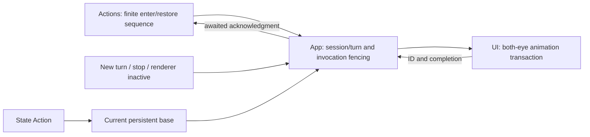

# ADR0104 — Expression Perform and Set contracts

Purpose: distinguish one-shot expression completion from persistent presentation state. Design goals: actual awaited endpoints, bounded ownership and independent UI.

## Decision

UI.express is finite: Actions validates a non-clear emotion, awaits the transition into it, then awaits restoration to the current base. UI.setExpression is state: commit a base emotion, including clear, without waiting for interpolation. Both share the UI module and Display default; Agent JSON v5 declares both aliases. Kind metadata does not add scheduling algorithms.

App retains one override and one pending continuation; conflicts fail, no new queue exists. SwiftUI transaction removal acknowledges animation completion. Expected 2s/timeout 5s metadata bounds failure cleanup and is never success evidence. Cancellation resumes the waiter, removes only the invocation-owned override and restores current base immediately. New turn/session reset invalidates old ownership before delayed callbacks can restore anything. Hidden/inactive rendering cancels; missing rendering rejects activation.

✅ Offline tests cover finite module exclusion through restoration, joined cancellation cleanup, argument validation and independent state completion. UI remains free of execution/service imports.

❌ Physical-device visual/Reduce Motion/background acceptance and looping Activity performances remain pending.

This supersedes the state-only UI.express completion descriptions in earlier ADRs, including ADR0083. Existing XML express aliases now mean one performance; persistent state uses setExpression, and clear is valid only there. Captions/gaze/following and other UI operations remain Tools.

✅ A one-shot performance includes a 6% eye emphasis and return, so performing the same emotion as the base still has an animated endpoint; persistent base setting never adds this emphasis.
