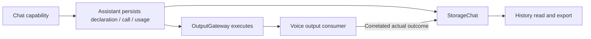

# ADR0106 — Conversation Tool diagnostics and token usage

Status: implemented, 2026-10-03.

## Context

Settings history already preserves actual request context and raw text fragments. Native Camera Tools are absent from that text, and generation completion does not establish execution success. Real-device diagnostics need call arguments and execution outcomes without replay or extra UI dependencies.

## Decision

StorageChat extends version-1 turns with optional Tool declarations, complete calls (provider ID and runtime UUID), execution state/result/error and input/generated/total token usage. Assistant persists declarations before inference and calls before permission resolution; App adapts actual OutputGateway outcomes into the same store. Resolution/admission failures and execution failures remain distinct from generation state. Completion-only success has no fabricated returned value. Late outcomes may update archived turns. Fixed internal UI Tools are excluded.

ModelKit exposes provider-neutral ChatEvent.usage. Cloud requests ask for streaming usage and drain beyond the terminal choice through [DONE] or clean EOF before delivering finished. Local Qwen reports actual template/backend token counts including a consumed stop token. Missing usage remains unknown. The existing history flow displays/exports these values and removes max tokens display; ordinary Assistant requests omit the output budget. SDK title/warmup budgets and historical storage fields remain supported.

Journal remains 32 MiB with explicit overflow rejection. Per-turn bounds are 128 declarations / 64 KiB, 128 calls, 512-byte provider IDs, 64-byte names, 4096-byte arguments, 64 KiB outputs and 4096-character errors. Store admission serializes one active operation and 16 FIFO waiters; overflow fails busy. Accepted atomic mutations join even on caller cancellation, preserving diagnostic outcomes without replaying an effect.

## Consequences and validation

UI keeps its StorageChat-only domain dependency. Tool-only turns become visible. Generation and Tool states can differ and are shown independently. Historical calls/usage and partial native SSE calls cannot be reconstructed. Providers may not supply usage; no estimate, retry or model continuation is introduced. Tests cover legacy decoding, durable/archived outcomes, mixed XML/native calls, trailing usage and invalid usage. Physical Camera, provider interoperability and UI acceptance remain separate.
