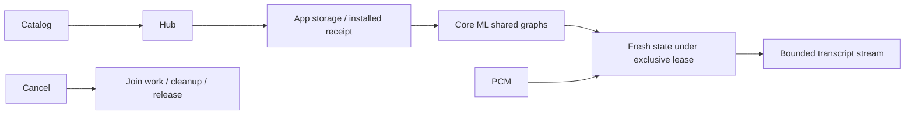

# ADR 0107: Shared multilingual Nemotron Core ML ASR

Status: accepted. Date: 2026-10-03.

Replace the registered CoreAI Nemotron adapter with the already pinned FluidAudio SDK's multilingual streaming Core ML API. Source: FluidInference/Nemotron-3.5-ASR-Streaming-Multilingual-0.6b-CoreML, revision 1a41b75758b0337ff67db7d5408280aaaf23074e. Download only multilingual/2240ms, flatten that prefix and validate all 22 files. One export serves macOS and iOS; app bundles contain metadata only.

ModelKitFluidAudio owns immutable shared graphs and native SDK execution; ModelKitNemotron owns capability events, exclusive leases and input admission. Each session allocates fresh recurrent state, selects an exact metadata prompt and uses cpuAndNeuralEngine. SDK native mel preprocessing and fused decoding replace the previous custom CoreAI frontend/tokenizer. Cancellation joins active work before cleanup and resource release. Bounds remain one operation without a waiting queue, 16,000 samples per packet, 300 s per session, 16,384 tokens, 64 KiB text and 128 result events; overflow fails explicitly.

Management owns download/installation. App storage rejects old receipt revisions as incompatible; Settings instructs deletion/re-download instead of silent replacement. The obsolete separate Mac profile and bundled mel resource are removed. No new third-party dependency is introduced. Optional independent CoreAI utilities remain unbound.

✅ Full scripts/check.sh, four simulator scheme builds and signed generic iOS app build passed. Deterministic adapter tests validate metadata/input/lease contracts; 37 management tests include explicit incompatible-revision handling. ✅ Real Mac Core ML packet parity, warmup, cancel/unload/reload and synthetic English/Chinese recognition passed with all 22 files validated. ❌ Real-device multilingual quality, sustained memory/thermal behavior and measured end-to-end latency require new acceptance; historical CoreAI results do not apply.

