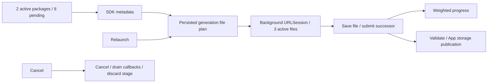

# ADR 0108: Durable background model transfers

Status: accepted. Date: 2026-10-03.

Use the existing swift-huggingface client for remote tree resolution and native iOS background URLSessionDownloadTask for file transfers. No library switch or new third-party dependency is required. swift-transformers exposes background/resume helpers but cannot supply App-owned lifecycle and persistent package installation by itself.

Management retains failed/restored generations and staging; explicit retry reuses completed files. ModelKitHub persists a bounded plan (16,384 files, 32 GiB, 8 MiB JSON), restores task identities, and admits at most three native tasks per package. Delegate completion moves and length-validates each file before submitting successors. Transient network errors retry three times/file; available resume data is bounded to 8 MiB/file and retained for retry. Unsupported resume or expired URLs can restart an affected file, but completed files are retained. Explicit cancellation joins callbacks before deleting staging; successful transfer removes its control files before App/Storage publication.

App owns background event completion and a bounded 25-second metadata/finalization execution window. This does not keep the process alive for long downloads. System transfers continue under iOS scheduling; forced quit cancels transfers, and next launch restores persisted work. Bandwidth depends on server/network and is not guaranteed by background mode or concurrency.

✅ Full check.sh, four simulator scheme builds and signed iOS build passed; Mac official/mirror production transfer tests and offline completed-file restoration passed. 38 Management tests include interrupted-stage preservation, same-generation network retry and explicit cancellation cleanup; five Hub tests cover plan boundaries/reuse. The build is installed on the connected iPhone; physical lock-screen feedback is pending. ❌ Physical-phone lock-screen, system termination, large-file resume, signed-link expiry and throughput acceptance remain pending.

✅ 2026-10-03 user acceptance: phone background downloading now continues successfully and observed speed improved. ❌ Forced-quit/system termination, signed-URL expiry and large-file range-resume traces remain unverified.
