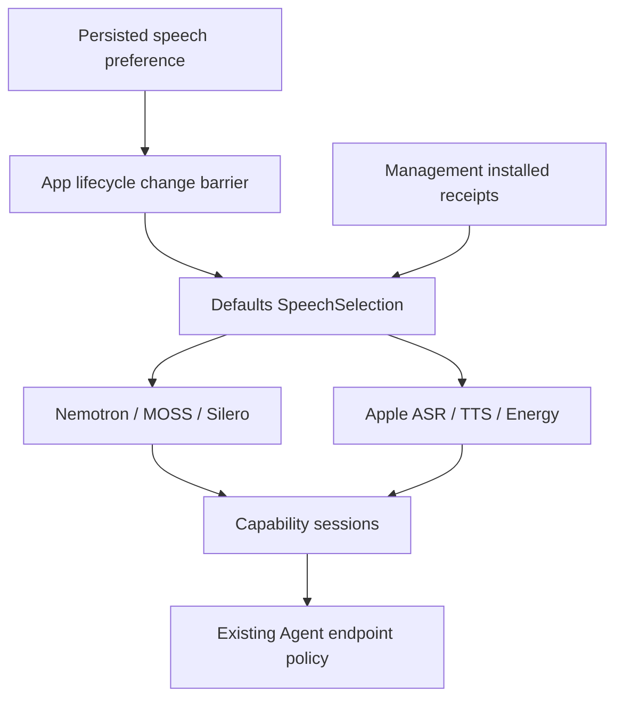

# ADR 0109: Optional downloaded speech with modern Apple fallback

Status: Accepted · 2026-10-03. The single speech preference is superseded by [ADR 0110](0110-feature-model-settings-and-native-vad.md); capability/lease contracts remain applicable.

Purpose: allow speech input/output before HF voice models are installed and let Settings force system speech. Design goals: keep independent SDK boundaries, one selected provider per operation and explicit availability/errors.

## Decision

Defaults owns stable recognition/synthesis/activity facades and an actor-isolated speech preference. Management continues to own only artifacts and lifecycle. App restores the persisted preference before composing conversation; changes stop active voice through the lifecycle settings barrier. UI imports domain values only. preferDownloadedSpeech defaults to true for old JSON; false preserves weights and forces Apple ASR/TTS plus energy activity. Qwen and YOLO are unchanged.

When enabled, each facade selects the installed and available Nemotron/MOSS/Silero provider independently, otherwise its system alternative. Selected operation failures propagate; no switch halfway through a request. Each concrete provider owns an exclusive managed lease and cancellation cleanup. Explicit MOSS acquisition remains concrete, separate from the default synthesis facade.

ASR uses SpeechAnalyzer/SpeechTranscriber (iOS/macOS 26+), system locale support validation and AssetInventory installation during explicit warmup. App microphone capture remains independent; no legacy SFSpeechRecognizer or cloud recognition is invoked. Apple assets may require first-use download and are managed by Apple, outside custom model download/delete controls. TTS uses AVSpeechSynthesizer PCM output and existing App playback. Unsupported locale/device remains an observable error.

EnergyVoiceActivity is a separate ModelKitEnergy adapter depending only on ModelKit. It scores 512-sample RMS windows with adaptive quiet-noise floor and hysteresis, max 16,000 samples/packet and 32 scores/call, less than one pending window. Scores reflect loud acoustic activity, not speech classification. Agents/SpeechPerception retains onset/pre-roll/800 ms silence/12 s chunk policy.

Apple ASR accepts 16 kHz mono Float32 and converts to native negotiated format. Input queue capacity is four frames (maximum 1 MiB each), with one suspended ordered sender when full; cancellation wakes the sender; output capacity 128 events, maximum 65,600 estimated bytes/event. Aggregate text is limited to 64 KiB, time-range fragments to 2,048, packet length to one second and total audio to 300 seconds. Finish drains native results under a 25-second deadline; cancellation stops native work before lease release. Native framework internal queues are opaque.

## Validation and limits

✅ Isolated selection tests cover installed local, unavailable local, missing artifact and forced system mode; workflow/UI tests cover persistence and old JSON. Energy tests cover packet independence, hysteresis, reset, invalid PCM and exclusive admission.

✅ Real Mac system ASR recognized the synthetic Chinese fixture “你好 ，这是一个语音识别测试。” and allowed another session followed by unload. Real Apple TTS emitted bounded PCM and finished (7.4 s fixture). ASR warmup/transcription/reuse test took 51.8 s including system preparation. These are integration checks, not latency/accuracy benchmarks.

❌ Physical-phone end-to-end voice, noise robustness, first-use asset failure UX and sustained native memory/thermal acceptance remain separate. Energy detection can mistake music or noise for speech; Qwen/chat availability still gates a complete conversation.

Sources: [Apple SpeechAnalyzer](https://developer.apple.com/videos/play/wwdc2025/277/), [AssetInventory](https://developer.apple.com/documentation/speech/assetinventory).

✅ Apple TTS resolves the production auto locale to zh-CN when text contains Han characters, otherwise en-US. Explicit locales retain their requested language/region, with zh/en script aliases normalized. Missing voices remain an explicit error with the resolved language. Consecutive real TTS integration uses auto rather than an explicit zh-CN fixture.
