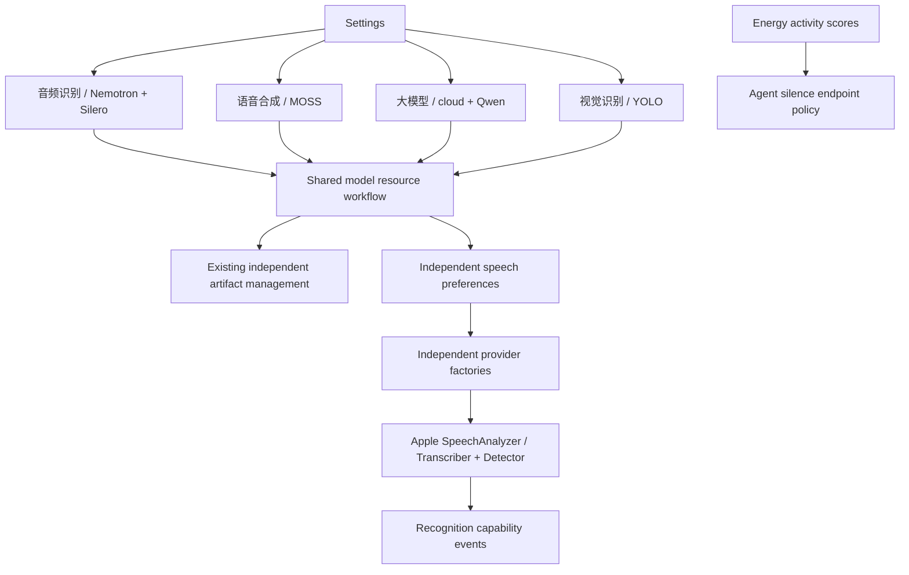

# ADR 0110: Feature model settings and native Apple voice gating

Status: Accepted · 2026-10-03

Purpose: group model settings by user task while preserving independent model capabilities and the established resource backend. Design goals: explicit mode activation, backward-compatible preferences and honest native VAD limits.

## Decision

Replace the mixed 本地模型资源 and 云端 LLM entries with 音频识别、语音合成、大模型. Retain 视觉识别 by user agreement. Recognition owns Nemotron/Silero download cards and the first 使用自定义模型 switch; synthesis owns MOSS and its independent switch. 大模型 retains cloud URL/Key/model discovery/save and adds Qwen acquisition/removal; local selection requires Qwen installation. Vision owns YOLO acquisition/removal. Shared ModelResourceSections renders source/progress/cancel/delete; download source remains global. No weights, credentials or manifests are duplicated by page.

Persist useCustomRecognition/useCustomSynthesis in the existing source document. New drafts default both false. Read legacy preferDownloadedSpeech into both flags; validate actual installations before applying. Enabling custom recognition requires both Nemotron and Silero, custom synthesis requires MOSS. An invalid enable is rejected before persistence, the UI returns to saved state and displays an installation alert. Successful downloads never auto-enable a mode. Restored/deleted missing prerequisites disable only the owning speech choice, with persistence before apply. One restore task is shared by at most 32 callers; excess returns conflict. Concurrent mode edits are rejected rather than queued. Voice mode changes use the saved download source and never implicitly commit or validate an unfinished endpoint/cellular edit in the form.

App applies changed choices through the existing voice lifecycle barrier. Defaults chooses enabled installed available concrete providers per capability, retaining exclusive leases and fallback on missing/unavailable resources. Separate factories, Management/Hub download limits, Storage publication/receipts, cloud chat and YOLO runtime are unchanged. UI depends on injected operations/domain values only.

Apple ASR now creates one SpeechAnalyzer with SpeechTranscriber and medium-sensitivity SpeechDetector, sharing native format conversion and bounded input. SpeechDetector provides internal voice gating. Apple documentation says its normal result stream currently supports error handling only. A real Chinese+silence probe with reportResults=true returned zero activity events even though the SDK exposes speechDetected/range fields. Therefore no native VoiceActivityCapability or normal endpoint callback is claimed. By explicit user choice, Energy remains only for business silence timing; SpeechPerception retains onset/pre-roll/800 ms silence/12 s chunk policy. Production detector reportResults=false introduces no unused result queue.

## Verification and limits

✅ Tests cover partial-pair rejection, missing synthesis rejection, independent modes, deletion reconciliation, legacy JSON and concurrent restore normalization. Combined real Apple ASR/VAD fixture recognizes Chinese under dense 137-sample input plus trailing silence and supports lease reuse.

❌ Normal native VAD activity events, native quality/power benchmarks and physical-page/voice acceptance are not established by compile or Mac tests. The installed SDK does not include the Simulator GUI app; headless simulator builds remain available.

Sources: [SpeechDetector](https://developer.apple.com/documentation/speech/speechdetector), [Apple ASR](https://developer.apple.com/videos/play/wwdc2025/277/).

This ADR supersedes ADR 0109's single speech preference. Its native capability/lease/error contracts continue unchanged.

## Subsequent decision

The ASR/VAD selection coupling and paired installation prerequisite are superseded by [ADR 0111](0111-independent-asr-vad-selection.md). The feature grouping, independent ASR/TTS preferences and Apple internal detector integration remain valid.
