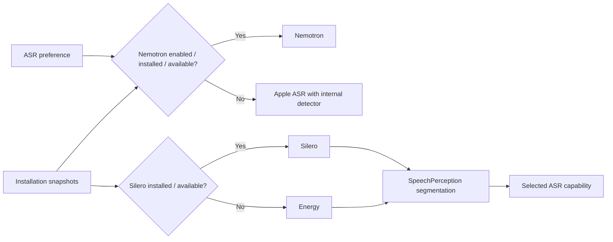

# ADR 0111: Independent ASR and VAD selection

Status: Accepted — 2026-10-03

Purpose: compose speech recognition and conversational voice detection independently. Design goals: keep capability boundaries intact, allow Apple ASR with Silero, and preserve bounded session ownership.

## Decision

The existing recognition and voiceActivity protocols and concrete provider registrations remain separate. Defaults chooses Nemotron only when useCustomRecognition is enabled and Nemotron is installed/available; otherwise Apple ASR. Independently, Defaults chooses installed/available Silero for VAD regardless of the ASR switch; missing/unavailable Silero selects Energy. TTS policy is unchanged. A provider is selected once for each operation; active inference errors propagate without replacing it mid-session. Apple SpeechDetector stays inside its analyzer for internal gating, while SpeechPerception consumes external VAD scores and owns onset, pre-roll and silence endpoints.

The recognition page keeps both download cards. Its 使用自定义识别模型 switch requires only Nemotron. Silero installation automatically affects the next voice session; deletion does not disable custom ASR. Removing Nemotron disables only custom recognition. Existing durable settings keys, installation receipts, source selection and background download implementation remain unchanged. No new files or directories are needed for production implementation.

## Validation

✅ Fixture tests cover both ASR preferences with installed Silero, absent Silero without changing Nemotron selection, absent Nemotron without changing Silero selection, separate synthesis preference and unavailable local fallback. Workflow tests cover missing Nemotron rejection, Silero removal preserving custom ASR, Nemotron removal disabling only ASR and durable restoration. UI state tests cover Nemotron-only enable prerequisites.

❌ Physical-device sustained Apple+Silero and Nemotron+Energy acceptance remains pending. Energy cannot distinguish loud environmental sounds from speech. No runtime-error fallback is introduced.
