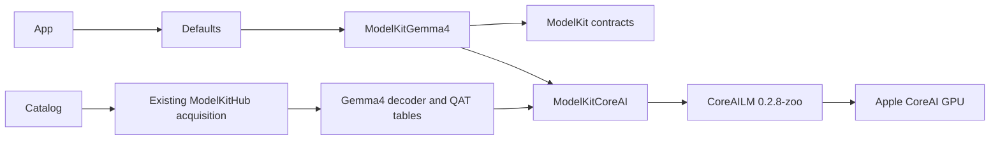

# ADR 0112 — Replace local Qwen/MLX chat with Gemma 4 CoreAI

Date: 2026-10-04. Status: implemented integration; Mac smoke verified; physical acceptance pending.

## Decision

Use mlboydaisuke/gemma-4-E2B-CoreAI at d669ab2b44c691e35e2b795f0535c0e1937b8390. Production selects the QAT b2 h18p AOT decoder plus its matching QAT PLE tables. The catalog ID is gemma4-e2b and installation directory is Gemma4; old qwen35 receipts cannot satisfy installation. Existing user-downloaded Qwen files are not silently deleted.

ModelKitGemma4 implements ChatCapability and depends on ModelKit and ModelKitCoreAI. CoreAI contains the pipelined language executor and tokenizer boundary alongside existing stateless graphs. It uses CoreAILM from the pinned community fork john-rocky/coreai-models 0.2.8-zoo because Gemma requires static input buffers not exposed by the stock runner. No CoreAIKit downloader/catalog enters the application. Qwen adapters, tokenizer fixtures, download scripts and both MLX packages are removed from the active graph. Historical measurement/attribution files remain historical evidence.

The fork requires a SwiftPM iOS/macOS 26 floor; CoreAI execution still requires OS 27 and the app already targets iOS 27. Capability consumers and ModelManager remain independent of concrete engines. Default assembly retains one process manager and one active model operation.

## Runtime contract

Each request receives explicit caller history, resets KV state, renders Gemma system/user/model turns and uses at most 4096 prompt-plus-generation tokens. Reasoning channels are withheld from Agent text. Native local tool calls and image input remain unsupported. Generated token usage counts consumed tokens, including turn-end tokens. Event admission has a 4096-event bound and a 4096-byte per-event bound; overflow fails. Backend decoded text has a 256 KiB bound. The upstream pipelined token producer can emit no more than the requested output-token budget and is drained immediately.

Cancellation cancels and joins the engine worker before clearing state and releasing the resource lease. Memory pressure can unload idle Gemma. The immutable ~2.35 GB PLE tables use owned shared Metal buffers; allocation/load failures propagate. The app already has increased-memory-limit entitlement. iOS h18p artifacts only admit iPhone18,1 / iPhone18,2. Mac opt-in tests acquire the uncompiled decoder from the same revision and use the identical tables.

## Verification and outstanding work

✅ Weight-free prompt, channel privacy, request validation and catalog-selection regressions replace the old Qwen tests. Production download selection and required paths are pinned. Existing cloud integration remains independent.
❌ Device inference, sustained memory/thermal measurements, broader iPhone support, local native tools and multimodal acceptance require separate evidence.

❌ The iOS simulator SDK lacks CoreAI; the external CoreAILM target cannot build there. build-ios.sh currently stops on this limitation. Independent UI tests run on Mac; a separate simulator assembly remains outstanding.

✅ 2026-10-04: Mac CoreAI smoke returned “你好”; generation cancellation and unload/reload passed. Four Gemma tests passed. Signed iPhone 17 Pro build and bundled Agent resource verification passed. Full check.sh passed boundaries, format and provisioning checks but failed two unchanged IntegrationTests aim-follow tests (four assertions). build-ios.sh is blocked by the simulator SDK missing CoreAI. Physical model inference remains pending.
