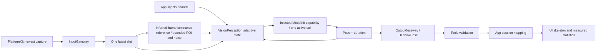

# ADR 0113 — Adaptive latest-frame pose detection

Date: 2026-10-04. Status: implemented; physical-phone calibration pending.

## Purpose and design goals

Replace the fixed 100ms measurement baseline with bounded, responsive detection cadence without restoring grayscale-percentage frame filtering. Preserve current module ownership, latest-frame retention and Gateway/Tool presentation boundaries.

## Decision

VisionPerception owns FrameCadence. App injects validated minimum/maximum/initial intervals (0/250/100ms defaults). Every valid capture replaces the capacity-one pending slot. The worker takes the newest frame, validates expiry, then applies capture-time cadence and, for inputs with a native capture instant, a monotonic inter-start gap. No timer, old-frame queue, new output worker or replay is added. One active inference remains exclusive.

Latest input motion first compares the 64×64 luminance sample against the last admitted inference sample. Native gray64 is reused; RGB fallback samples only 4096 luminance values. Skipped candidates never advance the reference. A union of up to six padded person regions weights small-target motion; global evidence discovers changes elsewhere. Bounded percentile contrast gain and median brightness offset remove simple exposure changes; a capped noise floor learns only on quiet, pose-confirmed evidence. Continuous activity requests faster cadence without selecting an older frame or suppressing stationary periodic detection.

Fresh validated results feed a bounded snapshot of at most six COCO-17 skeletons, total person count and measured capability-call duration. Spatial association and common reliable joints estimate body-relative movement; confidence degradation, arrivals, loss and failed association accelerate detection. Low movement holds for 600ms before relaxation. Slower demand uses a 500ms exponential relaxation; faster demand is immediate. After losing all people, fast search lasts 500ms then approaches a 200ms periodic search interval.

Normal inference has no compute floor: urgent demand can reach zero inter-start interval, with the single worker preserving serial execution. A compute floor of 1.5 times inference duration applies only when inference alone reaches 75% of the freshness budget or latency pressure is compute-dominated. During pressure it increases immediately and decays 20% toward cheaper samples, capped at the maximum; clearing pressure clears the floor immediately. Total latency at 75% of the default 750ms freshness budget requests fresh snapshots at no slower than the initial demand; compute-dominated latency enables the temporary 1.5× floor. All urgency remains subordinate to the compute floor. Capture age rejects stale candidates before inference; results beyond the same budget update timing pressure only and cannot become pose/UI observations. Inputs lacking a capture clock keep media cadence but cannot provide these age checks. This is a scheduling budget rather than a thermal limit or guaranteed FPS. A model operation slower than the maximum can still exceed it; no overlapping inference or buffered historical catch-up is allowed.

The optional next interval statistic is part of UI.showPose alongside the same frame's skeleton and timing. Types/Vision stores presentation values only (relocated by ADR0114); Tools decodes/validates its independent values; CameraCoordinator maps them under existing session/sequence checks; UI displays them. No new Tool permission or model-callable catalog is needed. ModelKit owns inference only; PlatformKit owns capture only; Photographer and device policy are unchanged.

## Implemented and outstanding

✅ Bounded image/result-driven cadence, geometric reset, inference/latency feedback, freshness rejection and backward-compatible interval/image-motion statistics are implemented.
✅ Deterministic tests cover response, stability, confidence, reordered people, jitter, loss/search, compute budget and monotonic throttling; existing latest-frame/Tool/crowd bounds remain verified.
❌ These heuristic thresholds require phone evidence. People outside the first six do not contribute detailed motion; crossings are spatial association, not identity recognition. Visible sampled image changes can accelerate before the next scheduled slow detection, but sub-sample/textureless motion can still require the periodic refresh. Severe clipping, nonuniform exposure and broad uniform scene changes are not fully distinguishable from exposure. Native exposure, screen rendering and thermal adaptation are not measured here.

Validation: 21 selected vision/UI tests, module/resource boundaries, formatting and unsigned generic iOS device build passed. Robot tests were excluded by user instruction. Simulator build remains blocked by the existing CoreAI SDK limitation; physical display/thermal/accuracy acceptance is not inferred from these checks.

2026-10-04 refinement: FrameMotionAnalyzer owns image evidence in the same Agent directory; no new worker, queue or platform policy is introduced. Total latency is now feedback and freshness evidence, while Tool output still carries same-frame diagnostics.

Fusion validation: 28 explicitly selected vision/UI tests, module/resource boundaries, changed-source formatting, project plist and unsigned generic iOS device build passed. Full check.sh was excluded by the user’s no-robot-test instruction; the known simulator CoreAI limitation remains. No robot tests or hardware actions were run. Physical small-target/exposure sensitivity, sustained latency/thermal behavior and UI acceptance remain pending.

2026-10-04 urgent-cadence refinement: default minimum is 0ms, normal compute headroom is removed, and compute-pressure release clears the floor immediately. Camera-close cleanup is sufficient for the requested lifecycle; source-stall timeout is deferred. Serial latest-slot admission and stale-input/result rejection remain unchanged.

Zero-interval validation: 29 selected visual/UI tests, boundary checks, changed-source strict formatting and unsigned generic iOS device build passed. Full check.sh and robot tests were excluded by the existing user instruction; simulator validation remains unavailable due to the documented CoreAI dependency.
