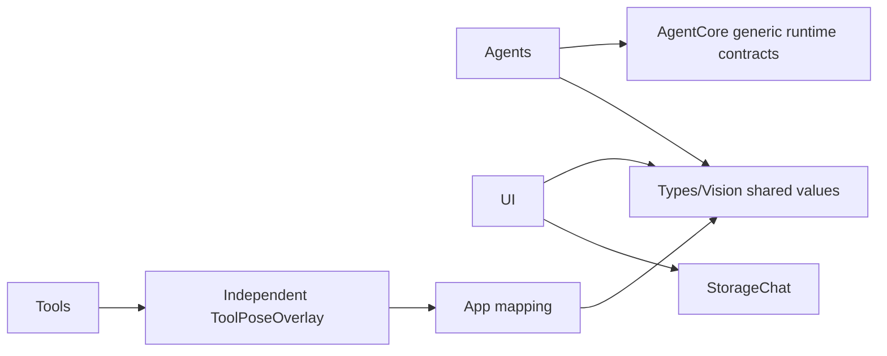

# ADR 0114 — Visual presentation values outside AgentCore

Date: 2026-10-04. Status: implemented.

## Decision

PoseOverlay is a feature-specific visual presentation contract, not Agent infrastructure. Move its source to Types/Vision without a compatibility alias in AgentCore. Types remains a dependency-free leaf. UI replaces its AgentCore dependency with Types; business Agents declare Types explicitly. App still maps independently validated ToolPoseOverlay after session/sequence admission.

Preview sensor-point rotation moves to UI/Camera as a value-only extension consumed by App’s native preview adapter. Joint decoding reports DecodingError rather than importing ImageInputError. JSON shape, optional statistics, limits, inference cadence and Gateway/Tool behavior are preserved.

✅ Source relocation, explicit target dependencies and boundary guards are implemented.
❌ Broader classification of other domain-specific Core values is outside this migration. Physical-device presentation acceptance remains separate.

Validation: 31 selected visual/UI tests passed, including legacy payload/statistics decoding, malformed joint arrays, rotation projection and latest-frame serial inference. Dependency/resource boundaries, changed-source strict formatting, project plist and unsigned generic iOS device build passed. Full check.sh was not run under the existing no-robot-motion-test scope; build-ios.sh simulator validation remains blocked by the documented CoreAI SDK limitation. No hardware actions were performed.
