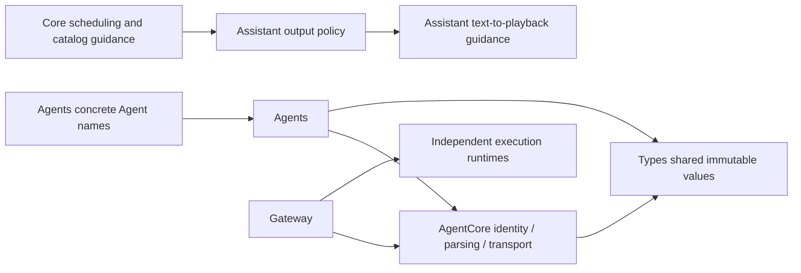

# ADR 0115 — AgentCore and domain separation, stage 1

Date: 2026-10-04. Status: stage 1 implemented; generic messaging migration pending.

## Decision

AgentCore must not define a specific Agent’s model/business policy. Keep generic identity, lifecycle, parser and output execution contracts in Core. Move the shared COCO pose observation into Types/Vision and SpeechPhase/SpeechSynthesisInput into Types/Speech; Types is still a dependency-free value leaf. Core’s current typed observation envelope consumes these values without compatibility aliases. This changes ownership, not the JSON schema or validation limits.

Types validation errors cannot depend on Core. AgentMessage.validatedSize maps pose/synthesis domain errors to the existing CommunicationError.invalidPayload at transport admission. Validating constructors expose domain-specific errors directly. The existing speech locale set is preserved as the current request schema, not expanded to provider negotiation.

Built-in AgentID constants compile in Agents/AgentIdentities.swift; Core defines only AgentID(rawValue:). App feature/adaptation source filters are application policy and keep their raw source names locally. Gateway scheduling finish/cancel requires explicit source, avoiding an Assistant-specific default in generic execution. Production callers already provide it; fixtures now make their owner explicit.

CapabilityContextBuilder keeps generic Channel/module/wait syntax and JSON-derived Action metadata. AssistantOutputContext adds the text-to-synthesis/playback policy and sequential speech example. The text-mapping callback and actual execution are unchanged.

✅ Value ownership, prompt split, concrete identity relocation, explicit scheduling owner and static boundary checks are implemented.
❌ AgentMessage is still a closed domain enum; CommunicationDeclaration’s built-in contract catalog, InputMetadata’s speech/vision expiry and phone source defaults, ConversationTurn semantics and ImageInput gray64 transport remain domain-coupled. A future stage must introduce validated contract registration and a generic message envelope together, preserving bounded admission and source/session identity. No partial dynamic payload mechanism is added now.
❌ Provider locale negotiation, model quality and physical runtime acceptance are outside this ownership refactor.

Validation: 61 selected speech/communication/configuration/Assistant tests passed, followed by 38 final visual/ownership/error-mapping/custom-source scheduling tests after the receive-boundary refinement. Module/resource boundaries, changed-source strict formatting, project plist, diff whitespace and unsigned generic iOS device build passed. Full check.sh was excluded under the existing no-robot-motion-test scope; simulator build-ios.sh retains the documented external CoreAI SDK limitation. No hardware actions were performed.

Stage 2 is now implemented by [ADR0116](0116-generic-agent-communication.md); its consolidation replaces the file layout and pending generic-message items described in this stage-1 snapshot.
