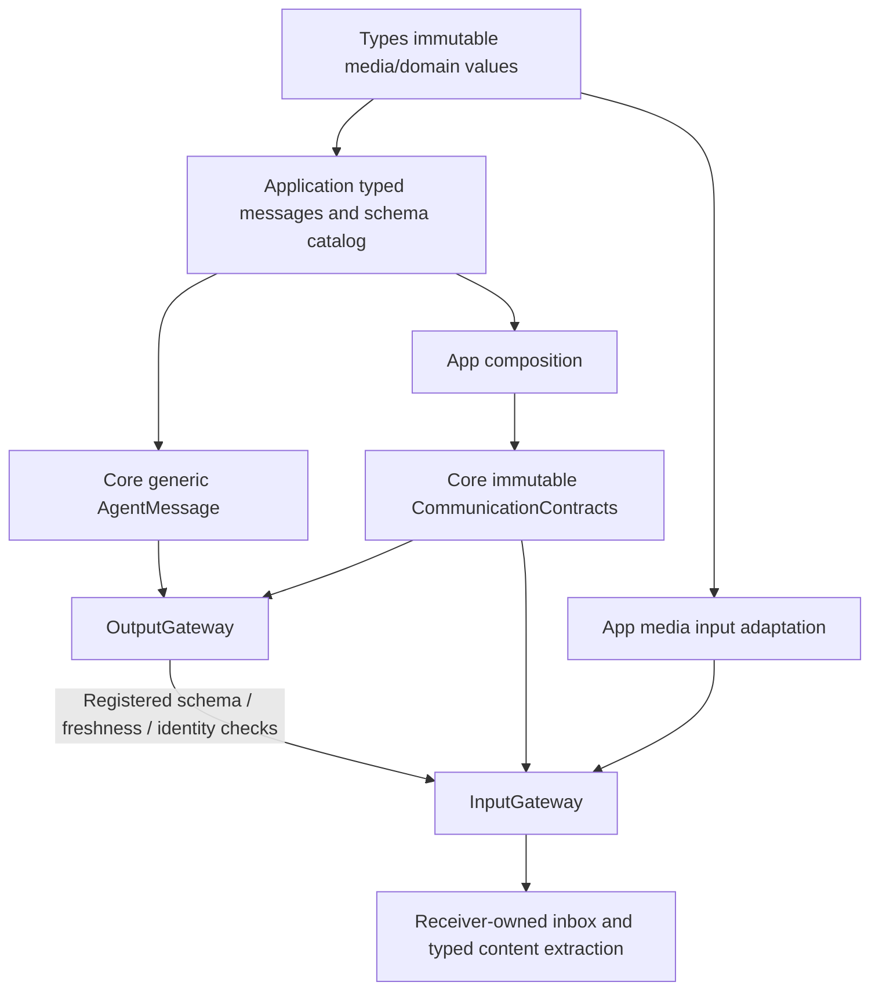

# ADR 0116 — Generic Agent communication and coherent ownership

Date: 2026-10-04. Status: implemented and validated.

## Decision

Core AgentMessage carries immutable Encodable/Sendable content through type erasure and a bounded validated encoding. It has no speech/vision enum cases, Codable dispatch table, compatibility alias or business registry. Receivers extract the concrete domain value through business-owned helpers. Actual domain payload JSON remains PerceptionMessage’s existing Codable representation; generic transport does not invent a persisted or remote wire format.

CommunicationPolicy and AgentConfiguration receive one immutable CommunicationContracts registry. It has a 128-entry bound and rejects duplicates, invalid size/lifetime settings and observation schemas lacking validators. The standard catalog defines framework input kinds only; Agents/Communication/AgentContracts.swift supplies application speech/vision cases, type checks, byte limits and freshness. Gateway validates against the injected schema on both output and input and measures actual encoded bytes. Unregistered names, mismatched content types/cases and oversized messages fail before receive.

A schema declares whether it starts new work. Such commands use a fresh registered lifetime; forwarded observations inherit the earlier parent deadline. Source incarnation/session/root/parent/hops/sequence and interaction correlation remain mandatory. Gateway uses the registered policy, not a string comparison with a specific Agent’s contract. External sources are injected by App; generic metadata no longer infers phone sources or per-domain expiry.

App/Adapters/MediaInputAdapter.swift groups native image conversion and explicit microphone/camera metadata. It preserves phone source names, 60s audio/1s image deadlines and causal root IDs. Types holds the generic media values. AgentTurn replaces the speech-specific ConversationTurn name while retaining id/ordinal shape and producer-owned assignment semantics.

## File organization

| Owner | Grouped responsibilities |
| --- | --- |
| Core/Communication/AgentMessaging.swift | Generic message envelope, sender port and delivery report |
| Core/Communication/CommunicationPolicy.swift | Generic schema definitions/registry, declarations and routing policy |
| Agents/Communication/AgentContracts.swift | Concrete identities, domain message cases, factories/accessors and schema catalog |
| Types/Vision/VisionValues.swift | Generic image attachment/input, pose observation, overlay/statistics and validation errors |
| Types/Audio/AudioFrame.swift | PCM format/frame/input values and validation errors |
| Types/Speech/SpeechValues.swift | Speech phase and synthesis-request values |
| Agents/VisionPerception/FrameMotionAnalyzer.swift | Motion sample attachment and fixed-size sample validation alongside its consumer |
| Agents/Assistant/AssistantAgent.swift | Assistant prompt/text policy with the existing actor |
| App/Adapters/MediaInputAdapter.swift | Host sources/deadlines and native image conversion |

Obsolete PerceptionInput.swift, Core/ImageInput.swift, separate AgentIdentities.swift, AssistantOutputContext.swift, PoseObservation.swift/PoseOverlay.swift and CameraImageAttachment.swift are removed. No forwarding source file or compatibility alias is retained. Source ownership and module boundaries remain acyclic; no extra workers, inboxes or timers are introduced.

✅ Generic routing preserves capacities, JSON v5 declarations, domain bytes/schema, causal identity and deadlines. Latest-frame serial YOLO processing and existing UI.showPose payload remain unchanged.
✅ Boundary checks prevent concrete schema strings and gray64 from returning to Core/Gateway. Regression checks cover custom schemas, type spoofing, byte bounds, invalid/duplicate registrations and forwarded/generated deadline policy.
❌ Registry hot reload, remote content codecs/authentication, durable delivery and generic request/reply remain separate work. No physical robot or model functionality is added by this refactor.

Validation: 117 selected non-robot tests passed; after the final registry restriction and input byte-count reuse, 11 relevant routing/schema/capacity tests passed again. Module/resource boundary checks, changed-source strict formatting, Xcode project syntax/source references and whitespace checks passed. The final unsigned generic iOS device build succeeded. The full check.sh suite was not run because it includes robot tests outside the authorized scope; the simulator build remains limited by the existing unavailable CoreAI module. This refactor was not installed or launched on a physical device.
