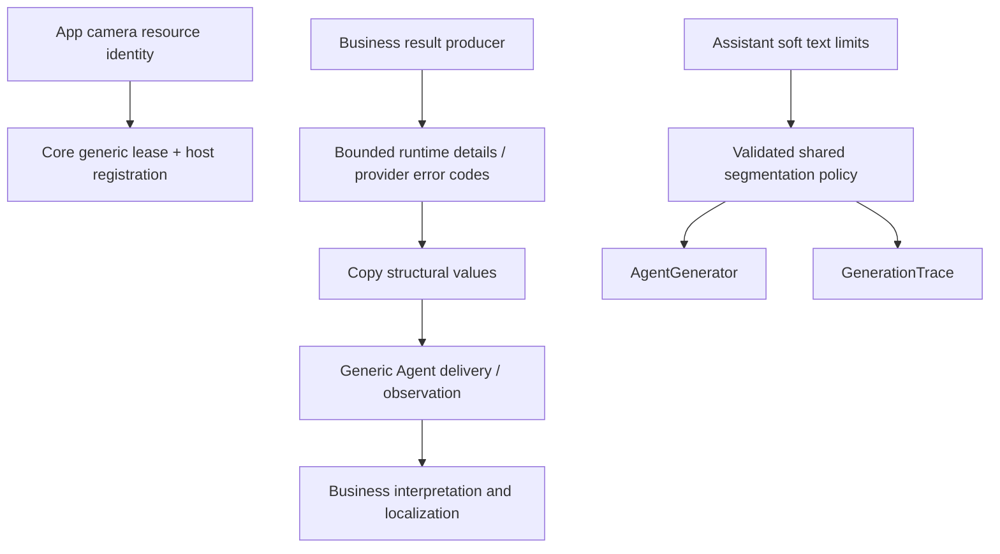

# ADR0118 — Generic resource/results and Agent-owned text segmentation

Date: 2026-10-04. Status: implemented and validated.

## Decision

AgentCore is the shared Agent framework. It must not name a camera resource, model mechanical-arm results with motor/target/observed fields, enumerate device failures or choose Assistant speech chunk latency.

CameraCoordinator owns captureResource, reused by App composition. ResourceID/leases remain generic. AgentActionReport and ActionReport use bounded producer-defined string details; Gateway copies these fields and raw failure identifiers without device interpretation. Each detail map has16 keys maximum, nonempty keys up to64 UTF-8 bytes and values up to512 bytes. Invalid programmer values fail at construction without silent loss; report entry/path bounds remain256/128. Core report codes/execution failures are1–64-byte RawRepresentable identifiers with only generic built-in constants. Concrete ActionRuntime error codes remain producer contracts, interpreted by App.

TextSegmentationPolicy resides alongside SentenceFunctionBuffer and validates positive soft limits up to2000 Characters. Core defaults to sentence boundaries only. Assistant supplies60/120-character Hanzi/other limits, preserving live behavior; HistoryAgentAdapter supplies the same policy to GenerationTrace. Sentence/word/decimal/quote mechanisms and hard buffer bounds remain shared.

Existing responsibility files are reused. No forwarding file, business alias, new dependency, worker or queue is introduced. YOLO cadence/latest-frame behavior and Action execution policies remain unchanged.

✅ Resource/results/text policy residuals are separated without introducing fragmented files.
❌ Provider schemas, remote codecs and physical-device acceptance are outside this change.

Validation: 62 selected framework, parser, result, composition and presentation tests passed, including configurable/default segmentation, opaque provider details/errors, cancellation and unknown-code presentation. Module/resource boundary checks, changed-source strict formatting, project syntax and whitespace checks passed. Unsigned generic iOS device build succeeded. scripts/build-ios.sh was attempted with full Xcode and stopped at the existing simulator CoreAI module dependency failure. Full scripts/check.sh was not run because it includes robot tests outside the authorized scope; no physical device action, installation or motion test was performed.
