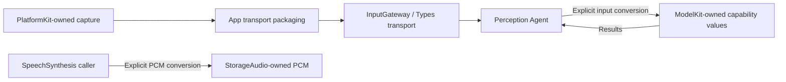

# ADR 0119 — SDK-owned values and caller-owned adaptation

Status: accepted. Supersedes ADR0098 shared SDK audio ownership and the previous Types dependencies of ModelKit/PlatformKit.

## Decision

ModelKit and PlatformKit are independent capability libraries. Their base targets have no project/product dependencies; their values, validation and errors belong inside the SDK. Concrete model adapters/backends retain their necessary external SDK dependencies. Types contains application transport/presentation values, rather than SDK contracts. StorageAudio independently owns SpeechPCMFormat/SpeechPCMFrame.

The caller conforms to each capability's required input/output. App packages native CameraFrame and native-rate MicrophoneFrame for InputGateway with host/session/source/deadline metadata. VisionPerception converts retained capture data into ModelKit.ImageFrame only after cadence admission. SpeechPerception chooses 16 kHz and uses PlatformKit's caller-configured continuous converter before constructing ModelKit.AudioFrame. SpeechSynthesis converts model output into storage PCM. Playback and diagnostics adapt the SDK values at their own call boundaries. YOLO-specific resize/normalization/tensors remain in its model adapter.

## Consequences

Agents has a concrete PlatformKit dependency for native frame access and generic PCM conversion, while AgentCore/Gateway/UI remain independent of both SDKs. No cross-SDK aliases, Types re-exports or injected App model-conversion closures remain. Native camera pixels remain retained without copying; existing bounded transport/cadence and model operation leases remain. The converter's rate is required and reset clears format/filter history; no new queue is introduced.

✅ Boundary checks and regression tests cover target/import direction, PCM translation, selected resampling rates and native model input ownership.
❌ Physical-device validation and simulator CoreAI support are separate outstanding work.
