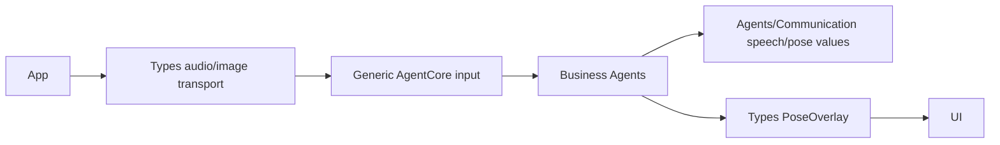

# ADR 0120 — Agent-domain value ownership

Status: accepted. Refines the value placement in ADR0115/0116; SDK value ownership remains as specified in ADR0119.

## Decision

Shared use within a single target does not require a project-wide Types value. Agents/Communication owns SpeechPhase, SpeechSynthesisInput, SpeechValidationError, PoseObservation/Joint and VisionValidationError. They are consumed by perception, Assistant, synthesis and Photographer inside the business Agents target. Types retains independent cross-target audio/image input transport and skeleton presentation.

Malformed image values report ImageInputError.invalidFrame. Receiver ordering and session validation use the existing generic CommunicationError.outOfOrder/scopeClosed at Agent/cadence/App admission boundaries. Core/Gateway do not gain any Agent-domain declarations or dependencies.

## Consequences

✅ Moves preserve Codable shapes, validation limits, Agent JSON contracts and queues. No aliases or Types re-exports remain. Root Package.swift compiles values once in Agents; the empty Types/Speech directory is removed.
❌ New communication schemas, persistent migration, inference behavior and device acceptance are outside this relocation.
