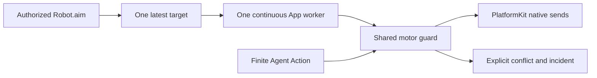

# ADR0126: Continuous aim worker owns motor resources

Status: Accepted. Supersedes ADR0102's transient five-motor Robot.aim fence.

## Problem

Robot.aim returns after storing a latest target while App starts a long-lived worker. Its Tool metadata held motors1–5 during dispatch, while the worker separately acquired motors1–4. The worker could collide with its own caller; once running, subsequent Tool updates collided with that worker. ResourceError.busy was presented as a connection failure despite healthy BLE, and worker-start errors bypassed incident recording.

## Decision

Robot.aim remains an authorized OutputGateway Tool, but publishes an intent with no transient motor fence. The App continuous worker is the sole native writer and holds motors1–4 through the shared injected ResourceCoordinator for its full lifetime. Finite Agent Actions keep their declared fences. ADR0127 supersedes the manual-control fence: Settings bypasses Agent resource admission and explicitly cancels/joins the old writer before manual submission. Agent callers cannot bypass the aim worker guard. Gateway binds trusted ExecutionOwner independently of a transient fence; the host worker inherits that Agent/incarnation/session and registers its use with that owner, so session cancellation/Agent removal cancels and joins it. Settings playback/jog belongs to independent App manual ownership (ADR0127). The first intent waits for a bounded one-element startup acknowledgment after resource/session admission. Subsequent intents replace its one latest target; no command backlog or physical-arrival promise is added.

The Agent aim worker releases its resource guard before declaring idle or starting another worker. Settings jog is outside the resource guard under ADR0127. Failed/closing owners cannot accept a target they would silently discard. Cleanup cancels/joins the worker and fences stale publication. App maps resource errors to localized control-admission errors and caches bounded incidents; healthy BLE readiness stays intact and resource conflict does not initiate reconnect. New successful admission clears the old presentation error. Gateway/PlatformKit gain no device/presentation policy.

## Validation and limits

Real OutputGateway/ToolRegistry tests use a simulated BLE link and the shared resource coordinator to cover repeated updates, competing-write exclusion, originating-session cancellation, joined release, new admission and recorded conflict without radio reconnect. Hardware tracking/stop/endurance acceptance remains separate. Cooperative owner cancellation and the existing radio recovery budgets still apply.

2026-10-04: selected BLE/aim/resource tests passed, including real Gateway continuous-update and originating-session cancellation checks. Boundary/format and plist checks passed. The full repository run retained the two pre-existing aim-planner failures and a vision time-limit failure; the vision test passed when rerun alone. Signed iPhone build, signature/configuration verification and installation succeeded. The simulator script still fails on the existing unavailable CoreAI simulator module. No robot-motion test was performed.
