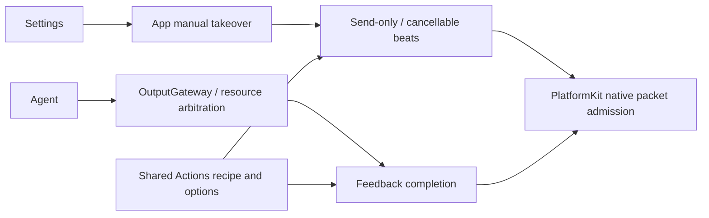

# ADR0127: Settings manual robot takeover

Status: Accepted. Supersedes ADR0126 manual resource fencing and the shared Settings/Channel completion policy.

## Problem

Settings controls changed from connected-only interaction to busy-state admission. Starting a slider set jogging, disabled the same slider and invoked release/zero, producing repeated start/stop and spring-back. Presets/reset also used Channel feedback completion and the shared Gateway resource guard, preventing the requested manual override behavior.

## Decision

UI remains independent: BluetoothControlling enters App directly, never InputGateway/OutputGateway. Actions owns one shared prepared geometry, motor options, home/reset selection and jog planner. NexArmMotionPlan preserves nominal frame beats and exposes bounded send-only submission; NexArmActionController.manualPlan builds that recipe without I/O or lock admission. Channel retains its existing feedback completion/report executor. The manual API is a host capability, not a new model-callable Action/Tool permission.

Settings uses one latest preset/reset slot, one playback child and six latest motor inputs. New clicks/reset/jog cancel old software work and join native-session cleanup; there is no arrival/telemetry prerequisite. They do not acquire Gateway motor resources. Delays between frames preserve choreography only and are immediately cancellable; the last admitted frame returns without a trailing completion delay. A blocked frame retries at 30 ms for at most two seconds. Plans remain at most 20 frames, each nominal beat 1…10,000 ms. Replacement explicitly discards old unsent steps rather than replaying a backlog. A manual-intent revision also fences a preset already removed from the pending slot but still waiting for old-owner cleanup; a later slider must supersede it before its first frame.

App keeps connection readiness, foreground/generation fences and exceptional recovery. PlatformKit still owns actual packet pacing, native backpressure and limits. Command estimates may seed jog takeover but never appear as measured telemetry. Refresh cannot overlap manual playback; takeover first retires a pending native query through live admission, then cancels/joins its owner. Directly cancelling an on-wire query would otherwise force native disconnection; intentional retirement is not a transport fault. Page exit/background/disconnect clears unsent manual work.

Controls stay enabled during motion/jog/reset/refresh while readiness is valid. App suppresses Photographer output during manual ownership and rejects raced Agent entry; only fresh later input may resume. Gateway cleanup calls stopAgentActions, which cannot cancel Settings work. Agent-selected Actions/Tools retain authorization, resource arbitration and declared completion.

## Validation and limits

Simulated BLE regressions cover held resources without telemetry, replacement under congestion, cancellation of remaining gesture/home frames, identical recipe packets across both policies, Agent motion/aim takeover, manual controls remaining enabled and independent Agent cleanup. Native iOS slider gestures, firmware endurance and physical stop/arrival remain separate acceptance work. Local admission and software cancellation never prove physical arrival or stop.

2026-10-05: 61 selected BLE simulation regressions passed, with boundary/format/plist checks. Full checks retain the two existing aim-planner failures; deadline-sensitive communication/vision failures passed isolated reruns. Final changed iOS targets compiled; overall App assembly was blocked by concurrent audio-detection project registration. Simulator validation remains blocked by unavailable CoreAI. See [validation history](../Validation-History.md#2026-10-05--settings-manual-robot-takeover).

Later on 2026-10-05, the current working tree passed signed iPhone compilation, signature/configuration verification and installation after audio-detection source registration was completed. See [latest installation evidence](../Validation-History.md#2026-10-05--latest-working-tree-iphone-installation). Physical robot/touch acceptance is still pending.
