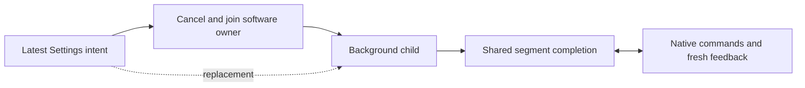

# ADR0128: Replaceable Settings motion with segment feedback

Status: Accepted. Corrects ADR0127's send-only playback decision.

## Purpose and design goals

Non-waiting submission means Settings returns immediately and accepts replacement requests. It does not mean abandoning position feedback or issuing every segment on a fixed timer.

## Decision

App retains the capacity-one latest request, one supervisor and cancellable child. The child builds Actions manualPlan and awaits performPlan. Actions reuses its existing fresh-feedback segment completion, bounded admission, dynamic deadlines and per-motor results, including the final home. Remove the send-only submit executor and its nominal-frame sleeps. Settings still bypasses Gateway resources. New preset/reset/jog cancels the old child and joins software/native observation cleanup; it never waits for physical arrival before replacement. Agent session cleanup leaves manual work alive. Refresh retirement retains native query cleanup. Segment completion ends the current worker; under ADR0131 manual execution failures are ignored by presentation and diagnostics, without blocking new input. Native SDK faults independently enter the Bluetooth recovery/record path.

## Implementation and validation

✅ Shared executor and immediate cancellable submission; no new dependency or queue.
✅ Simulation covers segment gating, prompt replacement/reset/jog, resource bypass and Agent-cleanup isolation.
❌ Physical arrival accuracy, perceived rhythm and takeover endurance need device acceptance. Software cancellation cannot retract a physical target.
