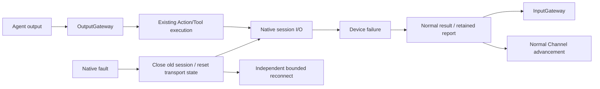

# ADR 0129: Independent Bluetooth recovery and Agent scheduling

Status: Accepted. Refines ADR0125 recovery scope; explicit resource/session cancellation and manual takeover in ADR0126/0127 remain unchanged. ADR0130 defines the current passive BLE connection policy.

Scope clarification: scheduling/session isolation is implemented. [ADR0131](0131-independent-bluetooth-diagnostics.md) additionally implements SDK-owned diagnostic types/messages, native-only device records and removal of execution-error recovery triggers.

## Context

Bluetooth connection reused a composition-injected voice cleanup callback, so reconnect could stop Assistant generation, speech and unrelated Actions. The first isolation implementation replaced it with motor-only scheduler suspension, removing accepted robot jobs and cancelling active handlers. That still coupled transport recovery to business scheduling and is superseded by this decision.

An accepted queued Action has not yet executed. Its first execution after reconnect is normal Channel advancement, not replay of an interrupted native command. Bluetooth must not decide which accepted Actions are discarded or cancelled.

## Decision and ownership

BluetoothWorkflow has no global quiesce dependency, scheduler callback or unavailable-resource admission bridge. Remove the unused scheduler suspend/resume implementation and its tests. Existing explicit session stop, resource lease revocation and manual takeover continue to use their own cancellation policies.

PlatformKit closes native I/O, invalidates observation/live session IDs and fails pending requests with NexArmError.disconnected. Explicit Task cancellation remains CancellationError. Old session IDs cannot send on a replacement connection. Actions retains per-motor disconnected/failure reports and ends according to its existing completion/composition policy. Gateway records correlated ActionResult/ToolResponse and advances normal Channel work; it does not remove accepted work on a Bluetooth fault. A later queued Action fails if the device is still unavailable, or can succeed after recovery.

App recovery clears connection-local telemetry/controller/planner state, unsent manual intents and the continuous latest-target writer. These are device/manual state, not Agent Channel Actions. It closes and joins native transport/manual workers, then applies the existing bounded reconnect policy independently of finite Agent handlers. It neither cancels nor waits for a business Action's result publication. Stale invocation errors propagate without overwriting a new connection's state.

Assistant generation, speech, other devices and the originating input/wait/session remain active. A Tool whose latest-target publication already completed is not retroactively given another result; later worker faults are diagnostics, and subsequent calls perform ordinary availability checks. No failed native command is automatically resent. Passive feedback silence remains diagnostic under ADR0130, while finite Actions can fail their own feedback deadline.

InputGateway accepts report-bearing failed/cancelled ActionResult values. Success still requires completion/no failure; non-success requires failure and rejects success-only completion kinds. Runtime origin, incarnation/session and payload bounds remain unchanged.

## Validation and limits

Simulated tests exercise pending Assistant generation, running/queued speech and other Actions during native disconnect, send congestion, radio loss and retry exhaustion. They verify normal device failures and Tool errors. A gated failed handler remains active while reconnect finishes; the next accepted Action stays queued, executes once after recovery and the disconnected motor report reaches the Agent. Failed-report validation rejects malformed success-only completion on non-success outcomes.

Boundary checks reject reintroducing Bluetooth voice cleanup or scheduler hooks. Required check/build results are recorded in Validation-History. Physical BLE/voice coexistence, native UI acceptance and hardware stop remain separate acceptance work.

2026-10-05: thirteen selected integration regressions and the unsigned iOS device build passed. Required full checks still fail in legacy BLE/manual fixtures, aim/vision and intermittent audio retry tests; simulator compilation remains blocked by CoreAI. See [Validation-History](../validation/Validation-History.md#2026-10-05--independent-bluetooth-recovery-and-retained-channel-queues) for scope and unresolved failures.
