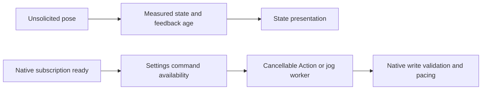

# ADR0130: Passive BLE connection and available Settings control

Status: Accepted. Supersedes ADR0125 feedback-loss recovery and prior connection verification prerequisites. ADR0128 segment completion/replacement remains accepted.

## Purpose and design goals

A missed position query quarantined an otherwise connected radio and exhausted recovery. Connection availability, feedback freshness and observed arrival are distinct facts. Manual controls must remain usable when feedback is absent.

## Decision

✅ App ends connection setup after native BLE service/notification subscription. No pose, firmware, IK, stationary or indication probe runs at connection. PlatformKit publishes latest unsolicited pose packets; App caches measured state. Refresh reads the latest packet without transmitting. Feedback silence is recorded but does not disconnect, reconnect or gate manual writes. Settings buttons use connected state, and native writers validate session, hardware limits, packet size and transport readiness rather than feedback freshness. Actual disconnect/write failures retain recovery.

✅ Explicit preset requests still resolve their required IK mapping through Actions on demand. Missing mappings/replies fail visibly; they are not fabricated. Reference positions used to seed manual jog remain separate from measured UI state. Action segment feedback deadlines and cancellation remain unchanged; lack of arrival feedback can fail a running Action without locking future manual input.

## Validation

✅ Simulation verifies zero connection probes/writes, passive refresh and manual jog after feedback health becomes false. UI enables controls based on connected state.
❌ Full physical passive cadence and motion endurance remain pending; connection does not establish arrival or clearance.
