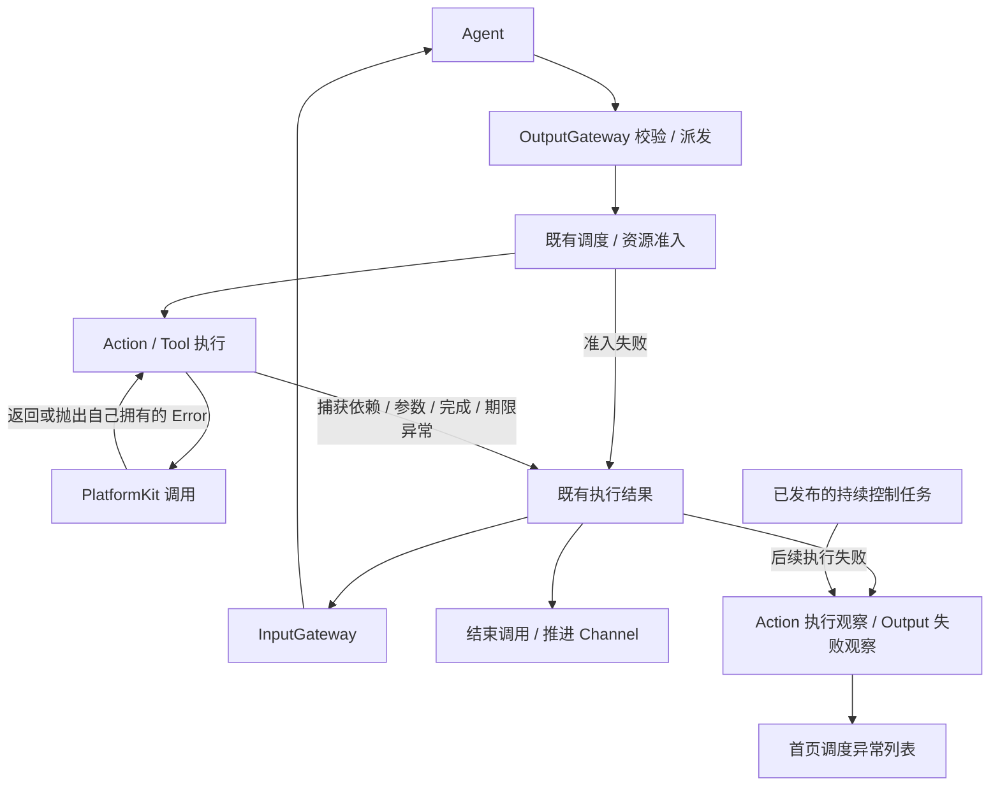
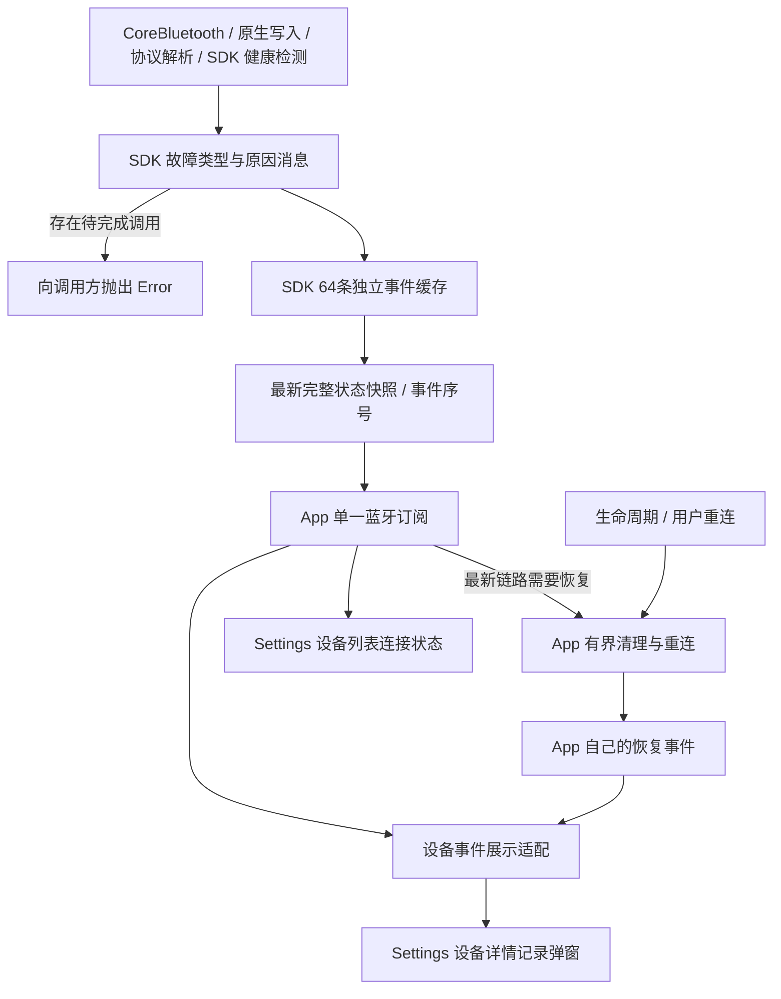
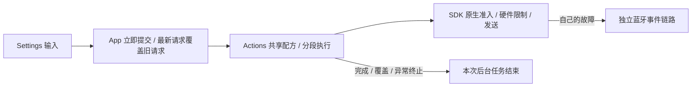

# ADR 0131: 独立的蓝牙异常与执行结果

> ADR0134 supersedes the Bluetooth event/history/display decision and types described below: SDK/App/UI retain current native state only; no incident ring, cache, cursor or modal remains. Independent execution results, native recovery and the other execution/admission decisions remain implemented.

Status: Implemented. ADR0129 已隔离调度与连接恢复；本次继续隔离异常来源、类型、消息、记录和恢复触发。自动化回归与构建结果见 [Validation-History](../validation/Validation-History.md)；❌ 真机通信与页面验收仍待执行。

## 所有权与边界

| 所有者 | 产生与解释的内容 | 不承担的内容 |
| --- | --- | --- |
| PlatformKit | 原生连接/订阅、读写、协议回包、发送阻塞及反馈健康事实；SDK 自己的故障类型、设备/连接标识、原因消息和流量快照 | Action/Tool/Agent/Channel 标识、资源锁、动作完成、中文页面文案、重连政策 |
| Actions / Tools / Runtime | 参数、业务、资源准入、完成期限等执行异常；捕获依赖抛错，返回既有结果与有界说明 | 蓝牙事件分类、设备记录、根据执行错误启动重连 |
| App 蓝牙恢复 | 根据最新原生链路事实、生命周期和用户意图执行有界清理/重连；自己拥有恢复阶段与原因 | 读取 Action/Tool result、解释 Actions 错误、删除 Channel 工作 |
| App 展示适配 / UI | 将两条独立来源各自转换为展示值 | 在首页显示蓝牙状态，或在 Settings 记录执行/资源异常 |

SDK 的 `NexArmBluetoothFailure` / `NexArmBluetoothIncident.Kind` 与 Actions 的 `NexArmExecutionError` / 执行报告代码独立。App 的 `BluetoothRecoveryCause` 只描述恢复政策，已移除资源失败分类及 Actions 错误依赖。不建立跨模块统一异常枚举。错误对象不进入 UI；执行说明最多512字符，设备原因也是 SDK 独立产生的有界消息。

## 异常分类与记录上下文

三个所有者分别定义类型，不能用执行结果反推蓝牙事件，也不能把原生事件归入重连原因。UI 的 `BluetoothIncident.Category` 只是独立来源的展示映射。

| 来源 | 类型 / 类别 | 产生点与后续处理 |
| --- | --- | --- |
| SDK | communication：建立连接/服务/订阅/写入/查询失败；timeout、responseTimeout、incompatibleService、native | 原生失败点独立记录；待完成调用抛错；最新链路事实决定是否进入 App 恢复 |
| SDK | protocolViolation：invalidPacket、receiveOverflow | SDK 解析/缓冲错误；不伪装成系统 NSError，也不从 Action 完成错误生成 |
| SDK | disconnected | 原生非预期连接丢失；主动关闭不重复记录意外断开 |
| SDK | feedback | SDK 自己的有效位置样本间隔检测；只诊断，不自动重连 |
| SDK | power、congestion | 原生电源可用性改变、系统写入持续阻塞；独立于业务期限/资源锁 |
| App | connection、lifecycle、recovery | 连接请求、前后台变化与有界恢复阶段；只有 recovery 带本轮原因、episode、尝试数和用时 |
| App | historyGap | SDK 全局事件序号缺口提示；无恢复上下文，不补造故障 |
| Actions | 参数/可用性/资源准入、feedbackTimeout、targetNotReached、motionTimedOut、依赖抛错 | 原有 Action 完成策略和当前调用的结果；无 SDK 事件对象或恢复回调 |
| ToolRuntime / Gateway | Tool handler、权限/资源/调度/期限、结果派送失败 | 原有 ToolResponse / 执行观察；不写设备记录 |

原生事件保留自己的发生时间、设备/连接ID、类别、原因和流量；`recovery` 为 nil，不附上导入时的恢复原因/次数/用时。历史缺口同样没有恢复上下文。UI 只在 App recovery 记录展开处显示恢复信息。

每次有限动作通过 `recordReport` 回传到该调用私有的 `ActionReportStore`；移除共享 `lastActionReport`。一个并发调用的参数/资源拒绝不能清掉或读取另一调用的电机结果。执行前拒绝不生成电机报告；开始后的失败保留本次电机结果与原始异常。报告回传不读取 SDK 诊断缓存。

已移除废弃连接提示动作、SDK 从未抛出的 feedbackLost，以及 Settings 中不再用于展示的 motionStatus/executing/testing/resetting/refreshing 和旧 controlValidated 标记。当前控制准入由原生连接阶段和恢复清理状态决定。严格固件/只读静止检查和旧单包 aim 仍由独立 USB/协议诊断使用，保留在 Actions；App BLE 连接/流式跟踪不调用它们，诊断单次使用错误只存在测试夹具。

## 链路一：Action / Tool 执行与首页异常

有限 Action 保留所有电机/子步骤结果及捕获错误说明，组合报告和 Gateway 翻译也保留说明。Runtime 不判断原生蓝牙类型。Tool 普通失败按既有 `ToolResponse` 策略返回；完成型 Tool 不注入额外结果输入。普通失败只结束当前调用，Assistant、其他设备和语音继续遵循既有执行策略。

首页通过独立 `ActionExecutionSnapshot` 与 `OutputFailureSnapshot` 收集调度、准入、Tool及结果派送失败。Output 失败最多100条、8个观察者，每个 newest-one 完整快照；旧历史淘汰计数可见。App 另保留最多100条持续控制后台执行失败，淘汰计数可见，不伪造有限 Action 或改写已成功返回的 Tool result。首页的错误只在“调度异常”列表显示；移除会话蓝牙 readiness 回退和相机跟踪失败横幅。

持续写入者在启动后捕获到的真实执行错误，即使连接代次已被恢复切换，也仍写首页执行观察；代次检查只隔离旧任务对连接/控制状态的修改，不能抹掉执行事实。明确取消不生成额外执行错误。

这些观察不写设备缓存，不改连接状态，不触发恢复。明确的会话取消、资源撤销、用户手动覆盖仍按独立策略运作。

## 链路二：蓝牙故障、恢复与 Settings 记录

真实故障在 SDK 故障点记录，同时向未完成调用抛错；不等待 Action 捕获或结果回传。事件保留设备ID、连接ID、时间、递增序号、原生故障与当时流量，不含业务调用上下文。连接状态流 newest-one 合并通知时携带完整64条保留事件；SDK 覆盖最旧事件并递增淘汰计数，App通过事件序号去重并显示缺口。

原生无响应写入持续受系统阻塞2秒，由 SDK 的发送预算/健康监控识别并失败关闭；命令取消/结束与系统恢复清除本次阻塞计时。动作到位期限和资源错误不参与这个检测。反馈间隔异常独立记录，单纯反馈沉默不主动重连；查询回包超时隔离、原生断开/通信故障和发送持续阻塞按 App 政策恢复。主动作业清理不重复制造意外断开事件。

恢复保持 ADR0129：清理旧原生会话、连接和连接侧意图，不取消或等待 Agent 有限 Action，不删除 Channel 队列，不停止语音。旧调用自然异常结束并记录自己的结果，即使重连已成功；旧执行错误不能改新连接状态。无旧命令重放。App 恢复三次尝试、退避、前后台政策不变。

设备展示缓存最多4个设备、每设备32条；详情通过紧凑入口打开 modal。只收 SDK 蓝牙事件及 App 连接/恢复生命周期事件，移除执行 catch、资源冲突、业务姿态转换/刷新错误旁路。清空只清展示记录，SDK 消费游标保留；后续状态更新不会重新导入已清事件。记录及恢复独立于页面寿命，无磁盘历史。

## Settings 手动控制

手动 preset/reset/jog 不经过 OutputGateway 或资源锁。页面提交不等待完成，新意图取消并收尾旧软件写入者，不等待旧目标到位。后台复用 Actions 现有分段反馈执行策略；不新增按时间睡眠的业务执行器。动作完成/失败不写首页或设备异常记录、不锁下一条命令，当前任务可完成、被覆盖或自然异常结束。真正 SDK 故障仍独立记录和恢复，未连接时输入不发送。

❌ 原生 BLE 长时间运行、固件回包频率、真实覆盖延迟和 iOS 页面交互仍需真机验收。本次不改原设计源 `Technical_Design.docx`。
