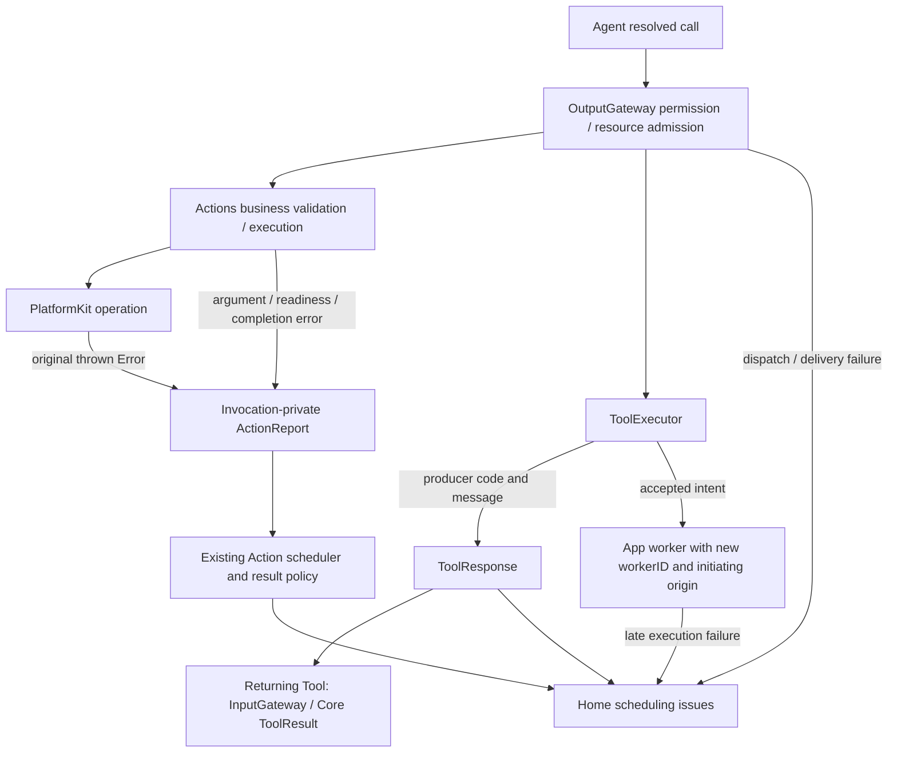
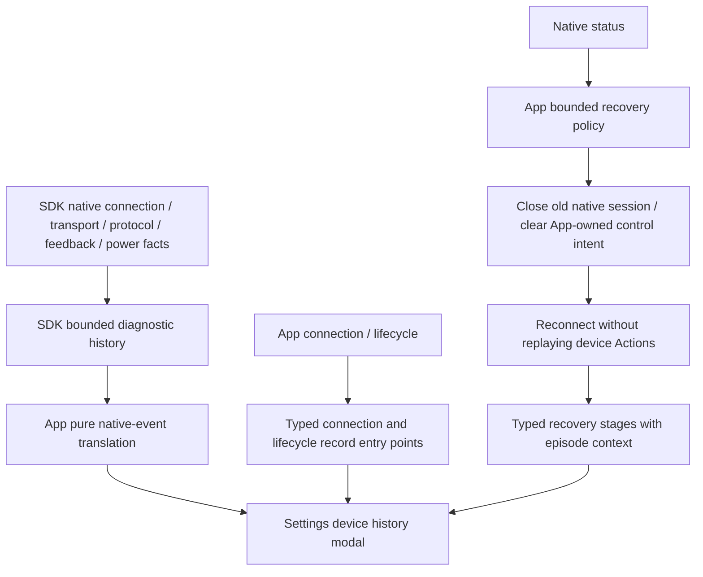

# ADR0132 — 独立异常链路的错误语义与调用身份

> ADR0134 supersedes the Bluetooth event/history/display decision and types described below: SDK/App/UI retain current native state only; no incident ring, cache, cursor or modal remains. Independent execution results, native recovery and the other execution/admission decisions remain implemented.

日期：2026-10-05。状态：已实现；真机验收未执行。

继承 ADR0131 的两条独立链路。执行错误不会产生设备诊断事件，也不会触发恢复。蓝牙恢复仅关闭旧原生会话，有限 Action 自然异常结束并记录结果；不改 Agent 会话、Channel 队列或语音策略。

## 执行链路

- Actions owns `NexArmExecutionError` 参数、业务准入、固件政策和发送准入期限。SDK `invalidMotion` 仅用于硬件命令编码；SDK 不再声明业务固件兼容错误。
- 原生查询通道被占用返回 SDK `busy`；原生请求被新会话接替返回 `sessionReplaced`。任务主动取消仍返回 `CancellationError`，二者不生成原生故障记录。
- 电机结果分为 `admissionFailed`（观察会话准入）、`sendingFailed`（提交原生写入）、`feedbackFailed`（读取/解码反馈）、`feedbackLost`（动作等待反馈阈值）、`disconnected`、`targetNotReached`、`timedOut`、`cancelled`。原始依赖 Error 单独保留，不根据该分类推断蓝牙恢复。
- Action 整体期限胜出后，执行层代码/消息固定为 `timedOut` / `Action execution timed out`，已保存子步骤的原因保留在其自身结果里，不借用取消清理或先前子失败作为超时主原因。
- ToolRuntime 提供 1–64 UTF-8 字节的通用 `FailureCode` 和 `ToolExecutionFailureProviding`。通用代码：参数无效、处理失败、期限超时、取消、未知 Tool、权限拒绝、资源不可用、派送失败。业务生产者可提供自身有界代码；Runtime/Gateway/Core 不导入设备错误类型。
- App 将 Actions 准入原因适配为 Tool code/message，不再把后台、未就绪等统一改为未连接。Tool handler code 与结果派送错误分开；Core ToolResult 和首页观察保留 code。
- App 持续控制 worker 的 `workerID` 与原生连接 ID 独立。来源是启动该 worker 的 source/session/input/call；后续目标更新不改写启动身份。自动再次启动生成新 workerID，并保留同一启动来源。迟到的非取消失败仍能进入首页；已经完成的 ToolResponse 不被修改。

## 蓝牙事实与恢复链路

原生记录只接受 SDK 事件，保留原始时间、连接 ID、流量和原因；没有恢复上下文。连接、生命周期、恢复记录各自有枚举入口，只有恢复事件携带 episode/原因/次数/耗时。共用缓存只保存已构造的展示值，仍限定四台设备、每台32条。历史缺口明确描述全局 SDK 序号缺口，不冒充某台设备的遗漏数量。清空展示记录不回退 SDK 消费游标。

恢复只重试明确的原生 timeout/disconnected/io、SDK 记录确认的协议错误，以及与 SDK native 记录 domain/code 一致的系统错误。busy/sessionReplaced、参数/服务不兼容、未知设备、存储错误、取消和未知异常不重试；权限拒绝/硬件不支持停止。暂时不可用的无线电继续按既有状态等待。判定使用本次失败的快照，先判定再清理，以免关闭会话抹去证据。三次退避、两分钟期限和断开确认策略保持不变。

Settings 手动命令继续直接复用 Actions，不经过 Gateway、不获取资源锁、不等待动作完成；新请求覆盖旧软件执行者，执行异常不进入首页或蓝牙设备记录。SDK 真正遇到的故障仍独立记录。

## 验证与限制

✅ 模拟测试覆盖 Tool 代码/描述、期限主原因与子原因、准入与反馈阶段、持续 worker 来源、原生恢复证据和业务异常隔离。模块边界检查阻止旧通用记录入口及 SDK 业务固件错误回归。

❌ 无真机异常/弱信号/高频流量验收；没有持久化异常历史、跨进程结果重放或设备侧停机保护。
