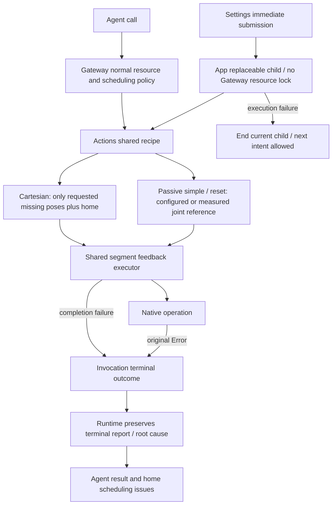
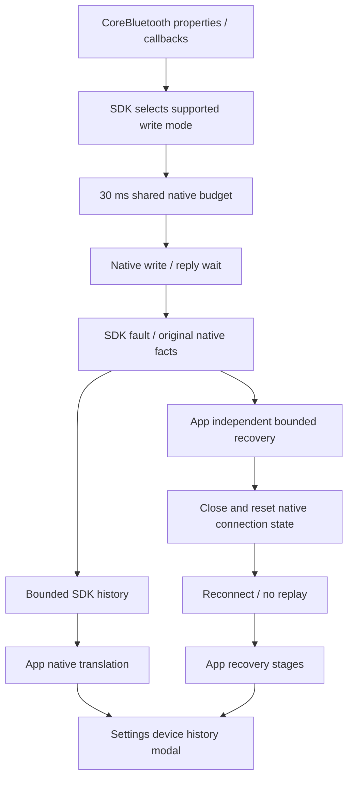

# ADR0133 — Motion preparation, native write admission and truthful terminal reports

> ADR0134 supersedes the Bluetooth event/history/display decision and types described below: SDK/App/UI retain current native state only; no incident ring, cache, cursor or modal remains. Independent execution results, native recovery and the other execution/admission decisions remain implemented.

日期：2026-10-05。状态：已实现；普通归位复用跟踪参考的错误由 [ADR0137](0137-nexarm-ordinary-home.md) 修复，普通归位与跟踪准备分别选取目标；无 IK 归位策略仍有效。真机验收按各版本证据记录。

用户报告 Settings 发动作后反复重连、对话动作无响应却记录完成，设备历史只看到恢复阶段。截图不能确认原生触发点或已安装版本。代码审查确认：部分有限动作先准备整个 IK 目录；原生控制/查询对写入能力要求不一致；已发查询取消会关闭连接但不记录原因；执行器与调度器可能用先前保存的报告覆盖最终报告。这些缺陷分别在其所属模块修复，保留 ADR0131/0132 的独立异常链路。

## 请求到动作

Actions owns selected poses, configured home and repetition/completion policy. Passive nod/shake-head, whole-arm reset and per-motor reset require no IK query; partial cached Cartesian plans cannot change that behavior. Cartesian presets incrementally cache only requested missing targets and the shared ending home. Explicit diagnostic full-catalog preparation remains available. The configured reference is not measured telemetry. Settings callers return after submission, with no resource acquisition or physical-completion wait; the child still uses the shared feedback executor until completion, replacement or error. Agent finite execution never reports success solely because a packet was admitted.

An explicit terminal ActionReport is authoritative. An earlier stored child report is used for void completion or thrown errors, but cannot replace returned terminal entries or the terminal error description in ActionExecutor/ChannelScheduler. Scheduler state and results follow terminal status; normal failure still advances the lane.

## 原生事实到恢复与显示

发现支持 writeWithResponse 或 writeWithoutResponse 的发送特征；控制优先无响应写，查询优先有响应写，按实际能力回退并校验该模式包长。两者仍共用 30 ms 流量预算。有响应控制写只允许一个待 ATT 确认包，确认期限两秒；未确认时返回未发送，不积累队列。查询仍只保留一个待响应请求，不与控制确认重叠。ATT 确认只表示传输，不是机械运动完成。

已经发出的查询被中断时，SDK 独立记录 `requestInterrupted(command:)`：等待原生回复被中断，旧连接已隔离以防迟到回包错配。它不包含 Action/Tool 身份或业务取消原因；原调用者仍按自身策略收到取消。尚未发送的查询取消只清理待发送状态，不断开、不生成故障。App 单独选择恢复；恢复成功只表示原生订阅连接已建立，不表示动作已验证。

## 验证边界

✅ 模拟回归覆盖无 IK 简单动作/归位、Settings 绕过资源准入、按需姿态缓存、写能力选择和单确认窗口、最终失败报告/原始描述，以及独立原生中断展示。

❌ 真机 BLE 属性、实际故障触发点、重复发送、复杂 IK 固件兼容和 UI 点击效果仍待验收。构建与模拟测试不能证明手机上的循环重连已经消除。
