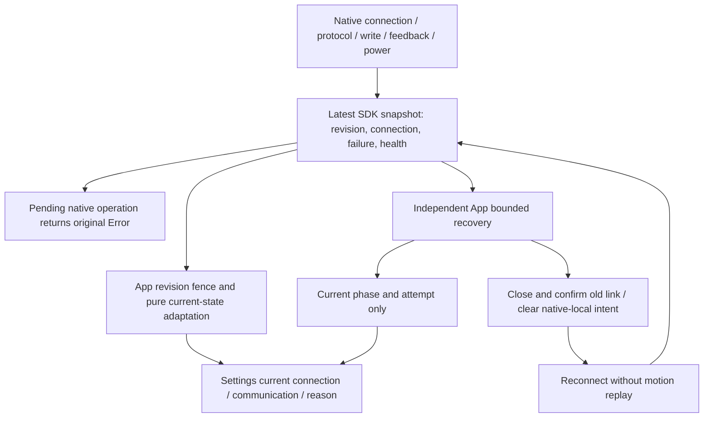
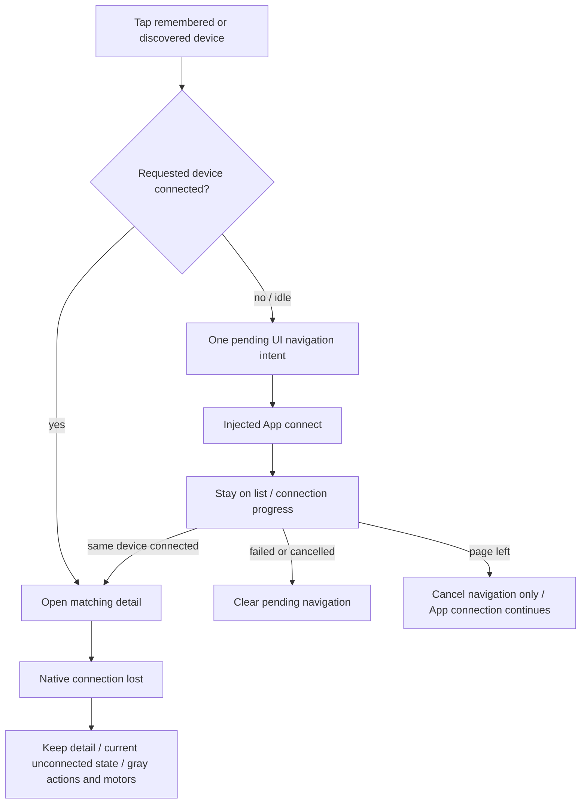
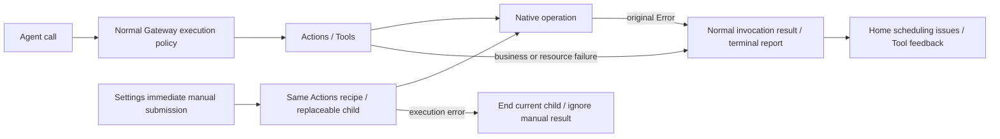

# ADR0134 — 蓝牙当前状态与连接后的详情导航

日期：2026-10-05。状态：当前状态与执行隔离仍有效；设备选择自动连接/导航、页面重置导航及独立通信行由 [ADR0136](0136-bluetooth-explicit-navigation.md) 替代。下文保留原决定；真机页面/通信验收未执行。

用户明确改为只显示最新蓝牙状态，移除异常历史 UI 和后端。此决定替代 ADR0131/0132/0133 中的设备异常事件、缓存和 modal 方案；保留独立 Action/Tool 结果与原生恢复的所有权边界。

## 当前状态链路

PlatformKit 保留当前连接、无线电、原生故障、查询隔离、被动位置反馈/健康和固定大小流量计数。移除 `NexArmBluetoothIncident`、`NexArmBluetoothDiagnostics`、事件环、历史序号/淘汰计数和历史原因副本。快照 revision 仍用于拒绝迟到状态，它不是异常历史。

App 删除原生事件消费游标、四设备/每设备32条缓存、历史缺口补记、连接/生命周期/恢复记录入口及清空接口。恢复仍保留其当前 worker/阶段/原因/尝试次数/期限，以履行原生连接政策，未建立历史记录。SDK 原生故障不会知道 Action/Tool/资源身份。UI 删除 BluetoothIncident 值、异常入口、modal、计数、展开条目和清空操作。

未连接显示“未连接”；连接期间的连接/恢复进度可显示正在连接、正在重连、正在断开或等待蓝牙。连接失败仍显示“未连接”，附带最新失败原因。已连接时分别显示连接与通信：正常，或异常及当前原生原因/反馈间隔提示。健康反馈清除前一次健康异常；新的原生连接清除旧连接故障。Action/Tool 执行错误不能覆盖蓝牙状态。

## 设备选择与控制

已连接设备立即进入。未连接设备点击发起连接，当前页等待该设备成功后才导航；身份匹配避免打开其他设备。繁忙状态拒绝重复点击。pending navigation 容量一，没有导航队列；失败/取消/页面离开清除导航意图，离开页面不取消 App 连接工作。页面再次进入重置旧导航展示，不借旧详情绕过连接要求。

详情已打开后断线不强制退页。动作、整臂归位和六电机手势均禁用并置灰；手势禁用/释放/离页清空输入。重新连接仍可通过当前状态操作。被动反馈间隔异常不代表链路断开，也不禁用已连接的手动接管。

## 执行链路保持独立

SDK 异常可使当前调用自然失败；Runtime/Gateway 保留终态、原因和子结果。恢复不取消有限 Agent Actions、不删 Channel 队列、不停止 Assistant/语音。Settings 继续复用 Actions，提交立即返回、不获取 Agent 资源锁、新输入覆盖旧执行者。手动执行错误不发布首页结果，也不能反向改变原生状态。

✅ 模拟验证覆盖当前异常替换/恢复清除、业务异常隔离、连接成功前不能进入、失败/身份/恢复/重复点击/离页导航边界和断开后的控制禁用。边界脚本拒绝旧历史类型/写入入口回归。

❌ 真机 UI 导航、不同字号置灰/手势体验、BLE 故障恢复与物理运动未验收；不提供历史诊断存储或动作重放。
