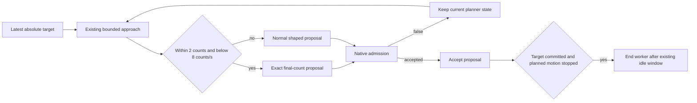

# ADR0135 — Commit the final tracking count on native admission

Status: accepted, 2026-10-05.

## Context

Supervised serial testing of the current Photographer → Robot.aim → App worker revealed a long fractional tail after visible tracking had mostly stopped. `approach` zeroed velocity within two encoder counts at low speed but kept a fractional internal position and sometimes a different last transmitted count. Its idle condition required the last transmitted count to equal the requested target. Further tiny proposals could therefore keep the worker/resource owner alive unnecessarily. The existing convergence regression failed for the same reason. A separate reverse-motion regression accidentally used motor1's start for a motor4 trial and did not actually request a reversal.

## Decision

Keep the existing two-count and below-eight-counts/s settling condition. Within that region, propose the exact requested count with zero planned velocity/acceleration. The proposal is committed only by `accept` after native admission; `false` leaves it pending for the next latest-intent tick. An already transmitted final count emits no duplicate packet. Direction-change braking, limits, the 30 ms admission budget and per-axis speed limits are unchanged.

## Boundaries and verification

This is Actions motion policy, with no SDK, Gateway, recovery or UI dependency change. Planner convergence and Tool target publication do not establish physical arrival; finite Actions continue to use actual timestamped feedback and their independent completion thresholds.

Serial acceptance also exposed an implementation inconsistency with the existing session contract: an invalidated/closed serial observation threw caller cancellation. Serial now reports `NexArmError.disconnected` for that native session loss and checks explicit Task cancellation separately. A closed-session preflight verifies both observation read and send fail before any further native write. This restores the existing SDK error boundary without introducing Action scheduling or reconnect policy into PlatformKit.

The convergence and correctly scoped reversal regressions remain required. Five motors in both directions at one/two-count offsets verify that deferred native admission preserves the final intent and successful acceptance terminates further proposals without affecting other motors. Opt-in serial trials exercise production Settings/App behavior and actual Assistant/Photographer execution with explicit model/pose fixtures. Their connection façade is not CoreBluetooth/radio or native UI acceptance. Dated hardware/build observations are recorded in the physical acceptance and validation history documents.
