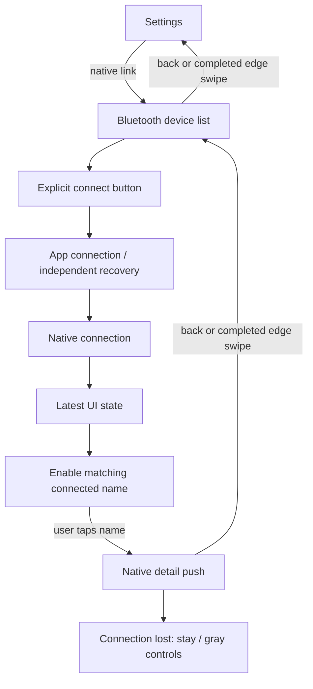

# ADR0136 — 蓝牙连接入口与原生逐层导航

日期：2026-10-05。状态：独立连接按钮、未连接名称禁用与原生 NavigationLink 入口由 [ADR0138](0138-compact-bluetooth-device-list.md) 替代。连接成功不自动进入、UI 所有权、逐层导航和当前错误展示仍有效；下文保留原决定。真机滑动返回与视觉验收待执行。替代 ADR0134 的自动连接/详情导航、页面重置导航和独立通信行；当前状态、执行隔离与恢复策略保持其原有所有权。

## 问题与决定

设备名称同时负责连接和自动进入详情，混淆了两种操作。列表 `onAppear` 清空详情 destination，可能在交互返回期间再次修改导航，引发详情直接退到 Settings。

未连接设备的名称和图标置暗，原生详情链接禁止点击。名称下的独立按钮发起连接；连接成功只更新状态、点亮名称并将按钮变为“断开连接”，不会自动跳页。连接/恢复进行中可取消当前设备的连接，其他连接按钮禁用；蓝牙关闭、无权限或不支持时不允许连接。

复用 App 现有唯一 NavigationStack：Settings → 蓝牙列表 → 设备详情使用原生 NavigationLink。删除 UI 共享状态中的 detailDevice、pending intent、状态驱动导航及页面出现时的重置；页面生命周期仅管理发现和手动电机输入，不能修改导航。详情返回一层到列表，再返回一层到 Settings；取消手势由原生导航保持原页面。详情中断线仍保留页面，动作/归位/滑块禁用。

## 状态与错误

详情的“连接”合并链路和通信状态：正常为“已连接”，当前原生故障/反馈间隔异常为黄色“已连接，异常”。当前完整原因在“当前状态”下方红字展示；取消独立“通信”行，保留测量位置/时间和必要的连接恢复进度。未连接及正在连接/重连/断开等过渡状态保持真实显示。

异常仍来自 SDK 当前快照经 App 适配；健康快照清除旧原因。Action/Tool 结果、资源异常与手动执行失败不能写入这条状态链路。Settings 指令保持即时提交、共享 Actions、覆盖旧输入、不获取 Agent 资源锁。没有新增异常历史、恢复政策或自动动作重放。

✅ 状态回归覆盖连接身份、连接按钮可用性、原生异常/健康替换和断开后的动作/电机禁用。边界检查拒绝旧程序化导航、状态驱动自动进入和重复通信行；串口验收入口改为显式连接操作，不声称测试原生 UI。

❌ 真机确认完整右滑只返回一层、取消右滑仍停留详情、连接成功停留列表，以及不同字号下的暗色/黄字/红字布局。
