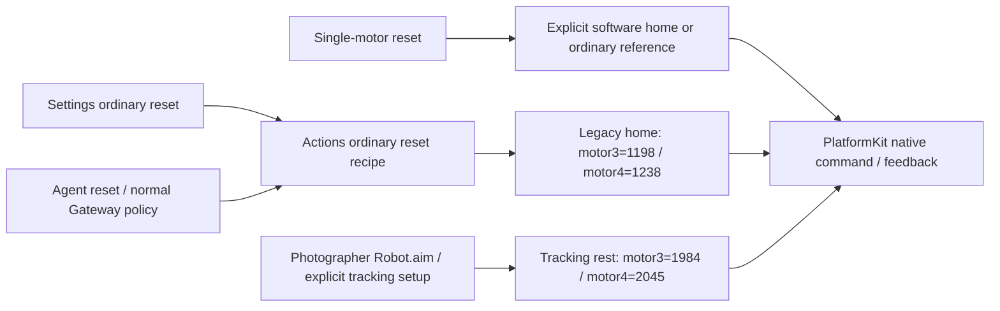

# ADR0137 — 恢复普通归位，独立保留跟踪准备姿态

日期：2026-10-05。状态：已实现；恢复后的真机姿态验收待执行。

## 原因

ADR0133 为普通归位去除了 IK 查询依赖，却复用了 `NexArmJointCommand.armHome`。该值是 Photographer 抬高相机的跟踪姿态，motor3=1984、motor4=2045；旧普通归位的参考为 motor3=1198、motor4=1238。复用改变了原有姿态，并使普通归位与笛卡尔动作的结束姿态不一致。

## 决定与所有权

Actions 的普通被动连接归位使用现有 `NexArmGesture.referenceHomeJoints` 的前五轴 `[2048,2087,1198,1238,2048]`。Settings `manualPlan(nil)` 和 Agent `resetPosition` 复用同一配方；未单独配置的 `resetMotor` 从同一普通归位参考选取目标。显式单电机软件 home 仍优先。当前反馈、部分 IK 缓存和跟踪历史不能替换普通归位目标。

归位不恢复 IK 查询、Gateway 资源锁或 UI 完成等待。Settings 仍即时提交，可被下一条指令覆盖；Agent 保留正常反馈完成与结果策略。普通归位仅发送 motors1–5，不发送夹爪，也不修改固件校准。

`NexArmJointCommand.armHome` 保留 `[2047,2087,1984,2045,2048]`，仅供跟踪角度/准备使用。严格协议路径继续通过设备 IK 解析原来的 XYZ `[200,0,200]` home，笛卡尔动作几何保持原样。PlatformKit 仅编码和传输调用者指定的目标，不选择业务姿态。

## 验证范围

✅ 模拟回归检查 Settings 与 Agent 普通归位、motor3/4 单独归位的实际编码目标；IK 不可用、跟踪反馈和部分 IK 缓存均不改变目标。另检查显式单电机 home 优先、五轴作用范围与跟踪零角目标仍为独立的抬高相机姿态。串口验收源码的普通归位断言及跟踪准备输入同步修正。

❌ 未运行新的物理动作。此前串口记录的 motor3=1984 归位是修复前版本的行为，已标明范围，不能用于证明恢复后的姿态已验收。
