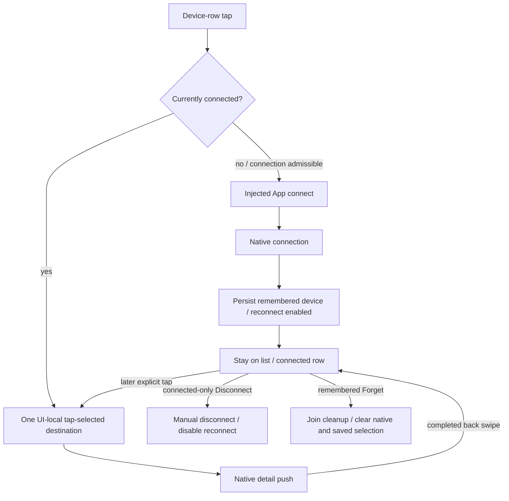

# ADR0138 — 紧凑蓝牙设备列表与点击连接

日期：2026-10-05。状态：已实现；真机列表布局与返回手势待验收。替代 ADR0136 的独立连接按钮、未连接名称禁用及 NavigationLink 入口；保留连接完成不自动跳页、原生逐层返回与独立当前状态。

## 交互与所有权

参考 [Apple 蓝牙连接说明](https://support.apple.com/en-gb/105108)：点击设备名称连接，通过信息入口管理/忽略设备。本项目按用户要求采用已连接时点击名称进入机械臂详情的交互，并保留列表中的忽略操作。

每台设备仅一个名称/状态行，移除重复“连接 XX”按钮和装饰图标。未连接且可操作时点击行只调用 App.connect；成功后停留列表，下一次点击已连接行才进入详情。已连接行显示详情箭头，下方才显示“断开连接”。繁忙、蓝牙关闭、无权限或不支持时拒绝连接点击；正在连接/恢复可从右上角取消。

“我的设备”展示当前连接或已记住的设备；未连接也能忽略。项目仍只有一个当前/最近设备记录和一条原生连接，不新增多设备历史。“附近设备”保留新选择的连接进度/失败行，即使发现列表被清空也不会消失；连接失败不会替换已有记录或把新设备错误显示到旧设备上。

UI 共享状态只计算分组、点击意图和当前显示值。详情目的地为 View 的一个本地 @State，容量一、没有队列；只由已连接行的明确点击赋值。连接状态变化、列表出现/离开不能赋值或清空目的地。沿用现有唯一 NavigationStack 与 navigationDestination 的原生 push/pop；详情断线不退页，动作与滑块置灰，完成右滑返回列表，取消右滑保持原页。

## 默认重连修正

原实现连接成功后先 remember(device)、后 reconnectEnabled=true，导致手动连接保存的自动重连值可能仍为 false。App 现在先启用重连再保存成功连接，冷启动恢复读取 true。明确手动断开/忽略仍停止并持久化关闭重连；旧记录的显式 false 不被擅自覆盖。没有新增 Action 重放或改变恢复预算、原生流控及异常所有权。

✅ 状态回归覆盖点击意图、成功/失败分组、发现清空期间的选择行、错误身份隔离和已连接异常展示。工作流回归检查连接成功持久化 true、冷启动自动恢复、忽略与手动断开持久化 false。边界检查拒绝重复连接行与状态驱动自动导航。

❌ 原生手机布局、字号、完整/取消右滑与无线重连体验仍待验收；模拟和编译不等于这些体验已验证。
