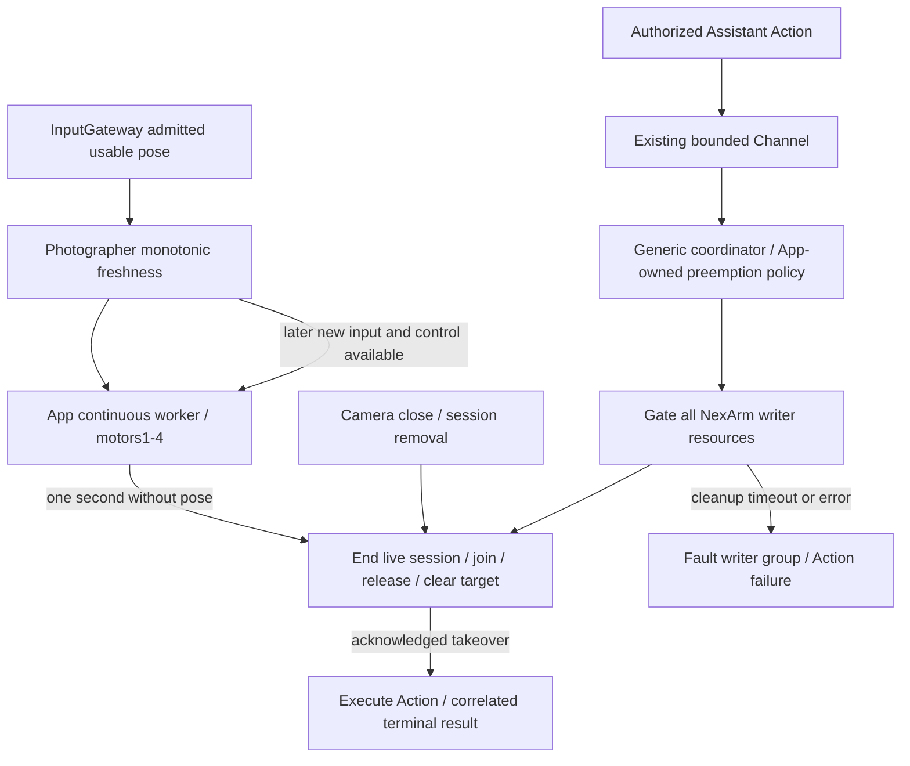

# ADR0139: Tracking input freshness and Assistant resource takeover

Status: Accepted. Supersedes ADR0126's unconditional competing-Agent rejection; continuous worker ownership, authorized intent publication and session cleanup remain current. Settings manual takeover and independent Bluetooth recovery remain unchanged. ADR0140 clarifies coordinator-owned cleanup acknowledgment when camera/session removal enters from a cancelled lifecycle task.

Current resource ownership contract: [ADR0141](0141-resource-control-ownership.md) supersedes the persistent faulted/explicit-recovery policy below. Caller-independent acknowledgment, configured preemption and existing execution/result isolation remain current.

## Problem

Photographer's continuous worker retained motors1–4 while approaching its last target even after pose input stopped. Authorized Assistant actions rejected resource conflicts before sending any native command. Actions using disjoint motor5/6 passed the motor fence but still met the workflow's single-writer guard. User-directed replies must have priority over background tracking, without removing accepted Actions or coupling resource arbitration to Bluetooth recovery.

## Decision

- Photographer retains one monotonic reception instant for an admitted usable first-person pose. Centered targets refresh it even without a Tool; empty/invisible targets, expired/out-of-order input and future sensor timestamps cannot keep it alive. Production freshness expires after one second. Pause/stop deny freshness and reset accumulation. After a one-second gap, new input resets old accumulated targets.
- App composition binds a weak, read-only freshness query to the current tracking worker. It checks before live-session startup and each 30ms tick. Staleness exits through normal session end/join, clears the old target and releases the ResourceCoordinator use. No timer task/pose queue is added. Camera close already removes the vision session and stops/joins its owned uses.
- ResourceDefinition has optional executionGroup and host-configured preempts owner relationships. Gateway contains no concrete device or Agent policy. Production groups NexArm motors1–6 under one writer and permits only Assistant-over-Photographer takeover. Permissions, leases, motor result scopes and same-owner module serialization remain intact. Settings still bypasses Agent resource fences.
- run validates all conflicting owners before mutation, gates the complete writer group, cancels/stops/joins its old uses within the existing cleanup deadline, then registers the new operation. Reverse, equal-owner, unknown-owner and unconfigured conflicts reject busy. Execution takeover cannot implicitly revoke leases.
- validateAdmission permits subsequent Actions only from the exact trusted takeover owner while that cleanup is pending. They enter the existing bounded Channel; strict execution remains gated. No scheduler cancel callback, queue removal or command replay occurs. Timeout/error faults the entire writer group and fails the new operation without entering its handler.
- Expected tracking expiry/preemption is ordinary cooperative interruption, with no Bluetooth error/reconnect or home execution warning. Unexpected errors retain normal Action/Tool outcomes. Assistant, voice and perception sessions continue. Later tracking requires fresh usable pose and normal control admission; an old aim is not restored.

## Bounds, validation and limits

No lock wait queue or new command backlog is added. Existing limits remain 64 resource definitions, 256 active uses, 32 cleanups, five-second default cooperative cleanup, 32 unfinished Actions per Channel and one latest tracking target. Pending takeover IDs are bounded by registered resources. A group changes active-writer exclusion, not the per-motor effect contract.

Fixture tests cover same-writer disjoint resources, reverse/equal-owner denial, cleanup gating/join, timeout without starting the new use, queued Assistant Actions, motor1/motor5 takeover, source expiry and subsequent fresh aim admission without reconnect. Current check/build observations belong in Validation-History.md.

Cooperative software stop/join does not establish instantaneous hardware stop. Physical camera close/source silence/takeover timing and obstacle clearance require supervised device acceptance. Native send blockage can delay a freshness check until the SDK operation returns; existing bounded transport behavior remains separate. This is explicit resource takeover, not general Channel priority/fairness scheduling.
