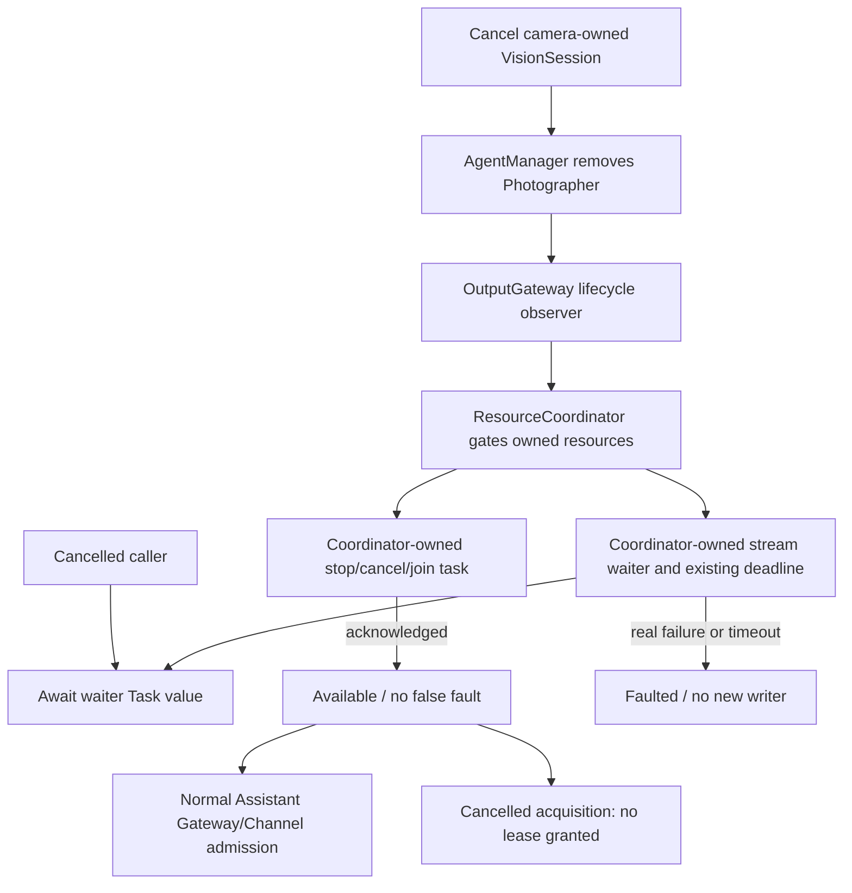

# ADR0140: Cancellation-safe resource cleanup acknowledgment

Status: Accepted. Clarifies cleanup lifetime in ADR0066/ADR0139 without changing execution priority, lease permissions, queue policy or Bluetooth recovery isolation.

Current resource ownership contract: [ADR0141](0141-resource-control-ownership.md) supersedes the persistent faulted/explicit-recovery policy below. Caller-independent acknowledgment, configured preemption and existing execution/result isolation remain current.

## Problem

CameraCoordinator cancels VisionSession before its catch removes Photographer through AgentManager. Stop observers inherit that caller cancellation. ResourceCoordinator gated active uses and launched bounded stop/join cleanup, but consumed its acknowledgment AsyncStream directly in the cancelled caller. AsyncStream iteration ended immediately with nil, which was classified as cleanup failure; the coordinator cancelled its own cleanup and marked motors faulted. Both later Photographer work and Assistant actions then failed resource admission despite normal software shutdown. Assistant priority cannot bypass a faulted writer.

A second misclassification occurred when lease acquisition checked requester cancellation/shutdown inside the cleanup-error catch. Even after confirmed successful cleanup, cancellation could fault already-stopped resources.

## Decision

- Gating commits cleanup responsibility to ResourceCoordinator. Its existing stop/join task, acknowledgment waiter and deadline remain coordinator-owned rather than inheriting lifecycle cancellation. A separate unstructured Task consumes the acknowledgment stream; the caller awaits its value. Caller cancellation cannot terminate that iteration. No detached task, lock waiter queue or transport callback is added.
- All cleanup entry paths share this behavior: owner/session closure, shutdown, lease release/expiry/acquisition, configured execution takeover and explicit recovery. Existing bounded cleanup concurrency/deadline and cooperative task joins remain intact.
- Successful cleanup restores affected resources before acquisition checks requester cancellation or shutdown. A cancelled requester receives its cancellation result and no new lease. Execution takeover already checks cancellation after restoring the gate; it preserves that behavior.
- Only actual cleanup failures, including cancellation thrown by a stop handler, or the existing cleanup deadline fault resources. Timed-out cleanup stays retained until joined, and late completion does not automatically clear faulted. Explicit root recovery still cannot overlap retained work. Caller cancellation is not proof of stop failure or success.
- No scheduler Action is silently dropped by this change. Normal explicit lifecycle removal still cancels/joins its own work under the existing policy. Independent Assistant sessions, Action/Tool outcomes, Settings manual execution and native Bluetooth state/recovery retain their contracts.

## Bounds, validation and limits

There is one acknowledgment waiter per retained cleanup attempt, bounded by the existing maximum of 32 attempts. Default timeout remains five seconds, configurable up to30 seconds; stream capacity remains one completion result. No motion backlog, retry or queue is added. Existing device execution/lease bounds are unchanged.

Regression tests first reproduce the false fault under cancelled owner/session/shutdown cleanup. Controlled gates prove cleanup is still transitioning before acknowledgment and becomes available afterward. Lease cancellation verifies that a cancelled acquisition grants nothing and confirmed release succeeds. A real AgentManager/OutputGateway lifecycle observer followed by an Assistant Action exercises the camera-removal relationship. Existing timeout and recovery tests continue to reject unconfirmed cleanup. Dated check/build results belong in Validation-History.md.

This is software acknowledgment only. Physical robot stop, camera-close timing and native phone behavior require supervised acceptance. Previously poisoned in-memory coordinator state is not automatically cleared; a new application runtime starts with fresh resource state. Genuine faults remain fail closed.
