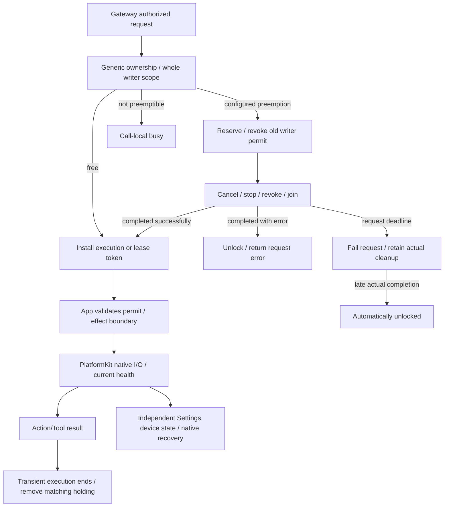

# ADR0141: Resource control ownership independent of execution/device failure

Status: Accepted. Supersedes the faulted/recover resource policy of ADR0066/ADR0139/ADR0140. Configured preemption, renewable leases, cancellation-independent acknowledgment and independent Bluetooth recovery remain current. Original Technical_Design.docx is preserved.

## Problem

ResourceCoordinator combined control occupancy with a persistent cleanup-fault latch. New Actions were denied even after old execution ended or device availability returned; Assistant priority could not reach takeover. Transient uses were tracked separately from available snapshots, so snapshot availability did not mean unlocked. Cleanup failure is not a current hardware-health measurement.

## Decision and ownership

- Public state is exactly unlocked or locked(owner), with nil owner permitted for host use. A single actor-owned holdings index owns occupancy; lease/use/handoff records hold lifecycle metadata. Internal phases are empty, held and handoff. Shutdown is coordinator lifecycle, not resource health.
- Leases and transient runs use unique tokens. Snapshot includes actual writer scope, including execution-group siblings. Requested effect/resource sets and lease permissions remain explicit. A lease-bound Action ending does not release its persistent lease.
- Every actual run binds a ResourceExecutionPermit through generic AgentCore context. Validation rejects after execution ends or handoff revokes the old holding. App validates at Agent finite-motion entry and tracking native startup/write; held IDs alone grant no bypass. Old completion/release removes only its own token. Expected cancellation remains cancellation.
- Configured execution takeover gates the complete affected writer before awaiting cancel/stop/join. Only explicit host policy may preempt another owner; existing leases require explicit lease takeover. Subsequent Actions from the reserved requester remain in existing bounded Channels. There is no second resource queue, scheduler removal, whole-Agent stop or native reconnect.
- Cleanup collects stop errors without cancelling sibling stop/join/revocation tasks. Completed cleanup with an error unlocks and returns that error to its requester. Normal execution failure releases its transient holding. Neither failure writes device health or creates a persistent resource fault.
- Successful cleanup retains its reservation until the waiting requester atomically installs a new use/lease or retires it on cancellation/shutdown. A deadline fails only that request and abandons its pending-owner reservation. The coordinator retains unfinished cleanup without cancelling it; actual late completion automatically unlocks. It never grants the timed-out request or replays its command.
- Owner/session/shutdown closure observes an existing handoff rather than returning early or issuing another stop against the future owner. Subscriptions are bounded and disappear on acknowledgment/deadline. Caller cancellation cannot terminate acknowledgment iteration.
- Remove ResourceError.faulted, resource recover and CameraCoordinator's recovery flag/branch. Camera retry acquires normally against actual occupancy. Device faults remain in PlatformKit/App native state, and Action/Tool errors in their execution results. Settings manual controls continue bypassing Agent locks.

## Bounds and consequences

Retain64 registered resources,8 resources/request,32 leases,256 uses,32 retained cleanups,60-second maximum lease and default5-second cleanup deadline (maximum30). Each cleanup admits at most8 lifecycle completion subscribers, each with a capacity-one completion stream and bounded deadline; excess explicitly rejects. Tokens and holding keys are bounded by admitted executions/catalog. Existing Channel queue bounds and overflow rejection remain unchanged. No new target, source duplication, hardware Action recipe or third-party library is added.

A genuine writer/stop callback that never ends remains locked. Removing a stale fault latch does not authorize concurrent writing or force native termination. Software stop completion does not prove physical stop, arrival or obstacle clearance. Native session cleanup/isolation and hardware health remain separately owned; this change never initiates Bluetooth recovery from a resource error.

## Validation

Controlled regressions cover A failure followed by B execution, transient snapshots, revoked/ended permits, stop error after joined writers, timed-out takeover with no request replay and automatic late release, shared-writer scope, stale lease release, expiry, cancelled camera-owner removal followed by Assistant action, existing queued Action preservation and Settings manual bypass. App-entry simulation rejects an obsolete permit before native commands. Required check.sh, build-ios.sh and generic device build results are recorded in Validation-History.md. Physical camera-off/takeover/native-I/O acceptance remains separate.
