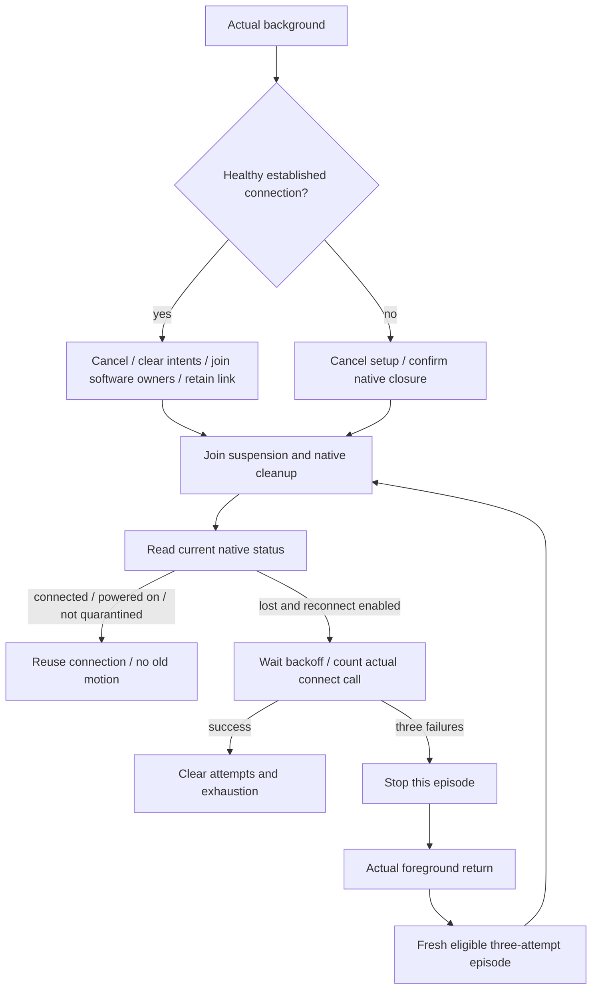

# ADR0142: Bluetooth scene lifetime and independent retry episodes

Status: Accepted. Supersedes ADR0125's cross-success retry budget and unconditional background disconnect policy. Native closure/isolation, manual disconnect preference, bounded recovery and Action/Tool result isolation remain current.

## Problem

Background transitions closed a healthy connection, retained recoveryAttempts across successful reconnects and cleared the stable-connection timestamp. Three rapid foreground returns could exhaust all attempts permanently until manual retry. Attempts were charged before backoff, even when background cancelled the wait without a connection call. App also mapped transient inactive to background.

## Decision and ownership

- App forwards actual background status to BluetoothWorkflow. Inactive does not disconnect or grant another retry episode; camera/voice keep their separate lifecycle policies.
- Healthy background entry stops discovery, clears pending manual/motor/aim intent, cancels and joins finite motion, manual playback and live control. One retained suspension Task gates new effects until actual software owners retire; fast return does not bypass it. Keep the connection-local controller and healthy native connection. This does not prove physical stop.
- Pending connection/recovery or unhealthy transport still follows existing disconnect and joined native closure. SDK query cancellation may quarantine/close an ambiguous reply stream; no lifecycle policy bypasses that isolation. Native loss observed in background is deferred for foreground recovery.
- Foreground joins suspension and native cleanup, then reads actual SDK status. Reuse only a connected, powered-on, non-quarantined link with the existing controller. Otherwise start eligible bounded recovery. Do not replay old motion.
- Each successful connection clears the attempt count/exhaustion immediately. Each genuine background-to-foreground transition starts a new eligible episode, even after the previous episode exhausted. Manual disconnect/forget remains disabled across return. Radio/permission/service compatibility and confirmed old closure still govern whether a connection can actually start.
- Each episode has at most three actual connect calls with 1/2/4-second backoff and the existing two-minute cooperative active deadline. Waiting cancellation/radio unavailability consumes no attempt. Count immediately before actual connection initiation. Repeated same-phase notifications grant no additional budget.
- Remove the 30-second stable-connection reset policy and timestamp. No independent automatic flapping throttle is added; future throttling must be separate from episode accounting and cannot permanently suppress an eligible user foreground return.

## Boundaries and limits

Suspension retains at most one Task and no command queue. Existing latest manual/motor/aim slots, recovery worker, native request/observation slots and Channel bounds remain unchanged. Resource arbitration, Agent lifetime and execution outcomes are not driven by radio recovery. The App's explicit background cancellation remains separate from native failure handling.

No bluetooth-central mode, restoration identifier/delegate, background robot execution, forced writer termination or third-party dependency is added. A foreground-only App may retain an existing BLE link while suspended but receive events only on return; connection survival is not guaranteed. See [Apple background processing](https://developer.apple.com/library/archive/documentation/NetworkingInternetWeb/Conceptual/CoreBluetooth_concepts/CoreBluetoothBackgroundProcessingForIOSApps/PerformingTasksWhileYourAppIsInTheBackground.html).

## Validation

Simulated composed workflow regressions cover success reset, repeated exhausted episodes with a new foreground attempt, repeated healthy reuse without reconnect, no old jog/gesture replay, background native loss, cancelled backoff, joined live cleanup before new admission and persisted manual disconnect/forget. Dated check/build results belong to Validation-History.md. Physical inactive/background/lock-screen and query-isolation acceptance remains outstanding.
