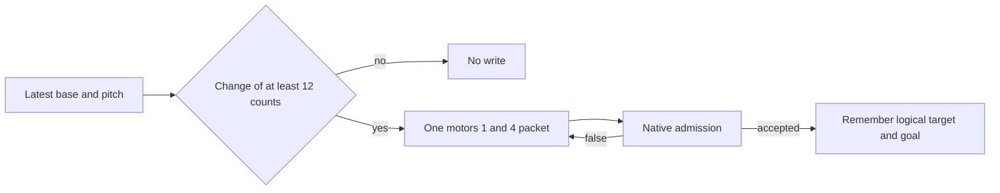

# ADR0142 — One pan/tilt packet per tracking target

Status: accepted, 2026-10-13. Supersedes the live streaming path in ADR0102 and the production use of `NexArmJogPlanner.approach` described by ADR0135. The planner function remains for manual-jog shaping and its existing tests.

## Context

Phone tracking moved motors 1–4 with a 30 ms jerk-limited position stream. Supervised BLE trials on 2026-10-13, with the phone mounted, compared that stream with one write per new target on motor 1. The stream (trial A) had about 33 counts RMS against a ±98-count, 6-second sine and was visibly hesitant. One packet per 200 ms target (trial B, acceleration 30) had about 10 counts RMS and was visibly smooth. Acceleration 10 and 100 did not change that result. A 30 ms host interpolation (trial C) was worse than B and stopped when feedback was lost.

Separate single-command trials showed motors ignore 1–2 count steps and respond unreliably below about 10 counts. A 200-count move at register speeds 100, 200 and 400 took about 4.2 s, 2.2 s and 1.2 s, so actual travel was roughly 0.45 of the register value. Passive position samples remained about 5 Hz, including during live control. A synchronous motors 1+4 write was admitted on the same live path, at the same spacing as a single-motor write.

## Decision

1. The tracking worker still owns motors 1–4 and still returns when the latest target is stored. It commands only motor 1 (pan) and motor 4 (pitch). Motors 2, 3 and 5 receive no tracking write and hold their current goals.
2. `NexArmAimCommand` emits at most one synchronous position packet for a new logical target. The packet is retried until native admission accepts it. A logical change smaller than 12 counts on both axes produces no packet.
3. The first packet aims at the logical counts. A later packet leads by at most the last logical step, using a 0.2 s horizon. Register speed is `distance / 0.2 * 2.2`, clamped to 10…600. Acceleration is 30. These values are `NexArmAimCommand.Parameters.tracking`.
4. The estimate of position is the last admitted goal, seeded from the latest six-joint sample or the tracking rest. It is cleared when the worker fails or is cancelled, and when a manual action or jog starts with no tracking worker running. Tool publication and an admitted packet still do not mean the arm has arrived.

## Consequences

Shoulder and elbow no longer extend with wrist pitch during tracking. The five-axis packet builder and `NexArmForearmLeveler` remain for the diagnostic controller path and preset geometry. `approach` is no longer on the live tracking path.

❌ Motor 4 was not measured in the BLE trials: the arm was at the ordinary home, not the tracking rest. The 2.2 speed scale was not part of the smooth trial, which used an unscaled speed. Phone perception, fast subject motion and endurance remain unaccepted.
