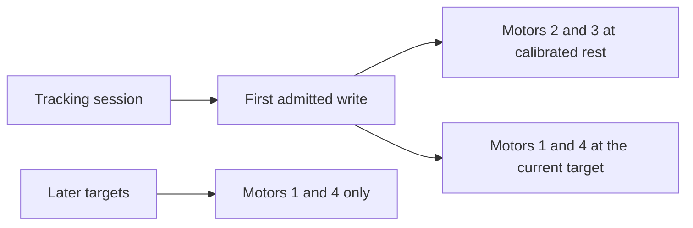

# ADR0143 — Tracking starts from the calibrated level rest

Status: accepted, 2026-10-15. Supersedes ADR0142's rule that motors 2 and 3 receive no tracking write.

## Context

The calibrated tracking rest is `[2047, 2087, 1984, 2045, 2048]`. Shoulder 2087 plus elbow 1984 is 4071, which holds the forearm level. The ordinary arm reset leaves the elbow at 1198, so the forearm is folded. ADR0142 commands only motors 1 and 4, so a session that starts at the ordinary reset never reaches that level pose.

## Decision

The first admitted tracking write includes motors 2 and 3 at the calibrated rest, register speed 400 and acceleration 30. That write is not repeated after admission. Later writes stay the ADR0142 pan/tilt packets for motors 1 and 4. Motor 5 is not written. Admission of the level counts does not mean the forearm has arrived.

## Consequences

A session begun at the ordinary reset moves the elbow toward 1984 once, then pans and tilts from the calibrated wrist and base zeros. ❌ Physical arrival of that elbow move, and tracking with the phone mounted on the level pose, remain unaccepted.
