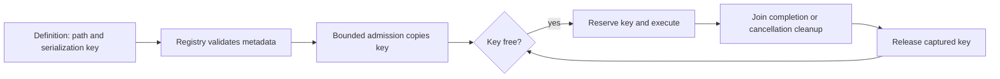

# ADR0155 — Explicit Action serialization identity

Status: implemented scheduling prerequisite; three-level Path migration remains pending.

## Context

The adopted Domain.Module.function layout splits current modules into cohesive entry files. Deriving exclusion from the new module field would let formerly serialized UI, Speech or NexArm Actions run concurrently.

## Decision

ActionDefinition owns an immutable serializationKey independent of path, Channel and resource leases. Both initializers and macro-generated factories preserve it. The registry rejects empty, malformed or overlong keys using its bounded identifier grammar. Production Action attributes explicitly retain UI, Speech and NexArm scopes. Omitted keys use path.module for legacy definitions and isolated tests; no business alias map is added to Runtime.

ChannelScheduler captures the registered key during bounded admission, reserves it before execution across all tasks/Channels, and releases the captured key only after cooperative cleanup joins. Caller parameters cannot change it. Queue bounds, waits, resource preemption, result delivery and Tool execution do not change.

## Verification and next stage

Deterministic fixtures hold an Action open while a different path on another Channel shares its key, and allow an independent key to progress. Invalid keys fail registration and macro metadata is checked. Full check results are recorded in Validation-History.md.

Next migrate three-field addresses, versioned Agent configuration and startup registration coverage together. Unified capability definitions/results and protocol dispatch follow; this change does not expose additional permissions or establish physical device acceptance.
