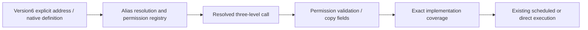

# ADR0156 — Three-level capability addresses

Status: implemented address and configuration migration.

## Decision

AgentCore ActionPath and ActionRuntime ActionIdentifier carry domain/module/function explicitly, with independently validated bounded identifier segments. Gateway copies all fields and startup coverage distinguishes domains. Direct Tool registry keys use exactly three validated segments. Canonical production addresses follow the cohesive entry-file mapping in Agent-Driven-App.md.

Configuration v6 requires three-field Action paths. Every native Tool entry binds path to a separate definition; only that native definition reaches model providers. Function names remain Agent-local aliases. Version5, missing fields, unknown bindings and dotted module segments fail explicitly. Fixed internal permissions use canonical paths. SDKs and Gateway contain no legacy business alias maps.

ADR0155 serialization keys keep UI/Speech/NexArm exclusion independent of new module names. Resource identities and Channel/wait behavior are preserved. Test-only fixtures select explicit addresses and exclusion scopes.

## Next

Unify implementation definitions/results and exposure adapters; remove re-export-only compatibility targets. This address change alone does not authorize both protocols, resume LLM reasoning from feedback or establish physical device acceptance.
