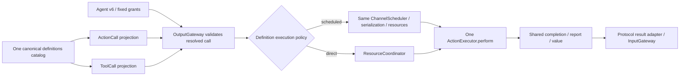

# ADR0157 — Canonical executable definitions and protocol projections

Status: implemented.

## Decision

ActionDefinition owns one canonical handler, three-level address, completion, protocol availability, execution policy, serialization key, resource resolver and constant/dynamic budgets. ToolDefinition/ToolResource are aliases, not parallel implementation stores. Each domain exposes one definitions catalog and filtered scheduled/native projections. Existing typed entry signatures are adapted by factories without duplicating business code.

ActionExecutor.perform normalizes completion/report precedence and deadline/cancellation cleanup for both protocols. Shared ActionCompletion adds a64 KiB bounded value outcome. ToolResponse and AgentCore ToolResult retain the shared typed completion alongside the native string value. Completion-only direct effects preserve no-feedback success and explicit errors; returning feedback remains owner/causality fenced through InputGateway.

Scheduled native calls use one isolated child scope outside XML waits, preserving original handler context. Existing scheduler bounds apply; one bufferingOldest1 receipt per child retains terminal completion. Cancellation cancels and joins the child before returning; one original ToolResult is delivered without an additional ActionResult. Scheduled Tool availability also requires its Action projection. Direct resource resolvers execute before resource admission.

Tools/ToolRuntime targets, re-export shims and namespace aliases are retired. Protocol request/context/result envelopes and registry projections remain Runtime adapters, not business implementations. App binds explicit endpoints; Gateway/AgentCore remain independent of concrete domains.

## Validation and remaining scope

Tests verify equal returned values, one gaze function through both adapters, protocol permission separation, dynamic-resource fences, shared scheduling, preserved context, single feedback and joined cancellation. Exact check/build outcomes are in Validation-History.md.

No new production protocol grant, model continuation, general progress service, physical stop proof or device/model acceptance is implied. Additional Agent-driven feature migration remains separate work.

✅ Composition freezes CapabilityCatalog once before projection: at most32 domains/256 canonical definitions, shared metadata validation before filtering, and duplicate addresses rejected across protocols. The same handler/metadata snapshot feeds both registries; invalid unexposed definitions cannot disappear silently.
