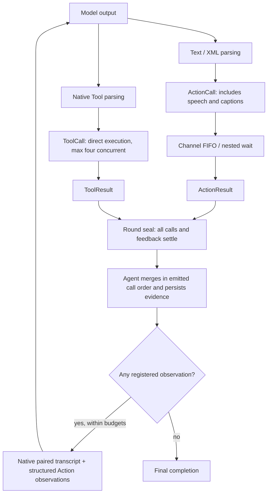

# ADR0183 — Action/Tool generation rounds and registered observations

Accepted and implemented: 2026-10-08.

## Contract

✅ Implemented: model text/XML resolves to Actions; text expands to Speech playback and Display caption Actions. Native Tool calls bypass Channel/wait. Both reuse canonical functions, resources, deadlines and cleanup. Tools have a per-input concurrency bound of four and a total bound of sixteen; waiting work remains within the 120-call generation bound.

Host bindings declare recordOnly or observation separately for each protocol. Production projects an immutable neutral policy table into Assistant. Existing native returning bindings initially observe; XML/speech/caption bindings initially record only. Business return shape never selects continuation. Void observation returns an actual completion acknowledgment. Both kinds retain distinct results and stable call/round identity.

An Agent owns one sealed model round at a time. The typed round-finished output closes the scheduler tree independently of final assistant.finished. All round calls settle before merge. Terminal Action and Tool results remain separate, sorted by emitted call order (each protocol preserves its own order; cross-protocol execution is independent). Only observation registration enables another model round. Pair every native call with a tool message when continuing; Action observations use structured user-role execution data, never forged provider calls. Data does not execute as markup.

Limits remain four model requests, sixteen native calls, 120 generated calls, 64 KiB observation/transcript results and one 30-second joined input deadline including execution wait. Failed results are observations, not replay instructions. Infrastructure/delivery failure terminates the turn; cancellation joins all admitted work. Task submission acknowledgment is not physical arrival. No remote transport or generic Agent request/reply is added.

## Signal exchange remains a separate chain

✅ Existing Agent send/publish Signals still use declared contracts, permissions, runtime scopes and causal envelopes through InputGateway. Execution results and round acknowledgments use the trusted runtime feedback route; receiving an ordinary Agent Signal does not automatically resume a model round. This change implements one Agent’s bounded execution-observation loop, without inventing generic Agent request/reply, remote transport or durable delivery.

## Ownership and migration

AgentCore owns neutral policies, round/call association and runtime feedback envelopes; Agents owns round collection and model requests. CallRuntime owns host registration. Gateway owns execution adapters and typed round acknowledgment. App owns an ordered Action admission / bounded Tool execution pump and projects host policies. StorageChat retains optional exact generation round records alongside existing version-1 history.

Remove Tool scheduler projection and scheduled native registration. Migrate affected fixtures to direct Tool resource coordination. Move only Assistant text presentation to Action; other deterministic Agents retain their existing native presentation interfaces. No new directory, module or dependency.

## Validation

Test Action-only, Tool-only and mixed rounds; record-only and observation independent of value/void/error; full-round barrier; ordering and stale/duplicate rejection; four-way concurrency; wait semantics; cancellation/delivery failure; budgets and v1 history ownership. Run scripts/check.sh and scripts/build-ios.sh when full Xcode is available. Real model/native UI/device acceptance remains separate.

## Generation flow

✅ Final repository check passed (607 integration /51 workflow tests); synthetic regression and repository validation cover the implemented runtime contracts. See [validation history](../Validation-History.md#2026-10-08--registered-actiontool-generation-rounds). ❌ Real provider, native UI and physical-device acceptance remain pending; Simulator compilation is blocked by the existing external CoreAI dependency.

## Independent protocol consumption refinement — 2026-10-08

✅ Implemented: replaced shared consuming loops with independent bounded text/Action and native Tool workers inside Assistant and App transport. No new directory, module or dependency. Protocol ordering is local; cross-protocol merge preserves emitted call order. Native saturation cannot block Action admission, and speech preparation cannot block native parsing/emission. Close and join both routes before round acknowledgment and downstream continuation. Overflow is explicit, failed turns cancel/join both routes and preserve the subscription for the next input. Generic Agent request/reply remains pending; this change supplies the existing completed-round continuation boundary.

Independent-consumer refinement validation: focused protocol regressions and unsigned iOS device-target build passed; full checks retain BLE fixture failures, and the required Simulator build remains blocked by CoreAI. See [validation history](../Validation-History.md#2026-10-08--independent-tool-and-action-protocol-consumers). No live-provider/native/device acceptance is inferred.
