# ADR0184 — Assistant photo Action and multimodal observation

Accepted:2026-10-08. Implemented. Automated validation passed; real-provider/native-device acceptance pending.

Assistant directly exposes Camera.Capture.takePhoto on Camera Channel with observation registration to exercise the new Action/Tool result loop. No Agent delegation or video recording is added. Native capture, bounded local persistence and screenshot-style presentation settle before terminal ActionResult. Result contains an owned photoID, not image bytes. Assistant resolves successful photo results into bounded user-role images for its next round; failures remain execution data and never replay automatically.

Budgets: one capture,10-second native deadline,3-second presentation acknowledgment,4MiB JPEG,32 files/128MiB local store, four image attachments/16MiB per model transcript. Existing4 model requests/120 calls/64KiB text/native feedback/30-second input bounds still apply. Keep durable photos on cancellation/presentation failure; reject capacity explicitly. No system Photos export permission needed. Native shutter sound uses platform capture; no duplicate/custom audio-session takeover.

Owner source/session/input scopes image reads. Attachment bytes stay out of Agent results and history; continuation history records photo identity/MIME/size alongside text data. Current-turn images are not silently replayed in later conversation context. OpenAI-compatible chat supports image content parts; local Gemma rejects. Actual configured provider/model vision support needs live acceptance.

UI uses150ms fade,250ms hold,450ms shrink to lower-right and indefinite latest thumbnail; Reduce Motion avoids large movement. Page disappearance cancels presentation acknowledgment, not durable storage; app camera lifecycle owns native capture cleanup.

Validation: real Gateway Action-only and mixed Action/Tool rounds with stub image provider; metadata result, actual image attachment after barrier, no repeated effect, capture/read/provider failures, image bounds, storage owner isolation, old transcript decode, exact cloud JSON. Required scripts/check.sh and build-ios.sh; unsigned device build separately if Simulator CoreAI fails. Native camera/shutter/animation and real model acceptance remain distinct.

API format reference: [OpenAI image inputs](https://developers.openai.com/api/docs/guides/images-vision).

## Runtime flow

```mermaid
flowchart LR
    Model[Assistant model output] --> Action[Camera takePhoto Action / Camera Channel]
    Action --> Capture[One native JPEG capture]
    Capture --> Store[Owned durable photoID]
    Store --> UI[Full photo fade / shrink / thumbnail]
    UI --> Result[Terminal ActionResult: metadata only]
    Tool[Optional parallel native Tool] --> ToolResult[Terminal ToolResult]
    Result --> Barrier[Full-round barrier and ordered merge]
    ToolResult --> Barrier
    Barrier --> Reader[Assistant resolves owned photoID]
    Reader --> Next[Next model request: native pairs + execution data + user image]
    Next --> Feedback[Model photo understanding: speech and captions]
```

CameraCoordinator hosts the composite capture/save/presentation endpoint; Actions declares its completion and Assistant chooses the effect. No standalone UI.Camera function or Photographer message is needed for this validation iteration. The native ten-second watchdog stops capture; cancellation and resource teardown retain/join the callback task until the platform terminal callback. Uncooperative OS callbacks cannot be forcibly completed.

CapturedPhotoStore retains at most32 photos, rejects capacity and does not silently evict. A gallery/delete/export UI is outstanding. The current thumbnail is display state, while photos persist across cancellation/restart. The photo result’s successful metadata creates a multimodal continuation, with registration as the sole loop trigger. Unsupported image capability, invalid/missing/foreign photo references and read failure terminate explicitly after retained execution evidence.

Text/native continuation history remains exact; multimodal records retain attachment ID, MIME and byte count and explicitly omit bytes. Photos are not automatically reattached to later user turns. See [API image-input format](https://developers.openai.com/api/docs/guides/images-vision).

## Validation evidence

✅ Final repository check:611 integration /51 workflow tests and other targets passed. Unsigned device-target compilation passed; final platform/UI hardening also passed incremental device compilation. ❌ Simulator CoreAI dependency remains blocked; live capture, animation, audio and model understanding are unverified. See [validation history](../Validation-History.md#2026-10-08--assistant-photo-observation-loop).

## Photo touch and voice recovery correction

✅ Implemented: passive photo transition plus a tightly bounded thumbnail inspection Button; remove the full-screen positioned-image gesture. Preserve closed recognition admission across ReAct rounds and reject late perception listening presentation. Scope native output task groups to each input so one failed reply cannot terminate the persistent Assistant consumer. Failure stays visible and explicit retry reuses loaded providers.
