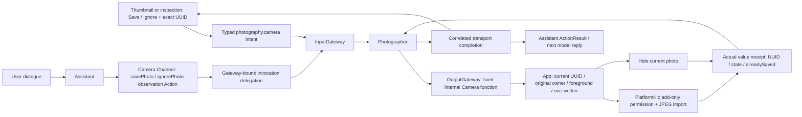

# ADR0185 — Agent-driven photo save and ignore

Accepted2026-10-08. Implemented; final automated/native compilation evidence recorded separately in Validation-History. Physical Photos/gesture/model acceptance is pending.

“Save” explicitly imports the displayed capture into the system Photos library; capture alone keeps private evidence. “Close/ignore” hides the thumbnail and inspection without exporting, deleting an existing album photo or cancelling a running photo-understanding reply. Current private evidence remains within the existing32-file/128MiB bound; later turns do not automatically reattach it. Durable deletion/gallery remains separate work.

Camera.Capture.savePhoto/ignorePhoto validate optional photoID before effects. UI always captures the rendered UUID; stale/ignored/replaced identity fails without affecting a new photo. Conversation may omit ID to select current at execution. The host uses the stored producing owner for private read, never invents cross-input read authority. Both protocols use neutral value receipts; only takePhoto attaches an image to the next model request.

Photographer's existing one-request service admits root UI or authorized Assistant provenance, selects canonical functions and returns actual result data after both execution and acknowledgment. Saved/ignored receipts, permission/execution failures and cancellations remain explicit. Capture still uses the direct Assistant validation path from ADR0184; this iteration extends disposition, not Photographer capture/video/movement planning.

Scheduled Actions now bind the same invocation delegation authority as Tools during their actual handler execution. Binding retains validated OutputEnvelope and ExecutionOwner, not media; ownerless scheduler calls receive no authority. Task-local nesting restores the parent and callbacks run after the scoped binding. Existing manager incarnation/session and communication permission checks remain mandatory.

CameraCoordinator owns one displayed photo/original owner and one export Task, rejects overlap and freezes selection. savePhoto has a60s cooperative function budget; Assistant retains its existing30s whole-input bound. PhotoKit permission/transactions cannot be forcibly cancelled: cancellation before import prevents it, issued transactions are joined. Scene/camera reconciliation cancels and joins export before native cleanup. Successful import commits savedPhotoID before returning, so another request cannot duplicate that displayed photo; cancellation after OS commit does not erase the real save fact. There is no accepted-command replay. App restart does not restore a thumbnail or expose earlier photos for export.

ApplePhotoLibrary owns add-only authorization, at-most4MiB JPEG import and native transaction completion through public PhotoKit APIs. UI has no storage/Photos dependency; it forwards44pt controls within the96×128 thumbnail, fullscreen actions and passive status. Animated image/messages do not intercept voice controls. Permission denial keeps the thumbnail for explicit retry; ignore closes inspection and clears display. Save leaves a confirmed saved state visible.

Configuration supplies NSPhotoLibraryAddUsageDescription and truthful camera-observation purpose text. No photo-library read/asset enumeration permission is requested. Native import follows [Apple PHAssetCreationRequest documentation](https://developer.apple.com/documentation/photos/phassetcreationrequest).

Validation plan: real Gateway root/Assistant routing, exact IDs, malformed arguments, permission failure/retry, one-export repeated save, missing/stale photo, input overlap, result-driven ReAct without extra capture/image, full repository check and iOS build. Physical authorization/album contents, thumbnail/fullscreen touch, VoiceOver/Reduce Motion and real-model intent following need separate acceptance.

✅ Final full checks passed616 integration /59 workflow tests; signed device build2026100807 and signature/resource/permission checks passed. ❌ Simulator CoreAI remains blocked, physical install failed because the paired phone was unavailable, and native/model acceptance is pending. See [validation evidence](../Validation-History.md#2026-10-08--agent-driven-photo-save-and-ignore).
