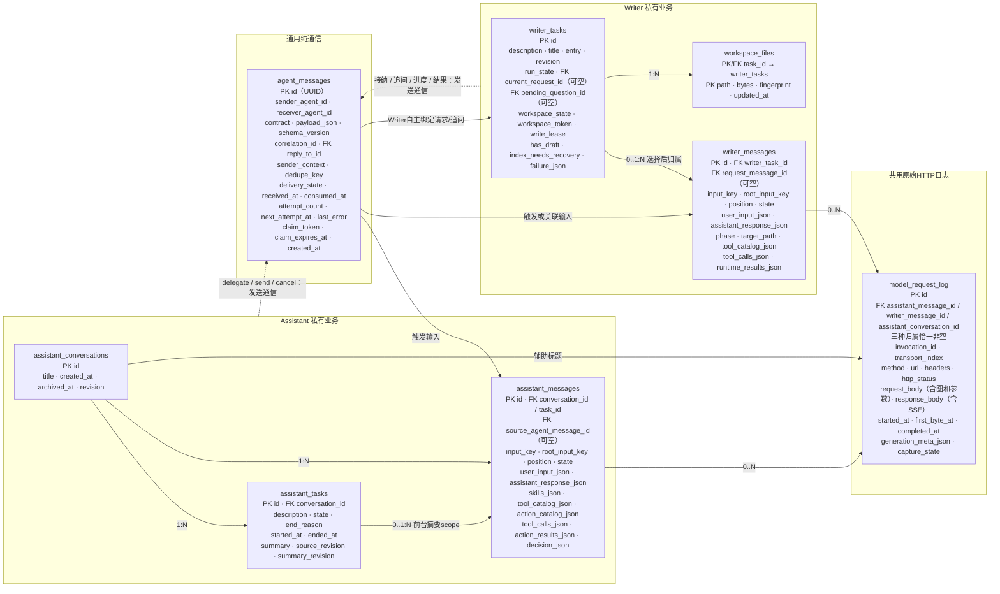

# 独立 Agent 业务、纯通信与 HTTP 日志表设计

日期：2026-11-07。状态：已完成并归档。新十表、按表目录、业务调用方、日志及历史 UI 已完成，旧表和兼容代码已删除；按用户授权清洁安装真机并验证启动与十表初始化。自动验证、历史失败和独立原生 UI/真实模型验收边界见验证记录。

## 1. 当前确定的边界

- Assistant / Writer 两侧独立保存各自的任务、完整消息和业务状态。上级仍为 assistant_conversations / writer_tasks，不共享 messages，也不创建 message_assistant/message_writer 扩展表。
- 不创建 writer_executions，不用跨 Agent 委派记录替目标 Agent 管任务；删除旧 agent_delegations。新增通用 agent_messages 只记录通信信封、实际消息内容和投递/消费事实。
- task.delegate 和 task.send 都产生 agent_messages；收到消息后是否创建任务、复用/打开 workspace、何时结束，由接收 Agent 内聚处理。通信表不含 task_id、workspace_id、goal、task_status、任务摘要或执行阶段等业务列。
- “纯通信”仍需保存实际发送的 payload：委派描述、补充文本、回报文本都是消息正文。不从正文抽出第二份任务模型，也不保存接收方任务快照。没有正文就无法可靠重投和诊断消息，此处不能只保留发送人和状态。
- Assistant 任务表只保存前台 scope，移除 delegated kind/目标 Agent 等字段。task.start/end 只管前台；task.delegate 独立通信；cancel/send 带 agent_id 时发消息，不带时作用于前台。
- 前台任务平铺、无父子关系，同一时间最多一个非终态任务。连续 start 必须强制结束旧任务后再启动新任务，不能嵌套或伪称旧目标已完成。
- ReACT 对两侧都是独立消息行；task 分段保留。完整业务 input、response、tool 结果保留在消息表，generation meta/HTTP/图片只在 log。
- model_request_log 保存实际 HTTP 请求/响应/SSE、参数、图片和时间；删除 model_requests/message_media。清空日志后 Prompts 图片整体消失，无相册/文件/旧缓存回退。

这版取代之前把 delegation 与前台任务合并、引入 writer_executions 和双份结果状态的方案。数据库物理实现仍可共用 SQLite pool；业务拥有者只访问自身表及通用通信/日志接口，不读取另一 Agent 私有任务表。

## 2. 已核对的现状与不能误删的机制

源码依据：[schema 组合](../../MobileHarness/Storage/Database/SQLiteSchema.swift)、[Task 声明](../../MobileHarness/Actions/System/Task/TaskActions.swift)、[Writer 接纳](../../MobileHarness/Agents/Writer/WriterAgent.swift)、[workspace 写入](../../MobileHarness/Storage/Database/WriterTasks/SQLiteWorkspaceRepository.swift)、[结果重投](../../MobileHarness/Agents/Writer/WriterNotifications.swift)。现状指当前工作区，不代表设备安装版本。

- 旧 agent_delegations 混合请求、目标 task、执行状态、交互、结果投递与权限退休，不能只改名为 agent_messages。必须拆成通信事实和接收方私有业务事实。
- 现有 Writer 列表/phase/删除检查会 JOIN agent_delegations；删表后若不调整这些路径，会造成列表缺失、无法取消或误删运行中的 workspace。
- workspace_token 防过期写入，workspace_lease 排斥并发写者；workspace_dirty 表示未发布草稿，workspace_reindex 表示索引与实际文件可能不一致。四者含义不同，不能合并成一个“状态”而丢失约束。
- 当前通知送达与权限退休独立；删 delegated 表时必须把重投放到通用通信机制，把关闭执行权限/清理留给 Writer 自己，不能拿“消息已送达”代替权限已撤销。
- 旧 logs 是中立 ChatRequest/ChatEvents，不是原始 HTTP；[记录器](../../MobileHarness/Agents/Support/Chat/AgentModelRequestRecording.swift) 和 [HTTP adapter](../../MobileHarness/ModelKit/Language/LLM/OpenAI/OpenAIChat.swift) 需要在后续业务调整阶段改造。

## 3. 目标分区与关系图

目标共 10 张领域表，图中展示相关 8 张；独立 media_files/devices 不展开。实线表示 FK 或明确的区域内关系，虚线表示接口调用，不是跨 Agent 任务外键。

图中 FK 都是单向引用事实，不允许通信层根据业务 FK 决定任务建立或 workspace 选择。agent_messages 没有反向业务 FK；删一侧会话/作品不会删除另一侧任务或通信正文。Writer 选择 workspace 前的消息暂时 writer_task_id=NULL，必须关联入站 request_message_id；选择后由 Writer 在本地事务一次性补齐，不由 Assistant 提前分配占位 task。

## 4. 精简后的表与约束

### 4.1 assistant_conversations

保留 id（INTEGER AUTOINCREMENT）、title、created_at、archived_at、revision。id 是唯一持久身份，公开地址使用 assistant_conversation_N；不再同时保存 identity UUID 和固定 agent=assistant。

移除 input_count/latest_input：按带索引的 assistant_messages 查询计算，区分真正外部输入与 ReACT。移除不透明 recovery BLOB：未完成状态从本侧 task/message 的显式字段恢复，不重放业务；运行时仅从当前显式状态读取，不恢复旧 blob。title_error 从对应辅助日志投影；日志清理后不保留生成诊断。revision 保留为会话读取/写入并发 fence，不是统计计数冗余。

唯一部分索引保证一个未归档会话；会话关闭/删除先让拥有方加入其活跃前台任务清理，再执行本侧删除。没有对 Writer 的级联。

### 4.2 assistant_tasks：仅平铺前台 scope

字段：id、conversation_id NOT NULL FK、description、state、end_reason、started_at、ended_at、summary、source_revision、summary_revision、failure_json（可空）。

- 删除 agent/executor/execution/kind/target_agent_id/delegate_id/parent_task_id 等角色常量或后台概念。
- 不保存重复 source_message_id、first_position、compression_json.sources。来源唯一由 assistant_messages.task_id 决定，首位置由 MIN(position) 推导；source_revision/summary_revision 保留，防异步摘要覆盖过期事实。
- state 记录 running/waiting_input/finishing/cancelling/completed/interrupted/cancelled/failed 等实际状态；end_reason 区分 completed/cancelled/superseded/interrupted。
- 在常量表达式上建立覆盖全部非终态 state 的唯一部分索引，保证整个 Assistant 同时最多一个前台任务，不能按 conversation 分区放宽。
- 后台委派不是本表一行：发起动作及消息 ID 留在 Assistant 当轮 action_results_json，任务进度由收到的 agent_messages 回报作为观察输入体现。
- 旧 compression_json 与旧数据一起删除，新摘要来源仅由 task_id 推导。

### 4.3 两张消息表的公共原则

各自拥有整数 id、稳定 input_key（幂等，按本侧 owner 唯一）、root_input_key（原始输入来源）、position（业务顺序）、input_kind、caused_by_message_id（本表 FK，可空）、state、created_at/updated_at/completed_at、schema_version。caused_by_message_id 表示 ReACT 因果，不是 task 父子关系。

`user_input_json` 是完整本轮业务输入；`assistant_response_json` 是本轮回复块及调用引用。调用参数/结果在本行的 tool_calls_json/action_results_json/runtime_results_json 各自唯一拥有，不再同时保存 user_text、response_text 和整个 content_json 三份副本。列表摘要从 JSON 有界投影，不能截断持久正文。业务返回可以保留实际文本/标识，但不含用于恢复 Prompts 的图片字节。

保留 position 而非简单用 id 排序：旧历史按 historyOrder 排列、ReACT 拆行和异步持久化都可能使主键顺序不同于业务顺序。input_key 与 id 也不能合并：前者用于写入前幂等，后者是本库读取地址。删除重复 client_id/input_id/messageID JSON 镜像；新记录必须保持输入因果。

Assistant 附加：conversation_id NOT NULL FK、task_id 可空 FK、source_agent_message_id 可空 FK、skills_json、tool_catalog_json、action_catalog_json、tool_calls_json、action_results_json、decision_json。decision_json 仅记录当轮必要 Task/Skill 选择和业务决策快照，不重复整份可删除模型 prompt 或运行期恢复 blob。

Writer 附加：writer_task_id FK（选择前可空）、request_message_id FK（该次请求的通信根，选择前必填）、phase、target_path、tool_catalog_json、tool_calls_json、runtime_results_json。具体补充/追问来源消息 ID 作为 user_input_json 的输入来源保存；request_message_id 用于区分同一 workspace 的不同请求，不能只靠“当前 task”接收旧回调。Writer 原生输入没有跨 Agent 请求时，该列允许为空，但不得出现既无 workspace 又无来源的孤立轮。

消息 task/workspace 关联一经进入实际执行不能随意重绑。模型结束不等于工具完成；实际失败、成功空值、取消、拒绝和未知结果明确区分。原生 tool call/result 必须按 providerCallID 完整配对；runtime 内部回执不制造 ReACT。各表按 owner/position/id、caused_by_message_id 和通信来源建索引，不加入另一 Agent 私有 FK。

### 4.4 writer_tasks：目标自行拥有任务、当前运行与 workspace

字段：id、description、title、entry、revision、created_at、updated_at、run_state、current_request_id（可空 FK → agent_messages）、pending_question_id（可空 FK → agent_messages）、workspace_state、workspace_token、write_lease、has_draft、index_needs_recovery、failure_json。

- writer_tasks 是可复用作品/task，不是一次通信。run_state 描述当前/最近一次处理状态（idle/running/waiting_input/closing/completed/failed/cancelled/interrupted/cleanup_failed），不会使作品永久不可再用。
- current_request_id 是 Writer 接纳后自己绑定的通信根；外部不能指定它来选择 workspace。新请求复用任务时，只有上次本地执行/清理终止且结果已可靠入通信 outbox 后才替换当前关联。current_request_id 的非空值在本侧唯一，防同一请求绑定两个 task。历史请求按 writer_messages.request_message_id 与不可变通信结果保留，不另建 executions 表。
- pending_question_id 指向 Writer 自己发出的待答消息；回答必须匹配 reply_to_id、当前请求和可信来源，不另存重复 interaction UUID。
- 本地调用/文件写入回调冻结 task ID、current_request_id、revision；旧请求的回调不能因 workspace 被复用而写进新请求。
- 新建/复用/打开完全由 Writer 决策。选择前可持久化入站处理消息但无 task；选定后原子绑定消息和 task，之后才产生文件副作用。一个当前请求仅绑定一个主 workspace，多 workspace 写入不在此次范围。
- 删除固定 agent、重复 number/identity、current_delegate_id；使用 id 派生 writer/task_N 目录。旧编号、链接和旧文件随清洁安装删除，不做映射。
- 将 history_revision 与本表元数据修改统一到 revision（所有业务修改推进）；但 workspace_token 单独保留，因为消息/标题变化不等于文件版本变化。
- workspace_state 归并互斥的未建立/ready/deleting 状态，替代 workspace_ready/deleting。write_lease（原 workspace_lease）和 workspace_token 分别用于排他写入和旧版本校验。has_draft（原 workspace_dirty）与 index_needs_recovery（原 workspace_reindex）保留为两个正交事实：已正确建索引的未发布草稿仍然可能存在。
- 没有 writer_executions 后，工作区删除条件改查本侧 run_state 和 write_lease，不能继续 JOIN 已删 agent_delegations。活跃/cleanup_failed 时不得删除；实际文件清理完成前保留 deleting。

### 4.5 workspace_files

保留 PRIMARY KEY(task_id,path)，task_id FK → writer_tasks，bytes、fingerprint、updated_at。只索引当前文件，不存源码或历史版本；文件为权威，索引可在 interrupted write 后按 index_needs_recovery 修复。每个相关字段都有现行作用，不能为了表少而去掉索引或写入 lease。

## 5. agent_messages：纯通信而非通用任务表

| 字段 | 职责 |
| --- | --- |
| id TEXT PK（UUID） | 一条不可变逻辑通信消息身份；网络重投复用该 ID，不创建重复消息 |
| sender_agent_id / receiver_agent_id | 单一发送方/接收方；发给多方拆成独立行，不能一行混多个回执 |
| contract / schema_version | 声明消息协议及版本，通信机制不解释业务任务 |
| payload_json | 实际发送的不可变正文；可为委派描述、普通补充、追问、进度或结果，不另存 task 内容快照 |
| correlation_id | 通信会话/请求链身份，用于关联消息而非目标 workspace |
| reply_to_id | 本表可空 FK，说明回复哪条消息；清理引用时保留 correlation_id |
| sender_context | 发送方提供、接收方不解释的回程关联信息；仅发送方验证后解析，不变成任务 FK 或任意路由授权 |
| dedupe_key | 与 sender/receiver 联合唯一；发送方为同一逻辑消息生成稳定键，防重建 outbox 产生重复完成回报 |
| delivery_state | pending / in_flight / received / dead_letter / historical，仅投递事实；没有 running/completed 等任务状态 |
| created_at / received_at | 创建、接收持久化时间；received 不等于业务处理完成 |
| consumed_at | 接收方已持久化接纳/拒绝/安排处理的去重标记，不是任务完成时间 |
| attempt_count / next_attempt_at / last_error | 有界重投、退避和投递失败；不是模型/任务执行次数或业务失败 |
| claim_token / claim_expires_at | 通信 worker 的领取 fence；崩溃后可恢复投递，不恢复业务执行权限 |

payload 的业务结果可描述真实任务结果，因为那是实际通信内容；但通信层不从正文构造 task 状态机、不写 workspace、不决定任务创建，不把收到 message 当作已完成 delegate。

`task.delegate` 发一条声明协议的请求消息，`task.send` 发补充消息，取消也是控制消息；接纳、拒绝、追问、结果、错误均是新的反向消息，用 reply_to/correlation 关联。双方身份和协议能力仍由 Gateway/Agents 认证，不能只凭写了一行数据库获得执行权。

必须保留的可靠性约束：

1. 同一部署的共享 Storage 中，发送方业务终态、最后一轮业务结果与对应 outbox 消息在一次事务内提交；接收方本地输入/安排处理与 consumed_at 在一次事务内提交。该事务只涉及本侧业务与通信表，不能写另一 Agent 私有表。
2. 外部文件/设备效果不在 SQL 事务内，不能宣称 exactly-once；保存调用/幂等 fence，崩溃后标中断并核对实际效果，不盲目重放。
3. id 是消息关联地址，dedupe_key 是发送方来源操作的幂等键；它防止提交重试生成不同 UUID，不能用随机重生成的键。收到相同 id/dedupe_key 只确认既有接纳，同一键正文不同明确冲突；结果消息重投不重新运行创作。迟到的 send/cancel 只能针对捕获的请求根，不能自动作用于新任务。
4. receiver consumed 的拒绝通过独立业务错误消息回复；delivery_state=received 仍是真实投递成功，不和业务拒绝混用。
5. 运行时通信 workers 每 Agent 最多一个有序接收 owner、一次最多取 32 条；最多 16 个待写缓冲项，满则背压或明确拒绝。每条自动投递最多 8 次，退避 1/2/4/8/16/32/60/60 秒；到上限进入 dead_letter、可显式重试，不静默丢弃。通用通信外层 payload 上限 128 KiB，已注册协议更小的限制仍然有效，超限明确拒绝，完整作品/源码不塞进通信正文。
6. claim 超时只释放投递占用，旧 worker 必须凭 token 更新；新 worker 不继承业务执行授权。终态回报发送失败不占用已结束的 Writer 创作状态。
7. 暂不新增通信清空操作。不得复用“清日志”删除通信行；待投递、未消费或仍被业务引用的消息不能清理。将来如加保留期，必须先定义去重/回报保留和 FK 处理，不能让删表导致重复执行。

权限退休仍由执行 Agent 的运行时在本地收尾屏障中完成，不能放进通信 delivered_at。未成功收尾保留 run_state=closing/cleanup_failed，禁止新执行覆盖；新进程不复活旧权限。终态通知仅作为普通认证消息重投，不携带能重开旧执行的授权。

## 6. model_request_log：原始 LLM HTTP 输入输出

保留独立 log id；assistant_message_id / writer_message_id / assistant_conversation_id 三个 FK 恰一非空（最后一项仅标题辅助调用）。invocation_id + transport_index UNIQUE 区分实际调用/HTTP 尝试。日志不作为任何业务表的 FK 父表。

字段：method、url、request_headers_json、request_body BLOB、http_status、response_headers_json、response_body BLOB、started_at/first_byte_at/completed_at、generation_meta_json、capture_format、capture_state、capture_details_json、created_at/updated_at、schema_version。generation meta 含真实模型/参数、首有效 token/耗时/usage/finishReason/生成诊断，业务表不留这些副本。

- 原始指实际提交/接收的 HTTP 应用层 body，不是 TLS/TCP 抓包；保留原始 SSE/错误 body，不从 ChatEvents 拼回最终文本。URLSession 已处理的传输编码与 header 可见范围如实标注；凭据型 headers/URL 参数脱敏。
- 图片按实际请求的 bytes/URL 保存，不额外下载未提交的内容。旧记录直接删除，本地非 HTTP 调用标 local，缺失 HTTP 不伪造。
- 每调用 64 KiB 分块、最多 16 待写块、满时背压；完整性以收到 EOF/终态且落盘成功为准。不能把旧 32 MiB 截断结果称为完整，采集失败保留 partial 和明确错误，不改写真实业务结果。
- 每次调用只初始化一次；后续 chunk/完成只 UPDATE。清除后该 handle 关闭采集，不因迟到回调重建日志；新请求可独立记录。
- 清一条、某轮或全库仅删除 logs；Prompts 图/参数/时间/生成 meta 与缓存同步失效，消息、task、通信、文件保持。缺日志显示不可用，不补零或回退相册。
- ModelKit 提供自身定义的中立传输采集端口，Agents 每调用记录器桥接至 Storage；不让 ModelKit import Storage 或共享业务 task 类型。

## 7. 前台 task 与业务入口

| Action | 含义 |
| --- | --- |
| task.start(description) | 无前台则新建；有前台则强制收尾、提交旧来源/终态后再新建，不接受 agent_id |
| task.end(summary) | 正常收尾并关闭前台摘要 scope，不接受 agent_id |
| task.delegate(agent_id,description) | 发送委派消息，目标自主管任务；不在 assistant_tasks 创建后台行 |
| task.cancel(reason,agent_id?) | 无 agent 取消前台；有 agent 发送针对捕获请求根的取消消息 |
| task.send(text,agent_id?) | 无 agent 补充前台；有 agent 发普通输入/待答消息，目标解释业务 |

公开参数不含 task_id、workspaceID、内部通信 ID。任务/来源绑定由可信运行时注入；多个可控制通信链时明确歧义，不选“最新 workspace”兜底。通信身份只解决因果，不授权执行。Writer 如忙碌可回复拒绝，不因 delegate 自动替换；用户可明确取消旧工作。维持当前 Writer 单执行容量：本侧在所有 writer_tasks 的活跃 run_state（含 waiting_input/closing/cleanup_failed）上建立唯一部分索引，并以唯一处理 owner 覆盖尚未绑定 task 的选择阶段；不能因任务表有多行而同时执行两个写作请求。

前台 start(A) → start(B) → start(C) 串行强制结束 A/B，只有 C 活跃；重复投递同一次调用幂等不切换。强制结束旧任务先停止接纳、取消/加入在途工作及清理（不等待触发切换调用自身），保存真实结果，end_reason=superseded；未完成不能写成目标成功。清理/终态保存失败则新 start 失败，新任务不能运行。摘要失败保留原始消息和失败事实，不能阻止已完成清理的 scope 关闭或伪造成功摘要。

摘要按 assistant_messages.task_id 精确收集，不按时间截取；source_revision 与 summary_revision 一致才可折叠。start/end 所在分段及实际回执属于正确 scope，task 切换不能重绑旧消息。后台结果关闭前被正确接纳时可成为前台来源，关闭后则独立观察轮，不复活旧 scope、不误归新 task；前台结束不级联取消后台。目标要求等待后台结果时，不能仅凭通信已送达宣称完成。

## 8. 删减清单与必须补齐的业务影响

| 删除/优化 | 为什么可删或合并 | 会破坏的旧路径与补充设计 |
| --- | --- | --- |
| writer_executions 提案、agent_delegations | 不把执行/任务伪装成通用通信 | 当前 Writer run/取消/清理转入 writer_tasks；历史按 request_message_id 分组；可靠回报用 agent_messages |
| assistant_tasks 的 kind/executor/execution/parent/后台状态 | Assistant 只管理单一平铺前台 scope | delegate 改发消息；取消/send 解析通信链；连续 start 强制结束旧 scope |
| model_requests、共享 messages、两类消息扩展 | 重复身份与混合业务 | 拆成完整角色消息；日志独立；旧地址及旧数据直接删除，不做映射或替代表 |
| message_media | 用户明确不保留聊天媒体关联 | 清理 UI 回退、引用计数和旧链接；不能误删独立相册 |
| input_count/latest_input、first_position、compression_json 来源副本 | 可从消息/任务 FK 得到 | 列表/摘要查询改写并建索引；来源版本变化则摘要失效 |
| user_text/response_text/content_json 多份正文 | 重复持久化会漂移 | 一份输入、一份回复、各自唯一工具结果；UI/上下文重写为明确投影 |
| identity UUID + number + 固定 agent 等冗余身份 | 角色拆表后主键/命名空间足够 | 新记录派生公开编号；旧编号、trace 与目录随清洁安装删除 |
| current_delegate_id、interaction UUID、任务级 delivered/retired 重复字段 | 委派表不存在，问题本身就是通信消息 | current_request_id/pending_question_id 提供明确因果；通信送达/消费独立，权限退休留本地清理 |
| workspace_ready/deleting 两个互斥标志 | 用 workspace_state 表达完整生命周期 | 更新文件删除补偿与目录查询，不能把 deleting 当 ready |
| workspace_token、write_lease、has_draft、index_needs_recovery | 不删：防过期写、排他、草稿、索引恢复是四个不同事实 | 延续真实文件校验，不能为了字段少损坏 workspace |

必须特别告知的风险已经在本方案补上：删除执行表后仍需本地运行/回调 fence；投递成功与任务完成分离；workspace 选择前消息允许未绑定且必须有通信来源；异步结果需 outbox/消费去重；权限退休不能随通信 ACK 消失。实现中如发现新的独有字段或跨模块依赖，先报告并补设计，不能以忽略/默认成功隐藏。

## 9. 已授权实施顺序

1. **目录与编译边界**：用户已明确授权一张业务表一个目录。表目录直接放在 Storage/Database 下；同表的 schema、record、repo、初始化和查询放在同目录。SQLite 仅保留 pool、事务、schema 初始化协调、公共 SQL 机制；跨表业务协调放在 Database 入口或所属能力目录。SQL-free 公共契约与 GRDB 实现通过 Package.swift 显式 sources 保持原编译边界，不为了文件位置新增模块或依赖。
2. **新表初始化**：用户最新授权不保留旧数据、不做兼容。删除旧迁移代码与旧表/DTO/SQL，使用新 schema；真机安装以卸载旧应用后全新安装清除数据库和关联旧文件。临时库验证全新初始化，不编写旧数据迁移或旧地址映射。
3. **依据新表改业务代码**：Assistant/Writer 各自 Repository 和 DTO、通信端口及 worker、日志采集、Actions/教学、UI/导出/删除/恢复一并适配；删除旧 JOIN 和双写，不让新旧契约长期并存。
4. **统一验证与发布**：初始化和调用方完成前，不把仅新 schema 发布/运行到用户数据库；代码适配失败不能让旧应用先打开新库。真实设备仅安装与新表匹配的版本，按授权卸载旧应用容器。

初始化与删除约束（用户最新要求覆盖此前保留旧数据的迁移方案）：

- 不保留旧表、兼容视图、双写或旧地址映射。旧 schema 不进入新业务读写；新安装数据库仅包含目标十张表。
- 不迁移历史请求/通信/摘要/媒体关联。真机全新安装删除旧应用容器，清除数据库、文件、缓存和旧日志；不能只清 SQL 留下孤立 workspace/media 文件。
- 新版本重复打开不清理新数据；仅明确旧格式初始化时重建 SQLite，不在业务运行中随意清库。未知未来版本仍报错，避免旧应用回滚覆盖新数据。
- 替换所有旧 JOIN、委派状态、工作区占用和媒体引用代码；新界面读取各自消息并通过共享 log 展示 HTTP 详情。

模块边界：Storage 只拥有中立表/事务/协议值，不决定任务调度；Agents 拥有通信解释、task/workspace 决策和生命周期；Gateway 验证身份/授权与递送；App 负责中立接口桥接。可共享现有 pool/低层机制，不共享跨 Agent 业务状态。

修改范围包括 Storage/Database/Chat、Tasks、SQLite、Workspaces；Agents/Assistant、Writer、Support/Chat、Communication、Context；Actions/System/Task、History；Resources/Skills/BasicSkill；UI/Settings；ModelKit HTTP adapter、App/Composition。实现后同步每个 owning README 与 MobileHarness/README.md，未实现设计仅保留 docs/。本次用户明确授权 Database 下的一表一目录；不创建无关目录。

## 10. 验证要求与本轮状态

后续测试必须覆盖：单前台及连续 start、两侧 ReACT、通信重复/乱序/断线/死信、接纳与任务完成分离、消费与业务事务失败、旧回调 fence、追问回复匹配、选择前消息、workspace 新建/复用/删除和租约/索引恢复、结果重投不重做业务、日志清理不复活/不回退图、摘要覆盖版本、全新初始化/当前版本重开/未来版本拒绝/事务回滚。

通信/日志缓冲有界，超限明确失败；普通业务列表不读 HTTP/Base64，完整结果不被 UI 摘要截断。代码实现后运行 ./scripts/check.sh；完整 Xcode 可用时运行 ./scripts/build-ios.sh。真实模型、原生 UI、物理设备验收独立报告，不能用编译或替身测试代替。

以下记录本轮实施范围；历史失败与验证限制保留在专项验证文档。

- 已完成 Database 物理目录归属调整：当前每张表的 row/schema/SQL 操作与对应公共 DTO 同目录，全部位于 Database 下；SQLite 只剩池与 schema 协调。删除空的 Chat/Tasks/Media/Workspaces 旧目录，跨表契约与工作流放在 Database 入口，工作区协调放在 WriterTasks。
- Package.swift 用显式 source 清单保持原编译模块依赖；边界脚本和 Xcode 引用已同步。
- 已实现新十表、删除旧表与旧版本迁移，Assistant/Writer 独立消息与任务，通用通信和原始 HTTP 日志接口已接入。
- 已适配 Action 命名、连续前台切换、Writer 自主 workspace 选择、历史页和 Prompt 图读取。全量检查与四项 iOS 构建通过；真机完成卸载重装、启动和新 schema 检查。未进行真实模型及交互式历史页面验收。
- 验证证据追加至 [数据库验证](../validation/Database-Table-Ownership.md)。早期目录阶段的通过结果不能代替本轮完整重构验证。

## 11. 最新实施补充

用户明确要求删除全部无用旧表/代码，不做兼容，并允许真机安装清空旧数据；UI 可按新结构调整。以下全部属于本轮授权：目标十张表、对应表目录/记录/仓库/初始化、调用方状态与行为、历史 UI、Database README 分组 ER 图、验证，以及真机全新安装时的旧容器清理。旧模型请求业务表和共享消息的读取投影必须替换，不能保留为数据库兼容层。现有内存推理请求值若仍用于真实运行可保留，但不能成为旧表镜像。

### 实施补充：切换与采集接口

连续 task.start 的清理通过 Gateway 的通用 channel 排空接口实现：冻结同轮非 Control 接纳、取消并加入已有副作用，保留发起切换的 Control 调用避免自等待。Assistant 随后保存旧 scope 的 cancelled/superseded，再创建新 scope；已属于旧 scope 的模型轮不重绑，新模型轮使用新 task。公开 start 必填 description，可带初始 skills；追加 Skill 使用独立 Action。HTTP 采集通过 ModelKit 中立回调由 Agents 的每调用记录器桥接 Storage，标题调用使用同一端口；ModelKit 不依赖业务存储。

前台 Skill 归属补充：前台 task.start 保留可选 skills（初始任务能力集），以维持任务结束释放自有 Skill 的业务语义；必填描述改为 description。task.delegate 仍严格只接收 agent_id/description，不能传入 task/workspace/skills。前台内部 Skill 状态机与公开 Action 使用同一命名，不保留旧别名。

接纳记录补充：Writer 接纳事务保存本地 task/current_request_id 与通信 consumed_at，不额外制造一个无模型响应的占位业务轮；完整入站正文在不可变通信中。实际模型轮分别写 writer_messages；若尚未模型调用就失败，终态事务创建一条明确的业务失败轮承载结果，不能丢失失败事实。

通信持久化补充：Agents.OutputGateway 在通过身份/协议校验后使用注入的通用通信仓库，给定向协调消息保留稳定消息 ID，直接 messaging 端口与 Action 发出的消息共用此路径。Gateway 基础模块不依赖 Storage。完成 outbox 在未来退避时间尚未到达时保留 worker 等待，不因一次空查询提前退出。

通知暂停补充：投递 worker 暂停时释放本次 claim 为待重试，保留消息身份与重试次数，不能让恢复依赖 60 秒过期锁。模型轮的模型名与采样参数随当轮元数据写日志，业务消息不重复持久化；清日志后这些参数不可恢复。

前台空闲补充：一轮回复结束而 task 未 end/cancel 时仅进入等待用户，数据库任务保持活跃；只有明确终态可调用 endTask。不能将等待误传为终态导致持久化报错、进而误关闭前台 scope。

领取批次补充：用户完成通知每次只领取一条，避免暂停时同批未处理消息占用锁；退休查询仍分页 32。未来投递时间以最长 1 秒等待重新检查，保证新完成消息不会被旧消息的较长退避阻塞。

日志图片清理补充：移除 History.photo 旧查询协议、读相册/预览缓存的端口及对应 facade 注入；历史缩略图仅直接解码已加载日志字节。业务列表不持有图片字节。测试改为日志图、非法引用、清理后缺失及大小限制，不保留旧兼容读取测试。

续轮窗口补充：一个输入完成当前模型轮后仍可能等待 ReACT 续轮。另一条消息完成并刷新历史窗口时，必须原样保留在途输入及其整体 generating 状态，不能以最后一个已完成模型轮覆盖整个输入状态。ConversationRecordStore 的窗口投影只重建持久化终态记录，在途上下文以运行时版本为准；延迟 Writer 通知与新委派交错的集成测试覆盖此约束。

废弃媒体接口补充：MediaStore.readForInput 已无任何生产调用，仅剩旧历史测试。删除这一按 input 跨 session 读取的旧接口；实时媒体统一使用完整 StorageOwner 的 read，删除/缺失媒体明确报错，历史仅从 logs 读取。保留媒体队列、缺失文件恢复、FIFO 和 owner 校验的行为覆盖，去掉专为旧历史通道保留的测试。

验证稳定性补充：全量并发测试中，PlatformStateTests 的通知观察等待使用 3 秒墙钟上限，主线程繁忙时先于事件调度超时；空闲复核通过。将这个测试辅助等待上限改为 15 秒，保留严格状态/次数断言和有界失败，不修改任何生产时序或原生状态逻辑。最终检查须在没有并行构建的条件下重新完整执行。
