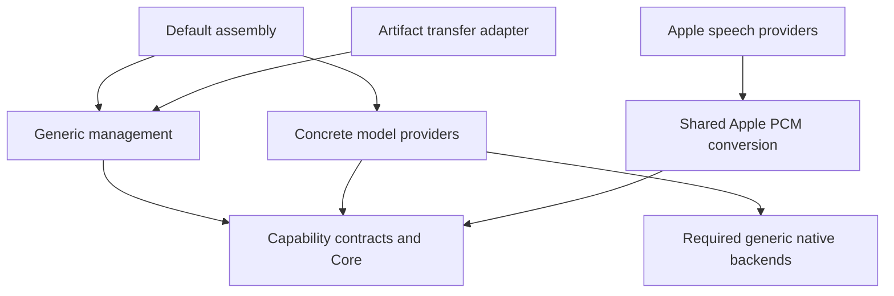

# ModelKit Core refinement and decoupling audit

归档日期：2026-10-15。原需求完成范围：中性 Core 契约、SDK 解耦审计及技术文档对齐。历史验证结果和独立验收限制保留如下；当前实现以源码 README 为准。

## Intended change — 2026-10-12

✅ Implemented. Validation results are recorded below. Replace conversation-specific inference metadata with opaque scopeID. Separate resource residency (Core ModelResourceState) from manager registration/construction state (Management ModelState). Require Core limits to be explicitly injected and validated; Management owns the existing four-loader/32-waiter defaults, with no new queues or provider policy. ModelManager initialization becomes throwing to expose invalid runtime limits. Isolated providers in tests receive explicitly configured contexts.

## Audit criteria

- Core contains only neutral data, streams, leases, cancellation and admission mechanisms; it must typecheck alone, without domain capability sources, Management or providers.
- Base ModelKit capability-domain interfaces contain typed inference values, not application task/signal/action policy. They remain part of the ModelKit SDK target; Core is not presented as a separately distributed product.
- Generic native backends do not know concrete models; shared speech code stays in its speech domain.
- ModelKitRuntime depends only on the base SDK; Defaults and Hub retain independent explicit source ownership. Concrete providers depend on contracts and necessary backend/SDK implementations, never each other or default assembly.
- Audit source algorithms and the full package graph, not just directory names. Preserve existing unrelated work and historical validation.

## Acceptance

Exercise neutral identity propagation, independent resource/manager states, configured loading/waiter bounds, invalid limits, existing resource cancellation/load/unload/shutdown and model-provider regressions. Run scripts/check.sh and scripts/build-ios.sh with Xcode; report any remaining full-suite/simulator limitation and distinguish builds from live inference/device acceptance.

## Completed source audit

All 66 Swift files were classified by implementation ownership, public interfaces, native operations, lifecycle/state and imports:

| Layer | Sources | Owner and dependency contract |
| --- | --- | --- |
| Core mechanisms | 7 | Opaque media/identity, streams, admission, leases and cancellation; typechecks alone |
| Capability-domain contracts | 6 | Typed Language/Speech/Vision inference contracts in the base SDK; no provider implementation |
| Generic native backends | 4 | Native CoreAI/CoreML graph/tensor primitives; no project dependencies or concrete model contracts |
| Generic management | 5 | Registration, manager state, runtime limits and artifact lifetime; ModelKit only |
| Artifact transfer | 2 | Hub implementation behind injected Runtime contracts; Runtime/HuggingFace only |
| Shared speech support | 1 | Apple PCM conversion shared by ASR/TTS; no capture/playback or Agent policy |
| Concrete provider algorithms | 36 | Model/native-service/wire-format algorithms; contracts and required native/backend SDKs only |
| Default assembly | 5 | Concrete registration/selection and process assembly; sole owner allowed to combine providers |

No Agent, Gateway, Actions, UI, Storage or PlatformKit imports or application business value types were found in these sources. Core contains no conversationID, manager ModelState, model registration identity or hardcoded loader/waiter policy. Generic backends contain no concrete Gemma/Nemotron/Kokoro/MOSS/YOLO formats or algorithms. Provider targets have no sibling-provider, Runtime or Defaults dependencies. Management/Defaults/Hub retain unique disjoint source ownership.

This refinement changes five ModelKit source files: Core Capability/ModelResource and Management ModelManager/ModelRegistration/ModelKitDefaults. Calling Agents only change construction of opaque request scope metadata. A final snapshot comparison finds 59 existing ModelKit files byte-identical and two concurrent OpenAI provider changes (bounded native provider-error code decoding) outside this refinement. Those changes were preserved and reviewed: they remain provider protocol/error handling with no application policy or new layer dependency. No concrete model algorithm was changed by this refinement.

Core and capability-domain contracts remain in the same base ModelKit SDK target/product. Independent Core typechecking proves that the lower sources do not require domain contracts or implementation targets; it does not create or claim a separately distributed Core package. Support is an ownership group, not one uniformly generic library: default assembly deliberately knows concrete providers in its independent target. Native SDK/platform restrictions remain explicit; this audit does not claim cross-platform runtime parity.

## API migration and compatibility

- InferenceContext.conversationID is replaced by scopeID, without a compatibility alias. All project callers are migrated; the Agent owns the actual session/conversation association.
- Core exposes ModelResourceState; Management owns the existing public ModelState manager snapshot and exhaustively projects resource state. Existing manager status cases and meanings remain.
- Core gate/context initialization requires positive explicit limits and throws on invalid configuration. ModelManager's assembly SPI initializer becomes throwing, defaults to four concurrent loaders/32 resource waiters, and permits positive custom values. All in-repository isolated fixtures and Defaults are migrated.
- InferenceContext was not a Codable persistence schema; history/catalog/receipt formats and resource identities are unchanged. No provider algorithm, download behavior or fallback policy changed.

## Validation

✅ Core's seven files passed independent Swift 6 typechecking with Xcode 27. The enhanced boundary audit passed explicit dependency/import maps, independent Core compilation and source ownership checks; manifest inspection uses a disposable cache so other SwiftPM activity cannot hold the audit behind the application's build lock. Targeted model/runtime tests passed, including six new scope/configuration/state/admission regressions. Full-suite and iOS build outcomes are recorded in Validation-History. Real-model and physical-device acceptance are separate.

### Automated checks completed

✅ The targeted run reports 118 declared tests including four opt-in skips; all executed tests pass. Six new tests exercise opaque scope propagation, invalid Core/manager limits, injected global-load/waiter bounds, explicit retry and resource/manager state projection. Enhanced source/target boundaries and independent Core typechecking pass. Current model design links, project/privacy/entitlements syntax and git diff formatting pass.

❌ The earlier Core-refinement scripts/check.sh run passed boundaries, formatting and six provisioning tests but was unsuccessful: the 715-test IntegrationTests target reports three sound-source perception timeouts/six issues. The full run reports 965 declared tests across target summaries, including 28 opt-in skips. All three failing cases pass when run separately, which does not establish a full-suite pass or a resolved timing cause. The unsigned physical-iOS App build and 25 packaged Agent/Skill assets pass verification; the full simulator App still fails because third-party CoreAIShared cannot resolve CoreAI in that SDK.

✅ Final unsigned physical-iOS MobileHarness build passes with Xcode 27, followed by packaged Agent/Skill verification (25 assets). ❌ scripts/build-ios.sh exits 65 at MobileHarnessSimulator with the pre-existing CoreAIShared/CoreAI simulator SDK dependency failure. No installation, live model inference or native physical-device acceptance is claimed. [Detailed validation](../validation/Validation-History.md#2026-10-12--modelkit-core-neutral-contracts-and-complete-layer-audit).

## Entire SDK independence — 2026-10-12

All 15 production targets currently use only ModelKit-owned targets, native frameworks and approved third-party SDKs. Cohesion is the inference capability and model/resource lifetime, with separate mechanisms, capability contracts, reusable runtime code, provider algorithms and default assembly. Application workflows and other foundation modules remain outside the SDK. ModelArtifactStorage/ModelArtifactDownloader are SDK-owned interfaces implemented by the host; this is dependency inversion.

✅ Implemented: explicit system/third-party import allowlists, product/package identity ownership, source confinement, and production SDK product dependency closure. The current 15 targets pass. Eight in-memory probes reject unknown imports, a newly introduced project module import, partial-declaration imports, an indirect host dependency through Runtime, the wrong third-party package, host source ownership, a host target in an SDK product, and a third-party import in the wrong provider. Keep the shared repository package; publishing a separate SDK package is outside this change. Repository check/build outcomes are recorded separately from runtime acceptance.

✅ The subsequent complete-SDK enforcement run passes `./scripts/check.sh` with Xcode 27: all 965 declared Swift tests across 18 run summaries (including 28 opt-in skips), provisioning, strict formatting and metadata. Previous sound-source timeouts did not recur; the cause is not declared resolved. [Latest enforcement evidence](../validation/Validation-History.md#2026-10-12--complete-modelkit-sdk-dependency-enforcement) preserves the earlier unsuccessful run separately.

❌ The subsequent iOS script still exits 65 because third-party CoreAIShared cannot resolve native CoreAI for the simulator. No runtime/device acceptance is inferred from dependency checks or compilation.

## Current source documentation alignment — 2026-10-12

✅ Completed documentation-only audit: all 28 ModelKit directory READMEs are reconciled with current ownership and contracts; 27 were revised, and CoreML was already accurate. All 26 Mermaid diagrams pass the local Mermaid parser; the complete 15-target/23-edge internal dependency graph exactly matches the manifest. Current source documents separate dependency graphs from runtime calls/events/injection and contain no ADR/change chronology, retired target names or superseded implementation claims. Production sources, dependencies and interfaces are unchanged by this audit. [Detailed verification](../validation/Validation-History.md#2026-10-12--modelkit-current-documentation-and-diagram-alignment).

## Final goal confirmation — 2026-10-12

✅ The agreed directory/source ownership, SDK independence and current English technical-documentation goals are achieved. Final review confirms 66 uniquely owned Swift files, 28 English source READMEs, 15 acyclic SDK targets/23 internal edges, 26 valid current diagrams and 94 exact Xcode navigator entries. ModelKit contains no non-technical record artifacts or ADR/change chronology. [Final review evidence](../validation/Validation-History.md#2026-10-12--final-modelkit-structure-and-english-technical-documentation-confirmation) distinguishes completed organization/documentation goals from separate package publication, simulator framework limitations and runtime/device acceptance.
