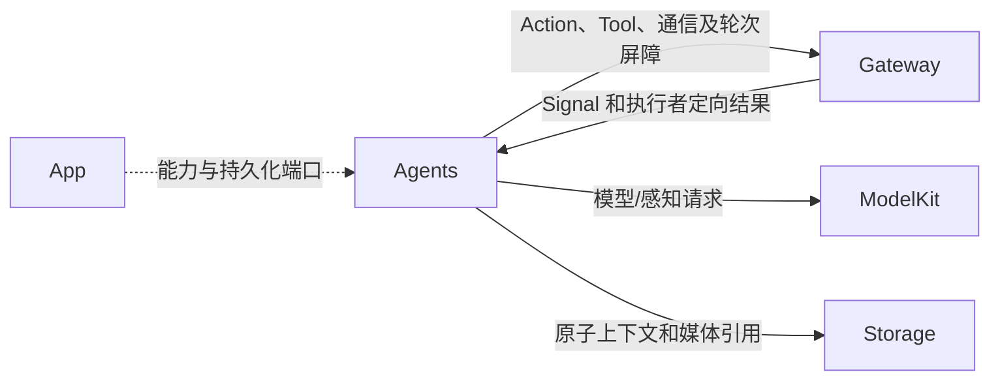
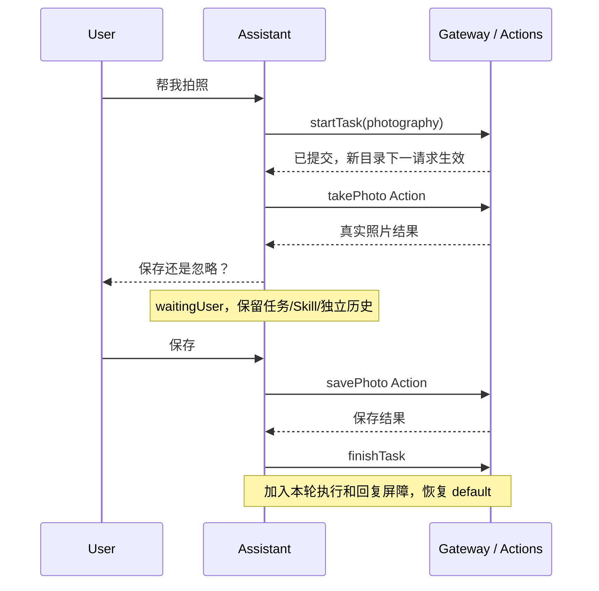
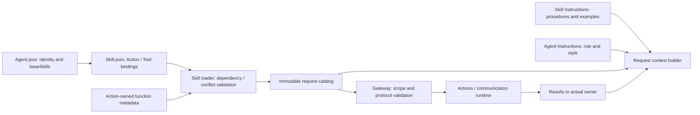
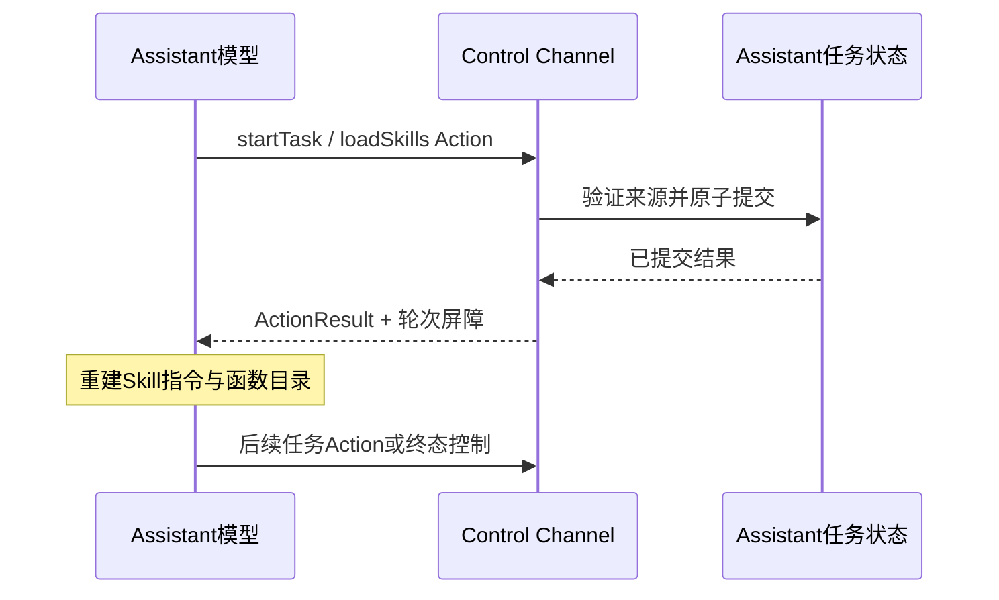
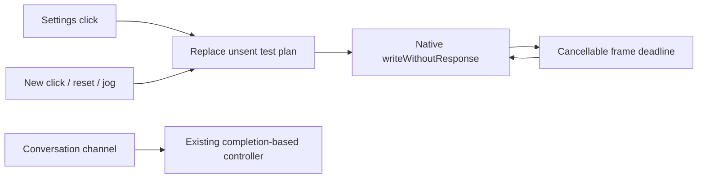
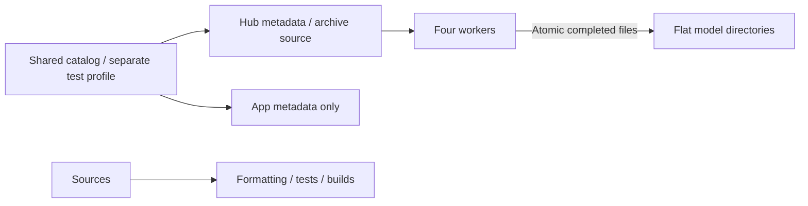

# 代码 README 旧契约与演进摘录

整理日期：2026-10-15。本文件保存代码目录 README 重整时迁出的原文，保留原日期、数值、失败及当时边界。无日期摘录不补写事件发生日期；整理日期不代表实验、实现或验收日期。原文中的“当前”“已实现”“待实现”只对应其写入时的版本，不能作为现行契约或今天的待办。

现行设计见各来源 README；另一类摘录见 [配套归档](../validation/Code-README-Validation-History.md)。摘录使用 Markdown 源文代码块保存，块内的旧链接、命令和图只作历史文本，不承诺仍然有效。仅格式/完成标记变化且正文仍在当前 README 的段落不重复归档；相同原文合并列出来源，不将重复摘要视为多次验证。

## Config/README.md

[现行 README](../../Config/README.md)

````markdown
# Build configuration

Purpose: own shared Xcode settings, local-signing templates and explicit metadata resource inputs/outputs. Design goals: reproducible builds without local model weights, confined staging and private signing configuration.

- ✅ Shared Swift 6 / iOS 27 settings; local signing stays in ignored Local.xcconfig.
- ✅ Both device and simulator Voice-Models file lists stage only model-catalog.json and license notices. No model graphs, weights, tokenizers or voice assets are build inputs or packaged outputs.
- ✅ Regenerate lists with scripts/update-model-filelists.py after changing staging metadata/licenses. The pre-build cleanup removes obsolete Models output from incremental App builds; staging never removes developer source artifacts.
- ✅ Physical App requests com.apple.developer.kernel.increased-memory-limit. It is not a memory-availability guarantee; simulator does not request it.
- ✅ NSCameraUsageDescription covers local preview and pose inference. Camera denial does not block Settings/history or voice preparation.
- ❌ Signed-device performance, export compatibility and background transfer acceptance require separate validation; configuration/build success is not that evidence.

Weights are acquired in Settings through Management/ModelKitHub and installed in the sandbox. Separate Mac/comparison provisioning profiles are not App resource inputs. See [Management](../MobileHarness/ModelKit/Support/Management/README.md#local-model-resources--current-contract).

<!-- 同段原文其他来源：Tests/README.md / Local model provisioning cleanup；Tests/UITests/README.md / UI State and Interaction Tests；scripts/README.md / Local model resources — current contract -->

✅ Local chat configuration now targets Gemma 4 E2B CoreAI; Qwen/MLX production bindings are removed. ❌ Real-model/device acceptance is separate from compilation and contract tests.

## Photo save and ignore — ADR0185

✅ NSPhotoLibraryAddUsageDescription requests only adding explicitly saved photos. Camera purpose text covers user-requested still capture and sending a requested observation to the configured model service. No Photos read permission or album enumeration is added.

✅ Navigation audit: Xcode file references/groups must mirror current Agents/Support and Resources/Agents/Skills locations. Remove retired Agent JSON navigation entries and add new metadata/control/state references. SwiftPM remains sole owner of these framework sources/assets; navigation changes do not duplicate target membership or resource phases.

## Skill 函数目录

✅ Xcode 导航删除七个 Permissions.json 引用，资源仍由既有 SwiftPM target 打包，无新增编译成员或签名配置。

## Action-owned documentation and Skill instruction contract

✅ Xcode 导航移除公共 FunctionMetadata 文件，登记 ActionDeclaration、TaskActions 和目录回归夹具。SPM 编译声明，FunctionContracts 不再打包具体函数 JSON 资源。

✅ Scheme pre-build cleanup removes the retired generated HarnessKit_FunctionContracts.bundle from incremental App output, so obsolete FunctionMetadata.json cannot survive a source migration. Source files are never cleaned.

✅ Implemented ProMotion packaging: Config/AppInfo.plist explicitly supplies CADisableMinimumFrameDurationOnPhone=true to both App targets. Generated standard/permission metadata remains enabled; remove the ineffective custom INFOPLIST_KEY setting and verify the final signed plist, not only build settings. No local signing edits.
````

## Macros/BehaviorDefinitions/README.md

[现行 README](../../Macros/BehaviorDefinitions/README.md)

````markdown
# Callable Action Macro

❌ No runtime reflection, automatic permissions, global registration, dependency injection or physical/model acceptance. Native wire contracts remain in Runtime/Gateway/AgentCore.

<!-- 同段原文其他来源：Tests/IntegrationTests/README.md / Resource ownership only — ADR0141 -->

✅ ADR0161: standard callable inputs use FunctionInput/FunctionContracts; common execution and call protocols belong to independent Gateway targets. This directory retains its existing ownership, resource/permission and lifecycle boundaries. ❌ Remaining feature Signal/continuation and physical acceptance are separate work.

## Action timeout contract (2026-10-12)

✅ BehaviorDefinitionMacro 将 dynamicTimeout 与 timeout 传入 ActionFunction，删除 estimatingDuration 旧名字，不保留重复入口。
````

## Macros/README.md

[现行 README](../../Macros/README.md)

````markdown
# Compile-time Macros

❌ Automatic discovery, dependency construction and permission inference are unsupported. See [macro design](BehaviorDefinitions/README.md) for the generation diagram.
````

## MobileHarness/Actions/Camera/README.md

[现行 README](../../MobileHarness/Actions/Camera/README.md)

````markdown
## 接口与完成语义

❌ savePhoto/ignorePhoto 的声明将 mediaID 标为必填，而函数体允许省略。调用者应使用实际拍摄回执中的明确 ID；声明与直接调用解析的统一仍待实现。

## SQLite records and runtime identity

<!-- 同段原文其他来源：MobileHarness/Actions/Camera/Support/README.md / SQLite records and runtime identity；MobileHarness/Actions/History/README.md / SQLite records and runtime identity；MobileHarness/Actions/History/Support/README.md / SQLite records and runtime identity；MobileHarness/Actions/Speech/README.md / SQLite records and runtime identity；MobileHarness/Actions/Speech/Support/README.md / SQLite records and runtime identity；MobileHarness/Actions/Support/Contracts/README.md / SQLite records and runtime identity；MobileHarness/Actions/System/README.md / SQLite records and runtime identity；MobileHarness/Actions/System/Support/README.md / SQLite records and runtime identity；MobileHarness/Actions/UI/README.md / SQLite records and runtime identity；MobileHarness/Actions/UI/Support/README.md / SQLite records and runtime identity；MobileHarness/Agents/ApplicationControl/README.md / SQLite records and runtime identity；MobileHarness/Agents/Assistant/README.md / SQLite records and runtime identity；MobileHarness/Agents/Memory/README.md / SQLite records and runtime identity；MobileHarness/Agents/Photographer/README.md / SQLite records and runtime identity；MobileHarness/Agents/SpeechPerception/README.md / SQLite records and runtime identity；MobileHarness/Agents/SpeechSynthesis/README.md / SQLite records and runtime identity；MobileHarness/Agents/Support/Chat/README.md / SQLite records and runtime identity；MobileHarness/Agents/Support/Communication/README.md / SQLite records and runtime identity；MobileHarness/Agents/Support/Core/Capability/README.md / SQLite records and runtime identity；MobileHarness/Agents/Support/Core/Communication/README.md / SQLite records and runtime identity；MobileHarness/Agents/Support/Core/Generation/README.md / SQLite records and runtime identity；MobileHarness/Agents/Support/Core/Output/README.md / SQLite records and runtime identity；MobileHarness/Agents/Support/Core/README.md / SQLite records and runtime identity；MobileHarness/Agents/Support/Core/Runtime/README.md / SQLite records and runtime identity；MobileHarness/Agents/VisionPerception/README.md / SQLite records and runtime identity；MobileHarness/App/Adapters/README.md / SQLite records and runtime identity；MobileHarness/App/Composition/README.md / SQLite records and runtime identity；MobileHarness/App/Lifecycle/README.md / SQLite records and runtime identity；MobileHarness/App/README.md / SQLite records and runtime identity；MobileHarness/App/Workflows/Bluetooth/README.md / SQLite records and runtime identity；MobileHarness/App/Workflows/Diagnostics/README.md / SQLite records and runtime identity；MobileHarness/App/Workflows/History/README.md / SQLite records and runtime identity；MobileHarness/App/Workflows/Presentation/README.md / SQLite records and runtime identity；MobileHarness/App/Workflows/Settings/README.md / SQLite records and runtime identity；MobileHarness/App/Workflows/Speech/README.md / SQLite records and runtime identity；MobileHarness/Gateway/Input/README.md / SQLite records and runtime identity；MobileHarness/Gateway/Output/Dispatch/README.md / SQLite records and runtime identity；MobileHarness/Gateway/Output/Protocols/README.md / SQLite records and runtime identity；MobileHarness/Gateway/Output/README.md / SQLite records and runtime identity；MobileHarness/Gateway/Output/Resources/README.md / SQLite records and runtime identity；MobileHarness/Gateway/Output/Results/README.md / SQLite records and runtime identity；MobileHarness/Gateway/Output/Scheduling/README.md / SQLite records and runtime identity；MobileHarness/UI/Settings/README.md / SQLite records and runtime identity -->

✅ Implemented: technical identities are opaque UUID strings; committed business entities use dialog/message/task/media/device SQLite IDs. Consumers use Storage repositories while preserving ownership, cancellation and independent foundation boundaries. Complete messages, including each ReACT message, persist at termination; delta fragments do not persist. The custom allocator and replaced file/index implementation are removed. See the project SQLite business-record plan.
````

## MobileHarness/Actions/History/README.md

[现行 README](../../MobileHarness/Actions/History/README.md)

````markdown
## 生命周期与失败处理

❌ 本接口没有全文搜索或完整会话导出；返回内容是显式截断的预览。
````

## MobileHarness/Actions/System/README.md

[现行 README](../../MobileHarness/Actions/System/README.md)

````markdown
## 生命周期与约束

❌ runtimeInfo 没有实时诊断实现。声明参数与可信入口解析的开放范围不是同一个集合，不能据函数存在推断模型权限或原生能力可用。
````

## MobileHarness/Actions/System/Support/README.md

[现行 README](../../MobileHarness/Actions/System/README.md)

````markdown
## Provider 请求暂存与容量

stage 以待领取项加 completed 项少于 32 作为准入条件。❌ 发现中的请求已经移出 entries，未占用容量槽，所以此条件不是待领取/执行中/完成的总量硬上限；并发总量控制仍需宿主约束。

## SQLite records and runtime identity

✅ Storage repository refactor: Settings/model-preference services consume DocumentRepository protocols; concrete file construction stays in App/test composition factories. Preserve revision conflicts and producer-owned rollback policy.
````

## MobileHarness/Actions/UI/Support/README.md

[现行 README](../../MobileHarness/Actions/UI/Support/README.md)

````markdown
## 姿态载荷与校验

❌ showPose 当前只读取 payload，没有统一拒绝其它参数键；调用规范应只发送 payload。
````

## MobileHarness/Agents/ApplicationControl/README.md

[现行 README](../../MobileHarness/Agents/ApplicationControl/README.md)

````markdown
## 职责与边界

✅ 配置、模型资源和设备事务、环境事实；不承担普通对话。 Agents 管业务策略和上下文，Gateway 管权限/传输，Actions 管函数实现；原生设备与 UI 端口由 App 注入。没有跨 Agent 共享可写聊天历史。

## 文件分工

ApplicationControlAgent.swift 管生命周期/事务和环境；ApplicationControlWorkflow.swift 管确定性步骤；ApplicationControlProcessing.swift 管状态与预处理。

## 输入、输出与流程

UI 数据操作直接提交可信事务；导航、展开和筛选留在 UI。Assistant application-control Skill 可以调用同一批 Action 控制 UI 或设备；函数复用不要求委派 Agent。

## Context 与 Builder

待执行调用、环境契约、事务关联。 状态通过独立 Repository 原子提交；Builder 选择确定版本，不修改已发出的请求。写入失败不产生依赖未提交状态的新调用。

## 生命周期、容量与失败

✅ 已实现（2026-10-13 scopeClosed 修复）：ApplicationControlAgent.prepareSignal 明确选择最近 4096 条 Signal 证据及消费批次，超限从最旧记录淘汰并累计淘汰计数。已有 8192 条有效 context 在首次新输入的原子提交中收敛，不清空模型配置或任务状态。pending 调用、任务和环境当前值由独立状态持有，证据不是待执行队列；保留现有写入失败传播和终止语义。容量饱和不应终止服务或关闭根设置通信 scope。

设置页机械臂测试仍保留自身注册。环境 publish 单向、目标拒绝不影响发送者；有确认的 send 仅用于真正独立的后台事务。 事务/输出消费由 App 根生命周期持有，独立于页面。输出最多 256，状态提交等待最多 32；通信消费者最多 16 待处理、4 并发。超限明确失败。取消加入已接纳工作清理；重启标记未完成任务中断，不重放设备动作。共享 Chat 的输入、调用和执行预算见 [Chat](../Support/Chat/README.md)。

## 函数权限与注册

[Agent.json](../../Resources/Agents/ApplicationControl/Agent.json) 声明固定函数；业务模型目录由加载 Skill 决定。实际实现/参数契约以 [owning @Action declarations](../../Actions/README.md) 为准。Internal 固定函数不会自动向模型开放。

<!-- 同段原文其他来源：MobileHarness/Agents/Memory/README.md / 函数权限与注册；MobileHarness/Agents/Photographer/README.md / 函数权限与注册 -->

本角色没有对话 worker。以下为本角色固定函数声明；实际固定调用由该角色 workflow 注册，不能把固定函数表误认为普通对话目录。

| 类型 / Channel | 别名 | 函数 | 参数 | 说明 |
| --- | --- | --- | --- | --- |
| action / Display | `openPage` | `UI.Navigation.open` | destination 必填 | On a conversational request, open the requested application page through authorized UI presentation. Touch navigation is local and does not call this Agent. |
| action / Robot | `shakeBase` | `NexArm.Motion.shakeBase` | cycles 必填, speed, acceleration | Perform the configured base-shaking gesture and return home. |
| action / Robot | `waveWrist` | `NexArm.Gesture.waveWrist` | count 必填, speed, acceleration | Wave the wrist with the configured arm gesture, then return home. |
| action / Robot | `tiltWrist` | `NexArm.Gesture.tiltWrist` | direction 必填, speed, acceleration | Tilt the wrist in the requested direction and return home. |
| action / Robot | `lookAround` | `NexArm.Gesture.lookAround` | cycles 必填, speed, acceleration | Perform the configured arm look-around gesture and return home. |
| action / Robot | `celebrate` | `NexArm.Gesture.celebrate` | cycles 必填, speed, acceleration | Perform the configured celebration gesture and return home. |
| action / Robot | `dance` | `NexArm.Gesture.dance` | cycles 必填, speed, acceleration | Perform the configured arm dance and return home. |
| action / Robot | `nodHead` | `NexArm.Gesture.nodHead` | cycles 必填, speed, acceleration | Nod using motor4, returning home; leave other motors untouched. |
| action / Robot | `shakeHead` | `NexArm.Gesture.shakeHead` | cycles 必填, speed, acceleration | Shake the head using motor5, returning home; leave other motors untouched. |
| action / Robot | `resetArm` | `NexArm.Motion.reset` | speed, acceleration | Reset configured homes for motors1–5; never move the gripper. |
| action / Robot | `moveMotor` | `NexArm.Motion.moveMotor` | motor 必填, target 必填, speed, acceleration | Move only the selected motor to its native encoder target. |
| action / Robot | `resetMotor` | `NexArm.Motion.resetMotor` | motor 必填, speed, acceleration | Reset only the selected motor to its configured home; motor6 needs an explicitly configured home. |
| tool / — | `ModelResources.snapshot` | `System.ModelResources.snapshotResources` | — | Read current shared model resource inventory, installed groups and progress. Does not download, remove or switch a model. |
| tool / — | `Provider.readSettings` | `System.Provider.readSettings` | — | Read confirmed cloud-enabled status and selected cloud model. Contains no URL/key. Does not probe provider availability or change configuration. |
| tool / — | `Bluetooth.readStatus` | `System.Device.readStatus` | — | Read current Bluetooth power/connection and discovered device IDs. Does not scan or move a robot. |
| action / System | `Bluetooth.control` | `System.Device.control` | operation 必填, id | Submit an explicit Bluetooth connection/discovery command. Accepted is not connected or physically completed. Read status to confirm actual state. |
| tool / — | `App.readEnvironment` | `System.Device.readEnvironment` | — | Read the latest admitted scene, navigation and device capability facts only when needed and absent from context. These are observations, not proof of physical completion. Wait for the result before deciding dependent actions. |
| action / System | `ModelResources.download` | `System.ModelResources.download` | id 必填, endpoint 必填, allowsCellular 必填 | Admit a model download using an explicit source. Admission does not mean installed; read the shared inventory for progress. |
| action / System | `ModelResources.cancel` | `System.ModelResources.cancel` | id 必填 | Cancel and join an admitted model transfer. Failure is returned without replay. |

## 固定内部权限

| Protocol | Canonical function | Channel | Parameters | Registration source |
| --- | --- | --- | --- | --- |
| InternalTool | `System.Device.control` | — | `operation`, `id?`, `value?`, `action?`, `fence?` | [ApplicationControlProcessing.swift](ApplicationControlProcessing.swift) |
| InternalTool | `UI.Navigation.open` | — | `destination` | [ApplicationControlProcessing.swift](ApplicationControlProcessing.swift) |
| InternalTool | `System.ModelResources.download` | — | `id`, `endpoint`, `allowsCellular` | [ApplicationControlProcessing.swift](ApplicationControlProcessing.swift) |
| InternalTool | `System.ModelResources.cancel` | — | `id` | [ApplicationControlProcessing.swift](ApplicationControlProcessing.swift) |
| InternalTool | `System.ModelResources.remove` | — | `id` | [ApplicationControlProcessing.swift](ApplicationControlProcessing.swift) |
| InternalTool | `System.Provider.restoreSettings` | — | `requestID` | [ApplicationControlProcessing.swift](ApplicationControlProcessing.swift) |
| InternalTool | `System.Provider.saveSettings` | — | `requestID` | [ApplicationControlProcessing.swift](ApplicationControlProcessing.swift) |
| InternalTool | `UI.ResourcePresentation.showProviderResult` | — | `requestID`, `failureCode?` | [ApplicationControlProcessing.swift](ApplicationControlProcessing.swift) |
| InternalTool | `System.Provider.discoverModels` | — | `requestID` | [ApplicationControlProcessing.swift](ApplicationControlProcessing.swift) |
| InternalTool | `System.ModelResources.snapshotResources` | — | — | [ApplicationControlProcessing.swift](ApplicationControlProcessing.swift) |
| InternalTool | `UI.ResourcePresentation.showResources` | — | `generation` | [ApplicationControlProcessing.swift](ApplicationControlProcessing.swift) |
| InternalTool | `UI.ResourcePresentation.showResourceFailure` | — | `generation`, `message` | [ApplicationControlProcessing.swift](ApplicationControlProcessing.swift) |
| InternalTool | `UI.ResourcePresentation.showResourceOperationFailure` | — | `message` | [ApplicationControlProcessing.swift](ApplicationControlProcessing.swift) |
| InternalTool | `UI.ResourcePresentation.showResourcePreferenceFailure` | — | `reason`, `message` | [ApplicationControlProcessing.swift](ApplicationControlProcessing.swift) |
| InternalTool | `System.ModelResources.restoreSource` | — | — | [ApplicationControlProcessing.swift](ApplicationControlProcessing.swift) |
| InternalTool | `System.ModelResources.saveSource` | — | `endpoint`, `allowsCellular`, `recognition`, `synthesis` | [ApplicationControlProcessing.swift](ApplicationControlProcessing.swift) |
| InternalTool | `System.ModelResources.configureSpeech` | — | `recognition`, `synthesis` | [ApplicationControlProcessing.swift](ApplicationControlProcessing.swift) |

### Declared input schemas

| Contract | Version | Kind |
| --- | --- | --- |
| `action.result` | 1 | `actionResult` |
| `app.environment` | 1 | `observation` |
| `app.interaction` | 1 | `observation` |
| `provider.settings` | 1 | `observation` |
| `provider.discovery` | 1 | `observation` |
| `model.resource.hostFailure` | 1 | `observation` |
| `model.resource.state` | 1 | `observation` |
| `model.resource.intent` | 1 | `observation` |
| `tool.result` | 1 | `toolResult` |
| `task.request` | 1 | `observation` |
| `task.input` | 1 | `observation` |
| `task.progress` | 1 | `observation` |
| `task.result` | 1 | `observation` |
| `task.cancel` | 1 | `observation` |
| `generation.round.result` | 1 | `roundResult` |
| `communication.receipt` | 1 | `communicationReceipt` |
| `user.text` | 1 | `text` |

<!-- 同段原文其他来源：MobileHarness/Agents/Assistant/README.md / Declared input schemas；MobileHarness/Agents/Memory/README.md / Declared input schemas；MobileHarness/Agents/Photographer/README.md / Declared input schemas；MobileHarness/Agents/SpeechPerception/README.md / Declared input schemas；MobileHarness/Agents/SpeechSynthesis/README.md / Declared input schemas；MobileHarness/Agents/VisionPerception/README.md / Declared input schemas -->

Directed input schemas and static subscriptions are distinct; admission also validates the runtime sender and scope.

## 状态与验收

<!-- 同段原文其他来源：MobileHarness/Agents/Assistant/README.md / 状态与验收；MobileHarness/Agents/Memory/README.md / 状态与验收；MobileHarness/Agents/Photographer/README.md / 状态与验收 -->

✅ 动态 Skill/确定性职责拆分已实现。❌ 摄影、保存、尾音、语音竞争及模式切换的真机验收仍需单独进行。

<!-- 同段原文其他来源：MobileHarness/Agents/Memory/README.md / 状态与验收 -->

✅ 收紧资源中的普通文本/模型反馈和语音对话通信，保留确定性协议。

## 输入与通信授权

| 输入契约 | 类型 |
| --- | --- |
| `app.environment` | observation |
| `app.interaction` | observation |
| `provider.settings` | observation |
| `provider.discovery` | observation |
| `model.resource.hostFailure` | observation |
| `model.resource.state` | observation |
| `model.resource.intent` | observation |
| `tool.result` | toolResult |
| `task.request` | observation |
| `task.input` | observation |
| `task.progress` | observation |
| `task.result` | observation |
| `task.cancel` | observation |
| `communication.receipt` | communicationReceipt |

| 方式 | 契约 | 目标/来源 |
| --- | --- | --- |
| send Action | `task.progress` | `assistant` |
| send Action | `task.result` | `assistant` |
| subscribe | `model.resource.intent` | `runtime` |
| subscribe | `model.resource.state` | `model.resources` |
| subscribe | `model.resource.hostFailure` | `app.resources` |
| subscribe | `app.environment` | `app.environment` |
| subscribe | `app.interaction` | `user` |
| subscribe | `model.resource.intent` | `user` |
| subscribe | `provider.settings` | `user` |
| subscribe | `provider.discovery` | `user` |

## 固定函数与 Skill

<!-- 同段原文其他来源：MobileHarness/Agents/Assistant/README.md / 固定函数与 Skill；MobileHarness/Agents/Memory/README.md / 固定函数与 Skill；MobileHarness/Agents/Photographer/README.md / 固定函数与 Skill；MobileHarness/Agents/SpeechPerception/README.md / 固定函数与 Skill；MobileHarness/Agents/SpeechSynthesis/README.md / 固定函数与 Skill；MobileHarness/Agents/VisionPerception/README.md / 固定函数与 Skill -->

✅ 资源不再包含 Permissions.json，Agent.json 的 baseSkills 引用 Skill，Skill.json 声明函数。业务模型函数由已加载 Skill 提供；固定调用与模型轮次分别验证，详见 [资源规范](../../Resources/Agents/README.md)。

## Agent → Skill → Function registration

<!-- 同段原文其他来源：MobileHarness/Agents/Memory/README.md / Agent → Skill → Function registration；MobileHarness/Agents/Photographer/README.md / Agent → Skill → Function registration -->

✅ Implemented: Agent.json references baseSkills; Skill.json alone registers model Actions/Tools. BasicSkill owns task orchestration and environment reading; ExpressionInteraction owns expression Actions. Role instructions retain identity/responsibility/style. Business roles reuse existing Skills; internal trusted bindings remain separate. Fixed transaction/task snapshots remain authoritative.

角色基础函数目录由资源中的 baseSkills（application-control）组合；上表供函数 review 使用，不是 Agent.json 中的另一份注册。函数说明属于实现，流程教学属于 Skill。

<!-- 同段原文其他来源：MobileHarness/Agents/Photographer/README.md / Agent → Skill → Function registration -->

✅ 本次提示词精简同步注册函数说明，保持职责、类型和参数不变；公共执行语义见Actions owning README。

✅ ApplicationControl注册调整：Bluetooth.control、ModelResources.download/cancel改为System Channel的Action Call；snapshot/readSettings/readStatus保持原生Tool，11个NexArm对话动作仅由RobotInteraction注册，ApplicationControl Skill不再重复注册。别名、参数、函数实现与内部固定调用不变；模型加载后的XML教学、revision和组合/解析回归同步更新。

✅ Skill scope review: application-control exposes seven navigation/status/System entries only. Removing robot model bindings does not remove trusted device-operation or settings Action implementations.

✅ scopeClosed 修复验证：真实手机的原 8192 条 context 在修复版启动后自动收敛为 4096 条，restoreSource 与后续 Tool 结果成功；满额持久化回归和完整串行测试通过。❌ 模型推理/原生页面显示及声学效果仍是独立验收。详见 [验证记录](../../../docs/validation/Validation-History.md#2026-10-13--saturated-applicationcontrol-context-and-scopeclosed-recovery)。
````

## MobileHarness/Agents/Assistant/README.md

[现行 README](../../MobileHarness/Agents/Assistant/README.md)

````markdown
# Assistant

✅ 基础教学以当前 Task/目标决定关闭，无 Task 或无关操作不关闭当前 Task；明确目标转移主动释放无关近期 Skill，不确定替换先询问是否继续旧目标。摄影/历史查询示例一致。共享 Chat 使用紧凑模型观察正文，内部关联和原生协议配对保持；提示词的真实模型遵循率另行验收。

✅ 已实现：无 Task 的已加载 Skill 跨输入复用，加载/实际 Action 或 Tool 使用重置 5，五次完整用户决策未使用才回收；Task 结束仍确定回收持有项。当前事实增加 Skill 归属与剩余次数，只有目录缺失才重新 loadSkills。

## 职责与边界

✅ 唯一用户对话入口，负责动态 Skill、一个前台目标任务、模型决策和 ReACT。 Agents 管业务策略和上下文，Gateway 管权限/传输，Actions 管函数实现；原生设备与 UI 端口由 App 注入。没有跨 Agent 共享可写聊天历史。

## 文件分工

AssistantAgent.swift 是共享 worker 的业务类型别名；AssistantProcessing.swift 定义预处理、结构化状态、请求策略与照片所有权。

## 输入、输出与流程

用户文本与最终 ASR FIFO；起音绑定当时任务，迟到识别不能改投新任务。camera.state 更新被动事实。每轮选择不可变 Context、Skill 和有效函数目录，输出经 Gateway 执行，结果只回 Assistant。

## Context 与 Builder

history、skillState（任务/加载事件/输入关联）、cameraState 和后台任务报告；普通对话与任务选择各自历史，任务结束只向默认请求提供简短结果摘要。 状态通过独立 Repository 原子提交；Builder 选择确定版本，不修改已发出的请求。写入失败不产生依赖未提交状态的新调用。

## 生命周期、容量与失败

基础 Skill 来自 Agent 配置（basic-skill、expression-interaction、robot-interaction）；任意任务目标按需组合 Skill，无 Task 的近期能力按五次用户 Decision 闲置倒计数保留。startTask 后下一轮才开放新函数；waitingUser 不关闭任务。finish/cancel 在本轮反馈和回复屏障完成后恢复默认。 事务/输出消费由 App 根生命周期持有，独立于页面。输出最多 256，状态提交等待最多 32；通信消费者最多 16 待处理、4 并发。超限明确失败。取消加入已接纳工作清理；重启标记未完成任务中断，不重放设备动作。共享 Chat 的输入、调用和执行预算见 [Chat](../Support/Chat/README.md)。

## 函数权限与注册

✅ 已实现：基础 Skill 明确保存/忽略当前预览及关闭相机也必须先检查当前目录；photography 仅在五次闲置回收、容量回收或 Task 终态回收后才需重新加载。无 Task 的当前预览可使用实时 displayedMediaID 处理，不创建虚假摄影目标；历史标签不提供当前权限。忽略只使用当前 ignorePhoto 别名。

[Agent.json](../../Resources/Agents/Assistant/Agent.json) 声明身份、通信与 baseSkills；模型函数目录由已加载 Skill 注册的函数组合。实际实现/参数契约以 [owning @Action declarations](../../Actions/README.md) 为准。Internal 固定函数不会自动向模型开放。

下表为可通过 Skill 使用的业务函数及固定控制总览，不代表全部同时开放。Assistant 的当前模型目录由默认能力、已加载 Skill 与控制 Actions 组成；send 由授权通信契约派生且只使用 Action Call。

### Internal fixed functions

| Protocol | Canonical function | Channel | Parameters | Registration source |
| --- | --- | --- | --- | --- |
| InternalAction | `UI.Caption.beginReplyTurn` | Display | — | [AgentChatWorker.swift](../Support/Chat/AgentChatWorker.swift) |
| InternalAction | `Speech.Playback.speak` | Speech | `audioID` | [AgentChatWorker.swift](../Support/Chat/AgentChatWorker.swift) |
| InternalAction | `UI.Caption.print` | Display | `text` | [AgentChatWorker.swift](../Support/Chat/AgentChatWorker.swift) |

### Declared input schemas

| Contract | Version | Kind |
| --- | --- | --- |
| `user.text` | 1 | `text` |
| `assistant.control` | 1 | `observation` |
| `tool.result` | 1 | `toolResult` |
| `speech.final` | 1 | `observation` |
| `speech.phase` | 1 | `observation` |
| `action.result` | 1 | `actionResult` |
| `generation.round.result` | 1 | `roundResult` |
| `communication.receipt` | 1 | `communicationReceipt` |
| `task.request` | 1 | `observation` |
| `task.input` | 1 | `observation` |
| `task.progress` | 1 | `observation` |
| `task.result` | 1 | `observation` |
| `task.cancel` | 1 | `observation` |
| `agent.userInput` | 1 | `observation` |

### Input subscriptions and communication grants

<!-- 同段原文其他来源：MobileHarness/Agents/SpeechPerception/README.md / Input subscriptions and communication grants；MobileHarness/Agents/SpeechSynthesis/README.md / Input subscriptions and communication grants；MobileHarness/Agents/VisionPerception/README.md / Input subscriptions and communication grants -->

Publication is one-way and has no recipient acknowledgment. Directed send returns admission; explicit task results report completion.

| Input contract | Source | Topic |
| --- | --- | --- |
| `speech.final` | `speechPerception` | `speech.final` |
| `user.text` | `user` | `user.text` |
| `speech.phase` | `speechPerception` | `speech.phase` |
| `agent.userInput` | `user` | `agent.userInput` |
| `assistant.control` | `runtime` | `assistant.control` |

| Output | Contract | Destination |
| --- | --- | --- |
| publish | `interaction.replyActivity` | Exact static subscribers |
| send | `speech.synthesize` | `speechSynthesis` |
| send | `speech.cancel` | `speechSynthesis` |
| send | `task.request` | `photographer` |
| send | `task.input` | `photographer` |
| send | `task.cancel` | `photographer` |
| send | `task.request` | `memory` |
| send | `task.input` | `memory` |
| send | `task.cancel` | `memory` |
| send | `task.request` | `applicationControl` |
| send | `task.input` | `applicationControl` |
| send | `task.cancel` | `applicationControl` |

## Related design

<!-- 同段原文其他来源：MobileHarness/Agents/SpeechPerception/README.md / Related design；MobileHarness/Agents/SpeechSynthesis/README.md / Related design；MobileHarness/Agents/VisionPerception/README.md / Related design -->

[Parent design](../README.md)

## 泛化 Task 与独立 Skill

<!-- 同段原文其他来源：MobileHarness/README.md / 泛化 Task 与独立 Skill -->

✅ 泛化 Task 与独立 Skill 已接入：任意目标、单前台任务，基础/会话近期/任务 Skill 作用域；后台复用 send，不抢占前台。详见所属 Agents 与公共机制设计。

<!-- 同段原文其他来源：MobileHarness/Agents/Support/Chat/README.md / 泛化 Task 与独立 Skill -->

✅ Audit correction: shared Chat worker must not cast AssistantContextState or interpret camera business facts. Role hooks select/apply passive context observations; Assistant owns provenance/sequence validation and camera/task data-message construction through its own Context Builder. Existing lifecycle, persistence and request snapshot semantics remain unchanged.

## Action-owned documentation and Skill instruction contract

✅ Assistant 提示词分别组装 Core 协议、身份、Skill 概述、当前任务/Skill 指令及有效函数 doc/parameters。移除 orderingExample/concurrentExample 模板插值；顺序及业务示例由基础交互、机器人和摄影 Skill 教学。

## Task controls through Action Calls

<!-- 同段原文其他来源：MobileHarness/Agents/Support/Chat/README.md / Task controls through Action Calls；MobileHarness/README.md / Task controls through Action Calls；MobileHarness/Resources/Skills/README.md / Task controls through Action Calls -->

✅ BasicSkill 的五个 Task/Skill 控制函数使用 Control Channel Action Call；App 通过 ChannelScheduler 返回已提交状态。startTask/loadSkills/releaseSkills 返回的已提交业务状态在结果屏障后重建目录并 ReACT，finishTask/cancelTask 加入回复及清理屏障后恢复默认。新目录仅影响后续请求，不允许加载轮提前调用新函数。可信固定调用复用同一实现。

## Agent → Skill → Function registration

<!-- 同段原文其他来源：MobileHarness/Agents/README.md / Agent → Skill → Function registration；MobileHarness/Agents/Support/Chat/README.md / Agent → Skill → Function registration；MobileHarness/README.md / Agent → Skill → Function registration；MobileHarness/Resources/Skills/README.md / Agent → Skill → Function registration -->

✅ Implemented: Agent.json references baseSkills; Skill.json alone registers model Actions/Tools. BasicSkill owns task orchestration and environment reading; ExpressionInteraction owns expression Actions. Role instructions retain identity/responsibility/style. Business roles reuse existing Skills; internal trusted bindings remain separate. Historical snapshots are preserved.

角色基础函数目录由资源中的 baseSkills（basic-skill、expression-interaction、robot-interaction）组合；上表供函数 review 使用，不是 Agent.json 中的另一份注册。函数说明属于实现，流程教学属于 Skill。

## Lifecycle-owned conversation and audio (2026-10-12)

<!-- 同段原文其他来源：MobileHarness/Agents/README.md / Lifecycle-owned conversation and audio (2026-10-12)；MobileHarness/Agents/SpeechPerception/README.md / Lifecycle-owned conversation and audio (2026-10-12)；MobileHarness/Agents/SpeechSynthesis/README.md / Lifecycle-owned conversation and audio (2026-10-12)；MobileHarness/Agents/Support/Chat/README.md / Lifecycle-owned conversation and audio (2026-10-12)；MobileHarness/Agents/Support/Core/Communication/README.md / Lifecycle-owned conversation and audio (2026-10-12)；MobileHarness/Agents/Support/Core/README.md / Lifecycle-owned conversation and audio (2026-10-12)；MobileHarness/Agents/Support/Core/Runtime/README.md / Lifecycle-owned conversation and audio (2026-10-12)；MobileHarness/App/Workflows/Speech/README.md / Lifecycle-owned conversation and audio (2026-10-12)；MobileHarness/Gateway/Output/README.md / Lifecycle-owned conversation and audio (2026-10-12)；MobileHarness/Gateway/README.md / Lifecycle-owned conversation and audio (2026-10-12)；MobileHarness/README.md / Lifecycle-owned conversation and audio (2026-10-12)；MobileHarness/Storage/Audio/README.md / Lifecycle-owned conversation and audio (2026-10-12)；Tests/IntegrationTests/README.md / Lifecycle-owned conversation and audio (2026-10-12)；Tests/OpenAIChatTests/README.md / Lifecycle-owned conversation and audio (2026-10-12) -->

✅ 已移除对话生成、ReACT、收件箱排队、结果屏障、ASR 收尾、TTS 合成及回复占用租约的计时终止。Signal 默认无过期时间，框架不再按通信契约附加 TTL。保留显式实时感知数据的新鲜度和网络传输自身超时；它们不作为对话/语音缓存生命周期。Action 自身超时通过原始执行者的 ActionResult 返回。请求/调用数及队列/PCM 容量仍有界，不以计时自动删除已接纳输入。语音句柄无读等待或错误记录 TTL，按播放完成、输入/会话正常结束、异常或显式取消清理；取消加入生成和播放工作。

## Result-driven ReACT (ADR0214)

✅ ADR0214：删除 AssistantContextState.actionFeedback，具体模块/路径不决定继续策略；由实际输出和错误进入 ReACT。照片 enrichment 与 Task 目标/收尾继续由本角色拥有。

<!-- 同段原文其他来源：MobileHarness/Resources/Skills/README.md / Result-driven ReACT (ADR0214) -->

✅ ApplicationControl注册调整：Bluetooth.control、ModelResources.download/cancel改为System Channel的Action Call；snapshot/readSettings/readStatus保持原生Tool，11个NexArm只由常驻RobotInteraction注册，ApplicationControl不再重复注册。别名、参数、函数实现与内部固定调用不变；模型加载后的XML教学、revision和组合/解析回归同步更新。

<!-- 同段原文其他来源：MobileHarness/README.md / ModelKit Core identity and lifecycle boundary -->

✅ Task 上下文收缩时机已修正：startTask 成功后保留进入前的普通对话、启动轮输出及完整调用/结果，只刷新当前 Skill/函数目录；后续任务输入继续携带普通对话背景和当前任务过程。仅旧 Task 关闭后收缩其原始过程为有界终态摘要；摘要在新 Task 中仍可作为历史背景，不能变成当前产物。完整持久化历史与不可变 taskID 保持不变；照片操作不再通过 Task 归属额外鉴权；同输入换任务先收缩已结束旧任务，再完整保留新任务入口。10 个历史请求块和64消息/64KiB/4图片容量保护仍独立生效。

✅ 已删除 Assistant 自定义 validateAction、registerPhoto 与 photoOwners；Camera 操作由当前 Skill/函数目录解析执行，无 Task 也能拍摄、接收图片结果、保存或忽略。设备前台/权限/相机就绪由实际函数处理。

照片事实直接来自当前相机快照中的 displayedMediaID / savedMediaID；图片证据按拍摄结果的 media_N 与产生输入读取，不需要额外 Task 登记。终态摘要从同一持久化Task记录投影，reportedSummary仅为总结说明，实际执行证据仍保留完整历史。新对话不会注入已归档对话的Task摘要。

<!-- 同段原文其他来源：MobileHarness/Agents/README.md / Result-driven ReACT (ADR0214)；MobileHarness/README.md / Agent records；MobileHarness/Resources/README.md / Agent → Skill → Function registration；MobileHarness/Resources/Skills/README.md / Result-driven ReACT (ADR0214)；Tests/IntegrationTests/README.md / 历史记录收敛（2026-10-13） -->

✅ Implemented (2026-10-13 Skill scope review): canonical Actions unify trusted business calls and model calls; Skill exposure is optional and must serve an actual procedure. ExpressionInteraction retains two expression functions; Feedback/Notice/Light model exposure is removed while implementations and business bindings remain. ApplicationControl keeps navigation/status/resource/Bluetooth operations, removing duplicate robot functions; RobotInteraction owns them. BasicSkill removes unused send while production background contracts are absent. Affected instructions/revisions and explicit communication-only test catalogs are aligned; all six Skills were audited for prerequisites, result handling and cross-Skill references.

## Task history indexing and in-place compression

✅ Implemented: Assistant validates history schema v2 and projects request-owned task history through conversation compressions. Startup recovery marks unfinished work interrupted and produces terminal history evidence without replay. Camera and media policy remain unchanged.

## SQLite records and runtime identity

✅ Storage repository refactor: AssistantConversationStorage receives ChatRepository and TaskRepository, constructs ConversationRecordStore and captures/restores the same Agent-owned state. Concrete backend creation moves entirely to App.

✅ Removed AssistantConversationRecovery (duplicated Task/Skill/registry/views). Restore history from SQL only; fresh runtime starts with no active Task, while SQL recovery closes interrupted records and builds source-linked summaries.
````

## MobileHarness/Agents/Memory/README.md

[现行 README](../../MobileHarness/Agents/Memory/README.md)

````markdown
## 职责与边界

✅ 历史读写、归档、删除及标题生成事务；不生成普通对话。 Agents 管业务策略和上下文，Gateway 管权限/传输，Actions 管函数实现；原生设备与 UI 端口由 App 注入。没有跨 Agent 共享可写聊天历史。

## 文件分工

MemoryAgent.swift 管接纳和事务；MemoryHistoryWorkflow.swift 管固定关联步骤；MemoryProcessing.swift 管状态；ConversationTitleGenerator.swift 仅生成标题。

## 输入、输出与流程

UI 历史事务经固定函数执行；归档提交后才生成标题，失败保留已提交归档。Assistant 的 history-query Skill 使用历史查询原生 Tools。

## Context 与 Builder

调用关联、事务状态；标题请求不写普通历史记录。 状态通过独立 Repository 原子提交；Builder 选择确定版本，不修改已发出的请求。写入失败不产生依赖未提交状态的新调用。

## 生命周期、容量与失败

✅ 已实现（2026-10-13）：MemoryAgent.prepareSignal 明确保留最近 4096 条 Signal 证据及消费批次，最旧证据淘汰计数持久化；已满的有效 context 首次新输入即可收敛。调用关联、任务、历史文档独立保存，证据淘汰不删除聊天或取消已接纳事务；真实写入失败继续传播。

标题独立注入 ChatCapability，抽取最多 32 轮历史，每段 80 Characters，输出最多 64 tokens，30 秒超时。标题必须单行非空、≤80 Characters，拒绝动作和原生调用。 事务/输出消费由 App 根生命周期持有，独立于页面。输出最多 256，状态提交等待最多 32；通信消费者最多 16 待处理、4 并发。超限明确失败。取消加入已接纳工作清理；重启标记未完成任务中断，不重放设备动作。共享 Chat 的输入、调用和执行预算见 [Chat](../Support/Chat/README.md)。

## 函数权限与注册

[Agent.json](../../Resources/Agents/Memory/Agent.json) 声明固定函数；业务模型目录由加载 Skill 决定。实际实现/参数契约以 [owning @Action declarations](../../Actions/README.md) 为准。Internal 固定函数不会自动向模型开放。

| 类型 / Channel | 别名 | 函数 | 参数 | 说明 |
| --- | --- | --- | --- | --- |
| tool / — | `History.list` | `History.Conversation.list` | offset 必填, limit 必填 | List current and archived conversations, current first then newest archives. Returns paged JSON metadata with IDs and explicitly truncated title/input previews. Start at offset 0; use nextOffset for more. |
| tool / — | `History.read` | `History.Conversation.read` | id 必填, offset 必填, limit 必填 | Read a conversation by an ID returned by History.list. Turns are oldest first. Returns paged JSON with bounded user/response previews and truncation flags, not complete text; never replays behavior. Start at offset 0. |

## 固定内部权限

| Protocol | Canonical function | Channel | Parameters | Registration source |
| --- | --- | --- | --- | --- |
| InternalTool | `History.Conversation.startNew` | — | — | [MemoryHistoryWorkflow.swift](MemoryHistoryWorkflow.swift) |
| InternalTool | `History.Conversation.summarize` | — | `id` | [MemoryHistoryWorkflow.swift](MemoryHistoryWorkflow.swift) |
| InternalTool | `History.Conversation.delete` | — | `id` | [MemoryHistoryWorkflow.swift](MemoryHistoryWorkflow.swift) |
| InternalTool | `UI.HistoryPresentation.showHistory` | — | — | [MemoryHistoryWorkflow.swift](MemoryHistoryWorkflow.swift) |

### Declared input schemas

| Contract | Version | Kind |
| --- | --- | --- |
| `history.intent` | 1 | `observation` |
| `tool.result` | 1 | `toolResult` |
| `task.request` | 1 | `observation` |
| `task.input` | 1 | `observation` |
| `task.progress` | 1 | `observation` |
| `task.result` | 1 | `observation` |
| `task.cancel` | 1 | `observation` |
| `action.result` | 1 | `actionResult` |
| `generation.round.result` | 1 | `roundResult` |
| `communication.receipt` | 1 | `communicationReceipt` |
| `user.text` | 1 | `text` |

## 输入与通信授权

| 输入契约 | 类型 |
| --- | --- |
| `history.intent` | observation |
| `tool.result` | toolResult |
| `task.request` | observation |
| `task.input` | observation |
| `task.progress` | observation |
| `task.result` | observation |
| `task.cancel` | observation |
| `communication.receipt` | communicationReceipt |

| 方式 | 契约 | 目标/来源 |
| --- | --- | --- |
| send Action | `task.progress` | `assistant` |
| send Action | `task.result` | `assistant` |
| subscribe | `history.intent` | `runtime` |
| subscribe | `history.intent` | `user` |

## Agent → Skill → Function registration

角色基础函数目录由资源中的 baseSkills（history-query）组合；上表供函数 review 使用，不是 Agent.json 中的另一份注册。函数说明属于实现，流程教学属于 Skill。

## Cloud title thinking policy

✅ Implemented: title generation retains the existing two-message request, 64-token budget, 30-second joined deadline and explicit rejection of incomplete/empty titles. The shared [cloud request encoder](../../ModelKit/Language/LLM/OpenAI/README.md#non-thinking-request-policy) disables provider thinking before execution, preventing supported models from spending the title budget on reasoning. Memory does not own vendor-specific fields or retry with a larger budget. Existing archive/title persistence and failure presentation remain unchanged; opt-in synthetic provider evidence is recorded separately from native UI/device acceptance.
````

## MobileHarness/Agents/Photographer/README.md

[现行 README](../../MobileHarness/Agents/Photographer/README.md)

````markdown
## 职责与边界

✅ 摄影确定性执行、相机事实和机械追踪，不负责对话或调用摄影模型。 Agents 管业务策略和上下文，Gateway 管权限/传输，Actions 管函数实现；原生设备与 UI 端口由 App 注入。没有跨 Agent 共享可写聊天历史。

## 文件分工

PhotographerAgent.swift 管生命周期、接纳、持久化与输出；PhotographerCameraWorkflow.swift 管固定摄影步骤；PhotographerTrackingPolicy.swift 管追踪；PhotographerProcessing.swift 管结构化状态和预处理。

## 输入、输出与流程

UI 的可信摄影事务直接进入该 Agent；Vision publish 提供最新姿态；camera.state 更新被动状态。固定调用的结果回原执行者。Assistant 摄影 Skill 直接发 Camera Action，不通过该 Agent 转发用户聊天。

## Context 与 Builder

摄影事务、相机状态、追踪目标、调用关联、任务状态。 状态通过独立 Repository 原子提交；Builder 选择确定版本，不修改已发出的请求。写入失败不产生依赖未提交状态的新调用。

## 生命周期、容量与失败

✅ 已实现（2026-10-13）：PhotographerAgent.prepareSignal 明确保留最近 4096 条 Signal 证据及消费批次，最旧证据淘汰计数持久化；已满的有效 context 首次新输入即可收敛。相机当前状态、调用关联和任务独立保存，证据淘汰不丢弃待执行动作；真实写入失败继续传播。

相机命令与追踪独立；追踪仅在权限/连接/前台条件成立时运行。旧版自然语言 task.request 拒绝，不创建 Chat worker。 事务/输出消费由 App 根生命周期持有，独立于页面。输出最多 256，状态提交等待最多 32；通信消费者最多 16 待处理、4 并发。超限明确失败。取消加入已接纳工作清理；重启标记未完成任务中断，不重放设备动作。共享 Chat 的输入、调用和执行预算见 [Chat](../Support/Chat/README.md)。

## 函数权限与注册

[Agent.json](../../Resources/Agents/Photographer/Agent.json) 声明固定函数；业务模型目录由加载 Skill 决定。实际实现/参数契约以 [owning @Action declarations](../../Actions/README.md) 为准。Internal 固定函数不会自动向模型开放。

## 固定内部权限

| Protocol | Canonical function | Channel | Parameters | Registration source |
| --- | --- | --- | --- | --- |
| InternalTool | `NexArm.Tracking.aim` | — | `base`, `pitch` | [PhotographerAgent.swift](PhotographerAgent.swift) |
| InternalTool | `Camera.Capture.open` | — | — | [PhotographerCameraWorkflow.swift](PhotographerCameraWorkflow.swift) |
| InternalTool | `Camera.Capture.close` | — | — | [PhotographerCameraWorkflow.swift](PhotographerCameraWorkflow.swift) |
| InternalTool | `Camera.Capture.flip` | — | `facing` | [PhotographerCameraWorkflow.swift](PhotographerCameraWorkflow.swift) |
| InternalTool | `Camera.Capture.retry` | — | — | [PhotographerCameraWorkflow.swift](PhotographerCameraWorkflow.swift) |
| InternalTool | `Camera.Capture.savePhoto` | — | `mediaID?` | [PhotographerCameraWorkflow.swift](PhotographerCameraWorkflow.swift) |
| InternalTool | `Camera.Capture.ignorePhoto` | — | `mediaID?` | [PhotographerCameraWorkflow.swift](PhotographerCameraWorkflow.swift) |

### Declared input schemas

| Contract | Version | Kind |
| --- | --- | --- |
| `camera.state` | 1 | `observation` |
| `vision.pose` | 1 | `observation` |
| `photography.camera` | 1 | `observation` |
| `tool.result` | 1 | `toolResult` |
| `task.request` | 1 | `observation` |
| `task.input` | 1 | `observation` |
| `task.progress` | 1 | `observation` |
| `task.result` | 1 | `observation` |
| `task.cancel` | 1 | `observation` |
| `action.result` | 1 | `actionResult` |
| `generation.round.result` | 1 | `roundResult` |
| `communication.receipt` | 1 | `communicationReceipt` |
| `user.text` | 1 | `text` |

## 状态与验收

✅ 收紧资源中的输入与通信：移除普通用户文本、模型轮次反馈和合成/回复占用权限；仅保留当前确定性流程实际消费的协议。最大函数可复用权限保持独立。

## 输入与通信授权

| 输入契约 | 类型 |
| --- | --- |
| `camera.state` | observation |
| `vision.pose` | observation |
| `photography.camera` | observation |
| `tool.result` | toolResult |
| `task.request` | observation |
| `task.input` | observation |
| `task.progress` | observation |
| `task.result` | observation |
| `task.cancel` | observation |
| `communication.receipt` | communicationReceipt |

| 方式 | 契约 | 目标/来源 |
| --- | --- | --- |
| send Action | `task.progress` | `assistant` |
| send Action | `task.result` | `assistant` |
| subscribe | `camera.state` | `phone.camera` |
| subscribe | `vision.pose` | `visionPerception` |
| subscribe | `photography.camera` | `runtime` |
| subscribe | `photography.camera` | `user` |

## Agent → Skill → Function registration

角色基础函数目录由资源中的 baseSkills（photography）组合；上表供函数 review 使用，不是 Agent.json 中的另一份注册。函数说明属于实现，流程教学属于 Skill。
````

## MobileHarness/Agents/README.md

[现行 README](../../MobileHarness/Agents/README.md)

````markdown
# Agents — Assistant、Skills 与业务执行

✅ 已实现：区分用户 Decision（整条 ReACT）和 Round（单次模型请求）。Task 终态回收持有 Skill；无 Task 的会话 Skill 使用后续期 5 次用户 Decision，闲置递减，不按内部 Round 或墙钟释放。Task 不继承全部近期能力，显式加载或实际调用时才取得持有关系；Agents 管理预算和使用，Gateway 继续验证不可变目录。

## 职责与边界

✅ Assistant 是唯一普通对话 Agent，动态组合 Skill 和一个前台目标任务。Photographer 管确定性摄影/追踪，Memory 管历史/标题事务，ApplicationControl 管配置/设备/环境；语音和视觉 Agent 保持独立流式生命周期。所有输入为 Signal，业务输出为 Action；ReACT 消费真实结果，不是向自己广播。

Agents 依赖 AgentCore、ModelKit、PlatformKit、Storage/Chat/Audio 和中立 FunctionContracts；不依赖具体 Actions、Gateway 或 UI。App 注入能力及端口；Gateway 校验身份、输入/通信权限和执行目录；Actions 实现函数。

## 上下游与数据流





Photographer 自己产生的追踪调用仍回 Photographer；Assistant 摄影 Action 的结果回 Assistant。send 仅用于独立确定性后台任务，投递接纳和任务完成不同；publish 单向，接收错误不反馈发送者。

## 内部结构

| 目录 | 职责 |
| --- | --- |
| [../Resources](../Resources/README.md) | v7 Agent 权限、v1 Skills 与显式 catalog；配置/指令无编译代码 |
| Support/Core | independent runtime framework AgentCore，身份、Signal、权限、队列、轮次和 Context 契约 |
| Support | 纯资源加载与不可变 Skill/函数目录组装 |
| Support/Communication | 业务 Signal 和任务通信 Schema |
| Support/Chat | 组合式 Chat worker、快照目录、提示词、原生协议、ReACT 与证据 |
| Support/Context | Task/Skill 结构化状态、固定任务协调与原子内存状态提交 |
| 七角色目录 | Actor/生命周期、Processing（状态、预处理、Builder）及本角色策略/固定流程 |

## 开发契约

每个角色明确输入/输出权限、队列/替换策略、Context Schema、Builder、调用/任务状态、容量、取消、失败与恢复。模型函数由已加载 Skill 决定，无额外权限上限。Skill 只能引用 Actions 参数契约；send 仅 Action，同路径不能同时注册 Action/Tool。函数可被多角色复用。

Skill 加载验证依赖、canonical 函数、别名、Channel 后整体提交；最多 16 Skill、8 层依赖。一个前台任务，不自动挂起。请求冻结任务身份/Skill/函数目录，切换只作用后续请求。每次用户决策链不设固定模型轮数或累计原生调用上限；按真实结果继续、完成或取消，重复同一失败且无进展则返回实际错误。单轮执行/传输仍有界，模型上下文淘汰最早完整调用组。模型等待用户不计入执行时间。

## 历史与可视化

所有角色的运行时 Context 都通过 Storage 内存接口持有状态，不读写 Context JSON。Task/Message 先在 SQLite 创建身份记录，运行时仅修改内存，完整消息、终态与证据按各自完成边界提交。每请求记录任务目标、执行类型、Skill revision、taskID 和目录快照。重启从 SQL 标记未完成业务记录中断，不恢复运行状态或重放动作。设置的 Agent 记录当前只展示 Assistant 聊天记录；首页保留有界 Task/Skill 投影和 Action/Task/Agent 执行诊断，未提供其他 Agent 的伪聊天页面。

✅ 资源、动态授权、Assistant 任务与 ReACT、确定性角色和历史/UI 投影已接入。❌ 真机摄影、语音竞争、模式切换及历史展示仍需验收。详细实现见各目录 README。

### 公共任务控制契约

✅ 泛化 Task 与独立 Skill 已接入：任意目标、单前台任务，基础/会话近期/任务 Skill 作用域；后台复用 send，不抢占前台。详见所属 Agents 与公共机制设计。
### 公共任务控制契约

startTask 的 goal 为必填；skills 为可选 JSON ID 数组，execution 缺省 foreground。后台还需要 target、businessContract、payload，校验目标声明后通过通信 Action/send 提交。一个前台任务；最多 16 个非终态后台任务，Registry 保留 256 条记录。投递确认、取消确认和最终结果严格区分。父任务结束不自动取消后台工作。后台消息不触发前台推理、抢占或播放。生产后台契约暂未声明，公共路径由合成执行者验证。

Skill 所有权分为 base、recent、task。无 Task 的近期能力跨决策复用并按五次闲置倒计数回收；startTask 只持有指定 Skill，后续显式加载或实际使用才加入任务。任务等待用户保持持有能力；终态经过执行/回复清理回收持有项，不转为近期能力；无关近期项保留。不提供任务栈。只接受当前格式，不导入旧 Task 或会话状态。

<!-- 同段原文其他来源：MobileHarness/README.md / 泛化 Task 与独立 Skill；scripts/README.md / Assistant photo observation — ADR0184 -->

✅ Resource-path contract: pure Agent and Skill assets move to MobileHarness/Resources/{Agents,Skills} with Catalog.json. Agents retains loading and policy ownership. Package sources remain limited to Agents; explicit copies exclude unrelated app/model assets. Bundle catalog lookup establishes the runtime root without repeating Resources. Regression covers flat and Resources-containing Bundle lookup plus missing catalog failure; final packaging checks compare indexed asset bytes. Device acceptance is recorded separately.

✅ Source organization audit (2026-10-11): No new directories/modules. Move resource loading/catalog composition to Support root, task/Skill structured state and fixed-task lifecycle to Context. Canonical resource directories and filenames become UpperCamelCase while IDs keep existing contracts.

## Skill 函数目录：取消资源权限上限

<!-- 同段原文其他来源：MobileHarness/README.md / Skill 函数目录：取消资源权限上限；MobileHarness/Resources/README.md / Skill 函数目录：取消资源权限上限 -->

✅ 已删除 Permissions.json 和 Agent.json 的 permissions 字段。Agent.json 不声明函数；基础和动态模型函数完全由已加载 Skill 组合，不再与 Agent 权限上限求交。保留 canonical 元数据、重复/冲突、容量、通信授权、真实执行身份和任务范围校验。Gateway 对有轮次快照的调用使用该快照，对无模型轮次的固定调用使用 Agent 固定目录。App 对所有 Skill 目录检查真实实现覆盖，不把全局 Skill 合并成权限白名单。后台 Skill 校验仍要求目标业务契约支持，但不再校验 Permissions。历史快照不重写。

<!-- 同段原文其他来源：MobileHarness/Agents/Support/Core/README.md / Related design -->

✅ ADR0213: shared FunctionTokenPrompts guidance describes task-local Channel/wait ordering, independent same-name Channels across tasks and explicit resource conflict/takeover outcomes. Canonical addresses do not create queues; prompt text grants no execution authority.

## Agent → Skill → Function registration

<!-- 同段原文其他来源：MobileHarness/README.md / Agent → Skill → Function registration；MobileHarness/Resources/Skills/README.md / Agent → Skill → Function registration -->



## Agent request failure continuation

✅ 已实现：AgentChatWorker 在同一决策链内携带上一轮 HTTP/provider 或解析异常重试，加入已接纳执行的结果而不重放副作用。Core 预算和 Gateway 屏障继续生效，未恢复或不能确认结果时才进入终态失败。

## Result-driven ReACT (ADR0214)

✅ ADR0214：模型决策按实际业务输出/失败继续，取消角色与宿主注入的反馈策略。Core 统一解释结果；Worker 保留原生配对、请求快照、Task 收尾、取消和已有错误重试。

✅ Implemented: explicit host session cancellation emits agent.cancelled for the original active/queued input and captured round identity after joining the cancelled model; this terminates its output transport and effects without fabricating failure or cancelling other sessions.

✅ 2026-10-13 已实现：ReACT 业务输出仅为显式 value（含空字符串），成功执行报告和活动句柄仅保留完成证据；失败报告仍由错误判定触发续轮，既有 Agent 异常恢复不变。详见 [总体设计](../README.md#react-continuation-and-agent-recovery)。

## Streaming TTS latency

✅ Shared Chat owns first-segment speech policy (20 Han / 60 other Characters, subsequent 60/120); Generation keeps generic segmentation state. Directed synthesis, identities, FIFO and rejection bounds stay unchanged.

## Task history v2 and in-place compression

✅ Implemented: Agents own request history membership and terminal compression policy; StorageChat supplies neutral records only. Task closure builds an indexed compression from reported finish summary and actual terminal status/failure in the same repository transaction. No additional inference or compatibility migration is added.

✅ 确定性角色 ApplicationControl、Memory、Photographer 显式选择最近 4096 条 Signal 证据和消费批次的滚动保留并在内存记录淘汰计数，避免根服务运行累计记录到 8192 条后终止。业务关联和任务独立保存；策略由角色拥有，Assistant 聊天/Task 历史和 Core 默认溢出拒绝策略不受此策略影响。

## Assistant model-photo ownership

✅ Implemented: Assistant owns model-photo preparation policy and invokes separate injected original-read and JPEG-preparation capabilities before building the observation image. App only wires/bridges capability values; PlatformKit retains generic native codecs. No native image framework dependency or new module is introduced. Policy and lifecycle details belong to [Assistant](Assistant/README.md#model-photo-preparation-policy).

✅ Implemented: every production Agent Context uses Storage process-memory state, with no context JSON writer. SQLite is the durable owner of Task/dialog/message facts; crash discards hot state and never replays effects.
````

## MobileHarness/Agents/SpeechPerception/README.md

[现行 README](../../MobileHarness/Agents/SpeechPerception/README.md)

````markdown
## Segmentation algorithm

`VoiceActivitySegmenter` validates contiguous scores over 16 kHz mono Float32: at most 16000 samples per frame, 32000 pending samples and 64 scores per process call. Default probability threshold is 0.5, valid 0.05…0.95. Overlap rejects inputBusy; failure closes/cancels the VAD session and clears damaged state. ✅ The unused `SpeechBoundaryPolicy.consume` return value is explicitly discarded; segmentation continues to use the policy's ordered `streamEvents`, without changing behavior.

## Output contracts

| Contract / function | Payload and semantics |
| --- | --- |
| speech.partial | Latest transcript preview ≤16 KiB encoded, two-second validity |
| speech.final | Nonempty final text ≤4096 UTF-8 bytes, ten-second validity; published once per nonempty turn |
| speech.phase | Discrete listening/speaking/processing/empty transitions; ten-second validity |
| sound.source | Native direction/quality/RMS and active/inactive/uncertain/unavailable; ≤10 Hz and 500 ms freshness |
| UI.Caption.setTranscript / finishTranscript | Internal completion-only calls; final text precedes sealing, including explicit empty result |
| UI.VoiceState.setVoiceState | Internal hearing/processing/listening display, no device control |
| Speech.Listening.update | Internal policy Action for the actual resident producer/root session |

## Sound-source algorithm

✅ Bounded speech processing, resident listening authority and independent sound observations are implemented.

❌ Barge-in and background listening are not implemented.

❗ `reportError` ignores the output stream's yield result. When its 32-slot buffer is full or closed, an `agent.error` diagnostic can be lost. Normal output emission checks yield failure; reliable diagnostic delivery is not guaranteed by this implementation.

## Function and communication registration

Model exposure comes from [../../Resources/Agents/SpeechPerception/Agent.json](../../Resources/Agents/SpeechPerception/Agent.json); code-owned internal permissions are separate. Empty Channel groups declare Channels without exposing a function.

### Model functions

<!-- 同段原文其他来源：MobileHarness/Agents/SpeechSynthesis/README.md / Model functions；MobileHarness/Agents/VisionPerception/README.md / Model functions -->

| Protocol / Channel | Model name | Canonical function | Parameters and constraints | Behavior |
| --- | --- | --- | --- | --- |
| — | — | — | — | No model-callable functions. |

### Internal fixed functions

| Protocol | Canonical function | Channel | Parameters | Registration source |
| --- | --- | --- | --- | --- |
| InternalTool | `UI.Caption.setTranscript` | — | `text` | [SpeechPerceptionAgent.swift](SpeechPerceptionAgent.swift) |
| InternalTool | `UI.VoiceState.setVoiceState` | — | `state` | [SpeechPerceptionAgent.swift](SpeechPerceptionAgent.swift) |
| InternalTool | `UI.Caption.finishTranscript` | — | — | [SpeechPerceptionAgent.swift](SpeechPerceptionAgent.swift) |
| InternalAction | `Speech.Listening.update` | Listening | `enabled`, `paused`, `revision` | [SpeechPerceptionAgent.swift](SpeechPerceptionAgent.swift) |

### Declared input schemas

| Contract | Version | Kind |
| --- | --- | --- |
| `media.audio` | 1 | `audio` |
| `action.result` | 1 | `actionResult` |
| `speech.listening` | 1 | `observation` |
| `interaction.replyActivity` | 1 | `observation` |
| `speech.captureEnded` | 1 | `observation` |

### Input subscriptions and communication grants

| Input contract | Source | Topic |
| --- | --- | --- |
| `media.audio` | `phone.microphone` | `media.audio` |
| `speech.listening` | `user` | `speech.listening` |
| `interaction.replyActivity` | `assistant` | `interaction.replyActivity` |
| `interaction.replyActivity` | `photographer` | `interaction.replyActivity` |
| `interaction.replyActivity` | `memory` | `interaction.replyActivity` |
| `interaction.replyActivity` | `applicationControl` | `interaction.replyActivity` |
| `speech.captureEnded` | `phone.microphone` | `speech.captureEnded` |

| Output | Contract | Destination |
| --- | --- | --- |
| publish | `speech.partial` | Exact static subscribers |
| publish | `speech.final` | Exact static subscribers |
| publish | `speech.phase` | Exact static subscribers |
| publish | `sound.source` | Exact static subscribers |

## Related design

✅ 对话占用订阅收敛为唯一对话生产者 Assistant；确定性角色不再发布对话占用。框架仍可容纳多生产者，但当前业务配置不授权闲置来源。

## Lifecycle-owned conversation and audio (2026-10-12)

✅ 无占用租约后，用户关闭聆听/采集异常清除本 Agent 的 pending-final；识别或发布异常也清除该轮等待并重新发布聆听事实。其他 Agent 的实际忙状态仍由其终态事实释放，不能被计时或用户录音开关伪造。

✅ Implemented: listening intent may set explicit consent idempotently; absent enabled retains toggle behavior. Physical reply pause is now owned by App rather than leaving the mic running. Reply terminal facts never restore revoked consent; policy revision and capture-end fences remain intact.

## Immediate post-reply listening

✅ SpeechPerception keeps consent/reply occupancy and emits revisioned Speech.Listening.update when the last reply finishes. App executes physical microphone start/stop and playback/utterance barriers, without a fixed post-playback wait. No Agent timer or physical audio driver is owned here.
````

## MobileHarness/Agents/SpeechSynthesis/README.md

[现行 README](../../MobileHarness/Agents/SpeechSynthesis/README.md)

````markdown
## Function and communication registration

Model exposure comes from [../../Resources/Agents/SpeechSynthesis/Agent.json](../../Resources/Agents/SpeechSynthesis/Agent.json); code-owned internal permissions are separate. Empty Channel groups declare Channels without exposing a function.

### Internal fixed functions

| Protocol | Canonical function | Channel | Parameters | Registration source |
| --- | --- | --- | --- | --- |
| — | — | — | — | No internal callable functions. |

### Declared input schemas

| Contract | Version | Kind |
| --- | --- | --- |
| `speech.synthesize` | 1 | `observation` |
| `speech.cancel` | 1 | `observation` |

### Input subscriptions and communication grants

| Input contract | Source | Topic |
| --- | --- | --- |
| — | — | Directed inputs only. |

| Output | Contract | Destination |
| --- | --- | --- |
| — | — | No communication output. |
````

## MobileHarness/Agents/Support/Chat/README.md

[现行 README](../../MobileHarness/Agents/Support/Chat/README.md)

````markdown
# Shared Chat Decision Worker

✅ 已实现：AgentChatContextBuilder 负责模型观察正文的紧凑投影，Worker 在原屏障后使用。Action 观察用原轮次调用序号、当前别名、真实状态和结构化 value，移除正文内部 callID 及 JSON 字符串二次编码。拒绝带 executed=false 与真实拒绝原因，执行失败保留 effect/错误与全部叶子执行状态、部分成功证据；报告不输出空 details、缺失的 executionFailure/failureDescription，同名多调用保留独立序号。业务 JSON 中原有 null、纯文本/scalar 字面值和显式空值保持。native 成功正文保持原业务值，失败/报告使用同一紧凑结构；provider tool_call_id、内部完整 journal、配对/取消/续轮判定不变。Task 边界投影保持终态事实，不把控制接纳当成关闭成功。状态只负责投影，是否续轮仍由原结果分类器决定；历史证据不重写。

✅ 已实现：首次用户处理在选择模型 Provider 前注册原始 Decision，ReACT 复用同一输入使用集合；XML Actions 与 native Tools 仅在合法解析且输出已接纳后按不可变 Skill 来源快照记录使用（执行失败仍算使用，解析拒绝不算）。Task 关闭屏障只收尾 Task，最终用户 Decision 收尾一次才结算闲置计数；系统/被动观察不扣次数。取消清理在途使用集合，新对话清理非基础激活；历史请求目录保持原证据。

## Summary

Adapts an injected ChatCapability into bounded role-specific model decisions and observation continuations. Assistant specializes this worker with dynamic Skills; deterministic roles use AgentFixedTaskCoordinator and have no conversational worker.

## Ownership and boundaries

Roles own identity, preprocessing, schemas, system/style templates, grants, context selection and completion policy. This directory owns request construction, model-event consumption, output interpretation and round coordination. Gateway executes resolved output; ModelKit owns provider transport.

## External relationships and data flow

Runtime flow; dashed arrows supply immutable resources or configuration.

The two consumers run independently within the driver's task group. Each request creates its own AgentGenerator and ToolCallParser use; parser implementations are shared, while parser state, history and permissions remain local to the executing worker.

## Components and requests

| Source | Responsibility |
| --- | --- |
| AgentChatWorker.swift | Admission, text/native interpretation, task routing, feedback/barriers, continuation, occupancy and cancellation |
| AgentChatDriver.swift | Provider session ownership, event demultiplexing, timing/evidence callbacks and joined consumer cleanup |
| AgentChatContext.swift | Role State hooks, selected request values and private history adaptation |
| AgentChatContextBuilder.swift | Completed request-block projection and provider call/result pairing |
| AgentCommunicationAdapter.swift | Visible send Action metadata and typed task-message validation |
| AgentPrompts.swift | Bundle discovery, immutable template/error caching and required-key validation |

Each provider invocation selects fresh role-owned `decisionContextMessages` from a repository snapshot, appends them to an immutable request copy and stores that exact request. Initial delegated requests identify the active task, requester and executor. Continuations retain the decision's Chat binding.

Unknown/invalid invocations may produce bounded observation continuation. Successful send admission is completion evidence without business output. Persistence failure or uncertain delivery after validation ends the decision without re-delegating. A sealed round joins Action and Tool results before actual business output or failure starts another request.

✅ Implemented camera-call rejection correction: AgentChatWorker returns explicit pre-execution rejection evidence for XML Actions and native Tools, including the rejected alias/reason, the fact that this call did not execute, and guidance to consult the current catalog and Skill-loading procedure. It does not resolve historical aliases, load Skills automatically or replay other calls. The existing immutable request catalog and result barrier remain authoritative.

## Prompt ownership and rendering

`AgentPrompts.load(named:)` reads Assistant templates through the explicit Resources catalog. Specialists have no ordinary conversation templates. Memory title templates are loaded separately. It caches immutable resources and load errors. The Assistant template set must contain `activeTask`, `taskReports`, `taskReport`, `executionObservations`, `historicalExecution`, `toolFailure`; role hooks select any additional templates.

`State.systemPrompt` combines its own system template with the AgentCore Function Token guide and current visible Action catalog. Role assets own identity, expression style and speech/action examples. Worker code renders task summaries, active-task context and execution observations; the context builder renders history projections. Native Tool definitions are separate `ChatRequest.tools` values. Internal grants are never model-callable aliases.

`AgentCommunicationAdapter.catalog` derives send metadata from allowed task target/contract pairs. Its illustrative example uses an actual permitted pair. `action` validates the exact pair and existing task scope, constructs trusted typed content and never broadcasts task ownership. Explicit native communication Tool registration rejects.

## Lifecycle and occupancy

One worker owns inference and dispatch independently of UI pages. Round results must match call, round, task and session identities plus sealed barriers. Pause/stop cancel and join owned work, including when cancellation delivery fails. Restart never replays effects.

## Provider timing

The driver adds a per-request ChatTiming sampler. Supporting adapters sample monotonic request start and first nonempty text before consumer persistence; the driver persists supplied evidence. Native-only replies and unsupported providers leave TTFT absent. ASR/TTS/UI timing is excluded; historical consumer timestamps remain distinctly labeled.

✅ Shared bounded decisions, independent protocol consumers, role-owned prompt rendering and Action-only communication adaptation are implemented.

## Related design

[Parent design](../README.md) · [Generation](../Core/Generation/README.md) · [Capability](../Core/Capability/README.md) · [Communication schemas](../Communication/README.md) · [Context persistence](../Context/README.md)

## 动态目录和提示词

✅ 请求顺序：Core 协议 → Assistant 身份/交互 → Skill 概述 → 独立 Agent 能力/合法 send → 通用 Task 生命周期规则 → 已加载 Skill 指令 → 有效 Action 目录。原生 Tool declarations 由同一目录生成。运行事实、任务状态、结果和用户内容在数据消息中。执行前读取快照，每个 round 冻结目录，Gateway 通过 Agent.effectiveCapabilities(roundID) 二次验证。

AgentTaskSkillState 控制经过真实 Agent.Task Actions 和原子 repository transaction；finish/cancel 先标记 finishing/cancelling，结果屏障后恢复默认。未结束任务保持 waitingUser。Skill/Mode 不取消已接纳 Channel 回复。✅ 已移除照片保存/忽略的 Task/photo owner 额外校验。起音捕获任务，迟到 ASR 对已关闭任务明确拒绝，不能改投；empty phase 清理无文本识别关联。

历史 request 保存 decisionMetadata(taskID/mode/Skill revisions/catalogJSON)，旧版缺失元数据视为预览失败。恢复中断未结束任务和清除过期相机事实；无设备动作重放。

✅ 输入接纳后若跨过模式切换且未绑定新任务，执行前明确拒绝；无关输入失败不能结束别的前台任务。任务收尾始终验证当前输入的任务归属。

✅ 固定 Task 控制复用同一 Action：App 验证 Assistant/root-session；worker 仅在没有当前 worker、队列和接纳操作时接受无 decisionID 的可信控制。模型控制仍要求当前 input/session/round。固定终态在空闲清理条件下提交，不启动模型。

## 泛化 Task 与独立 Skill

✅ Each Agent injects base Skills from its resource. The worker retains recent Skills across Decisions with a five-unused-user-decision countdown. Tasks adopt only explicitly loaded or actually used roots and release their held non-base Skills after terminal barriers; unrelated recent roots are not adopted. Background reports update evidence without starting Chat or foreground interaction. Request metadata stores exact taskGoal, execution and Skill/catalog snapshots.
✅ 后台补充输入：send 保留 content 摘要，新增 businessContract/payload 可选参数（必须配对）。后台 input 使用已声明类型化业务契约，后台取消继续通过 scoped send；不能因等待状态隐式捕获前台语音。

<!-- 同段原文其他来源：Tests/IntegrationTests/README.md / 泛化 Task 与独立 Skill（实施中） -->

✅ 2026-10-11 correction: TaskControl functions are finite committed transactions returning a bounded value, not state/completed-only operations. Regression executes each through FunctionExecutor. Task reports move out of system instructions into data messages; include only same-session live declared background tasks or the exact current directed task, not legacy terminal delegation records. Completed local outcomes are selected only for the current input. Persistent/UI task history is retained.

## Skill 函数目录

✅ Chat worker 用已加载 Skill 生成不可变请求目录；固定 descriptor 不再包含所有业务函数。独立 host 同样按真实业务结果或失败继续，不从 Skill 目录取得反馈策略。

## Action-owned documentation and Skill instruction contract

✅ 通信适配器按真实允许的目标和消息种类生成 send 说明，不注册示例。共享 Chat 驱动仍使用本轮不可变目录；业务工作流教学从 Skill Instructions.md 来。

## Startup publication and foreground task regression

✅ receive 遇到生命周期未就绪的 notRunning 仍返回拒绝，但不产生 agent.error 输出。业务验证、持久化和真实执行失败仍按原链路报告。生命周期检查用于广播启动/停止竞争，不能当成 Agent 崩溃。

## Task/history regression correction

✅ 本次修复：模型继续依据真实业务输出或失败，生产目录仍需包含真实函数；保持结果屏障和请求预算。空闲时开始新对话先通过固定 cancelTask 结束前台任务，忙时返回明确 busy。

✅ 未注册 Action 的拒绝属于真实调用失败，进入有界 ReACT 续轮。未知 alias 无 canonical 路径；已执行结果与此类未执行拒绝分开记录，不放宽函数权限，不自动重放副作用。

## Agent request failure continuation

✅ executeRound 保留失败请求及部分输出，封闭并加入已接纳调用后结束决策；HTTP/provider/流/解析/观察构建异常不进入 continuation。删除 decisionFailure 模板、错误续轮元数据和重复错误重试分支；真实业务调用失败仍按 ToolResult 续推。

✅ 不再有生成计时器或时间预算记账。

异常范围：HTTP 非 2xx 为 OpenAIChatError.httpStatus，网络故障在当前适配器归一为 transport；响应格式/不支持事件/流截断/超大响应分别为 invalidResponse、unsupportedOutput、truncatedStream、responseTooLarge。XML 格式/编码/实体/截断文档使用 GenerationError；未知调用、错误参数或禁止的 channel 也可作为拒绝结果继续。Chat 无完成事件/无可执行回复使用 CapabilityError.unavailable；反馈素材构造异常封装为 invalidRequest("Observation construction: …")。这些发生在 collect 或 observations 恢复边界时可进入下一请求。当前 SSE 错误事件可保留有界合法 providerCode；HTTP 不保留响应体，transport 不保留底层网络原因。

取消、关闭及 Agent 自身异常不重试；不按累计模型轮数或原生调用次数终止正常业务链。生成调用120次和反馈64KiB为单轮容量边界；持久化、结果屏障和准入失败明确结束，不伪造继续。

## Lifecycle-owned conversation and audio (2026-10-12)

✅ 最终 ASR 入队拒绝时仍发布本 Agent 的真实空闲/占用事实并关联 root，结束该输入的聆听等待；该事实不作为 publish 传输回执，也不改变发送方投递语义。

## Result-driven ReACT (ADR0214)

✅ ADR0214：RoundCall 不再持有反馈 policy，删除 GenerationPolicies 构造/注入；acceptResult 把真实 ToolResult 交给 Core coordinator，按 requiresReasoning 决定继续及 Action 观察/图片 enrichment。Action 无 completion 的旧终态只作为完成回执；旧 ToolResult 有 value 无 completion 继续按显式值兼容。成功通信回执归为 completed，失败始终可 ReACT；finishTask 完成屏障并恢复默认目录后可继续同一输入的剩余目标，cancelTask 收尾后退出决策链。新 journal 记录由结果推导的 requiresReasoning，旧 feedback JSON 留作历史。

✅ 本次修复：决策失败收尾把真实异常传给任务上下文，和失败状态一并提交；不重放 Action、不添加计时器。

✅ 本次组装核对：运行事实以 user-role 数据放在当前输入/结果之前，末尾保留本轮原始输入或配对 Tool 结果；不让状态数据冒充当前用户请求。

✅ 原生协议约束：如果请求末尾为 Tool 结果，事实插入其完整 assistant-call/tool-result 组之前，不能插入配对消息中间。

✅ 提示词精简已实现：AgentPrompts不再要求system风格模板；通信教学仅渲染真实授权kind。保持配对、历史原文、控制与续轮规则，清理闲置注入路径。

✅ 本次修正：finishTask默认结束决策，显式continueDecision=true才使用已恢复默认的快照继续当前输入中的新目标；cancelTask仍结束该决策链。已有Task包括finishing期间不允许startTask覆盖。

系统级触发矩阵、预算作用域、各层 limit、时间所有权及恢复缺口统一见 [总体设计第三部分](../../../README.md#react-continuation-and-agent-recovery)。预算按 input 的 decision chain 累计，不是整个多轮 Goal Task 的全程次数；ChatRequest 的整体边界独立于结果计数器。

✅ Task 上下文收缩时机已修正：startTask 成功后保留进入前的普通对话、启动轮输出及完整调用/结果，只刷新当前 Skill/函数目录；后续任务输入继续携带普通对话背景和当前任务过程。仅旧 Task 关闭后收缩其原始过程为有界终态摘要；摘要在新 Task 中仍可作为历史背景，不能变成当前产物。完整持久化历史与不可变 taskID 保持不变；照片操作不再通过 Task 归属额外鉴权；同输入换任务先收缩已结束旧任务，再完整保留新任务入口。压缩替换后统一选择最近10个历史块，64消息/64KiB/4图片容量保护独立生效。

✅ 边界收尾补充：旧任务最后一轮也可能混有照片结果或原生调用；旧Task结束时整块移除这些旧执行/图像消息，仅投影最后一条真实Task控制回执。原生调用/结果共同移除；同Task续轮仍完整保留协议配对。

✅ Implemented: cancelSession captures active input/round and queued matching inputs before cancellation, joins the worker, emits a reliable agent.cancelled terminal for those identities, releases reply occupancy, and leaves other-session work admitted. This control uses the existing bounded output stream; output rejection is explicit.

✅ Implemented: one host cancellation control owns the cancel/join barrier; concurrent controls reject invalidTransition. Drain is held until active and queued cancellation terminals are emitted, preventing a retained other-session round from overtaking them.

✅ Implemented: cancellation also fences in-flight matching input admissions across asynchronous context commits. At most capacity pending input identities and their rejected subset are retained until their callers join and committed matching work becomes cancelled; new matching inputs reject while host cancellation owns the barrier. Other-session admissions remain valid.

✅ Implemented: host cancellation cancels the active inference task before asynchronous context cleanup, then joins it. Drain stays closed through all terminals so native completion cannot cause another model request during interruption.

<!-- 同段原文其他来源：MobileHarness/README.md / ModelKit Core identity and lifecycle boundary；MobileHarness/Resources/Skills/README.md / Result-driven ReACT (ADR0214)；Tests/IntegrationTests/README.md / Action timeout contract (2026-10-12) -->

✅ Task关闭续轮修正：finishTask默认在收尾后结束当前决策，不重新提交已处理用户输入。仅显式continueDecision=true允许同一输入中尚未执行的新目标续轮；cancelTask始终结束。该可选参数在Action声明和Task状态中严格验证，默认false。跨边界模型回执使用实际终态/default目录，保留原始执行回执为历史证据。

✅ Removed ordinal<3 and cumulative native<16 guards; generated call/result-byte counters are per round. Driver native queue is 128 (finite generation cap remains 120). Continuations use bounded FIFO context projection of whole complete native blocks, preserving system/original user/latest results. A repeated identical generation error with no successful business output ends with the real error; successful business continuations have no count cap.

✅ Agent generation/provider/parser/observation failures end the decision after joined effects; successful maintenance acknowledgments cannot turn an Agent error into a retry.

✅ 2026-10-13 已实现：仅业务 value 或真实失败进入 Action observation/image enrichment 与续轮。成功报告/活动 ID 继续参与完整屏障和持久化；混合轮由其他值/失败续轮时仍保留全部 native call/result 配对。Agent 异常恢复与 Task 关闭契约不变。

## 历史记录收敛（2026-10-13）

✅ 已实现：AgentChatHistoryContext 只投影 repository 事务；删除历史导入与 historyImported。AgentTaskContextState 只定义任务状态/恢复，AgentChatContextState 另定义聊天历史。请求选择与 ContextBuilder 仅使用真实 modelRequests，不从 turn 汇总合成模型请求。

<!-- 同段原文其他来源：MobileHarness/App/Adapters/README.md / 历史记录收敛（2026-10-13）；MobileHarness/App/Composition/README.md / 历史记录收敛（2026-10-13）；MobileHarness/UI/README.md / 历史记录收敛（2026-10-13）；MobileHarness/UI/Settings/README.md / 历史记录收敛（2026-10-13）；Tests/AppWorkflowTests/README.md / 历史记录收敛（2026-10-13）；Tests/IntegrationTests/README.md / 历史记录收敛（2026-10-13）；Tests/README.md / 历史记录收敛（2026-10-13）；Tests/UITests/README.md / 历史记录收敛（2026-10-13） -->

❌ 历史记录页面板块重新设计及原生 UI/真机验收。

✅ 照片专用校验移除后，validateAction 已无业务实现；删除这一空协议挂钩及每次输出前为它读取 repository 的调用，函数合法性继续由当前请求目录解析与 Gateway 执行。

## Streaming TTS latency

✅ AgentChatWorker.textSegmentation selects 20/60 Characters for the first emitted speech/caption segment and 60/120 thereafter. Synthesis admission still precedes audio-ID playback scheduling without awaiting full PCM.

✅ Host cancellation fences input admissions, joins the worker and matching directed routing/delegated Tasks, cancels active/waiting foreground state, then emits original active/queued cancellation terminals before resuming other work. Pause preserves the captured round identity and publishes agent.cancelled. Agent-internal errors never enter continuation; business result continuation remains independent.

## Task history indexing and in-place compression

✅ Implemented: Replace whole-turn Task filtering and tail Ended tasks injection with chronological per-request replacement. Startup request is assigned to the new Task atomically without changing decisionMetadata. Fresh and boundary-continuation contexts share projection; ordinary/active requests retain native pairs; terminal compressions occupy their first source position. Apply ten-block/64-message/64KiB limits after replacement.

✅ Ordering: each admitted model request receives a monotonic historyOrder from the archive revision. Order the flattened timeline and compression sources by this value, not parent turn order or wall-clock timestamps; a continuation can interleave with later user inputs. History facade refreshes authoritative revisions and rejects stale commits.

## SQLite records and runtime identity

✅ Implemented performance refinement: checkpoint only dirty input records and changed terminal summaries; persisted current context reloads ten recent projected blocks, not the complete dialog. Full Task source indexes are joined from committed SQL relationships; a bounded context window is not deletion. Detail/UI pages stay separate from authoritative context projection.

✅ Storage repository refactor: AgentChatWorker uses injected TaskRepository for committed Task creation/completion; concrete backend access is removed. Preserve activation-after-commit, binding failure cleanup and no action replay.

✅ Implemented: model-request admission obtains an Assistant message ID before generation; observation IDs link ReACT input to the response. State mutations/deltas only change bounded memory. Generation completion, execution evidence and terminal Task handling keep separate checkpoints.

❌ Identified lifecycle gap (2026-10-15): scene background currently invokes pause and voice cancelSession independently. pause terminates even a waiting-user foreground Task and creates terminal compression after the per-input checkpoints, without a unified final Task/checkpoint flush. Goal preservation across scene suspension and complete host-terminal persistence need a separate fix; the SQL-paged UI Task folding correction does not change these semantics.
````

## MobileHarness/Agents/Support/Context/README.md

[现行 README](../../MobileHarness/Agents/Support/Context/README.md)

````markdown
# Agent Runtime Context and Task State

✅ 已实现：热状态升级为 v4，移除 temporaryInputID，分别保存 Task 根 Skill、会话根 Skill 的 remainingDecisions/最近使用顺序/最后使用会话和最多 32 个在途 Decision 使用集合。基础常驻；Task 持有项在终态回收，不转近期；无 Task 合法调用/显式加载续期为 5，整条用户 Decision 未使用扣 1，到零回收。Task 期间暂停未持有会话项倒计数。按展开后非基础总数 3、正文/增量函数目录 24 KiB 淘汰非保护 LRU；已在途 Decision 用过的项受保护。回收事件记录 idle/capacity/taskEnded/explicit/conversationClosed/sessionClosed 原因；定义缓存保留不意味着模型激活。共享依赖保留引用；所有加载验证/回收原子提交，失败不改变旧状态。新对话和重启清理全部会话保留；定向会话关闭只清理属于该会话的近期项，不影响其他会话。Task 收尾与用户 Decision 结算分离，防止 finishTask 屏障及最终收尾重复扣数。

## Runtime state ownership

Generic injected load/commit hooks support atomicity/failure fixtures and preserve the previous value on commit failure; production installs no such hook. The stored/document factory and ContextDocumentAdapter are removed, including File Context fixtures. Durable restart tests use SQLite; fresh runtime repositories do not replay prior work.

## Crash, cancellation and failures

❌ Durable live-worker resumption, cross-process runtime sharing and general state subscriptions are not implemented.
````

## MobileHarness/Agents/Support/Core/Capability/README.md

[现行 README](../../MobileHarness/Agents/Support/Core/Capability/README.md)

````markdown
## Schema and resolution

❌ Full JSON Schema and configuration hot reload are not implemented.

## Action-owned documentation and Skill instruction contract

✅ 提示词精简已实现：目录按Channel分组，只显示Action别名、doc和参数类型/必填性；不重复path、Channel和必填/可选总表。真实注册与参数契约不变。
````

## MobileHarness/Agents/Support/Core/Communication/README.md

[现行 README](../../MobileHarness/Agents/Support/Core/Communication/README.md)

````markdown
## Delivery and task state

❌ Dynamic subscriptions, remote serialization and durable delivery are not implemented.
````

## MobileHarness/Agents/Support/Core/Generation/README.md

[现行 README](../../MobileHarness/Agents/Support/Core/Generation/README.md)

````markdown
## Bounds and errors

❌ Automatic syntax repair and timer-based flushing are not implemented.

## Prompt resources and rendering

Role assets are described by [shared Chat](../../Chat/README.md#prompt-ownership-and-rendering). Templates change model instructions; grants and executable call validation remain code/configuration contracts.

## Related design

✅ 后台补充输入：send 保留 content 摘要，新增 businessContract/payload 可选参数（必须配对）。后台 input 使用已声明类型化业务契约，后台取消继续通过 scoped send；不能因等待状态隐式捕获前台语音。

✅ Naming alignment: FunctionTokenPrompts.json is the canonical Function Token template filename; the resource loader and package declarations change together.

✅ Core 只保留语法、Channel/wait 与通信协议教学；删除未使用的函数示例模板。具体函数与业务示例放在已加载 Skill 的 Instructions.md。

✅ FunctionTokenPrompts 的协议与目录标题分离，新增末尾目录边界说明；保持既有Channel/wait语义。

✅ 提示词精简已实现：精简XML、Channel、wait说明及末尾检查；共同规则只定义一次，保留依赖顺序、资源不可绕过、嵌套/转义约束。通信模板按实际消息kind生成。
````

## MobileHarness/Agents/Support/Core/Output/README.md

[现行 README](../../MobileHarness/Agents/Support/Core/Output/README.md)

````markdown
## Observations

❌ Durable execution delivery and full typed replacement of legacy control strings are not implemented.

## Result-driven ReACT (ADR0214)

✅ ADR0214：删除 GenerationFeedbackPolicy/GenerationPolicies；AgentActionCompletion 推导 hasBusinessOutput，ToolResult 推导 requiresReasoning（真实失败、failureCode 或真实失败 report 优先；纯取消不算失败/不续推；仅 value 为业务输出；所有成功 report、活动句柄和 completed 均为完成证据）。不新增可配置/序列化的 ReACT 标志。

✅ 2026-10-13 已实现：收窄 hasBusinessOutput 到显式 value；保留 ToolResult.hasFailure 对 report 真实失败、非取消 isError 与 failureCode 的优先判定，旧原生 value 兼容与报告结构保持不变。
````

## MobileHarness/Agents/Support/Core/README.md

[现行 README](../../MobileHarness/Agents/Support/Core/README.md)

````markdown
## Ownership and boundaries

AgentCore imports Storage for neutral business identity values/allocation, but owns no concrete role identities, business schemas, model sessions, persistence adapters or UI/device policy. Agents supplies role processing; Gateway supplies transport/execution; App supplies assembly/lifetime.

## Framework contracts

AgentContext and AgentDecisionContext are generic immutable snapshots/evidence contracts; Core persistence is injected load/CAS commit only. Directory arrows describe source use; the Capability builder uses Generation templates while the Generation interpreter uses the Capability resolver, all within one target. SignalInbox and AgentAdmissionGate provide explicit bounded admission. AgentRoundCoordinator registers calls, seals and merges results; AgentTaskBudget validates cumulative request/call/execution budgets. Runtime defaults are mechanism limits, not concrete role policy.

## Isolation and failures

❌ Generic factory/automatic restart, remote transport and durable execution delivery are not implemented.

## Related design

✅ Agent.effectiveCapabilities(roundID) 是中立不可变轮次授权查询，默认 nil 保留固定执行者契约；Core 不认识 Skill 或 Task Mode。CapabilityContextBuilder 分别提供协议和目录渲染，策略层控制组合顺序。

## Lifecycle-owned conversation and audio (2026-10-12)

✅ Core decision budget has optional caller-supplied request/native bounds; nil defaults record cumulative usage without an arbitrary business stop.
````

## MobileHarness/Agents/Support/Core/Runtime/README.md

[现行 README](../../MobileHarness/Agents/Support/Core/Runtime/README.md)

````markdown
## Ownership and boundaries

AgentManager owns live identity and grants; concrete roles own workers and lifecycle behavior. This independent runtime framework directory has no role/model/Storage implementation. AgentContextPersistence supplies injected load/CAS commit.

## Context and round state

AgentDecisionContext validates immutable snapshots and selected Signal/batch membership. AgentRoundCoordinator registers up to 120 calls, deduplicates results, seals/cancels and gates result-driven reasoning continuation. AgentTaskBudget validates cumulative request/native-call counts; the role commits budget evidence at its round boundary. Persistence contracts contain no Storage dependency.

## Admission and cancellation

❌ Factory creation, automatic restart and generic health supervision are not implemented.

## Result-driven ReACT (ADR0214)

✅ ADR0214：AgentRoundCoordinator register 只登记 callID，accept 接受实际 ToolResult；全部调用完成并封轮后由结果计算 needsReasoning，不读取注册策略。保持容量、身份、重复反馈和取消约束。

✅ 已清理从未被现有预处理器使用的 SignalDisposition.recordOnly 枚举项；真实被动事实和反馈仍由原有 updateState/feedback 路径拥有。

AgentTaskBudget defaults to nil request/native limits and records cumulative counts. Optional positive caller limits and historical decoded bounds remain validated/enforced; counts saturate only at Int representation capacity. Shared Chat instantiates it per admitted input and retains it across continuation, independently of a multi-input foreground Goal Task. No elapsed-time budget remains. See [system ReACT limits](../../../../README.md#react-limits-and-time-ownership) for worker hard bounds and other layers.

✅ AgentTaskBudget defaults maximumRequests/maximumNativeCalls to nil (unlimited), records counts with representation-safe saturation, still validates and enforces explicitly supplied bounds/legacy records. Shared Chat removes its direct fixed caps.

## SQLite records and runtime identity

✅ Memory-budget contract: bound AgentContext evidence payloads to32MiB before publication, independently of filesystem encoding. Count logical Data bytes without serializing a context; count/owner retention and explicit capacity failures remain.
````

## MobileHarness/Agents/Support/README.md

[现行 README](../../MobileHarness/Agents/Support/README.md)

````markdown
# Shared Agent Components

✅ 已实现：AgentSkillLoader 增加纯函数的激活预算计算；Context 管理根 Skill/依赖、Task 持有、Decision 使用及会话倒计数；Chat 记录合法接纳的模型 Action/Tool 使用并在完整用户 Decision 结束扣数。资源定义缓存与模型激活状态分离，不新增目录或依赖。

## Related design

✅ Chat 仅 Assistant 使用；Support 根级提供资源/目录加载，Context 提供 Task/Skill 状态及固定后台任务协调；三个确定性 Agent 保留旧 history 字段作为只读数据迁移，不接入 Chat 执行。

## 泛化 Task 与独立 Skill

✅ Source organization audit (2026-10-11): Support root: AgentConfigurations and AgentSkillLoader (immutable asset lookup/catalog construction). Context: AgentTaskSkillState (renamed from AgentSkillState, persisted fields unchanged), AgentFixedTaskCoordinator and repository. Communication: business values/contracts only. Chat remains capability adaptation and model-round execution.

## Source organization standard

Swift source filenames and primary types use UpperCamelCase; members/parameters use lowerCamelCase. Role directories keep Actor entry and Processing (State/Preprocessor/Builder) as the existing template. Shared files group one cohesive concern; plural schema files may contain related business values. Support root is limited to stateless resource/catalog helpers. Context holds mutable/persisted task state and lifecycle coordination; Communication holds serialized message validation. Core remains independent runtime framework; Chat depends on role hooks, never concrete role casts.

## Skill 函数目录

✅ AgentConfigurations 从 Agent.json 的 baseSkills 加载 Skill.json 中的函数；AgentSkillLoader 不再与权限上限求交，仍验证 canonical 绑定和组合冲突。
````

## MobileHarness/Agents/VisionPerception/README.md

[现行 README](../../MobileHarness/Agents/VisionPerception/README.md)

````markdown
## Pose and presentation contracts

✅ Adaptive newest-frame inference, independent pose publication and bounded gaze/skeleton projection are implemented.

❌ Person identity tracking, separate face/depth models and thermal feedback are not implemented.

## Function and communication registration

Model exposure comes from [../../Resources/Agents/VisionPerception/Agent.json](../../Resources/Agents/VisionPerception/Agent.json); code-owned internal permissions are separate. Empty Channel groups declare Channels without exposing a function.

### Internal fixed functions

| Protocol | Canonical function | Channel | Parameters | Registration source |
| --- | --- | --- | --- | --- |
| InternalTool | `UI.Gaze.moveEyes` | — | `x`, `y` | [VisionPerceptionAgent.swift](VisionPerceptionAgent.swift) |
| InternalTool | `UI.Pose.showPose` | — | `payload` | [VisionPerceptionAgent.swift](VisionPerceptionAgent.swift) |

### Declared input schemas

| Contract | Version | Kind |
| --- | --- | --- |
| `media.image` | 1 | `image` |
| `action.result` | 1 | `actionResult` |

### Input subscriptions and communication grants

| Input contract | Source | Topic |
| --- | --- | --- |
| `media.image` | `phone.camera` | `media.image` |

| Output | Contract | Destination |
| --- | --- | --- |
| publish | `vision.pose` | Exact static subscribers |
````

## MobileHarness/App/Adapters/README.md

[现行 README](../../MobileHarness/App/README.md)

````markdown
## Skill/task-mode contract

✅ SpeechPlaybackFailure 删除不存在的 Agent 合成/缓存超时分类；超时展示来自 ActionResult 的真实函数结果，网络失败保留底层来源。

## Action timeout contract (2026-10-12)

✅ NexArmBehaviorAdapter 删除包裹单个 gesture 的冗余 ActionComposition，直接记录 invocation 私有报告；避免新默认叶子 30 秒覆盖有限动作动态总预算。

## 历史记录收敛（2026-10-13）

✅ 已实现：HistoryAgentAdapter.preview 只使用 Assistant 当轮持久化目录；缺失或无效目录明确返回预览失败。删除角色选择与旧文本回退，不执行历史调用。

<!-- 同段原文其他来源：MobileHarness/App/Composition/Behaviors/README.md / Result-driven ReACT (ADR0214)；MobileHarness/App/Composition/README.md / 历史记录收敛（2026-10-13）；MobileHarness/App/Lifecycle/README.md / Related design；MobileHarness/App/README.md / Agent records；MobileHarness/App/Workflows/Presentation/README.md / Related design；MobileHarness/App/Workflows/README.md / Related design；MobileHarness/README.md / Agent records -->

✅ Implemented (2026-10-13): UI.Notice.showNotice/dismissNotice and UI.Light.updateLight are canonical presentation Actions for trusted business calls, currently registered by no Skill. Neutral Actions values cross RuntimePresentation into root-owned HomeEffectsWorkflow, which retains one replaceable notice expiry and one light expiry, UUID-fenced cleanup, and explicit stop. Notices remain separate from factual ExecutionIssue history; actual upper-layer errors have display priority and Action failures remain panel-only. Decorative light accepts normalized origin, initial opacity/intensity and duration; it never changes consent, microphone or eyes. Native renderer separates light generations from listening eye generations and preserves existing exit fade. RuntimePresentation adapts Action requests into UI-owned values; AppPresentationWorkflow keeps its existing UI/AgentCore/FunctionContracts boundary. No UI capability/business dependencies or new directories.

<!-- 同段原文其他来源：MobileHarness/App/Workflows/Presentation/README.md / Related design；MobileHarness/UI/Conversation/README.md / Home task and caption contract -->

✅ Implemented (2026-10-13 caption/error lifecycle): mask bottom ASR and reply/status immediately while a notice is visible, restore retained text after dismissal, and preserve pinned Task/promoted ASR layout. Consent-off clears both captions; root HomeEffectsWorkflow owns one ID/text-fenced350ms reply fade/removal task, cancelled by new text/turn/off/shutdown, scheduled only after reply-policy/playback/native-resume barriers. Agent errors stay in factual root failure notices, not persistent voiceStatus copies. App root contexts explicitly choose afterFirstUnlock file protection, including their directory; repository persistent factory accepts protection while its SDK default remains whileUnlocked. This mitigates lock-boundary writes, without claiming the screenshot proves that cause or hiding other storage failures.

## SQLite records and runtime identity

✅ Configuration preservation: ModelArtifactStorageAdapter uses the original Models/transfers.json. UUID and String generations share the same JSON string representation, so no transfer-schema migration or alternate numeric file is required. Installed receipts and model directories remain unchanged.
````

## MobileHarness/App/Composition/Behaviors/README.md

[现行 README](../../MobileHarness/Actions/Support/README.md)

````markdown
## Validation and failure

❌ Dynamic function discovery and registry hot reload are not implemented.

## Result-driven ReACT (ADR0214)

✅ ADR0214：BehaviorProtocolBindings 删除显式反馈属性，BehaviorAssembly 删除两张反馈策略投影。宿主只配置协议、执行路径和固定调用结果投递；这些不决定模型 ReACT。
````

## MobileHarness/App/Composition/README.md

[现行 README](../../MobileHarness/App/Composition/README.md)

````markdown
## Replacement and shutdown

❌ Independently active window runtimes and a unified audio-resource arbitration mapping are not implemented.

## Task/history regression correction

✅ 本次修复：历史开始新对话入口复用 Assistant 固定 cancelTask Action 能力结束等待任务，再调用 Memory 归档；保留数据，不直接写 Agent 上下文。

## Result-driven ReACT (ADR0214)

✅ 本次修复：前台任务日志使用持久化更新时间（无此字段使用创建时间），投影携带失败原因，启动恢复不显示为新发生的任务。

✅ Task上下文由 Agents 选择：进入 Task 保留已有普通背景、启动轮及完整调用/结果；旧 Task 结束后才将其过程收敛为终态摘要。✅ 已删除拍摄结果的 Assistant Task 登记回调，实际图片结果直接 enrichment；当前照片事实由原生相机提供；完整持久化历史不变。详见 [Chat](../../Agents/Support/Chat/README.md)。

## 历史记录收敛（2026-10-13）

<!-- 同段原文其他来源：MobileHarness/App/Lifecycle/README.md / Related design；MobileHarness/README.md / Agent records -->

✅ Implemented (2026-10-13 caption/error lifecycle): mask bottom ASR and reply/status immediately while a notice is visible, restore retained text after dismissal, and preserve pinned Task/promoted ASR layout. Consent-off clears both captions; root HomeEffectsWorkflow owns one ID/text-fenced350ms reply fade/removal task, cancelled by new text/turn/off/shutdown, scheduled only after reply-policy/playback/native-resume barriers. Agent errors stay in factual root failure notices, not persistent voiceStatus copies. Durable configuration documents retain explicit file protection. Agent runtime state uses memory; business records use SQLite. This does not infer the cause of historical lock-boundary failures.

## Task history v2 and in-place compression

✅ Implemented: ApplicationRuntime uses SQLite dialogs/messages and a bounded memory Assistant context. Old assistant.context.json and assistant.history-v2.context.json are unused; no import or migration.

## SQLite records and runtime identity

✅ Storage repository refactor: AppAssembly creates SQLiteRepositories and domain adapters, runs startup recovery before runtime admission, then injects chat/task/media/device protocols. Media also receives a BinaryObjectStore. Existing native/model lifecycle and user files remain unchanged.

✅ Configuration preservation: ApplicationRuntime constructs the cloud document at MobileHarness/Settings/settings.json. AppAssembly retains Models/download-source.json and CapturedPhotos roots. Runtime state uses memory only; old Context JSON is not imported. Keychain, installed-weight and SQLite paths remain unchanged.

✅ Removed contextDirectory and context file factories; construct all roles with memory-only AgentContextRepository. No Conversations/*.runtime-context.json writes remain. Configuration documents stay File-backed, business records SQLite-backed.
````

## MobileHarness/App/Lifecycle/README.md

[现行 README](../../MobileHarness/App/Lifecycle/README.md)

````markdown
## Cleanup and diagnostics

❌ Video recording and photo-gallery lifecycle are not implemented.

## Related design

<!-- 同段原文其他来源：MobileHarness/PlatformKit/Audio/README.md / Related design；MobileHarness/UI/Settings/README.md / 泛化 Task 与独立 Skill -->

✅ 音频完成等待使用原生回调、实际错误及作用域取消，不设置 ASR/TTS 收尾、PCM 首帧或播放 buffer 兜底计时器；移除相应不存在的 timeout/fallback 展示分支，完成仍须真实完成回调，不能伪造成功。

## Isolated audio-detection communication

✅ AudioDetectionScope restricts the loaded SpeechPerception declaration to media.audio and sound.source before constructing its single-Agent CommunicationPolicy. Only phone.microphone PCM is subscribed; conversational consent, reply occupancy and speech outputs are excluded. The same projected configuration constructs the Agent. This removes the absent Assistant publication dependency that previously threw CommunicationError.unauthorized during initialization, before microphone permission/capture. Existing cancellation, bounds and joined cleanup remain in force.

## SQLite records and runtime identity

✅ Storage repository refactor: CameraCoordinator consumes Media-owned JPEG store; File/SQLite creation remains in App composition. Preserve capture/save ownership and truthful cancellation outcomes.
````

## MobileHarness/App/README.md

[现行 README](../../MobileHarness/App/README.md)

````markdown
## Lifecycle and failure semantics

❌ Independent multi-window execution namespaces and forced interruption of non-cooperative native handlers are not implemented.

## Agent records

<!-- 同段原文其他来源：MobileHarness/README.md / Agent records -->

✅ Implemented: 设置的 Agent 记录入口由各 Agent 注入自己的记录页面，目前只有 Assistant 聊天记录。前台 Task 的摘要、终态与原始请求包含在同一 dialog 的 SQL 记录；任务运行状态与后台委派仍由 Agents/首页执行记录持有。删除重复任务历史页面与聚合接口。其他 Agent 的记录类型尚未实现。

## SQLite records and runtime identity

✅ Removed Agent runtime-context JSON construction and its directory/protection setup; App injects process-memory contexts for all roles and the isolated diagnostic. Keep SQLite business repositories and original settings/model/media paths unchanged.
````

## MobileHarness/App/Workflows/Bluetooth/README.md

[现行 README](../../MobileHarness/Actions/NexArm/Support/README.md)

````markdown
## Foreground and manual ownership

❌ Bluetooth state restoration and background execution are not implemented.

## SQLite records and runtime identity

✅ devices rows now own native/business mapping, selected-device and reconnect facts. App maps system UUID strings to device_N and passes native identities only to PlatformKit. The selected-device JSON and counter associations are removed. Lifecycle/recovery/manual execution contracts above remain the same.

✅ Storage repository refactor: BluetoothWorkflow receives a DeviceRepository factory rather than a database. Native/business mapping, selected device, reconnect state and all link lifecycle policy retain their contracts.
````

## MobileHarness/App/Workflows/History/README.md

[现行 README](../../MobileHarness/Agents/Memory/README.md)

````markdown
## SQLite records and runtime identity

✅ Implemented (2026-10-15 automatic history paging): ConversationHistoryWorkflow owns archive-page state and accepts loadMoreArchives(retry:). Honor EOF, same-cursor deduplication, cancellation and current-cursor fences before publishing results; archive failures stay at the paging footer. Refresh resets paging attempts. UI owns page-task lifetime; existing mutation operation slot/SQL contracts remain.
````

## MobileHarness/App/Workflows/Presentation/README.md

[现行 README](../../MobileHarness/Actions/UI/Support/README.md)

````markdown
## Vision replacement

❌ Durable execution-log storage is not implemented.

## Related design

✅ Removed per-input cumulative native-call accounting from OutputStreamReader. Each generation is already bounded by Chat; its tool delivery queue admits 128 envelopes, retains four concurrent executions and joins before sealing. Accepted work is never evicted or replayed.
````

## MobileHarness/App/Workflows/README.md

[现行 README](../../MobileHarness/App/README.md)

````markdown
## Streaming TTS latency

✅ History interfaces: feature ownership remains unchanged; History exports canonical conversation metadata/detail adaptation and Memory intent transport only, without a duplicate task aggregation API or placeholder destination.
````

## MobileHarness/Gateway/Input/README.md

[现行 README](../../MobileHarness/Gateway/Input/README.md)

````markdown
## Feedback and observation

Tool feedback uses a fresh ten-second admission deadline, preserved root/parent/turn and one added hop. Action/activity/round feedback uses the same captured causality and owner fences. Invalid/exhausted hops close delivery; capacity may retry feedback without replaying effects. Completion-only support is checked before delivering unsupported ToolResult.

❌ Remote inputs, dynamic subscriptions and durable feedback delivery are not implemented.

## SQLite records and runtime identity

✅ Implemented (2026-10-15): deliverFeedback creates a runtime UUID without a throwing allocator. Its unreachable ID-allocation catch/duplicate rejection envelope is removed; hop validation and deliverRuntime ownership/policy/capacity diagnostics remain unchanged.
````

## MobileHarness/Gateway/Output/Dispatch/README.md

[现行 README](../../MobileHarness/Gateway/Output/Dispatch/README.md)

````markdown
## Result and cancellation contract

Capture ExecutionOwner and original causality before execution. Return feedback to that incarnation/session under a fresh ten-second deadline with root/parent/turn/hops preserved. Rejection of delivery retains the original value/isError/callID/code plus separate deliveryFailure. Completion-only callers without ToolResult support still receive explicit execution outcomes.

❌ Durable result transport is not implemented.
````

## MobileHarness/Gateway/Output/README.md

[现行 README](../../MobileHarness/Gateway/Output/README.md)

````markdown
## Messaging and results

❌ Durable outcome transport and automatic effect replay are not implemented.
````

## MobileHarness/Gateway/Output/Registration/README.md

[现行 README](../../MobileHarness/Gateway/Output/Registration/README.md)

````markdown
## Validation and limits

❌ Dynamic registration/hot reload is not implemented.

## Result-driven ReACT (ADR0214)

✅ ADR0214：ActionBinding、ActionRegistry 和 ToolRegistry 移除反馈枚举/字段/初始化参数及拷贝。DirectResultPolicy 仅保留固定调用的结果投递契约，生成调用仍保留终态，不决定 ReACT。
````

## MobileHarness/Gateway/Output/Resources/README.md

[现行 README](../../MobileHarness/Gateway/Output/Resources/README.md)

````markdown
## Handoff and cleanup

❌ Durable leases, global fairness and forced unlock of unfinished native work are not implemented.
````

## MobileHarness/Gateway/Output/Results/README.md

[现行 README](../../MobileHarness/Gateway/Output/Results/README.md)

````markdown
## Effect and failure evidence

❌ Durable result delivery, crash recovery and generic activity outbox are not implemented.

## Related design

✅ 待投递 ActionResult 无 10 秒 TTL 或四次重试耗尽。保留有界 outbox 与退避，直到确认接纳、目标关闭或拥有会话清理；投递不以一秒尝试超时取消。
````

## MobileHarness/Gateway/Output/Scheduling/README.md

[现行 README](../../MobileHarness/Gateway/Output/Scheduling/README.md)

````markdown
## Passive execution observation

❌ Global fairness/priority, cross-task barriers and Channel-level leases are not implemented. Channel.swift retains always-unlocked metadata only; ResourceCoordinator is authoritative.
````

## MobileHarness/Gateway/Output/Validation/README.md

[现行 README](../../MobileHarness/Gateway/Output/Validation/README.md)

````markdown
## Checks and failure scope

❌ Full JSON Schema and unified hardware permission policy are not implemented.

## Skill 函数目录

✅ Function coverage recognizes the exact Agent.Communication.send runtime-routed Action, which is now registered by Skill rather than synthesized afterward. Other functions still require native handlers; communication execution keeps target/contract checks in the existing Gateway path.
````

## MobileHarness/Gateway/README.md

[现行 README](../../MobileHarness/Gateway/README.md)

````markdown
## Compilation

❌ Durable transport/results, global fairness scheduling and hardware stop acknowledgment are not implemented.
````

## MobileHarness/Gateway/Runtime/README.md

[现行 README](../../MobileHarness/Gateway/Runtime/README.md)

````markdown
## Cooperative lifetime and composition

❌ Durable execution, arbitrary rollback and generic physical-stop proof are not implemented.
````

## MobileHarness/ModelKit/Language/JEV/README.md

[现行 README](../../MobileHarness/ModelKit/Language/JEV/README.md)

````markdown
## Request and result validation

❌ Concrete model provider and calibrated confidence guarantees are not implemented.
````

## MobileHarness/ModelKit/Language/LLM/Gemma4/README.md

[现行 README](../../MobileHarness/ModelKit/Language/LLM/Gemma4/README.md)

````markdown
## Admission and timing

❌ Local native calls and image inference are not implemented.
````

## MobileHarness/ModelKit/Language/LLM/OpenAI/README.md

[现行 README](../../MobileHarness/ModelKit/Language/LLM/OpenAI/README.md)

````markdown
## Model discovery

❌ Cloud ASR/TTS/video and automatic retry policies are not implemented.
````

## MobileHarness/ModelKit/Language/README.md

[现行 README](../../MobileHarness/ModelKit/Language/README.md)

````markdown
## Interfaces

❌ A concrete judgment provider is not implemented.
````

## MobileHarness/ModelKit/Speech/ASR/Apple/README.md

[现行 README](../../MobileHarness/ModelKit/Speech/ASR/Apple/README.md)

````markdown
## Outstanding work

❌ Physical-device locale, cancellation and ASR/TTS coexistence acceptance remains outstanding. [Voice acceptance](../../../../../docs/validation/Voice.md) defines host-level trials.
````

## MobileHarness/ModelKit/Speech/ASR/Nemotron/README.md

[现行 README](../../MobileHarness/ModelKit/Speech/ASR/Nemotron/README.md)

````markdown
## Outstanding work

❌ Physical-device Chinese/English quality, end-to-end latency and sustained thermal/memory acceptance remains outstanding. [Provider evidence](../../../../../docs/validation/Nemotron-Validation.md) is maintained separately.
````

## MobileHarness/ModelKit/Speech/TTS/Apple/README.md

[现行 README](../../MobileHarness/ModelKit/Speech/TTS/Apple/README.md)

````markdown
## Outstanding work

❌ Physical-device voice availability and sustained native synthesis/playback coexistence acceptance remains outstanding. [Voice acceptance](../../../../../docs/validation/Voice.md) defines host-level trials.
````

## MobileHarness/ModelKit/Speech/TTS/MossNano/README.md

[现行 README](../../MobileHarness/ModelKit/Speech/TTS/MossNano/README.md)

````markdown
## PCM and worker contract

❌ Additional languages and custom voice registration are not implemented.
````

## MobileHarness/ModelKit/Speech/VAD/Silero/README.md

[现行 README](../../MobileHarness/ModelKit/Speech/VAD/Silero/README.md)

````markdown
## Outstanding work

❌ Physical acoustic accuracy and sustained ASR/VAD coexistence acceptance remains outstanding. [Voice acceptance](../../../../../docs/validation/Voice.md) defines host-level trials.
````

## MobileHarness/ModelKit/Support/Backends/CoreAI/README.md

[现行 README](../../MobileHarness/ModelKit/Support/Backends/CoreAI/README.md)

````markdown
## Interfaces and lifecycle

✅ Generic graph/tensor execution is implemented. ❌ A general stateful graph abstraction is not implemented.
````

## MobileHarness/ModelKit/Support/Backends/CoreML/README.md

[现行 README](../../MobileHarness/ModelKit/Support/Backends/CoreML/README.md)

````markdown
## Interfaces and algorithms

✅ Generic tensor execution is implemented. ❌ Universal image/model interchange is not implemented.
````

## MobileHarness/ModelKit/Support/Backends/README.md

[现行 README](../../MobileHarness/ModelKit/Support/Backends/README.md)

````markdown
## Interfaces and data flow

✅ Generic execution is separated from model-specific implementations. ❌ Universal engine interchange and cross-model scheduling are unimplemented.
````

## MobileHarness/ModelKit/Support/Core/README.md

[现行 README](../../MobileHarness/ModelKit/Support/Core/README.md)

````markdown
## Data and error contracts

❌ Durable event replay, inference waiting queues and forced native interruption are not implemented.
````

## MobileHarness/ModelKit/Support/Management/HuggingFace/README.md

[现行 README](../../MobileHarness/ModelKit/Support/Management/HuggingFace/README.md)

````markdown
## Outstanding work

❌ Full iPhone relaunch, force-quit and server-dependent resume acceptance remains outstanding; native transfer guarantees are limited by the OS and server. [Resource acceptance roadmap](../../../../../docs/Roadmap.md) tracks those trials.
````

## MobileHarness/ModelKit/Support/Management/README.md

[现行 README](../../MobileHarness/ModelKit/Support/Management/README.md)

````markdown
## Maintenance and background separation

❌ Timed eviction, global inference scheduling, general orphan-stage collection and batch acquisition are not implemented.

## Preparation and residency

❌ Active-inference provider fallback, automatic variant/quantization selection and judgment provider are not implemented.
````

## MobileHarness/ModelKit/Support/README.md

[现行 README](../../MobileHarness/ModelKit/Support/README.md)

````markdown
## Runtime flow

❌ General engine interchange and cross-model scheduling are not implemented. Capability and platform-specific limits are documented by the owning directory.
````

## MobileHarness/ModelKit/Support/Speech/Apple/README.md

[现行 README](../../MobileHarness/ModelKit/Support/Speech/Apple/README.md)

````markdown
## Encoding rules

❌ Resampling and multichannel output preservation are not implemented. Recognition owns its native-format converter; consumers own playback adaptation.
````

## MobileHarness/ModelKit/Support/Speech/README.md

[现行 README](../../MobileHarness/ModelKit/Support/Speech/README.md)

````markdown
## Data and lifetime

✅ Shared Apple PCM conversion lives here. ❌ General resampling and multichannel output preservation are not implemented.
````

## MobileHarness/ModelKit/Vision/README.md

[现行 README](../../MobileHarness/ModelKit/Vision/README.md)

````markdown
## Coordinate and lifetime contract

❌ Temporal identity and general model video sessions are not implemented.
````

## MobileHarness/ModelKit/Vision/YOLO/README.md

[现行 README](../../MobileHarness/ModelKit/Vision/YOLO/README.md)

````markdown
## Preprocessing and cleanup

❌ Temporal tracking and additional model size variants are not implemented.
````

## MobileHarness/PlatformKit/Connectivity/NexArm/README.md

[现行 README](../../MobileHarness/PlatformKit/Connectivity/NexArm/README.md)

````markdown
## Diagnostics

❌ Autonomous safety control and arbitrary register configuration. Physical endurance/calibration evidence belongs in [validation history](../../../../docs/validation/Validation-History.md).
````

## MobileHarness/PlatformKit/Core/README.md

[现行 README](../../MobileHarness/PlatformKit/Core/README.md)

````markdown
## Current design

❌ Shared Core capability implementation.
````

## MobileHarness/PlatformKit/README.md

[现行 README](../../MobileHarness/PlatformKit/README.md)

````markdown
## Capability contracts

❌ Movie recording and an autonomous hardware safety controller.
````

## MobileHarness/PlatformKit/Vision/README.md

[现行 README](../../MobileHarness/PlatformKit/Vision/README.md)

````markdown
## Photo lifecycle

❌ Movie recording and background capture. Physical camera/permission/latency evidence is tracked in [validation history](../../../docs/validation/Validation-History.md).
````

## MobileHarness/README.md

[现行 README](../../MobileHarness/README.md)

````markdown
# MobileHarness Technical Design

✅ 已实现（Task/Skill 生命周期修订）：Task 只持有明确加载或实际使用的非基础 Skill，终态屏障后回收其持有项；无 Task 的 Skill 跨用户 Decision 复用，使用/加载重置 5，完整 Decision 未使用扣 1，到零移出后续请求。按 3 个非基础 Skill 和 24 KiB 正文/函数目录预算回收非保护 LRU，原请求快照不变；新对话/会话关闭清理。具体算法由 Agents/Support/Context 拥有。

### ReACT continuation and Agent recovery

✅ 2026-10-13 clarification implemented: successful reports and lifecycle handles are no longer classified as business output. Explicit values and actual business failures continue. Pure cancellation and Agent-internal failures never request another model round.

✅ Shared Chat implements result-driven reasoning → call → joined result → reasoning. [AgentChatWorker](Agents/Support/Chat/AgentChatWorker.swift) owns requests, context refresh, history and continuation admission. independent runtime framework [AgentRoundCoordinator](Agents/Support/Core/Runtime/AgentRoundCoordinator.swift) owns the sealed/all-results barrier; [ToolResult](Agents/Support/Core/Output/ToolResult.swift) derives `requiresReasoning` from actual outcomes. Gateway owns authorization, Channel/wait scheduling, resources and result delivery. ModelKit supplies inference events and provider diagnostics. Registration attributes, role defaults and App policy tables no longer select ReACT.

#### Context, evidence and Task boundaries

Indexed Task history explicitly separates immutable request-start decisionMetadata from request historyTaskID. The startTask-producing request is assigned to the new Task in the same transaction. Terminal Task status and a conversation-owned compression (stable input/request source IDs, goal, reported summary and real failure) commit together after barriers. Model, UI and query projections replace only those indexed sources at their first historyOrder; current/ordinary/raw execution evidence remains durable. New inputs and same-input Task-boundary continuations share this projection. App commits completed messages, Task source indexes and recovery metadata in SQLite; previous Assistant contexts are unused without decoding/import/migration. Compression is derived from existing finish/cancel summary plus host terminal facts, without extra inference.

#### Recovery stop conditions and current limits

✅ The three-result strategy, joined barrier, evidence-preserving recovery, FIFO continuation, catalog refresh, native pairing and cumulative bounds are implemented. Fixtures cover Action/Tool/mixed results, rejection, cancellation, delivery failure, request/native limits, malformed/partial/HTTP failures, admitted-input priority and no automatic effect replay. Live/device evidence remains in [validation history](../docs/validation/Validation-History.md), separate from these fixtures.

❌ Recovery does not classify transient/permanent provider errors, apply HTTP Retry-After/backoff, switch providers or shrink an oversized request automatically. Repeated permanent errors can consume all four attempts. HTTP retains status only; network errors become `transport`; bounded valid SSE error codes are preserved as `providerCode`, without raw bodies or credential-bearing diagnostics. Error/partial-output fields are truncated. Generic activity/progress-driven Chat continuation is absent. These are explicit limits of completeness rather than additional implemented recovery mechanisms.

### Speech capability selection and recognition

Recognition merges revisions within its real segment. Partial/final observations are distinct: partial encoded size at most 16 KiB and two-second validity; final nonblank text at most 4096 UTF-8 bytes and ten-second validity, published once. Empty final seals the caption but does not invent user content. Recoverable recognition/queue failures reset only the damaged utterance and surface agent.error; native capture termination is a separate current-revision fact.

### Deterministic History Mutation Contract

HistoryPresentationAdapter validates root session/source, reads actual records and applies scoped MainActor state. Completion means accepted state, not rendering. Archive/title now uses Agent-selected startNew/summarize functions. Archival commits before inference; the committed archive is presented before title generation. A title error is persisted before failure feedback; the Agent selects final presentation and a terminal control. Cancellation joins title/persistence cleanup and never rolls back the archive. Preview remains a read-only feature operation. Resource transactions are described under Settings, history and feature workflows; App retains transport/native effects and root lifetime.

## 泛化 Task 与独立 Skill

✅ Task control/context correction: canonical Agent.Task controls return finite transaction values accepted by FunctionExecutor. Runtime task reports are data, never system instructions; archived/legacy tasks are not an always-present model context.

✅ Source organization audit (2026-10-11): Resources/Agents and Resources/Skills use UpperCamelCase directories and resource filenames. Support root owns immutable AgentConfigurations/AgentSkillLoader; Context owns AgentTaskSkillState/AgentFixedTaskCoordinator and persistence; Communication owns only business message contracts. Runtime Agent/Skill IDs and persistent field names are unchanged.

## Action-owned documentation and Skill instruction contract

✅ 函数 doc/parameters 由所属 @Action 声明；域模块从实际注册生成中立目录，App 在加载 Agent/Skill 配置前注入。Skill 负责业务流程及示例，Core 负责协议。函数实现和说明只有一个源，不再使用公共 FunctionMetadata 文件。

## Channel-owned Action ordering

✅ Action metadata has no serialization key. [ChannelScheduler](Gateway/Output/Scheduling/README.md) owns task-local FIFO/wait ordering; ResourceCoordinator rejects unconfigured conflicts without a queue and preserves explicitly configured joined takeover.

## Agent → Skill → Function registration

✅ Task/history correction: Task continuation follows actual committed control results. Assistant history displays all persisted user/assistant Task turns; the Task destination additionally groups them. Starting a new conversation cancels an idle foreground Task through existing controls before Memory archives the conversation; generating/queued work remains protected. No device effect is undone or replayed.

## Agent request failure continuation

✅ 业务结果续推、取消/Agent异常终止、证据和单轮容量边界统一见第三部分 [ReACT continuation and Agent recovery](#react-continuation-and-agent-recovery)。

## Result-driven ReACT (ADR0214)

✅ [ADR0214](../docs/adr/0214-result-driven-react.md) 的当前系统契约已汇总到第三部分 [ReACT continuation and Agent recovery](#react-continuation-and-agent-recovery)，包含结果策略、全部触发条件、Task 收尾/取消、各层 limit 和能力缺口。

✅ 提示词精简已实现：保留 Agent→Skill→Action 和动态目录快照；模型目录仅展示别名、简短用途与参数，完整地址保留执行/历史证据。规则按 Core 协议、Agent 角色、Skill 流程分工，事实与输入保持数据消息及原生配对。

## Action timeout contract (2026-10-12)

✅ 基础 FunctionContracts 统一提供 30 秒默认 Action 执行超时；dynamicTimeout（返回 expected/timeout 预算）优先于静态 timeout。UI 快速展示默认 5 秒，Speech.Playback 显式 300 秒，NexArm 有限动作保留参数相关预算。复合节点缺省预算使用基础默认值，组合串行求和、并行取最大、重复乘次数，并在 run 时执行整体 deadline；按函数定义构建叶子及组合函数时复用同一预算解析。计时不包含调度排队；取消加入清理，超时不代表物理停止。App 设置的 120 秒业务结果等待属于独立交互传输契约。

## ModelKit Core identity and lifecycle boundary

✅ Caller-owned sessions are mapped to opaque ModelKit scopeID values. ModelKit does not own conversation identity or task policy. Core ModelResourceState covers resource residency; Management ModelState adds registration/construction state. Management injects validated loading bounds and preserves four-loader/32-waiter production defaults. Concrete providers consume the base SDK without importing the manager/default assembly. See [whole-module audit](../docs/completed/ModelKit-Decoupling-Audit.md).

✅ 前台任务切换：finishTask在已接纳动作/回复收尾后恢复默认目录并结束决策；仅显式continueDecision=true时ReACT继续同一输入中的新目标；cancelTask结束当前决策链。startTask不覆盖运行/等待/收尾中的任务，关闭提交后方可启动新的独立任务。✅ Task 只组织持续目标与上下文；已加载注册的 Camera 函数可在默认模式执行，包括一次拍照且不要后续操作。

✅ Implemented: host cancellation must preempt a roundFinished dispatch already waiting for scheduled playback. App invokes a producer-bound Gateway cancelCalls operation concurrently with Agent cancel/join; selection includes actual Agent incarnation and session and preserves other producers/sessions/resources.

✅ Implemented: reusable UI.Feedback.playCue/vibrate functions own bounded parameters; Actions has no native UI imports. App injects audio/haptics, and Speech.Listening.update awaits root-owned startup with a real composed report. Readiness, cue and native-start-gated haptic run in parallel; successful readiness plus cue/native drain, haptic completion and acoustic tail gate capture. UI uses asymmetric fast waking (180 ms) and soft closing, a fresh blink epoch and native opacity transitions for the GPU rim; ordinary activation starts at 0.85 visibility while the existing exit curve is preserved.

✅ Implemented: Camera disposition joins committed save/ignore, renderer departure and canonical cue, then destroys only the matching current photo component. Actual save success is separate from bounded feedbackIssues in the receipt. UI owns renderer geometry/acknowledgment; App owns lifetime/gating; PlatformKit owns short native PCM playback without resetting the microphone/player session.

✅ App configures a bounded 1024-photo/2 GiB archive with a 512 KiB index, loading earlier 32-photo evidence and using FIFO retention when full; Storage supplies limits and validation only. Conversation task goal is pinned independently above the promoted ASR area. Native companion surface commits eyes and Metal halo from one generation/monotonic epoch. GPU display-link work is isolated from SwiftUI/MainActor bodies; UIView owns lifecycle and disposal, not devices/models.

✅ Implemented correction: default decision chains have no cumulative request/native-call limit. Per-generation work stays bounded, reset each round; immutable request projection drops oldest complete call/result blocks while preserving system/current user/latest result. Identical repeated generation failure without progress surfaces its real error instead of looping. App photo cache opts into FIFO retirement, preserving newest entries and reporting historical images as absent. Fresh Agent/Action failures appear in a root-projected home toast independently of voicePhase.

## Agent records

✅ Implemented: UI forwards press begin/end as passive warmup intent. Lifecycle owns one cancellable cue-preparation task and one cached default PCM clip; PlatformKit warms only the bounded output graph, never capture. The canonical Listening Actions remain the sole cue/haptic execution, reusing warm resources at recognized hold. Actual listening consent/admission remains Agent-routed.

✅ 长按打断后的旧语音呈现调用可返回正常取消；Gateway 在保留原始输出终态的同时，不将纯取消投影为运行异常。App/UI 继续消费真正失败快照，不新增取消重试、Task 权限或生命周期限制。

## Cloud non-thinking requests

✅ Implemented: ModelKit provider request encoding disables thinking for recognized Alibaba Cloud endpoints and supported OpenAI reasoning model IDs, for both ordinary chat and the existing independent title-generation flow. Memory retains its 64-token title budget and rejects incomplete/empty output; it does not duplicate provider-specific flags. Original message boundaries, native call authority and lifecycle ownership remain unchanged. See [provider encoding](ModelKit/Language/LLM/OpenAI/README.md#non-thinking-request-policy) for supported identities and failure limits.

## Streaming TTS latency

✅ Apple initial PCM, smaller first text segments and fenced native synthesizer reuse remain implemented. SpeechPerception owns listening policy; App resumes capture immediately after playback/lease cleanup and policy release, with no fixed post-reply wait. Native acknowledgments, consent, session/revision fences and confirmed-utterance barriers remain.

## Task history indexing and in-place compression

✅ Implemented: Task history v4 uses request-owned historyTaskID, conversation-owned indexed terminal compressions and one chronological projection shared by fresh inputs/Task-boundary continuations. App starts a fresh Assistant memory repository backed by SQLite message records; old contexts are never imported. UI shows inline expandable Task summaries and exact request membership.

## SQLite records and runtime identity

✅ Implemented: technical identities are opaque UUID strings; committed business entities use dialog/message/task/media/device SQLite IDs. Consumers use Storage repositories while preserving ownership, cancellation and independent foundation boundaries. Complete messages, including each ReACT message, persist at termination; delta fragments do not persist. The custom allocator and replaced file/index implementation are removed. See the [SQLite migration record](../docs/completed/Prefix-Numeric-ID-Plan.md).

✅ SQLite records: one current dialog per Agent, per-message/ReACT commits, ten recent projected context blocks, SQL source indexes and20-item cursor pages. Numeric references belong only to committed dialog/message/task/media/device records. Runtime/framework correlation identities remain opaque UUID strings. GRDB is private to Storage; no custom ID allocator or old-file importer remains. Media names use UTC timestamp plus primary key; models use media_N. See [Storage](Storage/README.md) and [SQLite plan](../docs/completed/Prefix-Numeric-ID-Plan.md).

## Storage repository boundaries

✅ Storage common contracts/memory/file mechanisms are backend-independent. Chat, Audio, Media, Tasks and Devices own their record contracts and policies. A separate StorageSQLite target compiles backend adapters and the shared pool; only App composition creates SQLiteRepositories and injects domain protocols. Agents/Actions/feature workflows do not depend on concrete databases. Preserve existing schemas, complete-message checkpoints, in-place Task projection, bounded previews/caches and failure semantics. No Storage.swift umbrella/global locator; no speculative document-database implementation.

✅ Configuration preservation (2026-10-15): SQLite migration is limited to dialogs/messages/tasks/media indexes/devices. App retains Settings/settings.json, Models/download-source.json, Models/transfers.json, the original version1 document envelope, Keychain identifiers and installed models. Media bytes reuse CapturedPhotos. All Agent runtime payloads use Storage process-memory state without loading or writing Context JSON.

✅ Record lifecycle: insert dialog/Task and Assistant identity rows before references escape; insert accepted user messages with complete content; hold live Agent state through Storage StateRepository/MemoryStateStore without JSON serialization; flush completed bodies and real terminal states at producer boundaries. GRDB record mapping stays private in StorageSQLite. App configuration and weights retain their original paths/formats.

✅ Implemented (2026-10-15): User message admission refinement: ASR partials remain in memory; after VAD closure, final ASR text and Agent acceptance, insert the complete completed user row once and publish its committed ID. Assistant identity reservation remains before generation.

✅ Implemented (2026-10-15 current-dialog hardening): Current-dialog consistency: SQL remains authoritative. Rotation commits archive/new-current atomically, then memory publication retains a recovery fence until successful. Read/admission/archive boundaries revalidate current; deltas remain memory-only. Missing current is created by the existing repository transaction. Active/dirty mismatches reject without dropping work.
````

## MobileHarness/Resources/Agents/README.md

[现行 README](../../MobileHarness/Resources/Agents/README.md)

````markdown
## Agent.json 字段

所有下列顶层字段应显式填写；空集合写 `[]`，不得用缺失或 null 表示。不要在文件中新增旧版 `actions` / `tools`、函数文档或未实现字段；加载器展开 baseSkills，并从 Skill 函数绑定和 canonical 元数据生成目录；Agent.json 出现 functions/actions/tools 会明确拒绝。

## 当前约束与相关设计

❌ 生产后台任务契约仍为空；远程资源更新和多前台任务栈未实现。

## Agent request failure continuation

✅ Assistant/Prompts.json 不再提供 decisionFailure 自动重试模板；Agent 自身异常保留在失败请求/历史中并结束决策，业务执行错误继续使用 executionObservations。

✅ 提示词精简已实现：角色与风格统一在Instructions.md，Assistant Prompts.json移除system键，其余请求/结果/异常模板保留。
````

## MobileHarness/Resources/AppIconVariants/README.md

[现行 README](../../MobileHarness/Resources/AppIconVariants/README.md)

````markdown
## Selection contract

✅ lamp-arm.png uses the centered composition of the user's chosen first expression-refinement design. It retains the phone's tilt, cyan open/winking eyes and white arm while balancing opposing canvas margins. The existing selector and opaque 1024×1024 contract remain unchanged; full-resolution prior and revised artwork remain in [icon concepts](../../../output/icon-concepts/README.md).
````

## MobileHarness/Resources/Assets.xcassets/AppIcon.appiconset/README.md

[现行 README](../../MobileHarness/Resources/Assets.xcassets/AppIcon.appiconset/README.md)

````markdown
## Asset declaration

✅ AppIcon.png is refreshed from the centered lamp-arm.png composition through the existing selector. It retains the selected first expression-refinement design's white articulated arm, tilted iPhone face, cyan open/winking eyes, hidden rear magnetic mount and clean dark display. The root README uses this same AppIcon.png; the declaration remains unchanged. Native home-screen appearance requires a rebuilt/installed app.

❌ Separate dark/tinted appearance entries.
````

## MobileHarness/Resources/README.md

[现行 README](../../MobileHarness/Resources/README.md)

````markdown
## Packaging contract

✅ HistoryQuery revision6: prefer exact stable ref returned by History.list, use full id only when ref is absent, and recover one notFound by listing again before one exact read. Preserve historical failure evidence and distinguish a corrected later success from the earlier failure. Function aliases, read-only scope and resource paths stay the same.

❌ Separate icon appearance variants.

## 职责与组织

✅ 纯随 App 打包的配置与文本，由 Catalog.json 显式索引。Agents 保存 v7 身份、角色指令、通信契约、baseSkills、backgroundTasks 支持声明；Skills 保存 v1 配置、revision、流程说明和函数引用。固定模式资源已删除。

这里不包含 Swift、脚本、函数实现、凭据或用户媒体。Actions 独立提供实现，FunctionContracts 提供中立元数据。没有第二套生效的旧版 Agent.json/Prompts.json。

## 生命周期

Agent 配置声明基础交互与机械臂 Skill，任务和交互链按需要加载辅助 Skill；只有一个前台任务，不支持挂起恢复。等待用户保留任务；结束经过执行屏障后回默认。重启中断，不重放。❌ 远程下载、热更新与任务栈不在首版范围内。

## 泛化 Task 与独立 Skill

✅ No fixed task-modes resources remain. Agent resources declare baseSkills and backgroundTasks; production backgroundTasks are empty until an executor implements and declares a business contract. Skill assets retain reusable instruction/function bindings. Task goals are runtime data, never bundled mode definitions.

✅ Source organization audit (2026-10-11): Rename existing Agent/Skill resource trees to Agents/Skills with UpperCamelCase role/Skill directories; Catalog.json, Agent.json, Skill.json, Prompts.json, TitlePrompts.json and runtime Instructions.md. IDs remain unchanged. No executable Skill code.
````

## MobileHarness/Resources/Skills/README.md

[现行 README](../../MobileHarness/Resources/Skills/README.md)

````markdown
# Skill 配置与撰写规范

✅ 已实现：BasicSkill21 以当前 activeTaskID/目标为关闭前提，无 Task 单步完成不生成 finishTask；目标明确转移时释放无关非基础近期 Skill，未明确放弃旧 Task 时先询问是否继续实际目标并保留等待状态。明确替换/正常完成不重复询问，continueDecision 只继续同一输入剩余新目标。Photography20 / HistoryQuery9 的完成规则与示例同步限定匹配的活跃 Task；Skill 释放不等于设备/照片清理。这些是模型教学，真实模型遵循率仍需验收。

✅ 当前教学保留无 Task 的 5 次闲置 Decision 保留和 Task 终态确定回收，保留原注册与调用协议；仅当前目录缺失时加载，明确目标切换可主动释放无关近期项。移除“每条决策结束即过期”的旧说明。

### contextFields 的实际边界

✅ 当前加载器校验合法值。❌ 当前没有根据此数组自动过滤、查询或注入数据；实际上下文仍由 Agent 的 Context Builder 选择和组装。新增类别须先实现读取和组装契约，不能只改 JSON。此字段不是订阅声明，也不是读取其他 Agent 私有状态的权限。

## 已有 Skill

✅ 仅随包加载纯资源，无远程下载或热更新。❌ contextFields 自动筛选、生产后台流程、多前台任务栈尚未实现。

## Action-owned documentation and Skill instruction contract

✅ Skill.json 只选择函数、调用类型、别名与 Channel；Instructions.md 包含用途、条件、流程、规则、失败处理及多轮示例。五个内置 Skill 的 revision 已升至 2。函数 doc/parameters 不重复配置；示例不再来自公共函数元数据。

### Instructions.md 撰写标准

每个 Skill 必须包含：目的与适用场景、需要的事实与前置条件、有分支的执行流程、等待/完成条件、失败与重试规则、基于真实函数的多轮示例。避免把“调用工具完成任务”作为全部教学。示例必须解释执行前条件与结果到达后的下一步，ID 使用真实反馈值，占位符必须显式标为不可执行。摄影流程须检查相机、等待拍摄结果、仅描述真实图像、询问保存/忽略/重拍，并在确认处理结果后结束任务。

只加载概述用于选择 Skill；加载后才注入全文。保留 Skill.json + Instructions.md 的本项目配置格式，目录内不加入编译代码或脚本。参考 [Agent Skills 规范](https://agentskills.io/specification)与[编写实践](https://agentskills.io/skill-creation/best-practices)：具体步骤、输入输出示例、边界情况和逐步披露。避免重复 Core 协议或复制全部函数文档；每个指令文件保持紧凑且低于资源加载上限。

✅ ADR0213: RobotInteraction instructions teach Channel/wait ordering and explicit resource conflicts; the arm writer group remains authoritative.

## Agent 和 Skill 撰写标准

- Agent.json 只引用 Skill，不允许 functions/actions/tools；空 baseSkills 用于无需模型函数的感知 Agent。
- Agent Instructions 只定义角色、职责和风格，不写具体函数参数、例子或业务执行流程。
- Skill.json 是函数注册的唯一配置来源；参数与 doc 引用实际函数声明，不在 Skill 重新定义。
- Skill Instructions 必须包含目的/范围、输入和前提、操作流程、规则与失败处理、完成条件、可执行协议一致的例子。
- BasicSkill 常驻需要任务编排的 Agent；ExpressionInteraction 专注表情，不能混入任务控制、设备查询或机械臂动作。
- 确定性 Agent 也通过 baseSkills 组合其函数目录，不因此新增模型 worker。
- 同一函数可被不同 Skill/Agent 复用；完全一致的绑定合并，类型/别名/Channel 冲突整体拒绝。
- 通信函数同样需要 Skill 注册；通信契约只限定目标与消息种类。可信内部固定调用保持代码绑定，不自动成为模型函数。

## Startup publication and foreground task regression

✅ BasicSkill revision 2 的教学明确摄影为本 Agent 的前台任务，必须省略所有后台字段；其他 Skill 的注册和权限保持原契约。

✅ 摄影 Skill 补充自动推进规则：用户已授权拍照时，加载后必须执行下一项前置检查/摄影 Action；口头承诺不算执行，不能无故结束为等待用户。

✅ BasicSkill 明确下一次 ReACT 已使用成功加载后的目录，禁止重复 startTask 或重复加载已有 Skill；Action tags 与原生 Tools 是并存的输出形式。

Task/Skill 控制沿用同一函数实现与真实结果，不通过自发 send 切换模式：



## Result-driven ReACT (ADR0214)

✅ ADR0214：BasicSkill revision 14 教学三种实际结果驱动规则；结束回复或完成回执不生成无意义观察轮，异常与业务输出可继续。注册 JSON 不加入反馈策略。

✅ BasicSkill修订8：精简重复说明，把入口和可执行示例前置，明确Skill ID通过skills参数加载，不是可执行标签；保持任务/临时/后台、等待和错误规则。

✅ Photography修订7补充加载后的直接Action示例，明确拍照前不得以口头准备结束，等待用户只适用于真实需要用户决策的节点。

✅ 提示词精简已实现：统一为## Skill及###范围、流程、规则/例外、示例；BasicSkill负责控制，业务Skill负责流程。Robot共性规则集中教学，Action doc仅独有含义。编辑Skill增加revision，历史证据不重写。

✅ 示例核对：RobotInteraction挥手例子必须使用函数实际参数count；不能沿用其他动作的cycles。注册与执行签名不变。

✅ 真实模型回归补充：摄影概述明确覆盖关闭相机；BasicSkill声明无后台契约时不发送send，前台用户操作加载Skill。保存/忽略回执按真实CameraPhotoCommandReceipt的state提供。

✅ 路由示例补充：关闭摄像头在默认目录用loadSkills(photography)，不通过send。实际操作仍必须由加载后的closeCamera完成。

✅ 本次修正：普通拍照并等待保存/忽略/重拍时创建/继续前台Task；✅ 明确不要后续操作的一次拍摄用临时加载，Task 不作为 Camera 授权前提。用户明确换任务时先finishTask并等待关闭结果，再startTask；完成历史不限制新任务。

✅ Implemented: ExpressionInteraction teaches closed for transient or persistent eyelids and bumps revision; registration paths/channels remain the same.

✅ BasicSkill revision17 / Photography revision16 已实现：BasicSkill 的 startTask 入口严格只输出一个自闭合标签，删除极短确认例外；所有准备话术仅在 wait 内输出一次，结果续轮只说新增事实，不复述任务、上一轮话术或观察数据。Photography 按真实就绪/镜头结果分轮打开、切换、拍摄，避免前序失败仍执行依赖动作；提供可独立解析的静默入口、一次准备、disabled 恢复、保存/重拍/权限失败示例。已更新两项 revision；函数注册及运行时 Swift 不变。

✅ 前置话术顺序教学修正：准备/预告语本身表示说完再操作，必须把整句放入wait，不能用文字位置表达先后。摄影示例覆盖打开摄像头与拍照；静默动作和真正独立的并行操作不加wait。只修改提示词/revision及测试修订预期，不增加执行器自动改写。

✅ Implemented: ExpressionInteraction exposes only the two expression Actions. Cue/haptic canonical Actions remain available to trusted business composition without Skill registration. No new Skill directory or user-media asset.

✅ Implemented: Seven cue profiles remain canonical business capabilities, absent from Skill instruction/exposure. Photography revision 13 documents automatic save/ignore departure/cues and actual-success versus feedbackIssues, without duplicate model-selected cues.

✅ 2026-10-13 已实现：BasicSkill revision 14 明确成功执行报告/活动句柄不是业务返回，失败仍需 ReACT；查询或其他所需数据用显式 value。

<!-- 同段原文其他来源：MobileHarness/UI/Components/README.md / Native companion rendering；MobileHarness/UI/Conversation/README.md / Home task and caption contract；MobileHarness/UI/README.md / 历史记录收敛（2026-10-13） -->

✅ Implemented (2026-10-13): UI.Notice.showNotice/dismissNotice and UI.Light.updateLight are canonical presentation Actions for trusted business calls, currently registered by no Skill. Neutral Actions values cross RuntimePresentation into root-owned HomeEffectsWorkflow, which retains one replaceable notice expiry and one light expiry, UUID-fenced cleanup, and explicit stop. Notices remain separate from factual ExecutionIssue history; actual upper-layer errors have display priority and Action failures remain panel-only. Decorative light accepts normalized origin, initial opacity/intensity and duration; it never changes consent, microphone or eyes. Native renderer separates light generations from listening eye generations and preserves existing exit fade. RuntimePresentation converts neutral Action requests into UI-owned values; AppPresentationWorkflow retains existing dependencies. No UI capability/business dependencies or new directories.

## Current Skill scope audit (2026-10-15)

✅ 六个 Skill 的提示词、注册、前置检查、结果/失败处理和引用关系已逐项核对。Action 定义与 Skill 暴露独立：可执行协议可以服务业务代码而不提供给 LLM。

| Skill | Current functions | Procedure and decision |
| --- | --- | --- |
| BasicSkill revision21 | 5 Task/Skill controls + readEnvironment | 当前真实 Task/目标决定关闭；不确定目标转移先询问，明确转移主动清理无关近期能力。没有生产后台契约，移除 send 注册；通信协议本身保留。 |
| ExpressionInteraction revision10 | express / setExpression | 短暂/持续双眼表情。移除提示音、振动、通知和光效绑定及教学；这些仍是 App 可用 Action。 |
| RobotInteraction revision6 | 11 NexArm Actions | 明确用户意图的手势/电机操作及真实完成/失败反馈。说明 readEnvironment/可选 express 来自 Assistant 的已加载基础 Skill，不能假设独立宿主拥有。 |
| Photography revision20 | 7 Camera.Capture Actions | 镜头/开关、实际拍摄、保存/忽略/重拍、显式重试。仅当前活跃匹配摄影 Task 才关闭；独立操作直接回复完成。Task/环境读取来自 BasicSkill。 |
| HistoryQuery revision9 | History.list / read native Tools | 只读分页查找与证据回答。仅当前活跃匹配查询 Task 完成时关闭；无 Task 或独立宿主只返回结果，无关查询不结束其他目标。 |
| ApplicationControl revision6 | openPage + 3 status Tools + 3 System Actions | 页面导航、资源/Provider/蓝牙状态、蓝牙操作和资源下载/取消。移除11个重复机械臂动作，运动流程由 RobotInteraction 管理。 |

✅ 当前没有 Skill 注册 UI.Feedback、UI.Notice、UI.Light 或 Agent.Communication.send。可信业务调用、聆听复合 Action、拍照反馈、实际错误展示和底层通信实现保留。测试需要通信暴露时使用显式测试目录，不依赖生产 BasicSkill。❌ 实际 LLM 操作与真机交互效果仍须单独验收。

✅ BasicSkill revision17 / Photography revision16 已新增“拍照但不要后续操作”分支与完整分轮示例：临时加载、按真实状态打开/拍摄、成功后简短确认并结束，不自动保存/忽略、不追问、不创建 Task。普通多轮摄影保留 Task 流程；更新两项 revision。

✅ BasicSkill revision18 teaches cancellation as terminal evidence: never regenerate speech or replay effects for cancellation. Agent provider/generation/parser/observation errors end the decision without automatic retry. Successful acknowledgments remain non-business evidence.

## SQLite business references

✅ 已实现：BasicSkill revision19 / Photography revision18 补齐独立保存、忽略、关闭的按需加载流程，明确 unknownCapability 是调用前拒绝，不得换猜测别名反复尝试。Photography 保存/重拍示例使用 media_N，覆盖无 Task 的当前预览；注册函数和 Channel 不变。

✅ Photography uses media_N/mediaID in instructions and catalog declarations; task/dialog/message references are committed SQLite business records. Runtime UUID strings are opaque technical identities, not model-readable business references. Photography revision17 records the field change.
````

## MobileHarness/Storage/Audio/README.md

[现行 README](../../MobileHarness/Storage/Cache/Audio/README.md)

````markdown
## Stream behavior

❌ Durable PCM storage and multi-reader/mixed playback.

## Lifecycle-owned conversation and audio (2026-10-12)

✅ Storage repository refactor: Audio continues using common bounded memory/lease contracts; no SQLite, file backend or third-party package dependency is introduced.
````

## MobileHarness/Storage/Chat/README.md

[现行 README](../../MobileHarness/Storage/Database/Chat/README.md)

````markdown
## Task, queries and archives

❌ Additional persistent Chat backends and cross-process/sync/replay semantics are unimplemented. Real model/native UI acceptance is separate from contract tests.

✅ Implemented: insert completed user messages and reserve Assistant identities before model admission, attach user/Assistant/observation message IDs to memory values, and never persist generating response bodies. User acceptance is its completion boundary; Assistant generation completes independently of action outcomes; each ReACT observation completes before the next model admission. Empty reserved rows recover as interrupted with truthful empty content. Serialized live Task/Skill recovery blobs are removed; interrupted Task compression is rebuilt from normalized SQL facts. Message/dialog writes use private GRDB records.

✅ Implemented (2026-10-15 current-dialog hardening): ConversationHistory tracks pending current synchronization, reloads SQL current before read/admission/rotation, and rejects mismatches with active/dirty work. A committed rotation clears persisted old dirty inputs, then publishes the new window; publication failure retains the synchronization fence for retry without a second rotation. The old currentExists helper is replaced by exact-ID comparison. SQLiteChatRepository rejects new message rows on archived dialogs, validates Agent ownership during rotation and permits existing-row late updates. Missing current is created transactionally; failures propagate rather than fabricating a draft.

✅ Implemented: HistoryPaging.pageSize supplies the shared20-item default for archived dialogs and timeline/Task previews; App uses the same value for archive EOF validation. Internal raw-message enumeration retains its independent50-row batch and complete-record reads remain complete. No schema/data migration.
````

## MobileHarness/Storage/Devices/README.md

[现行 README](../../MobileHarness/Storage/Database/Devices/README.md)

````markdown
## Outstanding work

❌ Additional record backends and physical-radio acceptance are separate work.
````

## MobileHarness/Storage/Media/README.md

[现行 README](../../MobileHarness/Storage/Database/Media/README.md)

````markdown
## Outstanding work

❌ Current producer is JPEG only; video/audio/document producers and real camera acceptance remain outstanding.
````

## MobileHarness/Storage/README.md

[现行 README](../../MobileHarness/Storage/README.md)

````markdown
## Completion and outstanding work

✅ Old aggregate RecordDatabase and database-bound conversation facade are removed. Generic settings/model documents, credentials, original media and model assets remain unchanged. Agent runtime documents are replaced by process-memory state. Repository, publication, concurrency and corruption failures propagate without backend fallback.

❌ Additional chat/document-database backends, semantic memory extraction/query, durable PCM and video/audio/document producers remain separate work. Current controlled tests/builds do not establish physical camera/Bluetooth/UI or live-model acceptance. See [validation history](../../docs/validation/Validation-History.md).

✅ Configuration preservation: the shared File document envelope retains its original version1 (UUID revision/value unchanged). Application configuration is not reset by SQLite adoption. Media bytes keep the existing CapturedPhotos root; SQLite indexes only new business media, without deleting/importing old user files.

✅ Implemented (2026-10-15): User acceptance inserts the complete completed message in one transaction, with no empty user placeholder. Checkpoints return backend-neutral committed message identities; Chat memory publishes the returned ID before inference. Assistant identity reservation remains unchanged.
````

## MobileHarness/Storage/Support/Contracts/README.md

[现行 README](../../MobileHarness/Storage/Support/Contracts/README.md)

````markdown
## Outstanding work

❌ Record repositories live with their domains; no speculative document-database adapter or universal ORM is defined.

✅ Implemented (2026-10-15 current-dialog hardening): RecordStorageError.conflict explicitly reports a repository precondition invalidated by a concurrent/current-dialog change; it is distinct from invalid content, missing records and busy admission.
````

## MobileHarness/Storage/Support/Memory/README.md

[现行 README](../../MobileHarness/Storage/Support/Memory/README.md)

````markdown
## Outstanding work

❌ General reactive state transitions/subscriptions and durable streams are not implemented.
````

## MobileHarness/Storage/Support/Persistence/File/README.md

[现行 README](../../MobileHarness/Storage/Files/README.md)

````markdown
## Outstanding work

❌ Cross-process document CAS and physical storage-protection acceptance remain outstanding.

✅ Configuration preservation: reads/writes retain envelope version1; the unnecessary version bump is removed without adding a second decoder/migration fallback. Fixed original-format settings/preferences/transfers fixtures verify read, unchanged restoration and revision-safe updates. CAS, bounded reads, explicit unknown-version rejection and atomic writes remain.
````

## MobileHarness/Storage/Support/Persistence/README.md

[现行 README](../../MobileHarness/Storage/Database/README.md)

````markdown
## Outstanding work

❌ Additional relational/document backends are not stubbed out.
````

## MobileHarness/Storage/Support/Persistence/SQLite/README.md

[现行 README](../../MobileHarness/Storage/Database/SQLite/README.md)

````markdown
## Outstanding work

❌ Alternate database libraries/backends and cross-process application ownership are not implemented.
````

## MobileHarness/Storage/Support/README.md

[现行 README](../../MobileHarness/Storage/Support/README.md)

````markdown
## Outstanding work

❌ General state-transition/subscription feature and new persistent backends remain outside this refactor.
````

## MobileHarness/Storage/Tasks/README.md

[现行 README](../../MobileHarness/Storage/Database/Tasks/README.md)

````markdown
## Outstanding work

❌ Persistent Task queries/UI and remote backends are separate work.
````

## MobileHarness/UI/Camera/README.md

[现行 README](../../MobileHarness/UI/Camera/README.md)

````markdown
## Photo rendering

❌ Video UI and exact preview-crop mapping of eye gaze.
````

## MobileHarness/UI/Components/README.md

[现行 README](../../MobileHarness/UI/Components/README.md)

````markdown
## Spectrum and captions

❌ Multistage performance queues and gesture-driven gaze.

## Native companion rendering

❌ Requested refresh is not guaranteed FPS. Synthetic device traces and live camera/ASR/model acceptance are distinct; see [validation history](../../../docs/validation/Validation-History.md).

✅ Implemented refresh hint: finite eye-layer transitions explicitly request the attached screen's supported CAAnimation preferredFrameRateRange, matching the Metal transition request. Actual ProMotion refresh remains system-controlled.

✅ Implemented perceptual synchronization: activation starts at at least 0.85 alpha and uses a 320 ms cubic ease-out rise and a faint rim from the first frame and distance-dependent edge arrival, while the contact-point front converges over 720 ms. The rim no longer has a separate 180 ms delay that would visually follow completed eye opening; exit keeps its smooth reversible fade.

✅ Implemented: normal activation begins with at least 0.5 opacity and rises to 1 using the existing 320 ms eased entry. Enlarge/brighten the contact-point flash and radial front; activation-only terms vanish by 0.9 s. Keep settled rim and the existing exit duration/smoothstep unchanged, including Reduce Motion fades.

✅ Implemented: UIModule.effectDefinitions exposes the same canonical factories for isolated hosts, with nil capability explicitly unavailable. Robot Assistant fixtures no longer register unrelated feedback/light/notice paths; isolated effect tests retain explicit capabilities. Clearing a decorative override restores an already-active listening rim without replaying its wake burst; its new generation still replays normally.
````

## MobileHarness/UI/Conversation/README.md

[现行 README](../../MobileHarness/UI/Conversation/README.md)

````markdown
# Conversation and Execution Presentation

✅ 已实现（2026-10-13）：ConversationView 的根启动失败提示改为“应用准备失败”，因为准备过程包括 Agent 服务和配置恢复；继续显示实际错误，不将 scopeClosed 一概归为模型文件失败。

## Preview boundary

❌ Durable execution audit and device-specific stage progress.

## Home task and caption contract

✅ Implemented: removed toast projection from Action execution snapshots. Only fresh Agent output and App/runtime/system issues may offer a toast; an issue with a call-scoped context remains log-only. Retain bounded deduplication, stale-snapshot fencing, UUID-fenced eight-second expiry and full log evidence. ConversationView replaces the material card/header/scroll/close button with centered yellow text and an inline warning icon in the lower caption slot; up to three lines, no touch interception. While visible, the lower reply/hint slot yields to the notice. ASR and task geometry remain independent.
````

## MobileHarness/UI/README.md

[现行 README](../../MobileHarness/UI/README.md)

````markdown
## Interaction and acceptance

❌ Multistage character performance and persistent UI audit storage.

## Related design

✅ Implemented: waking eye transition is rapid and separate from slow closure; first blink is delayed after a fresh wake epoch, and loading no longer scales the eyes. Halo keeps one stable native layer and generation-scoped GPU opacity envelope with no App/Action dependencies.

✅ Implemented: Conversation adds passive error-toast presentation, driven by root-owned failure projections. No Agent/provider dependency is added.

## Task history v2 and in-place compression

✅ Implemented (2026-10-15 Task record visibility): History must fold a terminal Task when the loaded paginated source subset matches its exact input/request references. Complete source evidence remains independently pageable. Subsequent timeline pages must merge Task compression metadata as well as request rows, without changing row styling/navigation.

✅ Implemented (2026-10-15 automatic history paging): History pagination becomes appearance-driven for archive lists, dialog timelines and expanded Task sources. UI-local cursor/ticket state prevents overlapping/duplicate attempts; page-owned tasks cancel on disappearance, while long-lived business operations remain root-owned.
````

## MobileHarness/UI/Settings/README.md

[现行 README](../../MobileHarness/UI/Settings/README.md)

````markdown
## History

`History*` values are presentation-owned. Actual request order, ReACT (orange type markers), native calls/results, usage and optional adapter-recorded request-start/first-token latency are retained. Generation metadata renders directly under Generation Meta. Timing is never inferred from record arrival. Unavailable provider values remain blank. Exports preserve supplied evidence and real failures, without injecting storage-migration explanations.

❌ Other Agent record schemas and native navigation/physical acceptance remain separate.

## 历史列表布局与单级详情导航

✅ Task-row disclosure: ConversationHistoryView renders Task metadata as one plain Button that toggles the existing expandedTasks state with animations disabled. The separate expansion-control row is removed. Status and source count read completed · N 轮对话; the trailing chevron uses request-row style/position, right when collapsed and down when expanded. Request/source cells stay independent in the contiguous timeline; source rows keep icon-free indentation and ReACT styling.

❌ Native expansion layout, interactive Back and repeated navigation acceptance remain separate from state regressions and iOS compilation.

## Detail headings and JSON sharing

✅ ConversationTurnDetail retains the six English section titles. decisionMetadata.catalogJSON's Function Catalog disclosure belongs to Tasks and Skills; Prompts retains actual context messages and sent declarations. Parsed Output and Metadata disclosure rows and the obsolete generationInfoExpanded state are removed. Their existing contents render directly in Action Execution and Generation Meta. Parsed interpretation still comes from controls.preview and is not execution evidence; no data/share/navigation contract changes.

✅ Conversation/request values are Codable; the presentation JSON encoder uses pretty printed/sorted keys, default Codable dates and a 32 MiB output limit. A native Transferable JSON document uses the unmodified UI-owned conversation/request value, including original requestJSON strings and evidence. Encoding happens only when the share provider requests data, with cancellation checks and thrown failures; no file writes, view-body serialization, diagnostic report, fabricated empty export or storage API change. Conversation timelines share loaded full conversation JSON, request details share the displayed request JSON; the duplicate task-only export is removed. Metadata is not substituted for a conversation that is still loading.

❌ Native receiving-app file acceptance remains separate from Codable regressions, simulator layout and Transferable/device compilation.

## SQLite records and runtime identity

✅ Implemented (2026-10-15 Task record visibility): ConversationHistoryPresentation.timeline now validates each loaded Task source pair against recorded sources instead of requiring all source input IDs to be loaded. HistoryConversation has a page-append operation that checks dialog identity and merges compression metadata/cursor with message previews; ConversationHistoryView uses it for list and expanded Task pages. Keep blue Task rows, source count, right/down chevrons and raw-request expansion.

✅ Implemented (2026-10-15 automatic history paging): Manual load-more rows are replaced with an automatic paging footer that starts when the lazy List reaches its row. Render loading and scoped error/manual retry without hiding existing rows. HistoryPageLoading provides cursor/ticket state in ConversationHistoryState.swift, use independent timeline/Task state, retain sixteen active Task-page reads and reject overflow explicitly. Cancellation releases only the matching attempt; stale responses cannot mutate replacement state. Archive controls accept an explicit retry flag. Keep20-item SQL cursor pages, source metadata merging, existing cell styling and navigation.

## Preserve history while returning from detail

❌ Native scroll-offset retention and interactive Back after multiple pages still require device acceptance; lifecycle-state tests and iOS compilation are distinct evidence.
````

## Tests/AgentModelEvaluationTests/README.md

[现行 README](../../Tests/AgentModelEvaluationTests/README.md)

````markdown
# Agent/model evaluations

✅ The clarified comparison variant now uses the complete current English Assistant system prompt, including registered text mappings. It no longer drops protocol lines by position or injects an undeclared main Channel. Historical baseline fixtures remain comparison data. ❌ This change alone supplies no new live-model quality evidence.

<!-- 同段原文其他来源：Tests/IntegrationTests/README.md / Acceptance still required -->

✅ JSON v5 uses Channel-grouped callable Actions; Assistant text interpretation uses Assistant.mapText rather than JSON aliases. Regression coverage checks internal permissions cannot be called through model markup and preserves wait event order. ❌ Live-model/device acceptance is separate from automated checks.

✅ Chat output-token budgets are optional and default to nil. Assistant/cloud requests omit max_tokens so the provider chooses its default; local Gemma 4 E2B uses remaining room in its existing 4096-token context. History shows 模型默认 for omitted values and preserves older explicit budgets. The separate 2000-byte whole-reply cap is removed; parser, queue, timeout and per-segment bounds remain. Explicit title/warmup budgets are unchanged. ❌ Live-provider/device acceptance remains separate.

## Identity ownership

<!-- 同段原文其他来源：Tests/AppWorkflowTests/README.md / Identity ownership；Tests/EnergyVADTests/README.md / Identity ownership；Tests/FunctionContractTests/README.md / Identity ownership；Tests/Gemma4Tests/README.md / Identity ownership；Tests/IntegrationTests/README.md / Identity ownership；Tests/KokoroTests/README.md / Identity ownership；Tests/ModelKitAppleSpeechTests/README.md / Identity ownership；Tests/ModelKitDefaultsTests/README.md / Identity ownership；Tests/ModelKitHubTests/README.md / Identity ownership；Tests/ModelKitRuntimeTests/README.md / Identity ownership；Tests/ModelKitTests/README.md / Identity ownership；Tests/MossNanoTests/README.md / Identity ownership；Tests/NemotronTests/README.md / Identity ownership；Tests/OpenAIChatTests/README.md / Identity ownership；Tests/SileroTests/README.md / Identity ownership；Tests/UITests/README.md / Identity ownership；Tests/YOLOPoseTests/README.md / Identity ownership -->

✅ Runtime and foundation identities use opaque protocol strings or Foundation UUID; no project ID-generator dependency exists. SQLite-backed Storage publishes committed business references and App injects repositories/maps native Bluetooth identities. Tests preserve caller identity, cancellation and failure semantics. See [current storage design](../../MobileHarness/Storage/README.md) for relational allocation and persistence.
````

## Tests/AgentModelEvaluationTests/Scenarios/README.md

[现行 README](../../Tests/AgentModelEvaluationTests/Scenarios/README.md)

````markdown
# Evaluation scenarios

- ✅ cases.json contains evaluation scenarios; it does not define SDK behavior or production Actions.
- ❌ Representative user-study coverage and semantic acceptance scoring.
````

## Tests/AppWorkflowTests/README.md

[现行 README](../../Tests/AppWorkflowTests/README.md)

````markdown
# App Workflow Tests

Purpose: test cross-module history operations using the real journal and a controlled ChatCapability. Design goals: observe durable state at explicit start/completion boundaries without sleeps or real providers.

❌ Keychain/provider migration and physical-device diagnostic playback acceptance.

## Storage domain organization

✅ History workflow fixtures use StorageChat records/stores plus Storage document primitives. No behavior change or new queue is introduced.

<!-- 同段原文其他来源：Tests/IntegrationTests/README.md / Storage domain organization；Tests/README.md / Storage domain organization -->

❌ Image/video/semantic-memory stores remain planned; this migration adds no storage behavior.

✅ ActionActivityTests covers channel grouping and queue counts,3s terminal hiding without history loss, failure dismissal/supersession, stale revisions, state/activity completion wording, honest cancellation-pending wording and injected snapshot consumption independent of page lifetime. ❌ Real-device visual/accessibility acceptance remains separate.

✅ Projection regression verifies all scheduled Actions remain visible, including UI/perception-originated fixtures; immediate Tools never create scheduler records.

## Action and Tool presentation boundary

✅ Presentation tests require every scheduled Action regardless of module/source, and verify arbitrary thrown descriptions display without a per-Action error mapping. ❌ Fixtures do not assert physical motion.

✅ AppWorkflows now owns generic execution-to-display mapping; tests inject Agent observations and inspect UI-owned display values. Tests cover verb-independent cancellation/completion wording, exact case-sensitive unknown Channel names and display aggregation of concurrent work from different tasks. No production Action-name map is duplicated by the tests. ❌ Native visual/device acceptance remains separate.

✅ App-owned execution-to-display mapping is tested here, including partial failures and per-motor details; UI tests no longer construct Agent result payloads.

✅ ADR0098: Fixtures explicitly import ActionRuntime/ToolRuntime where execution contracts are used. Behavior coverage is validated separately from assembly, and history title operations are injected without changing real journal/title regression behavior.

✅ Independent-output regressions prove rejected tracking calls are reported without terminating subsequent consumption; cancellation propagates instead of becoming an ordinary rejection.

## Local model resources — current contract

✅ ModelResourcesWorkflowTests verifies source persistence and download use of saved endpoint/cellular policy; invalid edits leave prior durable configuration intact.

<!-- 同段原文其他来源：Tests/IntegrationTests/README.md / Local model resources — current contract -->

❌ Full device/background acceptance and remaining enhancement items are tracked in [Management](../../MobileHarness/ModelKit/Support/Management/README.md). Earlier planned sections describe the full proposal; this current contract supersedes claims that downloads are entirely unimplemented.

✅ Model resources preferences persist forced-system speech before apply; invalid edits do not change saved policy. Restore applies the default once and cache avoids redundant effects.

✅ Single handler speech failure presentation preserves the underlying description rather than replacing it with 执行失败.

✅ Resource policy tests reject missing Nemotron and MOSS before persistence, preserve independent toggles, keep recognition enabled after Silero removal and disable it after Nemotron removal, normalize stale preferences before apply, preserve endpoint/cellular policy and coalesce concurrent migration/apply.

✅ Restoration tests verify legacy cellular restriction migration is persisted before a new download consumes it.

✅ Workflow fixtures import built-in application identities from Agents rather than AgentCore. Production feature workflows keep their own source-selection policy without depending on concrete Agents.

✅ Presentation regression tests use opaque provider codes/details while preserving motor failure display and unknown-code fallback. ❌ These tests perform no device effects.

✅ AudioDetectionWorkflowTests exercises automatic completion, one-operation admission, joined cleanup before restart, late-callback fencing and permission failure/retry using an injected endpoint without a microphone or models. ❌ It does not validate physical capture.

✅ ADR0131 regressions cover independent output failure projection, stale-revision rejection, bounded background issues and eviction counts without creating scheduler Action records. ❌ Physical UI acceptance remains pending.

✅ History workflow fixtures use exact requests with read tokens; archive/title/delete operation behavior remains unchanged. ❌ Agent-based history coordination remains planned.

✅ ModelResourceInteractionWorkflowTests migrates resource admission/cancel/source/rollback regressions from UITests and adds cancelled-page-caller acceptance. Fixtures use the owning ModelResourcesOperating contract and no network/model weights. ❌ Native UI interaction remains separate.

✅ History fixtures now inject explicit deleteArchive operations; production workflow cannot directly delete the journal. Archive/title regressions remain unchanged. ❌ Native confirmation and conversational deletion acceptance remain pending.

<!-- 同段原文其他来源：Tests/IntegrationTests/README.md / Resource ownership only — ADR0141 -->

✅ ADR0156: canonical execution addresses use domain/module/function; Agent v6 bindings resolve native names separately. Canonical resource requirements and output permissions are preserved.

✅ ADR0157: canonical executable definitions and shared outcomes replace duplicate protocol metadata; consumers import Actions/ActionRuntime. Protocol request views remain adapters, and production permission/resource boundaries are preserved.

<!-- 同段原文其他来源：Tests/IntegrationTests/README.md / Resource ownership only — ADR0141 -->

❌ Physical acceptance and additional business capability exposure are not established by this migration.

✅ Implemented: facade tests verify preparation, typed operation forwarding, overlap rejection and joined cancellation; real archive/title durability/model tests move to IntegrationTests to cover both Gateways and Actions.

✅ ADR0167: preference application failure propagates after commit; regression verifies durable preference remains, stale cache is invalidated and explicit restore retries once. Existing migration, installed-prerequisite and removal tests retain their behavior.

✅ ADR0168: preference business tests moved into IntegrationTests; facade tests verify injected results, cache invalidation and refresh/removal reconciliation. Interaction regression prevents implicit retry during error rollback/status polling.

Source application failure is projected using the last confirmed view flags; error handling/status polling cannot trigger another native binding. Explicit restore/save reopens preference reconciliation. This prevents a UI rollback read from becoming an implicit effect retry.

✅ ADR0169: resource fixtures return supplied view snapshots. Eligibility checks moved to Action inventory regressions; existing admission, cancellation, source/pref failure and refresh behavior remain covered.

✅ ADR0170: update resource fixtures for generation-aware presentation and test stale revision rejection/accepted failure without duplicate projection; command lock and preference failure regressions remain.

✅ ADR0171: deterministic injected cadence tests cover unchanged suppression, change/failure/recovery, delivery retry, one worker across lifecycle changes, joined shutdown, passive error ownership and release of admitted UI locks after an acknowledged recovery snapshot. No real timer/native transfer acceptance is inferred.

✅ ADR0172: Verify already-presented command failure is not overwritten by interaction projection and admission locks are released normally.

✅ ADR0173: Verify acknowledged preference notices/errors are preserved while confirmed visible flags roll back; restore/download-source failures do not overwrite accepted state or trigger implicit retries.

## Provider configuration transactions

✅ Implemented: replace tests of App-owned provider persistence with injected ProviderSettingsClient facade tests. Transaction-order regressions move to Actions integration fixtures, preserving prior observable ordering and rollback assertions.

## Completion batch — provider presentation and capability policy

<!-- 同段原文其他来源：Tests/IntegrationTests/README.md / Completion batch — provider presentation and capability policy；Tests/OpenAIChatTests/README.md / Completion batch — provider presentation and capability policy；Tests/UITests/README.md / Completion batch — provider presentation and capability policy -->

✅ Implemented: provider discovery model-family eligibility belongs to Actions ProviderModelList; ModelKit validates/decodes raw IDs only. Preserve filtering/dedup/order and bounds at the app boundary. SettingsState becomes a passive editable snapshot, with no tasks or injected execution; SettingsFormController in the existing Settings directory owns bounded form admission, revision and page-independent saves. UI forwards edits/discovery/cancellation/save through SettingsControlling.

<!-- 同段原文其他来源：Tests/IntegrationTests/README.md / Completion batch — provider presentation and capability policy；Tests/OpenAIChatTests/README.md / Completion batch — provider presentation and capability policy；Tests/UITests/README.md / Completion batch — provider presentation and capability policy -->

✅ Implemented: presentation-enabled provider intents select a second registered UI.ResourcePresentation.showProviderResult call after the business call, on success or failure. Headless requests retain one call. Private result lookup and revision/session fences prevent credentials in protocol payloads and stale form updates. One attempt only, no recursive presentation/replay; producer and presentation failure chains remain distinct. App injects the native UI endpoint; business functions remain independent of UI and call protocols.

## Typed device, navigation and environment entry points

<!-- 同段原文其他来源：Tests/IntegrationTests/README.md / Typed device, navigation and environment entry points -->

✅ Implemented: app.interaction/1 maps explicit device commands and navigation destinations to fixed registered functions through ApplicationControl and the shared root transport. This Agent now coordinates native resource interactions as well as model resources; it performs no native I/O. UI controls emit typed intent through a root-owned BluetoothInteractionWorkflow; native BluetoothWorkflow remains the injected connection/recovery/manual worker host. Existing arrival tolerance, timeouts, pacing and takeover algorithms stay unchanged.

<!-- 同段原文其他来源：Tests/IntegrationTests/README.md / Typed device, navigation and environment entry points -->

✅ Implemented: System.Device.control validates bounded string arguments and invokes neutral DeviceControlCapability; successful submission reports acceptance, not physical arrival. Read-only status and selected connection commands are explicitly model-granted. UI.Navigation.open commits native route state; manual taps and model requests share that function. A bounded latest motor-intent worker sends only changed values, with reset/stop priority and explicit failure display. No queued motion replay.

<!-- 同段原文其他来源：Tests/IntegrationTests/README.md / Typed device, navigation and environment entry points -->

✅ Implemented: app.environment/1 stores latest sequenced scene/device/capability facts in the root Agent, with finite categories and bounded data. App still performs synchronous background/native safety fencing before reporting facts; physical safety cannot wait on Agent admission or iOS background execution. Native back navigation remains platform-owned and reports a fact, rather than replaying navigation effects. Photo-library creation and physical acceptance are feature/acceptance boundaries, not implied by navigation support.

## Independent history presentation values

✅ Implemented: UI has no project dependencies, including StorageChat. History rendering receives UI-owned immutable HistorySnapshot/HistoryConversation/HistoryTurn values with matching data fields, not Storage types or stores. App HistoryPresentationAdapter copies the bounded stored snapshot through an explicit Codable boundary and propagates adaptation failure; Agent history mutations/queries are unchanged. Preview receives only fragments/finish reason from the view value. Per-request model evidence is presented as peer history rows; rows come exclusively from current modelRequests. UI target has zero project dependencies.

## Camera command entry

<!-- 同段原文其他来源：Tests/IntegrationTests/README.md / Camera command entry -->

✅ Implemented: CameraInteractionWorkflow emits typed open/close/flip/retry intents through Photographer and existing Camera functions. Root presentation accepts Photographer in the dedicated camera root session or validated active voice delegation; Assistant calls delegate through the bound Gateway context. Native capture, permission, lifecycle fences and joined cleanup remain CameraCoordinator responsibilities. Retry uses a canonical callable and the native explicit settings/permission request. UI receives controls and passive camera state, not the native coordinator. One command slot rejects overlap, no replay.

ADR0181 regression coverage: CameraInteractionWorkflow emits Photographer typed camera operations; preserve single-slot rejection and UI failure presentation.

<!-- 同段原文其他来源：Tests/IntegrationTests/README.md / Manual worker terminal feedback；scripts/README.md / Independent history presentation values -->

✅ ADR0182: canonical applicationControl identity and role-directory packaging checks; existing resource/provider/device/navigation/failure regressions now exercise ApplicationControl. All concrete Agent configurations require canonical role directories; no root exception remains.

✅ Interaction refinement: Manual camera regression verifies explicit opposite-facing target under unchanged overlap/failure policy.

## Photo save and ignore — ADR0185

✅ Photo UI regression verifies exact tapped identity, single-slot overlap rejection, independent photo error state and retry through the injected Agent transport. Existing generation recovery/round-join coverage remains. ❌ Native UI hit testing is not covered by these fixtures.

## Lens switch latency correction

✅ Implemented: gate old pipeline cleanup and verify camera vision replacement returns immediately, coalesces pending lens intents, never overlaps old/new pipelines and shutdown rejects stale startup and joins cleanup.

❌ Physical-device switch latency, repeated flips during inference and camera/voice coexistence remain unverified.

## Per-request conversation history

✅ Implemented: ConversationHistoryWorkflowTests verifies nested request evidence and native context survive the bounded StorageChat-to-UI Codable boundary.

<!-- 同段原文其他来源：Tests/IntegrationTests/README.md / Per-request conversation history；Tests/UITests/README.md / Per-request conversation history -->

❌ Native UI, live-provider and physical-device acceptance remain separate from automated validation.

## History image thumbnails

✅ Implemented: History workflow tests cover selected turn/reference ownership, missing files, reader failure, cancellation and four-read rejection without file/model/native I/O.

## Agent conversation history selection

✅ Implemented: the history entry lists the four conversation-storage owners (Assistant, Photographer, Memory and ApplicationControl). Each destination has a separately owned state/workflow and reads the same live context repository used by that Agent; no history copies or model startup are required. Existing request, reply, tool, usage and image presentation is reused. Assistant retains Agent-routed archive/delete/title controls; specialist histories are read-only until scoped mutation intents are defined. Streaming perception/synthesis context contains no conversation archive and is excluded. Reads propagate errors, admit one operation per destination and retain the four-image read bound. Photo reads and parser previews use the selected producer identity. Native UI acceptance remains pending.

✅ Execution-log regressions cover task-only projection, admission vs completion, ignored playback completion and terminal progress without native models/devices.

✅ Frontend/backend regression: while a backend device operation is held, page visibility/system settings and motor-stop fencing complete immediately and add no business request. Explicit device commands retain coalescing and bounded sequencing.

✅ Home-log regression: task-only projection retains admission/completion distinction, ignores runtime.replyFinished and prevents late progress reopening terminal tasks. No native model or device is used.

✅ Model timing regression: context/history projection preserves adapter request start, first text time and monotonic latency, excluding journal/admission timestamps.

✅ ConversationPresentationTests covers finalized prior user/reply captions followed by onset-first or transcript-first recognition, lower-slot reset, partial replacement, final promotion, preserved user text during reply, and stale/duplicate/invalid-sequence rejection. Tests use real presentation projection with passive UI state, no native capture or ASR; true-device layout/animation remains separate.

## Task-scoped specialist history

✅ History regressions verify Assistant current/archive Codable adaptation, foreground/background task identity and input/ReACT grouping across archives, scoped photo reads and read-only task mutation controls. Native UI/device acceptance remains separate.

✅ Reply/lifecycle regression correction: caption focus is presentation only and cannot cancel an authorized queued/playing reply from another Agent. Playback checks active session and explicit task cancellation, retaining Gateway owner/task/function authorization and the shared serialized Speech Channel. ApplicationControl accepts environment facts and correlated feedback while paused; fresh business commands still require running. Assistant delegation prompts emit send without redundant spoken acknowledgments and leave specialist speech to its executor. Scope/result delivery failures retain actual evidence; no silent error suppression or action replay is added. Add owner-switch playback admission and paused environment regressions.

✅ Camera interaction regression: a fresh default-off CameraState emits open on the first toggle, retains explicit overlap failure and can retry/switch afterward.

✅ Implemented: feedback regressions verify deterministic finite/bounded/ramped PCM, native-drain-before-tail ordering, cancellation, playback failure and tail failure without following admission.

✅ Implemented: native-transition fixtures cover pause-before-playback, off during pending start, rapid resume replacement and failure cleanup; caption/playback tests reject cancelled turns and accept a new recognition scope. Transport tests ensure cancellation joins held actions/tools and permits the next input.

✅ Implemented: two simultaneous identical native pause/start requests both finish successfully after the single held transition, with one start and one stop. This covers overlapping reply-policy and playback pauses.

✅ Implemented: canonical listening-composition fixtures replace retired fixed-tone tests: child identity/parameters, actual drain-before-capture, gating on readiness/cue/haptic failure, cancellation and preserved partial reports. Native audio/haptics are injected and not physical acceptance.

✅ Implemented: independent native transport admits all seventeen calls and dispatches the seal after every call completes; existing four-way concurrency, cancellation and failure-wakeup checks remain required.

## 历史记录收敛（2026-10-13）

✅ 回归更新：Assistant 前台 TaskRecord 的 inputIDs 关联归档内真实模型请求；后台任务从 registry/taskViews 投影。验证 read-only 任务权限、失败隔离及照片读取/取消边界。

<!-- 同段原文其他来源：Tests/IntegrationTests/README.md / 历史记录收敛（2026-10-13）；Tests/UITests/README.md / 历史记录收敛（2026-10-13） -->

✅ Implemented regressions: independent Notice/Light canonical metadata, strict argument rejection, expiry/replacement/session fencing, error priority and light/eye/consent separation regressions. Native physical appearance remains separate acceptance.

✅ Implemented (2026-10-13 caption/error lifecycle): mask bottom ASR and reply/status immediately while a notice is visible, restore retained text after dismissal, and preserve pinned Task/promoted ASR layout. Consent-off clears both captions; root HomeEffectsWorkflow owns one UUID/text-fenced350ms reply fade/removal task, cancelled by new text/turn/off/shutdown, scheduled only after reply-policy/playback/native-resume barriers. Agent errors stay in factual root failure notices, not persistent voiceStatus copies. App root contexts explicitly choose afterFirstUnlock file protection, including their directory; repository persistent factory accepts protection while its SDK default remains whileUnlocked. This mitigates lock-boundary writes, without claiming the screenshot proves that cause or hiding other storage failures.

✅ 直接记录和 Gateway 失败快照均验证语音识别错误 toast 只显示“我没听清”，原始 SFSpeechErrorDomain/RecogRejected 消息、输入ID仍保留日志；其他 Agent 错误展示不受影响。

## Streaming TTS latency

✅ Canonical activation/cue tests remain. Reply-policy and PCM drain/lease/cancellation regressions belong to IntegrationTests. There is no playback acoustic-tail helper or associated test suite.

## Task history v2 and in-place compression

✅ Implemented: History adapter regressions cover exact per-request Task membership, compressed archived Task retention, chronology and expandable raw source projection. Existing bounded image-read and cancellation contracts remain.

## 会话存储性能重构 v3

✅ 已实现：历史详情按ID加载、元数据列表、取消保存与标题任务不阻塞新会话。

✅ Records regressions: canonical conversation metadata/detail regressions verify retention of archived Task sources after live TaskRecord retirement and two Tasks within one input. Required-reader identity rejection protects the selected cache; retain cancellation, archive/title, selected-body/photo association and failure regressions.

✅ Required conversation reader: selected-conversation reads are a required injected interface; foreign identity fails without replacing the previous selection. Tests inject explicit readers/failures.

<!-- 同段原文其他来源：Tests/FunctionContractTests/README.md / Action timeout contract (2026-10-12)；Tests/KokoroTests/README.md / KokoroTests；Tests/ModelKitDefaultsTests/README.md / Default assembly tests；Tests/ModelKitHubTests/README.md / ModelKitHub tests；Tests/ModelKitRuntimeTests/README.md / Local model resources — current contract；Tests/ModelKitTests/README.md / ModelKit Support ownership；Tests/NemotronTests/README.md / NemotronTests；Tests/OpenAIChatTests/README.md / Non-thinking request policy；Tests/UITests/README.md / 会话存储性能重构 v3；Tests/YOLOPoseTests/README.md / YOLO pose tests -->

✅ Fixtures use UUID/opaque runtime strings and committed database business references; concurrency, restart, invalid-ID and failure behavior remain covered.

## SQLite records migration

<!-- 同段原文其他来源：Tests/IntegrationTests/README.md / SQLite records migration；scripts/README.md / SQLite records migration -->

✅ Runtime fixtures use opaque UUID strings; committed business entities use dialog/message/task/media/device database IDs. Independent repository interfaces preserve ownership/cancellation and foundation boundaries. Completed messages (including each ReACT message) persist individually, without delta fragments or old allocator/file-index compatibility. See the project SQLite business-record plan.

✅ Implemented (2026-10-15 automatic history paging): Archive paging tests cover twenty-row initial page, overlapping callbacks, error retention/manual retry, EOF, refresh and a late result after cancellation. Preserve already visible archives and scoped failure evidence.

✅ Implemented: archive refresh regressions hold a page read, verify cancellation/join before refresh, no late append, retained records on refresh failure and released admission.
````

## Tests/EnergyVADTests/README.md

[现行 README](../../Tests/EnergyVADTests/README.md)

````markdown
# EnergyVADTests

- ✅ Silence/energy transitions, three packet sizes, exclusive admission/reuse, reset and non-finite input rejection.
- ❌ These synthetic tests do not establish noisy-room speech discrimination; energy is not learned VAD.
````

## Tests/FunctionContractTests/README.md

[现行 README](../../Tests/FunctionContractTests/README.md)

````markdown
# Function Contract Tests

❌ It grants no Agent permission or physical/model acceptance.
````

## Tests/IntegrationTests/README.md

[现行 README](../../Tests/IntegrationTests/README.md)

````markdown
# IntegrationTests

✅ 已补充：解析生产 BasicSkill 的目标转移/无 Task 保存与结束示例，验证实际构建请求包含 Task 关闭前提和先询问规则；覆盖紧凑观察的 JSON/纯文本/scalar 字面值/空业务值、业务 null、同名多调用序号、拒绝未执行、失败未知效果、部分成功/取消细节、native 配对与完整 journal 保留。观察字段断言按新投影更新，内部 journal 仍要求完整关联。仅合成回归不证明真实模型遵循率；本轮执行结果见验证记录。

## Task / Skill 多轮边界专项（2026-10-15）

✅ 已实现并通过：原有 `AgentTaskSkillTests` 共 40 个测试函数（39 个离线、1 个 opt-in 真实模型）；新增 21 个离线测试函数 / 43 个展开场景，目前核心文件共 61 个测试函数。本次按下表选取相关离线回归，共 116 个函数 / 208 个展开场景全部通过；新增前同一筛选范围为 95 个离线函数 / 165 个展开场景。

| 文件 | 本次测试函数 | 展开场景 | 覆盖范围 |
| --- | ---: | ---: | --- |
| [AgentTaskSkillTests.swift](AgentTaskSkillTests.swift) | 60 | 93 | 基础/近期/Task 归属、五轮回收、相机跨输入、Task 替换/终态、容量/原子性、历史压缩及下列新增边界 |
| [AssistantChatTests.swift](AssistantChatTests.swift) | 14 | 25 | 跨语音会话继续、多轮非法输出恢复、native 结果配对、取消隔离、运行/等待 Task 关闭 |
| [ConversationHistoryTests.swift](ConversationHistoryTests.swift) | 17 | 17 | 请求/结果证据、历史窗口/新会话隔离、重启不重放、写入/并发冲突、交错 continuation |
| [PromptTemplateTests.swift](PromptTemplateTests.swift) | 5 | 5 | 已加载指令与函数目录、Skill ID 区分、Task 事实/进入/退出教学 |
| [GenerationRoundTests.swift](GenerationRoundTests.swift) | 20 | 68 | ReACT 屏障、Action/Tool/混合返回、拒绝/失败/取消、第二输入优先、36 轮/144 次调用、完整 native 配对 |

新增边界按可观察行为划分：

| 边界 | 新增测试函数（同一文件） | 展开场景 |
| --- | --- | ---: |
| 先加载后由指定/加载/Action/Tool 接管，分别完成/失败/取消；屏障前保留、结束只回收持有项、旧快照不变、重复收尾幂等 | `preloadedSkillAdoptionReleasesOnlyTaskOwnedSkills` | 12 |
| 等待用户六轮暂停无关计数、Task 前同一 Decision 使用不自动接管 | `waitingTaskPausesUnrelatedSkillUntilFirstPostTaskDecision` / `skillUsedBeforeTaskInSameDecisionIsNotImplicitlyAdopted` | 2 |
| 剩一次/已到零时重新加载、最后一轮多次 Action 使用只续期所属 Skill | `skillReloadAtLastChanceOrAfterExpiryStartsFreshFiveDecisionWindow` / `lastChanceActionRenewsOnlyItsProvidingSkill` | 3 |
| 错误调用类型、缺失来源快照、未知路径和基础函数不续期业务 Skill | `unrelatedOrUnexposedCallsCannotRenewOrAdoptSkill` | 4 |
| 32 个在途 Decision 上限、重复登记不替换身份、丢弃后解除保护 | `pendingDecisionCapacityRejectsAtomicallyAndDiscardReleasesProtection` | 1 |
| 非法/混合释放原子拒绝；Task 主动释放不篡改历史，旧请求不复活能力 | `invalidSkillReleaseCannotPartiallyRemoveRecentSkills` / `explicitTaskSkillReleaseKeepsHistoricalEvidenceAndNeverResurrects` | 4 |
| 字节预算恰好达到/少一字节、三项恰好满额、重复加载无重复目录、Task 不可被淘汰、批量超限撤销中途淘汰和事件 | `skillByteBudgetAcceptsExactLimitAndRejectsOneByteLess` / `allThreeNonBaseSkillsFitAndRepeatedLoadDoesNotDuplicateCatalog` / `capacityCannotEvictTaskSkillAndRecoversAfterTaskEnds` / `oversizedBatchLoadRollsBackTentativeEvictionsAndEvents` | 5 |
| 最后使用会话接管取消权、无关会话关闭保留 Task、全局关闭回收近期和 Task 项但保留基础项 | `recentSkillLatestUsingSessionOwnsCancellation` / `cancellingUnrelatedSessionKeepsTaskAndClearsOnlyItsPendingDecision` / `globalSessionResetReleasesRecentAndTaskSkillsButKeepsBaseAndEvidence` | 3 |
| 运行/等待 Task 重启变 interrupted；闲置/显式释放/Task 终态提交失败后原状态保留且可重试；活跃 Task 拒绝新对话 | `restartInterruptsTaskAndDiscardsAllNonBaseActivation` / `failedLifecycleCommitCanRetryWithoutDoubleReleaseOrCountdown` / `activeTaskRejectsConversationResetWithoutLosingSkills` | 7 |
| 真实 Assistant 处理链的七轮输入验证第五轮后下一请求不再带摄影目录、早期证据仍保留；连续八次 native ReACT 只扣一次无关计数，下一用户输入再扣一次 | `assistantIdleExpiryChangesNextRequestCatalogButKeepsEarlierConversationEvidence` / `assistantLongReACTRenewsUsedSkillAndDecrementsUnusedSkillOnlyOnce` | 2 |

本次专项按测试函数清单筛选现有 Task/Skill、多轮 Assistant、对话历史和 ReACT 测试；清单及通过日志见[验证记录](../../docs/validation/Validation-History.md#2026-10-15--taskskill-multiturn-boundary-test-audit)。仅运行这些内容，不运行全仓 `check.sh` 或 iOS 构建；范围遵循用户本次“只测上述这些内容”的要求。所有新增场景使用状态机或注入模型/执行结果，不调用真实模型、不操作设备。现有生产 Skill 均无依赖；本次不声称验证虚构依赖图。场景数量将每个普通测试记一次、每个参数组合记一次，不重复计算参数化函数本身。

✅ 已实现：覆盖跨输入相机复用、五次倒计数/使用续期、Action/Tool 合法接纳与拒绝区分、Task 归属/终态回收、在途 Decision 使用保护、容量/LRU/字节原子失败及新会话清理；保持旧目录证据与 native 配对。合成验证不等于真实模型/真机验收。

✅ Scripted capture-only → later save/ignore/close inputs cover cross-decision photography reuse and five-decision idle release, pre-execution unknown aliases (including discardPhoto), explicit correction feedback, reloading on a subsequent request, canonical alias execution exactly once, and no fabricated Task. Prompt regressions verify current-preview/media_N guidance. These are synthetic runtime checks, not real-model/device acceptance.

✅ 已实现（2026-10-13）：AgentArchitectureTests 用有效、已达 8192 条上限的内存 context 覆盖三个确定性角色首次输入收敛、淘汰计数、第二次输入继续服务及设置恢复函数输出；ResourcePreferencesTests 覆盖真实本地文档重开、根 Gateway 设置恢复和原语音配置保留；同时验证未显式选择保留策略时仍拒绝溢出。合成证据不包含用户记录或模型文件。

Purpose: verify composed Agent, Gateway, Action, Tool, Storage and voice contracts with injected model/device substitutes. Design goals: exercise real boundaries and failure paths without presenting a simulator or test double as physical-device acceptance.

## Supervised serial App/Agent acceptance

Run one explicitly selected physical test per process with `NEXARM_PORT=/dev/cu.usbserial-110` and its gate: `NEXARM_SERIAL_PREFLIGHT`, `NEXARM_SERIAL_ACCEPTANCE`, `NEXARM_SERIAL_TRACKING_ACCEPTANCE`, or `NEXARM_SERIAL_PRESETS_ACCEPTANCE` set to `1`. Default repository checks leave all gates disabled. Stop phone control and clear the physical workspace first. ❌ Serial results do not certify CoreBluetooth, radio recovery, native UI hit-testing, real model decisions, YOLO perception or sustained tracking under load. Dated observations belong to [physical acceptance](../../docs/validation/NexArm_Physical_Acceptance.md).

## Current coverage

- ✅ `FunctionTokenParserTests` covers fragmented UTF-8, escaped text, nested Channels, malformed and oversized input, Action resolution and native Tool syntax.
- ✅ `AgentConfigurationTests` covers packaged JSON v4 declarations, metadata, examples, capability visibility, path/Channel validation and malformed or missing configuration. Production permission lists remain in Agent JSON.
- ✅ `ActionExecutionTests` and `RuntimeTests` cover Channel ordering, resource exclusion, bounded admission, cancellation, failure isolation and completion barriers.
- ✅ `CommunicationTests` covers static and directed routing, schema/source checks, admission deadlines, state replacement and independent session cleanup.
- ✅ `VoiceTests`, `SentenceFunctionTests`, `SpeechPlaybackTests`, `PCMResamplerTests` and `StorageTests` cover VAD/ASR observations, captions, Assistant output segmentation, synthesis requests, audio-ID playback, starvation/timeout, resampling, cache leases and expiration. `FixedTextChat` and `SpeechRequestProbe` are test fixtures only.
- ✅ `AudioCaptureReadinessTests` covers startup without PCM, pre-wait frame arrival, first-format failure, cancellation without hardware callbacks, a single concurrent waiter and independent stop/replacement attempts. These tests do not open a microphone.
- ✅ `AudioSampleBufferReaderTests` constructs native CoreMedia Float32 sample buffers and verifies four interleaved channels in one buffer, four planar buffers with preserved samples, the four-buffer storage bound and reader-error cleanup/retry. These are native-format regression tests, not recorded user media or acoustic accuracy acceptance.
- ✅ `PhotographyPipelineTests` and `CameraSamplingTests` cover native sample transport and pixel-independent capture-time cadence, shared pose inference, current VisionPerception publication and completion-only `UI.showPose` Tool delivery with zero or multiple subscribers.
- ✅ `NexArmAimTests` covers the five-axis aim packet, rejection of a gripper value, Photographer's subscribed aim, the visible-joint fallback, empty observations, the time throttle, and rejection of a non-finite angle before send. No socket is opened.
- ✅ `EyeTrackingTests` covers pose-derived eye movement and related presentation Actions with injected services.
- ✅ `AssistantChatTests` verifies chat request context, history, expression metadata, hidden capability visibility, malformed output recovery and later-turn continuity.

## Acceptance still required

- ❌ Real microphone/camera behavior, model accuracy, playback and expression appearance, hardware latency, thermal stability and sustained conversation require physical-device testing. Passing this suite establishes protocol behavior with controlled inputs only.

Update this README when test responsibilities change; dated run results belong in [validation history](../../docs/validation/Validation-History.md).

✅ PromptTemplateTests 直接提取 BasicSkill/Photography 的生产 xml 示例，用当前组合目录与真实 GenerationTrace 解析；验证静默 startTask 无 Speech/Display、副作用按反馈分轮、准备文本只在 wait 中映射一次。检查默认及已加载摄影请求均含最新规则，摄影 revision 快照预期已更新至17。仅验证资源、解析及调用映射，不证明真实模型遵循率或物理相机效果。

✅ Local document tests cover reopen, cached reads, explicit refresh/invalidation, stale and concurrent writers, size bounds and corrupt-file cache preservation. ❌ Keychain migration requires device acceptance.

✅ FunctionTokenParserTests also covers GenerationTrace: exact raw/fragment preservation, equivalent production parsing and Channel resolution, continuing collection after parser failure, incomplete markup at finish and explicit byte/fragment overflow without eviction.

✅ Structured wait coverage includes byte-fragmentation invariance, lexical nesting/cross-close errors, empty and consecutive groups, reserved aliases, group/depth limits, ordered Assistant speech conversion, entry/exit joins, streaming nested execution, dormant-capacity accounting, task Action limits, module exclusion, independent-task progress and cancellation cleanup. Gates and handler signals verify execution dependencies without timing-based assertions. ❌ Live model syntax compliance and physical timing require device acceptance.

✅ Prompt regression verifies English production guidance, visible Action details grouped by default Channel, stable audio-Channel guidance independent of mapping order, hidden-call/text-effect/Tool exclusion and explicit invalid-mapping failures. ❌ These checks do not measure live-model instruction following.

✅ Chat output-token budgets are optional and default to nil. Assistant/cloud requests omit max_tokens so the provider chooses its default; local Gemma 4 E2B uses remaining room in its existing 4096-token context. History omits max tokens display and preserves older explicit budgets on disk. The separate 2000-byte whole-reply cap is removed; parser, queue, timeout and per-segment bounds remain. Explicit title/warmup budgets are unchanged. ❌ Live-provider/device acceptance remains separate.

✅ Runtime tests import the unified Actions and Tools targets. AgentCore is compiled from Agents/Core; test files remain under root Tests. Existing scheduler, conversation, perception and cancellation regressions verify the unchanged chain. ❌ Directory migration alone does not establish device timing.

## Action runtime stage 1

✅ ActionContractTests covers duplicate/invalid/oversized definitions, model/internal startup coverage, non-Action rejection, typed decoding, unknown-key rejection before UI effects, finite lane ownership versus state acceptance, fresh admission IDs, diagnostic overflow without losing Actions, failure propagation and cancellation after commit versus queued cancellation. Synchronization uses bounded single-waiter gates and explicit acknowledgments; no physical timing is inferred. ActionTestRegistry supplies explicit finite-operation metadata for pre-existing scheduler fixtures. Existing integration tests migrated to consistent invocation construction and Gateway-owned scheduling errors.

❌ These fixtures do not establish hardware completion, persistent activity ownership or resource takeover.

## Action runtime stage 2

✅ ActionLifecycleTests covers message-only retry, reserved feedback capacity, owner reincarnation, activity completion, atomic group takeover, stale leases, cleanup timeout/automatic unlock, automatic expiry, protected Tools and owner/session cleanup. All device acknowledgments are controlled test doubles. ❌ These tests do not establish physical device safety.

## Domain-owned behavior assembly

✅ BehaviorAssemblyTests verifies complete production capability coverage, invalid arguments before effects, returning/completion Tool semantics, duplicate/invalid/bounded module catalogs, missing internal Tools and extension modules that execute without an App host. ❌ Hardware acceptance remains separate.

## Action implementation audit

✅ ActionAuthoringTests verifies Speech entry validation and cancellation/error semantics. Existing speech tests use a test-only service convenience that enters through SpeechActions.speak before invoking typed playback.

## Storage domain organization

✅ ConversationHistoryTests imports StorageChat for journal behavior and Storage for durable document fixtures. Core StorageTests remains independent of chat and audio domains.

## NexArm diagnostics

✅ NexArmTests covers framing, corruption, fragmentation, bounds, Action validation, firmware/stationarity gates, single-motion admission, no retries after uncertain writes and joined cancellation. The opt-in `nexArmUSBPhysicalWristDiagnostic` calls the PlatformKit controller directly; the unused diagnostic Action, parameter test and synthetic Agent/Gateway fixture were removed. Production base/gesture tests retain Agent and Gateway coverage; default test runs never move hardware. ❌ TCP and independent physical-stop acceptance remain pending; BLE implementation and separate iPhone acceptance are described below.

✅ Base tests cover count/extra-argument rejection, firmware/motion preflight, uncertain-write fault latching, cancellation joining one committed leg, and real Assistant JSON/parser/Gateway dispatch of two cycles. `nexArmUSBPhysicalBaseAction` is separately gated by NEXARM_BASE_TEST=1, NEXARM_PORT and NEXARM_CYCLES=1...3. Model and presentation fixtures are test-only; USB and Action execution are real when enabled.

✅ NexArmBluetoothTests covers bounded BLE ACK/reply decoding and full Assistant → Action → BluetoothWorkflow → simulated arm, settings navigation/persistence/forget, protocol failures, explicit background cancellation, independent recovery and no automatic replay after unknown effect. Fixtures are explicit simulations; default checks never scan or move hardware. ❌ iPhone radio/UI and real-model selection require separate physical acceptance.

✅ Regression coverage verifies that Bluetooth disconnect does not stop unrelated voice work, while reconnection retains its old-session barrier. Vision receipt delivery through InputGateway must succeed before another frame is admitted. BLE timeout messages distinguish connection/service/notification/reply stages.

✅ Firmware regression tests cover three missing-AT32 replies followed by verified firmware, per-controller reuse, exhaustion after four reads and no retry after transport failure. No hardware moves during these tests.

✅ Simulated BLE tests cover retaining a connection after four missing AT32 replies, explicit capacity-one revalidation without reconnection, no motor writes or replay of rejected Actions, and background cancellation of revalidation. ❌ These do not establish physical iPhone control.

✅ Simulated connection tests assert exactly one reset followed by ID5 −23/+23/home targets, no replay on navigation/revalidation, no motion with missing firmware, no ready state on indication failure, and background cancellation joining reset without starting ID5. ATT-only write completion remains distinct from position feedback. ❌ Physical reset and servo timing are not validated by these fixtures.

✅ Current BLE compatibility tests require stationary valid telemetry for the exact known missing-AT32 response, verify truthful firmware labeling, one reset/ID5 ±8° indication and real Assistant/Gateway/Action fixture dispatch, reject invalid/moving pose and other explicit versions without any motor writes, and retain strict firmware behavior by default. ❌ Fixtures do not establish iPhone physical movement.

✅ The BLE fixture now reflects observed reset residuals (Z −3 mm, pitch −1.2°), with a separate stable-but-outside-home test ensuring no ID5 movement and a latched fault. ❌ Fixture convergence is not physical clearance evidence.

✅ Current BLE UX tests cover no firmware-version queries, renamed-device connection, priority sorting without excluding unrelated/unnamed rows, background/foreground recovery outside Settings with no additional motor commands, cold-start read-only recovery, persisted manual-disconnect/forget behavior, and manual disconnect during background motion cleanup. Service/protocol and movement checks remain covered. ❌ Mock tests do not establish OS radio discovery or suspended-device timing.

## NexArm entertainment skills (2026-09-30)

✅ Entertainment gesture tests exercise Assistant alias resolution, Gateway execution, typed validation, real controller packet/telemetry logic with explicitly simulated links, ACK-without-arrival failure, joint disturbance, capacity rejection, cancellation join, maximum repetitions and workflow background recovery without replay. ❌ Simulators do not establish physical gesture acceptance.

## Peripheral details coverage

✅ Simulated Bluetooth telemetry covers every motor ID, target/delta validation before writes, repeatable reset without indication, measured UI refresh, shared Action/manual admission, navigation-independent movement and uncertain-write fault latching. Existing foreground/disconnect tests exercise the shared motion lifecycle. ❌ No physical hardware is moved by these tests; layout and mechanical acceptance remain separate.

## Unconfirmed motion recovery

✅ Simulated tests check retained connection/control UI after failure, no implicit replay, read-only refresh recovery, next-request recovery on the same controller, moving-feedback rejection and real disconnect rejection. ❌ These tests do not establish physical completion or iPhone acceptance.

## Full Bluetooth lifecycle regression coverage

❌ These tests do not exercise iOS-managed pairing or prove physical RF stability.

## Live joystick regression coverage

✅ NexArm choreography coverage now decodes six-joint sync packets, compares absolute targets from different initial poses, checks speed bounds and final home, exercises 22-waypoint repetition bounds, ACK-without-arrival failure, cancellation and live reset fencing. ❌ Real device clearance/timing acceptance is separate.

✅ Preset fixtures now reject raw register broadcasts and accept only controller CMD51 packets, including six-target waypoint grouping and132-write maximum. Regression covers reset with no completion response followed by a successful preset on the same connection, and preservation of detailed UI errors. ❌ No physical-motion tests run by default.

✅ Added opt-in `nexArmUSBPhysicalPresetsSharedWithPhone` (`NEXARM_PRESETS_TEST=1`, explicit `NEXARM_PORT`). It opens the real serial adapter, verifies firmware, executes all seven production presets in order through the same controller as iPhone, prints bounded packet/telemetry evidence and stops/closes on first failure. Default checks skip physical motion. Regression tests model measured raised-pose error and assert native absolute CMD8 targets do not accumulate it. ❌ BLE transport performance is not inferred from USB.

✅ 2026-09-30: shared NexArm jog planner uses bounded acceleration/jerk, finite look-ahead, 30 ms scheduling and native servo position writes without per-write pose queries. Tests cover smoothing, duplicate suppression, six-axis streaming, congestion and reset preemption. See ADR 0079. ❌ BLE physical cadence/visual smoothness require phone acceptance.

✅ Tilt regression verifies both directions retain ready height,40° roll and all five approach/body/return waypoints. Opt-in NEXARM_PRESETS_FILTER=tilt limits the existing USB acceptance test to both tilts. ❌ Physical runs require avoiding concurrent phone commands; default tests do not move hardware.

## Settings test control (current)

✅ Settings Play uses native CMD8 writeWithoutResponse without telemetry/ATT completion waits. Fixed ready400ms → body800ms per frame → home600ms, maximum8 frames. These are cancellable playback deadlines, not arrival gates. One latest test slot replaces all unsent old frames; no command backlog. New Play/reset/jog can take over within the30ms worker cadence (subject to native transport admission). Buttons remain enabled while connected. Native congestion retains only the latest request, fails visibly after2s, and never replays skipped old frames. Page exit/background/disconnect discard unsent test frames. UI says sent, never physically completed. Conversation/channel performGesture retains its existing feedback-based contract.



❌ Wireless delivery and physical arrival are not established by local send admission. Optional NEXARM_SETTINGS_TEST validates the shared frame plan on USB, separate from default tests.

✅ Dance timing regression replays the observed leg8 timing past the old13.6s deadline and checks the per-segment timeout still wins over the larger aggregate budget.

✅ ActionObservationTests covers simultaneous channels, queued work, presentation without Agent feedback opt-in, cancellation pending until committed cleanup joins, full-snapshot coalescing, terminal immutability, active retention under terminal eviction, structured failures, subscriber capacity and shutdown stream completion. Fixtures are deterministic and never move hardware. ❌ USB/BLE acceptance is independent.

✅ Invalid NexArm dance repetitions are verified to report a structured/localized argument failure without invoking the device binding.

## Action and Tool presentation boundary

✅ Immediate UI Tool routing, append versus replacement validation, native-tool/Action permission separation, mixed generation event ordering, cancellation and bounded snapshots are covered. Failure observation asserts the thrown LocalizedError description survives scheduler projection. ❌ Device animation timing is not established by these fixtures.

## Head gestures

✅ Head regressions verify exact single-motor IDs, large symmetric targets, settings/live and serial/BLE observation admission, model markup-to-controller completion, and encoder arrival rather than stale Cartesian success. The opt-in USB preset test accepts NEXARM_PRESETS_FILTER=head. ❌ Simulated completion does not prove mechanical clearance or iPhone wireless timing.

## Head trajectory handoff regression

✅ Reply-owned speech cache tests retain both queued and completed audio past the former 60-second TTL, verify Gateway completion joins an active Action before remaining-audio cleanup, and verify per-reply/session isolation, explicit release/capacity reuse and shutdown. Generic Storage TTL behavior remains independently covered. ❌ These fixtures do not establish phone latency or audible output.

✅ Action metadata coverage rejects blank/oversized UTF-8 names and exercises an unfamiliar Action through registration → scheduler snapshot → root Workflow → UI with its own display name and an unknown Channel. Retained terminal names and feedback-independent observation are verified. Existing scheduling, completion and cancellation tests retain their behavior. ❌ These fixtures perform no physical effects.

✅ NexArm all-segment handoff regressions cover early telemetry, fresh feedback after the nominal duration, final/body gates, a later movement after an early plateau, and independent silence deadlines. Push-only tilt/celebration/dance and query-only fixtures detect commands sent before the previous trajectory duration; cancellation and takeover remain covered. ❌ No hardware motion is performed by these fixtures.

✅ SpeechPlaybackTests exercises production-default playback through SpeechSynthesisAgent with both first-audio and midstream delays longer than the former three-second read deadline, verifies ordered complete frame delivery and lease release, and checks cancellation without a read timer. Explicit read-timeout and synthesis-deadline regression tests remain. ❌ Audible hardware continuity requires device acceptance.

## Performance completion excludes unrelated gripper state

✅ Tracker regressions keep the default six-axis contract strict, exercise arm-only Cartesian/native target completion with a biased/moving claw, and reject arm joint instability or missed arm targets. A production-controller fixture completes a full finite gesture with claw−6° and varying motor6 feedback while preserving measured telemetry. Supervised causal-trial postflight checks now use the same arm-only home scope; legacy experimental intermediate trackers remain strict. ❌ These tests do not establish gripper function or physical smoothness.

## Arm-only motion regression

✅ NexArm fixtures emulate read-only IK separately from addressed motor writes. Tests cover all preset packets excluding motor6, unchanged output with different claw feedback, home/reset scope, injected motor6 rejection, invalid IK, native diagnostics, Settings takeover, preserved timing and final completion. The fixture IK is deliberately simplified and does not certify physical kinematics. USB historical six-axis causal modes remain data-only; physical home and baseline use the production arm-only controller. The optional `ik` causal mode is read-only.

❌ Long-duration BLE and loaded-arm smoothness are physical acceptance work, not simulated test claims.

## NexArm feedback execution — 2026-10-01

❌ Sustained real-device acceptance remains pending.

## Atomic composition — ADR0092

✅ Composition tests cover nested error retention, continuation after failure, resource union/conflict, bounded expansion, cancellation history and Channel feedback. Motor tests cover options, configured reset, stable-off-target deadlines and all unavailable-device child records.

❌ Sustained real-device acceptance and durable result delivery remain outstanding.

✅ ADR0093: NexArm controller/gesture/completion tests now import Actions; native packet and transport checks still exercise PlatformKit. NexArmLegacyArrivalTracker.swift preserves the old policy solely for historical causal fixtures, never production. Static boundary checks reject PlatformKit→business dependencies and Action policy types in NexArm SDK.

✅ The congestion/no-replay fixture now explicitly rejects admission throughout the operation; its former two-second unblock raced the next child admission and could legitimately allow a later target. This removes a wall-clock test race without changing production motion behavior.

✅ PlatformKit responsibility tests distinguish neutral device-name extraction and structured BLE failures from App sorting/localization, and exercise the Action-owned jog/reset policy. Packet checks use single/synchronous position-write terminology. No physical motion is triggered by these default tests.

✅ `NexArmLegacyDiagnosticController` isolates retired query/settle wrist and base diagnostics from production. Their opt-in USB tests retain historical timing for reproduction; current behavior is covered by the shared production gesture/controller tests. Native admission tests reject targets outside per-motor hardware limits for both live and observed writes.

✅ Contract fixtures translate Agent intents through Gateway. Regression coverage preserves resource arbitration, independent invocation IDs, macro budgets, composition errors and cancellation across the new boundary.

✅ SpeechPlaybackTests uses opaque storage source strings and retains wrong-owner, independent-sender, scoped cancellation and reply-cleanup regressions.

✅ ADR0098: Fixtures explicitly import FunctionContracts/ToolRuntime where execution contracts are used. Behavior coverage is validated separately from assembly, and history title operations are injected without changing real journal/title regression behavior.

✅ Shared audio storage regressions consume Types after the category layout migration (ADR0099); ownership and cancellation coverage are unchanged.

✅ BehaviorAssemblyTests covers Camera Tool production coverage, empty-argument controls, rejection before effects, completion-only feedback, cancellation and host failure propagation with injected capabilities. ❌ These tests do not establish camera permission or physical lens acceptance.

✅ Tracking regressions cover five-motor Tool metadata, malformed decoded pose rejection, eight-output overflow with retained accepted calls, and latched write failure with read-only recovery and no replay.

✅ BLE diagnostic fixtures distinguish position-query/no-notification timeouts from IK-query/unmatched-data timeouts. Hardware response remains a separate acceptance step.

✅ A rejecting Photographer subscriber is tested with two real VisionPerception frames: both produce showPose and perception remains running.

✅ Position-query timeout preserves connected state without granting control or sending a提示动作; explicit recovery is tested after notification health returns.

✅ Isolation regressions cover completion Tool failure results, bounded message delivery failure receipts, independent subsequent Tool execution and Photographer offline suppression/fresh-pose resumption.

✅ main-sh incremental tracking tests cover dead-zone hold, continuing off-center steps, previous-target speed and existing offline/overflow/write-fault regressions. The new decoder assertion reads its mutating value before Testing macro expansion.

✅ Expression contract tests prove finite UI.express blocks the shared module through target and restoration acknowledgments, cancellation awaits cleanup, and state setting completes while animation remains pending. Validation rejects clear for finite performance while allowing it for base-state clearing. ❌ Offline fixtures do not prove SwiftUI/device animation timing.

✅ ConversationHistoryTests covers durable Tool declarations/inputs/results and usage, late archived outcomes, and mixed XML/native Assistant output with provider/runtime correlation. ❌ Fixtures do not establish physical Camera success.

## Local model resources — current contract

✅ LocalFileStoreTests covers path traversal/descendant symlinks, atomic non-overwriting directory publication, preserved prior install and explicit deletion.

✅ Concurrent authoritative-document replacement verifies atomic complete snapshots and preserves stale-revision rejection and payload-size bounds. ❌ iOS file protection under lock needs device acceptance.

✅ Native directory enumeration regression checks that trusted filesystem aliases preserve model/weights.bin relative paths and reject outside-root files. ❌ App receipt migration is additionally verified through the actual adapter in an isolated host probe, not inferred from these mechanism tests.

✅ Regressions cover valid Action/wait preservation around unknown aliases and invalid parameters, same-turn Assistant completion after rejected Actions/native Tools, and shared Gateway error history with continued outputs. ❌ Live-provider acceptance remains separate.

✅ Regression coverage now checks stored Action reports plus later errors/cancellation, resource admission rejection inside waits, successful Tool values retained after feedback rejection, cooperative Tool timeout cleanup and true versus operation-local cancellation. ❌ Uncooperative handlers and physical-device acceptance are separate.

✅ Controlled inference regression verifies a newer capture with insignificant grayscale change replaces the pending frame and never overlaps model operations.

✅ Vision statistics regressions verify monotonic timing consistency, optional legacy decoding, invalid-statistics rejection and six-person payload bounds through UI.showPose. Only explicitly filtered vision/UI tests are run for this change; robot motion tests are excluded.

✅ Deterministic adaptive-cadence tests cover stable-to-motion/low-confidence acceleration, reorder/jitter tolerance, person arrivals/loss/search, cost rise/decay, geometry reset, invalid configuration and monotonic burst throttling. Existing latest-slot, non-overlap, Tool timing and crowd-bound tests remain selected; robot tests are excluded.

✅ Fused-cadence tests cover ROI prioritization/global discovery, slow accumulated motion across skipped frames, contrast/exposure/noise suppression, geometry reset, cost/freshness precedence, upstream versus compute latency and late-result suppression with continued fresh-frame inference. Only visual/UI filters run; robot tests stay excluded.

✅ Urgent cadence admits consecutive fresh frames 8ms apart with a measured 7ms inference cost and no artificial interval; compute-pressure budgeting and its immediate release remain covered. Existing controlled-worker tests cover non-overlap and newest-slot replacement. No robot tests are run.

✅ Pose payload/statistics regressions import Types explicitly; projection tests import UI. Legacy decoding, six-person byte bounds and all four rotations remain covered.

✅ Fixtures import shared pose/speech values from Types and built-in identities from Agents. Scheduler fixtures specify owner identity explicitly. Regression checks generic prompt guidance excludes automatic audio effects while Assistant still supplies them; existing wire, vision and speech behavior is retained. Robot motion tests remain excluded from this migration validation.

✅ Registry tests route a custom typed contract without adding Core cases, verify forwarded versus generated deadlines, and reject unknown/spoofed/oversized content and invalid registry assembly. Existing domain payload JSON and byte limits are tested through business content. Media fixtures supply explicit phone sources and unwrap Agent-owned samples. Robot motion tests stay excluded.

✅ VoiceTests directly verifies internal TranscriptAccumulator revision ordering, final sealing, cross-chunk preview prefix and transactional rejection of oversized results and sample-bounded variable-window endpoint padding after the SpeechPerception file separation. ❌ Real-model recognition quality remains device acceptance.

✅ Generic result tests cover opaque provider errors/details and configurable sentence limits; device fixtures compile against producer-owned details. Only selected non-robot tests are executed for Core decoupling. ❌ No physical robot acceptance in this stage.

<!-- 同段原文其他来源：Tests/SileroTests/README.md / Silero and Voice Boundary Tests -->

✅ SDK-boundary migration coverage uses caller-selected resampler rates and distinct model/storage PCM contracts. ❌ Real microphone/camera acceptance remains opt-in and device-specific.

✅ Communication JSON validation, speech synthesis, pose observation/cadence and session/order tests consume Agents-owned domain values. Ordering/session assertions use CommunicationError; wire payload shapes remain unchanged. ❌ No compatibility alias under Types is accepted.

<!-- 同段原文其他来源：scripts/README.md / Local model resources — current contract -->

✅ Types removal is checked through zero-dependency AgentCore, StorageChat-only UI, retired-target/import rejection, and existing vision payload/PCM integration tests. ❌ Simulator validation remains subject to CoreAI availability.

<!-- 同段原文其他来源：scripts/README.md / Local model resources — current contract -->

✅ ADR0122: Runtime resource values contain no camera constants. ActionFailure and ActionReport.Entry.Code are bounded opaque identifiers (1–64 UTF-8 bytes); Runtime provides generic execution codes only. NexArm owns its result vocabulary, BluetoothWorkflowError owns its failure-to-report mapping, and Gateway preserves producer identifiers. Existing device failure/report identifiers and presentation are unchanged.

<!-- 同段原文其他来源：scripts/README.md / Local model resources — current contract -->

❌ Runtime must not classify pose, foreground, control-readiness or device-feedback failures. Producers provide actionReportCode through ActionExecutionFailureProviding; the generic default handles invalid arguments/resource unavailability and otherwise reports handlerFailed. CancellationError remains cancellation.

✅ Invalid BLE connection pose coverage verifies stage-specific diagnostics and device coordinates while retaining zero motion writes.

✅ BLE pacing tests exercise six competing producers, no accumulated burst credit after a stall, system backpressure without committing unsent packets, and raw-notification versus valid-feedback diagnostics. A throttled Workflow fixture verifies all four aim motors receive commands and cancellation stops future writes. These tests are simulations, not hardware endurance evidence.

✅ SoundSourceTests covers synthetic FOA axes, ACN order, sample-rate/cadence and packet independence, activity/quality states, invalid values, transport bounds, mono fallback, W-only VAD input, independent non-speech broadcast, optional/rejected subscribers, Gateway identity/deadline propagation, latest-state replacement, stale capture rejection and reply/resume gating. ❌ These fixtures do not establish real microphone angles or physical accuracy.

✅ ADR0126 tests dispatch repeated Robot.aim calls through real OutputGateway/ToolRegistry into the simulated BLE workflow with one shared ResourceCoordinator. They verify target updates while the worker holds motors, exclusion of competing writes, originating-session cancellation, joined release/new admission, and cached recoverable resource-busy errors without BLE reconnect.

✅ ADR0127 simulations verify that Settings reset/jog works while all six resources are held and telemetry is unavailable, Agent cleanup leaves manual playback alive, preset/reset/jog replaces old unsent frames, manual controls remain enabled during busy/refresh state, and manual takeover cancels Agent motion/aim while reusing identical Action packets. ❌ These tests do not establish physical stop/arrival or native gesture feel.

✅ Manual takeover additionally covers retiring a held native refresh before cancellation and a later slider superseding a preset already waiting on held aim cleanup. A single simulated end-session latch models that software join; no physical-stop behavior is assumed.

✅ Sound-source diagnostic regression runs source-only SpeechPerception through real InputGateway/OutputGateway with forbidden VAD and ASR fixtures and no Tools/presentation grants or business subscribers. Mono produces unavailable; FOA produces the synthesized axis direction; shutdown emits no presentation output. ❌ Synthetic axes do not establish physical device accuracy.

<!-- 同段原文其他来源：Tests/README.md / Local model provisioning cleanup -->

✅ ADR0128: Settings preset/reset submission returns immediately; a cancellable background worker uses the shared Actions segment-feedback executor. Replacement joins software cleanup without waiting for arrival. ❌ Physical takeover/rhythm acceptance remains pending.

## Passive BLE connection — ADR0130

❌ Physical feedback cadence, preset IK availability and sustained manual takeover require real-device acceptance. Passive connection does not establish physical clearance or target arrival.

✅ Bluetooth connection-page cleanup regressions verify cancellation of a held connection sends no indication, and reconnect becomes connected while an old Action is deliberately held in observation cleanup; its eventual disconnected result cannot replace the new connection status.

✅ Late aim worker validation failure reaches only home execution observation; completed startup is not retroactively changed and healthy device history/connection remain unchanged. Tool error capture preserves bounded producer descriptions independently of native diagnostics.

✅ Business-rejection regression first completes a real simulated Action, then rejects a new invalid call and requires no stale motor report, Bluetooth incident or reconnect.

✅ Gated late-native-aim failure verifies recovery can fence a connection before its write caller returns while the execution error still reaches home exactly once; native device records remain independent. Observation admission preserves the original dependency error and does not manufacture a disconnect event. ❌ Physical timing acceptance remains pending.

✅ ADR0132: Regression coverage distinguishes observation admission and feedback-read failures without fake native incidents, proves original dependency Error preservation, timeout root/child causes, Tool producer/dispatch/delivery codes, worker provenance after recovery and evidence-based retry rejection. Fixtures never open a real Bluetooth manager.

<!-- 同段原文其他来源：scripts/README.md / Local model resources — current contract -->

❌ Sustained physical-device acceptance and durable error history remain pending.

✅ ADR0134: Bluetooth exception history is removed at SDK/App/UI layers. Latest native connection, communication issue and recovery state alone appear in Settings; healthy snapshots/new connections replace prior faults. Explicit connection admission is independent of native detail navigation (ADR0136); an already-open disconnected detail disables actions/motor gestures. Execution results/home issues and bounded automatic recovery remain independently owned. ❌ Physical BLE/navigation/touch acceptance remains pending.

✅ ADR0137 regressions check exact ordinary whole-arm and motor3/4 reset packets, Settings submission under refused Agent resource admission, rejected IK queries, tracking-feedback and partial-IK cache independence, gripper exclusion and explicit single-motor home precedence. Opt-in serial ordinary reset now expects the legacy home; Photographer setup explicitly sends its own tracking-rest motor targets through Assistant Actions. ❌ These software regressions are not new physical motion results.

✅ ADR0138: The real workflow persistence regression now requires a successful explicit connection to save automaticallyReconnect=true; cold-start restoration, disconnected Forget and explicit manual-stop persistence regressions remain covered. No native CoreBluetooth manager or hardware movement is used by these fixtures. ❌ Native compact-list touch acceptance remains pending.

## Tracking freshness and takeover — ADR0139

✅ ActionLifecycleTests covers configured takeover of a disjoint ID in one writer group, cleanup gating, joined admission, reverse/equal-owner rejection, later readmission and whole-writer occupancy until late cleanup joins after timeout. NexArmBluetoothTests exercises shared Action definitions plus ChannelScheduler against simulated BLE: Assistant motor1/motor5 commands preempt tracking, wait for live-session closure, retain subsequent queued Actions, complete through feedback and resume only new aim input without reconnect. Pose-expiry tests retain the guard through joined cleanup then release it. NexArmAimTests covers monotonic usable-pose reception, empty/centered observations and pause/stop freshness.

❌ These fixtures do not certify physical robot stop or native camera/Bluetooth takeover.

## Cancelled owner cleanup — ADR0140

✅ ActionLifecycleTests reproduces Agent/session/shutdown cleanup entered from an already-cancelled task, retains the transitioning gate until stop acknowledgment and checks later Assistant admission. Lease release/acquisition cancellation likewise preserves confirmed cleanup, without granting a cancelled requester a new lease. A real AgentManager removal and OutputGateway stop observer simulate CameraCoordinator cancelling VisionSession before Photographer removal; subsequent Assistant output crosses the Gateway/Channel and completes. Cancelled-owner and existing timeout tests retain actual occupancy until late cleanup automatically unlocks.

❌ Fixtures establish software lifetime behavior only; no radio, physical stop or loaded-arm movement is inferred.

## Resource ownership only — ADR0141

✅ ActionLifecycleTests checks transient locked(owner) snapshots, ordinary failure followed by a successful next use, completed stop errors without a persistent fault, cancelled lease/owner cleanup, stale permits before/after takeover, late timeout cleanup unlocking the whole writer, stale lease release and expiry. Existing Assistant tracking takeover/queue preservation, resource-free effects and Settings bypass remain covered. NexArmBluetoothTests rejects an obsolete held-context permit before any native command or reconnect. Fixtures use controlled completion gates and simulated devices.

❌ These tests do not prove physical stop, BLE recovery endurance or native I/O forcible termination.

✅ ADR0142 Bluetooth fixtures verify successful-recovery budget reset, repeated foreground episodes after three actual failures, cancellation during backoff without attempt consumption, repeated healthy connection reuse, background loss deferred to foreground, joined writer cleanup before new control, and manual disconnect/forget with no motion replay. ❌ Fixtures do not validate native iOS suspension, delayed delegate delivery, physical connection survival or robot stop.

✅ History regressions cover exact caller requests, stale/foreign tokens, archive races, persistence failure before model calls and Assistant ten-round policy. Speech tests assert producer-owned timeout/invalid-output errors and existing playback cleanup. ❌ Physical audio acceptance remains separate.

✅ HistoryToolTests covers pagination, raw non-executing records, Unicode preview truncation, oversized results, invalid arguments, native string-call resolution and correlated execution. ❌ UI intent and physical conversation acceptance remain separate.

✅ HistoryIntentTests verifies both-Gateway history refresh without voice/models, overlap rejection, cancellation cleanup and retry, bounded Agent output and foreign-scope rejection. Startup coverage includes Memory. ❌ Native page/navigation and conversational continuation acceptance remain pending.

✅ History intent tests add actual archive deletion and success-only refresh, current/missing-ID failures with retry, source/callID/duplicate feedback fencing, and cancellation after durable commit with joined cleanup. ❌ Native confirmation/gesture acceptance remains separate.

✅ ADR0149: composed regression tests reject forged internal origin and disguised Tool feedback, verify success/error causal continuity after original admission expiry, fence replacement Agents in held execution, and preserve committed values without replay on hop exhaustion. Agent messaging assertions verify internal origin. Fixtures are bounded and do not claim model/device acceptance.
❌ Action/activity full-root propagation tests follow their next migration stage.

<!-- 同段原文其他来源：Tests/README.md / Local model provisioning cleanup；scripts/README.md / Local model resources — current contract -->

✅ ADR0152: production registers one six-domain CapabilityModules catalog, with unified UI/NexArm ownership and unchanged call paths/permissions. Registry projections preserve existing execution policy; regression coverage checks expression and gaze through the same UI catalog. ❌ Unified call definitions and compatibility removal remain pending.

✅ ADR0213 fixtures verify same-function concurrency across Channels, same-name Channel independence across tasks/Agents, and resource busy failures without starting the conflicting handler or blocking later lane work. Same-Channel FIFO/wait/cancellation and configured takeover regressions remain.

<!-- 同段原文其他来源：Tests/README.md / Local model provisioning cleanup；scripts/README.md / Local model resources — current contract -->

❌ Three-level runtime paths and unified Action/Tool definitions are not completed by this stage.

✅ ADR0157: canonical executable definitions and shared outcomes replace duplicate protocol metadata; consumers import Actions/FunctionContracts. Protocol request views remain adapters, and production permission/resource boundaries are preserved.

✅ UnifiedCapabilityTests verifies one returned-value implementation and one gaze function through both projections, independent permission grants, shared scheduled native exclusion, original handler context, single typed feedback and joined cancellation. ActionLifecycleTests checks resolved canonical resources before native effect execution. ❌ These fixtures establish no physical-device or model acceptance.

✅ The controlled vision-result budget fixture retains capture timestamps, uses small RGB inputs and widens its wall-clock margin under parallel suite load; production latency policy is unchanged.

✅ Composition freezes CapabilityCatalog once before projection: at most32 domains/256 canonical definitions, shared metadata validation before filtering, and duplicate addresses rejected across protocols. The same handler/metadata snapshot feeds both registries; invalid unexposed definitions cannot disappear silently.

<!-- 同段原文其他来源：Tests/README.md / Local model provisioning cleanup -->

✅ ADR0159 unifies @Action metadata and invocation contracts; all business and injected endpoints receive one FunctionInput/ActionExecutionContext. Three-level ownership, existing availability/resources/deadlines and independent Agent grants are preserved.

<!-- 同段原文其他来源：Tests/README.md / Local model provisioning cleanup -->

✅ ADR0159 — Unified invocation: all business functions, injected capabilities and registered handlers receive FunctionInput with ActionExecutionContext. Native request/result normalization stays in Runtime/Gateway; no protocol-specific implementation signature remains.

✅ ADR0160: callable functions and shared producer failures are independent of call protocols. This directory consumes the appropriate pure function/shared invocation or registration adapter at its existing boundary; host profiles own protocol selection. ❌ Broader feature Signal migration and physical acceptance remain separate.

✅ Unified capability regressions cover structured thrown reports, producer codes and successful later native calls after an invocation failure.

✅ ADR0163 regressions verify scheduled feedback with a non-root input and expired original admission, retained root/parent/turn/sequence, fresh feedback deadline and hop closure for Action/activity results. History regressions reject wrong typed content and retired strings while preserving refresh/delete/cancel behavior.

✅ Implemented: typed Assistant control regression coverage for full/paused cancellation, session isolation, malformed/provenance/expired/legacy rejection and cancellation of unfinished generation.

✅ Implemented: real HistoryIntentRuntime/Gateway/Actions regressions cover commit-before-inference, cancellation/retry, empty/current/missing archives, bounded schema arguments, correlated result handling and unchanged raw model data.

✅ History title failure coverage includes simultaneous inference and retry-state persistence failure, preserving both causes in a bounded ActionReport.

✅ Implemented: resource routing tests use real Agent/Gateways/functions with controlled capability fixtures; verify admission vs eventual installation, correlated errors, concurrent IDs, explicit cancel, capacity overflow and joined shutdown.

✅ ADR0167: regressions verify speech preference delivery through both Gateways, strict booleans before effects, configuration overlap rejection and invocation-local failure followed by successful later binding.

✅ ADR0168: resource preference coverage uses real stores, functions, Agent and Gateways. Verify legacy wire compatibility, validation-before-write, missing-model normalization, commit-before-binding, failure/retry and malformed feedback retirement.

✅ ADR0169: real Agent/Gateway/function inventory regressions cover progress/group preservation, failure followed by successful read, duplicate/negative/overflow rejection and encoded byte bounds. Shared prerequisite tests retain optional-VAD behavior.

✅ ADR0169 validation extension: a valid inventory above48 KiB returns intact through the actual Agent/Gateway path; an over64 KiB inventory fails locally and a later read succeeds. The standard observation registry size is not the returning ToolResult value bound.

✅ ADR0170: add actual Agent/Gateway/UI-function tests for snapshot presentation, bounded argument rejection, query failure presentation, secondary presentation failure and successful later request. Fixture endpoints are not native UI acceptance.

✅ ADR0170 refinement tests: combining-character failures still produce a valid bounded presentation call; unavailable failure-presentation dispatch retains primary query failure and permits later refresh.

ADR0173 gate regression runs both preference-validation and post-commit binding failures while presentation is suspended; neither path admits an overlapping preference/configuration request.

✅ ADR0174 regressions: typed host schema/source/causality, non-returning dispatch without native effects, diagnostic acknowledgment/failure, no recursive presentation, joined request cleanup and continued resource use. Test-only bindings may select completionOnly; production registration remains returning.

ADR0174 diagnostic regressions also verify that an acknowledged UI commit retains its presented marker if correlated feedback delivery subsequently fails.

## Provider discovery

✅ Provider discovery regressions: real Agent/Gateway/result transport, secret-free envelopes/calls/errors, one-use/session/expiry/capacity staging, invalid result rejection, no query replay and continued resource operation. Production catalog fixtures must inject an explicit provider capability.

Provider fixtures verify that page cancellation does not revoke an admitted root-owned query, and inspect the actual Agent call parameters for requestID-only routing.

Provider compatibility regression verifies a valid256-model SDK result reaches the caller completely, retaining the pre-migration discovery capacity.

## Provider configuration transactions

❌ Pending provider transaction regressions: validate-before-write/barrier, persistence-before-apply, rollback-before-release, primary+rollback causes, private request/results, root Gateway execution, shared configuration exclusion, cancellation cleanup and continued use after failure. Replace production-catalog fixture dependencies with explicit unused throwing settings capability. Store migration gets injected credential/document fixtures.

Cancellation rollback fixtures cancel a separate invoking Task, not the test runner, and assert rollback persistence runs uncancelled before barrier release. Private completed results count against staging capacity until taken, including after unclaimed deadlines.

## Bounded native result continuation

<!-- 同段原文其他来源：Tests/ModelKitTests/README.md / Bounded native result continuation；Tests/OpenAIChatTests/README.md / Bounded native result continuation -->

✅ Implemented: ModelKit ChatMessage gains provider-neutral assistant tool-call declarations and tool-result messages. OpenAI serializes request-local aliases consistently across declarations and prior calls; Gemma rejects native transcripts explicitly. Storage keeps optional exact continuation request JSON bytes as data, with bounded records and unchanged v1 compatibility. Camera native model calls use returning protocol registration so actual completion/error can continue reasoning. No change to camera or NexArm function implementation.

## Manual worker terminal feedback

✅ Implemented: accepted device-control calls acknowledge submission only. Preset/jog native workers capture their own origin and report sink, retain one latest structured terminal failure, publish independent home issues and deliver a trusted ActionResult through InputGateway after non-cancellation failure. Root ApplicationControl accepts runtime-owned Action results into a bounded128-result inbox; environment context exposes the latest result summary. No accepted Tool receipt is rewritten, no movement replay, and no tolerance/arrival/timeout algorithm changes. Ordinary failure stops only its worker and keeps subsequent intents admissible. Diagnostic delivery rejection is reported separately.

✅ Implemented bound regression: the fourth model round must await its already-issued native calls before reporting the round limit, preserve actual outcomes, and admit a subsequent input. It must not start a fifth request or fabricate completion for outstanding work.

✅ Implemented admission hardening: the native device endpoint validates its existing foreground, connection and worker admission conditions before accepting scan/connect/reconnect/preset/jog. Rejected void UI commands must become explicit call errors, without changing native recovery/motion algorithms. Device facts include the current native issue. Motor arguments reject unrelated preset fields.

<!-- 同段原文其他来源：scripts/README.md / Independent history presentation values -->

✅ ADR0180: Memory / memory identity and MemoryHistoryIntent are used consistently in configuration, host transport, presentation source guards and regression fixtures; preserve history.intent/1 and runtime behavior. Enforce the two reorganized roles’ directory/actor/configuration naming and isolated business components.

ADR0180 validation coverage: canonical Memory/Photographer configuration identities and identity-mismatch rejection, plus Memory output overflow retaining accepted outputs and failing only its own actor. Existing history correlation/cancellation/title and Photographer freshness/throttle/overflow/target-commit regressions cover the extracted components.

ADR0181 regression coverage: camera open/close/flip/retry through both Gateways, authorized bound Assistant delegation, full errors, overlap/cancel recovery, invalid provenance/result rejection, vision detach leaving root camera service alive and original tracking regressions.

✅ Prompt regression verifies default-routing guidance and parse the concurrent expression/motion example into Display/Robot Actions without scheduling boundaries.

✅ Interaction refinement: Camera regressions cover required facing validation, both targets and delegated target preservation with existing failures/cancellation. Caption fixture retains finalized text and rejects late transcript updates.

## Action/Tool generation rounds — ADR0183

✅ Implemented: text/XML resolves to ActionCall; Assistant maps natural text to Speech playback and Display caption Actions. Only Actions enter Channel/wait. Native ToolCalls execute directly, with at most four concurrent calls and sixteen total per Assistant input. Registration declares recordOnly/observation independently of return values. Separate ActionResult/ToolResult feedback is correlated by call and round, merged in emission order after all calls settle, and only observation enables another model request. Four requests,120 generated calls,64 KiB feedback/transcript and a30-second joined input deadline bound the loop.

✅ GenerationRoundTests exercises Action-only, Tool-only and mixed rounds, value/void/failure policy, full-round barriers, wait bypass, concurrency limits, cancellation and native-call exhaustion with real Gateways and a stub model. Fixture-only parser tests synthesize receipts explicitly.

❌ Live-model, native UI and physical-device acceptance remain pending; local native Tools and generic Agent request/reply are not implemented. See [ADR0183](../../docs/adr/0183-generation-round-observations.md).

✅ Final regression: mismatched round seal is rejected without model continuation or successful acknowledgment.

✅ Delivery regression: rejected terminal Action feedback stops continuation after the effect runs once.

✅ Registration regression: changing handler return shape cannot implicitly opt in to observation.

## Assistant photo observation — ADR0184

✅ Implemented: Photo loop regressions use real Gateway/ActionResult and stub camera/image model, including mixed native Tool, failures and ownership; storage bounds/restart decoding and no image bytes in history.

❌ Real camera/shutter/animation and configured-model vision acceptance remain pending; video recording remains outside this iteration; system Photos export is implemented by ADR0185.

## Photo save and ignore — ADR0185

✅ Photo disposition regressions cover root Photographer identity, real Gateway receipt values, repeated-save result, stale identity rejection, permission failure/retry, Assistant Action delegation, argument rejection before native effects and observation-driven continuation without new captures/images. Effects/providers are fixtures; native acceptance remains separate.

## Independent protocol consumers — 2026-10-08

✅ Implemented: Assistant regression proves suspended speech preparation does not delay native Tool parsing/emission and complete feedback still gates downstream model continuation. An open-model-stream fixture also proves malformed Action parsing cancels the transport reader without waiting for another event or generation timeout. Existing mixed-round, stale feedback and failure coverage remains required.

## Per-request conversation history

✅ Implemented: ConversationHistoryTests and GenerationRoundTests cover per-request outputs and observations, immutable first-text-token arrival, native-only missing timing, per-request usage and late archived outcomes, restart/interruption/cancellation, four-request admission and image-metadata-only journals. Aggregate context remains covered.

## History image thumbnails

✅ Implemented: Photo store regressions verify archived input-scoped reads, mismatch rejection and missing images; generation photo history tests verify structured metadata and absence of attachment bytes. Existing history controller fixtures supply the required reader explicitly.

## Agent composition migration — ADR0187

✅ ADR0187 implemented: adopt Agent-owned Signal preprocessing, structured context and context builders; common Foundation-only queue/round/task mechanisms live in existing Core directories. Communication becomes output-stream Actions with owner-directed delivery receipts. Execution owner, task parent and causal root remain distinct; replies require active task/session authorization. Assistant rounds yield to FIFO user inputs, with listening gated by actual playback. Persist business records, retain media/DSP in bounded memory, and never replay interrupted device work. Existing business responsibilities and JSON v6 grants remain unchanged. See [ADR0187](/Users/devil/Pro/MobileHarness/docs/adr/0187-agent-composition-and-react.md) for the complete pending contract.

## Agent composition contract coverage

AgentArchitectureTests uses a separately configured model-backed child with its own Context and shared AgentChatDriver. Real Gateway routing verifies child-only ActionResult, explicit parent reports, admission/completion distinction, instance replacement fences and joined parent/child stop. Core tests verify bounded fusion, receipt deduplication, write failure, repository restart interruption, foreign/corrupt state and evidence deletion with active-work protection. GenerationRoundTests verifies that an admitted second user task executes before the first task's ready continuation while preserving provider call/result blocks.

FixtureCommunications is test transport only: it consumes communication Actions from legacy standalone fixtures, produces trusted synthetic admission receipts and exposes the remaining output stream. Production uses bound GatewayOutputConsumer and16-pending/four-way communication consumption. These fixtures do not claim physical camera, BLE, speech, UI or real-model acceptance.

✅ Regression coverage: sound-source publication context-write failure terminates perception without an emitted communication Action or publisher self-join; ordinary subscriber rejection remains nonterminal.

## Assistant Skill/task-mode contract — ADR0212

✅ Assistant is the sole ordinary conversational executor, with bundled Skills and one local foreground task. Three specialist Chat workers are retired. Fixed UI/business transactions and independent typed background delegation retain real executor ownership; send admission, task completion and native effects remain distinct.

App owns stable consumers, actual endpoint authorization and bounded presentation. Microphone capture remains an independent lifetime. Restart interrupts without replay. [Migration plan](../../docs/completed/Agents-Skills-Task-Modes-Plan.md) records remaining real-provider/native/device acceptance.

Bluetooth simulated initial connections wait for the existing restoration/recovery idle barrier after discovery; list appearance alone is not startup completion. Generic communication fixtures preserve explicit parent validity without assigning default transport TTLs.

## One-way publication and listening admission correction

✅ Implemented: regressions cover one-way publication/no receipts, subscriber failures and joined shutdown; ASR failure recovery, final reply admission, first-frame pause/resume; Assistant-only listening permissions, user-off precedence and queued cancellation; registered behavior bindings and independent business error presentation. Physical microphone/playback acceptance remains separate.

✅ Implemented: speech pause/resume before the first capture frame accepts the next frame without inputBusy or a fabricated utterance.

✅ Listening Action completion acknowledges policy while physical pause work remains independently owned; a newer off command completes without waiting for that pause, and stale completion cannot restore the old policy.

## Listening policy ownership

✅ Listening regressions verify resident consent across capture epochs, full reply snapshot combination, stale revision/incarnation fencing, bounded loss recovery, forged/cross-session controls, native-stop fencing and actual Gateway publication/Action ownership. Isolated sound fixtures include the subscribed Agent declarations without starting them. Mixed round outcomes validate protocol-result pairing independently of concurrent registration order.

❌ True-device acoustic echo, tail, route/interruption and native UI acceptance remain pending.

✅ Camera-command regressions cover concurrent environment admission during a held durable commit, waiting-input cancellation/stop, authorized communication schema, XML/native invalid-kind correction, and a Photographer-owned Camera.close tool with child-only result/context and explicit parent task completion. Endpoints/models are synthetic; physical camera, ASR and model acceptance remain separate.

✅ Execution-log tabs: Add production Gateway observation regressions for successful/rejected/one-way publication, no subscribers, overflow, feedback, media aggregation, observer shutdown and task receipt/result separation.

✅ Robot Action ownership correction: Role/prompt assertions and the Assistant-to-Gateway synthetic robot Action regression verify Assistant execution and owner-directed feedback while Photographer rejects general motion capabilities and ApplicationControl retains equivalent shared registrations.

✅ Robot regression fixture alignment: NexArmTests, NexArmBluetoothTests and opt-in NexArmSerialAcceptanceTests Assistant gesture/recovery fixtures use Assistant identity, context and shared writer grants, preserving their native recovery, queued-action and speech coexistence assertions.

✅ Shared Action registration: Action implementations support many-to-many Agent registration. ApplicationControl registers the 11 Robot Actions for Settings command tests; retain Assistant basic interaction registration and Photographer camera-only model permissions. Each role calls canonical functions under its own identity; no inter-Agent delegation is needed to reuse an Action.

✅ Device regression fix: Regressions cover startup/scene transition overlap, structured successful camera command feedback and active-task/requester plus explicit photo-question reporting data. Retain continuation-budget, native pairing and scoped save follow-up tests.

✅ Camera model exposure: Photographer declares openCamera/closeCamera/flipCamera/retryCamera alongside takePhoto/savePhoto/ignorePhoto as scheduled Camera Actions; no camera native Tool is exposed to the model. Host binds the canonical camera functions to both protocols only for explicit fixed UI transaction reuse. Model camera Actions keep observed owner-directed results and same-Channel ordering/wait groups.

✅ Frontend/backend separation: Fixtures use production subscriptions without patching catalogs. Regression verifies each typed user contract has only its business owner, touch camera execution leaves Assistant context/tasks empty, and conversational delegation/UI Action coverage remain available.

✅ Home-log regression: ordinary publication traffic leaves task observers silent through shutdown. Synthetic specialist delegation verifies task-only history/revision survives300 unrelated Signals; native/model/performance acceptance remains separate.

✅ Interface timing regressions: synthetic model rounds emit before consumer attachment, and stored timing must exactly equal provider evidence for each initial/ReACT request. Native-only rounds retain request start without text TTFT. Storage preserves optional timing through Codable and rejects invalid latency; provider timing remains optional.

## Responses and Action-only Assistant migration

✅ Implemented: Verify production Assistant exposes no native Tools, environment observation uses Action, communication remains XML Action even with native-capable providers, and old native history cannot request undeclared functions. Existing native protocol tests use explicitly synthetic native-capable test Agent catalogs, separate from production Assistant grants.

✅ Fixture alignment: Robot-only Assistant assemblies declare an unavailable environment Action handler to satisfy complete grant validation without performing environment reads. Native-history tests accept independent Action/native consumer ordering and use synthetic native state for snapshot assertions. These fixes preserve the tested behavior and do not weaken production permission checks.

✅ Reply/lifecycle regression correction: caption focus is presentation only and cannot cancel an authorized queued/playing reply from another Agent. Playback checks active session and explicit task cancellation, retaining Gateway owner/task/function authorization and task-local Speech Channel ordering. ApplicationControl accepts environment facts and correlated feedback while paused; fresh business commands still require running. Assistant delegation prompts emit send without redundant spoken acknowledgments and leave specialist speech to its executor. Scope/result delivery failures retain actual evidence; no silent error suppression or action replay is added. Add owner-switch playback admission and paused environment regressions.

✅ Round feedback delivery failures report execution ID, Action path and delivery state (closed), separately from task or presentation scope closure. Preserve failure, stop dependent continuation and never replay completed effects.

✅ Publication audit correction: publish validates its own payload/source and submits bounded one-way work, never awaiting subscriber or App observer completion and never returning recipient errors. Observer work shares bounded Gateway publication lifetime; overflow is diagnostic loss without publisher acknowledgment. Environment facts bypass request/result waiters and emit no completion acknowledgment; ApplicationControl errors still flow through its independent output consumer. Directed send retains correlated admission receipt (not task completion). Explicit UI data-operation result waits remain business completion contracts, not publish receipts.

✅ Camera perception/context change (2026-10-10): Add camera-state regressions for permissions/routing, latest revision, paused observation, recovery, bounded validation, task-phase projection and model-visible state on initial/continuation requests. Synthetic model/device fixtures do not establish native camera acceptance.

Camera observation request coverage inspects the complete message list for the owned image, because role state facts may follow the image message; image identity/bytes, native pairing and recorded request evidence remain required.

✅ Send Action-only audit (2026-10-10): remove automatic Agent.send native Tool declarations and the per-role exposesNativeCommunicationTools switch. Every role keeps authorized send Action declarations, target/kind/parameter documentation and receipt/task ownership contracts. Existing business Tools and historical native call/result evidence remain unchanged. Reject an explicit communication Tool registration instead of silently exposing it. Regression tests check all seven effective model catalogs and task request/progress/input/result flows using Action-call send, including roles with business Tools.

✅ Duplicate model registration audit (2026-10-10): Audit all seven packaged configurations plus shared communication catalogs for Action/Tool path overlap, duplicate paths within each model protocol and native send leakage. Verify ApplicationControl openPage resolves as an Action while App.openPage no longer resolves as a model Tool; fixed internal navigation remains authorized.

✅ Regression: dry-run GenerationTrace with the same effective role catalogs as production/history preview accepts split-fragment Assistant task.request and specialist task.progress/result send Actions, while retaining rejection for unknown aliases and invalid parameters. This verifies parser behavior, not live delivery or the native history screen.

✅ Skill/task-mode regression covers atomic loading, permissions, immutable request snapshots, local photography multi-input ReACT, terminal cleanup, late ASR, request evidence and UI projections. Retired product conversational delegation tests are replaced; generic task transport tests remain.

✅ AgentSkillTests uses the actual TaskControlModule through Gateway/Channel execution for multi-input photography and ReACT. It also covers atomic transitions, immutable catalogs, permission bounds, restart interruption, late ASR rejection, persistence rollback and idle fixed controls without a conversational request.

## 泛化 Task 与独立 Skill（实施中）

❌ 本次替换固定 Task Mode：Task 保存目标、前台/后台执行身份与生命周期；Skill 提供流程和函数，按基础/会话近期/任务作用域管理。startTask(goal, skills?, execution?) 原子组合任务创建与 Skill 加载，loadSkills/releaseSkills 独立支持数组；后台通过现有 send 和父子协议，不抢占前台。删除生效 task-modes，基础 Skill 移至 Agent 资源。请求目录和历史证据保持不可变，旧 Mode 仅作历史证据。UI 显示任务状态、目标、实际加载 Skill 及后台数量。

✅ Resource-path contract: pure Agent and Skill assets move to MobileHarness/Resources/{agents,skills} with Catalog.json. Agents retains loading and policy ownership. Package sources remain limited to Agents; explicit copies exclude unrelated app/model assets. Bundle catalog lookup establishes the runtime root without repeating Resources. Regression covers flat and Resources-containing Bundle lookup plus missing catalog failure; final packaging checks compare indexed asset bytes. Device acceptance is recorded separately.

✅ Source organization audit (2026-10-11): Update packaged resource regressions to canonical names and preserve old serialized task/Skill state decoding after type-only rename.

## Skill 函数目录

✅ 回归验证无静态业务权限也可加载 Skill、加载前调用拒绝、旧快照不变及摄影/保存 ReACT 的 Gateway 执行；解析器 fixture 显式组合所需 Skill，不再使用静态角色目录模拟业务目录。

## Action-owned documentation and Skill instruction contract

✅ ActionCatalogFixture 在每项集成测试作用域安装相同不可变生产目录。ActionDeclarationTests 验证宏与函数声明一致、Skill Tool 参数一致、缺失/重复/替换拒绝、examples 不进入新投影。真实模型遵循指令与物理摄影另行验收。

## Channel-owned Action ordering

✅ Channel/task concurrency and resource-conflict regressions replace the retired key fixtures. Test/build evidence is recorded in [Validation-History.md](../../docs/validation/Validation-History.md).

## Task controls through Action Calls

✅ BasicSkill 的五个 Task/Skill 控制函数使用 Control Channel Action Call；App 通过 ChannelScheduler 返回已提交状态。startTask/loadSkills/releaseSkills 的 observation 在结果屏障后重建目录并 ReACT，finishTask/cancelTask 加入回复及清理屏障后恢复默认。新目录仅影响后续请求，不允许加载轮提前调用新函数。可信固定调用复用同一实现。

## Agent → Skill → Function registration

✅ Implemented: Agent.json declares baseSkills and communication, never functions/actions/tools. Base and dynamic Skills are the single model function registration source. BasicSkill owns Task/Skill native Tools, environment reading and orchestration teaching; ExpressionInteraction owns expression Actions. Photographer, Memory and ApplicationControl reuse their existing business Skills for fixed catalog composition. Role instructions define identity/responsibilities/style; workflows and named function teaching belong to Skill Instructions. Internal trusted code bindings remain separate. Persisted request evidence is not rewritten.

## Startup publication and foreground task regression

✅ 回归覆盖前台任务混入后台字段时原子拒绝、合法前台 Task 成功、启动期 publish 不调用未启动订阅者、send 仍返回 notRunning，以及未启动 Assistant 不输出伪运行异常。

## Task/history regression correction

✅ 本次增加生产 record-only 注入下的摄影续轮回归、任务历史投影、新对话任务取消与真实 OpenAI Responses Task/Skill/标题 opt-in 测试。真实接口测试需 MH_OPENAI_ACCEPTANCE=1 和 OPENAI_API_KEY；设备效果使用明确标记的合成执行端。

✅ 合成与真实 Responses 验收使用 Task 控制 Action Call，验证启动→真正捕获→等待保存→保存→结束；保留历史查询的原生 Tool，并核对加载后的不可变目录与结果配对。

✅ 回归先输出尚未加载的 takePhoto、收到拒绝后正确 startTask，再加载目录并拍摄；真实接口使用普通“你好，帮我拍张照”请求，不能依赖用户显式要求保存确认来触发任务。

## Agent request failure continuation

✅ 已实现：GenerationRoundTests 覆盖 HTTP 请求失败后带错误重试、流部分输出/已执行动作结果加入、解析修正、重复失败四请求上限、取消不重试及失败尝试历史；ConversationHistoryTests 覆盖失败请求不提前结束用户 turn。测试使用受控模型/HTTP 错误，不声明真实服务或设备验收。

✅ Agent-only reply-activity 回归使用 FixtureGenerationOutputs 模拟调用/round 回执，同时通过可选观察回调记录原始输出。单向广播不制造通信回执。纯记录输出的旧 pump 不能验证需要屏障的错误重试。

## Lifecycle-owned conversation and audio (2026-10-12)

✅ 摄影回归的播放单次持续 31 秒，验证未声明超时的 Speech Action 不再被执行器 30 秒默认值取消；用户可取消开放模型流，语音缓存按轮次清理。

✅ Channel 是 input/task-local；取消等待加入所属输入的清理并抑制同输入未执行动作，但不能要求其他输入在无共享资源仲裁的合成 Scheduler 中全局串行。取消回归验证各输入内顺序与 cleanup join，避免以跨输入日志顺序推断错误。

## Result-driven ReACT (ADR0214)

✅ ADR0214：删除反馈策略 fixture/断言，覆盖 Action/Tool/混合路径的成功有值、空字符串有值、成功无值、报告/句柄、失败、拒绝调用和复合结果。继续验证混合屏障、失败真实效果、原生配对、Task 终态与既有 HTTP/解析重试。

✅ 拒绝原生调用的模型 fixture 在首轮失败后给出修正回复，不在所有请求重复同一个错误调用 ID；回归验证实际带错续轮而非策略阻断。

✅ Bluetooth 恢复期间的受控流模型在执行结果续轮给出确认回复，不再次开启未结束的相同动作流；回归按实际错误/业务输出断言续轮，并验证没有机械臂重放。

✅ 最终完整检查与通用 iOS 真机构建通过；模拟器受外部 CoreAI 依赖阻断。详细范围、日志和未执行的真实模型/设备验收见 [验证记录](../../docs/validation/Validation-History.md#2026-10-12--result-driven-react-without-registration-feedback-flags)。

<!-- 同段原文其他来源：Tests/UITests/README.md / History image thumbnails -->

✅ 本次回归：任务失败原因持久化及日志真实时间，不把历史恢复时间当作执行时间。

✅ 提示词回归：核对原始资源与最终system的段落顺序、Skill ID与函数目录区分、startTask可调用而photography不可调用；真实Responses测试使用模拟设备效果，不视为真机验收。

✅ 运行事实新增后，Chat fixture 按 user 内容与原生 role/callID 匹配，不以消息列表末项或固定总长度推断输入；仍验证历史完整性、取消及原生结果配对。

✅ 摄影修正 fixture 首轮输出未注册 Skill 标签 photography，验证真实拒绝后仍可通过 startTask、capture 和保存完成，不新增别名兼容或副作用重放。

✅ 提示词精简已实现：验证目录别名/类型/参数/Channel不变、事实投影无重复、角色和规则单一、原生配对、Skill误调用及等待边界；现有Responses摄影有/无相机事实各三次，补充忽略/重拍/关闭与机械臂模拟执行，统计usage及接口首token。

## Action timeout contract (2026-10-12)

✅ 覆盖默认/静态/动态预算优先级和无效配置、共享 Action/Tool 超时、缺省组合叶子/空树预算、串行/并行/重复合成、函数叶子和组合整体 deadline，验证取消清理及部分成功报告。长摄影流程测试区分单 Action 超时与全流程时长。

✅ 提示词精简验收从确定性摄影回归导出当前完整请求证据到/tmp，与真实API usage分别统计，不把合成请求当成模型验收。

❌ 上述真实Responses矩阵尚未全部通过，当前API额度耗尽；按用户选择等待原账户恢复后复测，详见[本轮验收](../../docs/validation/Validation-History.md#2026-10-12--assistant-prompt-compaction)。

✅ 回归补充：等待任务主动finish、关闭中的重复start拒绝、同输入关闭后开始新任务、新输入再次开始摄影，以及finish结果续轮。

✅ ApplicationControl注册调整：Bluetooth.control、ModelResources.download/cancel改为System Channel的Action Call；snapshot/readSettings/readStatus保持原生Tool，11个NexArm保持Robot Action并与常驻Skill合并。别名、参数、函数实现与内部固定调用不变；模型加载后的XML教学、revision和组合/解析回归同步更新。

✅ Task上下文回归已更新：进入Task保留普通背景/启动轮/完整调用结果；结束Task才将原始过程收敛为终态摘要。完整持久化历史仍独立验证；照片事实以相机快照为准。

✅ Implemented: closed expression regressions exercise finite enter/restore and persistent setter, inspect generated catalog constraints and preserve rejection of clear/unknown values.

✅ Implemented: host cancellation interrupts a held model, emits its original input/round terminal, clears occupancy and preserves other-session work. PCM continuity fixtures distinguish queue bounds from gaps/rate changes without real hardware.

✅ Implemented: explicit repeated off intent remains off across late reply activity and legacy empty intent retains toggle behavior. Active inference cancellation emits its original round terminal before queued cancellations and retained other-session work.

✅ Implemented: a real Agent/Gateway/scheduler fixture verifies the explicit host cancellation terminal cancels an admitted native Action, joins handler cleanup, records cancellation without an error, and makes no model continuation.

✅ Implemented: a direct host cancellation port must release already-sealed native Action waits. The Gateway fixture will invoke producer/session cancellation concurrently with model cancellation, and verify retained other-session work.

✅ Implemented: producer/session cancellation regression keeps another Assistant session and another Agent in the same session running, then verifies a late finish reports cancellation and shutdown joins the retained work. Sealed reply tests cover interruption both before and after the round boundary is entered.

✅ Implemented: FeedbackActionTests verify strict enum/range/unknown-key rejection before effects, all five bounded finite/continuous PCM profiles, capability absence, catalog/Skill aliases and listening feedback argument forwarding. Shared finite report semantics must retain real child failure.

✅ Implemented: shared NexArmAssistantUIModule registers canonical feedback definitions with an explicit unavailable capability, so expanded ExpressionInteraction coverage validates while unused native sound/haptic effects cannot fabricate success. Physical robot tests retain their existing handler/permission scope.

✅ Implemented: Expanded cue/catalog tests cover all seven finite ramped profiles and new enum metadata. Photo feedback receipt compatibility and bounded WAV conversion/invalid format cases get observable regression coverage; native mixing/Photos permission acceptance remains separate.

✅ Photo archive regression migrates an existing full 32-record default store to explicit host limits and admits record 33 with earlier owner reads intact; caller limits remain enforced and failures leave prior evidence readable.

✅ Implemented: cover more than four result-driven rounds/more than sixteen total native calls, >16 native calls in one generation, rolling complete-pair context, cancellation and repeated actual-error termination. Photo FIFO regressions verify retired historical absence/newest bytes/restart and rollback before index commit.

✅ Migrated legacy fixture: the native-continuation fixture terminates successfully after 32 actual result-bearing calls, then verifies the next user input; it no longer waits for a removed four-round error.

✅ 2026-10-13 回归已实现：Action/Tool/混合路径验证非空成功 report 不续轮、失败/部分失败 report 仍续轮，纯取消 report 不续轮，显式空 value 续轮；验证成功 report 日志保留、混合 report/value 的结果屏障/原生配对和活动句柄不续轮。NexArm 蓝牙恢复仍验证错误续轮及无动作重放。

✅ 成功执行证据不续轮的最终全量检查和通用 iOS 真机构建通过；模拟器受外部 CoreAI 依赖阻断。实际日志、测试数量与合成/真机范围见 [验证记录](../../docs/validation/Validation-History.md#2026-10-13--successful-execution-reports-and-activity-handles-do-not-trigger-react)。

## 历史记录收敛（2026-10-13）

✅ 回归更新：历史 fixture 使用实际 modelRequests 与 Assistant repository，不再依赖导入或 turn 汇总回退；覆盖独立旧文件不参与加载、重启中断、当前原文/请求保留、冲突/失败与固定执行者仅持久化任务状态。构建与完整检查结果见 docs/validation/Validation-History.md。

✅ Implemented: UIModule.effectDefinitions exposes the same canonical factories for isolated hosts, with nil capability explicitly unavailable. Robot Assistant fixtures no longer register unrelated feedback/light/notice paths; effect tests use explicit isolated capabilities. Clearing a decorative override restores an already-active listening rim without replaying its wake burst; its new generation still replays normally.

✅ Task 上下文回归覆盖普通对话和 native call/result 在 startTask 续轮、waitingUser 后新输入中保留；仅终态旧 Task 原始过程退出模型投影，摘要保留为新任务背景。同输入替换不恢复旧任务原始调用/图片消息；当前相机事实仍可以提供实际残留预览供操作，启动回执/新目录及历史原文仍完整。

✅ Implemented (2026-10-13 caption/error lifecycle): mask bottom ASR and reply/status immediately while a notice is visible, restore retained text after dismissal, and preserve pinned Task/promoted ASR layout. Consent-off clears both captions; root HomeEffectsWorkflow owns one UUID/text-fenced350ms reply fade/removal task, cancelled by new text/turn/off/shutdown, scheduled only after reply-policy/playback/native-resume barriers. Agent errors stay in factual root failure notices, not persistent voiceStatus copies. Agent contexts use Storage memory state; configuration documents retain their explicit file protection. SQL/business failure cases remain separately covered.

✅ 用 Assistant/Gateway 合成设备 fixture 验证 loadSkills→openCamera→takePhoto 在无 Task 模式完成，图片结果进入续轮且没有重复拍摄/Task/保存忽略。移除旧 Task 照片鉴权断言，改为验证注册函数可直接调用及相机实际 mediaID 投影。

✅ RuntimeTests 用 speechPerception→UI.VoiceState.setVoiceState 的真实 Gateway/ToolExecutor 路径验证局部取消被保留为取消结果但不进入异常快照、后续正常状态更新可执行；取消合并其他叶子失败及取消后的反馈投递失败仍属于异常。已有调用方取消/清理回归保持。

## Live cloud title generation probe

✅ Implemented: an explicitly opted-in HARNESS_LIVE_CHAT test uses process-supplied URL/key/model with a synthetic archived conversation and the actual ConversationTitleGenerator + OpenAIChat capability. Capture provider timing and title completion/failure; on failure, a separate diagnostic of the exact title request reports only sanitized provider codes, event types, terminal status and usage/reasoning counts. Never load user history/media or print/write credentials. Normal runs remain offline; live evidence and model limits belong in docs/validation/Validation-History.md.

## Non-thinking title regression

✅ Implemented: retain observable incomplete/empty title failures with deterministic streams, and use the actual title generator plus configured cloud capability in the live opt-in probe. Inspect its identical synthetic title request in a separate explicit wire probe for completed status, zero reasoning tokens and no reasoning-text events. The 64-token budget is retained. Timing observations are single-provider synthetic samples, not a comparative benchmark or native-device acceptance.

## Streaming TTS latency

✅ SentenceFunctionTests covers early first segments, later steady chunks, fragmentation equivalence, English safe words and first-emission state across scope flushes; retain existing sentence-only/explicit-policy checks.

✅ Regression coverage includes Action/Tool/mixed cancellation reports and wrapped throws without ReACT, mixed real failures, presentation without cancellation issues, active/waiting Task cancellation and fresh input, native host cancellation before the round boundary, paused/queued cancellation terminals, and HTTP/parser/observation errors terminating without retry or effect replay. Fixture entry waits use an event barrier; dated check/build evidence is in docs/validation/Validation-History.md.

## Immediate post-reply listening

✅ VoiceTests verifies that an explicit terminal reply immediately emits an enabled/unpaused listening Action, preserving perception execution ownership and user-off behavior. Existing streaming PCM/native-drain/lease/cancellation checks remain. No physical microphone or acoustic latency claim.

## Task history v2 and in-place compression

✅ Regression coverage preserves startup/terminal request ownership, stable in-place Task compression, same-input Task replacement, closure/failure/cancellation/recovery, ordinary/native pairs, context budgets and rejected persistence in the current SQLite repository. Old file-schema/import tests are removed. No real-model/device acceptance is inferred.

## 会话存储性能重构 v3

✅ 当前测试覆盖 SQLite 消息边界保存：流式零写入、用户/每条 Assistant 或 ReACT 观察独立提交、取消/失败保存、崩溃丢未保存尾部、原子归档、current 唯一建立、失败传播、列表不读大证据、完整原文与 Task 原位压缩。旧会话文件/索引/轮换测试已移除。

## Isolated audio-detection startup coverage

✅ History-reference regressions: canonical ID list/read routing, archive/database-backed reopen, explicit missing-ID errors, malformed/foreign-prefix rejection, pagination/truncation and non-mutating reads. The UUID-prefix/ref implementation and its collision tests are removed.

✅ SoundSourceTests reproduces unauthorized construction with the full SpeechPerception declaration in a single-Agent policy, then uses the production media.audio/sound.source restriction with only phone.microphone allowed. It verifies exact permissions, immutable original configuration, sole PCM recipient, real Gateway direction delivery and running lifecycle without model or presentation calls. This covers policy assembly with synthetic PCM; native microphone/device acceptance remains separate.

✅ Canonical history assertions: HistoryIntent regressions inspect canonical current/archived conversation sources directly. Task cancellation and archive compression must retain full source evidence.

## Native model-photo compression

✅ Implemented: NativeImageCompressionTests.swift uses synthetic native images to verify landscape/portrait and EXIF orientation, no upscale/crop, pixel/byte bounds, retry/exhaustion, malformed input/limits and cancellation. Storage/reopen plus Assistant photo observations verify that the model gets a reduced JPEG under the original photo identity while stored/export-readable bytes remain exactly original. GenerationRoundTests also verifies the compressed photo crosses the actual round/result barrier and is reused across an additional business-result continuation without another photo read. No live provider, user media or physical-camera acceptance.

✅ Fixtures distinguish runtime UUID identities from committed database business references; observable behavior and failures remain covered.

✅ SQLiteRecordTests replaces the custom allocator contracts with committed-ID concurrency/deletion/rollback and idempotent message storage. Runtime UUID identities are independent of database business keys; see docs/validation/Validation-History.md for exact synthetic/build versus native acceptance.

## Identity ownership

✅ Database initialization creates the new relational schema; existing settings documents do not influence business allocation. Missing/corrupt database and transaction failures remain explicit; no counter document is opened or imported.

## SQLite validation

✅ SQLiteRecordTests covers independent committed IDs, rollback, per-message ReACT persistence, zero delta writes, media pending/ready and publication rollback, context windows/full Task indexes and exact deduplicated snapshots. The100000-message corpus benchmark runs explicitly with MH_STORAGE_BENCHMARK=1 to avoid changing concurrent freshness/deadline test load. NativeImageCompression coverage remains intact. Required-check results and outstanding native acceptance are recorded separately in docs/validation/Validation-History.md.

✅ The opt-in 100000-message mixed corpus verifies actual dialog/Task/pair indexes, bounded 20-item preview payloads and post-seed pagination peak-memory growth. Committed-row diagnostics verify constant-row new-message writes and idempotent retry. Out-of-order primary keys/tied positions verify explicit history-position enumeration.

✅ After a successful checkpoint message/compression fingerprints are retained only for the captured context window; offloaded records retain SQLite UUID/role idempotency. The long-dialog regression asserts bounded fingerprint count instead of retaining one digest per stored historical message.

✅ Messages store a bounded240-character preview separately from full body. List/pair/title queries read only that column; context selectors project identity fields without body, and metadata reads omit recovery payload. SQLite does not need to materialize a long body to compute a list substring. Full details/context messages retain exact original bodies.

✅ Storage repository refactor: SQLite fixtures use explicit StorageSQLite construction and business repository interfaces; retain current storage/photo/Task/Bluetooth regressions and100000-message benchmark. Shared File/Memory document/binary, namespace, bounded publication/queue and actual cancelled-caller checkpoint regressions are implemented.

✅ Configuration-preservation regressions: fixed version1 cloud/preference documents reopen without resetting enabled/model/credential reference; cloud restoration applies the saved configuration, updates retain envelope1 and no plaintext credential. Fixed UUID-generation transfer JSON remains readable as a runtime string and round-trips to the original UUID representation, without downloads.

✅ Test wiring: IntegrationTests declares ModelKitRuntime directly for the File-document/SDK-transfer wire-format regression; production module boundaries do not change.

✅ Lifecycle regressions: message identity exists before generation with empty durable body, stable IDs across terminal save/retry, delta zero writes, independent ReACT commits, completed user versus cancelled Assistant, SQL-only crash interruption/compression, and shared memory-state visibility. File Context fixtures are removed; history restart tests use SQLite, and runtime-context restart tests verify fresh memory.

✅ ORM immutability regression: terminal content updates preserve the identity row’s original history position/date, even if a retry DTO supplies different metadata. Startup active-record indexes cover unfinished Tasks and messages.

✅ Empty-identity recovery regression: an uncommitted user body is absent from model context but remains an interrupted timeline identity; an interrupted Task with no source messages does not create an invalid empty compression.

✅ Memory-budget regression: logical evidence bytes reject overflow before publishing a mutated snapshot; the last committed memory state survives.

✅ Implemented (2026-10-15): Verify accepted final user text creates one completed row in exactly one committed transaction, returns the durable ID before model admission, and retries without duplicate rows or counts. Preserve Assistant reservation, ReACT and delta-zero-write coverage.

✅ Implemented (2026-10-15 current-dialog hardening): Current-dialog regressions cover concurrent ensure-current, missing-current recreation, archive/new-current rollback using a real SQLite INSERT trigger failure, post-commit memory-publication failure with repeated rejection/recovery, stale read tokens and archived-message insertion rejection while existing evidence remains editable. Use SQLite system test APIs only for controlled fault injection, without exposing SQL through production contracts.

SQLiteDialogLifecycleTests.swift owns current-dialog rotation/publication fault injection and archive admission regressions.

✅ Verified (2026-10-15): existing ActionLifecycle feedback acceptance, exhausted-hop rejection and replacement-owner fencing after removing the unreachable runtime UUID allocation catch in InputGateway. No new mirrored test is required.

✅ Implemented (2026-10-15 Task record visibility): The actual SQLite long-Task test covers HistoryPresentationAdapter and UI timeline projection: committed source records collapse to one Task card, expand all source previews and survive repository reopen/retirement. This distinguishes saved evidence from display failure without a fake storage implementation.

✅ Implemented: verify default20-item timeline/Task/archived-dialog pages, later-page Task folding and complete raw-record reads. Update opt-in100000-message preview-page assertions to20 without reducing corpus size.
````

## Tests/KokoroTests/README.md

[现行 README](../../Tests/KokoroTests/README.md)

````markdown
# KokoroTests

<!-- 同段原文其他来源：Tests/ModelKitAppleSpeechTests/README.md / ModelKitAppleSpeechTests；Tests/ModelKitRuntimeTests/README.md / ModelKitRuntimeTests -->

- ✅ Tests use explicit contexts for isolated adapters; shared-container behavior is tested in ModelKitRuntimeTests.
- ✅ Invalid inputs and lifecycle failures remain observable; no production fallback implementations are added for tests.
- ❌ Default test success does not establish physical-device quality or stability. Real-weight tests require local artifacts and opt-in flags.

✅ Kokoro is unregistered and its repository download profile/wrapper/local weights are removed. Contract tests require no weights. The legacy real-model test requires HARNESS_TEST_KOKORO=1 plus an explicitly supplied HARNESS_KOKORO_MODEL_ROOT; no repository resource path or automatic download remains.

✅ Current tests cover auto Mandarin/English routing, ordered mixed scripts, unsupported scripts, bounded segmentation and English dictionary behavior. Opt-in real Core ML tests synthesize English, Mandarin, mixed text and Chinese numeric/date input, then verify PCM, concurrent rejection and cancellation/unload. ❌ These are not iPhone endurance or listening-quality acceptance.
````

## Tests/ModelKitAppleSpeechTests/README.md

[现行 README](../../Tests/ModelKitAppleSpeechTests/README.md)

````markdown
# ModelKitAppleSpeechTests

✅ Apple ASR input now applies bounded backpressure instead of failing on a burst of pre-roll PCM. The real Chinese fixture test sends 137-sample packets without pacing and verifies final recognition and lease reuse. ❌ Phone ASR/TTS acceptance remains pending.

✅ Combined Apple native ASR+VAD integration sends dense 137-sample Chinese PCM plus two seconds of silence through one analyzer. The temporary reportResults probe emitted no VAD activities, consistent with documented error-only results; no fake positive event test is shipped.
````

## Tests/ModelKitHubTests/README.md

[现行 README](../../Tests/ModelKitHubTests/README.md)

````markdown
# ModelKitHub tests

✅ Offline tests cover directory exclusion, glob selection and unsafe/oversized remote metadata rejection.
✅ HARNESS_TEST_HUB_ENDPOINT enables an actual Silero download through the production adapter, asserts intermediate progress and required files, and cleans its temporary staging.
❌ Opt-in macOS downloads do not establish real iPhone progress rendering or lifecycle acceptance.
````

## Tests/ModelKitRuntimeTests/README.md

[现行 README](../../Tests/ModelKitRuntimeTests/README.md)

````markdown
## Local model resources — current contract

✅ ModelArtifactTests covers endpoint validation, unsafe required paths/prefix selections, maintenance through retained handles, manager-preserving removal, incomplete Hub snapshot rejection, successful SDK-contract installation, cancellation, symlink rejection, interrupted-stage restart, malformed receipt failure and bounded ZIP/deflate installation through fixtures. ❌ Physical network/background/device acceptance remains pending.

✅ 资源取消测试覆盖底层 URLError.cancelled 的清理，以及安装完成后迟到的取消不改变已安装状态。❌ 真实 iOS 网络/后台生命周期仍需单独验证。

✅ installedFilesSurviveTransferIndexWriteFailure reproduces a failure after file publication and asserts installed status, explicit bookkeeping warning and safe late cancellation. ❌ It does not reproduce the phone filesystem/lock state.

✅ HARNESS_TEST_YOLO_ARCHIVE opts into testing the actual production YOLO ZIP through Management checksum, native extraction and required-file validation; no weights are committed. ❌ Publication uses fixture storage, so device receipt/protection acceptance remains separate.
````

## Tests/MossNanoTests/README.md

[现行 README](../../Tests/MossNanoTests/README.md)

````markdown
# MOSS-TTS-Nano tests

❌ Mac synthesis does not validate iPhone latency, memory pressure, Chinese pronunciation or sustained stability. No runtime download occurs in tests; provision with scripts/download-moss-tts-nano.py first.
````

## Tests/NemotronTests/README.md

[现行 README](../../Tests/NemotronTests/README.md)

````markdown
# NemotronTests

- ✅ Strict 2240 ms metadata and prompt mapping, missing-resource availability, invalid PCM format and exclusive lease/unload checks.
- ✅ Optional scripts/test-nemotron.sh uses ignored Resources/Models/Nemotron, shared with iOS catalog provisioning, for packet parity, cancel/reload and synthetic English/Chinese checks.
- ❌ Default tests skip real weights; they do not prove phone accuracy, streaming latency or sustained stability.
````

## Tests/OpenAIChatTests/README.md

[现行 README](../../Tests/OpenAIChatTests/README.md)

````markdown
# Cloud chat tests

Purpose: independently verify the OpenAI-compatible adapter without network access or real credentials. Design goals: protocol fidelity, bounded parsing and shared ModelManager lifecycle.

✅ Request path/auth/encoding, invalid configuration, bytewise Unicode SSE, CRLF, multiline events, malformed/unsupported/oversized output, URLProtocol-backed streaming, context identity, unload/reload, concurrent-request rejection, cancellation, HTTP error sanitization and shutdown rejection.
❌ Live third-party compatibility, real authentication and physical-device networking acceptance require separately supplied endpoint/credentials.

✅ Added model-list validation and replacement tests, including candidate-failure preservation, active-session cancellation, old-handle rejection and unrelated-provider identity. ❌ UI and Keychain tests are separate from this target.

✅ Offline tests verify blank endpoint fallback, missing Authorization for empty credentials on chat and discovery, surfaced HTTP failures, and raw model discovery preservation. ❌ No live credentials or provider calls are used.

✅ Chat output-token budgets are optional and default to nil. Assistant/cloud requests omit max_output_tokens so the provider chooses its default; local Gemma 4 E2B uses remaining room in its existing 4096-token context. History omits max tokens display and preserves older explicit budgets on disk. The separate 2000-byte whole-reply cap is removed; parser, queue, timeout and per-segment bounds remain. Explicit title/warmup budgets are unchanged. ❌ Live-provider/device acceptance remains separate.

✅ Responses usage regression covers terminal-response counts before finished, malformed/negative/duplicate counts, store=false request encoding and URLProtocol delivery. ❌ Live-provider compatibility remains separate.

## Assistant photo observation — ADR0184

✅ Implemented: Verify exact Responses input_image encoding, old text-only behavior and image modality limits without remote API calls.

<!-- 同段原文其他来源：scripts/README.md / Assistant photo observation — ADR0184 -->

❌ Real camera/shutter/animation and configured-model vision acceptance remain pending; video recording and system Photos export are outside this iteration.

✅ Offline timing regressions: URLProtocol-backed requests produce provider timestamps and nonnegative elapsed time; empty/pre-start text is ignored, start is idempotent and later text cannot overwrite first evidence. No credentials or network requests; physical networking latency remains unmeasured.

## Responses and Action-only Assistant migration

✅ Implemented: Replace Chat Completions fixtures with offline Responses SSE and request assertions. Cover terminal status/usage, input and image items, function pairing, refusal/failure/unknown output, fragmented Unicode, cancellation then reuse, one session across sequential operations, unload/replacement cleanup and unchanged TTFT sampling. No live credentials/network calls.

## Startup publication and foreground task regression

✅ 本地请求编码回归验证所有原生 Tools 的 strict=false，并验证带可选属性的 Schema required 不被扩展。使用合成配置，不调用真实 API。

## Lifecycle-owned conversation and audio (2026-10-12)

✅ 覆盖已释放工具的历史call/output在当前无tools或不同tools时仍完整编码；不重新声明历史工具，当前输出名称映射不扩大。

✅ 覆盖credit_balance_exhausted从error与response.failed保留code；无合法code仍按原invalidResponse处理。

## Consecutive user message boundaries

✅ Implemented: Offline assertions verify original consecutive-user message and multimodal boundaries. The live-provider probe sends the original six-message transcript through OpenAIChat.chat(), with encoded roles matching every source message. Reasoning/private-channel and native-pairing regressions remain.

## Explicit live-provider request probe

✅ Implemented: opt-in liveProviderPreservesConsecutiveUsers uses HARNESS_LIVE_CHAT_URL/KEY/MODEL supplied by the invoking process, never reading or committing credentials in test sources. It calls the actual OpenAIChat capability with synthetic consecutive-user history, checks encoded user roles/parts, consumes streaming completion and joins model cleanup. On failure, one explicit diagnostic request captures a bounded, key-redacted provider error; normal tests remain offline. Real-provider evidence and compatibility limits belong in docs/validation/Validation-History.md.

## Responses reasoning compatibility

✅ Implemented: offline regressions verify Alibaba-style reasoning item/delta/done sequences produce only final answer text and usage/completion; reasoning before a native call preserves its original output index and exact pairing. Malformed reasoning/text fields, unknown outputs, truncated completion and existing byte bounds remain explicit errors. Live-provider probes report encoded roles and metadata only, never credentials or private reasoning text.

## Non-thinking request policy

✅ Implemented: offline wire assertions cover Alibaba Cloud workspace/dashscope hosts with reasoning.effort=none and top-level enable_thinking=false, canonical OpenAI IDs through native/proxy URLs, unchanged GPT-4/unknown model payloads, explicit mandatory-thinking rejection and title-shaped 64-token requests. Existing tool/image/usage/lifecycle and private-channel regressions remain. The live chat probe records real first-text timing with the same request flags; no secrets, user history or private reasoning text are printed.
````

## Tests/README.md

[现行 README](../../Tests/README.md)

````markdown
# Project tests

✅ Opt-in `IntegrationTests/NexArmSerialAcceptanceTests.swift` exercises physical USB writes/feedback through the production Settings workflow and Agent Action/Tool boundaries. Four independent gates remain disabled in normal checks; the test-only connection façade does not establish BLE or SwiftUI touch acceptance. See [IntegrationTests](IntegrationTests/README.md#supervised-serial-appagent-acceptance) for bounds, fixtures and supervision requirements. ❌ Sustained wireless/load/native UI acceptance remains separate.

Purpose: verify contracts and application integration in separate test targets. Design goals: one source tree and explicit test dependencies.

❌ Test success alone does not establish physical-device acceptance.

✅ All model tests live under this root. Gemma4Tests contains model-only checks; AgentModelEvaluationTests contains application prompt experiments. No tests live inside MobileHarness/ModelKit.

✅ ModelKitDefaultsTests checks internal production assembly independently of App; model factory and capability-mapping contract tests remain isolated from business Agents.

✅ YOLOPoseTests covers RGB boundaries, letterbox geometry, NMS and pose registration; YOLO_POSE_MODEL_ROOT enables real-model smoke and lifecycle checks. ❌ Human-image/device accuracy remains manual acceptance.

✅ IntegrationTests/PhotographyPipelineTests exercises camera input, shared pose inference and the VisionPerception skeleton display path with injected model doubles; native camera/device visual quality still requires device acceptance. The test filename records the earlier Photographer design.

✅ test_model_download.py contains offline ZIP hash/member/path/symlink and replacement-preservation tests, invoked by scripts/check.sh. YOLOPoseTests use the new end-to-end model/output contract.

✅ Integration coverage includes shared inference, v4 policy, event bounds, latest-state replacement, deadlines and independent session cleanup. VAD boundary tests import Agents; model adapter tests remain separate.

✅ Skeleton visualization regression coverage belongs to VisionPerception in IntegrationTests; no Photographer runtime is required.

✅ IntegrationTests covers direct no-feedback skeleton Tool calls while preserving normal ToolResult round trips.

✅ OpenAIChatTests independently checks cloud chat encoding, bounded SSE and managed lifecycle with local URLProtocol fixtures. ❌ Live-provider acceptance is separate.

✅ IntegrationTests cover Storage document cache/disk synchronization, concurrent revision conflicts, bounded I/O, unsupported schemas and invalid files. ❌ Device Keychain migration acceptance is separate.

✅ MossNanoTests covers input/PCM bounds and an opt-in local-model synthesis/lifecycle smoke test. ❌ Mac smoke does not establish iPhone quality or stability.

✅ UITests and AppWorkflowTests exercise form-save lifetime, archive-before-title, operation admission and cancellation/retry with controlled completion signals; they create no device or real model. ❌ Device interaction acceptance remains separate.

✅ IntegrationTests includes Action runtime stage 1 contract checks and preserves existing Channel/wait, speech and presentation regressions. ❌ Activity owners, resource leases and physical-device timing remain later acceptance.

## Action runtime stage 2

✅ IntegrationTests/ActionLifecycleTests adds stage-2 contract coverage for bounded Action feedback and resource leases/fences. ❌ Real-device lifetime/takeover tests remain separate.

## Domain-owned behavior assembly

✅ IntegrationTests depends on the pure BehaviorAssembly target to test module construction without compiling the iOS App. ❌ These tests do not validate native effects.

## Action implementation audit

✅ IntegrationTests now includes the Action authoring audit regression cases; no physical-device acceptance is implied.

## Storage domain organization

✅ Storage core and domain tests retain existing root test locations; the source reorganization changes only the build/import map.

## Local model provisioning cleanup

✅ Six offline Python provisioning tests cover catalog routing, shared Nemotron Mac/iOS catalog and optional Gemma 4 E2B4B profile, mirror/prefix selection, metadata-derived sizes/hashes, missing-file/pagination rejection and safe ZIP replacement. Mac real-model test roots remain locally available: Nemotron, Gemma4, Silero, MossTTSNano and YOLOPose. ❌ Full model runs still require their opt-in flags, platform frameworks and complete Xcode where applicable.

✅ ModelKitHubTests covers regular-file selection and remote metadata bounds. HARNESS_TEST_HUB_ENDPOINT opts into a real production-adapter Silero download with intermediate-progress/file assertions. ❌ macOS network integration is separate from iPhone UI acceptance.

✅ HARNESS_TEST_YOLO_ARCHIVE verifies the real production ZIP checksum/native extraction, while Storage regressions cover aliased relative paths and concurrent authoritative snapshots. Actual App adapter host probing additionally verifies receipt publication, exact legacy-path repair and damaged-file rejection. ❌ Physical iPhone evidence remains separate.

✅ EnergyVADTests covers packet-independent RMS/hysteresis, reset, invalid PCM and exclusive admission. Defaults selection fixtures cover installed/unavailable/missing resources and explicit system preference. UI/workflow tests cover legacy JSON and durable speech policy.

✅ Settings policy tests cover independent flags, full-prerequisite enable admission, legacy migration, deletion reconciliation and concurrent restoration. Real Apple combined ASR/VAD test remains opt-in.

✅ ADR0129: simulated recovery tests verify Assistant/speech continuation, ordinary disconnected reports and accepted queued Actions executing once after reconnect. Physical coexistence remains outstanding.

✅ Bluetooth UI-state and held-operation regressions distinguish connection labels from device Action diagnostics and verify native reconnection without waiting for prior business completion.

✅ Connected Bluetooth feedback-error regression verifies malformed passive packets and explicit refresh failures enter the per-device cache, unchanged packets do not log again on unrelated native snapshots, and clearing records preserves connection/control without reconnecting. These simulated checks do not validate native sheet rendering.

✅ ADR0132: Independent producer codes, timeout root/child causes, App worker provenance and native-only recovery evidence have regression coverage. ❌ Physical acceptance and persistent error history remain pending.

<!-- 同段原文其他来源：scripts/README.md / Local model resources — current contract -->

✅ ADR0134: Bluetooth exception history is removed at SDK/App/UI layers. Latest native connection, communication issue and recovery state alone appear in Settings; healthy snapshots/new connections replace prior faults. ADR0138 uses one row to connect while unconnected or open detail when already connected; connection success stays on the list, disconnect appears only when connected, and remembered devices remain forgettable; an already-open disconnected detail disables actions/motor gestures. Execution results/home issues and bounded automatic recovery remain independently owned. ❌ Physical BLE/navigation/touch acceptance remains pending.

✅ Storage boundary migration regressions cover fenced admission, Agent-owned context, producer failures and UI title rules. ❌ These tests do not establish device acceptance.

✅ Shared history Tool tests verify real journal queries and native declaration/execution compatibility. ❌ Full conversational task continuation remains a later stage.

✅ IntegrationTests adds deterministic history intent/Gateway lifecycle coverage. ❌ This does not establish native navigation or model-driven history continuation.

✅ Model-resource task/admission regressions now run in AppWorkflowTests, matching their AppSettingsWorkflow ownership; UITests remains UI-only. ❌ Native download/form interaction acceptance remains separate.

✅ IntegrationTests covers deterministic history mutation continuation through both Gateways and cancellation after commit; feature fixtures inject deletion explicitly. ❌ Physical UI behavior remains unverified.

✅ ADR0149 adds Signal provenance, returning Tool causal continuity and replacement-owner fencing regressions. ❌ Original-root Action/activity migration and native acceptance remain pending.

✅ ADR0213 replaces obsolete key tests with same-function concurrency across Channels/tasks and explicit resource-conflict failure coverage.

✅ ADR0163: integration fixtures cover feedback causality and hop boundaries plus typed history schema rejection and existing cancellation/continuation paths.

## Channel-owned Action ordering

✅ Channel/task concurrency and resource-conflict regressions replace the retired key fixtures. Test/build evidence is recorded in [Validation-History.md](../docs/validation/Validation-History.md).

## ModelKit Support ownership

✅ Provider tests now import their model-owned engine targets. ModelKit contract tests exercise the shared worker cancellation lifecycle; real-model opt-ins remain separate.

## 历史记录收敛（2026-10-13）

✅ 已实现：历史记录页面仅保留 Assistant 聊天记录与任务记录。Assistant context 是聊天持久化事实源，任务按持久化身份关联；页面板块重新设计另行开展。
````

## Tests/SileroTests/README.md

[现行 README](../../Tests/SileroTests/README.md)

````markdown
# Silero and Voice Boundary Tests

- ✅ Consecutive-probability onset, endpoint padding, internal pauses, maximum-duration chunking and exact sample order.
- ✅ Streaming resampler continuity/reset, final subframe preservation, cancellation and continuous speech beyond sixty seconds without ending the utterance.
- ✅ Test-only BoundaryRecorder assembles emitted events for assertions; production retains no full utterance copy.
- ❌ Real-model tests require explicit environment flags and local fixtures; default test success is not device acceptance.

✅ VoiceActivitySegmenter is now owned by Agents/SpeechPerception; these segmentation regression tests import Agents alongside ModelKit. No model source is duplicated.
````

## Tests/UITests/README.md

[现行 README](../../Tests/UITests/README.md)

````markdown
# UI State and Interaction Tests

Purpose: verify page state and injected-operation behavior without App, model or device implementations. Design goals: deterministic completion signals and independent module compilation.

Root Package.swift compiles this directory as UITests against the UI module. These are Swift unit tests for state and operation contracts; native UI automation remains separate.

✅ Configuration saves remain admitted across page disappearance/discovery cancellation; overlapping saves reject, failure releases the slot and retry succeeds. Repeated restoration preserves unsaved edits.

❌ Native rendering, navigation gestures and physical-device layout/animation acceptance.

✅ Composed Action history tests preserve all child issue descriptions beyond the compact summary. ❌ Real-device accessibility and long-history visual acceptance remain outstanding.

✅ Action-result translation tests moved to AppWorkflowTests, matching the App-owned mapping boundary.

✅ Model resource operation regressions moved to AppWorkflowTests/ModelResourceInteractionWorkflowTests.swift with their owning workflow. UI retains passive state/value contracts and independent imports. ❌ SwiftUI device rendering remains separate acceptance work.

✅ Legacy single speech-switch JSON decodes into independent recognition/synthesis flags; new JSON round-trips independent modes and no longer emits preferDownloadedSpeech.

✅ Speech switches validate/persist against the saved download source, preserving unfinished endpoint edits in the form. Changing voice mode never implicitly commits a draft download domain. Missing prerequisites bounce the switch and present the installation notice.

✅ Recognition prerequisite tests distinguish the displayed Nemotron/Silero cards from the required Nemotron installation; Silero alone cannot enable custom ASR.

✅ Settings state tests use UI and Foundation directly; no unused AgentCore import remains. ❌ Native UI automation is separate.

✅ AudioDetectionStateTests verifies direction expiry independently of PCM freshness, missing-audio metering, retained unavailable/quiet status and cleared executable angles. ❌ Native rendering and real angle precision remain separate.

✅ BluetoothConnectionStateTests verifies execution messages/manual activity cannot alter native status. Row intent distinguishes connect/open/unavailable; grouping retains remembered devices through unsuccessful new selections and current reasons stay scoped to their attempted device. Disconnected controls remain disabled. ❌ SwiftUI device rendering and return gestures remain separate acceptance.

✅ ADR0134 / ADR0138: Bluetooth state tests cover row intent transitions (connect / open detail / unavailable), connected-versus-remembered grouping, unsuccessful selection retention while discovery clears, attempted-device reason isolation, unavailable radio/recovery admission, current native warning replacement and disconnected motor/action admission. Shared/pending destination state stays removed; one view-local destination is assigned only by a connected-name tap. No diagnostic history protocol/value remains. ❌ Native single-level/cancelled swipes and compact-row layout require phone acceptance.

✅ ConversationHistoryPresentationTests verifies empty/current/archived title wording and preservation of raw user text. ❌ Native page and animation acceptance remains separate.

## Independent history presentation values

✅ Implemented: UI has no project dependencies, including StorageChat. History rendering receives UI-owned immutable HistorySnapshot/HistoryConversation/HistoryTurn values with matching data fields, not Storage types or stores. App HistoryPresentationAdapter copies the bounded stored snapshot through an explicit Codable boundary and propagates adaptation failure; Agent history mutations/queries are unchanged. Preview receives only fragments/finish reason from the view value. Per-request model evidence is presented as peer history rows; rows come exclusively from current modelRequests and missing values stay empty. UI target has zero project dependencies.

✅ Interaction refinement: ConversationState regressions verify finalized user text persists beside streamed assistant text and resets together on next turn.

## Per-request conversation history

✅ Implemented: ConversationHistoryPresentationTests cover request flattening/order, ReACT input/output/calls/timing, native correlation, exports, declarations without calls, stable model-request identity, empty missing values without technical explanations, and preservation of malformed actual request JSON.

## Empty history values

✅ History presentation uses exact modelRequests only, preserves actual malformed request JSON and unavailable provider values, and recognizes only structured image references. Aggregate input fields do not synthesize request rows.

## History image thumbnails

✅ Implemented: History presentation regressions cover structured image references, deduplication/bounds, valid user-role attachments and missing provider evidence.

✅ Execution-log tabs: Add passive-state regressions for tab/source/status filtering, internal Action failures, task timeline bounds and immutable observation revisions.

✅ Home-log regression: tabs are exactly Action / Task / Agent. Without Signal rows, independent Agent failures remain visible and identical source/input/message failures deduplicate. Related Action filtering uses retained task timeline input identities. Native visual/performance acceptance remains separate.

✅ Interface timing regressions: a record created at20 with interface start20.1/arrival20.125 displays0.025 seconds from provider evidence. Arrival-only records show missing interface timing rather than a duration derived from record date.

✅ First-token presentation regression verifies elapsed-only interface timing and empty timing for historical records lacking interface evidence. Native rendering of direct generation metadata and role-only context headings requires separate UI acceptance.

✅ Task 日志满额时优先淘汰终态记录，保留活跃后台计数；验证筛选、100 条容量和真实保留的活跃行。

✅ Home regressions: initial camera intent is off; shared task/caption geometry reserves a nonoverlapping row, clears top controls and preserves live/final caption placement.

✅ Implemented: home resting-eye regressions cover off/failure/stop, active-neutral/requested expressions and closed enum parity. Native hold threshold, halo, eyelid interpolation, haptic and audio acceptance remain separate.

✅ Passive reply state/wording uses the existing eye/goal presentation contract. ❌ Full native animation/physical microphone/playback acceptance remains separate from automated fixtures; shader compilation and visual video QA are recorded under docs.

✅ Implemented: retain resting/active-expression contracts; source-derived animation previews check eyelid geometry and rim fade. Native device frame pacing, physical haptic strength and audible comparison remain separate acceptance; builds and installation do not prove those outcomes.

✅ Implemented: PhotoDepartureTests verify request/ack identity, stale callback fencing, cancellation/unavailable completion and pure layout endpoints. Save scale remains 1.16 at right-edge departure; discard is fully outside bottom-right bounds at 0.06. Physical SwiftUI pacing/inspector gesture acceptance remains separate.

✅ Regression covers independent fixed goal geometry, ASR clearance across viewport/finalization/activity, fresh wake epochs/fade reversals, and all eye contour topologies. Device GPU frame pacing/combined effects remain separate native acceptance.

✅ Implemented: toast regressions cover upper-layer Agent/HTTP/App/system failures, panel-only Action failures, semantic dedup, historical snapshot suppression, stale revisions and UUID-fenced expiry without clearing logs.

## 历史记录收敛（2026-10-13）

✅ 回归更新：仅展示真实 modelRequests，保留错误请求 JSON，缺失 provider timing 不推算耗时；图片引用只接受结构化元数据，文本标记按原文显示。

✅ Implemented: regression verifies finite/clamped light-origin parameters and generation-latched origin across repeated state commits, close/fade and reactivation. Native shader compilation and device performance remain separate acceptance.

✅ Implemented: the Action-toast regression now requires panel-only presentation and verifies Action updates cannot replace a current Agent notice, call-scoped issues remain retained without a toast, and App/system errors still show with existing freshness/dedup/expiry contracts.

✅ Implemented: waking starts at 0.5 visibility, rises to full brightness and replays per generation. Add exact exit-curve checks to ensure the user-approved close fade is unchanged.

✅ Implemented: update waking visibility regression to 0.85 and preserve exact existing exit samples. Native warmup timing, output-only behavior and actual hold-to-onset latency require device acceptance.

✅ `EyeGeometryTests.swift` samples both eyes for all 144 expression pairs at 17 transition fractions (4,896 contours), plus 408 frames after an interrupted clear-to-love transition. It verifies eight-cubic topology, continuous nonzero join tangents, finite in-bounds outlines, positive area and no sampled edge self-intersections. `ListeningMotionTests.swift` retains topology parity and the open/closed height distinction. Sampling is regression evidence, not a mathematical proof of every possible frame.

❌ Native frame pacing and physical visual acceptance remain separate from geometry regression and source-path previews.

## Task history v2 and in-place compression

✅ Implemented: History presentation regressions cover chronological Task summary insertion and raw source expansion under v2. UI value tests do not establish native navigation/rendering acceptance.

## 会话存储性能重构 v3

✅ 已实现：新response字段、元数据计数和加载后的Task原位压缩展开。

✅ HistoryRequestNavigation regression covers admission, ignored duplicate/different taps while presented, dismissal and reopening the same/different request. These pure state tests complement device compilation; native expansion layout and navigation gestures require separate acceptance.

✅ JSON export regressions round-trip complete conversations/displayed requests, preserve exact malformed request JSON and output/native context evidence, reject non-finite values/size overflow, and replace formatted diagnostic report assertions. Native share-target file acceptance remains separate.

✅ Task reference regressions: verify equal IDs merge roles, distinct IDs remain separately labelled, record-only/request-only/absent evidence stays accurate, and JSON export retains the original fields. Native responsive/chip layout requires separate preview/device evidence.

✅ Catalog projection regressions: decode recorded Action/Tool fields and counts, preserve both groups/entries and original export JSON, support genuine empty groups and reject malformed/missing required snapshot fields. No production registry policy changes.

✅ Task-history surface removal: conversation/request export replaces obsolete subset/task-only export coverage. Preserve conversation/request JSON round trips, chronological Task expansion, IDs/Skills/catalog metadata and single request navigation regressions.

## Identity ownership

✅ Implemented (2026-10-15 Task record visibility): Regression fixtures cover paginated terminal Task subsets, exact input/request source validation, terminal-vs-generating state, subsequent-page Task metadata merge and foreign-dialog page rejection.

✅ Implemented (2026-10-15 automatic history paging): Verify paging-state admission, same-cursor suppression, explicit retry, cancellation/re-entry and stale ticket rejection. These are portable state tests; native lazy-footer visibility is separate acceptance.

✅ Implemented: refresh-reset paging-ticket regression rejects completions from the previous list generation and permits the refreshed cursor to load. Native List refresh gestures/spinner and Task expansion remain separate acceptance.
````

## Tests/YOLOPoseTests/README.md

[现行 README](../../Tests/YOLOPoseTests/README.md)

````markdown
# YOLO pose tests

✅ RGB bounds, padding, end-to-end decoding without NMS, coordinate restoration, malformed tensor rejection, typed registration and missing artifacts.
✅ Opt-in blank-image inference / unload / reload / shutdown via YOLO_POSE_MODEL_ROOT.
❌ Human-image accuracy, cancellation under device load and iPhone performance acceptance.

✅ Native preprocessing tests cover RGB/BGRA channels, constant-color resampling, exact 114 padding, buffer reuse across aspect-ratio changes, malformed dimensions and source byte count. Tensor extraction tests cover Float16/Float32/Double and contiguous, padded and transposed storage, plus unsupported types. Overlapping output rows must remain distinct; old raw-head shape, invalid classes/scores and malformed coordinates are rejected.
✅ `POSE_PERFORMANCE_CHECK=1 swift test --filter poseProcessingPerformance` compares warmed host medians (five iterations) with the pre-optimization letterbox/tensor reader retained only as test references. Old preprocessing timing covers RGB letterbox only; new timing includes the full RGB-to-model buffer step. No timing threshold is used. ❌ These microbenchmarks exclude camera, prediction and UI, and cannot claim phone throughput.

✅ All real-model tests and benchmarks now load yolo26n-pose only. Tensor fixtures are [1,300,57] in contiguous, padded and transposed layouts. Earlier YOLOv8 benchmark values are historical; rerun before making new performance claims.
````

## scripts/README.md

[现行 README](../../scripts/README.md)

````markdown
# Repository scripts

Purpose: validate code, download local models and stage selected resources. Design goals: reproducible development inputs and minimal runtime configuration.

Implemented Agent business-source audit: speech boundary validation maps TranscriptAccumulator to its owning SpeechRecognitionTurn source, requires the helper declaration and preserves the Foundation/ModelKit-only import rule. File co-location does not relax module isolation.

- ✅ check.sh runs formatting, root tests and metadata validation; build-ios.sh builds four simulator schemes.
- ✅ select-app-icon.sh accepts `original`, `robot-camera` or `lamp-arm`, copying a preserved 1024 × 1024 variant into the shared app icon slot; rebuild/install after selection. `lamp-arm` is the user-selected white articulated arm/iPhone icon. Explicit-name validation and the existing copy/exit behavior are retained. The root README references the shared selected image.
- ✅ model_download.py reads production sources from model-catalog.json and resolves selected HF files through paginated Hub metadata. Only Gemma 4 E2B4B retains a separate test profile; Nemotron macos/ios options select the same Core ML catalog entry. Gemma 4 E2B defaults to 2B; --size 4b selects comparison. The inactive Audio8 wrapper/profile is removed.
- ✅ Downloads use four workers, safe relative paths, .partial files and atomic replacement. Existing files are reused; --force refreshes them after a revision change or corruption. Errors propagate; no checksum catalog is generated.
- ✅ clean-app-models.sh removes generated app Models resources and the embedded Agents bundle in the scheme pre-build action. stage-voice-models.sh copies only the source catalog/license notices for both device and simulator; no weights are packaged.
- ✅ Optional model test scripts compile their respective adapters; HARNESS_TEST_GEMMA4=1 enables local generation, cancellation/reload and tokenizer parity.
- ❌ Compilation does not establish microphone UX, recognition accuracy or thermal acceptance. CoreAI language execution requires OS 27 and full Xcode.



✅ Run python3 scripts/update-model-filelists.py after editing production download profiles. It generates explicit Xcode sandbox file inputs and outputs; staging copies only those required files and licenses.

✅ Language-model download and test entry points target Gemma 4 E2B CoreAI through the pinned CoreAILM runtime.

✅ check-modelkit-boundaries.py rejects business imports and target dependencies in ModelKit and checks directory documentation. test-gemma4.sh uses the root project package. Agent evaluations run with HARNESS_EVAL_GEMMA4=1 swift test --filter AgentModelEvaluationTests.

✅ download-yolo26-pose.py reads the official YOLO26n-Pose INT8 ZIP source/hash from the shared catalog. App file lists stage metadata only.

✅ update-model-filelists.py includes yolo26-pose in physical-device staging; simulator still has no camera/model acceptance path.

✅ check-modelkit-boundaries.py also rejects Gateway model/platform/Agent dependencies and AgentCore model/platform/business imports; Gateway has no ModelKit target dependency.

✅ Boundary checks restrict Agent imports/dependencies to AgentCore/base ModelKit/Storage/StorageAudio/Foundation and reject presentation assignments in the speech Signal observer. This static check complements protocol tests; it is not a full semantic proof of arbitrary callback purity.

✅ Signal-observer checks target App/Lifecycle/VoiceSessionCoordinator.swift and also guard the Action-owned presentationPhase field.

✅ Boundary validation permits the shared StorageAudio dependency in Agents while continuing to forbid device/UI/Actions/concrete model imports. It also enforces Foundation-only Storage core and the narrow StorageAudio dependency set. ❌ This check cannot establish physical playback behavior.

✅ download-moss-tts-nano.py provisions the four streaming graphs, tokenizer, config and two preset voice-code files at a fixed revision; custom-voice encoders/source .mlpackage are not selected for local provisioning; App bundles no MOSS inference assets. ❌ Phone performance remains unverified.

✅ Agent boundary validation now allows Foundation-only Storage for the shared conversation journal. ModelKit remains independent of Storage and business modules.

✅ Boundary checks enforce the independent UI target at MobileHarness/UI, shared value-only dependencies, no service construction/App coordinator references, explicit ApplicationRuntime injection, and README coverage in both App and UI directories.

## Domain-owned behavior assembly

✅ check-modelkit-boundaries.py enforces the BehaviorAssembly target map/dependencies and rejects individual ActionDefinition/ToolDefinition registrations, concrete ActionPath construction, string handler registrations and UIActions/UITools/SystemTools function invocation in App. Semantic type references remain permitted. ❌ Static source checks complement type checking/tests; they are not a general Swift semantic analyzer.

## Action implementation audit

✅ The Action standard check recursively scans domain sources, requires Support-owned definitions and exactly one matching invocation:using: entry in domain-root files, and checks README coverage. Related entries may share a namespace file; registrations are checked regardless of filename. Runtime infrastructure is exempt from callable-domain checks. Swift and assembly tests validate semantic binding.

## Storage domain organization

✅ Boundary checks enforce Storage core exclusion of Audio/Chat, StorageChat → Storage dependency, Foundation/Storage-only chat imports and Storage directory READMEs. UI may use StorageChat values only.

❌ Bounded owned JPEG storage is implemented in ADR0184; galleries, video and semantic-memory stores remain planned.

✅ Tool authoring checks now recursively discover domain registrations, require each registered path to have one domain entry, keep registration in Support, and require directory READMEs. The existing unqualified `runtimeInfo` path is explicit. ❌ Source checks do not replace Swift semantic validation.

✅ ADR0093: check-modelkit-boundaries.py enforces PlatformKit independence and rejects NexArm gesture/execution-policy types in the device SDK. Only Actions/NexArm/Support may consume PlatformKit from the Actions source tree.

✅ PlatformKit audit guards now reject Action-side jog/reset types, localized string literals, business display/gesture APIs and camera layout assignments in the foundational SDK.

✅ Boundary checks validate macro-generated binding placement and keep the BehaviorDefinitions compiler plugin limited to SwiftSyntax dependencies.

✅ The boundary check also prevents retired NexArm polling diagnostics and historical test algorithms from returning to production Actions.

✅ Behavior boundary checks reject Actions/Tools dependencies on AgentCore, Gateway, UI, App or each other, and recognize Support as infrastructure rather than a callable domain.

✅ Boundary validation requires StorageAudio dependencies to be Storage only, and rejects other source imports including AgentCore.

✅ ADR0098 boundary checks require independent execution runtimes, shared Types, narrow feature workflow imports and role-specific Lifecycle dependencies; the complete project target graph is checked for cycles. ❌ Static checks complement compilation/regression tests and do not establish physical-device acceptance.

✅ Boundary checks include CameraTools in forbidden concrete business-entry use outside domain catalogs; camera Tool directories follow the existing namespace/Support checks.

✅ Tracking aim boundary checks keep rest/angle and speed policy in Actions/NexArm/Support and reject an aim wrapper in PlatformKit. ❌ Static checks do not establish physical tracking behavior.

✅ Lifecycle boundary checks reject direct Photographer construction; composition must inject its factory. Runtime tests validate five-motor Tool metadata and failure/recovery without hardware writes.

✅ The scheme pre-build cleaner removes only the generated embedded Agents bundle alongside generated model resources, forcing SwiftPM resource refresh after branch switches. verify-app-agent-resources.py checks all final app configs against source bytes; build-ios.sh verifies the simulator app.

## Local model resources — current contract

✅ App staging/file lists contain only catalog/license metadata and clean stale weights. Boundary checks enforce declarative schema v2 and no bundled file URL/hash manifests. model_download.py shares production source declarations with App, resolves remote file metadata dynamically, supports --endpoint, and retains only two separate Mac/comparison profiles. ❌ Real network/device acceptance remains pending.

✅ Removed the unregistered Kokoro comparison profile, downloader and local Core ML weights; no current App/diagnostic source requires them. ❌ Its optional adapter real-model tests require externally supplied resources.

✅ Boundary checks require UI → Types/StorageChat, allow business Agents → Types, and reject PoseOverlay under AgentCore.

✅ Boundary checks require AgentCore → Types only and reject concrete AgentID constants, pose/speech value definitions and automatic speech prompt policy under Core. Closed domain messages and their catalog remain a documented future migration.

✅ Boundary checks reject speech/vision schema strings and fixed gray64 transport under Core/Gateway, enforce shared values in Types and business contracts in Agents/Support/Communication, and validate relocated App native adapters.

✅ SpeechPerception boundary checks require the four perception helpers and restrict their imports to Foundation/ModelKit; transport, presentation and device ownership remain in their owning layers. ❌ Semantic actor race validation remains runtime-test responsibility.

✅ Core boundary checks reject concrete resource constants, device result fields/error cases and fixed sentence length policy. ❌ Static scanning complements rather than replaces runtime tests.

✅ SDK boundary checks require ModelKit/PlatformKit to have zero project/product dependencies, reject Types imports/re-exports, and reject App lifecycle ImageFrame construction or ASR resampling. Agents may consume PlatformKit to adapt device values for ModelKit. ❌ Static checks do not replace physical-device acceptance.

✅ Storage boundary validation scans nested core sources and qualified imports (including import struct/import func). Storage core accepts Foundation only; StorageChat/StorageAudio accept Foundation plus internal Storage only. ❌ External data aliases and concrete services cannot enter storage targets.

✅ Boundary checks require Agent-domain speech/pose values in Agents/Support/Communication, reject their declarations under Types/Core, and keep image receiver ordering/session policy out of Types. ❌ No domain value re-export or compatibility alias is retained.

✅ ModelKit capability error/availability diagnostic literals are checked for localized presentation leakage. Model warm-up text is input data and remains allowed. ❌ Storage semantic decoupling is tracked in its README and remains pending.

✅ Boundary checks keep SoundSourceEstimator Foundation-only and sound.source out of Core/Gateway concrete registries. PlatformKit spatial capture cannot import business Agents/Gateway/ModelKit. ❌ Device microphone spatial format and accuracy require physical validation.

✅ Audio detection boundary checks keep diagnostic workflow construction independent of Agents/Gateway and prevent a duplicated estimator/resampler or device backend in the workflow. The estimator remains pure Agent policy; capture facts remain device SDK values.

✅ Boundary checks require Settings presets/reset to reuse Actions feedback execution and reject nominal-frame playback sleeps. ❌ Physical motion quality remains outside static checks.

✅ ADR0129 boundary checks reject whole voice/session cleanup and scheduler-coupling hooks in Bluetooth workflow/composition. Regressions verify ordinary device failures and retained queued Actions; static checks alone cannot prove runtime isolation.

✅ ADR0130 boundary checks forbid active connection probes; passive feedback and native connection determine separate state. ❌ Hardware passive-cadence acceptance remains pending.

✅ Bluetooth presentation boundary checks reject shared Action errors, incidents, execution and control-readiness state in the scan/connect view while permitting separate device-detail diagnostics.

✅ ADR0131 boundary guards reject execution catches that write device incidents/reconnect, recovery dependencies on Actions, camera/home Bluetooth execution banners and SDK execution-context vocabulary. ❌ Static guards do not replace native device acceptance.

✅ ADR0132: Boundary checks reject generic Bluetooth record writers, SDK firmware business policy, cancellation-shaped channel admission and missing independent bounded Tool failure-code contracts.

✅ ADR0138: Boundary checks reject shared/pending destination state, appearance/connection-driven navigation, duplicate connectionButton rows and a duplicate 通信 row. Device-row intent connects while disconnected and assigns one view-local destination only on a connected-name tap. ❌ Static checks cannot certify interactive swipe behavior.

✅ ADR0139 boundary checks keep owner preemption generic in Gateway, require the concrete Assistant-over-Photographer writer policy in App composition and verify a weak current-Agent freshness binding. ❌ Source guards do not establish physical takeover safety.

✅ ADR0141 boundary guards reject persistent resource fault/recover and camera recovery flags, require ownership snapshots and per-use permits, and retain concrete-priority/SDK/recovery isolation checks. ❌ Source checks complement regression tests rather than proving execution timing.

✅ Boundary checks reject Storage localization, default title wording, ten-round context selection and synthesis timeout policy. ❌ Static checks do not replace behavior tests.

✅ Boundary checks require the History domain to retain Tools-owned queries, injected StorageChat and independent BehaviorAssembly/ToolRuntime contracts. ❌ Static checks do not establish provider invocation quality.

✅ Boundary validation permits the documented AppHistoryWorkflow Agent/Gateway/Tool transport dependencies and separately enforces transport, legacy workflow and presentation-adapter imports. Memory may import only AgentCore/Foundation; UI and AgentCore remain independent. Final-app resource validation discovers all six Agent JSON resources. ❌ Physical UI intent acceptance is separate.

✅ Boundary checks reject resource Task/effect implementations and installation policy in UI.ModelResourcesState, and keep effect tests under AppWorkflowTests. ✅ Resource admission uses ApplicationControl and both Gateways.

✅ Boundary checks prohibit direct journal deletion in the legacy history workflow; Memory remains AgentCore/Foundation-only. ❌ Native UI confirmation acceptance remains separate.

✅ ADR0149 boundary checks prevent returning Tool feedback from reverting to public external admission and require retained output input context. ❌ These source checks do not establish runtime or physical correctness; regression tests validate delivery behavior.

✅ ADR0161 boundary checks require protocol-neutral business Actions, FunctionContracts as the contract leaf, ExecutionRuntime depending only on that leaf and CallRuntime depending on both. Retired runtime imports, @Tool and business protocol aliases are rejected. Agent v6 permissions remain independently validated.

✅ ADR0151: Actions is the single executable capability directory; Tools and ToolRuntime are re-export-only compatibility targets. Boundary checks reject recreated Tools sources or nontrivial shims. ❌ Unified definitions and compatibility import removal remain pending.

✅ ADR0154 implements cohesive module entry files with one copy of each function and unchanged protocol behavior. File ownership is checked explicitly. ❌ Three-field path/configuration/registration migration remains outstanding.

✅ Obsolete definition-key checks are removed; behavioral regressions verify task-local Channel ordering and cross-Channel/task concurrency.

✅ ADR0156/0157 boundary checks require v6 explicit Agent bindings, three-field paths, canonical domain definition catalogs, shared metadata validation, one lifetime implementation and absent retired compatibility targets/imports. ❌ Runtime tests and native acceptance remain separate checks.

✅ ADR0159 unifies @Action metadata and invocation contracts; all business and injected endpoints receive one ActionInvocation/ActionExecutionContext. Three-level ownership, existing availability/resources/deadlines and independent Agent grants are preserved.

✅ ADR0160: boundary checks reject Tool contracts, ActionBinding and protocol/runtime policy in business Action domains or @Action factories. Production assembly must bind the validated pure catalog through grouped host profiles. ❌ Static checks do not establish physical/model acceptance.

✅ ADR0161: checks enforce FunctionContracts/ExecutionRuntime/CallRuntime target separation, Actions import isolation, standard input without Channel, removed aliases and unique shared-source ownership. ❌ Static checks cannot establish physical/model acceptance.

✅ ADR0163 checks keep history intent outside Core business enums, reject legacy history string parsing and require scheduled result context capture at the Gateway ledger boundary.

✅ Implemented: boundary checks recognize five History functions and the computation-only Memory title helper. The actor remains Core-only; helper cannot mutate the journal or execute effects, and history facade cannot archive, save titles or invoke inference.

✅ ADR0167: boundary checks require Agent-routed preference application, Core-only ApplicationControl actor imports and the fourth System.ModelResources function. Native lifecycle/Defaults bindings remain composition-owned.

✅ ADR0168: checks permit Storage only in the owned resource preference service, reject facade persistence/normalization and require Agent preference routing. Six source/binding/native functions retain canonical three-level paths.

✅ ADR0169: boundary checks require Agent inventory routing, the seventh System.ModelResources function and removal of ModelResourcePolicy from Settings effects. Inventory facts remain protocol-neutral and UI receives passive values.

✅ ADR0170: boundary audit recognizes UI.ResourcePresentation entries and production presentInventory binding; require no direct items/groups assignment in resource interaction.

✅ ADR0171: boundary audit recognizes a pure injected ResourceObservationWorkflow and prohibits polling/refresh loops in resource UI; root source/lifecycle bindings remain explicit.

✅ ADR0172: Boundary catalog audit includes the new pure UI.ResourcePresentation operation-error function; existing module profile is retained.

✅ ADR0173: Catalog audit includes showResourcePreferenceFailure. No generic runtime business-code handling or new dependency.

✅ Provider discovery boundary update: System.Provider.discoverModels joins the cohesive directory/module/function catalog. The boundary checker continues to forbid SDK/UI/protocol imports inside Actions and allows no new module directory.

## Provider configuration transactions

✅ Implemented: boundary rules add System.Provider restoreSettings/saveSettings, remove AppSettingsWorkflow Storage dependency and forbid the retired CloudSettingsStore/prepare transaction implementation in App workflows. Strict module independence remains.

❌ Pending: validate registered provider result presentation and passive SettingsState, plus native discovery policy retirement.

## Read-only model grants and shared capability facts

❌ Pending: Assistant JSON explicitly grants System.ModelResources.snapshotResources and System.Provider.readSettings as native read-only tools. The same canonical functions used by deterministic/manual routes return the current shared inventory and a confirmed cloud-enabled/model summary. Provider summary excludes endpoint/key and never restores or changes a binding; unavailable/unconfirmed state fails explicitly. LLM configuration mutations remain staged-secret human operations. These tools query current facts rather than fixed runtimeInfo text and can feed bounded model continuation.

## Typed device, navigation and environment entry points

❌ Pending: app.interaction/1 maps explicit device commands and navigation destinations to fixed registered functions through ApplicationControl and the shared root transport. This Agent now coordinates native resource interactions as well as model resources; it performs no native I/O. UI controls emit typed intent through a root-owned BluetoothInteractionWorkflow; native BluetoothWorkflow remains the injected connection/recovery/manual worker host. Existing arrival tolerance, timeouts, pacing and takeover algorithms stay unchanged.

❌ Pending: System.Device.control validates bounded string arguments and invokes neutral DeviceControlCapability; successful submission reports acceptance, not physical arrival. Read-only status and selected connection commands are explicitly model-granted. UI.Navigation.open commits native route state; manual taps and model requests share that function. A bounded latest motor-intent worker sends only changed values, with reset/stop priority and explicit failure display. No queued motion replay.

❌ Pending: app.environment/1 stores latest sequenced scene/device/capability facts in the root Agent, with finite categories and bounded data. App still performs synchronous background/native safety fencing before reporting facts; physical safety cannot wait on Agent admission or iOS background execution. Native back navigation remains platform-owned and reports a fact, rather than replaying navigation effects. Photo-library creation and physical acceptance are feature/acceptance boundaries, not implied by navigation support.

## Independent history presentation values

❌ Pending: remove the final UI → StorageChat project dependency. History rendering receives UI-owned immutable HistorySnapshot/HistoryConversation/HistoryTurn values with matching data fields, not Storage types or stores. App HistoryPresentationAdapter copies the bounded stored snapshot through an explicit Codable boundary and propagates adaptation failure; Agent history mutations/queries are unchanged. Preview receives only fragments/finish reason from the view value. Optional exact continuation requests are visible in history details. UI target has zero project dependencies.

✅ ADR0180: boundary checks require every directory-owned Agent configuration to match its directory, actor filename/type and lowerCamelCase identity. Root ApplicationControl remains an explicitly documented migration exception; removed ConversationMemory aliases are rejected in current Swift/JSON.

✅ ADR0181: boundary checks require composition-injected root Photographer transport rather than a transient lifecycle factory; camera grants are absent from ApplicationControl.

## Assistant photo observation — ADR0184

✅ Implemented: update canonical Camera.Capture inventory to include takePhoto while retaining exact directory/function ownership validation.

✅ Ownership inventory update: add Camera.Capture.savePhoto/ignorePhoto to the existing boundary check; keep PlatformKit localization and module independence checks intact.

Pending ADR0188: boundary validation permits the shared output consumer in existing Settings/History targets and base ModelKit/StorageChat in specialist business Agents. Core remains Foundation-only; concrete device/UI/Actions imports remain forbidden in Agents. Canonical Assistant entry may specialize the shared Chat actor. Robot takeover belongs to Assistant interaction Actions and fixed ApplicationControl operations over Photographer.

✅ ADR0189 implemented: boundary checks follow Agents/Support/Core and Support/Communication; the independent AgentCore target and its exclusion from Agents business compilation remain enforced.

ADR0189 layer checks require Core imports to remain Foundation-only, Communication to use Foundation/AgentCore, Context to use Foundation/AgentCore/Storage, and Chat to use Foundation/AgentCore/ModelKit/StorageChat. Shared source placement cannot relax these boundaries.

✅ Implemented: capability ownership guards recognize cohesive Speech/ListeningActions.swift and its canonical Speech.Listening.update function. Publication/listening regressions validate one-way routing and default-Agent authority.

✅ Robot Action ownership correction: Resource-policy audit checks Assistant and fixed ApplicationControl allowed writers and joined takeover of Photographer. Do not treat old ApplicationControl-only model-motion ownership as current architecture.

✅ Task-history boundary update: HistoryPresentationAdapter may import AgentCore/Agents solely to project immutable context/task contracts to UI-owned values. It does not invoke Agents, mutate history, select context for inference or own task policy. The boundary allowlist remains file-specific; UI retains zero project dependencies.

verify-app-agent-resources.py verifies the exact Resources tree, independent AgentCore Function Token resource and FunctionContracts canonical metadata against source bytes, rejecting missing/stale assets.

✅ Skill migration checks validate Resources/Catalog.json, confined v7 Agent/v1 Skill assets and final preserved resource paths, with canonical function metadata packaged separately by FunctionContracts.

❌ Pending source organization audit (2026-10-11): Update resource boundary and final bundle verifier for canonical UpperCamelCase names; enforce Swift source names and Support placement to prevent this drift. Scripts retain existing kebab-case naming.

## Action-owned documentation and Skill instruction contract

✅ 边界检查保留 System 命名空间，显式认定 Agent.Task 是 System 的宿主控制协议地址。最终 App 资源检查拒绝遗留 FunctionMetadata.json，函数声明由编译代码提供。

✅ clean-app-models.sh also cleans only the exact generated .app/HarnessKit_FunctionContracts.bundle path; the current FunctionContracts target contains no resources.

## Channel-owned Action ordering

✅ Retired serialization-key boundary checks are removed; full check.sh continues to validate imports, formatting, observable scheduling behavior and metadata. build-ios.sh verifies the simulator schemes and packaged assets.

## Agent → Skill → Function registration

✅ Implemented: Agent.json declares baseSkills and communication, never functions/actions/tools. Base and dynamic Skills are the single model function registration source. BasicSkill owns Task/Skill native Tools, environment reading and orchestration teaching; ExpressionInteraction owns expression Actions. Photographer, Memory and ApplicationControl reuse their existing business Skills for fixed catalog composition. Role instructions define identity/responsibilities/style; workflows and named function teaching belong to Skill Instructions. Internal trusted code bindings remain separate. Legacy request evidence is not rewritten.

## ModelKit Support ownership

✅ Boundary checks require unique ModelKit source ownership, explicit disjoint Management source lists, model-local third-party dependencies, no model-specific code in generic backends and no retired mixed-model targets/cancellation helpers.

✅ Boundary audits inspect the package manifest in a disposable build cache, without dependency resolution/version changes or the application workspace lock. The audit typechecks Core alone, rejects conversation/manager identity in Core, and enforces the complete target-layer dependency map and permitted source imports.

✅ Independent ModelKit SDK enforcement: reject unknown external imports and all non-ModelKit project targets without relying on a name denylist; validate third-party product/package ownership, target source confinement and SDK product transitive closure. Eight in-memory manifest/source mutation probes verify rejection without changing production sources.

✅ Implemented: AppSpeechPlayback allowlist adds only Actions and ExecutionRuntime for canonical activation composition. Presentation remains UI/AgentCore/FunctionContracts; ModelKit and foundational-module dependency guards are unchanged.

✅ UI boundary audit permits only public QuartzCore in NativeCompanionSurface.swift and Metal/QuartzCore/Synchronization in MetalHaloRenderer.swift, confined to Components. UI target still has zero project dependencies and service/other-module imports remain rejected.

✅ Architecture checks validate Actions/Support/Contracts as the independent contract leaf, require its exclusion from Actions compilation, and locate authoring macros in shared Support. Support is infrastructure rather than a seventh callable domain; shared helpers remain subject to business-layer import checks.

## Identity ownership

✅ Storage owns GRDB-backed relational persistence and BusinessRecordID validation. ModelKit, PlatformKit, UI and Storage have no dependencies on other project modules. Capabilities accept opaque caller IDs; internal tokens and temporary filenames use Foundation UUID. App owns Bluetooth business/native mapping. SQLite tables allocate committed business keys; no counter file or old-record migration exists.

## SQLite records migration

✅ Boundary checks now permit only Storage-owned GRDB/CryptoKit integration; AgentCore, FunctionContracts, ExecutionRuntime and CallRuntime no longer depend on Storage for temporary IDs. The required simulator build still encounters the external CoreAIShared/CoreAI SDK limitation; device-target compilation is verified separately.

✅ Storage repository refactor: Boundary checks distinguish Storage contracts from domain and SQLite adapter sources, reject backend imports in Agents/Actions/feature workflows, and ensure common Storage/Audio do not depend on GRDB.

✅ Lifecycle boundary guard rejects production Agent Context document factories/runtime-context JSON paths and require Storage memory-state ownership. Configuration document/file APIs remain valid.
````
