# Archived documentation notes

These notes were accumulated in project entry points and public architecture/index pages. They describe their original context and may repeat or be superseded by dated ADRs. They are historical source material, not current capabilities or contracts. Current entries are listed in [the documentation index](../README.md).

## Notes from the project README

✅ Settings includes optional cloud text chat configuration for HTTPS Base URL, API key and model through the same ModelKit capability as local Qwen. See [cloud adapter](../../MobileHarness/ModelKit/Language/LLM/OpenAI/README.md). ❌ Live-provider acceptance remains pending.

✅ Speech synthesis now runs in a dedicated Agent receiving directed text requests. Scheduled speech consumes transient audio IDs; cache limits and lifetimes are described in ADR 0055. ❌ Physical-device validation of this revision remains pending.

✅ Speech output now goes directly from validated Action admission to scheduled audio-ID playback. The output/session owner releases unused audio after failures and cancellation; no preparation stage remains. ❌ Physical-device acceptance is pending.

Local user settings now use Storage-backed cached persistence in the application sandbox; credentials remain in Keychain. Optional repository-local runtime files belong under ignored `.local/`. See [Storage](../../MobileHarness/Storage/README.md).

✅ Function Token output supports nested `<wait>...</wait>` execution groups. Wait joins earlier parent work and all internal Actions while preserving ordinary Channel concurrency; it does not block unrelated Agent tasks. See [scheduling](../../MobileHarness/Gateway/Output/Scheduling/README.md). ❌ Physical-device acceptance of the new coordination behavior is pending.

✅ Settings → 历史记录 stores actual user inputs, raw model text, exact request context and failures locally. Current context retains the latest ten completed rounds; Start New archives it and generates a title. See [conversation history](../../MobileHarness/UI/Settings/README.md). ❌ Live-model title quality and device acceptance remain pending.

## Action runtime migration

✅ Stage 2 adds bounded Action execution feedback and shared resource ownership, with camera capture as the first production integration. See [ADR 0066](../adr/0066-action-results-resource-leases.md) and [roadmap](../Roadmap.md). ❌ Other hardware mappings, durable delivery and physical-device acceptance remain pending.

## Behavior module ownership

✅ Actions/Tools now own explicit behavior catalogs; App binds typed capabilities through the independently tested BehaviorAssembly target. See [ADR 0067](../adr/0067-domain-owned-behavior-assembly.md). ❌ New native capabilities can still require App adaptation.

## NexArm diagnostic

✅ An opt-in macOS USB [NexArm Action](../../MobileHarness/Actions/NexArm/README.md) now supports supervised hardware validation through the gateways. ✅ Assistant declares `shakeBase(cycles: 1...3)` for supervised Mac USB sweeps; the hardware test supplies the real binding and deterministic model output. ✅ iPhone settings and foreground BLE binding are implemented. ❌ TCP, unattended robot safety and full physical acceptance remain pending.

✅ iPhone Settings → 蓝牙设备 now scans NexArm, verifies/connects, remembers one device, disconnects and forgets. Return to conversation to request “让底座左右晃动一次”; supported posture and finite-motion bounds still apply. [BLE lifecycle and limits](../../MobileHarness/PlatformKit/Connectivity/NexArm/README.md) distinguish implementation/tests from physical acceptance.

✅ Action implementations now group related entries, with registration, types and services in domain Support directories. See the [Action authoring standard](../../MobileHarness/Actions/README.md); public behavior and runtime contracts are unchanged.

✅ NexArm gesture definitions and completion execution now belong to Actions; PlatformKit remains the independent connection/protocol SDK. See [ADR0093](../adr/0093-nexarm-platform-action-boundary.md) for the enforced source and target boundary.

✅ The PlatformKit responsibility audit also moved manual motion/reset policy to Actions and presentation policy to App. The [NexArm Actions README](../../MobileHarness/Actions/NexArm/README.md) now provides the consolidated English current-state design and diagrams; repository instructions explicitly enforce directory ownership.

✅ Action/Tool entries use attached metadata macros; NexArm completion now prioritizes fresh arrival and uses centralized motor profiles and dynamic deadlines. See [ADR0094](../adr/0094-arrival-profiles-and-behavior-macros.md).

## Notes from the documentation index

✅ [ADR 0057](../adr/0057-local-settings-storage.md) records local document cache/persistence synchronization and user-settings migration. ❌ Cross-device synchronization remains deferred.

✅ [MOSS validation](../validation/Moss-Validation.md) records replacement-model setup and evidence; [ADR 0058](../adr/0058-moss-tts-nano.md) records the default change. ❌ Device acceptance is separate from build and Mac checks.

✅ ADR 0053 records optional cloud credentials and endpoint defaults. ❌ Live provider acceptance remains pending.

✅ Architecture and Roadmap describe the persistent conversation-history page, which supersedes the standalone raw-output test. It records real Assistant traffic; historical parser preview never executes Actions. ❌ Its preview does not establish physical-device or scheduler acceptance.

✅ [ADR 0059](../adr/0059-structured-wait-scheduling.md) records nested wait synchronization, task-local queues and the removal of implicit main. ❌ Live-model and device acceptance remain separate from compile/test evidence.

✅ Current generation/output/routing diagrams include typed wait boundaries. The [historical technical baseline](Tech_Design.md) and ADR 0015 explicitly point to the replacement scheduling rules; their original algorithms remain historical evidence. The Channel lock section is a future ownership proposal, not current wait behavior.

✅ [ADR 0060](../adr/0060-persistent-conversation-history.md) records durable current/past conversations, ten-round context and archived-title generation. ❌ Earlier in-memory conversations are not recoverable.

✅ [ADR 0061](../adr/0061-agent-json-v5.md) defines the current JSON v5 model catalog and code-owned internal permissions. Older ADRs describe historical schemas where marked superseded. ❌ Full native Tool schemas/streaming remain future work.

✅ [ADR 0062](../adr/0062-default-chat-output-budget.md) documents optional output budgets and default-provider behavior.

✅ [模块目录整合](../adr/0063-module-directory-consolidation.md) 记录 Runtime 子目录、Agents/Core 编译边界及当时的 App/Views 归属；页面后续迁到独立 UI 模块，见 ADR 0064。

- [ADR 0064 — App and UI boundaries](../adr/0064-app-ui-boundaries.md): explicit composition, independently compiled pages and application workflows.

✅ [ADR 0065](../adr/0065-action-runtime-contracts.md) and the then-current Actions/Runtime directory (now split into [function contracts](../../MobileHarness/Actions/Support/Contracts/README.md) and [Gateway execution](../../MobileHarness/Gateway/Runtime/README.md)) record the implemented Action contract stage and its limits. ❌ Ongoing activity owners, persistent resource enforcement and execution deadlines remain future work.

## Action runtime stage 2

✅ [ADR 0066](../adr/0066-action-results-resource-leases.md) supersedes the stage-1 future-work entries for Action terminal feedback and resource arbitration. Detailed contracts live in Gateway/Output/Results and Resources. ❌ Durable feedback, generic activity management, audio/robot migration and hardware acceptance remain outstanding.

## Behavior module assembly

✅ [ADR 0067](../adr/0067-domain-owned-behavior-assembly.md) and the BehaviorAssembly README describe ownership and extension rules. ❌ Automatic discovery and universal device capabilities are not supplied.

## Canonical Action entry audit

✅ [ADR 0068](../adr/0068-canonical-action-entrypoints.md) records the Action implementation audit and typed speech capability migration. ❌ Physical-device acceptance remains outstanding.

## Storage core/domain layout

✅ [ADR 0069](../adr/0069-storage-core-domain-layout.md) records the Storage core/domain split and no-data-migration guarantee.

❌ Image/video/semantic-memory storage and cross-device synchronization remain planned.

✅ [ADR 0070](../adr/0070-nexarm-usb-diagnostic.md) records the opt-in USB wrist Action and its production limitations. ❌ Wireless/iPhone robot acceptance remains pending.

✅ ADR 0070 also records the supervised Assistant base Action and explicit unavailable iPhone binding. ❌ Wireless and unattended robot acceptance remain outstanding.

✅ [ADR 0071](../adr/0071-nexarm-iphone-ble.md) documents iPhone BLE settings, bounded transport, shared Action binding and foreground cancellation. ❌ Physical acceptance and emergency-stop guarantees remain distinct from implementation.

✅ ADR 0071 distinguishes NexArm BLE connection from control readiness and documents manual read-only revalidation. ❌ Persistent AT32 version readout and physical iPhone acceptance remain open.

✅ ADR 0071 records the user-requested one-time reset/ID5 connection indication and its separate write-ACK/physical-feedback contract. ❌ Hardware acceptance remains pending.

✅ Revised ADR 0071 records physical USB/BLE evidence and explicit NexArm 1.0.2 compatibility for missing AT32 version, with truthful presentation and ID5 ±8° connection feedback. ❌ iPhone motion acceptance remains pending.

✅ ADR 0071 now records user-confirmed iPhone conversation control, firmware-independent BLE protocol validation, broad BLE discovery and read-only foreground recovery. ❌ Updated physical discovery/lock-screen UX acceptance remains pending.

## NexArm entertainment skills (2026-09-30)

✅ [ADR 0072](../adr/0072-nexarm-entertainment-skills.md) records finite NexArm entertainment skills, typed host bindings and cancellation/failure limits. ❌ Full physical sequence acceptance remains pending.

## Peripheral detail controls

✅ [ADR 0073](../adr/0073-peripheral-detail-controls.md) records Bluetooth peripheral details, shared manual-motion admission and measured telemetry. ❌ Physical six-motor acceptance remains pending.

✅ ADR 0073 now distinguishes unconfirmed motion from transport failure and documents read-only recovery without forced reconnection. ❌ Physical recovery acceptance remains pending.

✅ ADR 0073 now covers complete Bluetooth discovery/forget cleanup and one-shot read-only recovery after native transport loss. ❌ System accessory unpairing is outside the App's CoreBluetooth controls.

✅ [ADR 0074 — NexArm live jog](../adr/0074-nexarm-live-jog.md) separates streaming manual intents from completion-based presets and records reset preemption. ❌ Physical acceptance pending.

✅ [Fixed NexArm choreography](../adr/0075-nexarm-fixed-choreography.md) records absolute gesture targets, synchronous servo packets and feedback/cancellation semantics. ❌ Physical acceptance remains pending.

✅ [NexArm preset transport compatibility](../adr/0076-nexarm-controller-preset-transport.md) records the replacement of raw servo broadcasts and clarified reset/feedback semantics. ❌ Physical confirmation remains pending.

✅ [Calibrated NexArm pose choreography](../adr/0077-nexarm-calibrated-pose-choreography.md) distinguishes physical pose from example encoder counts and unifies phone performance transport. ❌ Full physical acceptance remains pending.

✅ [NexArm USB physical acceptance](../validation/NexArm_Physical_Acceptance.md) records seven real-arm results, failed diagnoses and reproducible shared-controller testing. [ADR0078](../adr/0078-nexarm-shared-physical-validation.md) owns the resulting contract. ❌ USB does not establish BLE timing.

✅ 2026-09-30: shared NexArm jog planner uses bounded acceleration/jerk, finite look-ahead, 30 ms scheduling and native servo position writes without per-write pose queries. Tests cover smoothing, duplicate suppression, six-axis streaming, congestion and reset preemption. See [ADR 0079](../adr/0079-nexarm-smooth-jog.md). ❌ BLE physical cadence/visual smoothness require phone acceptance.

✅ [ADR 0080](../adr/0080-nexarm-independent-motion-results.md): explicit preset admission no longer depends on previous completion/recovery feedback. New actions retain their own completion checks. ❌ Physical failure recovery acceptance remains pending.

✅ Tilt return repair keeps ready height240mm while preserving arm-relative yaw±12°/roll±40° and unchanged arrival thresholds. Both complete USB sequences passed; see [physical acceptance](../validation/NexArm_Physical_Acceptance.md). ❌ Phone BLE acceptance remains pending.

✅ [ADR0081](../adr/0081-settings-immediate-test-control.md) separates immediate preemptible settings tests from unchanged completion-based channel actions. ❌ Settings send status does not assert physical completion.

✅ [ADR0082](../adr/0082-nexarm-observation-watchdogs.md) adds continuous pose reception, notification-first channel completion, limited query fallback and independent silence/total deadlines. Settings live tests remain unchanged. ❌ Device-side watchdog and action-ID completion require firmware support.

✅ ADR0082 clarifies whole-action budget composition after isolated USB dance reproduction: sum per-segment allowances without extending the fixed deadline during playback.

✅ NexArm physical acceptance records a full isolated USB channel run after2026093015: all7 presets/50 segments completed observed arrival and home return in68.073s. BLE and repeated-cycle acceptance remain separate.

✅ [ADR0083](../adr/0083-action-execution-presentation.md) documents unified channel execution observation and frontend presentation, including bounds, cancellation semantics and lifecycle ownership.

✅ ADR0083 also records internal-action visibility filtering and native Liquid Glass presentation. NexArm argument validation errors are identified separately from device-connectivity failures.

✅ [ADR 0084](../adr/0084-llm-output-buffering.md) documents removal of the LLM pending-event count limit. ❌ Phone replay acceptance remains pending.

✅ NexArm head preparation now matches the other presets’ intermediate arrival contract; regression tests retain strict final-home verification. Actual phone measurements for the reported timeout remain unavailable.

✅ [NexArm physical acceptance](../validation/NexArm_Physical_Acceptance.md) now includes reproduced head no-motion failure, a controlled handoff experiment, and successful nod/shake closed-loop USB evidence. ❌ USB results do not substitute for phone BLE conversation acceptance.

✅ [Action authoring](../../MobileHarness/Actions/README.md) now specifies cohesive entry files and non-callable Support directories. This is source organization only; runtime contracts and historical ADRs remain unchanged.

✅ [ADR 0085](../adr/0085-reply-owned-speech-audio.md) records reply-owned speech cache retention and post-Action cleanup. ❌ Physical-device long-sequence acceptance remains pending.

✅ ADR 0070 records removal of the unused diagnostic Action while retaining direct device tests and production Action coverage.

- ✅ [ADR 0086](../adr/0086-action-display-metadata.md) removes centralized Action UI maps through domain-owned metadata and generic state rendering.

✅ ADR 0082 now records the all-segment nominal-duration gate and celebration/dance regression coverage. ❌ The reported motor2 oscillation remains pending physical iPhone BLE acceptance.

✅ [ADR 0087](../adr/0087-speech-producer-deadline.md) documents producer-owned PCM waits and regression coverage for delayed synthesis. ❌ Physical playback acceptance remains pending.

✅ [ADR0088](../adr/0088-nexarm-settings-matched-playback.md) records Settings-matched Cartesian Channel playback and final-home completion. The user reports the phone symptom resolved. [Physical acceptance](../validation/NexArm_Physical_Acceptance.md) records five supervised USB dance comparisons: intermediate waits alone reproduced motor2 jitter and timeout; queries or extra frames alone did not. ❌ Underlying servo holding-loop causes, isolated celebration and endurance remain unverified.

✅ TTS documentation audit (2026-09-30): Agent admission/FIFO, Speech.speak scheduling, producer-owned waits, hardware completion and per-reply PCM cleanup are aligned across module READMEs and the technical plan. Historical MOSS measurements are preserved with the old read deadline explicitly labeled historical. ❌ These documentation corrections do not establish the cause of reported repetition or abnormal speech.

✅ [ADR0089](../adr/0089-nexarm-arm-completion-scope.md) documents arm-only performance completion after reproducing a claw-offset-induced timeout. ❌ This is not gripper calibration or grasp verification.

✅ [ADR0090 — Arm-only motion packets](../adr/0090-nexarm-arm-only-motion-packets.md) documents gripper exclusion from all arm motion and home writes. ❌ BLE endurance remains pending.

## NexArm feedback execution — 2026-10-01

✅ ADR0091 records motor-scoped feedback execution, superseding the motion progression portions of ADR0088/0090 while preserving gripper exclusion.

❌ Sustained real-device acceptance remains pending.

## Atomic composition — ADR0092

✅ ADR0092 documents atomic motor outcomes and Action composition, superseding failure-propagation portions of ADR0091.

❌ Sustained real-device acceptance and durable result delivery remain outstanding.

✅ [ADR0093](../adr/0093-nexarm-platform-action-boundary.md) defines the NexArm foundational protocol SDK versus Action behavior boundary.

✅ [ADR0094](../adr/0094-arrival-profiles-and-behavior-macros.md) records fresh-arrival completion, measured profiles, dynamic budgets and Action/Tool macros. Bounded hardware evidence lives in [measurements](../measurements/README.md).

✅ [ADR0095](../adr/0095-remove-retired-device-and-behavior-code.md) records removal of unused device placeholders and isolation of retired Action diagnostics.

- [Behavior-owned execution contracts](../adr/0096-behavior-owned-contracts.md): module ownership and upstream translation.

## Notes from the public architecture

Default speech now uses local MOSS-TTS-Nano Core ML (beta) behind the same capability and audio-cache boundary. Kokoro is no longer selected or packaged, following repeated device crashes. [ADR 0058](../adr/0058-moss-tts-nano.md) records the replacement; device acceptance remains pending.

Cloud settings allow blank credentials and an omitted endpoint (official OpenAI URL fallback). Registration remains local; authentication and provider compatibility errors surface during discovery or generation. See the updated [ADR 0053](../adr/0053-settings-live-chat.md).

StorageAudio production PCM cache defaults to 8 MiB per handle (32 live handles; 256 MiB aggregate PCM ceiling, allocated on demand). This matches the synthesis Agent’s per-request output limit and accommodates approximately 43.7 seconds of MOSS 48 kHz mono Float32 audio. Overflow remains explicit; see ADR 0058.

Settings includes [conversation history](../../MobileHarness/UI/Settings/README.md) for actual Assistant exchanges. It preserves original user text, received model fragments, exact request context and error status in local durable storage. Current conversation context uses its latest ten completed rounds across voice sessions and App restarts. Start New archives it, creates an empty context and generates an archived title; pending titles can be retried. Stored markup is inspected without execution. This replaces the former single-turn raw-output test; it helps inspect wait failures but does not prove scheduler timing. See [ADR 0060](../adr/0060-persistent-conversation-history.md).

Action scheduling now uses task-local nested wait groups: each wait joins its parent's prefix, preserves Channel FIFO/concurrency internally, and releases the parent's suffix only after closure and completion. Equal Channel names no longer imply a shared cross-task FIFO; device-module exclusion remains process-wide. [ADR 0059](../adr/0059-structured-wait-scheduling.md) records the protocol and migration. Tools and speech synthesis prefetch remain outside these Action groups.

## Agent configuration and internal behavior

✅ JSON v5 declares model-callable Actions grouped by Channel, native function Tools and unchanged communication policy. Fixed speech/caption/transcript/gaze/overlay behaviors and their permissions are code-owned. Model parsers cannot resolve internal operations; all outputs still cross OutputGateway. See [ADR 0061](../adr/0061-agent-json-v5.md). ❌ Full JSON Schema and provider-native Tool deltas remain unimplemented.

ChatRequest output budgets are optional: normal Assistant calls omit max_tokens for provider defaults; local Qwen bounds generation by remaining context. Historical explicit budgets remain readable. Parser and execution capacity limits still apply.

## Source ownership

Actions and Tools each include their Runtime subdirectory in a single compilation target. Shared contracts live in Agents/Core but retain the independent AgentCore target to preserve acyclic StorageAudio/Gateway dependencies; see [ADR 0063](../adr/0063-module-directory-consolidation.md). SwiftUI pages, page state and interaction interfaces now live in the sibling UI module under [ADR 0064](../adr/0064-app-ui-boundaries.md). Runtime flow and behavior are unchanged.

## App and UI boundary

AppAssembly owns application composition. App/Composition builds the graph, Lifecycle owns voice/camera scopes and cleanup, Workflows coordinates settings/history/diagnostic operations, and Adapters connects validated effects to native devices and presentation state. UI is an independent sibling target containing pages, observable state and operation protocols. It imports shared record values only; pages do not own application runtimes, stores, model sessions or players. See [ADR 0064](../adr/0064-app-ui-boundaries.md).

The current lifecycle owners are VoiceSessionCoordinator, CameraCoordinator and VisionSession. ApplicationRuntime creates Assistant with the shared journal; CurrentChatCapability resolves the selected chat binding for conversation and title requests. Both speech and chat diagnostic execution belong to AppWorkflows. UI may own short-lived rendering/load tasks or await an injected diagnostic operation; long-lived voice/camera ownership stays in App. Directory/file inventories live in the [App](../../MobileHarness/App/README.md) and [UI](../../MobileHarness/UI/README.md) READMEs.

## Action implementation contracts

✅ App now validates Action implementation definitions against assembled Agent capabilities before producers start. Invocation derives from one envelope; scheduler admission assigns an execution ID. Shared argument readers and separated runtime/scheduling/domain errors support consistent Actions. A bounded, payload-free diagnostic ring records execution phases and conservative effect status; it does not alter scheduling or produce Agent feedback. See [ADR 0065](../adr/0065-action-runtime-contracts.md).

❌ Continuous activity owners, persistent resource leases, execution/cleanup deadlines and full business Action style migration remain outstanding. UI state acceptance still does not await animation, and speech still awaits playback completion.

## Action feedback and resource ownership

✅ [ADR 0066](../adr/0066-action-results-resource-leases.md) adds correlated ActionResult feedback through InputGateway and a single process-wide resource authority shared by declared Action/Tool/host paths. Results describe the handler completion boundary; ongoing ActivityEvent is separate. Message retry never repeats effects. Ownership binds Agent incarnation/session; group takeover gates, stops and joins before granting, with faulted gates on uncertain cleanup. Camera capture uses a renewable lease.

❌ Generic activity management, other device resource migration, durable delivery, physical watchdogs and real-device acceptance remain pending; these replace the corresponding stage-1 future-work items above.

## Behavior assembly ownership

✅ [ADR 0067](../adr/0067-domain-owned-behavior-assembly.md) moves concrete behavior definitions into Action/Tool domain modules. A pure BehaviorAssembly target under App/Composition/Behaviors constructs and validates both registries; App supplies typed effects and retains device/runtime lifetime. Agent permissions remain independent. ❌ This does not provide dynamic discovery or new device capabilities.

## Canonical Action entry audit

✅ [ADR 0068](../adr/0068-canonical-action-entrypoints.md) completes the current UI/Speech entry standard. Speech transport validation belongs to Actions; its host capability receives a typed UUID. Playback cleanup is joined before failure returns. ❌ No new device/animation functionality is implied.

## Storage core/domain layout

✅ Storage now separates generic mechanisms in its root from Audio and Chat domains. StorageChat depends on Storage; UI imports only shared chat values. Source relocation preserves journal data and runtime semantics. See [ADR 0069](../adr/0069-storage-core-domain-layout.md).

❌ Image/video/semantic-memory storage and cross-device synchronization remain planned.

## NexArm supervised diagnostic

An opt-in NexArm Action now delegates through a typed host binding to an actor-owned PlatformKit USB controller on macOS. The hardware test composes both gateways and the Action scheduler with Assistant JSON declaring the bounded base Action. Completion is controller-reported position convergence; uncertain effects block subsequent motion. The built-in domain catalog requires a typed base callback; Mac test composition binds USB; iPhone composition now binds BluetoothWorkflow (ADR 0071). This is a supervised diagnostic exception, not unattended robot control. See [ADR 0070](../adr/0070-nexarm-usb-diagnostic.md).

## Foreground NexArm Bluetooth

Settings now discovers supported NexArm devices, verifies firmware, remembers one selected device and exposes explicit disconnect/forget. AppAssembly retains one workflow/connection across page navigation and injects its motion handler into the existing Action module. CoreBluetooth stays in PlatformKit; UI contains only state and control interfaces. Both Gateways and the domain Action remain on the conversation execution path. Foreground loss cancels subsequent legs and closes the connection without pretending to stop an already committed motor command. [ADR 0071](../adr/0071-nexarm-iphone-ble.md) defines bounds and acceptance limits.

Bluetooth disconnect cleanup is scoped to robot work. The global voice/session barrier is used only before explicitly arming a replacement connection; see ADR 0071. Vision consumes terminal Action receipts before image-only validation.

NexArm readiness verifies firmware once per live controller/connection, permits at most four read-only queries for explicitly missing AT32 information, and never retries a transport failure or motion. BLE exchange deadline is five seconds based on measured device latency; see ADR 0071.

NexArm native connection and control readiness are separate. An explicit missing AT32 version retains the link but rejects motor Actions; a user-requested verification may establish readiness on that same connection after the requested indication described below. Rejected Actions do not replay. Other verification failures still close the link (ADR 0071).

Explicit NexArm connection now includes user-requested physical feedback after verification: one arm reset and a bounded ID5 gesture. AppWorkflows owns the indication task and readiness transition; PlatformKit separates ATT write acknowledgment from sampled physical convergence. Cancellation joins the committed leg and prevents remaining commands (ADR 0071).

Current NexArm BLE policy supersedes the earlier missing-version-only blocking behavior: App selects the explicit NexArm 1.0.2 compatibility profile, requires valid stationary telemetry for the known missing-AT32 response, and reports the unavailable version honestly. Reset and ID5 ±8°/center feedback must complete before ready. Controller default remains strict; no motion/transport retry or persistent firmware attestation is added. See revised ADR 0071.

Current Bluetooth UX supersedes the previous version-based compatibility gate: normal App connections use service/pose/gesture validation without querying firmware. Discovery lists BLE advertisements regardless of name/service (128-row bound), prioritizing NexArm names. Root-owned foreground recovery reconnects the saved verified UUID once per activation, performs read-only validation and never replays motions. Manual disconnect/forget and uncertainty disable persisted recovery. The user has confirmed the iPhone conversation-control path; the new scan/recovery UX remains to be accepted on device. See revised ADR 0071.

## NexArm entertainment skills (2026-09-30)

NexArm entertainment Actions use one typed host binding and the existing root-owned BLE motion lifecycle. PlatformKit owns bounded preset keyframes; neither model output nor Actions can supply arbitrary servo trajectories. All gestures share NexArm exclusion and cancel without replay. See [ADR 0072](../adr/0072-nexarm-entertainment-skills.md).

## Peripheral detail controls

✅ 蓝牙外设 connects to a detail page for sampled arm state, existing gesture presets, explicit reset and six bounded motor sliders. UI owns presentation only; root AppWorkflows owns manual admission and shares the controller/motion lifecycle with conversation Actions. Explicit host device controls do not synthesize Agent messages. See [ADR 0073](../adr/0073-peripheral-detail-controls.md). ❌ Six-motor physical acceptance remains pending.

## Unconfirmed motion is separate from connection failure

✅ NexArm motion uncertainty no longer discards a live Bluetooth controller. The workflow releases busy admission and retains the failure result; refresh or a new explicit request uses bounded read-only stationary validation before new movement. Actual transport loss still closes control. No motion replay is introduced. See the recovery amendment in [ADR 0073](../adr/0073-peripheral-detail-controls.md).

## Bluetooth discovery and recovery ownership

✅ Native discovery drops unnamed devices before retaining them, and connection clears scan results while retaining only its selected link. App forget joins disconnection and clears native, persisted and presented device state. Gesture completion is separate from validated connectivity. A transport timeout still fences the old request channel, then App may make one read-only reconnect attempt without replay. See the current lifecycle amendment in [ADR 0073](../adr/0073-peripheral-detail-controls.md).

## Manual servo stream versus preset completion

✅ Six spring-return velocity controls use a root-owned latest-intent worker and a separate BLE no-response session. Manual input does not wait for arrival/telemetry and reset can preempt preset output. Preset Play retains the existing completion contract. Read observations, commanded estimates and local transport admission remain distinct. See [ADR 0074](../adr/0074-nexarm-live-jog.md).

✅ NexArm entertainment Actions now execute fixed absolute preparation/body/ending poses using synchronized six-servo targets and native acceleration. Every waypoint is observed; final home requires stable telemetry. Explicit reset retains priority over playback. See [ADR 0075](../adr/0075-nexarm-fixed-choreography.md). ❌ Physical choreography acceptance remains pending.

✅ [ADR0076](../adr/0076-nexarm-controller-preset-transport.md) replaces unverified raw broadcast preset writes with the established CMD51 controller path. Six target writes overlap motion; whole-pose feedback still determines completion. Reset does not require a completion reply.

✅ [ADR0077](../adr/0077-nexarm-calibrated-pose-choreography.md) replaces nominal encoder-based performance admission/completion with fixed Cartesian poses through the working whole-arm CMD50 path. Phone base sway now uses the same performance engine. ❌ New full motion sequences await physical acceptance.

✅ Mac USB and iPhone BLE share `NexArmWritableLink` and the exact same preset controller. Native absolute CMD8 replaces host-measured increment compensation; all seven presets now have USB physical feedback acceptance. See [ADR0078](../adr/0078-nexarm-shared-physical-validation.md) and the [acceptance record](../validation/NexArm_Physical_Acceptance.md). ❌ BLE timing/visual quality remain separate.

✅ Dance timeout correction: the fixed overall channel deadline sums all per-segment motion and settling budgets, preserving2s feedback silence and per-segment limits. Previously one shared3s margin truncated a healthy multi-frame dance before its ending. Settings playback and pose tolerances are unchanged.

## Unified Action execution presentation

✅ [ADR0083](../adr/0083-action-execution-presentation.md) adds scheduler-owned execution observation independent of Agent result delivery. AppWorkflows maps bounded full snapshots to UI-only channel summaries and recent history. All active work remains tracked; terminal retention is100 records. Cancellation pending remains visible until handler cleanup joins. ❌ Device-specific progress and durable history are not provided.

✅ Action display includes every scheduled Action. Fixed internal UI updates use immediate Tools outside the observation stream. Invalid Action arguments are distinguished from physical-device failures; the execution panel uses native Liquid Glass on supported iOS versions.

### Action / Tool presentation boundary correction

✅ Every scheduled Action is observable; there are no module/source filters. Fixed UI updates are completion-only Tools with explicit append/replacement semantics; model expression remains an Action. Failure descriptions come from the thrown error, bounded in the scheduler snapshot, while machine codes remain metadata. See [ADR0083](../adr/0083-action-execution-presentation.md). ❌ Native model Tool output and physical-phone visual acceptance remain separate follow-up work.

### Single-motor head gestures

✅ Nod and head shake use a calibrated-home preparation and native motor4/5 trajectories. Channel arrival checks encoders with the same freshness/deadline policy; Settings remains send-only with bounded nominal targets. The shared transport admits only the new bounded motor command. ❌ Physical acceptance of these added gestures remains pending. See [NexArm](../../MobileHarness/PlatformKit/Connectivity/NexArm/README.md).

✅ LLM output buffering is decoupled from consumer speed: cloud/local chat retain pending events without a count cap and drain them in order after generation. Generation/response bounds and downstream execution limits remain. See [ADR 0084](../adr/0084-llm-output-buffering.md).

Head gestures cross from Cartesian trajectory control to native motor control. The shared NexArm controller keeps observing while requiring a fresh arrival sample after the ready trajectory duration before that handoff; strict final arrival and bounded watchdogs remain. A distinct ready target precedes native writes so the ending home is a new Cartesian request. See the [physical acceptance evidence](../validation/NexArm_Physical_Acceptance.md) and [controller contract](../../MobileHarness/PlatformKit/Connectivity/NexArm/README.md).

## Cohesive Action files (2026-09-30)

✅ Related short Action entries now share domain files. Non-callable registrations, capability interfaces, types and resource services live in domain Support subdirectories; shared infrastructure remains in Actions/Runtime. Public symbols, paths, permissions, completion and scheduling contracts remain unchanged. The [Action standard](../../MobileHarness/Actions/README.md) owns source-layout rules.

❌ This source reorganization adds no device behavior or runtime contract.

✅ Speech PCM lifetime now follows its originating reply: no queued/ready cache expiry. After Gateway joins all reply Actions, App clears remaining source/input audio; interruption closes session audio. Played segments release immediately. See [ADR 0085](../adr/0085-reply-owned-speech-audio.md).

✅ The unused NexArm wrist diagnostic Action and test-only Agent have been removed. Hardware diagnostics use direct controller tests; the eight production NexArm Actions retain their existing Agent/Gateway path. Runtime ActionDiagnostics remains scheduler-owned execution history, not a callable diagnostic Action. See ADR 0070.

## Domain-owned Action display metadata

✅ ActionDefinition owns a validated human-readable name, copied into shared execution records at admission. Root Workflow forwards scheduler snapshots; UI computes generic statuses/styles and preserves exact Channel names. Neither Workflow nor UI enumerates concrete Actions. Observation is separate from Agent outputs and ActionResult delivery. See [ADR 0086](../adr/0086-action-display-metadata.md).

❌ This does not add localization resources, durable audit delivery or per-device progress.

## Tool source organization

✅ Tool entries are grouped by domain, with non-entry registration/interfaces/types/policy under domain Support and the built-in catalog under Runtime. Tools remains one independent target depending only on AgentCore; direct returning/completion execution, cancellation and InputGateway feedback contracts are unchanged. ❌ This source migration adds no scheduler, live health probe or native model Tool transport.

✅ Conversation NexArm completion now requires a fresh stable arrival after each segment’s nominal trajectory duration, extending the head-only handoff protection to whole-arm gestures. Observation and watchdogs remain active throughout. See the [controller contract](../adr/0082-nexarm-observation-watchdogs.md) and ADR 0082. ❌ Reported celebration/dance motor2 oscillation requires physical BLE acceptance.

Speech playback now waits for synthesis progress without an independent PCM read timeout. The synthesis Agent retains its 60-second execution deadline; failures, cancellation, capacity bounds and hardware drain watchdogs remain explicit. See [ADR 0087](../adr/0087-speech-producer-deadline.md).

✅ NexArm Cartesian conversation gestures now share Settings frame generation and nominal playback timing, then observe final home before releasing whole-Action ownership. Intermediate waypoint arrival is no longer part of their completion contract; head gestures retain calibrated per-segment control. See [ADR0088](../adr/0088-nexarm-settings-matched-playback.md). ❌ Physical jitter acceptance is pending.

NexArm performance completion now verifies the arm axes independently of gripper position: XYZ/pitch/roll and motors1–5 retain their existing convergence and stability requirements. Generic arrival tracking remains strict by default; outbound gesture packets are unchanged. See [ADR0089](../adr/0089-nexarm-arm-completion-scope.md).

### NexArm arm-only output (ADR0090)

All arm gestures and home/reset exclude the gripper at packet level, not only arrival checks. PlatformKit prepares a bounded connection-local read-only IK table and compiles shared Settings/Channel geometry into synchronous writes explicitly listing IDs1–5. AppWorkflows prepares this capability before live admission and preserves motor6 in command estimates. Explicit manual gripper jogging remains independent. There is no six-axis fallback; see [ADR0090](../adr/0090-nexarm-arm-only-motion-packets.md).

## NexArm feedback execution — 2026-10-01

✅ NexArm motion now uses motor-scoped plans with one controller owner, common Settings/Channel execution, feedback-driven advancement, bounded skip-and-report for missed segments and connection-level feedback watchdog priority. Action definitions remain dependency-injected; PlatformKit does not import AgentCore. See ADR0091.

❌ Sustained real-device acceptance remains pending.

## Atomic composition — ADR0092

✅ ADR0092 separates Action execution termination from success: structured child reports, resource-union composition and Channel failure isolation. Device feedback loss is a leaf outcome; cancellation is an explicit control path.

❌ Sustained real-device acceptance and durable result delivery remain outstanding.

✅ NexArm business gestures, localized names, motion completion and error-collection policies belong to Actions/NexArm/Support. PlatformKit is the foundational connection/protocol/native-command SDK with no business dependencies. Settings and Channel consume the same injected Action controller through AppWorkflows. See [ADR0093](../adr/0093-nexarm-platform-action-boundary.md).

✅ PlatformKit audit further separates native capabilities from policy: Actions owns manual jog/reset behavior; AppWorkflows owns Bluetooth presentation of structured transport failures and device ordering; App adapters own preview layout. Audio/vision acquisition and conversion remain foundational capabilities. See the current [NexArm technical design](../../MobileHarness/Actions/NexArm/README.md).

## Arrival completion and behavior metadata (ADR0094)

Actions own per-motor arrival profiles and dynamic execution budgets. Arrival succeeds on fresh in-tolerance feedback; only off-target failure uses stability. Runtime deadlines cancel and join handlers, preserving child reports. `@Action`/`@Tool` generate explicit definition factories through the isolated BehaviorDefinitions compiler plugin; App injection and Agent JSON permissions are unchanged. See [ADR0094](../adr/0094-arrival-profiles-and-behavior-macros.md).

The cleanup in [ADR0095](../adr/0095-remove-retired-device-and-behavior-code.md) removes unused generic device placeholders and isolates historical polling diagnostics in Tests. PlatformKit/Core currently contains documentation only; actual authorization remains in the concrete adapters.

Actions and Tools now own Contracts directories and have no AgentCore dependency. Gateway translates Agent intents and delivery results; App projects UI display data and adapts stored audio. See [ADR0096](../adr/0096-behavior-owned-contracts.md).

## Audio storage identity boundary — ADR0097

✅ ADR0097 removed AgentCore from audio storage. ADR0098 subsequently moved PCM values to Types; StorageAudio now depends only on Storage and Types, and consumers pass opaque source strings instead of AgentID. Source/session/input authorization and cancellation behavior are preserved. See [ADR0097](../adr/0097-storage-audio-opaque-owner.md).

✅ Shared PCM values are now extracted; new physical-device acceptance remains outside this migration.

## Independent dependency boundaries — ADR0098 (2026-10-02)

✅ Gateway depends only on AgentCore/ActionRuntime/ToolRuntime; behavior assembly and Agent permission coverage are separate. Six feature workflow targets replace the broad workflow implementation target, with injected provider/title/preview operations. Types is shared by model/device/storage SDKs, and Lifecycle receives role-specific services and Agent factories. Existing business/runtime algorithms are preserved. Current direct dependencies are in MobileHarness/README.md. See [ADR0098](../adr/0098-independent-runtime-workflow-audio-boundaries.md).

❌ Real-provider/device acceptance and multi-window coordination remain separate; no phone installation is part of this refactor.

## Shared Types layout — ADR0099 (2026-10-02)

Types is the independent shared-value target, organized by category under Types/Audio. ModelKit, PlatformKit and StorageAudio consume Types; audio algorithms, validation and compatibility exports are unchanged. Image values currently remain in ModelKit/Core; future shared categories require concrete consumers. Current Tools has no PlatformKit dependency; a future device Tool domain may consume PlatformKit without adding a dependency to ToolRuntime. The technical plan now includes the current compilation dependency diagram. See [ADR0099](../adr/0099-shared-types-layout.md).

## 2026-10-10 — Source README technical-design reconciliation

All 108 tracked directories/READMEs under MobileHarness were reconciled with current source, configuration, direct consumers and relevant test contracts. Source READMEs now hold English current design: summary, ownership/boundary, direct relationships/data flow and implementation mechanisms. The nine module documents separate external one-level relationships from internal structure. Deeper documents link their parent/children and retain owning contracts instead of repeated architecture/ADR appendices.

The overall source map now places Core, Communication, Chat and Context under Agents/Support. Compile dependencies, host injection and runtime flows are distinct. Current role grants and communication schemas are recorded from all seven JSON configurations, with code-owned internal permissions separate. One-way publication, send admission versus task completion, direct Tools versus scheduled Actions, executor feedback, resident listening authority, current camera context and task-scoped specialist history supersede older descriptions.

Parser grammar/limits, VAD sample-count segmentation, pose/cadence/gaze algorithms, NexArm parameters/tolerances/budgets, resource cleanup, provider transactions, model backpressure, PCM ownership and native readiness were retained or corrected against source. Gemma's current stream is bounded to 4096 events of 4096 bytes; OpenAI's nil-capacity event queue remains a documented buffering gap. No runtime fix was made.

Chronological headings, implementation-stage notes, repeated ADR summaries and obsolete claims were removed from current design. Existing ADRs, change/milestone records and model/device validation remain historical evidence. Compatibility anchors preserve existing incoming references, including two previously broken anchors, without retaining dated appendices.

Historical evidence routing:

| Earlier material | Retained location |
| --- | --- |
| NexArm serial arrival trials, celebration/dance outcomes and calibration limits | [Milestone history](Milestone-History.md), [physical acceptance](../validation/NexArm_Physical_Acceptance.md), [measurements](../measurements/README.md) |
| First MOSS prediction/warmup and audio deadline investigation | [MOSS validation](../validation/Moss-Validation.md) |
| Nemotron/Silero real-weight and packet-size observations | [Nemotron validation](../validation/Nemotron-Validation.md), [Silero validation](../validation/Silero-Validation.md) |
| FOA capture/extraction investigation and device installation | [Validation history](../validation/Validation-History.md) |
| Former Hub/Management/Gemma README-only observations and local artifact cleanup | Relocated historical-claims subsection in [this audit's validation record](../validation/Validation-History.md#2026-10-10--full-source-readme-audit) |

The original Technical_Design.docx, source code, interfaces, targets, catalog/config files, downloaded vendor READMEs and module/directory structure were unchanged. The per-document inspection register and actual static checks are in [validation history](../validation/Validation-History.md#2026-10-10--full-source-readme-audit).

## 2026-10-10 — Expanded overall technical design

The overall source README had been reduced to 237 lines during the full audit, leaving too much system-level design available only through local documents. It now contains a navigable 1263-line current technical design with twenty-two Mermaid diagrams and nineteen tables. Historical appendices remain in docs rather than being restored to the current contract.

Restored detail includes all thirty-eight production target declarations and their source/dependency ownership; the seven-role runtime topology; assembly and owner identities; Signal provenance and payloads; publication/send/task semantics; atomic contexts; effective grants and host protocol bindings; Function Token grammar; Channel/wait scheduling; reasoning rounds; execution reports, feedback and resource handoff. Speech, UI, camera/photo, robot/Bluetooth, settings/provider, history, model/artifact and diagnostic lifecycles now retain their system-level algorithms, bounds, failure handling and completion boundaries. Module documents continue to own deeper implementation detail.

The expanded design follows current code/configuration rather than restoring superseded claims: Support/Core layout, independent foundational targets, Action-only Assistant and private specialist reasoning, one-way publication, resident SpeechPerception authority, direct owner-routed UI submissions, current model defaults, healthy lens switching and executor-owned feedback are explicit. Compilation, injection and runtime diagrams have separate meanings. The source-confirmed OpenAI buffering gap remains documented without a code fix.

Only the overall source README and existing documentation history/index/validation records changed in this follow-up. The preceding module README edits, source code, target configuration, directory structure and original Word design were preserved. Actual checks and limits are in the [follow-up validation record](../validation/Validation-History.md#2026-10-10--expanded-overall-technical-design).

## 2026-10-10 — Project introduction and Agent-loop concepts

The root project README now carries the conceptual introduction formerly embedded in the overall technical design: biological inspiration, Signal → Cognition → Action feedback, specialist cooperation, the governing questions for App/Agents/Gateway, and the distinction between computation, authorized effects and native/UI lifetimes. The existing `agent-loop.svg` is embedded through its repository-relative path; the original asset is unchanged. The complete current technical design remains in MobileHarness/README.md.

The introduction qualifies the former “every input is a Signal, every output is an Action” slogan at the Agent boundary: local frontend state and immediate native lifecycle work are not implicit backend tasks. Actual results, bounded continuation, publication versus directed admission and private specialist ownership are now described consistently with current source.

Outdated root claims were replaced: Memory supersedes ConversationMemory; typed UI intents, native Tools and bounded continuation are implemented; current camera capture/save/ignore and specialist histories are included; Apple speech is the default with optional Nemotron/MOSS and independent Silero/Energy selection. Cloud chat requires Responses and supports authorized image content. HF generations/background reattachment replace the unconditional restart-after-relaunch description. Listening consent withdrawal no longer promises cancellation of independently owned reply playback. Development instructions distinguish attempted simulator builds from the known CoreAI SDK limitation.

Dated migration/test appendices were removed from the project introduction. Their ADRs and existing validation records remain historical evidence. Existing license/signing/resource/privacy boundaries were retained and reconciled; no code, asset, directory or API changes were made. Checks are recorded in [validation history](../validation/Validation-History.md#2026-10-10--project-readme-concepts-and-current-capabilities).

## 2026-10-11 — Original overall-design structure restored

The preceding overall expansion changed the original document organization. At the user's direction, MobileHarness/README.md was restored from the pre-audit design as its structural/textual baseline: original title, Part I — Overall Architecture, Part II — Module Responsibilities and Part III — Cross-module Technical Design. All sixty-seven headings retain their exact text, order and level, including forty-seven third-level and sixteen fourth-level headings. The original App Host / Business / Foundations architecture diagram is retained verbatim.

Correct original narrative, diagrams and contracts remain in place. Targeted changes correct the old Agents source tree, target dependencies, owner subscriptions, role grants, canonical function inventory, context persistence, Responses transport, resident listening and camera/photo lifetimes. Missing current contracts were placed under the original owning subsections without introducing replacement chapters. Duplicated runtimeInfo/coverage/transition material and dated appendices were consolidated; existing historical records remain available. Incoming links retain compatible anchors.

The root project README and its conceptual introduction/SVG embed were preserved. No runtime source, asset, target or directory changes were made. Static evidence and the outline/preservation checks are in [validation history](../validation/Validation-History.md#2026-10-11--original-overall-design-structure-restored).

## 2026-10-11 — Opening concepts moved to the project README

At the user's direction, the overall design's opening conceptual summary and keywords now introduce the root project README. The summary retains biological inspiration, independent Agents and the Signal → Cognition → Action feedback loop, with the input/output vocabulary scoped to the Agent boundary. The existing root Agent-loop illustration remains in place.

The overall design now opens with its technical scope and a link to the project introduction. Its title, three-part navigation, original heading hierarchy and complete architecture/module/cross-module body are unchanged. Checks are recorded in [validation history](../validation/Validation-History.md#2026-10-11--project-opening-summary-and-keywords).

## 2026-10-11 — Overall design accuracy and redundancy review

MobileHarness/README.md was checked section by section against current source, Package.swift, all seven Agent configurations, host bindings and relevant regression-test contracts. The three-part hierarchy, all 67 headings, original three-layer architecture diagram and canonical function inventory were preserved.

Repeated ownership, feedback, task, cloud transport, storage and resource-failure explanations were consolidated under their owning chapters, with local references replacing duplicate detail. One redundant resource-operation failure diagram and diagram-authoring instructions were removed. Parameters, capacity/overflow rules, cancellation, cleanup and completion contracts remain explicit.

Corrections include ten completed request blocks rather than ten generic rounds; the actual work-state transition guard; separate InputGateway publication/admission pools; and resource fingerprints advanced by local publication submission rather than recipient/presentation acknowledgment. The route table now covers every static JSON subscription, including listening/capture-ended, reply occupancy, camera state, scoped user answers and specialist results. ApplicationControl native download/cancel grants and camera/environment sampling were completed. Discovery uses the actual scan/status APIs; history-error diagrams now distinguish the host failure surface from an absent generic presentation function.

Only the overall design and existing docs index/history/validation records changed in this review. The project introduction, other 107 source READMEs, code, configurations, assets and original Word design were preserved. [Validation evidence](../validation/Validation-History.md#2026-10-11--overall-design-accuracy-and-redundancy-review) records the checks and their limits.

## 2026-10-11 — Agents design documentation alignment

Reviewed and revised all 19 Agents technical READMEs for the current prompt/resource design, independent output consumers and exact role/runtime contracts. Integrated trailing prompt notes into owning design sections, separated runtime routing from source composition, preserved function/parameter/communication tables and corrected queue, identity, cancellation and tracking descriptions. Technical READMEs contain current contracts and the confirmed ❗ diagnostic-delivery issue; the complete inspection register and static results are in [validation history](../validation/Validation-History.md#2026-10-11--agents-technical-design-alignment). Implementation and project/overall introductions were unchanged.

## 2026-10-12 — ModelKit current-design documentation reconciliation

Reviewed all 28 ModelKit directory READMEs, revised 27, and retained the already accurate CoreML graph contract. Current source documents contain source ownership, SDK boundaries, interfaces, runtime state/lifecycle, failure/cleanup, provider limits and outstanding capability/acceptance work. Dependency diagrams and runtime flows have separate legends; the complete internal target graph now names all 15 production targets and its 23 edges match Package.swift.

Source README chronology was removed or integrated into current owning contracts: Support migration/retired-target descriptions remain in [the Support plan](../completed/ModelKit-Support-Plan.md); Core and SDK probe/build evidence remain in [the layer audit](../completed/ModelKit-Decoupling-Audit.md) and [validation history](../validation/Validation-History.md); the OpenAI startup/regression notes now describe strict=false, safe historical-call names and bounded provider error codes in request/decoder contracts. Apple completion notes no longer describe downstream playback or removed presentation branches. SDK helper documents describe consumers rather than prescribing Agent/Storage business flows.

The former Support README's full-suite perception-failure statement was a result of its earlier run, not a permanent implementation constraint. Its evidence remains in the dated validation history alongside the later passing full check. The former MOSS README compared its provider audio bound to an application timer and StorageAudio capacity; that cross-module policy statement was removed from the provider design. For historical source fidelity, its original wording was:

> Explicit voice/diagnostic warmup drains synthetic real PCM without playback. Adapter's 60-second audio-duration limit differs from Agent's 60-second execution timer and StorageAudio's eight MiB bound (about 43.7 seconds at this rate). Synthesis completion is not playback completion.

That quotation is archived source material, not the current application timer contract. Original ADRs, model validation reports and Technical_Design.docx remain preserved. [Audit evidence](../validation/Validation-History.md#2026-10-12--modelkit-current-documentation-and-diagram-alignment) records directory coverage, diagram parsing, manifest comparison and scope.

## 2026-10-12 — ReACT technical contract consolidated in Part III

Checked AgentChatWorker collect/observation recovery boundaries, result classification, round coordinator, Task controls, AgentTaskBudget, ChatRequest, XML/native parsing, Gateway closure/result delivery and OpenAI/Gemma limits against the current source. Added a central ownership/flow diagram, full trigger matrix, layered bounds and stop/gap sections. Budget is per admitted input and its continuation chain, not an entire multi-input foreground Goal Task. finishTask restores default scope before a possible remaining-goal continuation; cancelTask terminates its chain. Distinguish invocation cancellation from owner cancellation and transport retries from model requests.

Reconciled Shared Chat/Core Runtime current descriptions and linked duplicate overall summaries to the central contract. Removed outdated total-execution/queue/feedback TTL and four-attempt delivery claims. Original overall three-Part structure and unrelated designs are preserved. No new directory or runtime implementation was added. Targeted verification is recorded in Validation-History.

## 2026-10-13 — Actions README current-design reconciliation

The 15 Actions directory READMEs are reconciled against current Swift implementations and the shared-source target map. Current technical documents describe title/summary, ownership, direct upstream/downstream interfaces, internal module relationships, algorithms, completion/cancellation and failure contracts. Dated implementation notes, prompt revisions, migrations and acceptance observations belong in docs instead of these contracts. No Swift behavior is changed.

The earlier source-page UI control/grant audit is retained below as historical evidence. Current callable interfaces are described by Actions/UI/README.md; external Skill grants and host behavior have their own owners. Earlier build/test/device observations remain in Validation-History.md.

### Retained UI control coverage audit

An implemented canonical definition and an effective model grant are separate facts. Assistant loads ExpressionInteraction as a base Skill, exposing only express/setExpression by default. Photography requires its Skill and actual host/task admission. Business callers can use public functions with injected capabilities; canonical FunctionExecutor/ActionComposition execution additionally retains declared budgets/completion/reports. Direct calls do not bypass endpoint ownership or automatically provide Gateway scheduling/resources/Agent grants.

| Surface | Current canonical control | Model exposure / limitation |
| --- | --- | --- |
| Eye expressions | UI.Expression.express / setExpression | Assistant base ExpressionInteraction; closed is supported, nonclosed finite effects reject while voice is off |
| Short sound / haptic | UI.Feedback.playCue / vibrate | No Skill exposure; trusted business composition retains strict parameters and native busy/scope admission |
| Task goal label | Agent.Task.startTask / finishTask / cancelTask | BasicSkill; root projects actual active Task goal. No independent label/toast mutation Action |
| Capture / save / ignore | Camera.Capture.takePhoto / savePhoto / ignorePhoto | Photography Skill; appearance/departure/removal are joined host behavior, no separately model-configurable animation Action |
| Listening halo / automatic eyes | Speech.Listening.update indirectly commits consent/generation | Speech.Listening.update remains internal. UI.Light.updateLight exists for business calls without Skill registration with x/y, initialOpacity, intensity and durationMS; no mic/eye effect |
| Text notice | UI.Notice.showNotice / dismissNotice | No Skill exposure; transient business text separate from actual error history. Genuine Agent/App/system errors remain priority failure projections; Action failures stay panel-only |
| Captions / voice state / gaze / pose | UI.Caption.*, UI.VoiceState.setVoiceState, UI.Gaze.moveEyes, UI.Pose.showPose | Canonical implementations exist; fixed perception/host bindings, not all exposed to Assistant model |
| Navigation / history / resources | UI.Navigation.open, UI.HistoryPresentation.showHistory, UI.ResourcePresentation.* | Navigation appears in ApplicationControl Skill; history/resource presentations have role/scoped internal endpoints |
| Spectrum / measured FPS / local controls | None for individual rendered values/disclosures/drafts | Native telemetry and local view state; log filtering, inspection, form drafts, scrolling and FPS disclosure are not model functions |

✅ Independent notices and decorative lights are implemented through explicit typed host endpoints. Task goal display remains an actual-state projection, controlled through Agent.Task Actions. Local UI rendering values never import Actions or control native consent.

✅ Implemented (2026-10-13): UI.Notice.showNotice/dismissNotice and UI.Light.updateLight are canonical presentation Actions for trusted business calls, currently registered by no Skill. Neutral Actions values cross RuntimePresentation into root-owned HomeEffectsWorkflow, which retains one replaceable notice expiry and one light expiry, UUID-fenced cleanup, and explicit stop. Notices remain separate from factual ExecutionIssue history; actual upper-layer errors have display priority and Action failures remain panel-only. Decorative light accepts normalized origin, initial opacity/intensity and duration; it never changes consent, microphone or eyes. Native renderer separates light generations from listening eye generations and preserves existing exit fade. RuntimePresentation converts neutral Action requests into UI-owned values; AppPresentationWorkflow retains existing dependencies. No UI project dependencies or new directories.

✅ Implemented (2026-10-13 Skill scope review): canonical Actions unify trusted business calls and model calls; Skill exposure is optional and must serve an actual procedure. ExpressionInteraction retains two expression functions; Feedback/Notice/Light model exposure is removed while implementations and business bindings remain. ApplicationControl keeps navigation/status/resource/Bluetooth operations, removing duplicate robot functions; RobotInteraction owns them. BasicSkill removes unused send while production background contracts are absent. Affected instructions/revisions and explicit communication-only test catalogs are aligned; all six Skills were audited for prerequisites, result handling and cross-Skill references.

## 2026-10-15 — 架构说明中的旧实施叙述

以下内容从整理前的 `docs/Architecture.md` 迁入，迁移日期不是实现或验收日期。原有“当前”“默认”“待做”对应其原始上下文，可能已被后续记录替代；不作为现行契约或当前待办。完全相同的叙述段落已复用既有记录，原始测试与设备证据仍由验证报告拥有。

### Local model resource separation

✅ First release bundles a versioned model catalog rather than inference artifacts; Settings requests download/removal through App into ModelKit Management. Management owns verification and safe mutation; App injects generic Storage primitives and the separate concrete ModelKitHub adapter, preserving Management’s ModelKit-only dependency. Resource admission spans quiescence/unload and disk deletion. Settings/history remain available without weights. See the [technical workflow](../../MobileHarness/README.md#state-devices-resources-and-faults) and [Management current contract](../../MobileHarness/ModelKit/Support/Management/README.md#local-model-resources--current-contract).

Conversation history now retains actual native Tool declarations/calls and App-observed Gateway outcomes separately from generation state. Optional usage values retain provider/backend input/generated/total token counts. App adapts StorageChat records into independently owned UI values; no history replay is introduced. See [ADR0106](../adr/0106-conversation-tool-diagnostics.md).

✅ Local-resource refinement: compact schema-v2 repository/selection declarations replace per-file links/hashes. ModelKitHub wraps swift-huggingface 0.9.0 outside Management; App injects it. Storage-backed receipts record actual installed files/sizes. ✅ HF native background transfers preserve generations/completed files and available resume data. ❌ Full iPhone/server-resume acceptance remains pending (ADR 0108). See [ADR0105](../adr/0105-local-model-resource-management.md).

Local artifact completion has two outcomes: atomic installation publication and transfer-index bookkeeping. A valid settled installation receipt remains authoritative even when task-index persistence fails. App stores the non-sensitive authoritative transfer snapshot through atomic Storage replacement with afterFirstUnlock protection; ordinary revision-checked document clients keep their existing policy.

Installation receipts derive relative paths after normalizing both the trusted directory and enumerated child URLs. This handles native /var and /private/var aliases without relaxing descendant safety checks. The exact earlier staging-prefix receipt defect has a validation-gated migration; unrelated/corrupt receipts remain failures.

✅ Nemotron multilingual recognition uses FluidAudio Core ML with a shared macOS/iOS 2240 ms artifact layout; fresh recurrent state belongs to each leased session. Management provisions resources, App/Storage publishes revision receipts, and Settings exposes incompatible-revision deletion. See ADR 0107.

✅ Native iOS background sessions now carry HF model file transfers. ModelKitHub owns persisted file plans, three active tasks/package and delegate advancement; Management preserves generations on failure/relaunch. App handles OS events and bounded preparation; Storage owns installation publication. See ADR 0108.

✅ [ADR 0109: Optional downloaded speech and modern Apple fallback](../adr/0109-system-speech-fallback.md) implements persisted speech-only switching, artifact-aware Defaults facades, SpeechAnalyzer/AssetInventory ASR, Apple PCM TTS and independent energy VAD. ❌ Physical-phone end-to-end acceptance remains pending.

✅ 2026-10-03 user acceptance: phone background downloading now continues successfully and observed speed improved. ❌ Forced-quit/system termination, signed-URL expiry and large-file range-resume traces remain unverified.

✅ Apple ASR input now applies bounded backpressure instead of failing on a burst of pre-roll PCM. The real Chinese fixture test sends 137-sample packets without pacing and verifies final recognition and lease reuse. ❌ Phone ASR/TTS acceptance remains pending.

✅ Single-leaf Action failure presentation retains the captured bounded description; ModelKit capability errors preserve associated diagnostic reasons through LocalizedError. Speech SDK errors do not become business dependencies.

✅ Apple TTS resolves the production auto locale to zh-CN when text contains Han characters, otherwise en-US. Explicit locales retain their requested language/region, with zh/en script aliases normalized. Missing voices remain an explicit error with the resolved language. Consecutive real TTS integration uses auto rather than an explicit zh-CN fixture.

✅ [ADR 0110: Feature model settings and native Apple VAD](../adr/0110-feature-model-settings-and-native-vad.md) groups model UI by task, splits validated custom speech choices, preserves the download backend and integrates internal native VAD. Silero or Energy supplies silence endpoint scores independently of ASR because native normal activity events were unavailable. ❌ Physical settings/voice acceptance remains pending.

Model invocation resolution failures (unknown Action/Tool alias or invalid parameters) are non-executable rejected outputs. Assistant continues the turn; OutputGateway retains them in its existing bounded execution results alongside runtime errors. Structural parsing failures and limits still terminate generation.

✅ [ADR 0111: Independent ASR/VAD selection](../adr/0111-independent-asr-vad-selection.md) decouples the ASR switch from automatic Silero/Energy selection. Nemotron alone satisfies custom recognition prerequisites; Silero removal preserves ASR preference. ❌ Sustained device combination acceptance remains pending.

✅ Model source selection now automatically persists from the model section, with no network restriction toggle or explicit save action. App normalizes cellular permission to true and migrates legacy restrictions; OS permission remains authoritative. YOLO retains its fixed GitHub source. Endpoint save failure rejects download admission and preserves the draft; download queues and background transport are unchanged.

✅ ADR0103 failure isolation refinement: retained Action reports preserve later exceptions; invocation/resource rejection is call-local; Tools distinguish execution and feedback failures, with joined cooperative deadlines and task-scoped cancellation. ❌ Uncooperative handlers and physical acceptance remain outstanding.

✅ Canonical function budgets and static timeouts apply equally to both protocols before the shared30-second default. Invalid explicit declarations fail without fallback. ❌ Deadlines cannot forcibly interrupt uncooperative cleanup.

✅ [ADR 0112: Gemma CoreAI chat](../adr/0112-gemma-coreai-chat.md) replaces local Qwen/MLX with Gemma 4 E2B QAT CoreAI. iOS uses pinned h18p AOT resources; old Qwen downloads are incompatible. Shared package dependencies require OS 26; CoreAI execution requires OS 27. ✅ Mac real inference, cancellation and reload passed. ❌ Sustained device acceptance remains pending.

VisionPerception stores every valid latest camera input. Inference takes the newest available input at worker start and applies expiry plus adaptive image/pose/confidence/cost/freshness cadence (initial 100ms, default bounds 0...250ms); no grayscale percentage trigger or latched request remains.

Vision timing travels with the existing replaceable UI.showPose state through OutputGateway. Native capture-callback ContinuousClock instants remain separate from media timestamps; UI receives values only and owns no model instrumentation.

✅ [ADR 0113](../adr/0113-adaptive-pose-cadence.md): VisionPerception owns adaptive detection; App injects bounds, the model capability stays stateless with respect to cadence, and UI renders optional next-interval statistics through existing Tool dispatch. Native monotonic start gaps and one active operation bound scheduling without old-frame queues.

Adaptive image evidence is sampled/processed in VisionPerception using the existing immutable image contract. Inferred-frame reference and bounded pose regions survive cadence-skipped captures, while exposure/noise compensation suppresses nuisance changes. Total-latency pressure feeds scheduling; over-budget native inputs/results are rejected without publishing stale observations. Statistics remain on UI.showPose.

✅ Urgent YOLO detection now permits a zero scheduling interval. The single inference worker processes only the newest pending capture after the active call completes. Normal inference duration adds no scheduling floor; compute-dominated freshness pressure can temporarily impose a bounded cost floor. Camera close already clears skeleton and its statistics; no source-stall timer is added.

✅ UI/Camera owns PoseOverlay and display statistics. VisionPerception owns its Encodable PoseOverlayPayload; Actions.PoseOverlay remains the independently validated callable-function payload. App maps callable payload values into UI values. UI has zero project dependencies; AgentCore has zero project dependencies. See ADR0121.

✅ AgentCore/domain separation places pose and speech message values in Agents/Communication, application Agent names in Agents, and automatic speech guidance in Assistant. Core has zero project dependencies; scheduling completion requires explicit source. ✅ Generic message/schema registration, domain freshness policy, explicit host input adaptation and Agent-owned sample transport are implemented in stage 2. See [ADR0115](../adr/0115-agentcore-domain-separation.md).

✅ Application domain contracts and identities are consolidated in Agents/Communication/AgentContracts.swift; Core/Gateway contain no speech/vision/phone contract cases. Image transport belongs to AgentCore/Input and presentation values to UI/Camera; Agent-domain speech/pose values belong to Agents/Communication; Role identity/style and workflow prompt templates are owned by each chat Agent's `.prompts.json` file. Shared Chat renders them, while AgentCore owns generic Function Token protocol guidance. Unknown/spoofed schemas reject admission. ❌ Dynamic registry reload, remote codecs and durable communication remain pending. See [ADR0116](../adr/0116-generic-agent-communication.md).

SpeechPerception keeps utterance coordination in one Agent actor. VAD score adaptation, pure sample-count boundary policy, per-utterance ASR sessions and pure transcript accumulation have separate file ownership. Phase state and presentation transition together; resume and delivery recovery explicitly preserve their presentation-only observation contract.

✅ ADR0118 completes the Core boundary: host-owned concrete resource identifiers; bounded producer-owned report details and opaque error identifiers; Agent-supplied validated soft text limits with identical history preview policy. Gateway translates structural values without device semantics. No new dependency, worker or queue is introduced.

✅ Types has been removed. AgentCore/Input owns AudioInput and ImageInput; UI/Camera owns PoseOverlay; VisionPerception owns its output payload. Capability and storage types remain in their owning SDKs. See [ADR0121](../adr/0121-remove-shared-types.md).

✅ [ADR0121](../adr/0121-remove-shared-types.md): Types is deleted; AgentCore has zero project dependencies, UI has zero project dependencies, and explicit Agent → Tool → App → UI adaptation preserves the pose wire format. ❌ Physical-device acceptance remains outstanding.

✅ ModelKit diagnostic cleanup: availability/errors provide typed capability outcomes and neutral diagnostic text; consumer layers own localized messages and recovery guidance. Native camera gray64 sampling remains in PlatformKit, with motion/cadence decisions in VisionPerception. ✅ Storage context/title/producer-error ownership is separated in [ADR0143](../adr/0143-storage-consumer-policy-boundaries.md). ❌ Broader Agent-driven workflows remain planned.

✅ [ADR0122](../adr/0122-runtime-opaque-domain-failures.md): execution Runtime owns generic bounded resources and failure/report identifiers only; NexArm and Bluetooth producers own domain vocabulary and classification. Existing output identifiers remain unchanged. ❌ Physical robot acceptance remains outstanding.

✅ BLE writes share one PlatformKit connection-wide pacing budget; Actions keeps trajectory/completion policy and App keeps latest-intent ownership/recovery. Fixed-size transport diagnostics distinguish raw notification traffic from valid feedback. The initial rate requires physical calibration; see [ADR0123](../adr/0123-nexarm-ble-shared-pacing.md).

SpeechPerception owns deterministic FOA sound direction alongside its existing VAD/ASR path. PlatformKit supplies spatial PCM only; App transports it; the Agent broadcasts typed sound.source observations through both Gateways. Optional subscribers cannot gate recognition. No Photographer behavior or UI is introduced. See [ADR0124](../adr/0124-sound-source-perception.md).

Microphone readiness requires a validated/enqueued PCM callback, not only a running native capture session. PlatformKit bounds first-frame startup and joins failed spatial capture before mono retry; running streams retain their layout. App enters listening after readiness and exits it on capture failure or unexpected completion. See ADR0124's startup correction.

✅ [ADR0125](../adr/0125-bluetooth-exception-recovery.md): BluetoothWorkflow unifies abnormal connected and disconnected sessions under bounded cleanup/reconnect. PlatformKit supplies facts, Actions owns behavior, and UI displays bounded diagnostic records; no old motion is replayed.

✅ ADR0127: Settings device controls enter App through UI-owned typed operations, outside InputGateway/OutputGateway. They share Actions geometry/options with Agent behavior but use background manual takeover with segment arrival feedback and without Agent resource locks. App cancels/joins old software writers and suppresses tracking while manual control is active; Gateway session cleanup owns Agent work only. PlatformKit native pacing and exceptional connection recovery remain shared.

### Settings audio detection (ADR0128)

✅ AudioCaptureContext is a PlatformKit-owned native fact value, independent of generic Agent transport and UI. Actual MicrophoneFrame layout establishes capture mode; runtime FOA support and mono startup fallback are separate facts. AudioDetectionSession in App/Lifecycle assembles an isolated source-only SpeechPerception with its own session/manager/Gateways and no conversation, camera or robot consumer. Existing PCM bounds/rejection and latest sound publication remain unchanged.

```mermaid
flowchart LR
    UI[Settings audio detection] --> Workflow[AppDiagnosticWorkflow: one operation and deadline monitor]
    Workflow --> Endpoint[App Lifecycle: isolated session]
    Endpoint --> Capture[PlatformKit: actual input and PCM]
    Capture --> Adapter[MediaInputAdapter / InputGateway]
    Adapter --> Speech[SpeechPerception: source-only mode]
    Speech --> DSP[Existing SoundSourceEstimator]
    DSP --> Broadcast[Bound port / OutputGateway]
    Broadcast --> Observer[App diagnostic observer]
    Observer --> Snapshot[UI display-only snapshot]
```

✅ The feature workflow depends on UI/ModelKit/PlatformKit only and invokes a whole endpoint protocol; it never constructs an Agent or Gateway. No new SDK/model dependency or AgentCore sound value is introduced. Start/stop has one operation, one monitor, no pending queue, and generation-fenced latest UI values. Stop joins hardware, Agent publication and output cleanup before replacement. Voice startup and diagnostics share explicit cleanup barriers. Direction expires at its 500 ms observation deadline; quiet/non-active states have no executable angle. Detection lasts 10 seconds after the first received frame; page departure and background cancel it.

❌ Real device FOA axes, actual acoustic accuracy, camera coexistence and native navigation/background behavior remain acceptance items.

### Bluetooth recovery isolation — ADR0129

✅ Bluetooth connection/recovery has no voice lifecycle or Channel scheduler callback. App resets transport-local state and closes native I/O; old-session operations fail normally and retain Action/Tool results. Gateway keeps accepted queues, wait structures and admission unchanged. A queued Action executes once when its lane becomes eligible: it fails if the device is still unavailable, or can succeed after recovery. Assistant generation, speech and other Actions continue. Failed native commands are never automatically replayed; a queued Action’s first execution is not a replay.

❌ Physical concurrent voice/BLE recovery remains unaccepted. Explicit user stop, session closure, background microphone policy and shutdown retain their existing whole-session cancellation contracts.

### Passive BLE connection — ADR0130

✅ Native connection/subscription completion makes Settings controls available immediately. App performs no connection pose/version/IK probe, stationary validation or indication movement. It listens to unsolicited position packets and publishes measured state; refresh reads the latest received packet only. Feedback silence remains visible but does not disable manual commands, disconnect or start recovery. Native write/connection failures remain explicit. Actions uses passive BLE compatibility for this App connection; recipe IK resolution is deferred to an explicit preset request, not connection verification. Manual jog can start from the existing configured reference when no sample has arrived; that reference is not measured telemetry. Segment arrival observation and cancellable replacement remain in Actions/App.

❌ Physical feedback cadence, preset IK availability and sustained manual takeover require real-device acceptance. Passive connection does not establish physical clearance or target arrival.

✅ Bluetooth discovery/connection presentation depends only on connection/recovery state, independently of Action completion, feedback loss and control readiness. Device detail shows only the latest native reason below its connection status, with measured feedback separate; native reconnect can finish while the old Action is publishing its disconnected result.

### Independent Bluetooth diagnostics — ADR0131

✅ Existing Action/Tool result routing and ADR0129 recovery/session/queue isolation remain implemented.

✅ ADR0133 (`docs/adr/0133-motion-admission-and-terminal-reports.md`): Actions prepares only requested Cartesian poses; passive simple/reset commands require no IK queries. PlatformKit selects supported native write capability with shared pacing and a capacity-one acknowledged-control window, publishes current interrupted-reply failures, and App reports restored connectivity without claiming motion validation. Runtime/Gateway preserve terminal failure entries and descriptions. ❌ Physical repeated-control, characteristic/firmware and UI acceptance remain pending.

✅ ADR0134: Bluetooth exception history is removed at SDK/App/UI layers. Latest native connection, communication issue and recovery state alone appear in Settings; healthy snapshots/new connections replace prior faults. ADR0138 uses one row to connect while unconnected or open detail when already connected; connection success stays on the list, disconnect appears only when connected, and remembered devices remain forgettable; an already-open disconnected detail disables actions/motor gestures. Execution results/home issues and bounded automatic recovery remain independently owned. ❌ Physical BLE/navigation/touch acceptance remains pending.

✅ [ADR0135](../adr/0135-nexarm-aim-final-count.md) keeps final-count tracking convergence in Actions. Native admission commits the final proposal; no device receipt or Tool publication is promoted into physical arrival. The opt-in serial acceptance seam reuses production workflows/Actions and real Agent Gateways, with explicit model/pose fixtures; it does not certify BLE radio or native UI behavior.

✅ [ADR0137](../adr/0137-nexarm-ordinary-home.md): Actions selects the legacy ordinary reset home independently of Photographer tracking rest. Settings and Agent reset reuse the same query-free recipe; native transport and recovery do not select business poses. ❌ Restored phone posture awaits physical acceptance.

✅ [ADR0141](../adr/0141-resource-control-ownership.md): ResourceCoordinator expresses control ownership only as unlocked/locked(owner), including transient execution. Internal handoff retains old work until actual completion; a timeout fails its request and late cleanup automatically unlocks. Joined stop errors do not create persistent resource faults. Cancellation-independent waiting remains from ADR0140. App validates revocable execution permits; Bluetooth recovery, Action/Tool outcomes and Channel queues remain independent. ❌ Physical stop/camera-close timing acceptance remains pending.

✅ Model-resource interaction policy now belongs to AppSettingsWorkflow: bounded admission, ordered cancellation, source save and preference rollback. UI receives passive state and typed controls; App supplies lifetime and injected Management endpoints. ❌ Resource Agent/Gateway routing and cloud SettingsState coordination remain pending (ADR0146).

✅ Memory now selects confirmed archive deletion through History.delete and requests UI.showHistory only after correlated runtime success. Cancellation joins cleanup; committed storage changes remain durable. App transports the bounded chain rather than selecting the next operation. ✅ Archive/title sequencing is implemented in ADR0165 using registered History functions, preserving commit-before-inference and retry evidence. ❌ Model-driven destructive operations remain pending.

### Unified Signal contract

The active [Agent-driven architecture](../../MobileHarness/README.md#ui-requests-and-business-execution) defines Signal as immutable Agent input carried by AgentInput. Intent, observation, Agent message and execution feedback share envelope/admission rules while retaining domain-owned payloads. ✅ Existing envelopes, schemas and Gateway paths implement the common foundation. ❌ Typed legacy intents and full App entry-point migration remain pending; see [ADR0148](../adr/0148-unified-signal-contract.md).

The [scenario flows](../../MobileHarness/README.md#cross-module-flows) distinguish UI intent, conversational/perception input and Agent collaboration. All Agent-driven presentation uses registered Action functions through authorized call protocols; actual feedback can drive further processing, while rendering alone generates no new Signal. ❌ General conversational continuation and domain request/reply remain pending.

The same design separates external facts, internal Agent messages and internal runtime feedback under one envelope. Independent observation, system/capability changes and execution lifecycle supplement UI/conversation/collaboration. ✅ Typed origin admission and owner-fenced Tool feedback are implemented (ADR0149). ❌ Unified lifecycle/long-task contracts remain pending; host cleanup mechanisms remain App-owned.

✅ [ADR0149](../adr/0149-signal-origin-and-tool-feedback.md) implements typed Signal origin and captured-owner returning Tool delivery with causal continuity. ❌ Original Action/activity roots, typed host commands and remaining business entry points await subsequent stages.

✅ ADR0150 begins capability unification with one cooperative execution lifetime for both legacy executors. ❌ A shared business definition and dual ActionCall/ToolCall registration are not yet implemented. The adopted design separates protocol exposure from capability-owned scheduling and resources; configuration cannot bypass execution constraints.

✅ ADR0151 consolidates all executable domains and runtime sources under Actions. Invocation protocols still retain their current definition/result APIs. ❌ Unified definition adapters and removal of compatibility imports remain pending.

✅ ADR0152: production registers one six-domain CapabilityModules catalog, with unified UI/NexArm ownership and unchanged call paths/permissions. Registry projections preserve existing execution policy; regression coverage checks expression and gaze through the same UI catalog. ❌ Unified call definitions and compatibility removal remain pending.

✅ ADR0153 adopts Domain.Module.function (directory, entry file/namespace, function) as the required capability address. ❌ Three-field contract/configuration/registration migration and cohesive entry splitting are pending; current runtime still uses two-field Action paths.

✅ ADR0154 implements cohesive module entry files with one copy of each function and unchanged protocol behavior. File ownership is checked explicitly. ❌ Three-field path/configuration/registration migration remains outstanding.

✅ ADR0213 supersedes ADR0155: definition-owned exclusion is removed; Channels provide task-local ordering and unconfigured resource conflicts fail without queuing. Explicit host takeover retains joined cleanup.

❌ Three-level runtime paths and unified Action/Tool definitions are not completed by this stage.

✅ [ADR0156 — Three-level capability addresses](../adr/0156-three-level-capability-addresses.md): explicit fields and Agent configuration v6 bindings implemented; resource scopes preserved. ❌ Unified definitions/adapters and compatibility removal remain pending.

✅ [ADR0157 — Canonical executable definitions](../adr/0157-canonical-executable-definitions.md): completes shared definition/outcome/execution, protocol projections, scheduled native routing, typed feedback and compatibility retirement. Remaining work is broader Agent-driven input/feature migration and physical acceptance.

✅ [ADR0158 — Unified Action authoring](../adr/0158-unified-action-authoring.md): one @Action attribute for all capabilities; model context supplies text actions and request tools supplies native declarations. Text tags and native events retain distinct ActionCall/ToolCall transports.

✅ [ADR0159 — Protocol-independent invocations](../adr/0159-protocol-independent-action-invocations.md) removed native-only business signatures. ADR0161 completes the boundary with one FunctionInput/context/handler and @Action metadata; ActionInvocation remains a Gateway scheduling adapter. Differences remain in registration, model transport/parsing, runtime admission and feedback.

✅ [ADR0160 — Callable functions and protocol bindings](../adr/0160-callable-functions-and-protocol-bindings.md): pure ActionFunction catalogs and @Action metadata; host-owned ActionBinding profiles select protocols/runtime feedback. Business errors and UI payloads are protocol-neutral. Shared execution consumes only the function. Remaining work: external feature Signal migration, Agent continuation, additional device/navigation capabilities and physical acceptance.

✅ [ADR0161 — Gateway execution and isolated function contracts](../adr/0161-gateway-execution-and-function-contracts.md): standard FunctionInput contracts under Actions/Support/Contracts; common ExecutionRuntime under Gateway/Runtime; isolated CallRuntime registration/adapters under Gateway/Output. Actions has no execution/protocol imports and Channel stays outside the common request. Validation is recorded in Validation-History.md.

✅ ADR0162: invocation-local failures preserve structured reports and terminal causes across both call protocols; explicit cancellation and admission scopes remain unchanged. See [decision](../adr/0162-invocation-failure-isolation.md).

✅ [ADR0163 — Typed history and feedback causality](../adr/0163-typed-history-and-feedback-causality.md): typed history.intent/1 and explicit Action/activity causal feedback. Unified lifecycle/capability facts and resource/device Agent routes and bounded model continuation stay separate stages.

### Resource command routing (ADR0166)

Settings download, cancel and removal now enter ApplicationControl through typed model.resource.intent/1. Fixed internal System.ModelResources calls return through InputGateway; terminal controls cross OutputGateway. Download success means native admission. Source/preferences/status reads remain staged; no Assistant resource mutation permission is added.

### Speech binding stage (2026-10-07)

✅ ADR0167 routes actual speech model binding through ApplicationControl and both Gateways. A single configuration call rejects overlap; native lifecycle/Defaults adaptation retains prior behavior. Source persistence and installed-resource selection policy remain staged.

### Resource preferences stage (2026-10-07)

✅ ADR0168 moves source/preference transactions into Actions. Agent sequences returning preference JSON into speech binding; App supplies SDK/storage endpoints and view conversion. UI failure rollback/status polling cannot implicitly retry binding.

### Resource inventory stage (2026-10-07)

✅ ADR0169 routes resource inventory through typed ApplicationControl intent and returning System.ModelResources.snapshotResources. Actions validates bounded facts and supplies installed eligibility; App retains view/text conversion and generation-fenced UI assignment. Registered refresh snapshot/query-failure presentation is implemented in ADR0170; other settings presentation routes remain staged.

✅ ADR0170 registers resource refresh snapshot/query-failure presentation. Agent selects shared inventory/presentation function, then failure presentation when needed; App adapts root session and passive revision only. Other settings error routes remain staged.

✅ ADR0171: root foreground sampling emits changed/failed native resource Signals through InputGateway; ApplicationControl selects the same registered presentation functions used by manual refresh. Page polling is removed. Observation does not retry preference binding. Full shared state/native push and native acceptance remain outstanding.

✅ ADR0172: download/cancel/removal failed feedback selects a registered operation-error function before failed termination. Presentation failure retains the original cause and never retries the command. Operation errors survive progress refresh; preference notices and unavailable-Gateway host errors remain staged.

✅ ADR0173: preference-function failure codes select registered notices/source guidance, while binding-stage failures select execution error. Restore/save permits three calls; other requests retain two. The gate releases after failure presentation, and durable commits remain intact. Host fallback/provider/shared-state context and native acceptance remain outstanding.

✅ ADR0175: Settings provider model discovery now uses opaque provider.discovery intents, ApplicationControl and System.Provider.discoverModels with session-bound one-use private staging. Query results/errors are bounded and credential-free. ❌ Provider restore/save/rollback, lifecycle switching and registered provider UI effects remain a later migration; real provider/Keychain/native acceptance remains separate.

✅ ADR0177–0179: the current implementation in MobileHarness/README.md now includes registered provider form presentation, cloud native result continuation, Agent-routed device/navigation/camera controls and sequenced environment facts. All four foundational modules have no project dependencies. The separate Resource-State-Plan remains a future store/writer integration, and model configuration handoff/new picker/remote capabilities remain explicit extensions.

### Photographer camera control

✅ Photographer owns camera open/close/lens switch/retry through typed photography.camera Signals and existing Camera.Capture functions. Manual camera data requests publish directly to Photographer through InputGateway, while conversational requests may delegate through Assistant. Photographer invokes the canonical camera function under its actual execution identity. Returned errors retain the complete producer report.

The root service outlives preview. One attached vision session supplies pose tracking; closing capture retires/join-cleans that scope without stopping the camera-command Agent. Native camera permissions, leases, capture cleanup and immediate safety fencing remain App/PlatformKit responsibilities. ❌ Still capture, video recording and richer shooting interaction remain pending. See ADR0181.

### ApplicationControl ownership — ADR0182

✅ Remaining application operations belong to the canonical ApplicationControl service. Its directory owns actor/configuration, fixed function permissions and pure resource-result policy; App owns ApplicationControlIntentRuntime and injected native endpoints. Photographer and Memory retain their domains. Role identity/source/session guards and packaged resources migrate together; domain Signal schemas and Actions algorithms remain unchanged. Generic specialist delegation remains pending.

### Agent composition — ADR0187

✅ Agent 自有预处理、版本化结构化 Context 和 Builder 已接入；共享机制在现有 Agents/Core 与 Agents 目录中。业务职责保持当前分界。函数结果按运行时捕获的执行所有者定向返回，通信投递回执只表示接纳；模型续轮不订阅自身广播。

✅ 上下文采用有界原子提交，重启将未完成工作标为中断，不重放设备动作。普通输入、反馈和控制分别接纳；所有容量或持久化失败显式返回。音视频和原生会话保持有界临时状态。

✅ 第二阶段已实现独立摄影 LLM、正式任务委派及任务定向后续输入。❌ 真实模型、原生 UI、真机语音验收仍待完成。

执行所有者（Agent/incarnation/session）、task/parentTask、Signal 因果 root/parent、decision/call 分别关联。ActionResult 按可信运行时所有者路由；TaskResult 是子任务显式报告，communication receipt 是接纳反馈。反馈旁路、普通输入 FIFO/融合/替换由各 Agent 决定。

参见 [ADR0187](../adr/0187-agent-composition-and-react.md) 与 [Agents 当前设计](../../MobileHarness/Agents/README.md)。

✅ [ADR0189](../adr/0189-agent-support-hierarchy.md): reusable Agent sources group under Support/Core, Communication, Chat and Context. Core retains independent Foundation-only compilation; the seven role directories own business decisions. Target names and dependency boundaries are unchanged; full checks and unsigned iOS device build passed.

✅ [ADR0190](../adr/0190-assistant-listening-and-one-way-publication.md): SpeechPerception owns listening consent and admission policy through fixed Actions; interactive Agents publish reply occupancy and App executes native/playback barriers. External facts publish one-way, internal send retains admission receipts, and recoverable speech errors do not stop recording. Physical recording stops on user-off/native interruption and after confirmed utterance completion during a reply pause. Consent stays enabled through the pause; App immediately resumes fresh native capture after policy clearance and actual playback/audio cleanup, with no fixed post-playback timer. Manual hold-off also cancels the current Assistant reply and fences late effects.

### Basic mechanical-arm interaction ownership

✅ Assistant directly exposes the 11 NexArm gesture/motor Actions as basic interaction. Photographer exposes camera Actions and retains its internal photographic tracking Tool; ApplicationControl exposes connection/configuration capabilities and retains fixed settings device transactions and also registers the same mechanical-arm Actions for Settings command tests. Action registration is many-to-many; each role executes under its own identity. App grants Assistant the motor writer and joined takeover of Photographer tracking; shared resource exclusion and native safety remain unchanged. ActionResult returns to the actual executor.

✅ Frontend/backend boundary: local page navigation and UI state changes execute in UI/App without submitting Agent work. Explicit backend requests are subscribed directly by the owning Agent; Assistant remains the conversational entry only. Authorized Agent-issued UI Actions reuse the same presentation methods. Page visibility, system-settings opening and native stop fencing do not wait behind backend device transactions.

### Responses transport and Action-only Assistant

✅ Implemented: Cloud Chat uses Responses input/typed SSE under the existing ModelKit capability boundary. Model resource residency owns a reusable HTTP Session; each operation owns cancellation and never invalidates another request. Assistant has no Tool grants: environment observation and directed delegation use Action calls. Other Agent/host protocol grants remain role-owned. Historical native-call pairs stay in storage and become inert text evidence in Assistant requests. No server-side conversation ownership, protocol fallback or new modules/dependencies are introduced.

### Assistant Skills / Task Modes（2026-10-11）

✅ 当前对话入口收敛为 Assistant，通过纯资源 Skill 加载动态函数和单前台任务上下文；三个专用角色保留确定性流程。旧多 Chat Agent 对话委派说明由 [ADR0212](../adr/0212-assistant-skills-task-modes.md) 替代。❌ 真机摄影、语音竞争与模式切换验收待完成；没有远程 Skill、任务栈或新第三方依赖。

### 泛化 Task 与独立 Skill（2026-10-11）

✅ 固定模式资源已删除。Task 目标是运行时数据；startTask 原子加载可选 Skill 组。默认临时 Skill 归属决策链，前台 Task Skill 保持到终态清理。Core 任务协议增加 execution 和目标/请求 Skill 证据，最多 16 个非终态后台任务；后台复用通信 Action/send，无前台抢占或自动推理。生产 backgroundTasks 声明为空，公共链由合成执行者验证。当前契约见 Agents README；真机验收仍待完成。

### ModelKit shared support ownership

✅ ModelKit shared infrastructure is grouped under Support. Core owns neutral contracts/concurrency, Backends owns generic native graphs, Management groups separate lifecycle/default-assembly targets and injected artifact transfer, and Speech/Apple owns shared PCM conversion. Concrete model algorithms remain with their providers. Directory consolidation does not broaden ModelKitRuntime dependencies. See [approved migration](../completed/ModelKit-Support-Plan.md) and [current design](../../MobileHarness/ModelKit/Support/README.md).

✅ [ModelKit Core refinement and decoupling audit](../completed/ModelKit-Decoupling-Audit.md) separates opaque inference scopes, Core resource residency and Management registration/construction policy. Core is independently typechecked, and the complete target graph enforces one-way foundational/shared/provider/assembly dependencies.

Current conversation persistence (2026-10-15): GRDB-backed SQLite stores complete user, Assistant and ReACT observation messages independently. Delta text remains in memory; failures/cancellation save the actual received body and terminal state. SQL transactions atomically archive/create current dialogs; titles remain root-owned asynchronous work. Indexed previews omit execution evidence, while details restore exact deduplicated strings. Context windows retain recent projected blocks without deleting stored history. No legacy file-schema import remains.

✅ Agent records (2026-10-14): Settings uses a generic record-destination hub with one implemented Assistant conversation page. Foreground Task sources/terminal compression are canonical conversation evidence. Delete duplicate task-history pages/projections and their old subset-navigation hook; preserve Agent task lifecycle state and independent execution diagnostics. Other Agent record types remain future work.

✅ Storage owns GRDB-backed relational records. Committed dialog/message/task/media/device rows use SQLite-generated IDs; runtime and capability identities remain opaque UUID/protocol strings. App owns database lifetime and native-device adaptation. No counter generator or legacy record import remains. See [SQLite plan](../completed/Prefix-Numeric-ID-Plan.md).

### 2026-10-14 — SQLite business-record migration

✅ Implemented: GRDB-backed business IDs, individual complete-message/ReACT commits, indexed pages and timestamp/primary-key media files. No legacy import or new source module/directory. Runtime UUID identities remain separate. Automated/device-build evidence and native acceptance limits are recorded in Validation-History.md.

Current Storage boundaries (2026-10-15): Support contracts/memory/File mechanisms compile without third-party dependencies. Chat/Tasks/Media/Devices own their async repository interfaces, schemas and backend files; only StorageSQLite compiles the GRDB adapters. App constructs one backend family and injects protocols. File/Memory document/binary contracts distinguish durable and volatile success. Captured checkpoints complete independently of caller cancellation; other queued operations honor cancellation. No umbrella/global Storage entry or speculative document-database implementation is added.

## 2026-10-15 — 概念说明中的旧角色与实现状态

以下内容从整理前的 `docs/Concepts.md` 迁入，迁移日期不是实现或验收日期。原有“当前”“默认”“待做”对应其原始上下文，可能已被后续记录替代；不作为现行契约或当前待办。完全相同的叙述段落已复用既有记录，原始测试与设备证据仍由验证报告拥有。

### Agent composition — ADR0187

✅ 上下文采用有界原子提交，重启将未完成工作标为中断，不重放设备动作。普通输入、反馈和控制分别接纳；所有容量或持久化失败显式返回。音视频和原生会话保持有界临时状态。

✅ 第二阶段已实现独立摄影 LLM、正式任务委派及任务定向后续输入。❌ 真实模型、原生 UI、真机语音验收仍待完成。

✅ [ADR0190](../adr/0190-assistant-listening-and-one-way-publication.md): SpeechPerception owns listening consent and admission policy through fixed Actions; interactive Agents publish reply occupancy and App executes native/playback barriers. External facts publish one-way, internal send retains admission receipts, and recoverable speech errors do not stop recording. Physical recording stops on user-off/native interruption; policy pause suppresses recognition input while preserving capture.

### Frontend and Agent backend

✅ Signal/Action describes the Agent boundary, not every UI event. Like a web frontend, UI owns local navigation, drafts, filtering, selection and rendering. Explicit data/resource/history/camera/device requests publish directly to their owning Agent. Conversation enters Assistant, which may delegate actual tasks. Agent-initiated presentation still uses authorized UI Action functions over the same presentation state; local touch interaction does not create a backend task merely to reuse a UI operation. App owns native lifecycle and immediate cleanup.

### Assistant Skills / Task Modes（2026-10-11）

### Task 与 Skill 的独立语义

Task 表示任意目标及其状态/上下文；Skill 表示可复用流程和函数绑定。单前台任务与独立后台任务分离；后台通过 send 接纳、显式进度和终态通信。Skill 有基础、决策链、任务三种所有权。Mode 不再是资源配置，任务执行类型按前台/后台记录。

## 2026-10-15 — 平台说明中的旧默认装配

以下是迁出时保留的旧说明，不是当前配置或 2026-10-15 的重新验证结果；提供者与相机初始状态以源码拥有者为准。

当前生产语音由手机采集麦克风音频，使用本地 Nemotron/Silero 识别语音、MOSS-TTS-Nano 合成回复，再由扬声器播放。旧 Apple ASR 联网调试路径不属于当前默认装配。麦克风在用户开始语音交互时申请权限；相机在正常前台启动时独立申请权限并默认使用前置摄像头。App 协调前后台与设备中断。
