# MobileHarness 技术方案

> **历史设计基线（2026-09-23）。** 本文保留当时的需求、技术设想与示例接口，供追溯原始方案；其中的“必须”、目录、API、容量和完成状态不构成当前实现约束。现行技术计划与目录映射见 [MobileHarness/README.md](../../MobileHarness/README.md)，模块契约见其中链接的各模块 README，已实施范围见 [公开架构](../Architecture.md)。原始 [Word 设计源](../Technical_Design.docx) 保持不变。

> 文档版本：1.0 · 技术基线：2026-09-23 · 目标平台：iOS / macOS · 实现语言：Swift
>
> 定位：面向 Apple 设备的长期并行、有状态、多模态、多 Agent 运行框架。
>
> 本文中的“必须”为实现约束，“建议”为默认方案，“后续”为非首期范围。容量、时限与阈值是初始工程配置，必须通过目标设备测试调整，不代表已测性能。

> **调度迁移说明（2026-09-28）：** 下文 §6–8 的 Function/lane/barrier、§13 的并发及 §14.5 的有界通道方案属于历史设计。当前协议使用已注册的自闭 Action、Channel 作用域和嵌套 `<wait>...</wait>`；同一任务阶段内同轨串行、异轨允许并行，全进程模块互斥。wait 只汇合父组前序工作及自身子树，不阻塞其他任务；没有特殊 main。当前接纳有界且超限失败，不等待执行或队列空间。详见 [ADR 0059](../adr/0059-structured-wait-scheduling.md)、[生成协议](../../MobileHarness/Agents/Support/Core/Generation/README.md)与[调度契约](../../MobileHarness/Gateway/Output/Scheduling/README.md)。历史正文不作为新版实现规范。

## 1. 目标与架构决策

MobileHarness 在同一 App 进程内连接用户体验、事件路由、独立 Agent、动作执行、工具调用、模型推理与系统能力。核心对象是持续接收输入、维护状态并产生零到多个输出的异步状态机，不是一次请求对应一次响应的服务。

| 决策 | 约束与结果 |
| --- | --- |
| Swift / iOS / macOS | Swift Concurrency 管理异步与隔离；SwiftUI 实现 Experience；平台差异封装在适配层 |
| 长期 Stateful Runtime | 每个 Agent 拥有独立实例、邮箱、状态、任务作用域和输出流；可只输入、只输出或双向持续流动 |
| 双 Gateway | 所有业务输入进入 RequestGateway；所有 AgentOutput 经过 ResponseGateway |
| 生命周期独立 | AgentManager 负责注册、创建、启动、暂停、恢复、停止、重启、状态与健康检查 |
| Hybrid Router | 规则与状态优先，JEV 轻量判断其次，small LLM 处理歧义；多 Agent 规划属于 Agent |
| 类型化流 | AgentOutput 支持 text、FunctionToken、ToolCall、媒体、结构化数据、事件和控制消息 |
| Action Markup | 默认模型生成自然文本与 XML-style 标签；Runtime 增量解析为 Swift 类型；跨模块不传原始 Markup |
| Agent.Function | Function 名称属于 Agent namespace，身份来自可信 Runtime 上下文 |
| Function / Tool 分离 | FunctionToken 表达外部动作；ToolCall 表达需要结果驱动后续处理的能力调用 |
| 统一模型层 | ASR / TTS / JEV / LLM / VLM / YOLO / RetinaFace / Embedding 均由 ModelKit 实现 |
| 原生推理后端 | 仅按实际需求接入 Core ML / Core AI / MLX，模型提前转换；App 不内置 converter |
| 显式资源预算 | 邮箱、输出、模型、媒体、工具均有容量、时限、取消及失败隔离策略 |

### 1.1 首期范围与非目标

首期验证文本输入、长期 AssistantAgent、模型片段模拟、增量 Markup 解析、`Assistant.print` / `Assistant.smile` 与 SwiftUI 展示，并验证停止、取消与重新输入。真实模型不阻塞第一条链路。

不在首期实现：分布式 Agent 集群、服务端微服务、任意插件动态执行、完整 XML、App 内模型转换或训练、通用跨平台推理引擎、自动持久化所有事件、所有 Agent 同时完整落地。

### 1.2 命名与版本

- 产品 / 工程 / 框架：`MobileHarness`；仓库建议 `mobile-harness`。
- 类型与文件：`UpperCamelCase`；方法与属性：`lowerCamelCase`。
- 稳定 Agent 类型标识：`assistant`、`photography`；显示 namespace：`Assistant`、`Photography`。
- Function 全名：`Assistant.print`、`Photography.capture`；模型仅生成 `print`、`capture` 等局部名称。
- 区分协议版本、Agent 版本、Descriptor 版本、模型版本、状态快照版本；升级时分别校验。

## 2. 总体架构

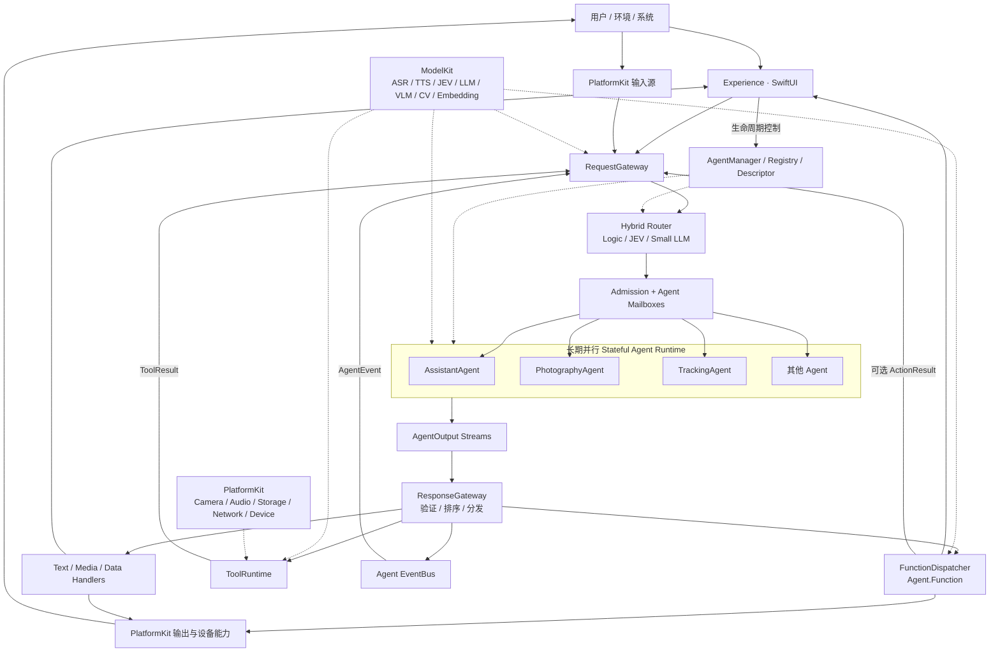

实线表示数据或控制流；虚线表示管理或能力依赖。所有 Agent 对外输出必须经过 ResponseGateway；模型推理属于 Agent 内部计算依赖，不额外绕 Gateway。AgentManager 的生命周期命令属于控制平面，不是业务输入的旁路。

### 2.1 模块职责

| 模块 | 拥有的职责 | 禁止承担的职责 |
| --- | --- | --- |
| Experience | 文本、语音、表情、相机预览、状态展示；产生用户意图 | 路由、规划、直接调用模型、直接调用 Agent 业务方法 |
| RequestGateway | 输入归一化、上下文快照、来源校验、路由、投递及接纳结果 | 复杂任务规划、维护业务 Agent 状态、自动创建无限 Agent |
| ResponseGateway | 输出契约校验、顺序控制、Function / Tool / 内容 / 事件分发 | 重新解释用户意图、直接实现推理或相机算法 |
| AgentCore | 公共契约、运行时、生命周期、流、状态、协议解析、监督 | SwiftUI / AVFoundation / 具体模型后端依赖 |
| Agents | 业务状态机、推理策略、协作计划；各 Agent 的 Function 定义 | 直接互调其他 Agent、直接操作 UI 或设备 |
| ToolRuntime | 工具注册、参数校验、调度、执行、结果、超时与取消 | 接管 Agent 生命周期、将工具结果直接注入模型内部 |
| ModelKit | 类型化模型能力、资源加载、推理、调度、预后处理 | UI、业务路由政策、动作执行、模型格式转换 |
| PlatformKit | 相机、麦克风、扬声器、存储、网络、权限、设备连接 | Agent 决策、模型语义、Function 命名策略 |
| App | Composition Root、依赖注入、注册、平台装配、应用生命周期联动 | 堆积业务实现 |

### 2.2 编译依赖与数据流分离

数据经过 Gateway，不代表每个模块都要互相 import。第一版采用一个工程内的逻辑目录；边界稳定后再拆 Package / target。

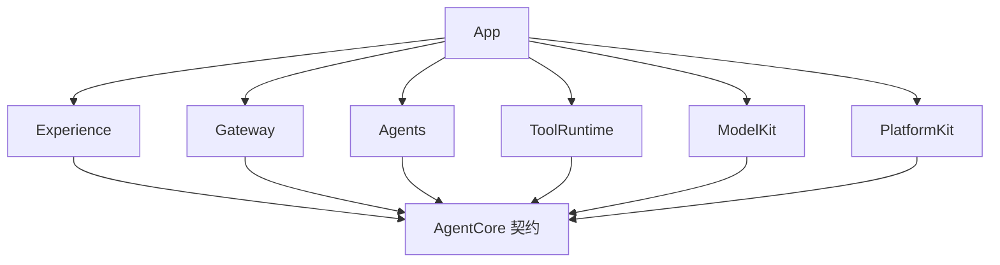

图表示建议的最小接口依赖。网关、Agent、Tool、Function 对具体服务的需求使用窄协议，由 App 注入实现。`AgentCore` 只保留框架中立的值类型、协议和运行时机制；ModelKit 的专用模型类型不应全部塞入 AgentCore。后续可拆 `AgentContracts`，但首期不增加空模块。

## 3. Experience 与系统入口

默认体验为一个可表达 listening / thinking / speaking / executing 状态的角色或表情，加文本输入与对话记录。语音优先，但任何关键流程必须能用文本输入完成。

- ViewModel 在 `@MainActor` 上更新；模型、解析、媒体处理不得占用 MainActor。
- ViewModel 依赖 RequestGateway 门面、PresentationSink 和 AgentManager 的控制接口。
- 聚合多个 Agent 状态时采用显式显示优先级，不用“最后一次事件覆盖全局状态”。例如正在播放音频时，另一个 Agent 的 idle 不应把角色改成空闲。
- 相机预览属于 PlatformKit → Experience 的设备展示通路；帧进入 Agent 必须再经 RequestGateway。
- UI 页面销毁只取消页面订阅；是否停止长期 Agent 由 App 的生命周期政策决定。

## 4. RequestGateway 与 Hybrid Router

### 4.1 输入流程

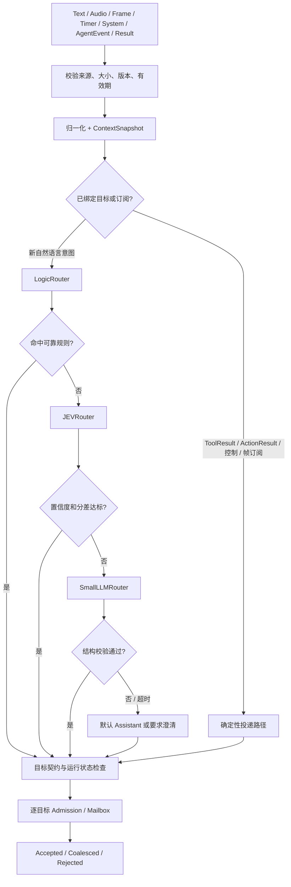

### 4.2 路由规则

| 路由层 | 输入 | 输出 | 约束 |
| --- | --- | --- | --- |
| Deterministic routing | 已建立媒体订阅、结果、取消、系统事件 | 已知实例目标 | 不调用 LLM；校验实例 generation、关联 ID 与过期时间 |
| LogicRouter | 显式场景、命令、当前交互状态 | 目标或 abstain | 优先级明确，规则可测试，避免隐式字符串规则扩张 |
| JEVRouter | 归一化意图与有限候选 | 候选分数、判断或 abstain | JEV 是项目内轻量 Judge / Evaluator 能力名；具体模型与训练定义待绑定，不假设某个标准模型 |
| SmallLLMRouter | 歧义自然语言、有限上下文、候选 Descriptor | 结构化 RouteDecision | 限定候选、生成预算、超时；不能生成可执行代码或自由 Function |
| Fallback | 路由失败或置信度不足 | Assistant / clarify / reject | 不把不确定意图升级为有外部副作用的动作 |

`RouteDecision` 至少包含目标列表、来源层、理由代码、置信度（如适用）及上下文版本。多目标 fan-out 是显式路由政策，不允许 small LLM 随意广播。

建议初始阈值：JEV top-1 ≥ 0.85 且 top-1 与 top-2 分差 ≥ 0.15；这些数值仅用于首版配置，必须以路由验证集校准。规则命中可跳过 JEV / LLM。高频帧、音频 chunk 不逐帧做语义路由。

### 4.3 输入与上下文

`AgentInput` 必须带 eventID、source、createdAt、deadline、traceID、可选 correlationID、sessionID、目标 instanceID / generation。上下文使用不可变快照，记录版本、时间及数据出处；不把相机历史或完整会话无限附加到 prompt。

- ASR partial 用于字幕与可撤销预判；默认仅 final 转为可触发动作的文本意图。
- ASR partial / final 共享 utteranceID 与 revision，final 不重复执行 partial 已预览的动作。
- 音频、帧保留采集时间、时基、格式及引用，不经 JSON / Base64 大规模搬运。
- Fan-out 逐目标返回接纳结果；一个慢 Agent 不阻塞其他目标。需要全目标原子接纳的业务必须另建协调协议。
- Gateway 不隐式启动停止状态的 Agent；可按配置向 Manager 申请 activation，得到许可后重试投递。

## 5. Stateful Agent Runtime

### 5.1 子架构

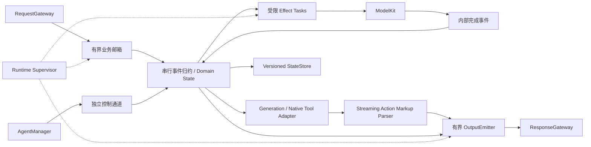

Agent 是逻辑实体；AgentRuntime 是执行与监督容器。默认一个实例一个业务状态 actor。Runtime 管理邮箱、输出、解析会话、关联表和取消作用域，不另复制一份可变业务状态。

Swift actor 提供隔离，但方法跨 `await` 可重入。必须通过单消费者事件循环或显式 reducer 保证业务事件顺序；长时间模型推理不能占住事件循环直到生成完成。

推荐执行方式：reducer 原子更新状态并产生 effect；effect 在受预算约束的任务中执行，完成后携带 stateRevision / operationID 回到 reducer。该回流仅限 Runtime 内部实现。跨 Agent、ToolResult、外部设备与业务 ActionResult 仍走 Gateway。旧 revision 或已取消 operation 的完成结果必须失效。

### 5.2 Manager、Registry 与 Descriptor

| 对象 | 职责 |
| --- | --- |
| AgentRegistry | 注册不可变 Descriptor、factory 和 capability 绑定；无运行状态 |
| AgentDescriptor | 身份、契约、资源、Function / Tool / Model 能力与运行政策 |
| AgentManager | 管理实例、状态快照、启动停止、健康、重启策略；防止同一实例重复启动 |
| AgentRuntime | 某个实例某个 generation 的邮箱、任务、输出与监督 |
| Agent 实现 | 业务 reducer、业务状态、具体决策与协作 |
| StateStore | 快照保存、迁移和恢复；不保存运行中的 Task / continuation / 裸设备句柄 |

Descriptor 最小字段：

| 分组 | 字段 | 含义 |
| --- | --- | --- |
| Identity | id / namespace / displayName / version / schemaVersion | 类型稳定标识与契约版本 |
| Runtime | persistent / autoStart / priority / maxInFlight | 生命周期意图与并发预算；不是 OS 常驻保证 |
| Input | inputKinds / subscriptions | 可接收类型、事件主题与定向输入 |
| Output | outputKinds / generationFormat / streaming | 可输出内容与生成协议 |
| Functions | localName / parameterSchema / handlerBinding / executionPolicy | namespace 内白名单、参数及资源冲突策略 |
| Tools | allowedToolIDs / timeout / maxConcurrentCalls | 可调用工具与预算 |
| Models | roles / requiredModelIDs / optionalModelIDs | 依赖角色、预热和降级 |
| Queues | capacity / byteLimit / overflow / deadline | 分类型排队规则 |
| State | observable / persistence / schemaVersion | 状态观察与恢复能力 |
| Recovery | restartPolicy / maxAttempts / backoff | 故障恢复限额 |

Descriptor 是可信 App 配置，模型不能修改。运行中更换契约必须重建 generation，不能让已生成的动作突然绑定到新 handler。

### 5.3 生命周期与状态

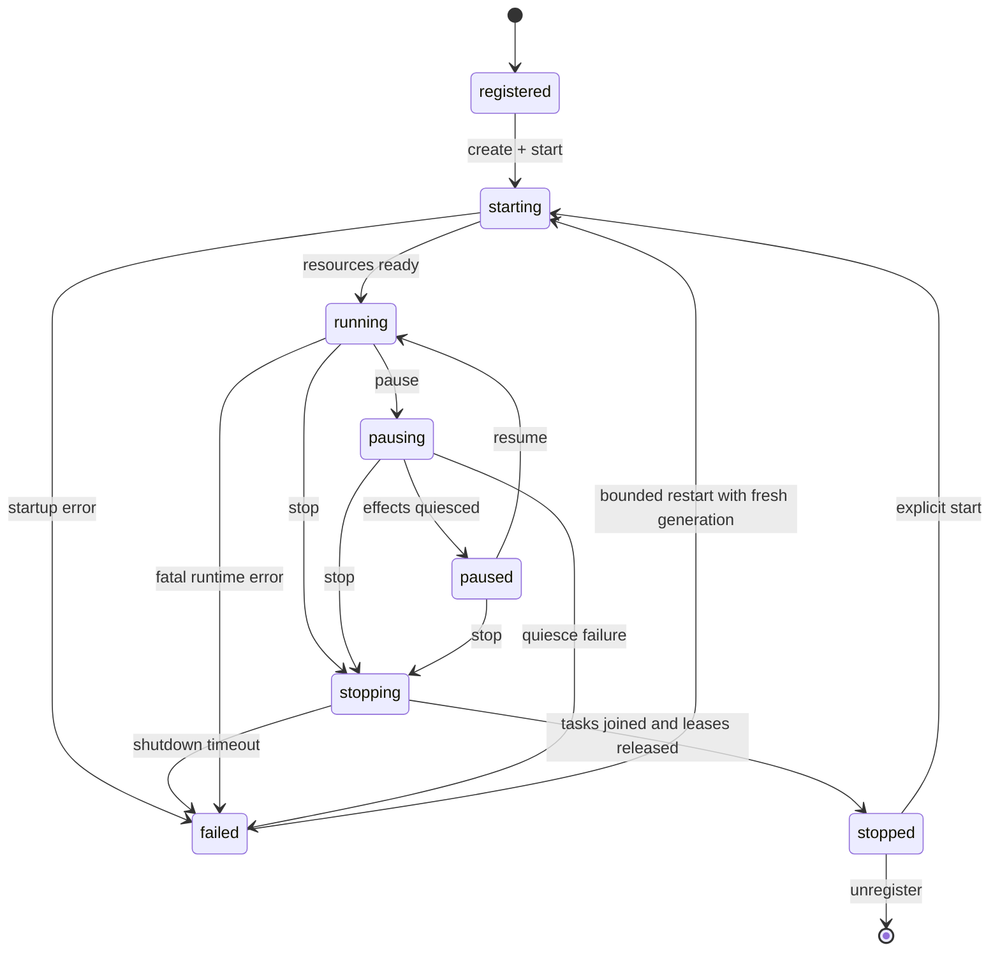

运行生命周期与活动状态分离：`running` 下可以是 `idle`、`processing`、`waitingForTool`、`streaming`。业务状态另行定义，如 Photography 的 searching / tracking / composing / capturing。`waitingForTool` 不能冻结其他输入。

| 操作 | 必须保证的语义 |
| --- | --- |
| start | 幂等；建输出消费端与控制通道后再激活生产者；失败释放部分资源 |
| pause | 停止接纳普通工作，停止 / 安全完成进行中的 effect；进入 paused 后不再产生新业务副作用；控制通道仍可用 |
| resume | 恢复接纳；过期帧不重放；需要时重新订阅设备数据 |
| stop | 拒绝新工作、取消作用域、关闭队列、终结输出、等待可终止任务、保存快照、释放资源 |
| restart | 先隔离旧 generation，再创建新 generation；旧 ToolResult / ActionResult / output 全部拒收 |
| status / health | 返回快照；包含活动、队列深度、最近进展、错误、资源占用；查询不能被长推理阻塞 |

暂停默认取消进行中的生成与工具，保留已提交的业务状态。不可中断的系统调用可能继续完成，但其结果在暂停或停止后的接纳由 operation 状态控制。未真正释放的设备 lease 不得假装释放给新任务。

### 5.4 持久性与应用生命周期

“长期”表示在允许执行的 App 生命周期中复用 Agent 实例，并通过快照恢复业务状态，不表示 iOS 进程永久后台运行。App 转入后台时按能力暂停相机、推理和非必要任务；只使用实际获准的后台执行能力。不得用持续音频等无关模式维持后台运行。应用恢复后重建资源、重新授权并校验快照版本。[Apple：应用生命周期](https://developer.apple.com/documentation/uikit/managing-your-app-s-life-cycle)

StateStore 采用带版本的原子快照；保存对话摘要、用户选择、计划节点、业务状态和已完成操作标识。媒体临时句柄、KV cache、执行栈不作为通用持久状态。崩溃恢复不自动重放拍照、发送设备指令等不可安全重试的动作。

## 6. AgentOutput Streams 与 ResponseGateway

### 6.1 输出类型

| 类型 | 例子 | 分发目标 | 关键语义 |
| --- | --- | --- | --- |
| text | 增量对话文本 | TextHandler → print / 可选 TTS | 保序、不丢字；明确 append 或 replace |
| functionToken | smile / capture / move | FunctionDispatcher | 外部动作；先完整解析、校验再执行 |
| toolCall | searchPhotos / detectFace | ToolRuntime | 用 callID 关联 ToolResult |
| image / video / audio | 图片、帧、音频块 | StreamDispatcher | 独立 streamID、时间戳、格式、所有权 |
| structured / embedding / tensor | 元数据、特征 | DataHandler | 保留 schema、shape、dtype、坐标或归一化定义 |
| binary | 非标准二进制 | BinaryHandler | 媒体类型、长度、预算、引用有效期 |
| event | targetLost / taskCompleted | Agent EventBus | 订阅与因果关系校验 |
| control | streamStart / streamEnd / error / cancelled | 控制与状态 Handler | 完成的是某条子流，不代表 Agent 停止 |

ToolResult 是由 ToolRuntime 产生、经 RequestGateway 投递的输入。若 Agent 需要向其他 Agent 转发结果，应产生明确 AgentEvent，不能伪装成可信 ToolRuntime 结果。

### 6.2 输出处理子架构

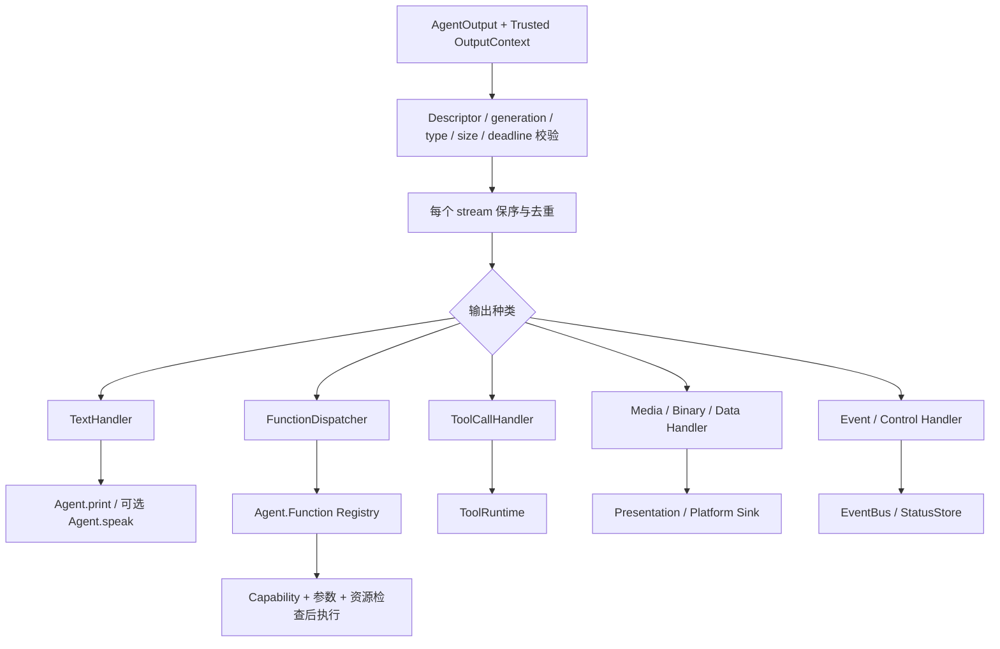

ResponseGateway 是流的验证与分发中心，不是单一 Function executor。慢 TTS、工具或某个 Agent 的输出不能阻塞全局多路复用循环。

### 6.3 流身份与顺序

可信 `OutputContext` 由 Runtime 添加，至少包含 agentTypeID、instanceID、generationID、sessionID、streamID、sequence、traceID、可选 correlationID。模型只能贡献 payload。

- sequence 在一个 generation 的一条 stream 内单调递增；多个 Agent 不承诺全局总顺序。
- 默认 Function 在同一 action lane 内串行执行；可并行动作须显式声明互不冲突的 resourceKey。
- 文本、TTS、媒体可能分 lane；“提交顺序”不等于“物理完成顺序”。需要先说完再拍照时，使用完成事件或显式 barrier，不能假设文本在前即音频已播放完。
- `streamEnd` 关闭子流并冲刷 parser / 文本分段；Agent 的 output 总通道持续存在直到 Runtime 停止。
- 纯文本输出模式绝不扫描标签。仅 Descriptor 声明的 Action Markup 生成会话启用 parser。

## 7. Action Markup：XML-style 流式协议

### 7.1 语义边界

Action Markup 是模型生成格式。规范化内部表示为 `TextChunk` 与 `FunctionToken(name, params)`，可序列化为 JSON，但进程内使用 Swift 类型。Parser 位于 AgentCore/Protocol，由 Runtime 的生成适配器持有；ResponseGateway 不再重复解析。

```text
模型片段: ["你", "好<sm", "ile/>"]
规范输出: TextChunk("你"), TextChunk("好"), FunctionToken("smile", {})
最终效果: Assistant.print 累加“你好”；Assistant.smile 执行一次
```

相邻 TextChunk 可合并；不允许跨动作边界合并从而改变顺序。

### 7.2 v1 语法

```ebnf
stream       = { text | emptyAction | bodyAction } ;
emptyAction  = "<", name, { attribute }, optionalSpace, "/>" ;
bodyAction   = "<", name, { attribute }, optionalSpace, ">", body,
               "</", name, optionalSpace, ">" ;
attribute    = space, name, "=", '"', attributeValue, '"' ;
name         = lowerAlpha, { alpha | digit | "_" } ;
```

规定：

1. 支持自然文本、空标签与纯文本 body；动作不能嵌套。
2. 属性只接受双引号；属性 / body 中的保留字符使用 `&lt;`、`&gt;`、`&amp;`、`&quot;`、`&apos;`。v1 不支持自定义实体、DOCTYPE、CDATA、注释、namespace 或 processing instruction。
3. 所有字面 `<` 必须转义为 `&lt;`，包括展示代码的场景；需要原样代码输出时优先使用独立纯文本生成模式。
4. 属性值先按字符串解析，再由 Function 参数 schema 转换；数字必须有限，布尔只接受约定值，不推测类型。
5. `<speak>你好</speak>` 的 body 映射为 `params.text`；仅 schema 显式声明 `bodyParameter` 的 Function 支持 body。
6. 同时给出 `text` 属性与 body、重复属性、未知参数、闭合名称不匹配均为协议错误。
7. 名称不含点号，模型不能写 `Photography.capture`；跨 Agent 能力必须通过可信注册与委派事件实现。
8. 原生 ToolCall 使用独立的结构化输出适配器；Markup 标签默认只生成 FunctionToken，不能自动升级成 ToolCall。

| Markup | 规范化结果 |
| --- | --- |
| `你好<smile/>` | text `你好`；`{"name":"smile","params":{}}` |
| `<capture camera="main"/>` | `{"name":"capture","params":{"camera":"main"}}` |
| `<speak>看这里</speak>` | `{"name":"speak","params":{"text":"看这里"}}` |
| `<look x="0.2" y="-0.1"/>` | schema 校验后数值参数 x=0.2、y=-0.1 |

### 7.3 Parser 状态与异常策略

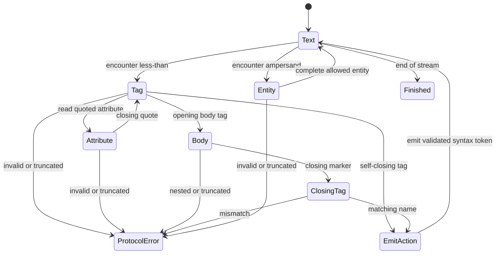

- 使用增量 UTF-8 decoder；一个 chunk 可以在汉字、emoji、实体、属性或标签中间截断。Tokenizer adapter 必须输出稳定的追加文本，不能假定单 token decode 后拼接永远等于完整 decode。
- 只有标签完整闭合后才产生 FunctionToken；`<capt` 既不执行也不显示。
- Parser 为每条生成 stream 独立持有状态，禁止跨流复用剩余 buffer。
- 建议限制：标签头 ≤ 4 KiB、属性 ≤ 16 个、单属性值 ≤ 2 KiB、body ≤ 16 KiB、单生成动作 ≤ 64 个；另设生成时限与总输出预算。
- 完整但未注册的标签由 capability 校验拒绝；语法畸形、超限、EOF 半标签终止该生成 stream，产生结构化错误，不执行残片，也不把残片原样展示。
- 之前已经输出的文本和执行的动作不会因后续解析错误自动回滚。需要原子动作集合的业务必须使用计划 / 事务机制，不能依靠 Markup 串隐含事务。
- 如需修复生成，开启新 stream 并明确已完成操作；禁止从头重播含已执行动作的旧输出。

## 8. Agent.Function 与 FunctionToken / ToolCall

### 8.1 namespace 与绑定

注册键建议为 `(agentTypeID, descriptorVersion, localFunctionName)`；执行时再绑定当前 instanceID / generation。`Assistant.smile` 和 `Photography.smile` 可以指向不同 handler，也可共享底层 Presentation capability。

Function 集合来自 Descriptor。ResponseGateway 依次检查：可信来源 → 当前 generation → output type → Function 白名单 → 参数 schema → App capability / 权限 → deadline / cancellation → resource lease → 执行。

Function 的业务定义放在 `Agents/<Agent>/Functions`。实现通过注入的 Presentation / Platform / Model 服务操作外部能力；Agent 的决策 actor 不直接调用这些实现。

### 8.2 两类调用的区别

| 维度 | FunctionToken | ToolCall |
| --- | --- | --- |
| 目的 | 表达对用户、界面、设备的动作 | 获取后续决策需要的观察或结果 |
| 例子 | print、smile、speak、capture、move | searchPhotos、detectFace、queryDatabase |
| 来源 | Markup 或 Agent 逻辑 | 原生模型 tool calling 或 Agent 逻辑 |
| 执行位置 | ResponseGateway → FunctionDispatcher | ResponseGateway → ToolRuntime |
| 返回语义 | 可有 ActionResult / 完成事件，但不默认续写模型 | 必须有按 callID 关联的终态 ToolResult |
| Agent 后续 | 可继续输出，不必等待 | 根据结果更新状态或恢复生成 |
| 副作用 | 常有，必须声明资源和重试政策 | 也可能有；不能因名字叫 Tool 就假定只读 |

区分基于协议用途，不基于底层 API。`capture` 作为动作可以产生照片句柄的 ActionResult；若决策明确要“拍照并分析”，Agent 应先等待结果事件，再发分析 ToolCall。底层 CameraService 可以复用，协议和关联状态不能混用。

### 8.3 文本映射与 TTS

TextHandler 按 Agent 的 presentation policy 把自然文本映射为注册的 `Agent.print`；启用 voice-first 时，经分句器映射为 `Agent.speak` 或流式 TTS handler。合成调用仍使用可信上下文及幂等标识，记录 origin=`textPolicy`。

显式 `<speak>` 的 body 默认不再进入普通文本自动朗读通路，避免双重播报。`speak` 内部调用 ModelKit.TTS，再交给 PlatformKit.Audio 播放。TTS 不属于 RequestGateway，也不参与 Agent 选择。

### 8.4 幂等、顺序与委派

动作标识由 Runtime / Gateway 从 generation、stream、sequence、子索引派生；不得由模型决定。进程内保留有界去重表。需要跨崩溃去重的外部设备操作使用持久操作记录与接收端幂等键；不得承诺通用 exactly-once。

跨 Agent 委派使用已注册的本地能力适配器，把动作转换为 `DelegationRequested` 事件，经 ResponseGateway → EventBus → RequestGateway 到目标 Agent。目标 Agent 自己决定如何处理，不直接调用其 actor 方法，也不靠名称猜测目标 namespace。

## 9. ToolRuntime 与结果回路

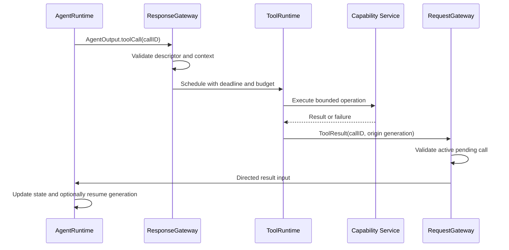

ToolCall 包含 callID、toolID、参数、deadline 和可信调用者上下文；模型原生 callID 可保留为 providerCallID，但系统 callID 必须由 adapter 分配，避免冲突。

ToolRuntime 负责参数验证、allowlist、并发限制、资源 lease、超时、取消、结果 schema、审计信息及去重。每个已接受调用在调用状态表中只能提交一个终态：succeeded / failed / timedOut / cancelled。迟到结果仅作诊断，不再推动 Agent。

ToolResult 通过定向高优先级输入回到原实例，禁止再交 small LLM 路由；投递失败须记录并释放结果资源。Actor 等待工具期间仍处理控制与其他允许事件。只对明确幂等且可重试的调用实行带抖动、限次数的重试。

## 10. Agent EventBus 与协作

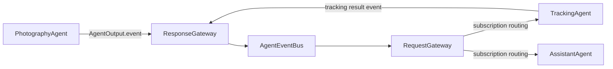

EventBus 负责内部事件连接与订阅索引，不接管路由决策和生命周期。事件须包含 eventID、topic、source、traceID、causationID、可选 correlationID、hopCount、deadline、payload schemaVersion。

- 默认进程内有界、非持久投递，不宣称 durable delivery；需要可靠跨重启交付时单独引入 outbox。
- 支持按 topic 与明确目标筛选；默认不回送源实例。
- hopCount 默认上限建议 8，同时保留事件 ID 去重窗口，阻止 A→B→A 无限循环。
- fan-out 使用独立订阅队列；慢订阅者按自己的政策降采样或拒绝，不阻塞全总线。
- Task delegation 使用 request / accepted / progress / completed / failed / cancelled 事件，关联同一 taskID；设置期限和超时处理。
- 协作计划由 Assistant 或专门 Coordinator Agent 管理；每个节点可定义依赖、重试与补偿，不在 RequestGateway 引入通用 Planner。

## 11. ModelKit

### 11.1 子架构

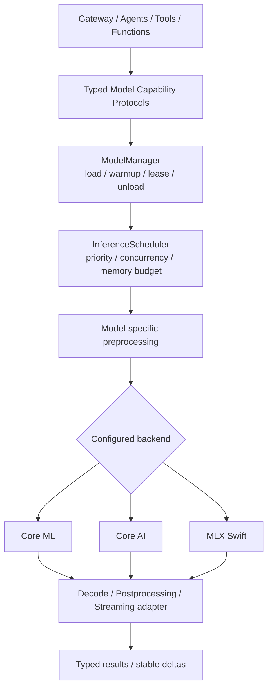

### 11.2 模型能力表

| 能力 | 所属目录 | 消费方 | 输入与输出 | 实施重点 |
| --- | --- | --- | --- | --- |
| ASR | Speech/ASR | RequestGateway | audio → partial/final transcript | 采样率、VAD 边界、utterance revision、取消 |
| TTS | Speech/TTS | speak Function / TextHandler | text → audio chunks | 分句、首包、播放队列、打断、重复朗读控制 |
| JEV | Language/JEV | Hybrid Router | intent + candidates → score/decision | 校准、阈值、abstain、低延迟 |
| LLM | Language/LLM | Assistant / Router | messages → text / structured call | tokenizer、上下文预算、KV cache、生成取消 |
| VLM | Language/VLM | Perception / Photography | image + prompt → text/data | 图像编码、分辨率、帧采样与时间关联 |
| YOLO | Vision/YOLO | Perception / Tool | frame → detections / keypoints | 与模型版本一致的 tensor 布局、解码和 NMS |
| RetinaFace | Vision/RetinaFace | Perception / Tool | frame → faces / landmarks | anchors、bbox / landmark decode、NMS |
| Embedding | Embedding | Memory / Search / Router | text/image → vector | 维度、归一化、距离度量与索引版本 |

### 11.3 后端政策

| 后端 | 使用方向 | 边界 |
| --- | --- | --- |
| Core ML | 已转换的视觉及其他适配模型 | 使用匹配模型的预后处理；计算设备由实际配置与系统执行决定，不保证总在 ANE |
| Core AI | 适合目标 SDK / 设备的生成式或其他模型 | 以能力检测和版本门控加载；`.aimodel` 等资源由离线工具链提供 |
| MLX Swift | 按模型生态及设备表现选择的 LLM / VLM 等 | 使用 Swift 实现；锁定依赖、权重、tokenizer 和模型实现版本 |

Core AI 提供设备端模型加载与执行；`AIModel` 可从 `.aimodel` / `.aimodelc` 加载。具体 API 与可用系统版本必须以实际采用 SDK 的声明为准，不将历史性能数字或未验证 availability 写入核心协议。[Apple Core AI](https://developer.apple.com/core-ai/)、[AIModel](https://developer.apple.com/documentation/coreai/aimodel)

MLX Swift 提供 iOS / macOS 模型应用路径；不把 MLX 限定为 Python 开发工具。涉及 Metal 的构建需遵循所锁版本的 Xcode 构建说明。[MLX Swift 官方仓库](https://github.com/ml-explore/mlx-swift)

第一版只实现真实使用的后端，不构建任意模型在三个后端自动转换的兼容框架。ModelKit 的 typed capability 是业务解耦边界，backend adapter 只是局部实现。可用性不足时返回 capabilityUnavailable 或使用预先配置的已验证后端，不能静默切换到云端。

### 11.4 模型资源与调度

每个模型 manifest 至少记录 modelID、version、backend、资源 checksum、输入输出 schema、tokenizer / prompt template、量化信息、预后处理版本、最低平台要求、估算权重 / 工作区 / cache 内存、验证用例与许可记录。

ModelManager 状态建议：unloaded → loading → ready → unloading；失败进入 failed 并保留结构化原因。并发 load 使用 single-flight；卸载必须等待 lease 释放。LLM session / KV cache 按 Agent 实例与 session 隔离，不能跨用户或会话误共享；只读权重可共享。

InferenceScheduler 同时限制并发任务、工作区和 KV cache 预算。高优先级不等于无限抢占：采用公平排队与 aging，防止视觉或 ASR 长期饥饿。热压力时依次降低帧率 / 分辨率 / 非关键模型频次，必要时停止低优先级 Agent。

Core ML 模型包不等于完整业务推理流程；YOLO / RetinaFace 的 resize、letterbox、色彩、方向、归一化、坐标反变换和 NMS 必须与导出模型匹配。不要对内置 NMS 的模型再次盲目执行 NMS。[Apple Core ML](https://developer.apple.com/documentation/coreml)

## 12. PlatformKit 与多模态数据

| 能力 | 责任 | 约束 |
| --- | --- | --- |
| Camera | session、预览、帧、拍照、曝光与焦点 | 共享采集源；独立消费订阅；停止时释放捕获资源 |
| Audio | 录音、播放、格式转换、系统中断与路由变化 | 音频会话与麦克风 lease 统一管理；打断时清空对应播放 generation |
| Storage | 状态、索引、媒体资源 | 原子写入、容量与保留策略；业务通过受限句柄访问 |
| Network | 可选下载或明确工具网络访问 | 时限、取消、可观测；端侧推理不默认依赖网络 |
| Device | 权限、热状态、电量、应用状态 | 状态变化经 RequestGateway 成为事件；授权不由模型决定 |
| ExternalDevice | 蓝牙 / 网络设备等具体适配 | 明确命令 ack、超时、资源互斥、失联处理 |

媒体 envelope 必须记录 streamID、序号、采集时间、时基、格式、分辨率 / 采样率、方向、长度与 ownership。小测试可用 `Data`；生产帧使用 actor 管理的 buffer pool / lease，避免每帧复制和 Base64。

跨 actor 传递媒体时，不可随意给 `CVPixelBuffer` 等包装加 `@unchecked Sendable`。应封装不可变所有权、限制读写区域并审查底层线程约束。fan-out 共享只读帧引用，由最后一个 consumer 释放；被丢弃、取消、超时的队列项也必须释放 lease。

## 13. 并发、背压、取消与失败隔离

### 13.1 并发模型

- Agent 之间逻辑并行；是否同时使用 GPU / ANE 由 Scheduler 与设备预算决定。
- 每个 Agent 一个有界邮箱和串行状态归约器，effect 按 maxInFlight 执行。
- ResponseGateway 用逐 Agent / stream 的独立队列与调度器，不能在一个全局消费循环里等待耗时 TTS / Tool 完成。
- 控制命令使用独立通道；取消不得排在数百帧之后。
- 同一摄像头拍照、音频输出、外部设备动作使用资源 lease 或串行执行 lane。
- 任何 effect 完成前后都检查 generation、operation 状态与 stateRevision，防止 actor 重入导致旧结果覆盖新状态。

### 13.2 队列与背压

| 通道 | 初始容量建议 | 溢出政策 |
| --- | --- | --- |
| 用户文本 / 业务事件 | 每 Agent 64 项，并设字节上限 | 异步等待至 admission deadline 或明确拒绝；不能静默丢失 |
| 相机 / 检测帧 | 每消费者 1–2 帧 | latest-wins，释放被覆盖帧 |
| ASR partial / 状态快照 | 每 key 1 个最新 revision | 合并；final / 终态另走可靠通道 |
| PCM 音频 | 固定时长 ring buffer，例如 200 ms | 溢出报告 discontinuity 并重置或降级识别；不能无标记跳音 |
| Markup / 文本 / FunctionToken | 64 项且设总字节上限 | 必须保序不丢；等待或结束该生成并报错 |
| ToolResult / 关键终态 | 独立有界可靠 lane | 提交到状态表后通知；拥塞时可查询终态，不能无限缓存 |
| 视频预览输出 | 1–2 帧 | 丢过期帧，不阻塞动作通道 |

`AsyncStream` 的 continuation `yield` 不等于等待消费者，默认无限 buffer 也不是可接受的队列策略。仅用 `.bufferingNewest` 会丢失动作或文本。可靠通道必须实现可挂起的有界 send / receive，或使用经验证具有背压语义的 channel；有损观察流才使用 latest-wins buffer。[Swift SE-0314](https://github.com/swiftlang/swift-evolution/blob/main/proposals/0314-async-stream.md)

容量必须同时限制元素数与字节数，并限制排队中的 producer 数；禁止“每个 callback 启动一个 Task 等待 send”，这会把无限缓存转成无限任务。不可挂起的设备 callback 使用有界桥接与显式丢弃政策。

### 13.3 取消层级

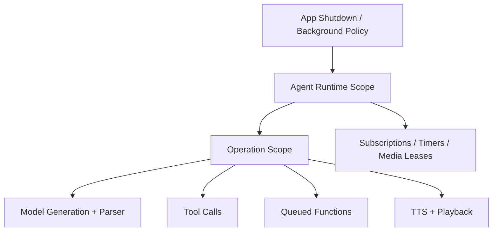

取消一个 utterance / operation 不等于停止 Agent。用户打断时撤销旧 operation 的模型生成、待执行 Function、关联工具和对应 TTS 播放，丢弃旧 parser 残片；保留 Agent 状态机以接收新输入。已提交的不可逆动作不能被“取消”撤销，必须报告其真实完成状态。

Task cancellation 是协作式信号；后端不能立即中断时隔离结果并等待真实资源释放。所有 queue waiter、continuation、subscription 在取消或关闭时必须终结且只恢复一次。Runtime 持有所有非结构化长寿命 Task 的 handle，并在 stop 时 join；`Task.detached` 不用于绕过隔离错误。

### 13.4 失败隔离与恢复

| 故障 | 处理范围 | 恢复 |
| --- | --- | --- |
| 路由模型超时 | 当前输入 | 默认 Assistant / clarification；其他事件继续 |
| Markup 非法 | 当前生成 stream | 终止该 stream，保留 Runtime；不重放旧动作 |
| Function 未注册 / 参数非法 | 当前动作 | 拒绝并记录结构化错误；可回送 ActionResult |
| Tool 超时 / 失败 | 当前 call | 终态 ToolResult；Agent 决定下一步 |
| 模型不可用 / 内存不足 | 当前模型使用者 | 可选已验证降级；有界释放 / 重试 |
| 单 Agent 业务错误 | 当前 operation 或 Runtime | supervisor 按错误等级恢复；其他 Agent 持续运行 |
| 设备失联 / 权限撤销 | 相关 capability 与订阅 | 停止相关动作、释放资源、发状态事件 |
| 全局内存压力 | 系统预算 | 停低优先级任务、降采样、卸载无 lease 模型 |

错误至少包含 code、scope、retryable、traceID、operationID、message 和可选底层诊断。Swift actor 只提供状态隔离，不提供进程隔离；进程崩溃、内存耗尽等不能保证其他 Agent 存活。必须避免 force unwrap、不可控内存与 fatalError 作为普通错误处理。

## 14. 核心 Swift Interface 示例

以下代码为可一起类型检查的接口骨架，使用 Foundation 和 Swift Concurrency；用于确定边界，不包含队列、调度或具体模型实现。协议中的 `async throws` 不自动实现容量或取消，具体实现必须满足第 13 节。示例使用字符串 ID 简化篇幅，生产实现建议用强类型 ID 防止误传。

### 14.1 值类型、输入输出与可信上下文

```swift
import Foundation

indirect enum JSONValue: Sendable, Codable, Equatable {
    case string(String)
    case number(Double)
    case bool(Bool)
    case object([String: JSONValue])
    case array([JSONValue])
    case null
}

struct RuntimeIdentity: Sendable, Hashable, Codable {
    let agentTypeID: String
    let instanceID: UUID
    let generationID: UUID
}

struct EventContext: Sendable, Codable {
    let eventID: UUID
    let traceID: UUID
    let correlationID: UUID?
    let sessionID: UUID?
    let source: String
    let createdAt: Date
    let deadline: Date?
}

struct OutputContext: Sendable, Codable {
    let runtime: RuntimeIdentity
    let descriptorVersion: String
    let streamID: UUID
    let operationID: UUID?
    let sequence: UInt64
    let traceID: UUID
    let correlationID: UUID?
    let sessionID: UUID?
}

struct FunctionToken: Sendable, Codable, Equatable {
    let name: String
    let params: [String: JSONValue]
}

struct ToolCall: Sendable, Codable {
    let callID: UUID
    let toolID: String
    let arguments: [String: JSONValue]
    let deadline: Date
}

enum CompletionStatus: String, Sendable, Codable {
    case succeeded, failed, timedOut, cancelled
}

struct OperationResult: Sendable, Codable {
    let operationID: UUID
    let status: CompletionStatus
    let value: JSONValue?
    let errorCode: String?
}

struct ToolResult: Sendable, Codable {
    let callID: UUID
    let origin: RuntimeIdentity
    let result: OperationResult
}

struct AgentEvent: Sendable, Codable {
    let topic: String
    let schemaVersion: Int
    let causationID: UUID?
    let hopCount: Int
    let payload: JSONValue
}

enum MediaKind: String, Sendable, Codable {
    case image, video, audio, binary, tensor, embedding
}

struct MediaReference: Sendable, Codable {
    let id: UUID                 // 经授权 MediaStore 中的句柄
    let kind: MediaKind
    let mediaType: String
    let byteCount: Int
    let timestampNanos: UInt64  // 与 metadata 中的 timebase 共同解释
    let metadata: [String: JSONValue]
}

enum InputPayload: Sendable {
    case text(String)
    case media(MediaReference)
    case event(AgentEvent)
    case toolResult(ToolResult)
    case actionResult(OperationResult)
    case cancelOperation(UUID)
}

struct AgentInput: Sendable {
    let context: EventContext
    let target: RuntimeIdentity?
    let payload: InputPayload
}

enum StreamControl: Sendable {
    case started
    case ended
    case cancelled
    case failed(code: String)
}

enum OutputPayload: Sendable {
    case text(String)
    case functionToken(FunctionToken)
    case toolCall(ToolCall)
    case media(MediaReference)
    case data(JSONValue)
    case event(AgentEvent)
    case control(StreamControl)
}

struct AgentOutput: Sendable {
    let context: OutputContext
    let payload: OutputPayload
}
```

`JSONValue` 的合成 Codable 格式不是标准 JSON wire 格式。需要与外部 JSON 互通时必须补充自定义 `init(from:)` / `encode(to:)`，并测试 null、对象、数组、数字；不能直接把此示例的自动编码当成协议。`MediaReference` 的 Codable 仅为标识传输，不意味着可跨重启恢复底层 buffer。

对外时间戳可使用 Date；队列超时实现使用单调时钟，避免墙钟调整影响取消。Input 的 `source` 在入口 adapter 填充并认证，不信任模型提供的同名字段。actionResult 另在接纳表验证目标 operation 的归属。

### 14.2 Descriptor、Agent 与 Manager

```swift
enum InputKind: String, Sendable, Hashable {
    case text, media, event, toolResult, actionResult, control
}

enum OutputKind: String, Sendable, Hashable {
    case text, functionToken, toolCall, media, data, event, control
}

enum GenerationFormat: String, Sendable {
    case plainText, actionMarkupV1, nativeToolCalls, none
}

struct FunctionDescriptor: Sendable {
    let name: String
    let parameterSchema: JSONValue
    let bodyParameter: String?
    let resourceKey: String?
    let idempotent: Bool
}

struct RuntimePolicy: Sendable {
    let persistent: Bool
    let autoStart: Bool
    let priority: Int
    let maxInFlight: Int
    let mailboxCapacity: Int
    let mailboxByteLimit: Int
}

struct AgentDescriptor: Sendable {
    let id: String
    let namespace: String
    let version: String
    let schemaVersion: Int
    let inputKinds: Set<InputKind>
    let outputKinds: Set<OutputKind>
    let generationFormat: GenerationFormat
    let functions: [FunctionDescriptor]
    let allowedToolIDs: Set<String>
    let modelIDs: Set<String>
    let runtimePolicy: RuntimePolicy
}

enum AgentLifecycle: String, Sendable {
    case registered, starting, running, pausing, paused
    case stopping, stopped, failed
}

enum AgentActivity: String, Sendable {
    case idle, processing, waitingForTool, streaming
}

struct AgentStatus: Sendable {
    let runtime: RuntimeIdentity
    let lifecycle: AgentLifecycle
    let activity: AgentActivity
    let stateRevision: UInt64
    let queueDepth: Int
    let domainState: JSONValue
    let lastErrorCode: String?
}

protocol OutputEmitter: Sendable {
    // 实现有界 send；等待不能阻塞线程；取消/关闭须唤醒等待者。
    // OutputContext、序号及 generation 由可信实现添加。
    func emit(_ payload: OutputPayload, streamID: UUID,
              operationID: UUID?) async throws
}

struct AgentContext: Sendable {
    let identity: RuntimeIdentity
    let outputs: any OutputEmitter
}

protocol StatefulAgent: Actor {
    nonisolated var descriptor: AgentDescriptor { get }
    func start(context: AgentContext) async throws
    // 由 Runtime 单消费者调用。只做有限归约与受控 effect 调度。
    func receive(_ input: AgentInput) async throws
    func pause() async throws
    func resume() async throws
    func stop() async
    func snapshot() async -> JSONValue
}

protocol AgentManaging: Sendable {
    func start(agentTypeID: String, instanceID: UUID) async throws
        -> RuntimeIdentity
    func pause(_ identity: RuntimeIdentity) async throws
    func resume(_ identity: RuntimeIdentity) async throws
    func stop(_ identity: RuntimeIdentity) async throws
    func restart(_ identity: RuntimeIdentity) async throws -> RuntimeIdentity
    func status(instanceID: UUID) async -> AgentStatus?
    func statuses() async -> [AgentStatus]
}
```

实现时 `AgentManager` 与 `AgentRuntime` 可为 actor。`StatefulAgent.receive` 不是 request/response 方法，返回只表示完成当前归约；真正业务输出通过 emitter 持续产生。Agent effect 的生命周期必须由 Runtime supervision scope 托管。

### 14.3 Gateway、Router、Parser 与执行边界

```swift
struct RouteDecision: Sendable {
    let targets: [RuntimeIdentity]
    let strategy: String
    let confidence: Double?
    let reasonCode: String
}

enum Admission: Sendable {
    case accepted(RuntimeIdentity)
    case coalesced(RuntimeIdentity)
    case rejected(target: RuntimeIdentity?, code: String)
}

protocol AgentRouter: Sendable {
    func route(_ input: AgentInput,
               candidates: [AgentDescriptor]) async throws -> RouteDecision
}

protocol RequestGatewayProtocol: Sendable {
    func submit(_ input: AgentInput) async throws -> [Admission]
}

protocol ResponseGatewayProtocol: Sendable {
    // 返回表示校验并接纳，不代表所有外部动作物理完成。
    func accept(_ output: AgentOutput) async throws
}

enum ParsedMarkupItem: Sendable, Equatable {
    case text(String)
    case function(FunctionToken)
}

protocol StreamingActionParser: Sendable {
    mutating func consume(_ bytes: Data) throws -> [ParsedMarkupItem]
    mutating func finish() throws -> [ParsedMarkupItem]
    mutating func reset()
}

struct ActionExecutionContext: Sendable {
    let output: OutputContext
    let actionID: UUID
    let deadline: Date
}

protocol AgentFunction: Sendable {
    var descriptor: FunctionDescriptor { get }
    func execute(_ token: FunctionToken,
                 context: ActionExecutionContext) async throws -> OperationResult
}

protocol ToolExecuting: Sendable {
    // 接纳后异步执行，终态结果通过注入的 RequestGateway 回流。
    func submit(_ call: ToolCall, origin: OutputContext) async throws
    func cancel(callID: UUID, origin: RuntimeIdentity) async
}

@MainActor
protocol PresentationSink: AnyObject {
    func appendText(_ text: String, context: OutputContext)
    func setExpression(_ name: String, context: OutputContext)
    func applyStatus(_ status: AgentStatus)
}
```

注册表应持有 `any AgentFunction` 或受约束的 handler 闭包，而不是任意 Objective-C selector / 字符串反射。`consume` 每次输入还需设置 chunk 大小上限，避免一次返回超大数组；生产版本可改为逐项 sink，保持同样的语义。

### 14.4 模型流接口

```swift
struct GenerationRequest: Sendable {
    let operationID: UUID
    let prompt: String
    let maxNewTokens: Int
    let format: GenerationFormat
}

enum GenerationDelta: Sendable {
    case textBytes(Data)
    case nativeToolCall(ToolCall)
}

protocol GenerationSink: Sendable {
    // 背压从这里传回模型 adapter；不能忽略慢消费者。
    func send(_ delta: GenerationDelta) async throws
}

protocol LanguageModelService: Sendable {
    func generate(_ request: GenerationRequest,
                  into sink: any GenerationSink) async throws
    func cancel(operationID: UUID) async
}

struct RoutingJudgement: Sendable {
    let scoresByAgentID: [String: Double]
    let abstained: Bool
}

protocol RoutingJudge: Sendable {
    func judge(text: String, candidateIDs: [String]) async throws
        -> RoutingJudgement
}

protocol SpeechRecognizer: Sendable {
    func start(streamID: UUID) async throws
    func append(_ audio: MediaReference, streamID: UUID) async throws
    func finish(streamID: UUID) async throws
    func cancel(streamID: UUID) async
}

protocol SpeechSynthesizer: Sendable {
    func synthesize(text: String, operationID: UUID) async throws
        -> MediaReference
}
```

LLM sink 是内部计算流，不是 UI 输出。文本 delta 经 Runtime parser 进入 OutputEmitter；原生 ToolCall delta 经完整参数累积和 schema 验证后进入 AgentOutput。模型在发起需要结果的 ToolCall 后结束或暂停对应生成步骤；结果到达后，由 Agent 显式恢复，禁止无限自动续写循环。

ASR 的 partial/final 通过注册时注入的 transcript sink 回到 RequestGateway；上例只列输入控制面。TTS 示例是最小整段接口，流式版本使用独立 audio sink，不能一次性把无限音频放入返回值。

### 14.5 有界流实现约束

框架对外语义可表达为 `AsyncSequence<AgentOutput>`，但不能把普通 `AsyncStream` 的缓冲行为当成完整运行时机制。

首期建议实现一个内部 `BoundedChannel<Element: Sendable>`：

| 操作 | 语义 |
| --- | --- |
| send | 容量可用时接纳；否则异步挂起至容量、取消或 deadline；限制等待者数 |
| next | 单消费者取下一项；channel 关闭且排空后返回 nil |
| finish | 禁止新 send；允许已接纳项按政策排空；唤醒消费者 |
| cancel | 使未提交项失败、释放 payload、唤醒全部等待者 |
| offerLatest | 仅有损通道提供；覆盖旧元素并释放旧资源；不可用于 FunctionToken |

channel 等待时不得持有阻止消费者运行的锁。所有 continuation 恰好恢复一次；send 取消与接纳竞态必须用单一状态归约决定。恢复一个 waiter 后再唤醒下一个，避免超发容量。

## 15. 关键端到端流程

### 15.1 第一条文本 / Markup / Function vertical slice

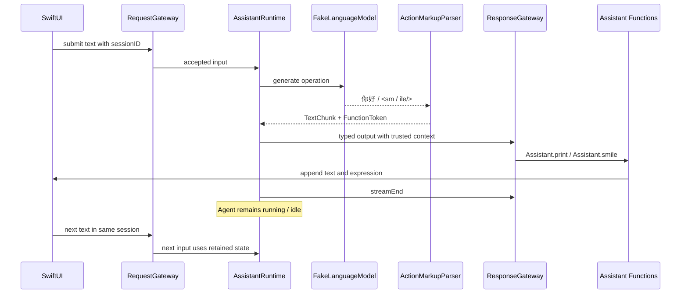

### 15.2 语音与打断

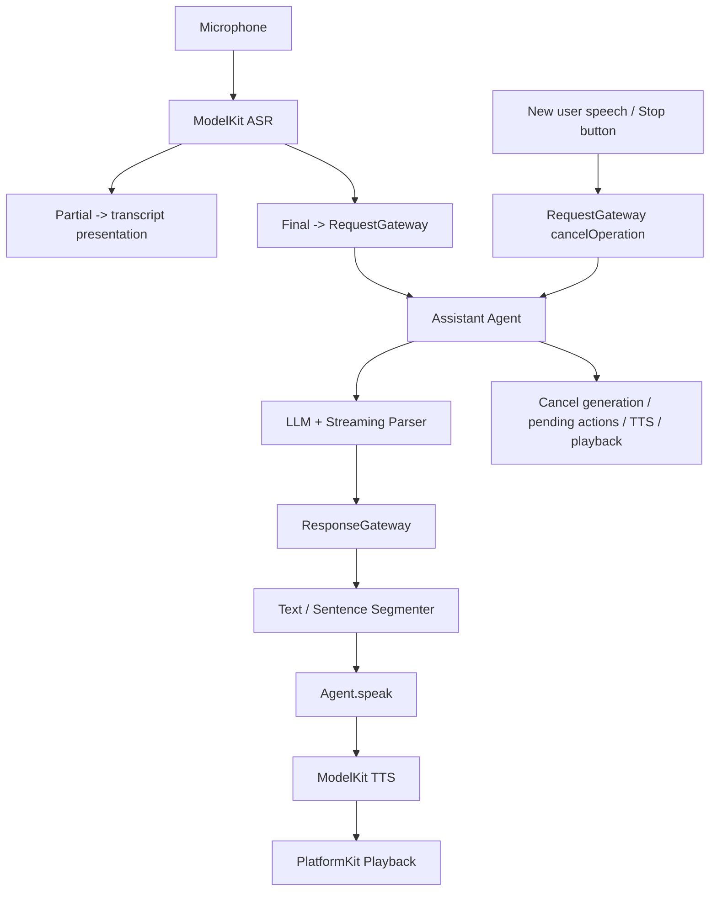

ASR partial 展示是输入预览，不伪装成 AgentOutput；Agent 的任何实际输出仍经 ResponseGateway。语音打断策略要处理回声和误触发，第一版允许按钮打断，后续再加入 VAD / echo-aware barge-in。

### 15.3 持续视觉与拍照

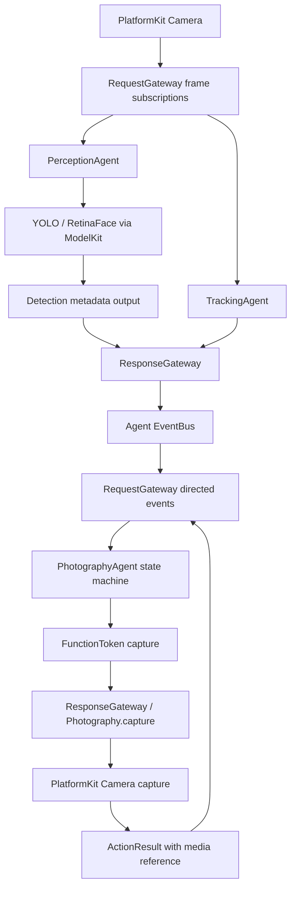

视觉结果带 sourceFrameID、captureTime、模型版本和坐标系。Photography 必须检查结果新鲜度，不使用过期检测控制当前拍照；Tracking / Perception 可共享采集帧与模型服务，不能各自无预算地创建摄像头或加载同一模型。

## 16. 项目目录与逐项注释

第一版一个 Xcode 工程，iOS / macOS target 共用主体源码。目录是逻辑边界；只有确有独立测试或复用价值时再拆 Swift Package。

```text
mobile-harness/
├── MobileHarness.xcodeproj/              # iOS / macOS targets、scheme 与构建配置
├── MobileHarness/
│   ├── App/
│   │   ├── MobileHarnessApp.swift        # SwiftUI 入口与 scene 生命周期
│   │   ├── AppContainer.swift            # 唯一装配入口；创建并注入依赖
│   │   ├── AgentBootstrap.swift          # 注册 Descriptor、factory、Function 与 Tool
│   │   └── AppLifecycleCoordinator.swift # 前后台、退出、热状态与 Manager 联动
│   ├── Experience/
│   │   ├── Conversation/
│   │   │   ├── ConversationView.swift   # 文本、输入框与对话展示
│   │   │   └── ConversationViewModel.swift # MainActor 状态；只依赖框架门面
│   │   ├── Character/
│   │   │   ├── CharacterView.swift       # 表情与动画
│   │   │   └── ExpressionState.swift     # UI 表达状态，独立于 Agent 业务状态
│   │   ├── Camera/CameraView.swift       # 相机预览与 overlay
│   │   ├── AgentStatus/AgentStatusView.swift # Agent 状态、启停与错误展示
│   │   └── PresentationAdapter.swift     # Gateway 输出到 MainActor 的适配
│   ├── Gateway/
│   │   ├── Request/
│   │   │   ├── RequestGateway.swift      # 业务输入统一入口
│   │   │   ├── InputNormalizer.swift     # 各输入 adapter 的归一化
│   │   │   ├── ContextBuilder.swift      # 不可变、限量、带版本的上下文快照
│   │   │   ├── AdmissionController.swift # 契约、容量、期限与接纳政策
│   │   │   └── Router/
│   │   │       ├── HybridRouter.swift    # 分层路由与 fallback
│   │   │       ├── LogicRouter.swift     # 确定性规则及事件订阅
│   │   │       ├── JEVRouter.swift       # 注入 RoutingJudge 的轻量判断
│   │   │       └── SmallLLMRouter.swift  # 受限结构化候选选择
│   │   ├── Response/
│   │   │   ├── ResponseGateway.swift     # 输出接纳与多流协调
│   │   │   ├── CapabilityValidator.swift # Descriptor、namespace、参数与 generation
│   │   │   ├── OutputDispatcher.swift    # 类型化输出分发
│   │   │   ├── FunctionDispatcher.swift  # Agent.Function 解析、顺序、幂等
│   │   │   ├── StreamDispatcher.swift    # 媒体 / 数据流 sink 管理
│   │   │   └── Handlers/
│   │   │       ├── TextHandler.swift     # 文本输出与可选分句 TTS
│   │   │       ├── ToolCallHandler.swift # 转交 ToolRuntime
│   │   │       ├── MediaHandler.swift    # image / audio / video
│   │   │       └── ControlHandler.swift  # 子流结束、取消、错误与状态
│   │   └── Bus/
│   │       ├── AgentEventBus.swift       # 内部事件连接与 fan-out
│   │       └── SubscriptionRegistry.swift # 订阅过滤、期限与取消
│   ├── AgentCore/
│   │   ├── Contracts/
│   │   │   ├── StatefulAgent.swift       # 持续事件处理协议
│   │   │   ├── AgentDescriptor.swift     # I/O、能力、运行预算
│   │   │   ├── AgentInput.swift          # 输入 envelope 与 payload
│   │   │   ├── AgentOutput.swift         # 输出 envelope 与 payload
│   │   │   ├── AgentContext.swift        # 可信身份与受限服务句柄
│   │   │   ├── AgentEvent.swift          # topic、因果与协作事件
│   │   │   ├── MediaReference.swift      # 框架中立媒体引用
│   │   │   └── CapabilityProtocols.swift # Gateway / Model / Platform 窄依赖接口
│   │   ├── Runtime/
│   │   │   ├── AgentManager.swift        # 启停、暂停、重启、状态与健康
│   │   │   ├── AgentRegistry.swift       # Descriptor 与 factory 注册
│   │   │   ├── AgentRuntime.swift        # 实例容器、邮箱、输出和任务作用域
│   │   │   ├── AgentLifecycle.swift      # 合法生命周期转移
│   │   │   ├── AgentStatus.swift         # lifecycle / activity / domain 状态快照
│   │   │   ├── RuntimeSupervisor.swift   # 失败隔离与有界恢复
│   │   │   └── OperationRegistry.swift   # 调用、取消、终态与 generation 关联
│   │   ├── Stream/
│   │   │   ├── BoundedChannel.swift      # 可挂起的有界可靠通道
│   │   │   ├── AgentMailbox.swift        # 输入队列、优先级与 admission
│   │   │   └── OutputEmitter.swift       # 可信上下文与保序输出
│   │   ├── Protocol/
│   │   │   ├── ActionMarkup.swift        # v1 grammar 与限制
│   │   │   ├── StreamingActionParser.swift # UTF-8 / 标签 / 实体增量状态机
│   │   │   ├── FunctionToken.swift       # 规范化动作结构
│   │   │   └── ToolCall.swift            # 独立工具调用与结果结构
│   │   ├── State/
│   │   │   ├── StateStore.swift          # 带版本的快照与迁移
│   │   │   └── StateSnapshot.swift       # 可序列化状态 envelope
│   │   └── MultiAgent/
│   │       ├── AgentPlan.swift           # 后续：业务协作计划数据
│   │       └── DelegationEvent.swift     # request / progress / completion 契约
│   ├── Agents/
│   │   ├── Assistant/
│   │   │   ├── AssistantAgent.swift      # 会话状态、生成与委派决策
│   │   │   ├── AssistantState.swift      # 会话与 operation 状态
│   │   │   └── Functions/
│   │   │       ├── PrintFunction.swift   # Assistant.print → PresentationSink
│   │   │       ├── SmileFunction.swift   # Assistant.smile → 表情 sink
│   │   │       └── SpeakFunction.swift   # 后续：TTS 与 Audio 播放
│   │   ├── Photography/                 # 摄影状态机与 capture / focus 等 Function
│   │   ├── Tracking/                    # 持续目标跟踪与 targetLost 事件
│   │   ├── Perception/                  # 视觉推理与类型化检测输出
│   │   ├── Media/                       # 媒体检索、选择与加工编排
│   │   ├── Memory/                      # 后续：记忆与检索政策
│   │   └── Robot/                       # 后续：外部设备状态机
│   ├── ToolRuntime/
│   │   ├── Tool.swift                   # 工具定义、参数和结果契约
│   │   ├── ToolRegistry.swift           # 工具注册和能力白名单
│   │   ├── ToolExecutor.swift           # 并发、时限、取消与结果回流
│   │   └── Tools/                       # SearchPhotos、DetectFace 等具体实现
│   ├── ModelKit/
│   │   ├── Core/
│   │   │   ├── ModelManifest.swift      # 模型资源、schema、版本与预算
│   │   │   ├── ModelRegistry.swift      # 模型 ID 到配置映射
│   │   │   ├── ModelManager.swift       # load / warmup / lease / unload
│   │   │   └── InferenceScheduler.swift # 推理、公平性、内存和热预算
│   │   ├── Language/LLM/               # 本地文本生成、tokenizer 与稳定 delta
│   │   ├── Language/VLM/               # 视觉语言输入构造与推理
│   │   ├── Language/JEV/               # 路由判断与分数校准
│   │   ├── Speech/ASR/                 # 识别、partial/final 与音频适配
│   │   ├── Speech/TTS/                 # 合成与音频片段输出
│   │   ├── Vision/YOLO/                # 模型特定 decode、坐标与 NMS
│   │   ├── Vision/RetinaFace/          # anchors、bbox、landmarks 与 NMS
│   │   ├── Embedding/                  # 向量化及 schema
│   │   └── Runtime/
│   │       ├── CoreML/                 # Core ML 原生后端
│   │       ├── CoreAI/                 # 可用性门控的 Core AI 后端
│   │       └── MLX/                    # 选定版本的 MLX Swift 后端
│   ├── PlatformKit/
│   │   ├── Camera/                     # capture session、帧与拍照
│   │   ├── Audio/                      # microphone、speaker、中断及路由
│   │   ├── Storage/                    # 原子持久化与资源管理
│   │   ├── Network/                    # 限定网络访问与下载
│   │   ├── Device/                     # 权限、应用和热状态
│   │   ├── ExternalDevice/             # 外部设备 transport 与命令
│   │   └── MediaStore/                 # buffer pool、lease 与媒体句柄
│   ├── Observability/
│   │   ├── TraceRecorder.swift          # trace / span、结构化诊断
│   │   └── RuntimeMetrics.swift         # 队列、时延、资源与取消指标
│   └── Resources/
│       ├── Models/                     # 提前准备的模型或下载 manifest
│       ├── Prompts/                    # 按 Agent / grammar 版本管理的 prompt
│       └── Assets.xcassets/            # UI 图像与颜色
├── Tests/
│   ├── Fixtures/                       # 固定模型片段、媒体与错误输入
│   ├── TestSupport/                    # FakeClock、FakeModel、FakeTool、SpySink
│   ├── AgentCoreTests/                 # 状态机、channel、生命周期与取消
│   ├── ParserTests/                    # 任意分片、非法输入、配额与 EOF
│   ├── GatewayTests/                   # 路由、namespace、契约与顺序
│   ├── ToolRuntimeTests/               # 单终态、超时、取消与迟到结果
│   ├── ModelKitTests/                  # manifest、lease 与预后处理 golden tests
│   └── IntegrationTests/               # vertical slice 与多 Agent 隔离
└── docs/
    ├── architecture.md                 # 本技术方案
    ├── model-manifest.md               # 接入模型的固定版本与验证矩阵
    └── decisions/                      # 后续关键架构决策记录
```

尚未进入当前里程碑的目录无需创建空实现。真实模型权重按大小、许可与分发方式决定是否进入版本控制；资源清单与 checksum 必须可追踪。

## 17. 推荐实施顺序与验收

### 17.1 M0：第一条 vertical slice

目标链路：

```text
Text Input
  → RequestGateway（固定或 LogicRouter 到 Assistant）
  → 长期 AssistantAgent
  → FakeLanguageModel 持续输出分片
  → StreamingActionParser
  → TextChunk + FunctionToken
  → ResponseGateway
  → Assistant.print / Assistant.smile
  → SwiftUI
```

逐项实施：

1. 创建 iOS / macOS SwiftUI 工程，启用 Swift 6 并发检查，设置核心模型层不默认隔离到 MainActor。
2. 建立第 14 节最小契约、RuntimeIdentity、Descriptor 和 FakeModel。
3. 实现 Manager 的 start / stop / status，单 Assistant 实例与有界输入 / 输出 channel。
4. 实现 RequestGateway 归一化、可靠接纳及固定目标 LogicRouter。
5. 实现 v1 parser 的 UTF-8、text、自闭合标签、body、实体、EOF 与配额处理。
6. 实现 ResponseGateway capability 验证和 `Assistant.print` / `Assistant.smile` 注册。
7. AppContainer 装配 PresentationSink；UI 展示文字、表情与 Agent 活动。
8. 支持 operation 取消、第二次输入与停止重启；保持同会话状态计数，验证实例长期存活。
9. 用第二个轻量 FakeAgent 验证故障与阻塞隔离，不依赖实际视觉模型。

固定测试输出为 `你好<smile/>`，分片至少包含 `你`、`好<sm`、`ile/>`；另用按 UTF-8 任意 byte 切分的输入验证 decoder。

M0 完成条件：

| 验收项 | 通过条件 |
| --- | --- |
| 流式展示 | 完整生成结束前已有文本显示；标签不泄漏到 UI |
| 动作执行 | smile 在完整闭合前执行 0 次，闭合后执行恰好 1 次 |
| namespace | Assistant 不能执行未注册的 Photography.capture |
| 状态 | 两次输入使用同一 instance / generation；业务状态计数连续 |
| 非 RPC | 输入归约完成后仍可输出；streamEnd 后 Runtime 仍 running |
| 取消 | 在 `<sm` 后取消不触发表情；旧流后续片段被隔离 |
| 停止重启 | stop 后无新动作；restart 新 generation 拒绝旧流与旧结果 |
| 背压 | 人为暂停输出消费者时内存有界；文本与动作不静默丢失 |
| 隔离 | 第二个 Agent 的慢操作 / 错误不阻止 Assistant 控制与输出 |
| 平台 | iOS Simulator 与 macOS 构建、核心集成测试通过 |

### 17.2 后续里程碑

| 阶段 | 内容 | 退出条件 |
| --- | --- | --- |
| M1 | 接入一个真实本地 LLM 后端，保留 FakeModel | 实机 streaming / parser / 取消通过；模型版本与资源预算记录完整 |
| M2 | ASR → Assistant → TTS，加入音频中断与 barge-in | partial/final 不重复触发动作；打断可停止旧播报并接收新输入 |
| M3 | ToolRuntime + EventBus + 两 Agent 协作 | ToolResult 单终态；取消、迟到、重复、循环事件均有测试 |
| M4 | Camera + YOLO / RetinaFace + Tracking / Photography | 帧可丢但动作不丢；坐标、延迟、资源与热压力在实机验证 |
| M5 | JEV / small LLM 混合路由、持久状态与恢复 | 路由验证集达标；后台恢复、状态迁移、资源回收与降级通过 |

无需等全部阶段完成才使用框架。优先验证最关键的语义，再扩展模型和 Agent 数量。

## 18. 测试矩阵与可观测性

### 18.1 必须覆盖的测试

| 领域 | 测试 |
| --- | --- |
| Parser | 每个 byte 边界分片、多个标签同 chunk、中文 / emoji、实体跨 chunk、带引号属性、body、未知标签、重复参数、截断、超限、取消 |
| Parser 性质 | 相同完整合法输入的不同分片方式得到等价语义序列；合并相邻 text 后一致；无半标签动作 |
| Descriptor | 不允许的输入 / 输出、重复 Function 名、未知 Tool、版本不匹配、伪造 namespace |
| Router | 规则命中、JEV abstain、LLM 非法结果 / 超时、定向结果绕过语义路由、fan-out 部分拒绝 |
| Runtime | start / stop 幂等、pause quiescence、跨 await 重入、旧 revision、旧 generation、纯输入与定时纯输出 |
| Channel | 容量与字节上限、sender / receiver 取消竞态、finish / cancel、所有 waiter 被唤醒、资源 lease 回收 |
| Function | 顺序、resourceKey 互斥、重复 token 去重、权限拒绝、取消前后提交界限、文本自动 TTS 不重复 |
| Tool | 成功 / 失败 / 超时 / 取消仅一个终态，迟到结果、无接收者、重试仅限幂等工具 |
| EventBus | fan-out 隔离、取消订阅、hopLimit、去重、任务协作超时与循环 |
| Model | load single-flight、lease 阻止卸载、session 隔离、预后处理 golden fixtures、调度公平性 |
| Platform | 音频中断、相机权限撤销、前后台、设备失联、媒体引用释放 |
| 集成 | 第一条 slice、双 Agent 并行、慢消费者、连续启停、资源不足及真实设备持续运行 |

使用虚拟时钟、可控 FakeModel / FakeTool 和显式同步点测试竞态，避免依赖任意 sleep。性能与热测试在真机上单独执行，不能把 Simulator 数字作为 iPhone 推理指标。

### 18.2 指标与日志

每条 trace 覆盖 input → route → admission → Agent operation → model / tool → parser → output → action / presentation。日志默认记录 ID、状态、长度、错误代码和耗时；文本、音频、图像原文不默认写日志。

指标至少包括：

- 路由延迟、接纳延迟、各层 fallback / rejection 比例。
- 首个文本输出延迟、首个音频播放延迟、模型 TTFT 与生成速率。
- 队列深度、字节峰值、producer 等待时间、丢帧 / 合并 / 音频断裂次数。
- Function 排队 / 执行延迟、Tool 终态与超时率、取消响应时间。
- 模型加载与预热、权重 / KV cache / 工作区内存、热状态与持续运行表现。
- Agent 健康、最后进展、重启次数、旧 generation 拒收次数、资源 lease 数。

容量与延迟目标应由实测报告更新。不能仅用 decode tokens/s 宣称交互性能，也不能假定更多 Agent 或模型并发必然加速。

## 19. Coding Agent 实现约束

1. 先完成 M0 的真实闭环，不用大量空模块或 mock 成功状态代替运行时语义。
2. 任何 Agent 业务输入必须经过 RequestGateway，任何 AgentOutput 必须经过 ResponseGateway；生命周期控制使用 AgentManager。
3. Agent 不直接引用其他 Agent 实例；协作走类型化事件，不在 Gateway 实现业务 Planner。
4. 不把 Agent 实现为仅有 `run(request) -> response` 的一次性函数；不要在每次输入时重新创建实例。
5. 原始 Markup 只存在于生成适配与 parser 边界；UI、Function 和 Tool 不重新扫描文本标签。
6. 身份、generation、namespace、actionID、callID 和权限来自可信运行时；模型只提供受限语义内容。
7. FunctionToken 与 ToolCall 不合并；schema 验证、结果关联、超时与取消都要有实际实现。
8. 不使用无界队列或无界任务创建。视频允许 latest-wins；文本、动作、关键终态不能静默丢弃。
9. 不用“actor 是线程安全的”替代事件顺序与状态版本控制；跨 await 的状态读取必须重新验证。
10. 不能通过 `@unchecked Sendable`、`nonisolated(unsafe)` 或关闭并发检查掩盖设计问题。
11. 只在 PresentationSink / UI 访问 MainActor；重计算通过受控后端执行，不阻塞合作式执行器。
12. 实际 SDK API、deployment target、Core AI availability 与 MLX 依赖版本在接入时核对并锁定；禁止虚构 API 或把示意接口当成系统 API。
13. ModelKit 不内置 Python、converter 或模型训练链路；模型提前准备并登记 manifest。
14. iOS 后台能力按平台实际授权实现；长期 Agent 不等于后台无限运行。
15. 所有外部副作用必须有资源与取消政策；失败重试不得重复执行未确认幂等的动作。
16. 每完成一个里程碑更新测试与模型验证矩阵。改变协议、namespace、状态恢复语义或编译依赖方向时新增明确的架构决策记录。
