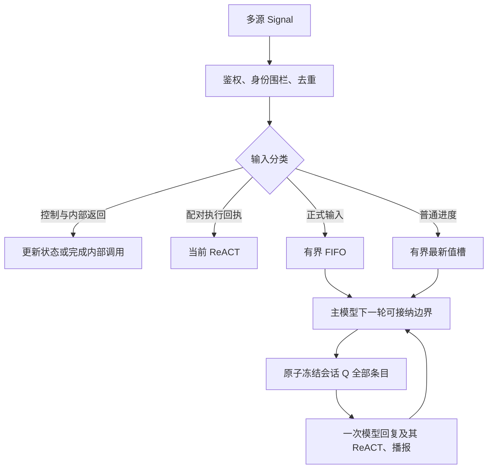
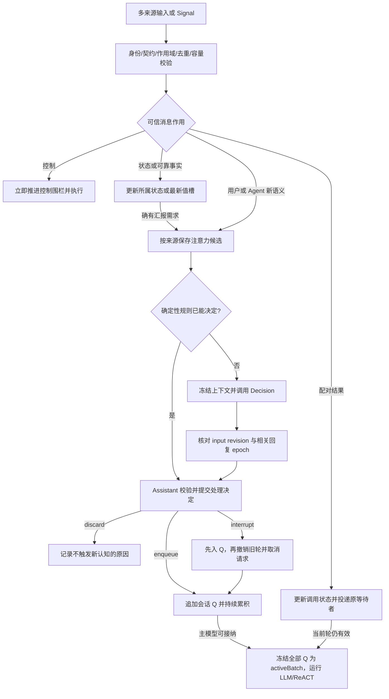

# Assistant 多源输入的触发时机与合并

## 范围与状态

2026-11-06：根据当前代码分析并提出后续设计。本次只记录分析，不改变输入调度、FIFO 或合并规则。此前约定正式输入互不合并；下述整队列批次是需要单独实施和验收的策略变化，不是现有 `SignalBatch` 已有能力。

协调归 Assistant 业务运行时；Gateway 保持身份校验、传输及执行职责。Writer 创作、生命周期和进度呈现不等待 Assistant 是否接纳、生成或播报成功。

## 2026-11-10 实施划分

先执行 [Assistant 内聚语音合成](technical/Assistant-Owned-Speech.md) 的设计与迁移。输入协调、批次、小模型与全双工音频仍待独立实施。下文 2026-11-06 的当前实现分析是当时快照；Writer 现在以确定性通知播报，不额外请求模型，最新契约见 Assistant/Writer README。

后续采用统一有界收件箱，分开正式输入、最新状态、控制和配对反馈；“是否启动认知”与“是否播报”分别决策。规则处理明确事件，ModelKit 的拟议 DecisionCapability 对剩余语义返回有限候选结果或不可判断；Assistant 校验输入快照版本后决定。当前源码仍使用 JudgeCapability 名称，尚未迁移。请求冻结相关成员身份/版本，新信号继续接纳，打断走控制路径。选中、请求完成、执行完成和播放完成分开记录，不能在发送请求时把成员全部标为已完成。语音结束检测属 SpeechPerception，不能代替多来源语义协调。

2026-11-10 后续讨论形成的多通道全双工方案见本文最后一节；它是最新提案。下文“当前实现”保留 2026-11-06 快照；旧的“回复期间全部等待、播完恢复接纳”不能作为新全双工设计的要求。

## 当前实现与缺口

- Assistant 正式输入共用容量为 32 的队列，接纳顺序决定处理顺序，溢出明确拒绝。用户最终文本和需要回复的 Writer 事件分别成为输入。
- 一次模型回复可有多次 ReACT。配对的执行回执属于该轮延续，不应成为新用户输入。内部 Gateway 调用的返回由内部调用者消费，不进入模型反馈或 ReACT。
- Writer 普通进度只保留最新待处理项；Assistant 空闲且正式输入处理完后才接纳，两次普通汇报至少间隔 10 秒。已经接纳的正式输入不再被该合并槽替换。终态清除未接纳的过时进度。
- Writer 正式事件在队首时等待实际回复播报边界；`AgentDecisionContext.batch()` 和 `selected(by:)` 当前严格绑定单一 input ID，并未实现多输入批处理。
- 因而“用户语音、Writer 追问、完成消息几乎同时到达”可能连续触发多次模型回复。现有逐项 FIFO 不能表达一次主模型请求消费整个已接纳待处理队列。

主要代码依据：`MobileHarness/Agents/Support/Chat/AgentChatWorker.swift`、`MobileHarness/Agents/Support/Core/Runtime/AgentDecisionContext.swift`、`MobileHarness/Agents/Assistant/AssistantProcessing.swift`。当前运行契约见 [Chat README](../../MobileHarness/Agents/Support/Chat/README.md)。

## 输入分类

| 类型 | 触发模型 | 合并边界 |
| --- | --- | --- |
| State 更新、语音阶段、字幕／灵动岛内部返回 | 否 | 更新事实或内部调用状态，不制造正式输入 |
| 配对的模型 Action／Tool 结果 | 延续当前 ReACT | 保留调用配对，不与新外部输入混合 |
| ASR 中间文本 | 否 | 只更新字幕；最终文本才正式接纳 |
| 用户最终语音／文本 | 是 | 保留接纳顺序，不盲目拼接独立或冲突指令 |
| Agent 普通进度 | 低优先级 | 按来源、任务、委托保留最新项；终态替代尚未接纳的进度 |
| Agent 追问、完成、失败、取消确认 | 是 | 保留每条事实、身份及交互关联；适合时可联合汇报 |

## 建议的触发边界

1. 所有来源先完成鉴权、会话／委托有效性检查和去重，再接纳。用户最终文本的接纳顺序仍是事实顺序，不用跨来源时间戳重新排序。
2. 当前认知轮拥有模型请求及其必要 ReACT 延续。新到普通输入持续累积，不热插入已发出的请求。认知轮和播放周期分别计忙碌；主模型可接纳下一轮时不必等上一轮所有声音播完，播放仍按有界 FIFO 和实际停止/完成屏障执行。
3. 到达主模型可接纳下一轮的边界后，Assistant 原子取出该会话 Q 中全部已接纳条目，保留逐条身份、来源和时间，冻结为一次请求。不同主题可以同批；不再按相关性挑选子集，也不为等待未来消息增加固定延迟。
4. 已确认用户正在说话、ASR 尚未完成时，暂缓主动汇报，避免抢占说话；仅仅“聆听已开启”不阻止主动回复。未完成 ASR 不提前占 FIFO 位置。此策略需要与现有语音打断策略一起验证。
5. 普通进度不能持续挤占用户接话机会。正式输入有待处理内容时优先处理正式输入；没有正式输入时才考虑最新普通进度。
6. 非聆听时收到应回复事件仍可启动回复；是否继续感知由独立语音许可/全双工政策决定，不用每轮 LLM 的 busy/idle 反复启停采集。



## 全量批次与身份边界

用户于 2026-11-10 明确选择：在下一轮允许发起时，会话 Q 中所有已接纳条目一起进入主模型。此规则替代之前“一个主输入加相关事实”以及按相关性筛选批次的提议。不同主题、不同来源和多条用户命令都可同批，以独立事件保留身份；批次不等于把所有正文拼成一个伪用户文本。

- 用户说“保存”与 Writer 完成可在一次回复中分别处理，但不能把“保存”未经理解自动回给 Writer。
- 不同用户命令、互相冲突的修改要求可一起送入，让主模型依据来源/时间/明确引用理解；不得仅因较晚到达就推定覆盖。不同会话保持隔离；不同委托/interactionID 在同批内仍保留各自绑定与授权，不能串用。
- 多个 Agent 追问同时待处理时，需要记录实际向用户提出的交互；含糊回答不能唤醒错误任务。
- 同一委托终态可使尚未询问的旧问题失效，但必须留下被替代证据，不能静默删除已经接纳的正式输入。
- 已经开始生成或播报的回复不被新进度重写。终态只清除尚未接纳的普通摘要。
- 消息投递或汇报失败不能重新执行 Writer 创作，也不能盲目重放已经执行的业务 Action。

## 存储、容量与失败语义

保留每条原始输入的 ID、来源、接纳顺序和处理结果；一次回复记录它消费的成员 ID，避免把同一回复正文重复存入每条输入。完整实际模型上下文仍由 `model_request_log` 留证。优先评估现有结构化字段，不在本次分析中新增数据表。

32 项容量应约束待处理正式信号总数，不能通过无限增大 batch 绕过队列限制。普通进度合并槽也必须有界。排队、选择、请求失败、取消和已回复分别留证；失败后不能重复消费已完成的成员。会话切换和 delegate 身份围栏必须先于合并。

## 后续实施涉及的职责

| 位置 | 后续变化 |
| --- | --- |
| Agents/Support/Chat | 待处理输入选择、语义合并、回复占用和批次结算 |
| Agents/Support/Core/Runtime | 如果采用多输入批次，明确替换现有单输入选择契约 |
| Agents/Assistant | 带来源的联合上下文、追问关联及用户回复解释 |
| Agents/SpeechPerception | 复用语音阶段与恢复契约，验证说话期间延后主动汇报 |
| Storage/Database | 评估现有 messages／请求日志能否完整追溯批次成员，不先增加表 |
| 相关技术 README | 实施后同步实际输入、回复及播报生命周期；本次不将提案写成现行设计 |

## 验收场景

- 用户最终语音先到／后到 Writer 终态；用户正在说话时收到追问；播报期间收到正式输入。
- 普通进度连续更新、终态覆盖未接纳进度、汇报失败不影响 Writer。
- 同一冻结边界的全部 Q 条目进入一次主模型请求，包括独立主题；不同会话不混入，同批的委托／交互身份不串用。
- ReACT 中间的单次 HTTP 完成不误判为整轮空闲；认知轮结束即允许下一批，TTS/播放独立有界，不能用未播完阻止语音接纳。
- 队满明确拒绝、重投去重、迟到事件、模型失败与取消后批次正确结算。
- SQLite 可还原原始输入、联合请求及处理证据，信号数量、回复次数、模型请求次数分别统计。

本次未实施上述协调变更，也未宣称这些新场景已经通过。

## 2026-11-10：多通道全双工输入设计（提案，未实施）

### 目标与基本决定

采用“按来源暂存、多路接纳、单一 Assistant 仲裁和认知执行”的设计。接收与感知可以同生成/播报并行，但一个会话只允许一轮拥有当前回复发布权。输入通道是 Assistant 私有的输入分区，与 Gateway 的输出执行 Channel/Speech Channel 不同，不新增基础模块或目录。

把两件事分开：第一层是根据可信契约确定消息走控制、反馈、状态还是注意力候选；第二层才为注意力候选选择 enqueue / discard / interrupt。不能要求所有消息都在这三个动作中选一个，否则模型可能丢掉执行结果或阻塞停止控制。

“来源”有两个维度：传输发送者（如 SpeechPerception）和语义来源（用户）。最终转写的语义来源仍是用户，不能因为 origin=agent 就归入后台 Agent 通知。身份、来源类别、关联 ID 和控制权限由可信适配器/契约产生，不从消息正文自报的身份推导。

### 来源、消息作用与路由

| 语义来源 | 代表事件 | 接纳后的处理 | 是否调用 Decision |
| --- | --- | --- | --- |
| 用户语音 | speech.final，最终有效语句 | 保留独立 utterance 身份，成为注意力候选 | 默认每个独立 final 一次；明确控制、重复和失效输入先走规则 |
| 用户显式界面输入 | 提交文本、明确停止/取消按钮 | 文本保留；停止/取消直接控制 | 忙碌时文本可判断 enqueue/interrupt，不允许模型把显式提交任意 discard；按钮不调用 |
| 语音感知状态 | onset、partial、endpoint、ASR 失败/修订 | 更新当前 utterance、字幕和说话状态 | 普通 partial/onset 不调用；稳定的提前打断候选是后续独立优化 |
| 其他 Agent 的新语义请求 | 主动建议、追问、需要 Assistant 理解的新信息 | 校验委托/交互后进入该 Agent 来源通道 | 有语义择时需求时调用；来源权限限制可选动作 |
| 其他 Agent 的可靠事实 | 委托接纳、waitingUser/待回答问题、完成、失败、取消确认 | 先更新其所有者的可靠任务/通信状态；再派生待汇报候选 | 事实本身不调用；汇报择时可调用，discard 仅抑制冗余汇报 |
| Agent 进度/感知摘要 | 写作进度、视觉场景变化 | 状态更新或按 source/task/topic 保留最新项 | 逐条进度不调用；有变化且需要主动提示时才派生候选 |
| 当前调用的执行反馈 | Tool/Action/round result、配对 Agent 调用回复 | 按 session/input/round/call/委托身份投递到原等待者 | 不调用，不进入新对话 FIFO |
| 运行时/系统控制 | 关闭、授权撤销、原生音频故障、已定义的关键状态变化 | 确定性控制或状态更新；普通诊断不主动发言 | 控制不调用；后续确需汇报的摘要独立成为候选 |

Agent 消息和 Action 结果都要按作用分类，不能仅按 payload 外形判断。一个 Agent 发来的“原调用结果”也属于配对反馈；一个 Action 输出触发了新的独立观察，则由拥有者显式派生新候选，不能把同一回执重复接纳两次。字幕、灵动岛等 executeInternal 结果继续只返回其内部调用者，不进入 Assistant 认知。

需要用户回答的 Agent 追问还拥有可靠的 interaction 义务：先保留未解决问题，再决定何时向用户提出；模型不能用 discard 使该义务消失。重复提醒可以抑制，原问题只有收到匹配回答、明确撤销或任务终态后才能结算。待提出问题与已实际提出的当前问题分开；前者沿用受容量约束的委托/交互记录，后者才可以绑定用户的简短回答。

### 数据结构与时间

沿用并扩展 AgentInput/InputMetadata，避免建立第二份不一致的 Signal 信封。现有字段已有 id、sessionID、origin、source、incarnation、capturedAt、sequence、rootID、parentID、deadline、turn/taskScope；新增信息首先评估放入现有中立元信息或 Assistant 私有记录，类型迁移单独实施。

拟议 Assistant 私有结构：

```text
AssistantInputCoordinator (会话/根所有，单一隔离域)
  entries: inputID -> InputEntry             // 唯一内容与处理状态
  channels: InputChannelID -> [inputID]      // 按来源索引，不复制消息
  ready / Q: [inputID]                      // 已通过接纳判断、等待下一轮的全部输入
  activeBatch: batchID + [inputID]          // 从 Q 原子转移，执行期间不可变
  decisionInFlight: inputID + snapshotToken // 最多一个
  activeReply: replyID + generationEpoch + playbackEpoch
  pendingInteraction: 已实际提出的问题与 interactionID

InputChannelID = 会话 + 语义来源类别 + 可信生产者实例
InputEntry = AgentInput + receivedAt + admissionSequence
           + utteranceID/revision/final（语音）
           + sourceClockID/occurredAt（可获得时）
           + reply/call/interaction 关联（适用时）
           + processingState + dispositionEvidence
```

任务/委托 ID 放在 entry 关联字段中，不为每个 task 无限制创建 channel。用户语音与 UI 文本可保留不同通道，但共享同一用户/会话的互动关系。来源 epoch 换代使旧消息和旧判断结果失效。

时间保留三层含义：

1. 事件发生区间：语音至少保留 utterance 开始/结束、ASR final 生成时刻；用来关联用户开始说话时的 Task/问题/播报片段，而不是用 final 到达时的当前 Task 覆盖它。
2. 本地接收单调时间：计算 freshness、等待和耗时。跨设备/进程 capturedAt 需要时钟域标记，不能直接比较 systemUptime。
3. Assistant 接纳序号：在隔离域内原子分配，作为本地稳定顺序。墙上时间 Date 用于展示和历史，不用于打断围栏或跨通道排序。

同一来源正式输入保留单调 sequence/接纳次序；跨来源按 Assistant 接纳序号稳定呈现，保留发生时间供主模型理解，不按来源时间戳重排因果事实。到下一轮时全部 Q 条目同批进入，不再由调度器按优先级或相关性挑选子集。反馈与控制按各自关联直接处理，不会被同来源正在等待 Decision 的普通消息堵住。

### 接纳流水线



入站接纳回执只确认内容已接管，不等待 Decision、LLM 或播报。尤其必须替换现有 pendingFinal 等待整个回复释放后才接纳新句的门控：full duplex 模式下，final 的接管确认不能等于全会话停止收音。

原始消息只存一份。可行状态为 received → deciding/ready → selected → completed/interrupted/failed；discarded、superseded、rejected 各有明确原因。选中/发出模型请求不等于业务或播报完成。一个原始 Agent 结果可对应一个独立汇报候选，必须以因果 ID 连接，避免重复写入事实。

### 三种处理方式

- **enqueue**：该条完整加入 Q，忙碌时持续累积；主模型空闲时 Q 全部转为一个新批次，不人为增加固定等待窗。按冻结的交互绑定解释，不把旧“嗯”绑定给后提出的新问题。
- **discard**：在单条候选接纳阶段决定不进入 Q，不参与已入队批次的筛选；例如无须回应的附和、已确认回声、过期摘要、重复通知。仍保留简明处理证据；不会删除任务终态、执行回执、有效问题答案或已经提交的业务记录。最新值替换记作 superseded，容量不足记作 rejected，都不能伪装成语义 discard。
- **interrupt**：先将新输入接纳进 Q，再立即撤销旧轮发布权并取消当前 LLM 请求；释放下一轮接纳权后取整个 Q，包括此前已等待的消息，不只处理打断消息。不能只停止播放而丢掉这句话。中断不是新输入已处理完毕，也不是撤销所有正在运行的业务任务。Assistant 空闲时合法新意图的 interrupt 退化为 enqueue；独立“停止”且无活动对象按控制规则完成，不新开无意义回复。

前台用户来源有申请打断回复的权限。后台 Agent 的普通建议/进度默认不可打断；只有被可信契约允许、与当前活动直接相关的紧急失效/必要纠错才可申请打断。消息正文写“紧急”不会自行扩大权限。Decision 可以用候选集合表达限制，但不同候选集合的概率不能混用同一阈值。

### 整 Q 提交与轮次结算（用户确认的批次策略）

Decision 管单条消息的接纳，主模型管整批消息的理解和处理，两者职责分离。已进入 Q 表示这条消息已经获得下一轮输入资格；不会再因“不相关”而被调度器排除。Q 限定于当前会话，内容是完成单条接纳后的输入；仍在 deciding 的候选尚不属于 Q，不为等待未来分类结果无限延迟已经可开始的轮次。

在 InputCoordinator 隔离域内，以一个不含异步挂起的事务完成：

```text
if cognitionState == idle and Q is not empty:
    activeBatch = freeze(all entries currently in Q)
    Q = empty
    cognitionState = running(activeBatch.id, generationEpoch)
    schedule one main-model request for activeBatch
```

清空的是 Q 索引，原始记录转入 activeBatch 而非标记已完成或删除。先建立 running 身份再异步发请求，避免两次到达启动两个并行主轮；消息到达和轮结束都能唤醒同一个 pump，避免丢失启动信号。事务之后接纳的新消息写入新的 Q。新输入持续到达不改变已冻结批次，也不让快照永远无法完成。正常入队与“轮结束”的竞态按这个原子时刻确定属于哪一批。

每条批次消息独立呈现 inputID、source、发生/接收时间、接纳序号、正文与 task/call/interaction 关联。不同来源正文均是消息数据，不能因为同批而提升为 system 指令。即使主题独立，模型也可以在一次认知轮中统筹回应或提交多个动作；具体 Action 能否并行仍由权限、资源冲突和依赖控制，不由全量输入自动决定。

例如当前轮忙碌时积累“用户问报告状态”“Writer 报告完成”“用户询问天气”，下一轮三条全部输入。若随后又接纳“先停下，改查后天”，则新消息先进入同一 Q，再触发旧轮取消；下一轮看到四条全部消息，由主模型理解修改关系。来源与时间辅助理解，但不能代替明确指代；不清楚修改对象时应澄清，不能让框架自行把所有旧命令取消。

“空闲”指当前认知轮已结束或已被撤销且主模型资源可接纳新请求。一个 ReACT HTTP 请求返回 tool calls 不等于认知轮结束。TTS/播放另有 busy 状态：认知轮结束时可继续生成下一轮，输出仍受已有有界 FIFO 和音频停止围栏约束；若输出积压满载则明确背压，不无限生成音频。interrupt 立即使旧结果失去效力并发出取消；实现内部仍需 cancelling 状态，不能仅把布尔值置 idle 就在同一不可重入模型资源上发起重叠推理。具有独立请求能力的后端在旧轮已隔离后可以接纳新请求，旧原生资源的停止/加入依然由原 owner 负责。

activeBatch 的结算区分：消息已经纳入理解、相关动作已经执行、后台委托仍进行、问题待用户回答、消息被明确后续意图替代，以及尚未处理。一次轮结束不意味着所有任务业务完成，但每个批次成员需要可追溯的处理去向。没有回复或操作证据的成员不能仅因“请求已发出/模型流已结束”就当作处理成功。

被打断的 activeBatch 不原样回灌 Q 自动重跑。保留原输入、实际已执行工具结果、已播/未播状态及未完成义务，作为下一轮带状态的延续上下文，与新 Q 全量消息一起交给主模型。由后续意图决定继续、修改或取消，执行层沿既有调用身份防止重放；不得丢掉旧批次未完成事项，也不得把被丢弃的草稿回答写成已向用户表达的内容。

主模型上下文预算与 D3 的 512-token 分类预算是两套边界。全 Q 提交需要入队时维护主模型输入 token 预留：完整新批次、必要关联/续办事实、system/tool 固定开销及输出预算应能装入实际所选模型窗口。先压缩可省历史，不截断 Q 中原始输入。条目/字节上限只控制内存，不能替代 token 预算。预算不足在入队前明确拒绝并说明原因；若已接纳后因模型切换/必要上下文增长导致装不下，则保留整批并显式报告无法调度，不能暗中逐条拆批或把剩余条目当作 discard。如何扩大窗口或改变内容需明确策略，不能承诺无界全量提交。

Q 与 activeBatch 分别有界；初始建议每者最多 32 条/512 KiB，合计最多 64 条/1 MiB，超限在接纳前拒绝。归档、重试和被打断批次的延续义务还受既有历史/任务存储及上下文预算约束，不能另建无限的重试列表。

### Decision 的输入与失败策略

每次只评估一个新候选，携带最小必要上下文：

- 当前语句/消息及可信语义来源；语音是否最终确认、来源是否为已确认回声。
- 用户是否正在说话；Assistant 是 idle/generating/executing/speaking/cancelling 中的哪种实际状态。
- 当前回复身份、用户开始说话时的活动身份，以及最近已确认播放的片段；不能把尚未播放的完整生成文本当成用户已经听过。
- 最近实际向用户提出的问题和 interactionID、当前目标简述，以及会改变本次分类的相关待处理信息。
- 此来源允许的动作、明确产品规则、input revision 和相关上下文快照 token。

ModelKit 返回候选分布和推理失败信息，Assistant 决定是否采用。它不操作业务队列、取消音频或管理 Task。模型实现及接口统一用 Decision 命名；现存 Chat Decision（一次认知执行）与输入分类 Decision 在字段上区分为 replyID / inputDisposition，避免混为同一生命周期。

当前制品只有 512 token，完整转写+规则+必要上下文必须一起计数。压缩只作用于可省背景，不能截断当前用户语句、有效交互绑定或必要规则。仍放不下时明确记录 inputTooLong，候选走保守 enqueue，保留完整原文给主认知处理。重型模型忙碌不能阻塞控制和反馈。

现有 [D3 验证](../validation/D3-Edge-CoreAI.md) 最佳业务准确率为 35/48，存在误丢弃和漏打断。因此初期采用影子评估：模型结果只留证，确定性规则与现行接纳策略产生实际决定。验证足够后逐类启用，不以未校准 softmax 的固定数值（例如 0.8）直接宣称可信。对于不确定/超时/模型不可用，默认 enqueue；已确认的明确停止控制不等待模型。内部可以记录 undecidable/error，最终调度仍归约为三种处理方式，不新增对用户不明的第四个处理动作。

清晰停止的规则必须使用受约束控制语法或确认的停止意图，不能简单匹配“停”字；“不要停”“停止按钮在哪”“讲完再停”等是必须覆盖的反例。ASR partial 首期不触发不可逆中断。若以后增加提前打断，应给稳定片段明确 revision、去抖和 utterance 级去重，final 继承同一身份；每次改字都调用模型会放大抖动与负载。

### 并行接收与打断屏障

接收 actor 不跨模型/原生执行 await 持有接纳许可。Decision worker 在 actor 外运行；输入到来、执行反馈、停止和音频事实继续接纳。结果返回仅在以下身份仍匹配时提交：会话/来源 incarnation、input revision、活动 reply/generation epoch、相关 pendingInteraction 版本。普通进度更新不应让所有判断反复失效。

若相关状态变化，例如 D3 返回 interrupt 时旧回复已结束，先按当前状态归约为 enqueue；真正需要重新理解的候选最多重新判断一次，之后保守接纳并留证。限制重试，不能因状态频繁变化永远无法处理。

打断顺序：

1. 原子保留新输入，递增当前回复 generation/output epoch，立即禁止旧输出再提交播放或更新当前回复字幕；同时向原生播放 owner 发出匹配 audioID 的停止请求。
2. 取消旧 LLM 流、尚未执行的旧输出和旧 TTS 生产；并行启动这些清理，音频停止不能排在等待模型取消之后。
3. 收集原生停止、TTS/provider 和旧回复工作者的实际清理完成；记录已播放/已执行与未播放/未执行部分。清理失败显式保留，不能假装旧资源已经释放后启动冲突的新播放。
4. 主模型已可接纳时，以整个 Q 开启新轮；保留相关 Task/Skill 与实际执行证据。LLM 接纳边界与旧音频/设备清理边界分别管理，后者只阻止冲突的新输出/执行，不人为等待无关后台任务结束。已提交的不可逆 Action 不回滚或重放；后台委托默认继续，只有明确取消任务的业务意图才走相应 Task 取消协议。

打断后迟到的 Action/Agent 结果必须完成原调用的终态记账，必要时更新共享事实；不能自动恢复已退休 ReACT 或旧播放。重复停止合并在同一个有版本的中断事务中，不建立多个竞争的 stop task。

当前 speech.phase(speaking) 清回复字幕的规则也需要调整：全双工下，用户附和的 onset 只更新自己的转写槽，不能在 Decision 尚未决定时清掉继续有效的 Assistant 回复字幕。

### 有界容量、顺序与公平性（首版候选参数）

以下是待验证的配置建议，不是当前实现宣称：

| 对象 | 首版界限 | 满载/失效处理 |
| --- | --- | --- |
| 正式候选 entries（deciding + ready） | 沿用总数 32，合计文本载荷不超过 512 KiB，单项最多 16 KiB | 接纳前明确拒绝；业务大载荷由来源保留、候选使用验证过的引用和摘要；不得静默截断 |
| 用户与后台配额 | 后台普通候选合计最多 16；其余容量给用户，用户可使用全部 32 | 不临时驱逐已接纳用户输入；来源收到 busy/rejected |
| 来源通道索引 | 最多 32 个活动来源实例 | 注册/替换时校验，旧实例清理后再释放名额 |
| Decision | 一个运行中，无独立复制队列 | 待判条目仍算入上述 32；建议从接纳起 250 ms 为分类预算，超时 enqueue；此值需真机校准 |
| 最新状态/普通进度 | 最多 32 个键，每键最新一项，合计 256 KiB | 替换记录 superseded；新键满载显式拒绝 |
| 控制 | 每会话一个合并的停止/关闭意图槽；关闭优先于打断 | 不与普通收件箱争容量，重复控制推进版本/合并等待者，等待者仍受既有根上限约束 |
| 配对反馈 | 在提交每个调用时预留对应终态记录及字节预算；上限从既有 admitted-call/round 限制推导 | 预算不可得就不提交新调用；终态更新预留槽，重复终态去重，退休后按现有持久记录查询 |

250 ms 到期不代表原生推理已经停止：标记结果过时并发起取消，下一次 native 推理须等旧工作实际完成/清理；不能超时后无限追加新 worker。接纳满载失败需要生产者与 UI 可观察；可靠 Agent 事实应有来源侧记录和有界重试/查询恢复，不能声称当前 Gateway 自带持久投递。

调度规则：控制与反馈独立处理；待分类候选可以按来源轮转，避免单个来源阻塞 Decision。已经进入 Q 的条目不再按来源/相关性二次挑选，统一在下一轮冻结。interrupt 提前创造下一轮边界，不把打断消息排成独占批次，也不挤掉已有 Q 条目。来源配额和进度合并发生在入 Q 前。

### 音频全双工的配套要求

当前实现是逻辑半双工：ReplyActivity/pendingFinal 关闭新句接纳，原生订阅继续排空但不调用 VAD/ASR。只加入 Decision 无法改变这一点。拟议变化：

- 在已授权且路由能力支持的会话内，回复生成/播放期间继续感知；ReplyActivity 成为上下文事实，而非自动关闭识别的总开关。关闭、撤销权限、原生中断继续立即关闭采集。
- PlatformKit 暴露原生同时采集/播放、语音处理和回声抑制的实际能力/错误；Actions 拥有启停与播放终态；SpeechPerception 拥有分段、ASR 和声学来源证据。Assistant 不直接操作音频硬件。
- 需要验证原生语音处理路线与现有空间 FOA 路线的兼容性。不能假设现有空间采集天然具备可用的扬声器回声抑制；不支持时明确报告能力，若保留半双工模式应显式展示实际模式，而非静默伪装成全双工。
- 不能只凭转写与 TTS 文本相似就丢弃输入，用户可能重复助手用词来纠错。已确认回声依赖声学证据/播放参考，未知来源保留为不确定。
- 用户开始说话本身不等于要求取消回复。可选的降音量/短暂停播必须是另行实现的可恢复能力，并有明确恢复规则；首版不假定现有播放器支持这一点。
- 完整延迟必须测量：用户开始/结束说话 → final/stable 产生 → 候选等待 → Decision → 停止请求 → 原生停止确认。现有 VAD 结束静音默认 800 ms，模型 55 ms 的 Mac 指标不能代表打断只需 55 ms。

### 所有权、实施文件与文档更新

| 所有者/现有目录 | 拟议修改与界限 |
| --- | --- |
| Agents/Assistant | 在现有目录增加私有 InputCoordinator 文件与三分类政策；AssistantProcessing 接入接纳；AssistantExecutionSession/AssistantSpeechOutput 接入回复 epoch 和中断结算；不新建目录 |
| Agents/Support/Core 与 Support/Chat | 只提供必要的中立元信息、可注入接纳/选择机制和单轮清理契约；调整 AgentInput/InputMetadata、SignalProcessing、AgentChatWorker 的当前同步分类接缝；Assistant 私有来源分类与 D3 规则不放共享层 |
| Agents/Support/Communication | 演进语音 utterance/revision、交互关联、输入接管确认和必要播报事实，保留可信身份围栏 |
| Agents/SpeechPerception | 修改 SpeechPerceptionAgent/Processing、SpeechRecognitionTurn、SpeechBoundaryPolicy 与 VoiceAgentSession 的半双工门控和 final 接管，保留音频唯一源和有界处理 |
| ModelKit | 将候选模型契约迁到 Decision 命名并接入 D3/CoreAI provider、制品和生命周期；现有 Language/JEV 位置可先承载，不因命名创建目录；候选模型不依赖 Agents 或持有业务队列 |
| Actions/Speech、PlatformKit/Audio | 在既有文件内设计真实采播并发/能力反馈、播放停止与清理、可用声学证据；遵守基础模块独立性，不接收 Assistant 私有类型 |
| Gateway | 保持原身份、传输、执行和反馈职责；仅在已证明的公共生命周期缺口上调整，不解释输入 channel 或三分类语义 |
| Storage/Database 与 App/Composition | 优先复用已有原始消息/模型日志/任务记录和注入端口；确有字段缺口再规划 schema；App 只装配，不持有输入仲裁政策 |

实施前分别补齐上述能力变更的详细接口；实施后同步总体 MobileHarness/README.md 的输入/音频/中断流，以及 Agents、Assistant、Support/Chat、Support/Core、Communication、SpeechPerception、ModelKit 和实际修改的 Actions/Speech、PlatformKit/Audio README。只有实际变更 Storage/App 接口时才更新相应拥有文档。本次仅改需求提案，技术 README 继续描述现状。

### 分阶段交付与验收

1. 先实现来源分区、身份/时序、确定性控制、独立反馈和可观察的三种接纳结果；保持现有默认行为，覆盖竞态与容量。
2. 完成真实采播并发/回声路线、final 接管和旧输出围栏；真机验证用户可在播报期间输入、纯扬声器回放不会触发自我对话。
3. D3 以影子模式采集新业务语料与错误分布；分别统计误打断、误丢弃、漏打断和有效回答保留率。独立测试集、设备延迟及负载验证通过后再启用模型实际路由。
4. 最后评估稳定 partial 的提前打断；整 Q 批次是首版接纳与轮次协议的一部分，不延后为可选的相关输入合并。

必测场景：

- 同样的“嗯”在自发附和与回答当前已提出的问题时不同处理；“继续”在正在播报与已暂停时不同处理。
- “停一下”与“不要停”“停止按钮在哪”；用户纠正、延后请求和两条冲突命令。
- 用户 final 与 Writer 完成/追问同时到达；先记完成事实，再判断汇报择时；不能错误回答另一个 interaction。
- Q 中独立主题的用户输入与不同 Agent 消息在同一边界全部进入一个请求；每条仍保留身份、来源和时间，不按相关性拆轮。
- 原子冻结时到达的新消息只属于一个批次；轮结束与新消息同时发生不漏触发、不双发主轮；仍待 Decision 的候选不混入已冻结批次。
- Q 已有 A/B 时接纳 interrupt C，下一轮包含 A/B/C；被打断 activeBatch 的未完成义务与已执行证据同时可见，不能重放工具或静默漏办。
- 主模型已空闲但旧 TTS 仍播放时允许下一轮认知，并遵守有界输出背压；ReACT 中间返回不能误判整轮结束。
- 整批超主模型窗口时明确预算失败并保留记录，不用按条拆批或截断伪装“全 Q 已提交”。
- 播报期间连续 final 正常接纳；partial 修订与 final 不重复触发；发声起点绑定的 Task 不被迟到 final 换绑。
- D3 运行中来了停止、Action 结果或新回复；不阻塞反馈、不让过期决定停止新回复；高频进度不导致无限重判。
- 候选队满时反馈仍能完成、控制仍能停止；独立来源洪泛与用户配额；Decision 超时/加载失败/超长输入保留原意图并留证。
- 打断后旧 PCM、字幕和模型 delta 被围栏拦截；真实播放停止失败不伪造成功；已执行 Action 不重复执行，后台任务不被误取消。
- 用户声音叠加助手扬声器、用户复述助手词句、耳机/蓝牙/扬声器路由变化、长时 LLM+ASR+TTS+D3 并行负载和内存压力。

本次验证仅为现有源码/文档核对与设计一致性、链接、diff 格式检查。没有实施该方案，没有将 D3 已发布制品、编译检查或模拟数据当作全双工验收。
