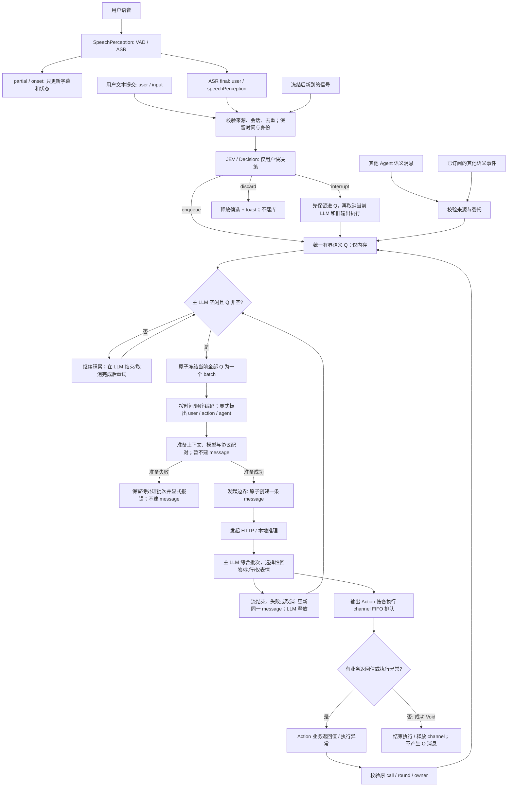
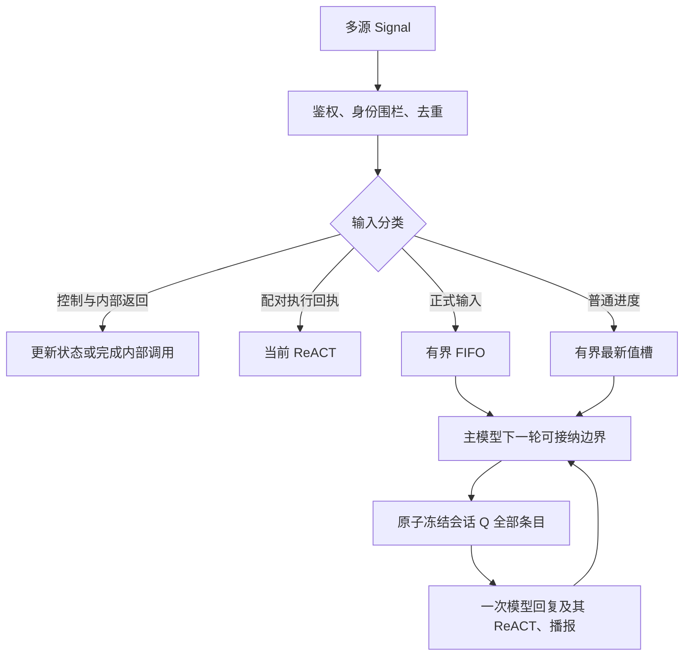
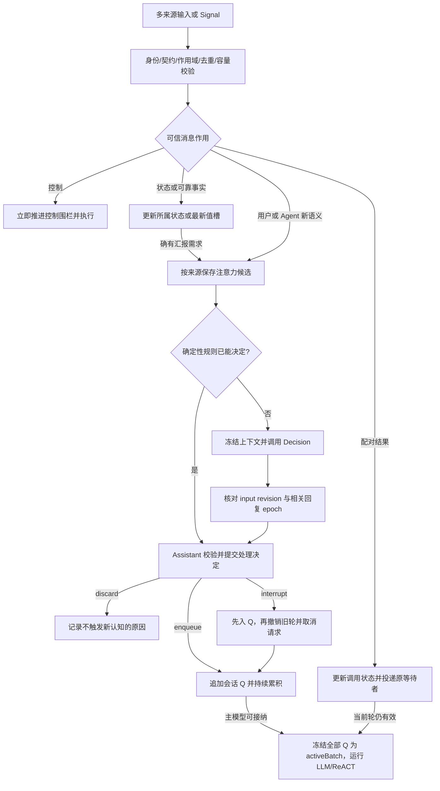

# Assistant 多源输入的触发时机与合并

## 2026-11-10 最新收敛：仅用户快决策、统一语义 Q（代码核对与目标设计）

本节记录最新用户要求，覆盖此前“Agent 文本也走 Decision”和按独立续轮消费业务结果的输入策略。本节调整于 2026-11-11 获准实施；下表保留改动前的核对基线，实施结果和验证在本节末及专项验证文档更新。Message 实际发起请求才建行的规则不变。

### 改动前代码核对（历史基线）

| 项目 | 改动前代码 | 本次目标 |
| --- | --- | --- |
| 用户 ASR final / 手工 input | `AgentChatWorker.receiveSignal` 把 `.text` 和 final transcript 交给 Decision | 用户最终文本必经 JEV/Decision；partial/onset 不触发语义请求。鉴别用户身份须依据已认证入口，不依据 `.text` 载荷类型或正文自称。 |
| 其他 Agent | `admitPeerText` 将同伴输入转成 `.text`，再次进入同一分类分支 | 不再分类；保留 Agent 身份，直接进入 Q。 |
| Action 返回值/异常 | `acceptPendingFeedback` 先进入 PendingRound，收到 round receipt 后以 priority=100 排入续轮；结果另外组成 execution observations/native tool 块 | 有业务返回值或执行异常的 Action 才成为 Q 项，不因同轮其他 Action 尚未完成而等待。成功且无返回值的 Action 只结束执行，不产生输入。 |
| 冻结批次 | `drain` 只合并同会话可转换为文本的输入，并排除部分 PendingRound；单条发送裸文本，多条才发送 `inputs` JSON | 统一冻结同一 Assistant 会话中当时全部已就绪语义消息，单条也使用相同 envelope。 |
| 来源/身份/时间 | 批次已有 id/source/time/text，但缺少 user 与 agent/action 的显式角色区分；capturedAt 默认是 systemUptime，排序以接纳 sequence 为主 | 显式 sender_role、channel、可读时间及顺序；ASR 多条均标为 user，各自保留时间和正文。不能把 uptime 当 Unix 时间。 |
| 提示词 | Assistant Instructions 只描述协调与简短回答，未定义多来源 envelope 或选择性回答规则 | 加入本节提示词；不要求逐条复述/回复，不需要说话时允许仅表情。 |
| 持久化 | awaitingDispatch 过滤准备态；onDispatch 创建请求，之后更新结果；Writer 使用相同门槛 | 保持，不恢复 Signal 接纳/丢弃时建 message 的行为。 |

证据入口：
- [输入接纳与批次](../../MobileHarness/Agents/Support/Chat/AgentChatWorker.swift)：receiveSignal、classifyPendingInputs、drain、acceptPendingFeedback、admitPeerText。
- [输入事实](../../MobileHarness/Agents/Support/Core/AgentInput.swift)、[现有有界邮箱](../../MobileHarness/Agents/Support/Core/Runtime/SignalProcessing.swift)。
- [Decision 校验](../../MobileHarness/Agents/Assistant/AssistantInputDecision.swift)：手工 local text 当前仍把 discard 强制转为 enqueue；这是需要统一说明/调整的既有保护，而非没有调用分类。
- [Assistant 提示词](../../MobileHarness/Resources/Agents/Assistant/Instructions.md)、[请求发起回调](../../MobileHarness/ModelKit/Language/LLM/OpenAI/OpenAIChat.swift)、[历史写入门槛](../../MobileHarness/Storage/Database/AssistantMessages/AssistantHistoryStore.swift)。

### 输入来源与边界

这里的输入 channel 表示来源，不等于输出执行端的 Speech/Display/Camera 等 FIFO channel。

| 输入 | sender_role / channel 示例 | 处理 |
| --- | --- | --- |
| SpeechPerception 最终 ASR | user / speechPerception | 每条 final 调用 Decision；来源仍是 speechPerception，语义作者是用户。 |
| 显式文本输入 | user / input | 每次提交调用 Decision，不因载荷同为 text 与 Agent 混淆。 |
| Action 业务返回值或执行异常 | action / action.camera | 验证 owner/session/round/call，业务返回值或异常去重后直接进 Q，不走 Decision；成功 Void 不进 Q。 |
| 其他 Agent 进度、追问、完成、失败 | agent / agent.writer | 来源和委托校验后直接进 Q，不走 Decision。 |
| 已订阅的其他语义事件 | event / 已注册来源 | 经现有权限及契约校验后直接进 Q，不代表接受未知任意事件。 |
| ASR partial / onset | 字幕/语音状态 | 只更新运行状态，不进语义 Q，不调用 Decision。 |
| 表情/播报完成、流结束、投递确认、token、状态刷新 | 内部控制与输出结算 | 只完成既有执行/更新状态，不是返回给 LLM 的业务值。表情成功返回 Void；内部完成通知不能包装成“表情已完成”再入 Q。执行异常才作为错误反馈。 |
| 停止/权限失效/应用关闭 | 运行时控制 | 立即处理，不等待 LLM 空闲。 |

仅用户输入接受 enqueue/discard/interrupt 快决策。Decision 仍使用当前用户文本、来源/时间和短现场，不带完整聊天或整个 Q；JEV 是能力模块，D3 是本地实现，云端继续复用 Assistant 配置并强制分类 tool。无法分类/超时保守 enqueue；“必经分类”不等于故障时阻塞或丢弃。可靠答案保护必须以语义/交互关系判断，不能因为同伴载荷被转成 text 就把它当用户。

### Action 返回值规则（用户确认后的修正）

按返回契约统一处理，不为表情另设“忽略反馈”黑名单：成功且无业务返回值 → 不产生语义输入；成功且有业务返回值 → 入 Q；执行异常 → 错误入 Q。用户主动取消仍是控制终态，不伪装成执行失败。

核对现行实现，`UIActions.express` / `setExpression` 已是 `async throws -> Void`，没有需要删除的成功返回值。内部 `.completed` 是调度完成标记，`AgentActionCompletion.hasBusinessOutput` 对它返回 false；`ToolResult.requiresReasoning` 对成功 `.completed` 为 false，对真正失败为 true。`AgentChatWorker` 不为纯成功 Void 发起下一次推理。内部调度仍需知道演出已结束，以推进 FIFO、恢复表情及释放资源，但不把完成通知当成用户/模型输入。

前文关于“表情完成导致循环”的说法混淆了内部执行完成与业务返回值，撤回对当前表情实现的这一推断。统一 Q 改造只需沿用上述返回契约；不能把所有完成事件包装成文本放入 Q。证据见 [表情函数](../../MobileHarness/Actions/UI/Expression/ExpressionActions.swift)、[完成契约](../../MobileHarness/Agents/Support/Core/Output/ActionResult.swift)、[推理判定](../../MobileHarness/Agents/Support/Core/Output/ToolResult.swift)。

### 完整链路



冻结后的新信号仍按来源走上述入口：用户经 Decision，非用户直接 Q；图中 NEW→AUTH 仅示用户路径。Q 表示同一 Assistant 会话的全部**已完成准入**语义项，不包含正在分类的用户候选，也不包含未发生的 Action 结果。

- 一个 Assistant 会话最多一个主 LLM 请求；LLM 空闲不等于所有输出 Action 已结束。旧 Action 运行时仍可发起下一批请求；新 Action 沿原 channel FIFO 等待。
- interrupt 先保留新用户输入与原 Q。取消旧 LLM 并等待其实际终止，旧输出同时走所有者取消/清理；迟到结果不能再次触发旧请求，不把取消请求的提交当作取消已完成。执行资源的清理屏障不能被伪造为空闲或成功。
- 原子冻结决定这一轮成员；冻结以后才进入 Q 的信号留到下一轮。用户分类未完成的候选不阻塞已就绪 Q。没有固定“等更多 ASR”的延迟；若每次到达时 LLM 都空闲，连续 ASR 仍可能分别发起请求。
- Action 的业务返回值或异常逐条入 Q；成功 Void 没有消息可入队。原 call/round 用于关联、去重和执行结算，不再要求所有普通 Action 齐备才消费。内部 round 完成不是额外语义项。
- 原生 function/tool 协议仍保留调用/结果配对。需要整组配对的结果由协议适配器暂存为未就绪组，配对齐备后才成为可消费项，不阻塞其他已就绪消息，也不为缺失结果伪造完成。HTTP messages 中保留必要的 assistant tool_calls / tool 消息；统一 user envelope 不能代替这些协议字段。
- 排队不按主题逐条调用 LLM，不在应用层静默丢掉普通进度。沿用容量、字节上限和明确拒绝策略；不得建立无界 Q。整个批次过大先裁剪可省历史，仍超限保留批次并报告准备失败，不截断用户正文、不拆成偷偷发送的小批次。准备失败不立即无限重试。

### user content 格式

单条和多条使用同一种自然文本格式，放在一个 API user 消息中。整批按完整事件时间排序，时间相同按内部接纳顺序。每条先放原正文，下一行由可信入口生成来源及设备本地 24 小时制 `HH:mm:ss`，条目之间空一行。

```text
帮我拍一张照片。
User (ASR) ｜ 13:06:35

Camera.Capture.takePhoto {"status":"succeeded","value":{"previewID":"preview_23"}}
Action Result ｜ 13:06:36

等一下，先别保存。
User (ASR) ｜ 13:06:36

文稿初稿已完成。
Writer ｜ 13:06:37
```

手输使用 `User`，语音定稿使用 `User (ASR)`，Writer 使用 `Writer`，其他已认证同伴使用其 Agent 名。Action 的函数名放进结果正文，保留真实结果与异常。可能与来源行或辅助上下文标题混淆的正文行缩进。完整时间、诊断标识和分类路径仍在内部；发起时的请求原文可回查。旧 JSON 回放使用同一格式，既有自然文本继续保留。历史回放通过来源行识别当前时间线；时间线内的旧 JSON 示例仍是原正文。

### Assistant 提示词契约

在 Assistant/Prompts.json 的 inputProtocol 加入正文在前的格式例子、来源含义和修正规则，在系统提示中紧邻通用 XML 输出协议。把角色 Instructions.md 中重复的选择性回应段落移到 inputProtocol，保留整合有用事实、按需回应、呈现可处理失败和待答问题，以及语音可选规则。ASR 的明显误识别可结合上下文理解；疑义影响意图、目标或动作时先问一个具体问题。

输入处理按意图、证据、澄清和回应的顺序。先确定用户目标及限制，按条目顺序接受最新修正；把同伴消息、执行结果、状态和图像作为证据，按相关性、时效和是否证实判断。上下文足够时理解明显的转写错误；疑义会改变意图、目标或动作时，先问一个具体问题。回应优先给出答案、等待中的结果或阻塞，合并相关事实和需要处理的问题，省略重复、例行进度和无关细节。此调整修改 Assistant/Prompts.json 的 inputProtocol 及对应提示词回归，保留时间线格式和既有提示词预算。批次回归在投递同伴消息前固定 ASR 采集时间，使断言中的来源顺序不受异步投递耗时影响。

实现由 AssistantInputBatch 渲染，Chat Worker 继续提供可信输入来源及事件时间。更新 Assistant、资源与持久化相关 README，回归覆盖多来源同批排序、同秒顺序、伪造来源行、旧历史回放、实际模型请求和提示词预算。

表情只是一种可见输出，不等于没有模型请求；这轮实际请求仍记录输入及真实输出。提示词不决定要不要落库，落库只由请求发起边界决定。

### 持久化不变

1. Signal 到达、Decision、入 Q、冻结和模型准备都不新增 message。discard 使用瞬时灵动岛反馈，无独立 Signal 记录。
2. 校验和上下文准备成功后，在 onDispatch 的 HTTP/本地推理发起边界前原子创建一条 message，保存此次完整正文与真实请求关联；持久化失败阻止发起。
3. 发出后的回复、工具/Action 结果、失败、打断更新既有记录；结果结算可以更新原请求，但不能冒充一次新请求插入行。HTTP 发送失败仍保留已经发起的这次请求。
4. 下一次从 Q 发起另一请求才新增另一行；原生续轮和真实重试也依此计数。Assistant/Writer 均保持这条规则，Writer 执行入口仍独立于消息表。

### 2026-11-11 前台任务结束与历史折叠

- Assistant 全双工的 `task.end(summary)` 在 Control channel 执行时提交任务终态、结束时间和摘要，使用当时已经发起并关联此任务的 Message 作为来源，包含发出结束调用的 Message。调用成功立即释放任务 Skill、清空前台任务并折叠历史。保留原始 Message 与 Action 结果，后续生成或执行证据只更新原行，来源成员固定。Control channel 保留同 channel FIFO 和显式 wait 语义。
- Agent Chat Worker 验证调用与请求身份，通过 AssistantHistoryStore 的串行写入边界封存来源。SQLite AssistantTasks 在一笔事务内核对来源和结束调用并保存终态及摘要。成功持久化后 Agents 发布新 Context；失败传播给 Action 调用者。尚未发出的旧任务请求不能在结束后绑定新 Message。普通结束回执不触发额外模型请求，`continueDecision=true` 仍可为同一用户请求的另一个目标提供结果。Assistant Context 的输入绑定仅将等待用户的任务恢复为运行中。
- 保留 Message 的独立写入阶段。请求发起前建行，模型生成完成写回复正文和生成终态，轮次执行结算更新原行的 Action 记录。回归在模型流和另一个 Action channel 分别阻塞时检查任务和摘要已落盘，释放后检查生成正文、Action 证据和折叠结果。实施后更新 Agents、Chat、Context、BasicSkill、Storage 和总体设计的拥有者文档。

### 2026-11-13 打断回复后保留前台任务（历史修复）

- 用户输入触发 `interrupt` 时，保留前台任务和其 Skill。`Agents/Support/Chat/AgentChatWorker.swift` 在标记已生成、等待执行结果的轮次时保存取消类型。轮次在会话打断屏障释放后仍按该类型结算，旧轮的取消和执行证据留在原 Message。显式关闭会话仍可结束任务。
- 新输入继续绑定原前台任务。拍照场景中，用户在旧回复期间要求丢弃照片并结束，后续轮次确认关相机成功，再用原 `task.end` 接口提交终态和摘要。存储协议、表结构与显式 `task.cancel` 契约沿用现有设计。
- 在 `Tests/IntegrationTests/AgentTaskSkillTests.swift` 用脚本模型、阻塞的旧轮 Action 和真实 SQLite 验证打断、同任务继续执行、摘要落盘。完成后同步 Chat Worker 技术说明和全双工验证记录。

当前行为以紧接的前台结束与 Writer 取消消息为准。

### 前台结束与 Writer 取消消息

- Assistant 前台任务由 `task.end(summary)` 结束。单轮失败、打断或关闭会话只结算相关输入与执行，保留未结束目标和任务 Skill。结束调用失败时保留任务供后续明确结束。前台已有任务时，`task.start` 拒绝重复启动；明确替换先结束旧任务，再开启新目标。用户从历史页启动新对话时，沿用现有显式结束入口提交旧目标摘要，再切换会话。进程重启仍按中断恢复契约记录遗留执行。
- 移除 BasicSkill 的 `task.cancel` Action、注册和替换清理。Assistant 使用 `task.send(agent_id="writer", text, intent="cancel")` 发送 `task.input`，由 Writer 验证委派并决定接受，清理工作器、保留草稿和提交自身终态。取消请求可在 Writer 等待答复时提交。原消息文本随 Writer 接纳记录保存，旧数据仍可读取。保留非 Writer 固定任务的内部生命周期信号。
- 更新 Actions/System/Task、Assistant、Chat、Context、Writer、Storage/WriterMessages、Skill 及总体 README。验证拒绝重复启动、失败及关闭后的前台任务连续性、显式结束与摘要、Writer 收到消息后的清理和记录。

### 结束入口与日志清理

- 清理 Chat Worker 中前台任务控制的重复终态写入和旧的点对点终态旁路，保留非全双工轮次结算、任务创建失败及进程恢复边界。删除前台投影中无法由当前运行状态产生的旧取消展示分支。
- 移除 Task/Skill 结算和 Writer 普通消息接纳的未用参数，复用 Writer 消费消息的 SQL。保留历史取消原因读取与固定任务运行时的内部取消协议。同步当前接口说明和用例。

### 前台控制重试与 Writer 消息边界

- BasicSkill 根据当前任务与实际回执处理失败或取消的 start/end。目标仍适用时允许纠正后再发起，已提交的控制不重复执行。偶尔岔题保留任务，话题已转开但是否继续不明确时询问，明确转向且旧目标已无继续依据时允许主动结束并如实总结。
- task.send 只传 agent_id 和 text，保留已有待答身份关联。Assistant 转述用户意图。Writer 对明确独立的停止消息及时清理，其他措辞交给 Writer 私有模型判断，私有 finish 支持取消结果。保留 SQLite 已有原因和消息来源，不更改表结构。
- 更新 Task Action、BasicSkill、Assistant/Writer 与跨模块 README。验证消息不含意图参数、普通补充与明确取消的差异，以及 Writer 私有取消结果。

### 前台任务输入与后台定向发送

- `Actions/System/Task/TaskActions.swift` 将 `task.send` 的 `agent_id` 和 `text` 声明为必填。`Agents/Support/Chat/AgentChatWorker.swift` 在解析后台委派前拒绝缺参，移除无目标时返回前台输入证据的分支。后台消息继续按会话和目标匹配活跃委派，关联待答身份，由目标 Agent 处理正文并提交终态。
- 前台任务继续接收 Assistant 的常规用户输入，完成或停止时通过 `task.end` 提交摘要后退出。更新 BasicSkill 教学并移除 `Assistant/TaskFeedback.json` 的 `foregroundInput`。同步 Actions、Assistant、Chat、Communication、资源与总体 README 的调用契约。
- Chat Worker 入口共享调用方、会话、轮次及取消校验。按操作分派到后台委派或本地状态控制后，只有本地任务和 Skill 路径核对原轮的前台任务身份，并使用本地控制锁。后台 `task.delegate` 和 `task.send` 由授权、接纳、活跃委派和待答身份约束。后台消息写入与终态协调使用 Agent 消息仓库，移除对 Assistant 前台任务仓库的准入检查。
- 集成测试验证目录拒绝缺参，前台任务活跃时运行时也拒绝无目标或发给 Assistant 的调用，且当前任务保持活跃直到明确结束。验证前台结束与后台委派、补充的独立性，复跑 Writer 定向补充与停止的回归，以及 `scripts/check.sh` 和 `scripts/build-ios.sh`。

### 单一后台消息入口

- 移除 Task Action、BasicSkill 和 Chat Worker 的 `task.delegate`。`task.send(agent_id,text)` 持久化并投递一条认证的后台正文消息。Assistant 转述用户要求，运行时可附带可信的待答关联，调用方无需决定消息是否创建任务。
- Writer 负责消息准入、空闲时创建任务、判断活跃任务的补充与新目标、匹配追问以及停止清理。消息接纳与业务结果分开。Writer 回报接纳、进度、问题、拒绝和持久终态，Assistant 按消息来源和关联身份更新会话视图。
- Communication 与 Gateway 提供普通认证投递及接收方申请工作范围的能力。Writer 用有界串行收件队列接纳正文，在自己的模型上区分活跃目标的补充、停止与无关新请求。可信追问答复只应用于原问题。初次工作继续走既有创作模型。消息级拒绝保存并通过认证消息回报。移除 Assistant→Writer 的旧 request/input 发送授权，框架的固定任务协议与 Writer 的执行授权、资源清理和终态回报继续使用。WriterMessages 使用既有 Agent 消息与私有任务表关联消息，不变更 SQLite 表结构，已保存的任务和终态仍可读。
- 同步 Actions、Agents、Writer、Chat、Communication、Storage、资源和总体设计。回归覆盖新任务、活跃补充、无关新请求、过期待答、停止与前台独立性，运行全量检查及 iOS 构建。

### 后台消息与统一回报契约

- Assistant 和 Writer 的正文契约统一命名为 `agent.task.message`，Writer 的接纳、进度、追问、消息拒绝和任务终态使用 `agent.task.report`。报告区分原消息与已接纳的任务，Assistant 按来源和关联验证。固定任务继续使用 `task.progress`、`task.result`，Gateway 继续返回 `communication.receipt`。
- Communication 定义回报值，Chat Worker 统一接收。Writer 的拒绝与终态共用持久投递、重试和去重，进度走原有有界队列。WriterMessages 和 AgentMessages 保持表结构及旧终态读取、重投。运行时执行授权退休仍是独立步骤。
- 更新 Agent 注册、Writer/Assistant 与 Storage 的 README，验证新消息名、过期待答、忙碌拒绝重投、终态重投和固定任务兼容。

### 2026-11-11 实施细化

- 在现有 Agents/Assistant 目录增加输入 envelope 值类型；共享 Chat Worker 持有有界消息元数据及附件，来源角色只能由用户入口、已认证同伴适配器和执行反馈适配器指定。准入时分配 seq，以本机 uptime/Date 锚点映射用户事件时间；同伴采用本机接收时间。
- 普通 Action 单个业务结果/异常就绪即可入 Q；原 PendingRound 仍结算执行 journal，但不重发旧用户意图。成功 Void、内部调度完成及纯取消不产生语义项。原生 tool 组在配对完整后统一入 Q，保留 assistant tool_calls/tool 消息。Web 观察附件继续由原观察适配器生成，受请求图片和总字节上限约束。
- 内部结算先完成，随后原子取同会话全部已就绪语义项；单条同样编码 envelope。输入时间排序不改变冻结成员、原执行身份或输出 FIFO。批次附件与 envelope 一起作为受保护当前输入，历史只能整体裁剪。
- 准备失败的批次保留内存并标记阻塞，不自动循环请求。后续接纳的新用户输入可解除该会话阻塞并一起重试，显式停止/暂停/关闭清理批次；这一阶段不创建 message。已发出请求的失败仍按原规则终态结算，不自动重试。
- 绕过 Decision 的语义消息入 Q，以及准备失败批次重新入队后，直接刷新既有 UI 排队事实回调，避免计数依赖分类消费者。
- 修改拥有者：Assistant（envelope、Decision 校验、README）、Support/Chat（接纳、批次、结果适配、README）、Support/Core/Runtime（邮箱排除阻塞会话、README）、Resources/Agents（提示词及说明）；同步 Agents 与全局 README 的跨模块流，并将 Writer 回馈说明从直接播报改为全双工模式下交由统一 Q 综合决定呈现。Storage/ModelKit 的 dispatch 持久化接口不变。
- 完整并发检查暴露 discard toast 回归测试的固定 700ms 等待不可靠；仅将测试改为有截止时间的可见状态等待，保留生产到期行为及失败提示断言。
- 验证用户/同伴路由、单条/多条时间身份、普通结果提前入队、Void/取消不续轮、原生协议配对、准备失败不落库且保留、完整批次记录、原有打断/FIFO 回归；运行 check.sh 和 build-ios.sh，真实模型与设备交互另行标明。

### 实施范围与验收

- Agents/Support/Chat：基于可信来源决定是否用户输入；同伴直接入 Q；业务 Action 结果改为独立就绪项；统一 batch 编码、排序、冻结与一次性消费。保留工具协议适配和输出结果结算，不双重消费结果。
- Agents/Assistant：收敛 Decision 调用范围和显式 input 的结果保护策略。来源事实在 Core/输入入口维护，用户业务角色映射由 Assistant 拥有，Storage/ModelKit 不承担分类或队列业务。
- Resources/Agents/Assistant/Instructions.md：接入上述 batch 与选择性回复契约；检查 ExpressionInteraction/Core 教学无冲突。
- Storage 无需为这次 envelope 新建表；requestText 保存完整当前批次，日志清除后仍能读取，新增行门槛不动。
- 实施时同步 Assistant、Chat/Core、Resources/Agents 的 owning README 和总体数据流。当前源码 README 维护实际契约；真实模型/设备验收仍独立跟踪。
- 验收：语音和 input 每次均调用 Decision；Agent/Action 零分类；忙时三类输入积累，空闲后一次提交全部；单条与多条同格式；多次 ASR 标 user 且时间/轮次有序；冻结竞态；Action 未全部结束不阻塞已完成结果；工具配对；表情成功 Void 不触发请求、失败才入 Q，所有无返回值 Action 同理；旧 Action 运行不挡新 LLM、输出 channel FIFO；准备失败/丢弃零 message；一个 batch 一行、真实失败留证；Prompt 构建包含新契约。实际模型选择性回复和无声表情须独立真机/云端验收，不能用字符串断言代替。


### 2026-11-11 代码交付状态

已实现用户专属 Decision、同伴直接 Q、普通 Action 独立结果 Q、native 完整组就绪后直接 Q（不等待无关 Action）、统一单条/多条 envelope、时间/身份、选择性回复提示词和准备失败保留。真实 Action/工具结算 journal 仍属于原请求，新语义批次不会重发旧意图。当前批次工具配对从历史去重，截图附件保留。发起边界和表结构不变。

针对性自动回归覆盖上述行为；完整检查、构建及设备交付证据记录于 [专项验证](../validation/Assistant-Full-Duplex.md)。真实云端/D3 选择性回复准确率、持续语音和表情体验尚需真机交互验收，本需求暂不归档。


## 2026-11-10 已批准的实施契约

本节取代下文历史提案中的整轮等待执行完成、D3 默认影子评估及本地失败直接入队策略。代码已接入，自动验证及尚未完成的真实验收记录于 [验证报告](../validation/Assistant-Full-Duplex.md)；历史分析不代表当前已实现能力。

- Assistant 拥有逐来源输入协调和三分类。enqueue 累积 Q；请求可接纳时冻结全部 Q，不按主题拆分；interrupt 先入 Q，再取消当前会话此前各轮遗留生成、播放与 Action；discard 只作用于尚未入 Q 的单个候选。
- 模型请求、输出执行、采集/播放状态独立。单个会话只运行一个主模型请求；旧工具/Action 等待期间可以处理新 Q。结果保留原 call/round，齐备的原生工具组保持配对后续接；不运行过时续轮、不重放已完成效果。
- 输出执行 channel 在 Assistant 实例/会话内跨轮 FIFO，其他 Agent 独立。取消加入实际原生清理；只阻挡冲突新执行，不阻挡不相关模型请求。独立后台任务不随回复打断取消。
- Decision 默认云端，设置中手动选择本地；下载不切换。复用 Assistant 保存的云端配置，即使主对话当前选择本地。D3 缺失/加载或推理失败/超过512 token转云端，云端失败则保守入队；配置变更不改变在途快照。
- Decision 使用有界现场和历史，字段以本节下方的 Decision 对话窗口为准。云端只允许一个 classify_input 工具，参数为三个合法动作；不执行业务工具。
- 本地热调用预算250ms、从接管起总分类预算2秒；一个分类worker，本地/云端各最多一个在途。迟到结果不改变已提交决策。可靠事实与有效交互答案不得因 discard 消失。
- pending/ready最多32条，后台最多16条，单条16KiB、总512KiB；活跃输入最多64，等待执行请求最多32；来源/状态键各32，状态总256KiB。内部控制与配对收集不争普通队列；就绪语义结果与用户/同伴共享普通队列容量（由上方最新契约取代旧独立续轮策略），容量满明确拒绝，不能静默丢弃。
- 增量数据库迁移保留历史，输入原文、来源、批次、分类和终态可追溯，联合回复只保存一次；重启不自动重放设备效果。整Q超过窗口先压缩可省历史，仍超限明确失败且保留输入。
- 全双工优先于空间定位，使用共享语音处理采播图；不可用明确显示受限模式。final确认只代表接管；onset/partial不清旧回复、不直接语义打断；首版保留端点参数并计入延迟。
- UI复用模型资源管理增加Decision页和云端/本地模式，下载/续传/取消/删除/版本/许可/失败状态齐全；并行用户/助手字幕、实际fallback及有界排队事实由业务投影。

### 2026-11-13 Decision 对话窗口

沿用 [Mac 对照](../validation/Decision-Model-Mac-Comparison.md#对话历史窗口对照) 中 D3 Edge 的一来一回窗口及候选顺序。固定规则、候选描述、状态标签和角色标签使用英文，用户及助手对话原文保持原语言。`AgentChatWorker` 从当前会话已提交的历史选取最新输入之前带可用回复的一组对话；合并批次取其最近的用户原文。`AssistantSpeechOutput` 通过共享语音接口提供实际播放事实，Worker 读取本会话的活动生成／执行，并保留接纳时绑定的关联追问。`AssistantInputDecision` 和 `Assistant/InputDecision.json` 负责限制历史和问题长度、引用文本并单独标出最新输入。云端 `classify_input` 使用相同语义。超过 D3 窗口沿用已有回退，100 ms 继续作为真实本地模型验收指标。

同步 Assistant、Chat、提示词资源与总体数据流说明。回归覆盖历史顺序、其他对话或无关来源隔离、文本边界、运行状态及动作结果。Mac 模型验证与 iPhone 端到端验收分别记录。

### 实施所有者与文档

Agents/Assistant、Support/Chat/Core 拥有输入批次、原调用续接和会话取消；Gateway/Output/Scheduling 增加跨轮顺序域。ModelKit/Language/JEV 保存Decision契约与隔离编译的D3实现，ModelKitDefaults注册/装配，现有Resources/Models目录登记固定制品。Actions/System/ModelResources、Provider与ApplicationControl负责偏好和操作，UI/Settings/Root只展示/导航。PlatformKit/Audio、Actions/Speech、SpeechPerception负责共享音频图、原生取消和连续识别。Storage/Database现有AssistantMessages与ModelRequestLog目录承载增量输入记录和证据，不新增目录。

实施后同步以上所有者README和MobileHarness/README.md跨模块流；不把尚未实施部分写成当前技术契约。清除被替代Judge命名和半双工门控；保留文档中的历史证据。

### 存储落地细化

复用 assistant_messages.user_input_json 增加可选 coordination 字段，保存来源、采集时间、分类路径及批次成员；旧记录缺省为空，不另建重复消息表。schema 增量版本只增加批次查询索引，现有版本升级不得 erase。回复继续仅由主输入持有，成员保存批次关联及各自终态。

### 生命周期收尾

暂停接管分类 worker、已冻结批次与等待执行轮，记录取消并关闭对应轮；恢复不续跑旧批次。执行所有者完成取消清理后，缺失的原生工具回执按未知效果的取消状态落盘，不能伪造回滚。绑定模型失败同样结束整批成员，避免遗留处理中的输入。异步执行轮封口失败立即结束输出消费并加入清理，不等待下一条模型输出才上报。

### 历史双方完整文本（2026-11-10）

每次请求详情的 User Request 显示本次完整业务输入（包括合并 Q 的来源/时间/正文以及本次续轮观察），Assistant Response 显示完整模型正文；列表继续使用有界预览。AssistantMessages 在 user_input_json 增加 requestText，和原始 text/coordination 分开，首次请求及 ReACT 均在接纳时保存，并在后续 checkpoint 保留。无需重建表或清空数据；清理 model_request_log 不删除该业务文本。读取 message/window/input/read 不能再用主输入原文覆盖已保存的请求文本。

Support/Chat 在合并续轮时把批次文本与本次观察一起留证。旧的多成员批次仅在完整日志存在且 inputs 成员身份全部吻合时恢复实际批次文本，不能凭当前队列重建旧请求；日志缺失时无法保证补回既往完整文本。涉及 Storage/Database/AssistantMessages、Agents/Support/Chat、Actions/History 和 UI/Settings 的契约与回归同步维护，验证真实 SQLite 重开、后续 checkpoint、清日志及完整详情投影。

### 历史尝试：输入记录与模型请求详情区分（2026-11-10，已被下节替代）

修复历史预览与详情将未产生模型调用的原始输入包装为虚构 AssistantModelRequest，导致空 Assistant Response、无上下文和伪 Request ID 的问题。保留所有输入及 enqueue/discard/interrupt 证据，不删除或过滤原始记录。AssistantMessages 的 page/message 返回真实输入或真实模型请求；预览透传有界 coordination，详情保留完整来源、时间、分类路径、批次身份和实际输入状态。UI/Settings 接收独立的协调证据值，列表与详情区分输入记录和模型请求：输入记录显示等待分类/已排队/丢弃/合并批次/失败取消等已记录事实，不展示不存在的回复和模型上下文；真实请求没有正文时明确区分生成中、失败、取消、仅工具调用及已结束但无输出，保留错误证据。原始输入仍可导出，批次身份可核对，不复制批次回复。Actions/History 保持事实转换，不推测模型是否执行。

修改既有 AssistantMessages、UI/Settings 和测试文件，无新增目录或数据库表；同步 Storage、Actions/History、UI/Settings 及总体数据流文档。回归覆盖真实 SQLite 的输入-only 预览/详情、三类决策、批次成员、清日志、真实空回复及失败/中断，保证不虚构调用、无空白回复框、不隐藏真实请求。真机数据库只读核对截图输入的实际状态，副本不进入仓库。

未调用模型的输入在恢复后以消息行终态为准，不能被恢复前 JSON 中的 generating 覆盖。既有 SQLite 测试中通过伪请求访问原始输入及硬编码 completed 的断言，改为验证真实输入身份、无模型请求及恢复后的 interrupted 状态。

### Message 只记录实际模型请求（2026-11-10 最新约束）

本节覆盖此前关于保存所有原始 Signal、discard 和批次成员独立行的约定。assistant_messages / writer_messages 每行必须对应一次实际发起的模型请求，包含本次输入、输出或请求失败。排队、分类和请求准备仅在有界内存中；discard 直接释放并由前端 toast 提示，不写 message、模型日志或其他持久化 Signal 记录。整个 Q 合并发起一次请求只产生一行，来源、时间、采用的 enqueue/interrupt 决策随实际批次输入留存。ReACT 和真实重试各自产生请求行；配置/准备失败、发起前取消不得制造空请求。

Agents/Support/Chat 与 Writer 在准备阶段保留未发出的请求描述，HTTP 发送边界（本地模型为实际推理开始）才提交记录；传输错误和非成功状态仍有一行。Storage 两侧 checkpoint 跳过未发出的输入/请求，首次落盘原子保存身份、完整输入与请求快照，后续完成只更新该行。UI 历史只呈现真实请求；保留真实失败/取消/空正文状态说明，撤回输入-only 详情与伪 Request ID。

Writer 的委托生命周期不等于模型请求：将当前混在 writer_messages 的 delegation 入口移至独立 writer_executions 表，继续由现有 WriterMessages 目录及 WriterExecutionRepository 拥有；Agent 通信沿用 agent_messages，补充输入不再复制为 message 行。无新增目录或上层模块。迁移保留工作区、委托结果、真实请求、工具结果和日志的身份及外键，清除没有 invocation 的旧输入行；不通过重置数据库实现。现存有 invocation 但日志已清理的记录不据此推定未请求，不删除真实失败记录。

涉及 Storage/Database 的 schema、AssistantMessages、WriterMessages、WriterWorkspaces 关系；Agents/Support/Chat、Writer 请求生命周期；ModelKit 的中立开始通知；Actions/App 的瞬时丢弃提示装配及 UI/Conversation、Settings。同步各所属 README 和总体链路，测试零HTTP时零message、HTTP失败留证、整Q一行、ReACT/重试多行、discard提示且无持久化、Writer委托与请求分离及旧库迁移保留。真机安装前完成 scripts/check.sh、scripts/build-ios.sh 与签名构建，不以模拟器或替身测试代替真机交互验收。

丢弃提示使用 HomeNotice 的中立 toast 呈现位置，由 UI/Root 在导航外层渲染，不能复用会被助手字幕遮蔽的 caption notice。UI/Conversation 继续拥有单槽替换、到期与根停止清理；Actions 只选择通用呈现值。Root 不解释 discard 业务，不写库。验证回复字幕存在时提示仍可见、字幕不被替换，以及历史页与首页共用根 toast。

### 验收

整Q与冻结竞态；旧Action运行时新请求；跨轮同channel FIFO；结果配对和联合续接；打断所有旧会话执行/迟到结果围栏；容量与恢复；Decision短上下文/非法tool/超时/fallback/配置变化；D3 tokenizer/512边界/真实推理；默认云端和下载不切换/删除维护；双字幕及外放回声/重叠讲话/蓝牙切换。运行scripts/check.sh及scripts/build-ios.sh；真实D3、云端调用、原生UI和真机音频分别报告，不能以编译或替身测试替代。

## 历史范围与状态

2026-11-06：根据当前代码分析并提出后续设计。本次只记录分析，不改变输入调度、FIFO 或合并规则。此前约定正式输入互不合并；下述整队列批次是需要单独实施和验收的策略变化，不是现有 `SignalBatch` 已有能力。

协调归 Assistant 业务运行时；Gateway 保持身份校验、传输及执行职责。Writer 创作、生命周期和进度呈现不等待 Assistant 是否接纳、生成或播报成功。

## 2026-11-10 实施划分

先执行 [Assistant 内聚语音合成](technical/Assistant-Owned-Speech.md) 的设计与迁移。输入协调、批次、小模型与全双工音频仍待独立实施。下文 2026-11-06 的当前实现分析是当时快照；Writer 现在以确定性通知播报，不额外请求模型，最新契约见 Assistant/Writer README。

后续采用统一有界收件箱，分开正式输入、最新状态、控制和配对反馈；“是否启动认知”与“是否播报”分别决策。规则处理明确事件，ModelKit 的拟议 DecisionCapability 对剩余语义返回有限候选结果或不可判断；Assistant 校验输入快照版本后决定。当前源码仍使用 JudgeCapability 名称，尚未迁移。请求冻结相关成员身份/版本，新信号继续接纳，打断走控制路径。选中、请求完成、执行完成和播放完成分开记录，不能在发送请求时把成员全部标为已完成。语音结束检测属 SpeechPerception，不能代替多来源语义协调。

2026-11-10 后续讨论形成的多通道全双工方案见本文最后一节；它是最新提案。下文“当前实现”保留 2026-11-06 快照；旧的“回复期间全部等待、播完恢复接纳”不能作为新全双工设计的要求。

## 当前实现与缺口

- Assistant 正式输入共用容量为 32 的队列，接纳顺序决定处理顺序，溢出明确拒绝。用户最终文本和需要回复的 Writer 事件分别成为输入。
- 一次模型回复可有多次 ReACT。配对的执行回执属于该轮延续，不应成为新用户输入。内部 Gateway 调用的返回由内部调用者消费，不进入模型反馈或 ReACT。
- Writer 普通进度只保留最新待处理项；Assistant 空闲且正式输入处理完后才接纳，两次普通汇报至少间隔 10 秒。已经接纳的正式输入不再被该合并槽替换。终态清除未接纳的过时进度。
- Writer 正式事件在队首时等待实际回复播报边界；`AgentDecisionContext.batch()` 和 `selected(by:)` 当前严格绑定单一 input ID，并未实现多输入批处理。
- 因而“用户语音、Writer 追问、完成消息几乎同时到达”可能连续触发多次模型回复。现有逐项 FIFO 不能表达一次主模型请求消费整个已接纳待处理队列。

主要代码依据：`MobileHarness/Agents/Support/Chat/AgentChatWorker.swift`、`MobileHarness/Agents/Support/Core/Runtime/AgentDecisionContext.swift`、`MobileHarness/Agents/Assistant/AssistantProcessing.swift`。当前运行契约见 [Chat README](../../MobileHarness/Agents/Support/Chat/README.md)。

## 输入分类

| 类型 | 触发模型 | 合并边界 |
| --- | --- | --- |
| State 更新、语音阶段、字幕／灵动岛内部返回 | 否 | 更新事实或内部调用状态，不制造正式输入 |
| 配对的模型 Action／Tool 结果 | 延续当前 ReACT | 保留调用配对，不与新外部输入混合 |
| ASR 中间文本 | 否 | 只更新字幕；最终文本才正式接纳 |
| 用户最终语音／文本 | 是 | 保留接纳顺序，不盲目拼接独立或冲突指令 |
| Agent 普通进度 | 低优先级 | 按来源、任务、委托保留最新项；终态替代尚未接纳的进度 |
| Agent 追问、完成、失败、取消确认 | 是 | 保留每条事实、身份及交互关联；适合时可联合汇报 |

## 建议的触发边界

1. 所有来源先完成鉴权、会话／委托有效性检查和去重，再接纳。用户最终文本的接纳顺序仍是事实顺序，不用跨来源时间戳重新排序。
2. 当前认知轮拥有模型请求及其必要 ReACT 延续。新到普通输入持续累积，不热插入已发出的请求。认知轮和播放周期分别计忙碌；主模型可接纳下一轮时不必等上一轮所有声音播完，播放仍按有界 FIFO 和实际停止/完成屏障执行。
3. 到达主模型可接纳下一轮的边界后，Assistant 原子取出该会话 Q 中全部已接纳条目，保留逐条身份、来源和时间，冻结为一次请求。不同主题可以同批；不再按相关性挑选子集，也不为等待未来消息增加固定延迟。
4. 已确认用户正在说话、ASR 尚未完成时，暂缓主动汇报，避免抢占说话；仅仅“聆听已开启”不阻止主动回复。未完成 ASR 不提前占 FIFO 位置。此策略需要与现有语音打断策略一起验证。
5. 普通进度不能持续挤占用户接话机会。正式输入有待处理内容时优先处理正式输入；没有正式输入时才考虑最新普通进度。
6. 非聆听时收到应回复事件仍可启动回复；是否继续感知由独立语音许可/全双工政策决定，不用每轮 LLM 的 busy/idle 反复启停采集。



## 全量批次与身份边界

用户于 2026-11-10 明确选择：在下一轮允许发起时，会话 Q 中所有已接纳条目一起进入主模型。此规则替代之前“一个主输入加相关事实”以及按相关性筛选批次的提议。不同主题、不同来源和多条用户命令都可同批，以独立事件保留身份；批次不等于把所有正文拼成一个伪用户文本。

- 用户说“保存”与 Writer 完成可在一次回复中分别处理，但不能把“保存”未经理解自动回给 Writer。
- 不同用户命令、互相冲突的修改要求可一起送入，让主模型依据来源/时间/明确引用理解；不得仅因较晚到达就推定覆盖。不同会话保持隔离；不同委托/interactionID 在同批内仍保留各自绑定与授权，不能串用。
- 多个 Agent 追问同时待处理时，需要记录实际向用户提出的交互；含糊回答不能唤醒错误任务。
- 同一委托终态可使尚未询问的旧问题失效，但必须留下被替代证据，不能静默删除已经接纳的正式输入。
- 已经开始生成或播报的回复不被新进度重写。终态只清除尚未接纳的普通摘要。
- 消息投递或汇报失败不能重新执行 Writer 创作，也不能盲目重放已经执行的业务 Action。

## 存储、容量与失败语义

保留每条原始输入的 ID、来源、接纳顺序和处理结果；一次回复记录它消费的成员 ID，避免把同一回复正文重复存入每条输入。完整实际模型上下文仍由 `model_request_log` 留证。优先评估现有结构化字段，不在本次分析中新增数据表。

32 项容量应约束待处理正式信号总数，不能通过无限增大 batch 绕过队列限制。普通进度合并槽也必须有界。排队、选择、请求失败、取消和已回复分别留证；失败后不能重复消费已完成的成员。会话切换和 delegate 身份围栏必须先于合并。

## 后续实施涉及的职责

| 位置 | 后续变化 |
| --- | --- |
| Agents/Support/Chat | 待处理输入选择、语义合并、回复占用和批次结算 |
| Agents/Support/Core/Runtime | 如果采用多输入批次，明确替换现有单输入选择契约 |
| Agents/Assistant | 带来源的联合上下文、追问关联及用户回复解释 |
| Agents/SpeechPerception | 复用语音阶段与恢复契约，验证说话期间延后主动汇报 |
| Storage/Database | 评估现有 messages／请求日志能否完整追溯批次成员，不先增加表 |
| 相关技术 README | 实施后同步实际输入、回复及播报生命周期；本次不将提案写成现行设计 |

## 验收场景

- 用户最终语音先到／后到 Writer 终态；用户正在说话时收到追问；播报期间收到正式输入。
- 普通进度连续更新、终态覆盖未接纳进度、汇报失败不影响 Writer。
- 同一冻结边界的全部 Q 条目进入一次主模型请求，包括独立主题；不同会话不混入，同批的委托／交互身份不串用。
- ReACT 中间的单次 HTTP 完成不误判为整轮空闲；认知轮结束即允许下一批，TTS/播放独立有界，不能用未播完阻止语音接纳。
- 队满明确拒绝、重投去重、迟到事件、模型失败与取消后批次正确结算。
- SQLite 可还原原始输入、联合请求及处理证据，信号数量、回复次数、模型请求次数分别统计。

本次未实施上述协调变更，也未宣称这些新场景已经通过。

## 2026-11-10：多通道全双工输入设计（提案，未实施）

### 目标与基本决定

采用“按来源暂存、多路接纳、单一 Assistant 仲裁和认知执行”的设计。接收与感知可以同生成/播报并行，但一个会话只允许一轮拥有当前回复发布权。输入通道是 Assistant 私有的输入分区，与 Gateway 的输出执行 Channel/Speech Channel 不同，不新增基础模块或目录。

把两件事分开：第一层是根据可信契约确定消息走控制、反馈、状态还是注意力候选；第二层才为注意力候选选择 enqueue / discard / interrupt。不能要求所有消息都在这三个动作中选一个，否则模型可能丢掉执行结果或阻塞停止控制。

“来源”有两个维度：传输发送者（如 SpeechPerception）和语义来源（用户）。最终转写的语义来源仍是用户，不能因为 origin=agent 就归入后台 Agent 通知。身份、来源类别、关联 ID 和控制权限由可信适配器/契约产生，不从消息正文自报的身份推导。

### 来源、消息作用与路由

| 语义来源 | 代表事件 | 接纳后的处理 | 是否调用 Decision |
| --- | --- | --- | --- |
| 用户语音 | speech.final，最终有效语句 | 保留独立 utterance 身份，成为注意力候选 | 默认每个独立 final 一次；明确控制、重复和失效输入先走规则 |
| 用户显式界面输入 | 提交文本、明确停止/取消按钮 | 文本保留；停止/取消直接控制 | 忙碌时文本可判断 enqueue/interrupt，不允许模型把显式提交任意 discard；按钮不调用 |
| 语音感知状态 | onset、partial、endpoint、ASR 失败/修订 | 更新当前 utterance、字幕和说话状态 | 普通 partial/onset 不调用；稳定的提前打断候选是后续独立优化 |
| 其他 Agent 的新语义请求 | 主动建议、追问、需要 Assistant 理解的新信息 | 校验委托/交互后进入该 Agent 来源通道 | 有语义择时需求时调用；来源权限限制可选动作 |
| 其他 Agent 的可靠事实 | 委托接纳、waitingUser/待回答问题、完成、失败、取消确认 | 先更新其所有者的可靠任务/通信状态；再派生待汇报候选 | 事实本身不调用；汇报择时可调用，discard 仅抑制冗余汇报 |
| Agent 进度/感知摘要 | 写作进度、视觉场景变化 | 状态更新或按 source/task/topic 保留最新项 | 逐条进度不调用；有变化且需要主动提示时才派生候选 |
| 当前调用的执行反馈 | Tool/Action/round result、配对 Agent 调用回复 | 按 session/input/round/call/委托身份投递到原等待者 | 不调用，不进入新对话 FIFO |
| 运行时/系统控制 | 关闭、授权撤销、原生音频故障、已定义的关键状态变化 | 确定性控制或状态更新；普通诊断不主动发言 | 控制不调用；后续确需汇报的摘要独立成为候选 |

Agent 消息和 Action 结果都要按作用分类，不能仅按 payload 外形判断。一个 Agent 发来的“原调用结果”也属于配对反馈；一个 Action 输出触发了新的独立观察，则由拥有者显式派生新候选，不能把同一回执重复接纳两次。字幕、灵动岛等 executeInternal 结果继续只返回其内部调用者，不进入 Assistant 认知。

需要用户回答的 Agent 追问还拥有可靠的 interaction 义务：先保留未解决问题，再决定何时向用户提出；模型不能用 discard 使该义务消失。重复提醒可以抑制，原问题只有收到匹配回答、明确撤销或任务终态后才能结算。待提出问题与已实际提出的当前问题分开；前者沿用受容量约束的委托/交互记录，后者才可以绑定用户的简短回答。

### 数据结构与时间

沿用并扩展 AgentInput/InputMetadata，避免建立第二份不一致的 Signal 信封。现有字段已有 id、sessionID、origin、source、incarnation、capturedAt、sequence、rootID、parentID、deadline、turn/taskScope；新增信息首先评估放入现有中立元信息或 Assistant 私有记录，类型迁移单独实施。

拟议 Assistant 私有结构：

```text
AssistantInputCoordinator (会话/根所有，单一隔离域)
  entries: inputID -> InputEntry             // 唯一内容与处理状态
  channels: InputChannelID -> [inputID]      // 按来源索引，不复制消息
  ready / Q: [inputID]                      // 已通过接纳判断、等待下一轮的全部输入
  activeBatch: batchID + [inputID]          // 从 Q 原子转移，执行期间不可变
  decisionInFlight: inputID + snapshotToken // 最多一个
  activeReply: replyID + generationEpoch + playbackEpoch
  pendingInteraction: 已实际提出的问题与 interactionID

InputChannelID = 会话 + 语义来源类别 + 可信生产者实例
InputEntry = AgentInput + receivedAt + admissionSequence
           + utteranceID/revision/final（语音）
           + sourceClockID/occurredAt（可获得时）
           + reply/call/interaction 关联（适用时）
           + processingState + dispositionEvidence
```

任务/委托 ID 放在 entry 关联字段中，不为每个 task 无限制创建 channel。用户语音与 UI 文本可保留不同通道，但共享同一用户/会话的互动关系。来源 epoch 换代使旧消息和旧判断结果失效。

时间保留三层含义：

1. 事件发生区间：语音至少保留 utterance 开始/结束、ASR final 生成时刻；用来关联用户开始说话时的 Task/问题/播报片段，而不是用 final 到达时的当前 Task 覆盖它。
2. 本地接收单调时间：计算 freshness、等待和耗时。跨设备/进程 capturedAt 需要时钟域标记，不能直接比较 systemUptime。
3. Assistant 接纳序号：在隔离域内原子分配，作为本地稳定顺序。墙上时间 Date 用于展示和历史，不用于打断围栏或跨通道排序。

同一来源正式输入保留单调 sequence/接纳次序；跨来源按 Assistant 接纳序号稳定呈现，保留发生时间供主模型理解，不按来源时间戳重排因果事实。到下一轮时全部 Q 条目同批进入，不再由调度器按优先级或相关性挑选子集。反馈与控制按各自关联直接处理，不会被同来源正在等待 Decision 的普通消息堵住。

### 接纳流水线



入站接纳回执只确认内容已接管，不等待 Decision、LLM 或播报。尤其必须替换现有 pendingFinal 等待整个回复释放后才接纳新句的门控：full duplex 模式下，final 的接管确认不能等于全会话停止收音。

原始消息只存一份。可行状态为 received → deciding/ready → selected → completed/interrupted/failed；discarded、superseded、rejected 各有明确原因。选中/发出模型请求不等于业务或播报完成。一个原始 Agent 结果可对应一个独立汇报候选，必须以因果 ID 连接，避免重复写入事实。

### 三种处理方式

- **enqueue**：该条完整加入 Q，忙碌时持续累积；主模型空闲时 Q 全部转为一个新批次，不人为增加固定等待窗。按冻结的交互绑定解释，不把旧“嗯”绑定给后提出的新问题。
- **discard**：在单条候选接纳阶段决定不进入 Q，不参与已入队批次的筛选；例如无须回应的附和、已确认回声、过期摘要、重复通知。仍保留简明处理证据；不会删除任务终态、执行回执、有效问题答案或已经提交的业务记录。最新值替换记作 superseded，容量不足记作 rejected，都不能伪装成语义 discard。
- **interrupt**：先将新输入接纳进 Q，再立即撤销旧轮发布权并取消当前 LLM 请求；释放下一轮接纳权后取整个 Q，包括此前已等待的消息，不只处理打断消息。不能只停止播放而丢掉这句话。中断不是新输入已处理完毕，也不是撤销所有正在运行的业务任务。Assistant 空闲时合法新意图的 interrupt 退化为 enqueue；独立“停止”且无活动对象按控制规则完成，不新开无意义回复。

前台用户来源有申请打断回复的权限。后台 Agent 的普通建议/进度默认不可打断；只有被可信契约允许、与当前活动直接相关的紧急失效/必要纠错才可申请打断。消息正文写“紧急”不会自行扩大权限。Decision 可以用候选集合表达限制，但不同候选集合的概率不能混用同一阈值。

### 整 Q 提交与轮次结算（用户确认的批次策略）

Decision 管单条消息的接纳，主模型管整批消息的理解和处理，两者职责分离。已进入 Q 表示这条消息已经获得下一轮输入资格；不会再因“不相关”而被调度器排除。Q 限定于当前会话，内容是完成单条接纳后的输入；仍在 deciding 的候选尚不属于 Q，不为等待未来分类结果无限延迟已经可开始的轮次。

在 InputCoordinator 隔离域内，以一个不含异步挂起的事务完成：

```text
if cognitionState == idle and Q is not empty:
    activeBatch = freeze(all entries currently in Q)
    Q = empty
    cognitionState = running(activeBatch.id, generationEpoch)
    schedule one main-model request for activeBatch
```

清空的是 Q 索引，原始记录转入 activeBatch 而非标记已完成或删除。先建立 running 身份再异步发请求，避免两次到达启动两个并行主轮；消息到达和轮结束都能唤醒同一个 pump，避免丢失启动信号。事务之后接纳的新消息写入新的 Q。新输入持续到达不改变已冻结批次，也不让快照永远无法完成。正常入队与“轮结束”的竞态按这个原子时刻确定属于哪一批。

每条批次消息独立呈现 inputID、source、发生/接收时间、接纳序号、正文与 task/call/interaction 关联。不同来源正文均是消息数据，不能因为同批而提升为 system 指令。即使主题独立，模型也可以在一次认知轮中统筹回应或提交多个动作；具体 Action 能否并行仍由权限、资源冲突和依赖控制，不由全量输入自动决定。

例如当前轮忙碌时积累“用户问报告状态”“Writer 报告完成”“用户询问天气”，下一轮三条全部输入。若随后又接纳“先停下，改查后天”，则新消息先进入同一 Q，再触发旧轮取消；下一轮看到四条全部消息，由主模型理解修改关系。来源与时间辅助理解，但不能代替明确指代；不清楚修改对象时应澄清，不能让框架自行把所有旧命令取消。

“空闲”指当前认知轮已结束或已被撤销且主模型资源可接纳新请求。一个 ReACT HTTP 请求返回 tool calls 不等于认知轮结束。TTS/播放另有 busy 状态：认知轮结束时可继续生成下一轮，输出仍受已有有界 FIFO 和音频停止围栏约束；若输出积压满载则明确背压，不无限生成音频。interrupt 立即使旧结果失去效力并发出取消；实现内部仍需 cancelling 状态，不能仅把布尔值置 idle 就在同一不可重入模型资源上发起重叠推理。具有独立请求能力的后端在旧轮已隔离后可以接纳新请求，旧原生资源的停止/加入依然由原 owner 负责。

activeBatch 的结算区分：消息已经纳入理解、相关动作已经执行、后台委托仍进行、问题待用户回答、消息被明确后续意图替代，以及尚未处理。一次轮结束不意味着所有任务业务完成，但每个批次成员需要可追溯的处理去向。没有回复或操作证据的成员不能仅因“请求已发出/模型流已结束”就当作处理成功。

被打断的 activeBatch 不原样回灌 Q 自动重跑。保留原输入、实际已执行工具结果、已播/未播状态及未完成义务，作为下一轮带状态的延续上下文，与新 Q 全量消息一起交给主模型。由后续意图决定继续、修改或取消，执行层沿既有调用身份防止重放；不得丢掉旧批次未完成事项，也不得把被丢弃的草稿回答写成已向用户表达的内容。

主模型上下文预算与 D3 的 512-token 分类预算是两套边界。全 Q 提交需要入队时维护主模型输入 token 预留：完整新批次、必要关联/续办事实、system/tool 固定开销及输出预算应能装入实际所选模型窗口。先压缩可省历史，不截断 Q 中原始输入。条目/字节上限只控制内存，不能替代 token 预算。预算不足在入队前明确拒绝并说明原因；若已接纳后因模型切换/必要上下文增长导致装不下，则保留整批并显式报告无法调度，不能暗中逐条拆批或把剩余条目当作 discard。如何扩大窗口或改变内容需明确策略，不能承诺无界全量提交。

Q 与 activeBatch 分别有界；初始建议每者最多 32 条/512 KiB，合计最多 64 条/1 MiB，超限在接纳前拒绝。归档、重试和被打断批次的延续义务还受既有历史/任务存储及上下文预算约束，不能另建无限的重试列表。

### Decision 的输入与失败策略

每次只评估一个新候选，携带最小必要上下文：

- 当前语句/消息及可信语义来源；语音是否最终确认、来源是否为已确认回声。
- 用户是否正在说话；Assistant 是 idle/generating/executing/speaking/cancelling 中的哪种实际状态。
- 当前回复身份、用户开始说话时的活动身份，以及最近已确认播放的片段；不能把尚未播放的完整生成文本当成用户已经听过。
- 最近实际向用户提出的问题和 interactionID、当前目标简述，以及会改变本次分类的相关待处理信息。
- 此来源允许的动作、明确产品规则、input revision 和相关上下文快照 token。

ModelKit 返回候选分布和推理失败信息，Assistant 决定是否采用。它不操作业务队列、取消音频或管理 Task。模型实现及接口统一用 Decision 命名；现存 Chat Decision（一次认知执行）与输入分类 Decision 在字段上区分为 replyID / inputDisposition，避免混为同一生命周期。

当前制品只有 512 token，完整转写+规则+必要上下文必须一起计数。压缩只作用于可省背景，不能截断当前用户语句、有效交互绑定或必要规则。仍放不下时明确记录 inputTooLong，候选走保守 enqueue，保留完整原文给主认知处理。重型模型忙碌不能阻塞控制和反馈。

现有 [D3 验证](../validation/D3-Edge-CoreAI.md) 最佳业务准确率为 35/48，存在误丢弃和漏打断。因此初期采用影子评估：模型结果只留证，确定性规则与现行接纳策略产生实际决定。验证足够后逐类启用，不以未校准 softmax 的固定数值（例如 0.8）直接宣称可信。对于不确定/超时/模型不可用，默认 enqueue；已确认的明确停止控制不等待模型。内部可以记录 undecidable/error，最终调度仍归约为三种处理方式，不新增对用户不明的第四个处理动作。

清晰停止的规则必须使用受约束控制语法或确认的停止意图，不能简单匹配“停”字；“不要停”“停止按钮在哪”“讲完再停”等是必须覆盖的反例。ASR partial 首期不触发不可逆中断。若以后增加提前打断，应给稳定片段明确 revision、去抖和 utterance 级去重，final 继承同一身份；每次改字都调用模型会放大抖动与负载。

### 并行接收与打断屏障

接收 actor 不跨模型/原生执行 await 持有接纳许可。Decision worker 在 actor 外运行；输入到来、执行反馈、停止和音频事实继续接纳。结果返回仅在以下身份仍匹配时提交：会话/来源 incarnation、input revision、活动 reply/generation epoch、相关 pendingInteraction 版本。普通进度更新不应让所有判断反复失效。

若相关状态变化，例如 D3 返回 interrupt 时旧回复已结束，先按当前状态归约为 enqueue；真正需要重新理解的候选最多重新判断一次，之后保守接纳并留证。限制重试，不能因状态频繁变化永远无法处理。

打断顺序：

1. 原子保留新输入，递增当前回复 generation/output epoch，立即禁止旧输出再提交播放或更新当前回复字幕；同时向原生播放 owner 发出匹配 audioID 的停止请求。
2. 取消旧 LLM 流、尚未执行的旧输出和旧 TTS 生产；并行启动这些清理，音频停止不能排在等待模型取消之后。
3. 收集原生停止、TTS/provider 和旧回复工作者的实际清理完成；记录已播放/已执行与未播放/未执行部分。清理失败显式保留，不能假装旧资源已经释放后启动冲突的新播放。
4. 主模型已可接纳时，以整个 Q 开启新轮；保留相关 Task/Skill 与实际执行证据。LLM 接纳边界与旧音频/设备清理边界分别管理，后者只阻止冲突的新输出/执行，不人为等待无关后台任务结束。已提交的不可逆 Action 不回滚或重放；后台委托默认继续，只有明确取消任务的业务意图才走相应 Task 取消协议。

打断后迟到的 Action/Agent 结果必须完成原调用的终态记账，必要时更新共享事实；不能自动恢复已退休 ReACT 或旧播放。重复停止合并在同一个有版本的中断事务中，不建立多个竞争的 stop task。

当前 speech.phase(speaking) 清回复字幕的规则也需要调整：全双工下，用户附和的 onset 只更新自己的转写槽，不能在 Decision 尚未决定时清掉继续有效的 Assistant 回复字幕。

### 有界容量、顺序与公平性（首版候选参数）

以下是待验证的配置建议，不是当前实现宣称：

| 对象 | 首版界限 | 满载/失效处理 |
| --- | --- | --- |
| 正式候选 entries（deciding + ready） | 沿用总数 32，合计文本载荷不超过 512 KiB，单项最多 16 KiB | 接纳前明确拒绝；业务大载荷由来源保留、候选使用验证过的引用和摘要；不得静默截断 |
| 用户与后台配额 | 后台普通候选合计最多 16；其余容量给用户，用户可使用全部 32 | 不临时驱逐已接纳用户输入；来源收到 busy/rejected |
| 来源通道索引 | 最多 32 个活动来源实例 | 注册/替换时校验，旧实例清理后再释放名额 |
| Decision | 一个运行中，无独立复制队列 | 待判条目仍算入上述 32；建议从接纳起 250 ms 为分类预算，超时 enqueue；此值需真机校准 |
| 最新状态/普通进度 | 最多 32 个键，每键最新一项，合计 256 KiB | 替换记录 superseded；新键满载显式拒绝 |
| 控制 | 每会话一个合并的停止/关闭意图槽；关闭优先于打断 | 不与普通收件箱争容量，重复控制推进版本/合并等待者，等待者仍受既有根上限约束 |
| 配对反馈 | 在提交每个调用时预留对应终态记录及字节预算；上限从既有 admitted-call/round 限制推导 | 预算不可得就不提交新调用；终态更新预留槽，重复终态去重，退休后按现有持久记录查询 |

250 ms 到期不代表原生推理已经停止：标记结果过时并发起取消，下一次 native 推理须等旧工作实际完成/清理；不能超时后无限追加新 worker。接纳满载失败需要生产者与 UI 可观察；可靠 Agent 事实应有来源侧记录和有界重试/查询恢复，不能声称当前 Gateway 自带持久投递。

调度规则：控制与反馈独立处理；待分类候选可以按来源轮转，避免单个来源阻塞 Decision。已经进入 Q 的条目不再按来源/相关性二次挑选，统一在下一轮冻结。interrupt 提前创造下一轮边界，不把打断消息排成独占批次，也不挤掉已有 Q 条目。来源配额和进度合并发生在入 Q 前。

### 音频全双工的配套要求

当前实现是逻辑半双工：ReplyActivity/pendingFinal 关闭新句接纳，原生订阅继续排空但不调用 VAD/ASR。只加入 Decision 无法改变这一点。拟议变化：

- 在已授权且路由能力支持的会话内，回复生成/播放期间继续感知；ReplyActivity 成为上下文事实，而非自动关闭识别的总开关。关闭、撤销权限、原生中断继续立即关闭采集。
- PlatformKit 暴露原生同时采集/播放、语音处理和回声抑制的实际能力/错误；Actions 拥有启停与播放终态；SpeechPerception 拥有分段、ASR 和声学来源证据。Assistant 不直接操作音频硬件。
- 需要验证原生语音处理路线与现有空间 FOA 路线的兼容性。不能假设现有空间采集天然具备可用的扬声器回声抑制；不支持时明确报告能力，若保留半双工模式应显式展示实际模式，而非静默伪装成全双工。
- 不能只凭转写与 TTS 文本相似就丢弃输入，用户可能重复助手用词来纠错。已确认回声依赖声学证据/播放参考，未知来源保留为不确定。
- 用户开始说话本身不等于要求取消回复。可选的降音量/短暂停播必须是另行实现的可恢复能力，并有明确恢复规则；首版不假定现有播放器支持这一点。
- 完整延迟必须测量：用户开始/结束说话 → final/stable 产生 → 候选等待 → Decision → 停止请求 → 原生停止确认。现有 VAD 结束静音默认 800 ms，模型 55 ms 的 Mac 指标不能代表打断只需 55 ms。

### 所有权、实施文件与文档更新

| 所有者/现有目录 | 拟议修改与界限 |
| --- | --- |
| Agents/Assistant | 在现有目录增加私有 InputCoordinator 文件与三分类政策；AssistantProcessing 接入接纳；AssistantExecutionSession/AssistantSpeechOutput 接入回复 epoch 和中断结算；不新建目录 |
| Agents/Support/Core 与 Support/Chat | 只提供必要的中立元信息、可注入接纳/选择机制和单轮清理契约；调整 AgentInput/InputMetadata、SignalProcessing、AgentChatWorker 的当前同步分类接缝；Assistant 私有来源分类与 D3 规则不放共享层 |
| Agents/Support/Communication | 演进语音 utterance/revision、交互关联、输入接管确认和必要播报事实，保留可信身份围栏 |
| Agents/SpeechPerception | 修改 SpeechPerceptionAgent/Processing、SpeechRecognitionTurn、SpeechBoundaryPolicy 与 VoiceAgentSession 的半双工门控和 final 接管，保留音频唯一源和有界处理 |
| ModelKit | 将候选模型契约迁到 Decision 命名并接入 D3/CoreAI provider、制品和生命周期；现有 Language/JEV 位置可先承载，不因命名创建目录；候选模型不依赖 Agents 或持有业务队列 |
| Actions/Speech、PlatformKit/Audio | 在既有文件内设计真实采播并发/能力反馈、播放停止与清理、可用声学证据；遵守基础模块独立性，不接收 Assistant 私有类型 |
| Gateway | 保持原身份、传输、执行和反馈职责；仅在已证明的公共生命周期缺口上调整，不解释输入 channel 或三分类语义 |
| Storage/Database 与 App/Composition | 优先复用已有原始消息/模型日志/任务记录和注入端口；确有字段缺口再规划 schema；App 只装配，不持有输入仲裁政策 |

实施前分别补齐上述能力变更的详细接口；实施后同步总体 MobileHarness/README.md 的输入/音频/中断流，以及 Agents、Assistant、Support/Chat、Support/Core、Communication、SpeechPerception、ModelKit 和实际修改的 Actions/Speech、PlatformKit/Audio README。只有实际变更 Storage/App 接口时才更新相应拥有文档。本次仅改需求提案，技术 README 继续描述现状。

### 分阶段交付与验收

1. 先实现来源分区、身份/时序、确定性控制、独立反馈和可观察的三种接纳结果；保持现有默认行为，覆盖竞态与容量。
2. 完成真实采播并发/回声路线、final 接管和旧输出围栏；真机验证用户可在播报期间输入、纯扬声器回放不会触发自我对话。
3. D3 以影子模式采集新业务语料与错误分布；分别统计误打断、误丢弃、漏打断和有效回答保留率。独立测试集、设备延迟及负载验证通过后再启用模型实际路由。
4. 最后评估稳定 partial 的提前打断；整 Q 批次是首版接纳与轮次协议的一部分，不延后为可选的相关输入合并。

必测场景：

- 同样的“嗯”在自发附和与回答当前已提出的问题时不同处理；“继续”在正在播报与已暂停时不同处理。
- “停一下”与“不要停”“停止按钮在哪”；用户纠正、延后请求和两条冲突命令。
- 用户 final 与 Writer 完成/追问同时到达；先记完成事实，再判断汇报择时；不能错误回答另一个 interaction。
- Q 中独立主题的用户输入与不同 Agent 消息在同一边界全部进入一个请求；每条仍保留身份、来源和时间，不按相关性拆轮。
- 原子冻结时到达的新消息只属于一个批次；轮结束与新消息同时发生不漏触发、不双发主轮；仍待 Decision 的候选不混入已冻结批次。
- Q 已有 A/B 时接纳 interrupt C，下一轮包含 A/B/C；被打断 activeBatch 的未完成义务与已执行证据同时可见，不能重放工具或静默漏办。
- 主模型已空闲但旧 TTS 仍播放时允许下一轮认知，并遵守有界输出背压；ReACT 中间返回不能误判整轮结束。
- 整批超主模型窗口时明确预算失败并保留记录，不用按条拆批或截断伪装“全 Q 已提交”。
- 播报期间连续 final 正常接纳；partial 修订与 final 不重复触发；发声起点绑定的 Task 不被迟到 final 换绑。
- D3 运行中来了停止、Action 结果或新回复；不阻塞反馈、不让过期决定停止新回复；高频进度不导致无限重判。
- 候选队满时反馈仍能完成、控制仍能停止；独立来源洪泛与用户配额；Decision 超时/加载失败/超长输入保留原意图并留证。
- 打断后旧 PCM、字幕和模型 delta 被围栏拦截；真实播放停止失败不伪造成功；已执行 Action 不重复执行，后台任务不被误取消。
- 用户声音叠加助手扬声器、用户复述助手词句、耳机/蓝牙/扬声器路由变化、长时 LLM+ASR+TTS+D3 并行负载和内存压力。

本次验证仅为现有源码/文档核对与设计一致性、链接、diff 格式检查。没有实施该方案，没有将 D3 已发布制品、编译检查或模拟数据当作全双工验收。

## 2026-11-11 Decision 独立模型配置

需求：Decision 独立选择本地 D3 或云端；云端从已经保存的 Provider 列表选择服务和模型，交互沿用 Agent Brains，不跟随 Assistant/Writer 的选择。

实施范围与契约：
- `UI/Settings` 的 Decision 页面保留下载与立即保存的本地/云端模式选择，增加独立 Provider/模型草稿和保存按钮；本地模式仍可配置云端备用。复用根拥有的 SettingsFormController 模型发现、取消、错误呈现及私有保存通道。Provider 管理仍在 Agent Brains，删除 Provider 清除 Decision 引用并显示未配置。
- `Actions/Support/Contracts`、`Actions/System/Provider` 的私有设置增加 decisionProviderID/decisionModel，通过 `Agents/ApplicationControl` 暂存与呈现；凭据继续只存钥匙串，共用 Provider 稳定 ID，不复制业务凭据到公开 Signal。
- 持久文档新增可选字段，旧文档缺字段读作未配置，保存后明确写入模型字段。未配置不隐式继承 Assistant；可在 Decision 页显式选择同一 Provider 或不同 Provider。Assistant 与 Writer 配置保持各自选择。
- `ActionsBusinessAssembly` 从独立 decisionConfiguration 创建固定云端 ChatModel，保持最低思考与短上下文工具分类。`Agents/Assistant` 的本地失败回退只使用该云端配置，未配置、失效或推理失败沿用可见错误与保守入队。切换配置用于下一次分类，不改写已取得的模型句柄。输入 Q 与请求前才持久化 message 的规则不变。
- 实现后同步总体设计、Actions/Agents/UI 模块及 Provider、Contracts、ApplicationControl、Assistant、Settings、Root、ModelResources 拥有目录 README；当前技术说明移除借用 Assistant 的旧描述。

验证计划：独立 Provider/模型保存与重开、缺少新字段、无配置及悬空引用失败、同一 Provider 不同模型、删除/编辑 Provider、模型发现与表单私有传输回归。运行 scripts/check.sh 与 scripts/build-ios.sh；模拟与替身结果不等同于真实云端分类或原生 UI 验收。

实现进展：独立配置、私有传输、运行时解析、共用模型选择器与删除清理已完成。针对性回归覆盖持久化重开、旧文档缺字段、无效引用、独立角色选择和实际 UI 请求/呈现链路；完整检查、构建及交付证据见 [验证记录](../validation/Assistant-Full-Duplex.md)。真实云端与原生页面交互验收另列，不以自动化替身结果替代。

## 2026-11-11 回声消除与固定双方字幕

问题：全双工时扬声器播报被 ASR 重复识别；用户未定稿字幕与助手回复占据相同下方位置，随后上飘导致重叠。

实施计划：
- PlatformKit/Audio 的 AppleAudioIO 保留同一采播图，优先尝试 iOS 18.2+ 受支持设备的 playAndRecord/default 回声消除输入，以激活后的 isEchoCancelledInputEnabled 确认；不支持或设置失败时显式回退 voiceChat + AVAudioEngine voice processing，关闭 bypass，检查输入/输出双节点，不同时叠加两种 AEC。原生错误保留报告，不再吞掉启用失败。
- AudioCaptureContext 增加实际回声处理路径事实；仅确认 AEC 可用才标记 fullDuplex。引擎启动后、每次输出提交前重新校验，不把偏好或单节点配置当成实际能力。两路径不可用保持已有受限聆听策略；路由变化继续关闭旧代重建，不靠全文相似度误删用户插话。
- Actions/Speech/Listening 展示真实 AEC 路径与受限状态；不改 Decision、Q、消息持久化边界。设备实际回声抑制效果必须由扬声器单讲及双方同时说话检验，开关状态不能证明抑制效果。
- UI/Conversation 的 ConversationCaptionLayout 改为固定用户上方、助手下方的两个不相交区域，位置与 ASR 是否定稿及任务活动无关。移除 transcriptFinalized 引起的上飘动画；保留文字淡入，不移动角色位置。队列/提示保持下方区域内有界布局。
- 更新 PlatformKit/Audio、PlatformKit、Actions/Speech/Listening、UI/Conversation、UI 与总体设计；调整布局和音频选择/失败回归，运行 check.sh、build-ios.sh，完成后覆盖安装真机，不清数据。

依据：[Apple 回声消除输入](https://developer.apple.com/documentation/avfaudio/avaudiosession/setprefersechocancelledinput%28_%3A%29) 与 [AVAudioEngine 语音处理](https://developer.apple.com/videos/play/wwdc2019/510/)。回声输入仅适用于支持硬件及指定 session 配置，Voice Processor 已自带 AEC，两者不叠加。

交付进展：回声处理路径确认与降级、固定双方字幕、回归和文档同步完成；完整检查脚本与四个 iOS 构建目标通过，已覆盖安装版本 2026111103。原生扬声器回录/用户插话和页面目视效果尚未验收；完整证据与步骤见 [全双工验证记录](../validation/Assistant-Full-Duplex.md)。

## Decision 结果的灵动岛呈现

SpeechPerception 继续维护录音、识别灵动岛及用户字幕。在发布语音 final 前，先提交结束当句录音/识别状态。Assistant 的对话工作器继续维护回复字幕，语音输出子能力维护播放灵动岛。Assistant 的输入工作器只在实际丢弃或同代打断成功后向角色会话发送瞬时反馈。角色会话使用独立的灵动岛活动槽，以高优先级详情展开显示约三秒，同槽新结果替换旧结果，后台暂停或退出清理。enqueue 和跨代未实际打断不发布反馈。显示仅限 App 内灵动岛，展开正文只显示本次结果。反馈不进入系统活动、执行队列或历史。移除 Actions 装配的 Decision toast 回调，基础 UI 保持通用呈现与仲裁。验证实际生效的决策、队列与持久化回归，以及真机录音结束到展开的呈现顺序。

## 自然文本输入兼容

当前时间线格式见 [user content 格式](#user-content-格式)。批次、消息、调用、轮次和内部任务 UUID、分类路径及内部序号留在协调证据中。保留业务载荷中有用的标识和原生工具的协议配对。打断上下文补充相关旧用户意图。协调 JSON 保留成员明细；发起时保存实际请求文本。旧 assistant.input_batch.v1 回放投影为当前自然文本，历史原始请求继续可回查。

## 本地 D3 请求格式诊断

针对真实语音指令误丢弃，核对 Assistant 到 ModelKit 的状态语义、候选定义、chat template 和候选读出。用已发布 Core AI 权重复跑原始提示词，分别替换状态格式和选项定义，保留误打断、误丢弃和漏打断。另用预先写好的中文指令和反例核对简短请求、否定、引用和上下文。历史采集时间继续用于入队证据，原话在推理前完整保留。

只有经过对照支持的调整才用于本地路径。Assistant 拥有三类业务解释和候选结果映射，ModelKit 保持通用候选选择及 512 token 契约。云端工具协议继续由原路径负责。若有代码变更，核对本地请求、云端回退及候选映射，并同步所属 README 和验证记录。

补充对照使用轻量中文句向量模型。每类分别使用一句定义、多条定义和多条带对话状态的代表例，比较余弦分数聚合对上述冻结集的影响。原型提前写定，采用同一组评估标签，不训练权重。此实验只产生本机验证证据。

## 全双工会话状态与 Decision 上下文（讨论稿）

### 会话状态与输入去向

Assistant 按会话维护 `normal`、`listening`、`addressedOnly`。会话状态决定当前允许的回复，Decision 判断当前文本的去向，输出执行者提供真实生成和播放事实。`enqueue`、`discard`、`interrupt` 保留现有含义。`interrupt` 仍接纳新输入并处理旧轮；会话静默另有仅针对回复输出的停止范围。

| 状态 | 用户输入 | Assistant 回复 |
| --- | --- | --- |
| `normal` 正常 | 有效输入和无法可靠丢弃的短句照常入 Q；可靠的乱码、无意义重复可丢弃 | 使用现有回复与 Action 契约 |
| `listening` 先听 | “你先别说话，听着”切入该状态，随后可理解的讲话持续进入同一个语义 Q，按现有整 Q 屏障及时消费 | 主模型可以完成空回复，或调用当前目录授权的表情；当轮由用户内容引发的新业务动作同样受限，已接纳的业务动作继续正常结算 |
| `addressedOnly` 等点名 | “没叫你就不要说话”切入该状态。普通环境讲话在 Decision 阶段丢弃，唤起、恢复控制及可信关联的回答继续处理 | 被明确叫到并获得有效请求时，只给该次回复授权；一轮及其因果续轮和播放结算后继续等点名 |

“我说完了，你说吧”可结束 `listening` 并触发回复；“以后可以正常说话”可解除两种静默。“小助手，刚才那段总结一下”在 `addressedOnly` 下授权一次回复。仅叫名字时可保留一个短时、同会话的一次性唤起，供下一条有效请求消费；重复唤起替换同一槽，过期或关闭即释放。经验证的显式交互答案保留原归属；在 `addressedOnly` 下可静默接纳答案，发声仍需一次性授权。手输明确请求视为主动叫到，普通 ASR 问句在等点名时需要称呼或明确向助手索取回复。“他说你先别说话”“我没说不让你说”按普通内容处理。进入 `listening` 的指令也按正常容量进入 Q，携带已经生效的控制事实；同一句兼有正文时保留整句。状态退出依赖用户表达或会话关闭，切轮和播报结束只更新运行事实。

状态由 Assistant 的串行工作器提交，由角色策略解释。按可信会话与对话身份隔离，根替换、关闭对话或新建对话时从 `normal` 开始。已确认的静默控制使用独立保留槽，在普通 Q 满或分类超时时仍可关闭输出。状态提交合并到一个在途的呈现清理，按最新修订更新输出许可，恢复也须等已启动的清理结束。明确、独立、定向的控制优先用窄规则确认；含否定、引用或不确定指向的表达需要语义判断，首版对新模型的控制判定先做影子评估。静默在成功确认时立即生效，切换本身不依赖后续语义文本的队列接纳或模型请求成功。

### Decision 请求与采纳

现有分类快照把推理、未结算轮次、待回复输入合为 `occupied`，并拼接流式回复尾部和待答交互。改为按同会话、同回复身份重建有界快照。候选拿到分类槽时读取当下状态，按关联保留这些事实。

1. 当前会话模式，以及是否有可被打断的回复。分别描述正在生成、待播、实际播放和业务结算。播放事实复用 Assistant 已有的真实播放回调，关联音频与回复身份。
2. 当前有效待答问题优先，其次是当前回复中已呈现的片段或最近一组相关用户输入与助手回复。待答问题、先前已接纳的用户内容和已呈现回复各有字段。先前被丢弃的环境话、静默期拦下的模型文本和其他会话片段排除在上下文外。
3. 当前可信输入来源与原话。使用短自然语言描述状态和候选含义。输入字段转义换行和边界符。精确时间及内部身份用于因果校验和诊断。D3 使用含原话、候选描述及 chat template 的实际 512 token 上限，优先让出可选历史空间，装不下则沿用云端备用或保守接纳。主模型继续收到完整已接纳输入。

示例快照为“模式：先听。播报：无。待答：要先打开相机吗？当前话语：‘要。’”。候选用短语区分“保留有效输入或回答”“丢弃明显无法理解或当前模式下的环境话”“保留新输入并打断当前回复”。对照实验分别验证状态表达、候选定义及上下文长度，使用各自任务的误判分布选择本地和云端提示词。

先处理可信身份、明确控制和当前模式下的入队约束，再用本地 D3 或云端处理语义判断。模型只给候选建议。Assistant 确认当前可打断回复的身份后才提交 `interrupt`。`discard` 的原因至少区分等点名期间的环境话、明显不可理解、无需响应的附和。短句、口音、生词及能回答当前问题的片段都需要结合上下文判断。“嗯”可作为附和丢弃，也可作为有效回答入 Q。“拍一张啊”是完整意图，应保留。对疑似叫到、疑似回答但未能确认的内容，优先保护输入；在等点名状态下仅静默接纳。分类超时、非法结果和 D3 低可靠场景沿用保守策略，模型分数仅作评估证据。

分类与状态更新分别带会话修订号、输入序号、目标回复代次和待答交互身份。结果返回后在提交点核验相关状态。较早候选的迟到结果不能覆盖更新的已确认控制。状态切换保留已接纳的 Q，批次发声采用最新授权；尚未提交且目标已换代的 `interrupt` 只按当前策略做接纳或环境话丢弃。需要重新理解的候选至多重判一次，沿用原截止时间。实际提交结果与模型建议分别留证。已被模式消费的环境话释放输入和交互关联，通常保持安静，避免每句都触发现有 discard 灵动岛。现有队列容量和满载拒绝用于语义内容。

### 主模型与运行时输出约束

主请求在受保护的系统上下文注入当前会话模式、这一轮的回复授权和相关历史。Assistant 指令给出静默轮允许的空响应和已授权表情。Chat Worker 在自然语言展开为 Speech/Display 前应用同一授权，显式字幕、播放、带文字的 `wait`、原生 Tool、即时回复和 Assistant 代播的 Writer 通知也走相应接缝。静默轮新生成的调用只开放已授权的表情，保留系统内部反馈与结算。只给授权轮发起回复等待呈现。一次性授权绑定触发它的输入和因果续轮，整 Q 中其他成员保留各自的来源和作用。静默期已处理的用户正文仍按当前消息历史规则给后续模型使用，拦截的 Assistant 文本只保留在原始模型证据。恢复时按新请求引用已听内容，已有业务事实继续入 Q 或按原通道结算，前台任务状态继续由拥有者推进。

当前 `collect` 要求至少产生一个调用。增加仅由静默策略授权的正常空响应终态，依据真实 provider 完成及已执行表情/空输出结算。provider 错误、截断、取消和实际清理失败沿原失败路径。现有结果身份、配对、整 Q 和 onDispatch 持久化用于静默轮，避免为了表示“已听”制造一条空的助手气泡或成功 ToolResult。

进入任一种静默时，先关闭旧回复代次的 TTS、字幕及代播接纳，再以 Assistant 实例、会话、回复和调用身份撤销已经接纳的对应呈现，加入 TTS、原生播放和调度清理。迟到的模型文本、字幕、播放起止事件按原身份核验。只有原生停止确认才能记为停播。已经执行或排队的业务调用照原轮收据结算。现有 `AssistantExecutionSession.interruptConversation` 的整会话调用取消继续服务明确的整轮打断；静默需要在现有执行路径增加通用的按身份取消能力，Gateway 依据调用身份处理，Assistant 决定选中哪些调用。恢复后的回复使用新代次，从保留的用户上下文继续。

### 实施顺序与验收

1. 在 `Agents/Assistant` 落地会话状态、可信控制和回复授权，`Support/Chat` 提供请求/输出策略接缝、空响应结算和整 Q 的原有屏障；通过 `AssistantExecutionSession`、`AssistantSpeechOutput`、`OutputGateway` 和 `Gateway/Output/Scheduling` 的既有执行路径接入受身份保护的呈现取消。先以替身验证模式迁移、原生停止回执及清理失败。
2. 在 `AssistantInputDecision.swift`、`Assistant/InputDecision.json` 和主请求资源接入结构化快照、短提示和候选说明。Assistant 将描述映射回稳定的三分类标签。ModelKit 的通用候选和 tokenizer 契约作为适配边界。保留云端独立配置及校验工具协议。先影子比较新增的丢弃、语音控制与打断判定，按错误类别达标后逐项采纳。
3. 用现有冻结集做基线，追加独立中文真实 ASR 与多轮场景。覆盖静默后连续讲话、点名只授权一轮、恢复、引用和否定、极短有效回答、乱码、Writer 结果/追问、发声与业务结算并存、旧代次迟到、Q 满、超时及本地 512 token 边界。分别统计有效输入误丢弃、误切静默、漏停播、误打断、静默文本或音频泄漏。真实 D3 和真机外放分别验证分类延迟、用户说完至原生停止确认、双讲及回声。

实现后同步 Assistant、Chat、Gateway Scheduling 和总体全双工设计中实际改动的契约。相关实现以 [Assistant 当前设计](../../MobileHarness/Agents/Assistant/README.md#多源全双工输入与-decision)、[Chat 全双工调度](../../MobileHarness/Agents/Support/Chat/README.md#assistant-全双工调度) 和 [D3 对照记录](../validation/Decision-Model-Mac-Comparison.md#d3-请求格式与句向量追加对照) 为基线。代码阶段运行 `scripts/check.sh`、`scripts/build-ios.sh`，分别记录真实模型、原生音频和替身结果。

### 任务请求、回报与运行时反馈命名

- Assistant 和 Writer 的定向通信使用 `agent.task.request` 与 `agent.task.response`。`task.send` 的参数、Writer 对正文的判断、追问关联和前台任务生命周期沿用现有约定。
- AgentContracts 与资源配置将固定任务的进度和终态收敛到 `agent.task.response`。固定任务信封仍携带 progress/result 类型并沿用 Gateway 授权、终态清理和关闭准入时的收尾路径。Writer 回报仍走带事件身份的信封，终态重投独立于执行授权退休。固定任务的 request/input/cancel 控制协议保留。
- AgentCore 与使用方配置统一使用 `runtime.action.result`、`runtime.tool.result`、`runtime.round.result`、`runtime.message.receipt`。语音订阅、Action 调度 Channel 及日志筛选保持原有行为。
- Storage 迁移旧正文和回报的契约列，保留 SQLite 消息身份、关联、正文及投递状态。Writer 收发、认证与 outbox 查询使用新名，历史 `writer.completion` 按原路径兼容。
- 同步总体设计和 Agents、Resources、Storage 所属 README。验证打包权限、固定任务完成及运行时终止、Writer 回报和数据库迁移，并运行仓库检查与 iOS 构建。

### Decision 执行日志计时

- `AgentChatWorker.swift` 在开始准备单条分类的上下文时读取单调时钟，在分类器返回最终决定时停止计时。总耗时包含上下文准备、路由、请求准备、模型调用、结果校验和回退，排除分类队列等待及决定返回后的入队、打断清理和反馈。
- 完成的分类通过现有日志回调传递该耗时。`AgentRuntime.swift` 与 `ActionActivityPresentation.swift` 将它投影到 `DecisionLogItem`，`RuntimeLogView.swift` 按毫秒显示。分类超时产生回退结果时记录实际等待时长。
- 用延迟模型替身和延迟反馈验证计时边界，并核对 UI 日志保留耗时字段。

### Decision 请求上下文

Decision 行折叠时预览用户输入。展开时显示可复制的模型请求上下文。`AssistantInputDecision.swift` 在本地和云端调用边界采集实际请求的指令、分类候选、输入上下文，以及云端工具定义和生成设置。一次分类最多记录本地、云端各一次，超时后迟到的调用不补写已提交的记录。没有进入模型调用时明确显示未发起模型请求。通过现有 Decision 结果和日志投影传递上下文，验证展开内容与模型替身收到的请求一致。

### D3 回退恢复与诊断

`AssistantInputDecision.swift` 区分本地超时、取消、忙、单请求无效、模型未就绪及持续故障。超时取消的工作继续由现有所有者收尾，下一条输入可在收尾后重新使用 D3。Decision 结果保留本地转云原因，经现有日志投影显示。回归测试模拟可取消的本地超时，并验证下一条成功走本地。保留现有截止时间。
