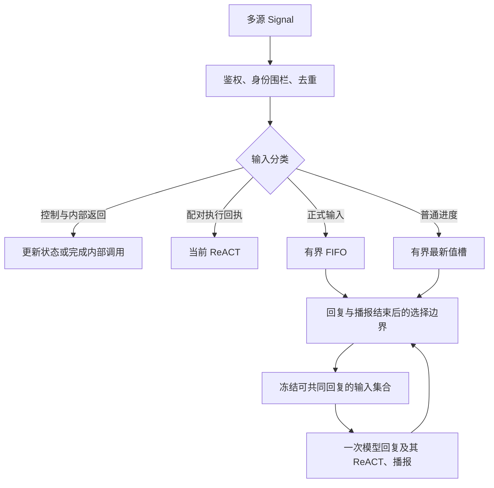

# Assistant 多源输入的触发时机与合并

## 范围与状态

2026-11-06：根据当前代码分析并提出后续设计。本次只记录分析，不改变输入调度、FIFO 或合并规则。此前约定正式输入互不合并；下述联合回复是需要单独实施和验收的策略变化，不是现有 `SignalBatch` 已有能力。

协调归 Assistant 业务运行时；Gateway 保持身份校验、传输及执行职责。Writer 创作、生命周期和进度呈现不等待 Assistant 是否接纳、生成或播报成功。

## 当前实现与缺口

- Assistant 正式输入共用容量为 32 的队列，接纳顺序决定处理顺序，溢出明确拒绝。用户最终文本和需要回复的 Writer 事件分别成为输入。
- 一次模型回复可有多次 ReACT。配对的执行回执属于该轮延续，不应成为新用户输入。内部 Gateway 调用的返回由内部调用者消费，不进入模型反馈或 ReACT。
- Writer 普通进度只保留最新待处理项；Assistant 空闲且正式输入处理完后才接纳，两次普通汇报至少间隔 10 秒。已经接纳的正式输入不再被该合并槽替换。终态清除未接纳的过时进度。
- Writer 正式事件在队首时等待实际回复播报边界；`AgentDecisionContext.batch()` 和 `selected(by:)` 当前严格绑定单一 input ID，并未实现多输入批处理。
- 因而“用户语音、Writer 追问、完成消息几乎同时到达”可能连续触发多次模型回复。单有 FIFO 无法决定哪些事实应一起汇报，也无法表达一次回复消化多条输入。

主要代码依据：`MobileHarness/Agents/Support/Chat/AgentChatWorker.swift`、`MobileHarness/Agents/Support/Core/Runtime/AgentDecisionContext.swift`、`MobileHarness/Agents/Assistant/AssistantProcessing.swift`。当前运行契约见 [Chat README](../../MobileHarness/Agents/Support/Chat/README.md)。

## 输入分类

| 类型 | 触发模型 | 合并边界 |
| --- | --- | --- |
| State 更新、语音阶段、字幕／灵动岛内部返回 | 否 | 更新事实或内部调用状态，不制造正式输入 |
| 配对的模型 Action／Tool 结果 | 延续当前 ReACT | 保留调用配对，不与新外部输入混合 |
| ASR 中间文本 | 否 | 只更新字幕；最终文本才正式接纳 |
| 用户最终语音／文本 | 是 | 保留接纳顺序，不盲目拼接独立或冲突指令 |
| Agent 普通进度 | 低优先级 | 按来源、任务、委托保留最新项；终态替代尚未接纳的进度 |
| Agent 追问、完成、失败、取消确认 | 是 | 保留每条事实、身份及交互关联；适合时可联合汇报 |

## 建议的触发边界

1. 所有来源先完成鉴权、会话／委托有效性检查和去重，再接纳。用户最终文本的接纳顺序仍是事实顺序，不用跨来源时间戳重新排序。
2. 当前回复拥有完整的模型生成、全部 ReACT 及实际播报周期。新到输入先等待，不热插入已经发出的模型请求，也不因进度到达中断播报。
3. 到达可回复边界后，Assistant 原子选择待处理输入，冻结本次输入集合、来源和所需 State，再发出一次请求。用户最终文本不为等待可能到来的消息而增加固定延迟。
4. 已确认用户正在说话、ASR 尚未完成时，暂缓主动汇报，避免抢占说话；仅仅“聆听已开启”不阻止主动回复。未完成 ASR 不提前占 FIFO 位置。此策略需要与现有语音打断策略一起验证。
5. 普通进度不能持续挤占用户接话机会。正式输入有待处理内容时优先处理正式输入；没有正式输入时才考虑最新普通进度。
6. 非聆听时收到应回复事件仍可启动回复，最终恢复聆听。连续 ReACT 或已有下一批正式输入时，避免无效地反复启停采集。

## 合并规则与不能合并的情况

首轮建议只支持“一个用户请求，加上已经待处理且相关的 Agent 事实”，或多条可共同汇报的 Agent 事实。联合回复保留成员的接纳顺序，不等于改变原始事件顺序或合成一个伪用户文本。

- 用户说“保存”与 Writer 完成可在一次回复中分别处理，但不能把“保存”未经理解自动回给 Writer。
- 不同用户命令、互相冲突的修改要求、不同会话、不同委托生命周期以及不同 interactionID 的回答，不做通用拼接。
- 多个 Agent 追问同时待处理时，需要记录实际向用户提出的交互；含糊回答不能唤醒错误任务。
- 同一委托终态可使尚未询问的旧问题失效，但必须留下被替代证据，不能静默删除已经接纳的正式输入。
- 已经开始生成或播报的回复不被新进度重写。终态只清除尚未接纳的普通摘要。
- 消息投递或汇报失败不能重新执行 Writer 创作，也不能盲目重放已经执行的业务 Action。

## 存储、容量与失败语义

保留每条原始输入的 ID、来源、接纳顺序和处理结果；一次回复记录它消费的成员 ID，避免把同一回复正文重复存入每条输入。完整实际模型上下文仍由 `model_request_log` 留证。优先评估现有结构化字段，不在本次分析中新增数据表。

32 项容量应约束待处理正式信号总数，不能通过无限增大 batch 绕过队列限制。普通进度合并槽也必须有界。排队、选择、请求失败、取消和已回复分别留证；失败后不能重复消费已完成的成员。会话切换和 delegate 身份围栏必须先于合并。

## 后续实施涉及的职责

| 位置 | 后续变化 |
| --- | --- |
| Agents/Support/Chat | 待处理输入选择、语义合并、回复占用和批次结算 |
| Agents/Support/Core/Runtime | 如果采用多输入批次，明确替换现有单输入选择契约 |
| Agents/Assistant | 带来源的联合上下文、追问关联及用户回复解释 |
| Agents/SpeechPerception | 复用语音阶段与恢复契约，验证说话期间延后主动汇报 |
| Storage/Database | 评估现有 messages／请求日志能否完整追溯批次成员，不先增加表 |
| 相关技术 README | 实施后同步实际输入、回复及播报生命周期；本次不将提案写成现行设计 |

## 验收场景

- 用户最终语音先到／后到 Writer 终态；用户正在说话时收到追问；播报期间收到正式输入。
- 普通进度连续更新、终态覆盖未接纳进度、汇报失败不影响 Writer。
- 可联合事实只产生一次回复；不同会话／委托／交互不串入，独立命令不被误合并。
- 多轮 ReACT 无中途启听；最后实际播报结束再启动下一批或恢复聆听。
- 队满明确拒绝、重投去重、迟到事件、模型失败与取消后批次正确结算。
- SQLite 可还原原始输入、联合请求及处理证据，信号数量、回复次数、模型请求次数分别统计。

本次未实施上述协调变更，也未宣称这些新场景已经通过。
