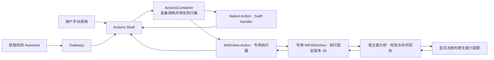

# 用户自定义 WebView Action

状态为需求草案，待设计确认与实施。

## 1. 目标与现状

用户可以在 App 安装后编写或导入自定义 Action，也可以用自然语言委托 Writer 创建或修改。用户试运行并启用后，可以手动执行，也可以让获得授权的 Assistant 在普通任务中发现和调用它。开发者通过 JavaScript 编排业务逻辑，通过版本化 JS SDK 使用 App 提供的能力。新的脚本组合无需重新编译 App；新增原生能力仍随 App 版本交付。

当前 [Actions](../../MobileHarness/Actions/README.md#registration-and-validation) 在启动时绑定编译期函数，并将只读目录交给 Agents；调用由 Shell 管理 Channel、资源许可与结果。[Writer](../../MobileHarness/Agents/Writer/README.md#作品库与工作区分域) 已有 HTML、CSS、JS 和 JSON 的文件编辑、流式写入和作品发布能力。[网页预览](../../MobileHarness/UI/Components/Web/README.md) 已支持远程网页与受控本地作品，使用页面会话呈现内容。自定义 Action 增加独立的安装与调用通道。

## 2. 用户流程与首版范围

1. **创建或导入。** 从统一 Action 管理页的 WebView Actions 分区创建模板、导入本地包，或明确委托 Writer 生成草稿。
2. **检查和试运行。** 宿主在加载前校验包结构、入口、地址、接口版本及能力声明。用户填写样例参数，使用专用测试会话运行；首版以样例输入和宿主能力的模拟回执为默认，结果明确标注为模拟。诊断给出可定位的文件或调用、错误码，以及已完成的步骤。试运行与正式运行使用相同的参数、输出和桥接校验。
3. **安装并启用。** 用户确认安装版本与所需权限后启用，单独选择是否允许 Assistant 发现和调用。Writer 可以交付待安装版本并提交测试报告；安装确认、启用与授权由用户界面处理。更新产生新版本，用户先查看能力差异，增加能力须明确授权。用户可以禁用、回退至仍兼容且已获授权的版本，或卸载。
4. **执行并查看结果。** 用户可手动运行；Assistant 在后续模型请求中取得授权后的 Action 描述，按已声明参数调用。两种入口共用执行校验、资源策略和结构化终态，分别保留实际调用者。

**贯穿示例。** 用户请 Writer 创建「清单摘要」。脚本接收一段手工输入的清单，去除空行、统计条目并生成短摘要，再通过已授权的宿主接口显示摘要。Writer 用固定样例检查条目数、摘要和模拟呈现回执。用户审阅并启用后，可在 App 中手动执行，也可让 Assistant 针对当前对话提供的清单执行。真实呈现失败时，用户可看到摘要计算已完成、呈现失败。

首版交付本地、前台、有限时长的 JavaScript Action，包含自有地址、返回结果及至少一项窄范围宿主能力。首批宿主能力拟选用有限文本呈现接口。包内可使用本地 JS 文件，HTML/CSS 可用于创作预览。自定义 UI 窗口与运行会话联动、网络连接器、相机/麦克风/设备控制、脚本间调用、事件订阅、后台触发、直接 Tool 入口及公开包目录均作为后续范围分别评估。

### 统一 Action 管理页

同一页面分为 **Native Actions** 和 **WebView Actions**。前者列出 App 注册的编译期 Action，后者列出本地草稿及已安装版本，包括已禁用项。此页面使用 Actions 提供的管理视图；现有执行日志只展示运行记录，Assistant 历史中的 Function Catalog 记录的是当轮模型目录。[执行日志](../../MobileHarness/UI/Components/RuntimeLog/README.md) · [会话历史](../../MobileHarness/UI/Settings/README.md)

| 区域 | 要求 |
| --- | --- |
| 元数据详情 | 展示各 Action 的完整声明与运行约束，包括 canonical 地址、名称与说明、实现类型、参数类型及必填与约束、输出或完成语义、调用协议、调度策略与 Channel、可声明的资源和时限、可用控制及当前可执行状态。WebView 项额外展示包来源、版本、入口、SDK 版本、声明与获授能力，可查看源码。按输入动态解析的资源和时限在参数校验后展示；缺少声明的字段如实标示。 |
| 调试 | 每项详情提供「调试」入口，按参数声明填写输入、查看校验结果，再由用户提交。Native Action 按自身策略开放实跑或仅参数校验；有副作用的实跑显示相关影响并要求用户明确确认，内部调用或前置条件不足时给出不可运行原因。WebView 草稿支持模拟试运行，已启用版本按授权支持正式执行。调试走受控执行入口，实跑沿用该 Action 的权限、资源及完成规则。 |
| 输入与结果 | 同屏显示本次实际提交的脱敏参数及其校验结果、执行 ID、阶段、耗时、返回值或完成回执、错误码和副作用证据。区分仅校验、模拟与正式执行，区分尚未返回、无值回执和失败。对已受理且支持取消的运行提供取消入口。 |
| 管理操作 | Native 项可查看与按策略调试，安装态由 App 构建决定。WebView 项提供创建、导入、启用、禁用、授权、更新、回退和卸载。调试或查看权限与 Assistant 调用授权分别判断。 |

## 3. Action 包与调用目录

| 契约 | 首版需求 |
| --- | --- |
| 本地包 | 版本化清单、JS 入口、包内静态依赖及可选测试样例。清单声明稳定 ID、版本、面向用户的名称/说明、所需 SDK 版本、参数与结果约束、宿主能力 ID。测试样例与源码作为包数据处理。 |
| 安装身份 | 宿主为用户 Action 分配独立命名空间下的稳定地址，安装版本由不可变内容与摘要标识。同一地址在任一时刻只有一个启用版本。拒绝内建地址冲突、重复 ID 冲突、越界路径、符号链接和超限包。 |
| 参数与结果 | 兼容现有 Action 参数传输约束，由原生层和桥共同校验，向 JS 投影受限 JSON。JS 入口接收已验证的输入和 SDK 客户端，异步返回声明范围内的 JSON；正式回执携带执行 ID、版本和结构化结果或失败。二进制和原生对象通过未来独立能力契约设计。 |
| 发布与发现 | Actions 管理独立的已安装目录，内建目录保持启动时绑定。向 Agents 提供带实现类型、版本身份和调用描述的只读投影，Agents 再按角色和上下文生成当轮授权目录。脚本或包说明中的文字作为数据处理，由宿主拥有教学和授权规则。 |
| 版本切换 | 提交安装、启用或更新的可见状态须一致；失败保留先前可用版本。每次调用固定到获准的版本与目录修订，执行前复核目标绑定。更新后已运行实例仍使用原快照；尚未启动的目标旧版请求显式失效并释放准备凭据。其他地址的有效请求继续执行。撤销授权、禁用和卸载均须封闭新准入并取消、等待匹配实例清理。重启恢复已提交的安装和授权，未完成实例作为中断记录。 |

启用使 Action 成为可用实现；Assistant 的调用还要经过当前角色及上下文的授权。原生调用资格取已安装版本获准能力、当前调用者授权、运行模式和宿主运行状态的交集。iOS 权限由调用所属原生组件独立检查。

### Function Token 与类型分流

当前 Assistant 的 Action 调用使用受限 XML Function Token。自闭合标签名是当轮目录中的别名，Agents 将其解析为 canonical 地址、参数及已注册 Channel；Gateway 转发结构化调用，另有一条独立的 provider native Tool 协议。当前成对的 `<wait>…</wait>` 是调度作用域，闭标签参与等待编排。**Native Action** 在管理页里表示 Swift 实现类型，仍可用 XML Action 调用；**native Tool** 指模型侧调用协议。[Function Token 契约](../../MobileHarness/Agents/Support/Core/Generation/README.md)

- 首版沿用单个自闭合标签，例如 `<summarizeChecklist items="苹果；香蕉"/>`。该别名仅作示例，由 Agents 在当轮授权目录中分配和解析。动态目录更新负责让新 Action 可发现；Actions 按 canonical 地址和已验证版本绑定 WebView 执行器。实现类型与 Channel 来自宿主注册信息，模型只提供声明中的业务参数。
- `<webview>…</webview>` 作为需要表达多个调用共享会话或明确分组语义时的待评估扩展。届时需定义会话与闭标签语义、与 `<wait>` 的嵌套、流式解析时未闭合是否允许子调用开始，以及错误和取消如何结算。首版单次调用已有明确的会话边界，可直接参与现有 `wait`。

## 4. 独立执行通道与原生能力

### 执行与权限

- 现有 [Actions Shell](../../MobileHarness/Actions/Support/Shell/README.md) 已通过 `ActionsExecutionPort` 委托 ActionsContainer 准备和执行调用。首版采用**一个 Shell、两类执行器**。Shell 统一拥有 Native 和 WebView Actions 的排队、Channel、wait、资源仲裁和终态交付；ActionsContainer 在准备阶段固定实际执行器及版本，执行时消费凭据后调用 Swift handler 或专用 WebView 执行器。通过执行端口组合接入，WebView 执行器负责脚本会话、原生桥和执行清理。
- 首版 WebView Action 使用宿主固定的 Channel；脚本内的原生桥调用在父执行范围内按序处理，复用受控的领域服务与父执行已取得的资源许可，避免再次向自身 Channel 排队。所需资源由宿主根据获准的能力在准备阶段解析，执行期不允许脚本临时增持。
- JS 在单次执行专用的本地 WKWebView 会话中运行。普通浏览页、Writer 作品预览和自定义 Action 各自使用自己的会话。执行会话只加载该版本的包内资源，首版禁用外部网络、跨包读取、子框架与跳转。原生桥只接纳绑定的执行实例和预期主框架；宿主从可信上下文绑定来源和调用者。脚本提供的身份、签名字段、角色或资源声明不能作为权限凭据。
- 采用 Hybrid 框架常见的显式注册、JS 客户端和异步结果模型。每个 JS 可见能力定义稳定 ID、版本、参数/结果、权限、资源、完成与取消语义。原生适配逐项发布，支持有限文本呈现等应用层命令。脚本只接触声明且获准的命令。现有 Action 目录、原生反射入口、系统凭据与内部业务仓库均在桥的能力范围之外。[Capacitor 插件文档](https://capacitorjs.com/docs/plugins) · [Apple WebKit 消息回执 API](https://developer.apple.com/documentation/webkit/wkscriptmessagehandlerwithreply)

### 有界执行与完成

- Shell 的排队上限沿用既有规则。专用会话、桥并发、单次桥调用总数、脚本时限、包与消息体大小各有独立上限。首版设计起点为每个执行一个会话、全局同时一个执行、额外会话队列深度为零、每个执行同时一个未完成桥调用；会话或桥超限显式返回忙或超限。其余数值以真机原型测量后写入实施计划。
- JS 返回有效结果、已接纳的原生子操作取得真实回执并完成必要清理后，父 Action 才产生终态。脚本异常、桥超时、WebContent 退出、用户取消或 App 离开允许执行的生命周期时，宿主封闭桥接、取消并等待原生工作清理、销毁会话，丢弃迟到或重复结果。离开设置或预览页面本身不结束执行。
- 回执区分参数/版本错误、未授权、忙、脚本错误、宿主能力失败、超时、取消和清理未确认。已发生的副作用进入结果记录；清理未确认的资源继续按其持有者规则处理。遇到结果不确定时保留事实，避免自动重放产生副作用的调用。运行历史记录版本、阶段与错误码，限制并脱敏参数和日志。

## 5. Writer 与 Assistant 的 Skills

首版拟由 App 随包提供两份角色专用 Skill。Action 包保存脚本、参数契约和用户可见说明；已安装 Action 的运行声明由宿主校验并按需投影。沿用当前 Skill 资源的职责，静态教学和依赖由 Skill 维护，动态的用户 Action 由运行时目录提供。导入 Action 包时其中的文字按数据处理，安装也不会注册新的 Skill 资源。[Skill 配置与撰写规范](../../MobileHarness/Agents/Resources/Skills/README.md)

### Writer · 编写 Action

用户直接要求创建或修改 Action，或由 Assistant 按该意图委托 Writer 时，Writer 进入相应创作流程并加载 Action Coding Skill，复用现有工作区编辑和独立源码生成。指向同名 Action 或编辑目标不明确时先澄清。修改已安装 Action 从明确选中的版本建立独立草稿；同一草稿可以继续编辑，已有安装版本通过用户确认的更新流程变更。

| 阶段 | Skill 需要知道和完成的事 |
| --- | --- |
| 定义契约 | 基于用户意图确认输入、输出、必要副作用和完成条件。读取目标 App/SDK 支持的能力目录；依赖尚未开放能力时报告缺口，征得用户同意后再调整目标。 |
| 编写 | 控制请求获得工作区、校验和模拟试运行的工具声明；实际写 JS 的内容请求获得同版本 SDK 契约、入口规范及相关文件。接口说明、可生成的类型声明和运行时校验源自同一份宿主能力描述，包含参数、权限、错误码、完成语义和示例。 |
| 验证 | 校验 manifest、入口、依赖与输入输出。为包提供正常样例及至少一个无效输入或桥失败样例；由宿主执行可复查的断言。使用与正式运行相同的输入输出校验及明确标记的模拟宿主回执。按现有恢复预算修正，记录失败位置及实际结果。 |
| 交付 | 返回待安装的固定版本、样例、验证结果及权限或兼容性差异。完成条件绑定本次草稿的实际版本；编辑后旧测试结果保留为历史，交付需要针对最新内容重新验证。Writer 的权限覆盖草稿和模拟执行，正式安装、启用及授权由用户确认。 |

### Assistant · 使用 Action

当用户要求执行一个已有的自定义 Action，或目标可能由获准的自定义 Action 完成时，Assistant 沿现有 `skill.load` 流程加载使用 Skill。加载成功后下一次模型请求获得调用目录；加载本身没有业务效果。首版由一个使用 Skill 教学如何发现和调用多个用户 Action，复用现有 Skill 的加载、保留和释放规则。创建或修改需求走 Writer 委托流程。[Assistant Controls](../../MobileHarness/Agents/Resources/Agents/Assistant/Controls/Controls.md)

1. **发现。** 使用已安装、启用且允许当前 Assistant 调用的目录。公开候选包含名称、用途和必要的效果提示。按用户目标筛选，支持按名称或用途查找；目录超出模型预算时返回有界结果并保留继续查找途径，同名歧义由用户选择。向模型提供所选候选的当轮别名、参数与约束、输出或完成语义、前置条件和副作用说明。源码、桥接能力清单、测试夹具及草稿诊断留在创作或管理视图。
2. **调用。** Skill 教学使用当前请求公布的 XML 别名，按声明填写业务参数。参数缺失或效果需要确认时先询问。宿主在准入时重新判断版本及授权；模型生成时使用的目录在该请求内固定，后续请求读取最新快照。Skill 处于加载态也需要通过逐次准入。
3. **反馈。** 将结构化终态按此次调用关联回 Assistant；受理、排队和进度可展示，用户所问的执行结果以完成或失败回执为准。找不到候选时说明当前没有可调用的匹配项；若宿主针对用户已指明的 Action 返回禁用或未授权状态，据该回执说明。调用因版本改变被拒时重新发现，输入或效果语义有变则重新确认。若执行曾开始且结果不确定，查询该次回执或报告不确定，避免自动重放。

### 跨角色交接与数据

- Writer 交付与用户启用是两个独立状态。Assistant 可以凭实际交付回执告知用户草稿可审阅；待安装版本通过启用并获准后才出现在可调用目录中。历史请求保留当时的版本与反馈，重新执行须使用当前授权。
- 将正在创作的 SDK 资料、用户输入和源码送入 Writer 模型，以及将 Action 输入与结构化结果送入 Assistant 模型，都遵循现有模型选择与请求留证规则。两侧只装配完成当前任务所需的数据，宿主凭据和授权令牌留在原生侧。脚本返回正文和导入包中的描述按数据处理，不能改变模型指令层级或调用资格。

## 6. 模块职责与交付顺序

| 归属 | 拟变更 |
| --- | --- |
| Actions | 在现有根内拥有包的业务校验、用户授予记录、管理页目录投影、动态调用目录、调试准入、执行会话和宿主能力适配。通过现有 Shell 和执行端口接入 WebView 执行器。 |
| Agents / Writer | Assistant 的使用 Skill 负责发现、XML 调用教学和反馈处理；Agents 使用受授权目录快照做别名解析和调用校验。Writer 的编写 Skill 管理创作任务及源码上下文；测试调用经受控入口返回诊断。 |
| App / Gateway | App 连接执行宿主、持久化端口、界面与 Agents；Gateway 沿用 Agent 调用和反馈通道，保留生产者及执行身份。 |
| UI / Storage / 平台宿主 | UI 负责管理界面及用户确认；Storage 提供受限文件和持久化机制；专用 WebKit 宿主以窄接口注入，放置与编译边界在原型后确认。基础模块保持独立。 |

先完成本地专用会话、单项宿主能力和取消/清理原型；再以手写样例打通安装、授权、版本切换、手动调用和 Assistant 使用 Skill；最后接通 Writer 编写 Skill 的生成、试运行及待安装交付。进入实现前明确包与 SDK 规范、目录更新的提交点、动态候选如何进入已加载 Skill 的当轮目录、宿主放置和容量参数；实现后同步更新总体设计及各受影响目录的技术 README。发行前单独确认审核路径。Apple 的 2.5.2 约束影响功能的可执行代码，4.7 对部分二进制外软件设有条件；若适用 4.7，4.7.2 涉及向该软件暴露原生平台 API 或技术的事先许可，4.7.3 涉及逐次明确同意共享数据或隐私权限。需要结合实际导入、生成、宿主接口及分发方式复核适用条款。[Apple App Review Guidelines](https://developer.apple.com/app-store/review/guidelines/)

## 7. 验收标准

| 范围 | 可观察的验收结果 |
| --- | --- |
| 管理与调试 | 同页可找到 Native 和 WebView Actions，查看两类 Action 的真实元数据。至少各有一项可提交参数并看到实际回执，WebView 草稿可显示模拟结果，权限或前置条件不足时显示禁止运行原因。 |
| 创建与调用 | App 安装后导入「清单摘要」，无需重新构建即可试运行、启用和手动执行；授权后的 Assistant 从更新后的目录发现并调用，收到实际结果。重启恢复版本及授权。 |
| 标签与调度 | Assistant 通过同一种自闭合 Function Token 调用已授权的 Native 与 WebView Action，Actions 按注册信息选中正确执行器。包含两类调用的 `wait` 等到实际执行终态才继续；未授权别名或过期版本无法启动执行。 |
| Writer 编写 Skill | 真实模型根据自然语言和目标 SDK 生成可安装的清单与 JS；控制及源码请求使用同版本契约，正常样例和失败样例有实际验证证据。修改已安装 Action 产生新草稿，交付记录对应最新通过验证的版本，由用户确认启用。 |
| Assistant 使用 Skill | 从 Skill 尚未加载开始，真实模型能加载、发现并调用已授权样例，以实际回执回复；缺参时追问，同名时澄清。禁用或撤权后下一请求不再公布该调用，旧请求产生的调用被执行端显式拒绝。 |
| 结果与清理 | 正常完成、部分失败、取消、超时和 WebContent 退出均得到对应终态。关闭准入后旧回调不能修改新实例；已提交效果保留记录，原生子操作清理可验证。 |
| 权限与隔离 | 错误的版本、未授予能力、其他包资源和越界资源被拒绝。正常网页与作品无法发送有效桥请求，模拟回执不冒充正式呈现。 |
| 更新与负载 | 更新失败保留有效版本；旧目录调用、禁用中的新调用和超限请求明确失败；重复消息不重复执行；回退、卸载和重启后的状态与用户可见操作一致。 |

工程检查和 iOS 构建、真机 WebKit 与原生交互、真实 Writer / Assistant 模型链路分别记录证据。模拟回执用于验证契约；正式呈现和系统资源清理由真机验证。
