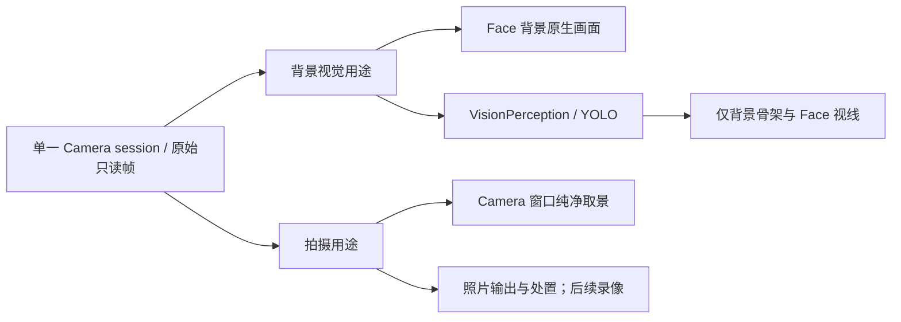

# Face、通用 Window 与 App 内灵动岛

## 2026-11-03 灵动岛黑色边缘与内容偶发错位

已实施针对性修复：紧凑岛标题改用固定画布，消除会随计时宽度变化的独立header宿主尺寸；阻止多入口同步布局重入，并在有效动画结束时统一校正目标。两项新增回归、UI189项、串行运行时225项及四项iOS构建通过；全量check因3个范围外用例失败退出1，原生UI整组缺少结束摘要。用户截图的真机间歇触发链尚未复现，需继续视觉验收，详见[验证记录](../validation/Window-Camera.md)。

- UI/Components/Island/IslandHost.swift：标题宿主改用与状态条一致的全视口固定画布，按IslandPlacement.compact定位内容；通过逆向父容器偏移保持全局位置，展开顶部6pt下移仍由UIKit frame动画承担。标题内容宽度变化不再改变宿主画布宽度。背景、命中和占位仍使用同一IslandPlacement。
- render设置同步重入保护，嵌套布局只请求下一次布局，不重复构造／覆盖animator。两段开场、展开／收起在有效动画完成后无动画统一写回目标frame／corner／alpha／内容及状态条坐标，再发localCompleted；被新token取代的动画不能校正新目标。
- Tests/UITests/IslandStateTests.swift补充固定画布坐标回归：单侧／双侧状态、22pt普通槽／44pt计时槽、展开／收起、硬件保护区／非硬件布局及父容器中途位置，验证背景与内容共享同一全局基准，不从截图宣称已证明唯一根因。
- 更新Island与测试README，保留其他在途紫色主题等改动。运行完整check和四项iOS构建；记录实际结果与尚未覆盖的真机间歇复现／转场验收。本次不改变跨模块接口或系统Widget外壳。

## 2026-11-03 现有窗口使用emoji

已实现：项目实际创建Window的入口只有CameraCoordinator和WebExecutionService，分别将系统图标改为📷和🌐，使用已有WindowIcon.emoji接口。两个拥有目录README已同步，保留通用系统图标／图片能力和已有布局。UI回归、串行运行时测试和四项iOS构建通过；全量check因平台状态用例首次失败退出1，该用例单独复核通过，原生UI整组缺少结束摘要。详见[验证记录](../validation/Window-Camera.md)。

## 2026-11-03 最小化卡片自适应宽度与窗口图标

已实现：最小化卡片按标题实际字体宽度伸缩，最小128pt、最大320pt，同时不超过安全视口宽度减32pt；达到上限后单行尾部省略。左右各44pt分别保留图标位和关闭按钮，标题两侧各8pt间距。窗口身份、普通／最大化位置、卡片拖动与恢复规则不变。新增4项回归、完整check脚本与四项iOS构建通过；原生UI整组缺少结束摘要，真机视觉／触控仍待验收，见[验证记录](../validation/Window-Camera.md)。

- UI/Components/Window 新增同目录 WindowAppearance.swift，拥有通用 WindowIcon（系统symbol、单个emoji、自定义图片Data）及原生字体测量／卡片宽度规则。无图标时保持左槽。图片最多1MiB、尺寸最多4096×4096，接纳时ImageIO缩放为最长边96像素PNG；错误明确invalidIcon，不读文件／网络，不增加异步任务。
- WindowState.present增加可选icon参数，随窗口身份保留规范化图标；layout/present依据标题和字体更新卡片宽度，旋转／字体变化保留卡片中心并约束到安全范围，普通窗口几何独立。WindowHost使用同字号渲染和测量，观察Dynamic Type变化；最小化图标22pt，图片等比完整显示，不侵占标题／关闭命中。
- Actions/Camera/CameraCoordinator、Actions/Web/WebExecutionService在创建窗口时分别提供camera.fill／globe系统图标；通用UI不根据业务content猜图标。UI/Window、UI模块、Actions/Camera、Actions/Web及总体设计同步接口说明。
- Xcode工程为WindowAppearance增加源码导航引用，编译所有权仍由UI包目标持有。scripts/check-modelkit-boundaries.py仅为新WindowAppearance文件声明原生AppKit测量与ImageIO图标处理权限，保持UI零项目依赖。Tests/UITests/WindowStateTests覆盖中英文／emoji标题、短长宽度／封顶／窄屏／字体尺寸变化、位置与模式保留、各类图标、非法图片／符号及清理；更新测试和脚本README。
- 执行完整check与四项iOS构建，记录实际结果；真实iOS图标、截断、关闭按钮及拖动触控验收单列，不把状态测试或编译当成真机效果。

## 2026-11-03 首页覆盖层与导航隔离

已实现：Window只覆盖首页，层级固定为首页 → Window → 本地灵动岛 → 其他导航页；进入导航页期间本地岛退出呈现，系统状态栏恢复，返回首页恢复进入前的详情展开／收起偏好。新增状态回归、首页原生持久挂载单独复核、完整check脚本及四项iOS构建通过；NativePresentation整组缺少完成摘要，真机视觉／手势待验收。详见[验证记录](../validation/Window-Camera.md)。

- UI/Root/ApplicationRootView 将 WindowHost 移入持久首页内容，保留窗口实例、尺寸、模式与任务，导航层负责覆盖和阻断首页触摸／无障碍。不关闭业务窗口或采集任务。
- UI/Root/NavigationState 在路径跨越首页边界时同步通知 UIContainer；模块根将首页可见性传给 WindowState 和 IslandState，不引入跨模块依赖，不依赖页面 onAppear/onDisappear。
- WindowState 的宿主可见性参与遮挡／内容／背景可见面积判断，使导航页下的相机窗口不取得可见镜头权限。呈现回执仍只代表窗口壳就绪，不代表未被导航遮挡。
- IslandState 分离本地呈现可见性与业务活动／系统 Live Activity。首次离开首页保存最多8活动的展开偏好，多级 push/pop 不重复覆盖；回首页只恢复仍存在且有详情的活动，已结束活动不复活，新活动按自身默认偏好。根失活清理保存值，前后台切换不解除导航遮挡。IslandHost 停止本地绘制、命中、状态条刷新及布局占位，迟到回执不能重新挂载。
- 回归覆盖原先展开／收起、嵌套路径和直接返回、期间内容更新／结束、后台往返、窗口状态保留及可见镜头权限；更新 UI、Root、Window、Island README 与总体设计。运行完整 check 和 iOS build，并明确原生转场／真实触控的验收范围。

## 2026-11-03 组合拍摄等待首帧（152）

已实现；完整check退出0、四项iOS构建及真机资源/签名校验通过，2026110303已安装并启动。真实摄录待用户验收；NativePresentation无完成摘要，不宣称原生Metal验收通过。详见[152验证记录](../validation/Window-Camera.md)。

附件 task_116 的执行回执显示 open 成功、takePhoto 随即 unavailable；原生运行回执早于 UI 接纳首帧，导致拍摄方向尚未建立。修复范围如下，不更改 Gateway 的 ReAct 调度语义，不以固定延时伪造就绪。

- UI/Camera/UICameraContainer 在 CameraPresenting 增加类型化首帧方向等待接口；同根最多一个等待者，超限明确 busy。接纳新鲜视频帧时完成，不向 Facts 发布逐帧事件；根令牌与视频 generation 拒绝过期回执。取消、后台、停止、渲染失败解除等待，10秒无有效首帧返回明确超时，计时任务取消并加入。
- CameraState 的只读拍摄方向只接受新鲜帧。Actions/Camera 的 open 在窗口挂载、采集运行后等待首帧；PhotoSession 在倒计时结束、RecordingSession 在配置与音频交接后再次等待有效方向并重验生命周期。失败保留已打开的错误窗口，不触发实际拍摄。原生 Foundation 继续拥有设备状态，UI 仅确认呈现几何。
- 在既有 UI 测试文件覆盖延迟首帧、复用、容量、超时、取消、后台/根停止及旧帧拒绝；保留组合步骤顺序与终态反馈回归。同步 UI/Camera、Actions/Camera 以及模块技术文档，记录自动化、四项构建、资源/签名与真机安装结果；不将替身测试视为真实摄录验收。

## 2026-11-03 拍摄组合入口与失败策略（151）

已实现并通过完整检查、四项iOS构建和资源／签名校验，真机2026110302已安装启动。原生Metal用例无完成摘要，真实模型／摄录验收待用户确认；见[151验证记录](../validation/Window-Camera.md)。

- takePhoto/startRecording 保持现有地址、参数和 UI Tool 路由，内部组合 Camera.Capture.open 与真实拍摄。open 幂等复用／恢复唯一拍摄窗口，等待挂载和采集就绪；不打开背景视觉。takePhoto 自动准备照片模式，保留镜头、zoom、倒计时等已有设置；录像沿用150的自动video准备和时长。openCamera 保留为只打开预览或显式镜头／参数准备入口，Skill 默认直接拍摄而不先分轮open/configure。删除takePhoto旧的重复最小化恢复分支，窗口准备统一归open。
- Actions/Support 的 ActionComposition.sequence 增加 failurePolicy：默认continueOnFailure保持机械臂现有执行；stopOnFailure在失败后标记后续叶子notStarted（dependencyFailed），不执行副作用。策略逐层独立；单步超时也服从所选失败策略，保持机械臂既有行为。整个组合取消／截止时阻止后续执行并加入已启动工作。并行与重复节点不另加策略。保留路径、失败、预算和容量限制。
- 组合提供类型化最终结果执行接口，准备步骤成功后才运行结果步骤；保留步骤报告，同时返回最终照片或录像回执。FunctionExecutor和Gateway/Output/Scheduling/ChannelScheduler仅在子报告有失败／取消时覆盖业务value，成功报告不能吞掉mediaID等结果；不新增ActionCompletion变体。内部步骤不再入Gateway、不单独产生ReAct；录像模型调用仍等ready且UI短回执仍允许手动stop。
- 文件归属：Support/ActionComposition及FunctionExecutor负责通用机制，Contracts/ActionReport负责未启动原因；Camera既有CaptureActions/VideoActions及新的同目录CameraCaptureWorkflow.swift负责组合，Coordinator负责模式准入／状态保留，CameraModule保持显式绑定。无新目录。同步Support、Contracts、Camera、Skills、Gateway/Scheduling和总体技术README。
- 预算包含open与最终拍摄，照片110秒（60+50），录像终态780秒（60+720）、UI短启动120秒（60+60）。权限／容量／busy／配置失败停止链条，保留已打开窗口和待处置媒体，不隐式重试或删除。已发生的照片／文件效果不因后续错误伪造回滚。
- 回归覆盖默认机械臂继续、失败即停与嵌套、取消／超时、类型化结果与失败报告；相机关闭／已开／最小化、照片／视频模式切换、失败不拍摄、设置及背景视觉保持、真实Action/Skill链的单次终态。运行完整check和四项iOS构建，资源签名校验后安装真机，真实摄录／模型验收单列。

## 2026-11-02 Overall README organization

Reorganize the appended window, camera, recording and Island descriptions in `MobileHarness/README.md` into the existing lifecycle, UI-request, camera, media and presentation workflow sections. Keep cross-module ownership, interfaces, data flow and completion boundaries in English. Retain component algorithms, layout, resource limits and module structure in the existing owning READMEs (UI, Island, Camera and Runtime); avoid duplicate contracts. Reconcile Scene continuity wording with the implemented App lifecycle. Preserve unrelated working-tree changes and create no directories. Validate relative links, section placement, English-only overall prose and diff formatting; this documentation-only change requires no build.

Completed: cross-module descriptions are integrated into the existing sections; duplicated module details remain authoritative in their owning READMEs. Verified all relative file targets in the overall README, English-only text, paired code fences, final scenario-map placement and `git diff --check` for the edited documents. No code, build, automated-test, model or device acceptance claim is made.

## 2026-11-02 录像自动模式与 Skill 示例（150）

已实现，完整检查及四项iOS构建通过，已安装并启动真机版本2026110301；真实语音/录像验收待用户确认，见[150验证记录](../validation/Window-Camera.md)。

- startRecording 在已开启的拍摄窗口内自动准备 video 模式，不要求先 configureCamera；保留现有镜头、变焦、照片倒计时，录像闪光设为 off。新增可选 durationSeconds（1…600），省略沿用当前时长设置，定时录像也不必单独配置。仍不隐式打开窗口或处理待处置媒体。
- VideoActions 纯校验参数后将可选时长经 CameraControlCapability/CameraExecutionEndpoint 传到 CameraCoordinator。Coordinator 保持采集/镜头/待处置准入并在短启动期间持有变更门；CameraRecordingSession 将视频准备纳入同一启动任务，先配置成功再获取音频和开始原生录制。现有 configureCapture 与录像共用一个原生配置/回滚实现，放在既有 CameraRecordingSession.swift，不新增目录。失败或取消不开始录像，配置失败加入回滚后报告；不重置不相关设置。
- 保留149的默认终态等待、UI Tool启动短回执、独立停止及单次 ReAct；不改Gateway调度。更新Photography revision和文档，拍照/录像分列示例：普通开始、限时开始、ready询问、保存/忽略、关闭窗口及完成匹配Task。保持既有Skill总字节上限，删除重复说明为示例留空间。
- 自动化验证照片模式直接录像、配置顺序/回滚/取消、已有video不重复切换、设置保留、时长校验，以及真实Skill示例解析和并存容量。执行完整check.sh、四项iOS构建/资源签名校验并安装真机；原生录制和真实模型验收单列。

## 2026-11-02 录像完成反馈与手动停止修复（149）

已按以下边界实现并安装2026110221；自动化、构建及待做真机闭环见[149验证记录](../validation/Window-Camera.md)。原生/真实模型验收不以构建或替身回归替代。

- 已核对：Photographer 的按钮请求为 ToolCall，经 DirectExecutionDispatcher，不进入 ChannelScheduler。业务路由保持 Agent → Gateway → Actions，不修改调度器或绕过准入。UI facade/Photographer 的单请求槽与模型 Action 的通道等待是不同的约束。
- VideoActions.startRecording 增加纯校验的 waitForCompletion（默认 true）。默认启动后等待该录像实际收尾，原 Action 仅返回一次 ready 或失败，沿既有执行身份续推；不在 recording 阶段产生业务值 ReAct。Photographer 固定按钮 Tool 显式传 false，只等待 didStart，从而释放 UI 请求槽；停止仍是独立 Tool，能结束模型发起的长录像。业务实现不读取或分支判断 Action/Tool 协议。
- CameraControlCapability/CameraExecutionEndpoint/CameraCoordinator 增加类型化 waitForRecording；CameraRecordingSession 共用唯一 completion，取消等待时停止对应原生录像并加入清理，不能操作后续录像。600秒录制上限外预留启动/文件收尾预算，默认执行预算720秒；按钮短启动预算保持60秒。限时/手动结束合流且不增加第二条终态事件，避免重复通知。
- 文件验证、pending存储、ready呈现后再归还聆听；CameraVideoReceipt 增加不含路径的 fileName，保留 mediaID、实际时长、stopReason，明确 ready 不是 saved。失败仍释放音频且保留可处置素材。普通取消不产生 ready 续推，真实收尾失败不能被取消掩盖。
- 同步 Camera/Contracts/Photographer/Skills 技术文档、总体跨模块流程及 Photography 指令。补充启动接纳/终态等待、手动Tool跨调度停止、自动结束、失败、取消与单次结果回归。执行 check.sh、build-ios.sh；真实模型和设备验收独立记录，不扩大到关键词感知或其他审查项。

## 2026-11-02 紧凑岛外侧留白微调（148）

后续147、148一并随2026110220安装真机；自动启动被锁屏拒绝，待用户解锁确认观感。

已实现，最终UI回归及四项iOS构建通过；完整检查的两条旧尺寸断言已修正并复验，证据见validation/Window-Camera.md。将IslandCompactMetrics.outerPadding从5pt增加到8pt，两侧各多3pt；保持高度、图标尺寸、中央硬件相邻位置和展开正文边距。组件几何与视图共用该常量，系统Widget默认边距不变。更新既有布局断言及组件README，执行完整check与四项iOS构建。

## 2026-11-02 首页采用模拟器验收页背景（147）

已实现并通过完整check及四项iOS构建；真机视觉待确认。将测试页从RGB(0.08, 0.20, 0.32)到黑色的纵向渐变用于正式首页及启动页。ApplicationRootView统一拥有底色；CameraConversationSurface不再铺黑色，保留30%视频叠加；ConversationView移除覆盖底色的旧Atmosphere。Camera原有暗色对比层移入其视频内容内部，不遮暗无视频的首页。范围仅Face背景，不修改窗口/灵动岛外壳、导航页或Action接口，不新增目录。同步Root、Conversation、Camera README，执行check及四项iOS构建。

## 2026-11-02 灵动岛封装与结构收尾（146）

结构审查和小范围清理已完成；完整检查、四项构建与最终资源包校验通过，证据见validation/Window-Camera.md。本轮无视觉修改；后续按用户要求安装真机2026110219，启动因锁屏被拒绝。

- 审查范围限UI/Components/Island、UI根组合和Actions/UI/Runtime灵动岛适配。保留现有七个UI文件和两个Actions文件，不新建目录、不按技术类型增加细碎层级；内容/状态/宿主/状态条/指标/系统驱动/Widget的职责已分开。
- 删除失效destination/linkTitle数据链：UI公共内容、系统快照、校验/编码、Actions蓝牙/任务/相机生产者不再存储或发送导航目的地。旧JSON/持久化快照中的额外键忽略，继续读取旧symbol等必要兼容字段；点击仍固定唤回当前页面。移除只为补导航字段而存在的相机包装方法。
- Actions通用控制、领域发布、图片注册协议与执行服务同置IslandActions；IslandDomainPresentation仅拥有事实观察与内容转换。UI不新增业务引用，Action名称/注册/Skill调用链不变。
- 检查本地动画中断/状态条/资源所有权，移除重复导入、无效绑定、不使用的编码键及从未抛出的systemUnavailable错误；同步ApplicationControl/Photography Skill中已过时的“整体活动切换”为详情/实时状态独立选择；不重写稳定状态机或扩大到其他模块。更新UI、Actions owning README，修复重复/过时说明和文件清单。
- 更新回归验证旧导航元数据仍可解码但不再编码/参与内容身份，旧系统活动固定返回App；沿用领域选择、图片资源、代际/后台、动画回执与Action链测试。执行完整check、四项构建；本轮无视觉改动，不安装真机或改签名配置。

## 2026-11-02 紧凑背景与系统状态分离（145）

已实现；完整检查、四项iOS构建及Mac模拟器样式/录屏验证通过。后续用户要求安装，已随2026110219安装真机；启动因锁屏被拒绝，真机视觉待用户确认，见validation/Window-Camera.md。

- 保留Island全宽统一内容容器和系统状态避让；新增组件内部独立黑色背景面。紧凑稳定态背景只覆盖中央compact业务矩形，时间/网络/电池仍在外侧同一容器；展开背景继续覆盖全部状态与正文，不改变Action接口。
- 初次紧凑显示先扩展到包含全部状态的外壳，再用弹簧收回中央背景；展开/收起使用约620ms、阻尼0.76的可中断过渡。分段动画共享代际/版本/动画身份，最后一段真实完成后才确认完成；Reduce Motion短淡入、无回弹。
- IslandHost拥有背景布局/动画和命中，透明系统状态区域不拦截业务触摸；最大化顶部占用仍使用统一容器底边。技术README同步删除整面始终黑色的旧描述。
- 自动化覆盖紧凑/展开背景范围与系统状态保持，检查既有代际/动画回执回归；完整check和四项构建。先在Mac模拟器使用仓库外测试内容验收打开、展开/收起、中途切换，用户确认后再装真机。

## 2026-11-02 最大化贴屏与顶部避让（144）

已实现并通过完整检查、四项iOS构建、模拟器测试内容交互及资源签名；2026110218已安装（流水5612）。真机相机窗口待用户确认，见validation/Window-Camera.md。

替代“最大化填满安全区域”：最大化外壳左右/底部贴应用全屏边界，顶部距当前App内灵动岛底部4pt；没有可见岛时从顶部安全区开始。岛展开/收起后重新布局最大化窗口，不改变普通窗口与卡片位置。

- IslandState只读发布本地宿主的目标占用矩形，实际拆卸清空；业务不能设置。Root把其底边作为通用topBoundary传给WindowHost，不让Window直接依赖Island或Task。均为当前scene窗口坐标。
- WindowHost全屏挂载，普通/卡片继续安全区坐标；新增纯几何计算，把全屏最大化矩形换算为安全区相对坐标供WindowState、可见性及原生宿主共用。最大化左右/底部不留壳边距，取消外壳圆角/边线；内部底部控件保留home indicator安全内边距，背景填满屏幕。
- WindowState单独持有最大化布局，不覆盖normal/card/restoreMode；模式切换、岛占用变化、旋转、安全区变化使用同一frame。保留既有回执围栏与窗口中断规则，不通过布局更新发Action或停止设备。
- 更新Window、Island、Root技术README；自动化覆盖紧凑/展开/无岛、竖横屏、贴边几何、最小化后恢复最大化、还原原位置。执行check、四项iOS构建、资源签名并安装真机；真实贴边/手势区由设备验收。

## 2026-11-02 系统岛退出清理与回到原页（143）

已修复返回路由并补齐尽力退出清理/遗留清理/过期展示；完整check、四项iOS构建和资源签名通过，2026110217已安装启动（流水5604）。划掉立即关闭仍受系统强杀回调限制，未标记完全实现；真实场景待用户验证，见validation/Window-Camera.md。

修复系统岛点击错误导航，补齐可执行的进程退出清理；保留既有后台语音会话，不以进入后台替代进程结束，不新增目录。

- Widget的所有点击统一使用mobileharness://island，仅激活App；删除ApplicationRootView的待处理目的页和history/camera/bluetooth分发。旧活动链接也不再改变页面/打开相机；暖启动保留路径、窗口和详情偏好，冷启动使用正常首页。内容destination/linkTitle字段暂保持现有解码/API兼容，但不驱动整体岛点击。
- UI/Components/Island拥有系统活动终止适配；App/Lifecycle的applicationWillTerminate仅调用其公开端口。收到通知时在回调返回前尽力完成Activity.end(.immediate)，非主actor异步执行并最多等待1秒，超时明确记录，不发起等待回调返回后才开始的主actorTask、不阻塞无限时间。此路径只用于进程退出，不替代正常异步根stop。
- 系统驱动安装时主动提交空快照，先清理上次进程遗留活动，无需等待首条业务发布；后续写入沿用一个串行worker，清理后再创建当前活动。
- Widget根据系统isStale/paused/ended呈现明确失效状态，移除运行图标、计时、频谱/进度和旧目标描述；不将过期伪装为已结束或自动移除。保持现有30秒心跳/60秒staleDate。
- 平台限制：UIKit不保证挂起/强杀时调用applicationWillTerminate；ActivityKit staleDate不执行end，进程死亡后本地Task无法运行。没有服务端APNs结束链路，无法保证划掉后立即移除；本轮不增加服务器、私有API或后台保活。该未满足项在验证记录保留，不能把回调清理或下次启动清理描述为覆盖所有强杀。
- 回归验证点击URL与业务目的地解耦、失效展示不继续计时、提前清理与后续发布顺序、终止清理正常完成和有界超时；同步UI根/Island、App生命周期/装配与总体技术README。运行完整check、四项iOS构建、资源签名校验，安装真机供用户验证真实后台点击与划掉行为。

参考：[Apple终止回调说明](https://developer.apple.com/documentation/uikit/uiapplicationdelegate/applicationwillterminate(_:))、[Apple DTS关于回调返回后进程退出](https://developer.apple.com/forums/thread/824825)、[ActivityContent.staleDate](https://developer.apple.com/documentation/activitykit/activitycontent/staledate)。

## 2026-11-02 任务详情与实时状态独立选择（142）

已实现；完整检查、四项iOS构建、追加领域调用链回归及模拟器独立双路场景通过。2026110216已完成资源/签名验证并安装启动（流水5596）；真实业务与系统外观待真机确认，详见验证记录。

用户澄清替代141同一活动上下重复以及早期整体抢占规则。任务展开后，下方固定目标图标和描述；顶部继续切换聆听、说话、拍摄、录像、加载等实时状态。保持141间距、同壳动画和系统状态避让，不新增目录或业务参数。

- IslandState按有效detail分为详情与无详情状态两组，各组沿用rank/最新排序；详情拥有独立展开偏好，上部状态更新/抢占/结束不清除或收起详情。无实时状态时展开顶部不重复目标；收起时可用目标作为紧凑身份。无详情时保持原有图标状态行为。组件不识别Task/Camera等业务owner。
- IslandHost上部读取状态活动，下部从详情活动读取primary/tone/text/thumbnail；原有手势始终操作详情活动。普通更新与频谱不触发重新展开，根/图片生命周期不变。
- 系统投影分别过滤liveActivity，持续详情作为快照身份锚点，实时状态填入顶部指标；新增可选详情图标/色调和顶部存在标记，兼容读取旧快照。Widget展开区同时呈现实时状态和独立任务详情；系统动画时机仍由iOS控制。Action入口/内容参数不变，领域适配继续独立发布现有槽。
- 更新UI组件、Actions/UI/Runtime和总体技术文档，移除当前整体抢占描述。回归覆盖低优先语音仍显示、高优先相机不隐藏目标、收起后状态更新不重开、任务/状态分别结束、多个详情抢占恢复、后台与两端同源投影及旧快照兼容。运行完整check、四项iOS构建；模拟器用仓库外测试壳实际操作独立任务与实时状态组合，不把模拟数据视为真语音/相机验收。

## 2026-11-02 展开岛双行布局与模拟器验收（141）

已实现并完成Mac Device Hub内iPhone 18 Pro模拟器组件验收；完整check及最终四项iOS构建通过。模拟器采用真实UI组件与明确标注测试输入，非真实音频/模型/相机闭环。截图与验收记录见[验证记录](../validation/Window-Camera.md)。后续用户已请求安装：2026110215真机签名/资源校验及安装成功，自动启动因锁屏被拒绝，解锁后可手动打开。

按用户14:09反馈收紧展开顶部状态行与详情间距：展开时整行系统/业务状态下移6pt，详情起点改为紧凑高度加10pt，正文底部18pt、左右24pt留白。顶部保留当前活动primary/secondary（包括计时、loading、频谱）；同一活动选择与抢占规则保持，不拼接其他活动的详情。系统状态避让始终包含完整业务双翼，不能因展开忽略业务占用。

- IslandHost几何统一提供header区域，硬件保护区保持固定；主辅内容独立hosting子视图仅用于布局，由既有UIViewPropertyAnimator与系统状态、壳身共同插值，中断采集当前frame，移除展开时隐藏紧凑内容的分支。底层全壳点击/上滑仍由原body处理，顶部无新增业务操作。
- 频谱场景补充：顶部hosting通过观察型SwiftUI视图直接读取现有bands/spectrumActive，不传冻结数组快照；音频更新只刷新图形，不重启壳身动画或增加Action发布。
- 模拟器中央点击验收发现顶部内容拆出hosting后，收起的空ZStack没有实体命中承载；保留全壳透明内容面，继续由原手势统一处理中央和两侧点击。
- 模拟器图文验收发现空Group让缩略图首次加载任务没有可挂载视图；改为空内容保留透明占位承载既有task，图片仍由组件有界解码。黑色岛的overlay显式使用dark样式，避免测试宿主浅色外观导致收起箭头/loading过暗。
- IslandStatusBar用同一header中心线布局；纯几何回归验证固定硬件/横向位置、6pt位移、两行间距、正文底边、全宽系统状态避让。更新组件README与验证记录，不新增目录或Action参数。
- 本轮用户改为先在Mac模拟器验收：使用仓库外测试壳加载真实UI组件，注入明确标注的测试内容，覆盖短文/长文/图片/图文、计时/loading/频谱、点击/上滑收起再展开、快速切换。测试壳不进入产品，模拟器不验证真实录音或相机；运行完整检查及四项iOS构建。截图和结果先供用户确认，本轮不安装真机。

## 2026-11-02 系统状态并入同一岛身（140）

已实现：系统状态与业务共用黑色裁剪面和动画，统一边距并缩小电池。完整check退出0、四项iOS构建及资源签名校验通过；2026110214已安装并启动。原生Metal测试仍缺完成摘要，真实动画/布局由用户真机验收，详见[验证记录](../validation/Window-Camera.md)。

用户13:49截图指出139系统状态在岛外独立显示、电池过大和边距不统一。本轮将系统状态真正纳入同一个黑色裁剪面及UIViewPropertyAnimator；保留中央业务绝对位置和现有数据来源，不新增Action参数或目录。

- IslandPlacement区分中央业务compact区域与实际外壳frame；紧凑外壳与展开外壳同样左右留16pt、最大420pt，紧凑高度仍110/3pt。无硬件保护区时中央业务也居中。系统与业务都放进surface，系统条以坐标转换保持同源位置，打开/关闭/展开/打断共享父壳裁剪和动画，不再在controller根上单独浮动。
- 系统状态布局以岛身边界为准，两侧统一16pt内边距；先同步压缩至10pt，再从内向外隐藏网络、最后电池/时间，保留中央业务原位置。时间16pt，网络18pt，电池28×14pt，共同垂直中心。详情布局沿用24pt正文边距，不与紧凑头部混淆。
- 电池改为原生绘制的轮廓/端帽/按比例填充与数字；低电量、低电量模式、充电和未知继续来自真实值。不宣称使用私有系统状态栏控件。删除旧38pt实心UILabel电池和独立全屏状态条挂载逻辑。
- 新几何/坐标回归验证系统元素在同一壳内、统一边距/对齐、不与业务重叠、压缩后隐藏顺序、紧凑/展开/退出坐标和电池填充边界。更新组件/测试文档，执行完整检查及四项构建、资源签名校验后直接安装真机；不操作模拟器界面。真实裁剪/动画手感及系统电池近似程度由用户实机对照。

## 2026-11-02 App内灵动岛系统状态（139）

已实现；完整check退出0，新增布局/生命周期/未知值回归通过，四项iOS构建和最终资源签名验证通过。2026110213已安装并启动。原生Metal测试缺完成摘要，系统状态栏真实隐藏/恢复与视觉仍由用户真机验收；详见[验证记录](../validation/Window-Camera.md)。

用户确认替代138覆盖策略：App内岛实际挂载时隐藏原生状态栏，组件自行显示时间/网络/电池；退出、后台或根停止恢复。系统Live Activity仍由iOS管理，不添加自绘系统状态。仅组件内部样式与避让，不新增Action参数或允许模型覆写系统状态。

- Components/Island增加IslandStatusBar.swift，集中UI中立系统状态值、只读注入端口、可取消的显示刷新owner、纯几何避让及原生状态条视图。UIContainer构造注入reader给IslandState；PlatformKit/Core/NativeSystemState定义PlatformSystemStatus，PlatformContainer提供既有power/network驻留快照的类型化只读投影；App/Composition/ApplicationContainer仅逐字段转换为UI值，不解析JSON或持有采样器。UI不导入PlatformKit，不重复开启电池监测/NWPathMonitor，不请求权限。
- 仅本地挂载时刷新：一个主线程owner至多一个任务，每5秒读取现有缓存，分钟边界提前刷新时间；不采样硬件、不发Action、不更新Live Activity。退出/后台/失活清除显示并取消任务；同步只读接口不允许在途设备工作。读取失败显示未知并按失败周期报告一次，恢复后解除故障；未知电量不当成0。网络表示当前路径类型/离线/未知，不展示伪造信号格数或声称互联网服务可达。
- 状态条左时间、右网络+电池，默认接近原系统位置；以业务占用区为约束，先将每组向外挤到12pt屏幕边距，再由内向外移除网络、最后电池；左侧时间无法容纳时隐藏。保留业务全部内容与原有固定高度。展开后上方使用硬件区作为占用区，正文区域不参与顶部状态布局。固定字号/元素范围及可访问性说明归组件；系统状态无交互，透明触摸继续透传。
- IslandState公开只读本地状态栏替换标志，由真实宿主挂载/拆卸更新；Root用公开SwiftUI状态栏隐藏修饰符，OverlayController同样声明隐藏，调用方只绑定组件生命周期。停止本地呈现恢复原状态栏；安全区改变保持当前方向布局基准，避免隐藏后岛向上跳动。状态条与业务壳在同一overlay内，内容切换沿用组件动画。
- 修改前台UI、App装配与技术README/总体流程，补充默认位置、挤压/隐藏顺序、极窄视口、展开与紧凑、实际挂载可见性、未知值/读取失败和取消刷新回归。完整检查、四项iOS构建、签名资源后安装真机；不操作模拟器界面。真实状态栏隐藏/恢复和状态条视觉由用户真机验收。

## 2026-11-02 紧凑灵动岛覆盖状态栏（138）

已修复条件降层逻辑，完整check退出0、四项iOS构建及资源签名通过；原生Metal测试无完成摘要仍未确认。2026110211安装成功，自动启动因连接断开、重试超时未确认；真实系统状态栏覆盖待用户真机验收，详见[验证记录](../validation/Window-Camera.md)。

用户12:51截图中聆听计时被系统信号图标覆盖。IslandHost只有展开或带详情时提升至alert，无详情紧凑态初始化及动画完成会降至normal+1。修复仅限通用UI组件，不改变业务内容、计时槽宽或系统Live Activity。

- IslandOverlayWindow创建并显示前固定使用公开UIWindow.Level.alert，整个挂载周期（紧凑、展开、抢占、动画打断及关闭）保持该层级；删除内容/几何驱动的层级切换与无用coversStatusBar派生值。
- 继续非key透明窗口，不关闭系统状态栏、不修改单个系统图标；只有岛身实际绘制区域遮盖下层，透明区/圆角外触摸透传保持原契约。后台拆卸和前台重建仍归既有owner。
- 更新Island技术README与过时几何测试断言，沿用固定高度/计时槽、点击命中、展开/收起/抢占/后台回归。check、四项iOS构建、资源和签名后安装真机，不操作模拟器界面。UIKit真实合成层级不可由macOS纯状态测试证明，需用户真机核对计时与信号交叠处。
- 平台依据：Apple UIWindow.Level公开排序normal、statusBar、alert，https://developer.apple.com/documentation/uikit/uiwindow/level 。不推断可覆盖所有系统保护界面或隐私指示器。

## 2026-11-02 UI模块契约归位（137）

已实现并写入AGENTS.md。完整check退出0，四项iOS构建、资源及签名校验通过；既有原生相机Metal测试仍缺少完成摘要，不计为通过。2026110210已安装并启动，未操作模拟器界面或宣称真机交互验收；详见[验证记录](../validation/Window-Camera.md)。

按用户确认的原则修正136的根目录限制：根目录放模块入口和整体契约；Shared／Support放可复用机制；具体能力跟随所属目录。本轮仅调整UI及仓库规则，不搬迁其他模块，不新增目录或target。

- UIFailure.swift、UIStateSnapshot.swift由Shared迁回UI根；UIFailureReporting与UIContainerError从Shared/UIPresentation合入UIFailure。公开类型、错误schema、状态编码和运行行为不变；UIConfiguration继续随UIContainer。
- Shared保留UIPresentationAccess/Token/Admission与泛型UIRequests及其局部错误；Root继续负责根页面组合与导航，子Container留在对应能力目录。
- AGENTS.md记录按责任归档的规则，明确public或多处引用不等于根契约，编译目标边界需要保留，禁止机械限制根文件数量。边界脚本恢复统一Failure根路径、更新Snapshot位置，检查唯一所有权而非根文件白名单；同步Xcode、相关技术README及总体设计。
- 执行完整check与四项iOS构建、签名和资源校验，沿用已授权真机交付方式，不操作模拟器界面。记录实际结果及原生测试证据限制。

## 2026-11-02 UI目录归档与共享机制整理（136）

其中“根只保留Container”的路径安排由137修订；本节保留该轮变更记录。

已实现：19个文件迁移，共享机制与功能输入归属完成整理，删除3个确认未使用成员；文档和构建路径同步。check脚本退出0，四项iOS构建、资源与签名验证通过；原生相机Metal测试缺少完成摘要，仍未确认。2026110209已安装，启动因iPhone锁屏被拒绝，未做界面验收。详见[验证记录](../validation/Window-Camera.md)。

用户已明确批准按上一轮展示的布局实施，包含新建UI/Root、UI/Shared、UI/Components/Island与UI/Components/Window目录；不新增Swift target/一级模块，不迁移Settings的历史/相册职责到新目录。

- 根只保留UIContainer.swift与README。ApplicationRootView/Ports、PersistentHomeNavigation、NavigationContext进入Root；从UIContainer抽出导航类型到Root/NavigationState，呈现接纳/凭证/错误及回调定义到Shared/UIPresentation，State快照到Shared/UIStateSnapshot。Shared/UIFailure保持基础错误独立schema。
- UIRequests通用有界请求/回执机制进入Shared；HomeInput归UIHomeContainer，CameraInput归UICameraContainer，Settings/Resources/History/Device输入及回执归对应Settings现有owner文件。Shared不依赖相机、设置、历史等具体内容。
- 灵动岛六文件全部归Components/Island，WindowState/WindowHost归Components/Window。Face专属NativeCompanionSurface、EyeGeometry、ListeningMotion、MetalHaloRenderer与ListeningHalo.metal归Conversation；通用字幕、频谱、本地播放器、覆盖继续留Components。
- 清理经过全仓引用核对无调用的UIRequests.cancelOutstanding、UIDiagnosticsContainer.audioDetectionPresentation别名、ActionActivityState.hasOngoingTask派生值。保留SwiftUI/UIKit运行时协议回调及已安装Live Activity旧快照兼容，不把缺少显式调用当作删除依据。
- 同步Package资源/排除列表、Xcode文件引用与Widget三源、UI路径/归属/错误/State检查。新增四目录README，重分配Components内Face/Island/Window技术细节，更新UI总体及相关owner/项目技术文档；历史验证原路径不回写。迁移保持公开类型、运行生命周期、导航与视觉行为。
- 验证目录/旧路径不存在、Shared无功能类型依赖、声明唯一、资源及Widget打包、完整check与四iOS构建；签名后尝试真机安装。不操作模拟器界面，原生视觉与后台多轮验收仍由真机完成。

## 2026-11-02 灵动岛代码归并与职责整理（135）

已实现，源文件9→8；最终四项iOS构建、2026110208签名/资源校验通过。相关回归通过；全量检查的测试编译错误已修正，平台状态采样失败单独复验通过，原生Metal测试缺少完成摘要仍未确认。iPhone恢复连接后2026110208安装并启动成功，后台音频与UI手感待用户实机验收；详见[验证记录](../validation/Window-Camera.md)。

按用户范围仅整理UI/Actions灵动岛实现，不扩展其他模块接口，不引入新目录或额外抽象层。

- 系统队列、心跳、注意力账本与原生ActivityKit驱动合并至UI/IslandSystemPresentation.swift，删除Components/IslandLiveActivity.swift。保留驱动协议用于真实平台隔离和自动化替身。
- UI/Components/IslandActivityAttributes.swift归并中立内容/详情/指示器/系统快照类型；IslandState只保留活动、资源和生命周期管理，布局几何/手势判定移入IslandHost同文件的跨平台部分。将App/Widget重复指示器绘制、计时、频谱投影及其尺寸常量归并到现有Components目录内IslandIndicators.swift；两个宿主只负责自身布局及平台能力选择，系统用静态频谱、不启动App循环动画。扩展只编译共享内容、共享指示器及Widget入口三份文件。
- Actions/UI/Runtime/IslandActions.swift归并通用参数校验、Action声明、模块绑定及执行服务，删除IslandPresentationService.swift；IslandDomainPresentation保留业务状态投影和生产者窄端口，不进入UI。内容决定的伸缩、动画、计时仍归UI组件。
- 删除IslandMotion、large/custom枚举及无效width/height/animation存储、Action参数广告；旧请求在纯校验入口明确拒绝，不保留执行分支。保留已持久化系统快照/现有旧内容的最小兼容解码，不保留双渲染路径。导航路由、现有状态公开程度等本轮不扩展重构。
- 更新Xcode共享源、边界检查和对应技术README；回归覆盖旧尺寸/动效拒绝及现有图标/计时/展开、版本和后台链。执行完整检查、四构建、签名和资源验证，尝试真机安装；不操作模拟器界面。外观和业务交互保持现状。

## 2026-11-02 聆听岛右侧计时（134）

已实现；2026110207四项iOS构建、真机签名/资源校验通过；check脚本退出0，原生Metal相机测试无完成摘要仍不计通过。真机连接不可用，未安装，视觉验收待连接后执行；见[验证记录](../validation/Window-Camera.md)。

实现：聆听右侧展示本次连续聆听时长，进入listening记起点，离开后清除，下次聆听重计；业务无关更新、前后台切换和高优先活动遮挡不重计。不是本次VAD语句长度，也不是累计录音文件时长。

- UI通用IslandIndicator增加elapsed(startedAt: Date)，两端同源序列化起点；UI组件使用SwiftUI原生计时文字，无每秒业务Task、Action或ActivityKit更新。等宽数字16pt，和18pt主图标垂直居中，专用44pt槽，仅横向增加空间，岛高不变、靠硬件区域无内侧间距。外侧沿用5pt，不修改系统状态栏策略。
- Actions域适配器只维护连续listening的起点并提交elapsed，UI内聚计时样式；通用Action参数说明同步elapsed及标准Date编码，Skill说明紧凑区的计时附件例外；保留原有旧快照兼容。
- 自动化覆盖计时编码/无效起点、固定高度和硬件对齐、相同聆听保持起点与重新聆听重计。更新UI/Components、Actions/UI/Runtime技术README及验证记录；执行check.sh、四项iOS构建、签名资源校验并尝试安装真机，仍不操作模拟器界面。

## 2026-11-02 后台语音连续与灵动岛同源（133）

已实现；四项iOS构建、2026110206真机签名构建与资源/audio声明校验通过。完整检查脚本退出0，但原生Metal相机测试缺少完成摘要，不能记为全量原生验收通过。新增后台生命周期/同源岛状态/Action接纳回归通过。iPhone当前unavailable，安装报CoreDeviceError 4016，尚未安装或进行后台实机验收；详见[验证记录](../validation/Window-Camera.md)。

实施计划：将已运行应用的Scene不可见与根会话停止分开。用户已开启的聆听在后台继续；ASR/VAD、已有模型请求、回复播放和不依赖前台的Action保留。前台/后台灵动岛消费同一活动身份、内容和真实阶段，不冻结为暂停副本。用户关闭、系统音频中断、显式停止仍真实清理，后台不能自动重新取得许可。

- App/Lifecycle ManagedService增加显式continuesInBackground（默认false）；只在running阶段允许声明的服务跳过Scene失活invalidate，首次启动途中/根停止仍使用完整失效和逆序加入。Composition选择持续的model/platform/ui/actions/gateway/agents，通过各owner Scene端口关闭视觉/窗口/设备前台能力，不伪造原服务的setForeground(true)。不新增目录。
- Agents根增加场景可见性通知，只停止VisionPerception，保留SpeechPerception/Assistant等已运行输入/决策；App不读取内部worker。Actions根增加独立场景回调执行既有camera/bluetooth foreground关闭与加入，不取消其他已接纳Action；原invalidate/stop保持完整取消。Platform基础会话/Model/Gateway不因页面隐藏销毁，根停止仍原顺序。后台相机/机器人等有前台门的Action继续明确拒绝，不能保证所有Action后台可用。
- 半双工仍暂停VAD/ASR准入，但在回复等待/播放期间保留同一原生录音流并消费丢弃被抑制PCM，避免每次回复都中断后台音频会话；禁止将回复音重新识别。录像交接、用户关聆听、系统中断及根停止仍关闭原生采集。UIBackgroundModes仅新增audio，不采用静音播放/循环背景任务保活。
- UI根增加Scene呈现控制，保留home的会话/回复事实和token；关闭Window接纳及本地岛渲染，Island内容/详情偏好/图片/owner/generation与系统更新持续，返回前台重挂最新内容。前台Metal和频谱已有scenePhase停止机制继续使用。系统外壳/动画仍归iOS；中断或进程终止不能承诺无限后台执行，系统快照staleDate保留。
- 更新各owner README及总体跨模块流程、配置文档；scripts/check-modelkit-boundaries.py同步校验UI独立Scene入口及Model仅前台重新接纳绑定，保留根start/invalidate/stop绑定检查。自动化验证Actions场景切换保留在途执行及已准备票据、持续服务场景切换不失效且根停止仍清理、默认服务保留旧行为、岛后台接纳更新/回前台身份偏好保持、最终结束系统活动，以及半双工准入/失败回归。完整检查、四iOS构建、资源/签名/audio后台模式校验并安装真机；锁屏/桌面下长句ASR、慢请求、TTS连续多轮、用户关闭及音频中断由真机验收。CoreML语音当前CPU路径可持续；本地GPU模型受iOS限制，不承诺后台GPU推理可用，错误如实报告。

来源：Apple AVAudioSession record文档明确UIBackgroundModes audio用于锁屏/后台继续录音；Activity.update支持后台运行期间更新，Live Activity不授予执行时长。https://developer.apple.com/documentation/avfaudio/avaudiosession/category-swift.struct/record 、https://developer.apple.com/documentation/activitykit/activity/update(_:)

## 2026-11-02 聆听关闭回执循环（132）

已修复并安装2026110205；首次启动被锁屏拒绝，用户继续后再次启动成功。定向回归与四项构建通过；完整检查的平台状态等待失败单独复验通过，原生相机渲染无完成摘要仍未确认。详见[验证记录](../validation/Window-Camera.md)。用户多次长按开关后内部Speech.Listening.update持续刷屏。根因链路为关闭Action→取消回复→新revision空闲ReplyActivity→SpeechPerception无条件applyListeningPolicy→再次关闭。新回执不是新执行意图，不能只凭revision发Action。

- SpeechPerception.receiveListening接收ReplyActivity时先保存aggregate paused，仍完整校验/记录各source incarnation/revision并清理pendingFinal确认，只有实际paused改变才调用既有策略执行。显式用户输入/启停Action/采集结束保持现有语义，不以日志过滤、限频或计时器掩盖循环。
- 保持四来源聚合：某一来源完成而另一来源仍忙，不重复执行暂停；全部释放才发恢复。相同占用新revision以及新incarnation的同态事实更新账本但无设备动作；迟到回执仍拒绝。
- 在VoiceTests覆盖重复长按式toggle、四来源大量递增空闲回执、关闭Action输出后注入回复空闲反馈、下一条只为新用户输入、聚合占用/释放及旧revision拒绝；同步SpeechPerception/测试技术README。完整检查和四构建、签名资源校验后安装真机。原始4095条是日志累计淘汰数量，不能直接证明每条均为聆听；测试验证具体Action数量。

## 2026-11-02 ASR失败后的聆听恢复（131）

已实现并安装启动2026110204；语音回归/四项构建/签名资源校验通过，完整检查中一项相机原生渲染等待失败、复跑无完成摘要，不能记为全通过；真实Apple拒识后呈现待用户验收，见[验证记录](../validation/Window-Camera.md)。修复SpeechPerceptionAgent.recoverRecognition仅赋值phase、未发呈现/阶段消息的问题。识别收尾的processing表示ASR正在完成，尚不是已发模型请求；保留该阶段，但无最终有效文本的失败必须结束本轮。

- SpeechPerception负责取消并加入失败ASR/VAD、重建下一轮、清除失败临时字幕并封口，通过既有transition发布empty终态（持久状态为listening）及UI.VoiceState.listening；Assistant已有empty处理释放该turn识别绑定。原始错误继续报告，不伪造final、不启动聊天。
- 生命周期/采集代变化后不复活旧轮次；恢复接纳仍检查captureOpen、enabled与paused，关闭或暂停时不发聆听显示，不获取设备/重启麦克风。UI和灵动岛继续消费统一语音呈现事实，不加超时重置或第二套修补状态。
- Tests/IntegrationTests/VoiceTests覆盖ASR创建失败和输入结束时报错，验证processing后恢复呈现/Context/listening、empty/字幕封口、下一句成功，保留原错误。更新SpeechPerception/Agents/测试README，完整检查及四项构建后签名安装真机，用户验证Apple ASR真实拒识；不操作模拟器界面。

## 2026-11-02 收起重开、详情对齐与相机初始位置（130）

已实现并通过完整检查、四项iOS构建、签名和资源校验；2026110203真机安装并启动成功。仅调整UI基础组件，不新增目录，不更改Action或业务生命周期。触控与视觉待用户验收，证据见[验证记录](../validation/Window-Camera.md)。

- IslandHost取消中央黑区触摸排除；具有详情的紧凑岛保持公开alert层级，让完整岛身接受再次展开点击，圆角外和透明区继续透传。不隐藏系统状态栏，无详情不可展开；动画中的命中使用当前可见frame。
- IslandExpandedView图标、正文、缩略图、箭头统一垂直中心对齐。短文字使用自然高度，长文字超过可用高度才滚动；左右留白从16增加至24pt，测量文字宽度与实际布局一致，紧凑岛尺寸不变。
- WindowSizing.image竖屏初始布局在安全区顶部预留80pt，窗口完整装入剩余区域，保留图像比例，必要时等比缩窄。横屏及standard不变，手动拖动与最大化不受该初始位置策略限制；不因岛实时展开推移用户窗口。
- 自动化覆盖完整紧凑岛点击命中/收起重开、圆角外透传、相机竖屏上方预留及比例/底部可达。更新Components/UI/UITests README，运行完整检查与四项构建，签名资源校验后安装真机，不操作模拟器界面。长详情仍可能覆盖手动移动/最大化窗口，由用户收起或拖动。

## 2026-11-02 紧凑岛固定高度与横向贴合（129）

实现、回归复验及四项构建完成；2026110202真机已安装并启动，修复后视觉待用户对照。首轮断言修正和最终证据见[验证记录](../validation/Window-Camera.md)。

用户00:31:59/00:32:21截图确认App内岛身偏高、位置偏上，外侧留白偏大。Apple HIG Live Activities尺寸表的compact高度36.67pt；当前SDK WidgetKit公开contentMargins和isDynamicIslandLimitedInWidth，但没有供App读取系统完整岛frame的公开API，UIKit本机SDK也无reservedRegions。不可把safeAreaInsets当成精确岛frame；本轮使用公开尺寸加该机截图标定，记录推导与边界。参考：https://developer.apple.com/design/human-interface-guidelines/live-activities 。

- 两截图均1206×2622，3x对应402×874pt。黑色中心/翼部测量：App顶约31px、翼部底147/148px；系统顶41px、底152px，左图标App y62...118、系统68...126。当前40pt高度与safeTop-52顶偏移错误；紧凑高度统一110/3pt，顶部按safeTop-48推导（该机14pt），中心垂直对齐。该定位为受测机型校准，不声称SDK实时返回硬件轮廓。
- UI组件持有唯一紧凑尺寸契约：中央硬件保护宽376/3pt（Apple230pt总预算减两侧52.33pt），22pt图标槽、18pt符号、外侧5pt留白；图标槽直接邻接硬件区，内侧零额外padding/Spacer。双翼约179.33pt，只有左图标时不预留空右翼，硬件位置始终居中，外壳只向有内容的一侧延伸。系统截图黑色宽约538px，主图标中心约382px、辅图标中心约824px；22pt槽对应两个实测中心，槽+外边距仍为27pt，与双翼预算一致；5pt为该截图对应的布局标定，不称Apple默认边距常量。
- 同一尺寸用于布局/SwiftUI/命中/初态/关闭目标，圆角为紧凑高度一半。紧凑出现、消失、切换附件仅改变横向frame，y/height不变；详情展开/收起仍允许高度变化。无硬件的安全区备用不推测摄像头frame，保留完整图标。
- 不修改系统Widget原生外壳/边距，只统一既有18pt图标常量；不减少图标能力、不隐藏系统状态栏，不改变业务/Action/详情接口。纯布局测试覆盖实测402pt设备、单/双侧零内边距、固定高度与基线、无辅图标空翼释放、展开还原；更新UI/Components技术README和验证证据。check.sh与四iOS构建、签名资源校验后安装2026110202，用户真机对照；不操作模拟器界面。

## 2026-11-01 内容驱动的通用灵动岛接口（128）

实现、自动化和构建完成，2026-11-02真机安装2026110201成功；启动被锁屏拒绝，视觉验收待用户进行。见[验证记录](../validation/Window-Camera.md)。

按用户确认方案实施，替代126/127独立详情来源和固定右翼模型。

- UI基础值改为primary/secondary IslandIndicator（symbol+none/pulse/bounce/variableColor、loading、spectrum、progress），detail仅可选text/thumbnail引用；展开主图标直接沿用primary。紧凑18pt、展开24pt、文字15pt动态字体；所有动画、布局、点击/上滑内聚组件。只在展开区显示文字/图片，紧凑无文字或数字计时。
- 每活动保存手动展示偏好；有效详情首次出现默认展开，不依赖expansionID；同阶段修改不抢展开；清空收回，新阶段默认展开。rank/最新仲裁整体切换活动，图标/附件/详情同源，低优先活动保留展示偏好，结束高优先后恢复。取消跨活动拼接详情，修正setPresentation只修改指定活动。
- 缩略图本轮仅App内。UI提供异步注册Data→不透明UUID和释放接口，注册含owner/generation，最多8资源（含在途）、单在途解码（忙时拒绝），输入最多4MiB，源图最多4000万像素且单边不超过8192，输出最长边256像素；ImageIO非主线程有界解码并应用EXIF方向，图片只允许一活动绑定，跨owner/过期引用拒绝。替换/清空/活动结束释放绑定资源，后台/根停止取消并加入清理；无路径/URL/网络加载，无App Group。本地内容提交先校验再提交，不用图片失败破坏原内容。
- IslandContent旧symbol/trailing/progress/detail.symbol只在解码入口迁移；仓库调用方迁移到新类型。共享Widget快照兼容旧已安装活动解码，新布局消费统一指标值；系统仅图标/文字，图片不进入受限原生payload。更新Action内容契约、Skill、ui.island事实与所有相关技术README；不新增目录，不改变模块依赖。
- 测试内容有效性、每实例展示偏好、整体抢占恢复、图文组合、旧格式迁移、资源容量/解码/归属/取消/清理、回执与Action链。运行完整check.sh、四iOS构建及签名资源检查，直接安装真机；不做模拟器界面验收。

## 2026-11-01 边距与展开收起交互（127）

实现、完整自动化检查和安装完成，真实视觉与触控等待用户验收；见[验证记录](../validation/Window-Camera.md)。

- UI/IslandState的纯布局缩小紧凑横向边距15→10pt、总宽200→190pt（安全区备用96→86pt），保持20pt图标与中央126pt保护区；展开正文边距24→16pt、间距14→10pt、底边24→14pt，正文距状态栏12→8pt。字体与图标不缩小。系统Widget目标内容间距同步14→10pt、垂直附加padding8→4pt，系统外壳边距仍由iOS管理。
- UI/Components/IslandHost与IslandExpandedView提供中立收起回调、右侧chevron.up按钮（44pt触摸区）和展开区域向上拖动结束收起，阈值36pt且垂直位移大于水平1.5倍；短触摸/横滑/下滑不收起。调用现有setExpanded(false)，同任务更新不重新抢展开，紧凑顶部可再次打开。组件拥有手势与动画，不向Task/Action添加手势业务。
- 根据Apple公开UIWindow.Level.alert文档，App内展开跨越状态栏时将非key透明窗口提升到alert层级，收回动画真正完成后恢复normal+1；窗口其余区域透明、系统状态栏仍启用，不访问/隐藏系统图标，不声称改变系统灵动岛或隐私指示器。保留硬件/状态栏行触摸透传。系统Widget布局与交互继续由iOS控制，不伪造原生收起按钮。依据：https://developer.apple.com/documentation/uikit/uiwindow/level/alert 。
- 测试布局间距/硬件避让、覆盖层级意图、手势方向和阈值；已有状态测试覆盖收起后更新不重开。同步UI与Components技术README，运行check.sh、四iOS构建与签名资源校验，安装127真机。按用户要求不做模拟器界面测试；状态栏覆盖与收起手势待用户真机验收。

## 2026-11-01 前台与系统双呈现、通用详情组件（126）

实现与自动化检查已完成，安装及真机验收记录见[验证记录](../validation/Window-Camera.md)。

用户确认桌面系统岛正常，明确恢复App内状态图标/附件动画，并保留系统呈现；两端对齐内容语义与leading/trailing/详情分区。系统物理位置/动画仍由iOS拥有，App内不宣称复制系统私有动画。替代125“唯一系统呈现”。

- UI/IslandState增加中立IslandDetail(symbol,text)，与紧凑title/symbol/trailing分离；基础组件不解释Task。expansionID只在附带detail的新阶段自动展开，同阶段更新不抢回手动收起状态；结束详情来源后收回，普通状态无详情不展开。字段/文本/频带有界，owner/revision/generation保持。当前只有Actions的Task适配器提供detail，内容仅目标图标及目标文字；其他Camera/Voice/Bluetooth保持紧凑。
- 同一个根State提供两端同源紧凑主状态及可选附件，系统Snapshot增加兼容旧快照的detail；Widget目标详情只显示图标与文字，删除该场景旧的状态说明/大导航按钮。原生非目标状态使用紧凑状态摘要，iOS仍可能允许系统长按展示其基本摘要。
- 在现有UI/Components内恢复IslandHost，包含可复用IslandCompactView及IslandExpandedView；框架拥有尺寸/圆角/弹性伸展/符号切换与加载/录制/实际频谱动画。单一标准圆角矩形连续变形，删除旧窄脖子轮廓。展开顶端保持与紧凑位置一致，内容在系统状态栏下，顶部留空保护时间/信号/电量；不隐藏系统状态栏。紧凑左右等宽槽及黑色留白，中央避开硬件；无硬件或空间不足时放在安全区内，保留完整附件。屏幕边界和字体尺寸由UI组件约束，透明区域透传，硬件区域不拦截。
- UIKit场景非key容器定位，UIViewPropertyAnimator拥有可中断尺寸/圆角弹性形变，SwiftUI同一视图树承载内容；Reduce Motion缩短过渡并停止重复符号动效。真实UIViewPropertyAnimator完成核对generation/revision和动画身份更新localStatus，不用固定延时模拟挂载；后台解除宿主并停止渲染。频谱由领域窄端口输入实际32频带，只局部更新，不产生Action或原生Live Activity更新。
- Action保持@Action、纯参数校验、显式Module/协议/Skill；setPresentation支持compact/expanded（expanded要求已有detail），不开放large/custom/调用方动画参数。回执明确submitted、localStatus/systemStatus，两端独立：系统禁用/失败不会让App内图标消失或把业务判失败。App根只挂载组件，不设计样式；Actions只提供内容/详情/测量。UI/Components、UI、Actions Runtime、Skills、整体技术文档同步。
- 自动化覆盖详情阶段/普通内容不可展开/更新与收起/终态撤下/并发来源、频谱隔离、布局边界和标准轮廓、挂载回执代际、原生权限失败与前台独立性、Snapshot升级兼容、Action/Skill链。执行check.sh与build-ios.sh、资源/签名检查后直接装真机126；不运行模拟器界面验收，视觉与功耗由真实设备另验。

## 2026-11-01 按 Demo 切换为唯一系统呈现（125，已被126替代）

实施与安装完成，系统视觉及动画等待用户真机验收；自动化复验、四目标编译、签名与安装证据见[验证记录](../validation/Window-Camera.md)。

本节替代124及之前的App内仿岛布局方案。用户明确拒绝自绘岛身、私定动画及模拟器界面验收；要求直接使用1998code/iOS16-Live-Activities的ActivityConfiguration/DynamicIsland分区实现，仅适配Action/UI。删除IslandHost、IslandOutline、IslandLayout、几何插值和动画回执，不再保留第二套胶囊。

- UI/Components/IslandActivityWidget采用Demo的leading title3、trailing title2/50pt caption2计时、center caption/原生linear进度、bottom caption Link/padding/15pt圆角结构；compact caption2/40pt计时、minimal和锁屏原生呈现。只把送餐数据换成真实状态/任务摘要，不复制送餐假进度、自动成功或后台保活。新增共享摘要字段解码提供旧版默认值，保证升级后仍可读取和清理已存在活动。位置、外壳、动画、系统图标避让和Reduce Motion全部由WidgetKit/iOS拥有，状态栏不隐藏。记录来源，不宣称仓库存在未核实的MIT许可。
- IslandState保留8活动、256身份账本、owner/revision/generation及固定领域slot；删除本地几何/renderer/动画等待。通过IslandSystemPresentation串行提交唯一原生摘要，错误状态显式公开；操作完成只代表系统请求完成，不宣称像素已展开。UI.Island.setPresentation仅size=expanded映射为一次系统alert请求，旧compact/large/custom/自定义animation明确unsupported，不伪造尺寸。Skill、Action说明和Facts同步。
- expansionID按任务身份请求一次系统提醒；普通进度和heartbeat不重复alert。iOS可能短暂展开，不能强制前台常驻或保证自动展开。任务结束撤下任务，最后一个活动结束使用Demo的immediate策略。任务状态在Actions本地化。App底部聆听频谱保留，系统侧仅展示语音符号（不承诺逐帧回复频谱），不发送逐帧数据或模拟频谱动画。
- 原生摘要仅接收声明的内容。Task/Camera及语音/蓝牙均通过相同接口映射到系统；按rank/最新选择，任务阶段提醒不由业务操作系统UI。根失活以暂停摘要停止计时/更新，清空旧代交互；新前台重新投影，根stop立即end。后台暂停不是任务成功、相机持续采集或后台保活。60秒staleDate保留失去更新的说明。
- 删除旧App内IslandButton/IslandInteraction、ApplicationControl专用订阅和islandCalls以及被替代的测试；相机窗口既有按钮仍走Photographer。Widget导航按钮使用白名单路由回App现有相机/蓝牙/历史入口，设备命令仍在App通过既有请求链执行，不把任意Action放到URL。普通点击返回App；旧代命令不得执行。
- 自动化替换自绘几何测试，覆盖原生提交/合并/权限/失败/一次性提醒/结束/根清理、Task阶段投影、旧参数拒绝、导航和回执语义。同步UI/Components、UI、Actions/Runtime、Agents、Skill、整体技术README。运行check.sh和build-ios.sh（仅编译），签名/包资源校验后直接安装真机125；本轮不启动模拟器做界面测试。原生视觉和动画由用户真机验收。

## 2026-11-01 保留系统状态栏与任务自动展开（124，已被125替代）

用户要求撤销隐藏状态栏，任务开始在灵动岛展开区展示、结束收回。参考1998code的WidgetDemo.swift分区与原生控件：其系统岛定位/伸缩由iOS拥有，无可直接复制给App内UIView的系统动画参数。系统Widget保留系统行为；App内以同一黑色轮廓连续尺寸插值、轻弹簧与数字内容过渡对应，不宣称复刻私有系统动画。

- UI/Components/IslandHost删除prefersStatusBarHidden及让位逻辑，始终保留系统时间/信号/电量。UI/IslandState的IslandLayout为顶部中心保护区和安全区下正文分别建模：紧凑左右槽满足系统预留区时横向展开，单侧横向空间允许时外侧留白可收至12pt；空间不足时保留22pt内容与外侧黑色留白，将两槽移入同一岛身向下延展的区域，不删除附件；展开态窄顶部与宽正文连成一体，宽正文只在状态栏下出现，不用大矩形覆盖状态栏。无硬件岛时仍在安全区域内呈现。几何、轮廓、命中与动画全部内聚UI。
- IslandContent增加兼容旧JSON的可选expansionID，中立语义是内容新阶段需要展开；新token首次接纳时展开并选中该活动，同token进度更新不重新抢焦点，用户手动收起保持。移除当前展开活动时收回，并恢复其他紧凑状态；其他活动结束不收起当前详情。复用revision/generation和真实completion，不创建延迟伪完成或第二套选择状态。
- Actions/UI/Runtime/IslandDomainPresentation按实际任务身份发布expansionID，标题/说明/执行记录按钮复用原有事实与固定请求链；任务终态立刻移除Task活动，删除原3秒Task终态计时，蓝牙计时保留。首个任务详情采用左侧状态图标与标题、右侧轻量加载、下方状态说明和执行记录操作的紧凑排版，无假进度。并发任务保留聚合，当前任务变更触发新的展开；UI不理解Task身份或状态。
- UI/Conversation移除Face任务文字条以及对应字幕布局空位，不删除执行记录数据或异常提示。技术README同步UI/Components、UI/Conversation、Actions/Runtime及整体跨模块流。
- 自动化覆盖状态栏两侧避让、向下连接轮廓、窄屏完整附件、自动展开/更新/手动收起/结束/并发/迟到回执及真实领域接入。执行check.sh与四套iOS构建，分开进行以减少时间敏感用例干扰；真机独立验证状态栏、任务起止和详情按钮，无法完成的项目明确记录。

## 2026-11-01 真实 Face 顶部整合修正（123）

122真机截图确认：安全区下独立160pt胶囊形成第二个岛，且与Face右上按钮相交；单侧聆听仍保留整条空右翼。该设计错误必须修正，组件夹具通过不等于真实Face验收。

- 保留原生ActivityKit/WidgetKit及统一Action，不撤回系统集成；前台App内呈现由UI组件贴合顶部硬件黑区，普通状态不再占用Face工具栏所在行。公开API不能读取精确硬件轮廓，基于竖屏手机安全区分类使用保守134×38pt中心保护区，真机确认；刘海、横屏/平板采用左侧紧凑44/88pt安全区胶囊，不与右侧Face按钮相交。
- IslandLayout统一计算背景、硬件保护区、左右22pt槽、外侧18pt黑色留白；每侧独立按内容增加44pt翼区，无右附件不留空右翼。中心硬件不放可视内容/按钮。紧凑背景从中心黑区向有效翼区连续伸展，关闭收回；SwiftUI同一轮廓弹簧插值，取消普通模式岛身淡入，Reduce Motion保留短淡变。展开仍由同一背景向下/左右延展，正文从安全区下方开始，不能覆盖硬件。
- 根据用户此前“优先保留功能、必要时隐藏系统状态栏”的授权，附着活动侵入左100pt/右116pt系统预留区或展开时，组件通过公开prefersStatusBarHidden暂时让整条状态栏让位，退出动画完成/后台/拆除恢复；不访问/遮挡单个系统图标，不操纵隐私指示点。状态栏策略完全在UI组件，不传给业务调用方。
- 保留真实SwiftUI completion及generation/transition围栏；空白与硬件区域触摸透传。改动限UI/IslandState、Components/IslandHost、对应测试/README及总体设计，不调整业务优先级、Action或设备生命周期。
- 用户追加要求深入参考1998code实现：已读取WidgetDemo.swift、ActivityAttributes.swift和ContentView.swift。系统展开区按leading状态图标、trailing计时、center详情/进度、bottom返回App操作整理；compact/minimal/expanded/lock-screen提供Xcode原生预览。只借鉴分区与原生timer/progress组合，不复制送餐业务、stale=成功推断或保活机制，不把系统动画误称自定义App内动画。
- 真实Face追加发现：单一聆听展开仍使用160pt正文下限，造成大块空白。默认expanded按标题、说明、附件/计时、进度、活动选择、操作及错误提示的实际存在分配正文高度；单标题76pt，复杂内容保留滚动，large/custom仍尊重显式尺寸。尺寸策略归UI组件，业务无需提供像素高度；新增内容稀疏/完整的回归。
- 自动化验证单侧/双侧占位、图标与硬件不相交、外侧留白、紧凑不侵入Face工具栏行、回退布局和展开内容起点；执行check.sh、四个iOS构建、资源/签名检查。先在真实Face检查聆听和说话，Camera状态根据实际可操作入口验收；未完成的状态单列，不能再把独立夹具当真实Face验证。

123顶部整合、内容高度与四种系统预览已实现并安装真机；真实Face聆听、详情展开/收起与设置按钮已复验。其余动态业务、系统新展开布局和无障碍/功耗仍独立待验收，见[验证记录](../validation/Window-Camera.md)。

## 2026-11-01 原生双呈现重构（ActivityKit + SwiftUI）

用户明确同时接入真正系统灵动岛/锁屏和App内组件，替换121的Isle依赖。参考[1998code示例](https://github.com/1998code/iOS16-Live-Activities)的ActivityAttributes/Widget扩展结构与Apple当前ActivityKit/WidgetKit文档；自行实现，不复制示例图片、送餐业务、旧版API、定位或静音音频保活。

- 删除Package.swift/两份resolved的Isle、包内许可副本及依赖白名单；历史许可和121验证记录保留并标明不再分发。UI恢复零项目/第三方依赖。全部源码放现有UI、UI/Components、Config和测试目录，不新增目录或一级模块。
- IslandHost改成场景非key宿主+单个SwiftUI内容根。原生SwiftUI胶囊位于顶部安全区下8pt，紧凑左图标/右附件、展开完整内容；展开状态附件与计时合并一行，避免重复占用高度；不仿冒硬件黑区、不隐藏系统状态栏。持续保留同一视图身份，使用SwiftUI spring/形状与尺寸插值；withAnimation真实completion核验generation/transition，透明区域按实际动画几何透传。删除SDK适配、CADisplayLink结算观察器和替换重建队列；Reduce Motion短淡入淡出。旋转推进呈现版本，后台清空并取消等待。
- IslandState仍是统一入口，现有present/update/end/setPresentation、领域slot、权重、版本、按钮与频谱接口不改变。IslandContent新增可选liveActivity开关，默认nil/false兼容旧JSON；领域仅对持续Task、相机录制/倒计时选择系统摘要，其余状态与高频真实频谱留App内。尺寸/动画参数仅控制App内；系统布局由iOS拥有。
- 新增中立系统摘要、可替换原生驱动及根所有者：一个最新目标槽、一个串行写入worker、一个30秒前台刷新任务、一个当前Activity状态观察任务，最多一个系统活动。静态/动态载荷合计限制3500字节，保留4KB平台余量。系统摘要按内容去重，其他App内活动更新不能只因时间戳不同刷新系统；结束摘要最多保留一个，下一次启动前移除旧摘要。系统摘要不携带频带、业务按钮命令或设备事实副本；使用系统Text(timerInterval)/timer、ProgressView及紧凑/最小/展开/锁屏区域。权限关闭/请求失败/用户移除通过独立system状态与错误显式呈现；不把App内可见当系统启动成功，用户移除后本轮不重新拉起，空闲后才重新接纳。
- UI/Components中放共享ActivityAttributes、原生ActivityKit驱动及Widget入口。新增Xcode应用扩展target（不建目录），只编译共享值与Widget视图；两个App目标均嵌入同一扩展，Config中提供扩展plist，App开启NSSupportsLiveActivities及固定mobileharness://island链接。扩展不链接Agents/Actions/设备/模型，点击Link回App查看当前活动；本轮不从锁屏绕过Gateway直接执行硬件按钮。App内原有按钮保持完整请求链。
- 系统写入完成代表ActivityKit请求完成，不承诺系统像素上屏；end等待已提交清理与App内真实动画完成。后台停止前台刷新并提交结束，锁屏短暂保留“打开App查看最新状态”的结束摘要且冻结计时，不声称设备仍运行；原有设备后台收尾不变。staleDate为60秒，异常退出后过期视图停止动态计时并提示数据过期；下次根启动清理同类型遗留活动。根stop加入写入和观察清理，不引入后台保活、推送服务或App Groups。
- Actions只设置中立系统展示偏好并回传独立状态，不import ActivityKit。UIContainer拥有系统呈现启动/停止；统一open链接只打开当前活动或保留一个由首次实际UI呈现消费的待打开意图（领域批量发布完成后选择当前系统活动），不接收任意Action参数。同步UI/Components、Actions/Runtime、App/Config、总体README及包/扩展资源检查。
- 自动化覆盖旧JSON兼容、系统选取/载荷界限、合并更新/迟到状态/拒绝与失败/停止清理、真实API与本地完成区别、链接校验、App内尺寸边界；完整check.sh、四套构建、扩展嵌入/plist/签名/资源检查。原生模拟器与真机单独验收，不把授权/系统UI展示等同于mock通过。

原生双呈现、Widget扩展、统一接口及技术README已实现。自动化、四套构建、模拟器原生App内/系统/锁屏展示通过；122已完成扩展签名、真机原位安装及首页启动确认；完整真机业务动效与功耗仍待验收，按[验证记录](../validation/Window-Camera.md)单列，不能以模拟器代替真机验收。

## 2026-11-01 用第三方 Isle 替换自绘灵动岛

用户否定120版外观，要求引入第三方库替换全部视觉壳并保留现有features。此次移除自绘CAShapeLayer轮廓、果冻关键帧和头部遮罩，不继续调整旧设计。

调研：DynamicNotchKit（474 stars）是macOS专用；Dynamic-Islands（553）是设计示例而非可直接接入SDK；IslandAlertsForSwiftUI（49）只有固定通知/确认样式，缺少自定义左右槽；DynamicIslandFramework（3）仅提供预编译framework且未找到明确源码/许可文件；FluidIslandHUD（1）是固定HUD。选用[Isle](https://github.com/marciliojrs/isle)（2 stars），因为公开IsleView支持compactWrap/expanded、自定义UIView槽、原生入场/退场；这是功能适配选择，不声称它是最流行或客观最美。数字为本次GitHub读取结果。

- Package.swift与两份resolved锁定Isle提交a47b8cf62891c820729c9939660ac24094705202，仅UI的iOS目标依赖；不新增项目源码目录，不引入SDK自带相机或第二套业务生命周期。保留MIT原文及包内分发许可。
- UI/Components/IslandHost改为IsleView适配器：直接使用库的黑色外观、内边距、圆角及animateIn/animateOut；左槽接最高权重状态图标、右槽接真实频带/加载/进度/录制附件；展开centerView接文字、计时、通用按钮及活动选择。SDK内容槽是视图边界，Action/Agent不import Isle。
- 根仍持有唯一IslandState与场景非key宿主；保留容量、身份/版本/代际、交互请求及真实完成语义。仅采用SDK纯视图，不采用其全局singleton/无界通知队列/自动消失计时器。最多一个在途退出和一个最新待呈现目标；替换按库退出→入场，旧请求明确取消。SDK退出completion直接确认退场；入场SDK未暴露completion，CATransaction结束后由短寿命主runloop CADisplayLink核验根层动画已移除且presentation与目标一致，两次连续稳定采样确认完成，防止SDK刘海入场三段动画的第一段回调提前确认。观察器仅有限过渡期间存在，不创建显示线程、不生成业务帧任务，不按固定延时伪造。后台立即移除、撤销观察器并解除等待；同一渲染周期内根失活后重新开启也按generation清掉旧SDK实例与观察器，不等待上一代动画结束。
- 尺寸适配只负责将受限请求映射到SDK内容区域、旋转安全区和硬件避让；原生几何变化也在组件内推进transition并取消旧尺寸等待，避免旋转动画继承已完成回执；删除旧轮廓计算及相关测试，保留可验证的SDK尺寸/内容映射测试。状态栏让位、外围触摸透传及Reduce Motion仍在UI组件适配层内，不传给调用方。默认spring使用SDK动画；已有smooth参数及Reduce Motion使用120ms无弹性淡入淡出，保留显式参数含义。SDK缺少通用的连续尺寸morph，替换沿其退出后入场方式执行。
- Actions/UI/Runtime既有呈现服务和领域投影继续统一接入同一IslandState；验证聆听、说话频谱、蓝牙、相机倒计时/录像/待处置及Task的内容映射和按钮链，不改变Foundation设备操作。
- 同步UI及Components README、总体第三方依赖说明、许可索引和验证记录。执行check.sh、四套iOS构建、资源/签名校验，并运行链接实际SDK的原生模拟器展示。漂亮与否以实际画面验收，不以构建通过代替。集成验证中修正领域投影夹具复用上一阶段deadline的问题：蓝牙与倒计时分别等待本阶段可观察条件，保留有界超时及完整按钮断言。

本轮第三方视觉壳替换、通用SDK适配与README已完成。完整check.sh、四套iOS构建、原生模拟器受控验收及资源/许可/签名检查通过；121已安装，真机因锁屏未启动验收。证据与限制见[验证记录](../validation/Window-Camera.md)。

## 2026-11-01 灵动岛定向流体展开与辅助附件恢复

用户反馈首次呈现偏fade、右附件消失。原因：Host首次没有收拢路径，默认透明度入场；119版在小于426pt屏幕直接删除右翼，导致正常说话/加载附件也不展示。

- 保持所有布局/动效/降级策略在UI/IslandState与Components/IslandHost内，业务调用方只发布内容；不改Action、业务优先级或设备生命周期。
- 首次从hardware估算轮廓（非岛设备从胶囊中心）起步；根据实际左右内容分别伸展，没有内容的侧不预留空翼。结束反向收回，普通动效期间岛身不使用opacity fade。
- 通用轮廓使用同拓扑Core Animation关键帧：当前presentation路径→拉伸→回缩→稳定，spring约550ms，smooth约350ms；图标通过与岛身相同的路径遮罩揭示，避免图标提前浮在岛外。持续更新/打断从当前视觉路径接续，形状与内容真实completion共同回执，后台/根停止仍解除等待；Reduce Motion保留120ms淡入淡出。
- 用户明确优先保留功能，必要时隐藏系统状态。辅助附件不再按窄屏阈值删除或移到下方：左右都有内容时保持各22pt＋外侧12pt，左/右无内容时收回对应翼。附着布局按当前内容实际外框判断是否侵入原100/116pt系统保留区，冲突时由组件IslandController公开prefersStatusBarHidden/setNeedsStatusBarAppearanceUpdate临时隐藏整条状态栏；恢复空间、活动退出、根失活或组件移除还原。控制权不下放业务调用方，不隐藏相机/麦克风系统隐私提示，不访问私有系统图标或遮挡半个图标。模拟器原生验收已确认当前非key窗口可请求隐藏及恢复系统状态栏，真机观感另行验收。
- 更新UI组件README与几何/状态回归，验证初始收拢、单侧伸展、无内容收回、形变边界、动画打断和附件显示；check.sh、四套构建及原生受控UI验收，业务/真机验收单列。

调研确认：[WidgetKit DynamicIsland](https://developer.apple.com/documentation/widgetkit/dynamicisland)提供系统compactLeading/compactTrailing/expanded/minimal，iOS拥有实际排布；[prefersStatusBarHidden](https://developer.apple.com/documentation/uikit/uiviewcontroller/prefersstatusbarhidden)只公开整个状态栏偏好。未证实ChatGPT具体实现，不以外观推断。检查[FluidIslandHUD源码](https://github.com/BalochCodes/FluidIslandHUD/tree/main/Sources/FluidIslandHUD)，属于SwiftUI App内ZStack浮层，入场仍结合scale/opacity/move，无单个系统图标接口；不引入不能解决当前问题的依赖。ActivityKit属于后续独立系统呈现场景，不在本轮替换现有实时频谱/动作完成语义。

参考Apple [CAKeyframeAnimation](https://developer.apple.com/documentation/quartzcore/cakeyframeanimation)的values/keyTimes原生插值，不使用逐帧业务Task或新显示线程。

本轮代码及技术README已同步，完整检查、四套构建和原生模拟器验证通过，120版已安装并启动；真实业务动效及无障碍/功耗验收仍独立保留。证据见[验证记录](../validation/Window-Camera.md)。

## 2026-11-01 灵动岛组件内聚与调用边界

检查发现：UI IslandButton枚举、按钮文字与recordingID校验写死相机/导航业务；Actions服务重复维护领域slot身份和revision，并读取selectedID决定是否等待退出；领域投影直接读取service.state。此次在现有目录整理，不改外观、不增加目录。

- UI/IslandState.swift：通用按钮为有界id/title/value（value不透明），组件只验证结构及已登记的精确按钮、活动revision/generation；删除录像专有字段和未被渲染使用的pulse字段。稳定slot身份、去重、容量及revision由组件独占；根失活统一清理。新增有限结束/尺寸呈现端口，组件自行判断受影响的左右槽/展开内容并等待真实renderer回执，调用者不检查transition/selectedID；底层configure、renderer、acknowledge和waitForPresentation收为UI模块内部，测试通过@testable注入回执，生产调用方不能伪造动画完成。
- Actions/UI/Runtime：服务保留上下文owner派生、Action参数校验及返回序列化，state私有化；领域投影消费窄协议（available/generation、发布、频谱、错误），不持有组件内部状态。业务按钮id与文案由Actions的IslandDomainControl生成；Agents内IslandControlIntent按稳定id契约验证及路由，录像ID有效性在执行边界验证，通用UI不识别业务值。领域状态映射、rank和3秒业务提示寿命继续留在领域适配层，不移入基础UI。
- Agents/ApplicationControl：从组件验证后的按钮取声明，按本模块业务白名单解释并校验停止录像身份，继续原有Photographer/Gateway请求链；未知id或非法value明确拒绝，不执行任意Action路径。
- Agents与Actions保持已有独立依赖，不能为共享按钮枚举而新增直接import；双方只通过UI中立的id/title/value契约连接，集成测试校验生产声明与消费白名单兼容。
- 更新上述README及总体跨模块说明，替换旧业务枚举/recordingID契约。测试通用自定义按钮、重复id/过期点击拒绝、slot根代际与去重、移除右槽仍等待真实回执、业务白名单及录像请求链；check.sh、四套iOS构建。当前无需重新调整视觉或声称真机验收。

本轮内聚调整、窄发布协议、中立按钮和内部回执接口已实现并同步技术README；check.sh、四套iOS构建、最终App增量构建及25项资源检查通过。本轮不改变外观、不重装真机，验证边界与结果见[记录](../validation/Window-Camera.md)。

## 2026-11-01 灵动岛可读尺寸与自适应收敛

118版固定对称总宽扣除留白后，402pt屏幕的图标内容框仅10pt，不能继续通过缩小内容解决避让。本次替代下面118及117版的固定对称宽度策略，仅修改UI及测试，不改Action、设备或活动生命周期。

- IslandState.swift中的IslandLayout先分配20–22pt主内容与12pt外侧黑色留白；左右独立计算，硬件中心保持原位。基于公开安全区的估算布局为时间保留100pt、信号电量侧保留116pt；右侧放不下完整34pt翼区时整个隐藏，主图标不再被压缩。窄到左侧不足32pt、横屏及非岛设备回退安全区内胶囊。机型真实避让仍需实测，不声称能读取硬件或系统状态图标的真实边界。
- IslandHost.swift主图标保持20–22pt，文字只在下方展开区，沿用动态字号headline/subheadline/title2及44pt操作区。右侧隐藏时不挂载附件动画；展开后可查看该活动的附件和完整文字。仅有右侧专用活动时，紧凑最小形态用左槽承载它，不能变成空黑条。
- 保留同一轮廓的水滴展开、顶部固定和当前视觉值接续，过渡改350ms，减少动态效果仍120ms。容量、rank/最新顺序、真实动画回执不变。
- 更新Components README与UITests，覆盖390/393/402/430/440pt、阈值、20pt最小内容、12pt边距、硬件中心不移动、右侧移除及回退。运行check.sh、四个iOS构建、包内资源校验，原生模拟器与真机视觉结果单列。

调研：Apple [Live Activities布局规范](https://developer.apple.com/design/human-interface-guidelines/live-activities)和[WWDC23设计讲解](https://developer.apple.com/videos/play/wwdc2023/10194/)要求同心留白与可扫读内容；14pt是锁屏规范，不直接套用到紧凑岛。Apple [宽度受限环境值](https://developer.apple.com/documentation/swiftui/environmentvalues/isdynamicislandlimitedinwidth)只适用于系统Live Activity，本App内组件不冒用。参考[DynamicLanding](https://github.com/bring-shrubbery/dynamic-landing)的顶部固定、紧凑/展开槽和350ms变形，以及[NotchKit](https://github.com/duongductrong/NotchKit)的单轮廓形变思路；两者是macOS库，不引入为iOS依赖、不复制实现。20–22pt与12pt为本项目设计参数，不宣称Apple规定。系统图标的单独隐藏不属于公开App内能力；只隐藏本组件次要附件，系统ActivityKit留在后续独立范围。

本轮可读尺寸、自适应翼区、展开附件及350ms过渡已实现，拥有目录README已同步。四套构建与自动化复测通过，119已安装；首轮全检时序失败、模拟器合成验收和锁屏导致真机未复验分别见[验证记录](../validation/Window-Camera.md)。

## 2026-11-01 灵动岛外侧黑色留白

用户117版真机截图确认左图标靠近外缘。本轮只调整UI/IslandState的内容几何与Components/IslandHost的左右槽排布：胶囊总宽和系统状态栏保留区不变，左右内容各向硬件中心靠拢，外侧至少8pt黑色内边距；中间侧不额外加间隙。图标按可用内容框等比缩放，频谱与加载附件使用同一约束，不能越出留白。继续保留窄屏右槽隐藏策略、44pt命中区及原有展开／Action语义。更新Components README、增加外侧留白与硬件区不相交的几何回归；执行check.sh、四iOS构建及资源校验并安装真机，视觉确认与自动化分开记录。

## 2026-11-01 灵动岛视觉修订

用户真机截图确认115版紧凑内容下移、状态栏遮挡；替代下方初版210pt／外置频谱／同级不抢占约定。

- UI/Components/IslandHost关闭UIHostingController重复安全区注入；紧凑头部只显示左侧最高rank且同级最新的图标，右侧独立可选spectrum/loading/progress/recording槽，不显示任何文字、计时或辅助小图标。其他状态保存在有界活动栈，展开才列出。
- UI/IslandState增加可选trailing及独立右侧选择、可测试安全布局；紧凑附着区为系统状态左右各保守预留120pt，最多184pt；模拟器检查后右槽不足18pt隐藏、五柱按实际槽宽缩窄，左槽不足12pt时回退安全区下方胶囊，不操纵／隐藏系统状态图标。无公开硬件岛边界API，按安全区估算126×37硬件区域，真实机型避让需独立验收。
- 展开保留顶部窄头部，文字、计时和操作全部位于安全区以下的圆角内容体；原生同拓扑曲线在紧凑胶囊与带颈部的水滴形状间连续变形。使用单个可中断UIViewPropertyAnimator的真实completion，形状和内容同步；Reduce Motion短淡入淡出，背景停动画。外围和圆角透明区触摸透传。
- Actions/UI/Runtime继续使用同一IslandContent类型化接口；领域按实际事实提供左图标及可选右动画；允许symbol为空但trailing非空的右侧专用活动（仍需可访问标题），不挤占左图标，新增聆听／思考状态，回复频谱放在右槽、消费真实32频带合并5柱，不生成假音频、不逐帧Action。Camera／Bluetooth／Task保留原有业务请求链。
- 更新UI、Components、Actions/UI/Runtime及总体README；覆盖同级最新、独立左右选择、降级隐藏、紧凑／展开安全区、频谱失活和调用链。执行check.sh、四iOS构建、资源与签名校验；模拟器／真机实际视觉验收单独记录。
- 参考[Apple Live Activities](https://developer.apple.com/design/human-interface-guidelines/live-activities)的compact leading/trailing与expanded区分、[UIHostingController.safeAreaRegions](https://developer.apple.com/documentation/swiftui/uihostingcontroller/safearearegions)；查看[原生流体示例](https://github.com/stolyarenkoks/Dynamic-Island-SwiftUI-Demo)但不复制其代码或引入依赖，曲线由本项目自行实现。

## 2026-11-01 通用 App 内灵动岛实施

用户确认顶部全局显示、主活动＋辅助标记、展开业务操作、预设＋受限自定义尺寸、拍摄优先且展开时手动固定，以及保留底部聆听频谱。本轮在既有目录实施，不新增目录／模块／第三方依赖。

- 紧凑岛身保留44pt实际按钮高度；回复频谱作为底边外侧24pt装饰层，硬遮罩限制在左右圆角切点之间，区域不接收触摸，避免频谱落在硬件遮挡区。
- 紧凑布局采用210pt内容宽度（仍受屏幕减32pt约束），为估算126pt硬件区保留中间空位，左右只放小图标／计时，避免把标题挤到状态栏；完整标题在展开与无硬件岛布局展示。该估算仍需真机避让验收。
- UI 根增加唯一 island 状态和 ui.island facts，Components 提供场景绑定透明非 key 宿主、通用内容槽及原生可中断动画。普通页面／窗口上方显示，外围触摸透传，硬件区域只作背景延展；真实操作位于安全区。紧凑／展开／大展开／自定义尺寸受屏幕和内容约束，旋转重新布局；Reduce Motion、动态字体和后台清理统一处理。
- Actions/UI/Runtime 增加 IslandPresentationService、IslandModule 与 @Action present/update/end/setPresentation，使用类型化领域更新及固定交互身份，不允许任意可执行路径。领域直接复用同一呈现服务，Agent 跨域呈现通过固定 Action；Photography／ApplicationControl 只按需向模型暴露 setPresentation，Basic 常驻目录不增加。
- 接入适配器由Actions根拥有，只观察既有领域呈现快照（Task摘要、连接状态、拍摄状态及回复频带），使用容量1唤醒槽和单个到期计时器；不观察Action执行日志，不采样原生设备。setPresentation提供spring/smooth两种有限过渡预设；连接中使用可关闭的脉冲。新增Action／State教学会增加摄影提示长度，预算随实际目录增长验证，Basic预算保持25000。
- 已结束活动的最后owner/revision保留在本前台代最多256个身份的有界账本中，迟到present不能复活旧活动；固定领域slot复用身份，陌生身份超账本上限明确capacity，失活清空账本。
- 每活动 owner、revision 与根 generation 独立围栏；最多8活动，Task聚合为一项，超限拒绝；每活动最新值、唯一可替换视觉过渡，有限控制等待真实呈现，后台／根停止解除等待。频谱独立最新值端口不逐帧发Action；计时只显示领域时间，不触发快门或停机。尺寸／选择与设备事实分别拥有。
- 自动主活动：倒计时／拍摄、录像、待处置、短暂蓝牙变化、普通Task、回复、稳定蓝牙；同级保持当前。展开手动选择保持到收起／活动结束，新活动仅提示。蓝牙短暂反馈3秒不排队重放；照片／视频待处置保留。成功／取消Task有限反馈后结束。
- 迁移现有蓝牙连接状态、Task摘要和回复频谱，删除旧 HomeBluetoothIndicator 专用实现及首页重复入口。Camera接入倒计时／拍摄／录像／待处置，取消倒计时、停止录像、打开Camera继续走UI请求→Agent→Gateway→固定Action；Task按钮进入执行记录，蓝牙按钮进入蓝牙页面。隐藏展示不改变业务生命周期。任务观察不得观察Island Action自身形成反馈环。
- 更新总体及拥有目录README、Skill／State注册和提示词预算；新增状态／容量／选择／尺寸／回执／失活／调用链回归。运行check.sh、四iOS构建、签名／资源校验、安装真机；真实触摸透传、系统遮挡、录像停止／恢复、频谱动效和功耗独立验收。

## 2026-11-01 录像音频交接与成片方向修复

真机2026110110反馈：录像启动PlatformError.busy；竖向取景的照片缩略图横转。检查发现VoiceSessionCoordinator暂停使用stopCapture而未释放AppleAudioIO的session owner；原生照片使用gravity capture角度，而窗口渲染使用sensor-to-interface角度，两者在侧躺／斜持时不同。

- Actions/Speech/Listening：录像hold先关闭新聆听／语音播放准入，加入采集停止，再完整stop音频I/O并检查cleanupFailure；不取消整个回复或关闭用户聆听意图，避免当前语音录像请求等待自身。录像终态沿用代际恢复。复用可测试的实际交接函数，覆盖未释放owner、清理失败和取消；不强行清空PlatformKit的其他scope。
- UI/Camera与Actions/Camera：只读快照公开当前拍摄窗口显示的sensor旋转角（原生portrait参考＋实际窗口方向），在倒计时结束、快门前冻结；照片和录像使用该角度，后续转动不修改已有成片。缺少有效画面时明确未就绪。UI不事后旋转UIImage或视频文件，保留原生EXIF／track transform；Photos保存、缩略图和相册保持同一方向。
- PlatformKit/Vision：录像入口增加明确rotation参数；照片／录像验证有限且原生支持的角度后应用到输出connection。共享视频输出与YOLO重力坐标不改变。参考Apple RotationCoordinator与AVCaptureConnection官方文档区分preview、capture及显式orientation角度。
- 同步相关README，测试多窗口方向与重力不一致、前后镜头参考、音频交接顺序及清理失败；运行check.sh、四iOS构建、签名／资源校验，安装新真机版本，再区分设备实际验收。

本项代码与技术README已同步；针对性交接／方向测试、完整check.sh、四iOS构建、真机签名及资源验证通过，2026110111已安装并启动；真机收音／方向复验待确认。验证细节见[验证记录](../validation/Window-Camera.md)。

## 2026-11-01 拍照增强与录像实施计划

用户已授权倒计时（含取消）、闪光灯、变焦及带声音录像；录制期间暂停聆听，结束后恢复此前仍有效的聆听意图。保持同一Foundation Camera和独立背景视觉需求，不创建新目录或一级模块。

- **PlatformKit/Vision**：CameraCapturing／AppleCamera提供经设备能力验证的闪光灯与变焦，以及同一AVCaptureSession的有声Movie输出。原生输入、输出、方向、镜像和实际录制Facts由Foundation拥有。start等待真实didStart，stop等待didFinish和文件封装，委托与临时文件有明确所有者；可取消工作必须停止并加入。最多一个录制，最长600秒、单文件512MiB，达到预算停止并明确报告原因；禁止录制中换镜头／拍照。保留VideoDataOutput供窗口和YOLO读取，兼容性以canAddOutput及实际配置验证，不假装已录制。
- **Actions/Camera及Speech/Listening**：领域拥有设置、倒计时、录制／收尾／待处置状态、媒体归属和根清理。倒计时单槽且基于单调时钟，可明确取消；到期重新检查前台及就绪条件后仅拍一次。录制开始前加入聆听暂停，录制结束／失败恢复仍有效的旧聆听意图，用户关闭聆听或后台时不得自动重开。录制期间窗口最小化保留有声录制并显示业务状态；关闭需先停止再保存／忽略／取消，后台停止封装并保留可恢复文件、不继续后台拍摄。
- **PlatformKit/Audio与根装配**：录像加入既有原生音频owner互斥，录制占用camera scope，其他音频采集／诊断显式busy；Camera在原生终态释放后Actions才恢复聆听，避免仅暂停UI却并发抢麦。视频导出复用VisionContainer的单槽、根准入和提交后加入语义。Photography新增六项Action后单独调整提示词字节预算，Basic常驻目录保持不变。
- **Storage/Files、Database/Media、SQLite**：在既有媒体目录与相册中保存录像，提供有界文件导入和受控文件读取，避免把完整视频装入Data；保留元数据／字节发布和显式收录的区别、2GiB总预算与受保护相册不淘汰。相册识别视频、缩略图、播放、导出与删除；图片与模型附件预算保持原约束。
- **UI/Camera、Settings及Agents接入**：Components/LocalVideoPlayer.swift仅使用AVKit呈现已拥有的本地文件、离窗或后台暂停播放；在边界检查器中按文件允许AVKit，不允许UI调用采集或存储。VideoActions.swift按既有三级Action规范独立拥有Camera.Video声明。同一个Camera窗口提供照片／视频模式、倒计时显示与取消、闪光灯／变焦选择、录制计时／停止、视频回放及保存／忽略。UI仅呈现并发送类型化请求，经Photographer→Gateway→固定Action执行；不由View消失停机。沿用窗口壳、可见层镜头优先级、真实完成与代际围栏。
- **UI/WindowState及Components**：为最小化卡片增加领域提供的纯文字activity槽，用于录制／收尾状态；窗口框架只展示状态文字，不解释相机或计时。视频模式原生使用1080p预设，照片模式仍用照片预设，模式切换重新验证预览与照片输出几何，保持同一session及视频观察者。
- **Action与Skill**：新增配置、取消倒计时及录像开始／停止／保存／忽略的@Action，纯参数校验、CameraModule显式绑定、协议策略和Photography声明同步。原拍照入口保持兼容；模型使用实际回执和Facts，不把倒计时、录制接纳、文件完成、相册收录混为一个成功。已确认处置后的摄影任务仍先关闭窗口再结束。

本轮代码及拥有目录README／总体设计已同步；构建与自动化结果及真机未验项目见[验证记录](../validation/Window-Camera.md)。自动化覆盖参数／设备能力拒绝、倒计时取消与到期竞争、录制开始／停止／自动限时、并发拒绝、后台封装、聆听恢复围栏、媒体预算与故障清理、模式UI状态和Action／Skill链；执行check.sh、四iOS构建、真机包及资源验证。真机声音、共享预览连续性、录像回放和功耗单独验收，不以替身或编译证明。

## 当前后续清单（2026-11-01）

聆听开关Actions已单独提交；本轮通用窗口、照片闭环、背景视觉／跟随与拍摄独立开关、共享Foundation Camera及Facts、可见层镜头优先级均已实现。用户反馈基本可用；完整真机／真实模型和性能功耗验收仍独立跟踪。

1. **拍照增强**：倒计时／取消、原生闪光灯与变焦已实现，自动化与构建验证通过，真机效果待验收；曝光、对焦等参数留后续。
2. **录像**：同一个Camera窗口已接入照片／视频、带音开始／结束、最长时限、回放与保存／忽略；构建与自动化通过，2026110111已安装并启动；用户在110反馈音频占用与照片方向问题，111已修复，真机复验待确认。录制暂停聆听，终态按原意图恢复；后台停止，最小化继续录制。
3. **独立App内灵动岛**：通用根组件、活动／尺寸／动画控制以及蓝牙、Task、回复频谱、拍摄适配已实现；自动化／构建与真机验收分别记录。系统灵动岛／Live Activities不在本阶段范围。
4. **更多页面窗口化**：蓝牙扫描、历史记录、相册逐步迁入通用Window框架，复用窗口控制和生命周期，不另建多套窗口壳。

本轮在已实现第1、2项基础上实施第3项；第4项留后续。验证证据与未完成真机项目单独记录。

## 2026-11-01 通用标题栏布局调整

在既有UI目录实现：WindowHost.swift的WindowChrome以左右等宽控制槽保证标题相对整个窗口居中，左侧最小化、最大化／还原，右侧关闭；加载指示占用右侧固定空槽，不推动标题。最小化卡片同样居中标题、右侧关闭，保留标题拖动／点击恢复互斥，按钮44pt触摸区域独立于拖动。

控制移到两侧后，原只保证左侧240pt可见的横向约束会把关闭按钮拖出屏幕。WindowState.swift改为横向完整标题栏限制在安全区内，移除会越过右边界的横向弹性位移；纵向仍允许内容部分移出屏幕并保留52pt标题栏，最大化仍不拖动。补充移动／拖动／旋转后的两侧可达回归；同步UI和Components README及旧基线描述。执行check.sh、四iOS构建及资源验证；实际触摸与观感单独记录。

本轮已实现并通过窗口专项、完整check.sh、四iOS构建及包资源验证。2026110109已安装真机，标题观感、点按和拖动手感待用户验收；详见[验证记录](../validation/Window-Camera.md)。

## 2026-11-01 摄影收尾与视觉层次优化

本轮在现有目录内完成三个细节：

- `Resources/Skills/Photography/Instructions.md` 教学匹配的单张摄影 Task 在保存／忽略实际成功后，独立请求 `closeCamera`，等待窗口关闭回执后再 `finishTask`；失败不重复处置、不伪造关闭，明确重拍保持窗口与原 Task。未处置照片继续走现有保存／忽略／取消决策，不自动丢弃。只关闭 Capture，不关闭独立 Perception。递增 Skill revision，同步 Skills README 与请求提示回归。
- 同步 BasicSkill 的摄影完成示例和终态前清理规则，防止常驻提示提前 finishTask/cancelTask；正常完成、取消与替换均先执行 Photography 的窗口收尾。未处置照片的关闭决策取消时，保留窗口与 Task。BasicSkill 不增加常驻 Action 或 State。
- `UI/Camera/CameraConversationSurface.swift` 仅把 Face 背景视觉不透明度设为0.30，保留触摸透传；窗口预览、Face、右上角按钮及 YOLO 统计面板不受影响。同步 UI/Camera README。
- 快门声核对结果：AVCapturePhotoOutput 未设置 shutterSoundSuppressionEnabled（SDK默认false），AppleAudioIO.configureNativeAudioSession 已调用 setAllowHapticsAndSystemSoundsDuringRecording(true)。用户已明确选择跟随系统静音，保留原生快门音，不修改 Foundation 或增加重复音效；此前截图手机处于静音，实际听感仍需真机验收。不增加绕过静音的自定义音效。

验证提示词装配、真实关闭链及错误／重拍分支，执行check.sh、四iOS构建和包资源校验。真机听感、视觉透明度及真实模型收尾独立验收，不把编译或提示文本断言当成这些验收。

本轮实现：背景不透明度0.30、Photography revision30／BasicSkill revision36及两阶段关窗／终态示例已落地。提示词专项6项通过；测试要求保留的 Skill ID 原句已恢复，默认／摄影提示长度24978／31930字节，未放宽25000／32000预算。2026110108已原位安装到原iPhone17 Pro（安装流水5324，系统查询确认版本）。最终check.sh退出0（944项集成／225项实时测试及其余检查通过），四iOS构建、真机构建、签名与资源校验均通过。听感／视觉／真实模型验收边界见[验证记录](../validation/Window-Camera.md)。

## 2026-11-01 前置照片 photoFailed 修复计划

build 2026110105 已验证预览，用户进一步报告前置拍照通过手动和语音均失败。两入口复用 Foundation Camera 的 capturePhoto；本轮先在 PlatformKit/Vision/AppleCamera 保留原生处理／终结回执错误，诊断模式输出阶段、错误域／码、返回JPEG字节数与照片尺寸，不输出图像或用户媒体。区分原生采集失败、无编码数据、原生结束失败及4MiB结果预算拒绝，避免把它们全部抹为photoFailed。

诊断版2026110106真机确认：前置原生处理及结束均无错误，4032×3024 JPEG为5542949字节，随后被4194304字节上限拒绝；确认现场根因为成功照片超过字节预算，而非原生拍摄失败。NativeImageCompression 增加显式输入预算，默认仍为4MiB；Camera 唯一拍摄任务在原生回调终结后，对超4MiB且不超过32MiB／4096边长／16777216像素的JPEG使用既有有界Image I/O编码，输出继续严格限制4MiB。未超预算的原片保持字节不变；超预算编码保持构图与镜像、应用EXIF方向，有限质量／尺寸调整不重复快门。编码任务保留在photoTask内，取消和stopAndWait必须加入，原生10秒回调期限不延伸到已经完成的快门；编码阶段取消只取消并加入编码，不停止已经完成快门的共享采集，根stopAndWait仍显式停机。增加合成大JPEG、方向、小图不变、非法输入／预算和取消回归。随后根据真机回执定位是否还需修复原生格式或有界照片准备路径，继续保持共享采集、一次快门、回调加入、取消和真实完成；不以自动重拍、放宽下游媒体边界或假成功解决。若需编码适配，在既有 PlatformKit/Vision/NativeImageCompression 内完成并先补充具体预算计划；不新增目录或Action入口。同步该目录README及 Tests/IntegrationTests 的相关失败回归，执行完整check、四iOS构建和包资源校验。安装真机后验证前置及后置照片，而非只验证预览；语音和手动使用同一能力。

本项结果：已实现有界原生照片准备和原始错误保留；943项集成测试、225项实时测试及check.sh其余检查通过，四iOS构建／资源／签名校验通过。修复版2026110107已安装，用户明确确认前置正常拍摄；后置和本轮语音句式没有单独验收记录。证据见[验证记录](../validation/Window-Camera.md)。

## 2026-11-01 真机回归修复计划

用户报告 build 2026110103 点击开启相机闪退，并要求视觉／跟踪语音打开背景，拍照语音才打开拍摄窗口。先取真机异常证据，检查 PlatformKit/Vision/AppleCamera 的照片预设、输出尺寸、镜头切换和原生属性设置前提；修复需保留同一 Camera 流及真实 Foundation Facts，不用 Swift catch 假装捕获 Objective-C 异常。真机 .ips 与连接控制台已确认异常来自 AVCaptureVideoDataOutput.setVideoSettings，原因是手动输出宽高与 activeFormat 比例不符。改为显式开启系统 preview-sized buffers，仅请求 BGRA、不传自定义宽高；在配置完成后读取原生预览和 activeFormat 尺寸，校验正尺寸、同视野比例及既有4096边长／4194304预览像素预算，再选择同源比例的有界照片尺寸。配置不支持时通过 CameraError.configurationFailed 失败，不扩预算、不持续传输全分辨率视频。CameraCapturing.swift 中纯几何校验覆盖有效、比例不符、超预算和无兼容照片尺寸；首启和换镜头复用同一路径。支持动态比例的设备读取 iOS 26 dynamicDimensions 作为有效源尺寸，而不是把 activeFormat 的传感器包围尺寸当输出尺寸；不支持时才使用 formatDescription。既有 -direct-input-diagnostics 下只记录配置尺寸，便于真机核对，不记录图像。build 2026110104 真机未闪退，但显示配置失败；原生返回 source=4032×3024、preview=1206×1608。原生预览已经应用输出方向，因此几何校验允许同一源比例的90度转置，照片尺寸仍从原生支持列表按源比例选择；不通过交换像素或额外旋转数据修复。增加横向／竖向等价预览验收，继续拒绝不同取景比例。

UI/Camera/CameraConversationSurface 恢复原右上角胶囊：视觉开关（eye 图标）、仅视觉开启时出现的翻转、设置；移除新增的拍摄窗口快捷按钮。恢复左上角真实 YOLO 统计的折叠／展开入口，显示 FPS、采样间隔、画面运动、排队／推理／总耗时和跳帧；仅背景视觉显示，不混入拍摄窗口。恢复错误／权限／重试提示，沿用视觉 Action 链。

修订 BasicSkill 的入口指引和 ApplicationControl／Photography 的说明及描述：打开视觉、跟踪、跟随、人物／姿态跟踪归 application-control 的 Vision.open；拍照／拍摄照片归 photography 的 openCamera／takePhoto。BasicSkill 不新增常驻 Action。补充 Skill 加载后真实注册 Action 路径和隔离测试；不以关键词截流替代模型正常决策。

验证包括原生配置前提回归、UI 入口／真实统计投影、Skill 声明与 Gateway 路径、check.sh、四个 iOS 构建及资源校验；重新安装真机后，实际开启前后镜头、视觉与拍摄，独立记录功能验收，不能把安装成功当作已修复闪退。同步 PlatformKit/Vision、UI/Camera、Skills 及相关技术 README 和验证记录。

本轮修复结果：原生预览配置、横竖输出几何校验、分流提示与胶囊／YOLO统计已落地。check.sh、四个 iOS 构建、包内25项资源和签名校验通过；build 2026110105 已原位安装，真机日志确认两种预览方向真实出帧和GPU完成。完整语音／照片处置验收及性能功耗仍待反馈或实测，详见 [验证记录](../validation/Window-Camera.md)。

2026-11-01：通用多窗口和 Camera 拍照首期已构建并安装真机。用户实测反馈取景/成片比例不一致，并要求恢复 Face 背景镜像及 YOLO，与拍摄窗口分别启停。下方“真机反馈修订方案”为本轮实施范围，取代首期基线中的相机固定2/3高度、移除背景镜像、窗口独占采集和最小化停机约定。本轮已实现并通过自动化检查、四个 iOS 构建和资源校验；已按用户要求安装到 iPhone 17 Pro（build 2026110103），本轮交互验收仍待完成。验收结果单独记录。聆听启停独立提交为 `53d878d2`；该版本尚不包含录像、倒计时和独立App内灵动岛，后续实现记录见本文件顶部。

## 首期交互基线

- Face 是常驻首页，不改变原生渲染树身份。WindowHost 覆盖 Face 和现有导航，未覆盖区域透传触摸；无全屏遮罩。
- 安全区内默认左右16pt、高度2/3、居中。圆角、细边框、阴影和半透明标题栏。标题居中，最小化、最大化/还原在左，关闭在右，触摸范围至少44pt。
- 标题拖动，内容和按钮不拖动；最大化不拖动，双击标题最大化/还原。普通窗口内容可向下部分出屏，横向保留完整标题栏及两侧控制。拖动跟手并约束边界，无惯性、吸附或缩放边。
- 点击窗口聚焦置顶并保留该次内容交互；最多4个实例，含最小化；超限明确拒绝。Camera 单实例，重复打开恢复并聚焦。
- 最小化160×48卡片，只有标题/关闭；单击标题恢复，拖动互斥。初始右下逐项向上错开；始终限制安全区。随机柔和色板在实例内固定，透明度0.75；高对比度/减少透明度使用实色。
- 普通位置、最大化前位置和卡片位置独立。恢复回到最小化前状态，最大化再次还原到普通位置。旋转重新约束；不跨进程恢复。

## 所有权、实现文件和链路

不新建目录、一级模块或第三方依赖。

| 所属位置 | 计划/实施责任 |
| --- | --- |
| `UI/WindowState.swift`、`UI/UIContainer.swift` | 唯一根状态、十个子能力、布局、实例/revision/generation、焦点、ui.windows、根接纳和有界类型化请求 |
| `UI/Components/WindowHost.swift` | SwiftUI 内容插槽、UIKit 容器和 UIViewPropertyAnimator、命中透传、标题控件、卡片、真实完成 |
| `Actions/Support/Contracts/WindowCapabilities.swift` | 中立窗口操作能力；不依赖 UI 或业务设备 |
| `Actions/UI/Navigation/WindowActions.swift`、`WindowModule.swift`、`WindowExecutionService.swift` | 纯参数校验、显式 Module 绑定、有限执行、逐实例替换取消/加入、领域生命周期端口 |
| `Actions/Camera/` | 组合唯一窗口与现有相机、权限/租约/照片处置/后台清理；保留失败窗口 |
| `UI/Camera/`、`UI/ApplicationRootView.swift` | 移除背景镜像，照片/预览/按钮/检查器统一窗口内；Face 保留相机入口 |
| `Agents/ApplicationControl/`、`Agents/Support/AgentUIRequests.swift` | 窗口按钮类型化请求经固定 Gateway 调用，不执行相机业务 |
| `Agents/Photographer/` | 原相机链增加本地拍摄请求 |
| `App/Composition/`、`Agents/AgentContainer.swift`、`AgentRuntime.swift` | 同一根注入和前后台；删除导航路径控制相机的旧入口 |
| `Agents/Assistant/AssistantStateBindings.swift`、`Resources/Skills/` | ui.windows 选择，Photography/ApplicationControl 一致 Window 别名；BasicSkill 不扩大 |
| `Tests/UITests/WindowStateTests.swift`、`Tests/AppWorkflowTests/WindowExecutionTests.swift` | 布局/层级/容量/真实回执契约、生命周期失败与取消的替身验证；不增加产品演示窗口 |

链路：窗口按钮 → UIRequests → ApplicationControl → Gateway → 固定 UI.Window Action → WindowExecutionService → 领域暂停/恢复/关闭 → UI 呈现完成。拍照按钮继续走 Photographer → Camera.Capture。拖动和聚焦直接修改同一 UI 状态，不逐帧发 Action。

普通请求源上限64，控制源1；窗口订阅最多4个并发普通工作，其余 UI 请求源默认串行。逐实例最多一个 UI 提交任务和一个 Actions 操作；替换取消旧请求，关闭优先并加入清理。跨实例互不取消。业务长期任务继续由领域 owner 持有。

## 呈现与异步契约

尺寸模式 normal/minimized/maximized 与 opening/settled/changing/closing 分开。窗口身份、revision 和根 generation 校验所有完成；替换请求明确失败/取消，不接受迟到回执。

打开约280ms淡入/轻缩放，关闭200ms，最小化/恢复350ms，最大化/还原约300ms；新目标接续当前视觉位置。SwiftUI承载内容，UIKit UIViewPropertyAnimator提供有限完成，不能用固定延迟伪造。Reduce Motion 用短淡入淡出；后台/根停止解除等待并停止隐藏渲染，无新增显示线程或逐帧业务任务。

WindowChrome 提供统一外观、错误和声明式决策提示；不解释相机、存储或 Task。Camera 通过领域生命周期接口组合拍照业务。展示完成不代表拍照成功；容量、无效实例、业务忙、权限和清理失败明确传播。

## Action 与 State

公开 UI.Window.focus/minimize/maximize/restore/move/close，参数稳定 windowID；move 为安全区内0...1归一化位置，使用相同边界约束。restore 恢复最小化前模式或把最大化还原。类型化领域呈现创建窗口，模型唯一相机打开入口仍是 Camera.Capture.open。

遵循 @Action、纯 preflight、Module、CapabilityModules、BehaviorProtocolBindings 和 Skill 声明。窗口采用 direct/returning 双协议，沿用 Display Channel；领域生命周期不由 Channel 隐式保证。ui.windows 只报告身份、模式、过渡和焦点，不复制设备或 Task 权威状态。

## Camera 首场景

- 只有照片模式，复用预览、镜头、拍照、保存和忽略；无不可用视频按钮。照片检查器在窗口内。
- open 返回原相机结果并补充 windowID；窗口先挂载，采集失败保留错误和重试入口，明确报告失败。
- 最小化先停止采集并释放租约，保留照片/窗口；恢复先呈现再重新准入，失败仍可看照片。拍摄最小化窗口先恢复并等待就绪。
- 被其他窗口完全遮挡时暂停预览渲染，展开且前台仍保持采集，避免焦点切换反复启动。
- 未处置照片关闭提供保存/忽略/取消；取消保留窗口。成功处置后停止并加入相机清理，再退出窗口。View 消失不是设备停机。
- 后台停机，前台只保留窗口和重新开启入口，不自动采集。

## 验证与剩余范围

执行 check.sh、四个 iOS 构建及包内资源验证。自动化覆盖尺寸/边界、层级、位置恢复、颜色稳定、容量拒绝、动画替换/迟到回执、后台解除等待、关闭决策、领域失败与 Action/Skill。原生动画、触摸透传、真实相机租约释放/恢复、照片处置、旋转和无障碍在真机独立验收。性能/功耗只报告实测，不从实现方式推断。

完整真机/真实模型验收尚未完成；实施证据见 [Window / Camera 验证](../validation/Window-Camera.md)，不将编译或替身测试视为设备验收。

## App 内灵动岛和录像范围

App 内灵动岛已实现独立根组件与蓝牙／Task／回复频谱／Camera整合，compact／expanded、活动优先级、计时、进度及控制Actions以本文件顶部实施方案和源码README为准。录像独立拥有原生音频／文件生命周期，灵动岛只提供呈现及固定交互。系统Live Activities仍是另行讨论的ActivityKit／WidgetKit扩展，不在本轮范围。

倒计时和录像的持续任务归 Actions/Camera，窗口/岛仅展示真实状态；录音与聆听的资源冲突、文件封装、定时停止、后台策略必须另定。

## 设计参考

参考原理，自行实现，不引入第三方窗口库或复制源码：

- [Microsoft 标题栏与拖动区](https://learn.microsoft.com/en-us/windows/apps/develop/ui/controls/title-bar)
- FloatingPanel [展示状态](https://github.com/scenee/FloatingPanel/blob/master/Sources/State.swift)、[弹簧行为](https://github.com/scenee/FloatingPanel/blob/master/Sources/Behavior.swift)、[透明区域命中](https://github.com/scenee/FloatingPanel/blob/master/Sources/PassthroughView.swift)

关闭的领域忙碌边界：窗口展示替换仍取消并加入；照片生成或保存/忽略尚在执行时，相机关闭明确返回 busy 并保留窗口，不通过取消照片展示让尚未处置的作品消失。根后台/停止仍按原有相机清理契约取消并加入。未完成的采集启停工作先加入，再执行关闭检查。

模拟器交互修订：ApplicationRootView 的 Face 相机入口不再复用对话模型准备门；只在应用会话尚未建立或根启动失败时禁用，并继续保留 Camera 自身 busy 与类型化请求/Action 准入。未安装对话模型不应阻止用户打开相机窗口；姿态模型失败仍由原领域单独呈现。同步 UI/Camera README 的入口契约。

签名包验证修订：模拟器可执行验收使用 Xcode ad-hoc 签名包；scripts/verify-app-agent-resources.py 区分资源根的 Apple `_CodeSignature` 标准元数据与业务资源，仍逐字节校验所有声明/提示词并拒绝未知文件。同步 scripts/README.md。无源码签名设置或凭据变更。

权限弹窗实测修订：系统授权弹窗导致场景暂时失活时，现有请求按代际撤销，保留窗口并允许重新开启。CameraInteractionWorkflow 将 UIRequestError 和取消映射为明确的业务提示，不向用户显示 Swift 类型/数字错误码；保持已保存照片的成功事实及原始请求失败语义，新增工作流回归测试并同步 Camera README。

## 真机反馈修订方案：取景比例与双路用途（实现及验证）

### 取景比例决定 Camera 窗口尺寸

当前 AppleCamera 使用 hd1280x720，CameraFrameView 使用 aspect-fill，而成片查看使用 scaledToFit；窗口内容区还被标题/底部控制/错误文字占用。因此不能仅把窗口外框改成3:4就宣称修复取景范围。

- 照片模式目标为横向4:3、竖向3:4；PlatformKit 提供实际照片尺寸、视频有效取景区域和方向元数据。启动前可用目标比例布局，完成格式选择后以实际元数据校准；不声称读取或继承系统 Camera App 的私人设置。
- 将照片模式采集配置从固定720p改为支持照片输出与同视野预览的格式选择。优先验证 photo preset/支持的照片尺寸及预览尺寸配置，限制预览像素、帧率与现有内存预算；不能直接切成全分辨率 BGRA 持续采集。保留照片字节上限的明确失败，不通过拉伸、静默裁切或忽略预算制造成功。
- **图像区**保持照片比例，外框高度为图像区高度+标题栏+底部控制区。正常打开优先左右16pt；若高度超出安全区，等比缩小图像与窗口宽度并居中。通用窗口默认2/3高度仍保留，Camera 通过类型化尺寸策略覆盖，WindowState 不解释相机型号。
- 最大化仍填安全区，但图像保持比例完整显示，剩余区域留底色。错误/加载信息覆盖在预留区域内，不临时挤压取景比例；照片查看沿用同一图像区域，缩略图/检查器保留已有交互。
- 统一有效取景范围、镜像及旋转约定；单纯比例一致不等于视野一致。先检查四边实物标记，再核对成片像素与方向。iPhone 界面仍按现有竖屏策略；横持拍摄按实际照片方向展示，不拉伸到竖框，必要时等比留边。iPad 旋转更新尺寸策略并重新约束窗口位置。

### 一份硬件采集，两条独立用途链

用户进一步明确：视觉与人物/姿态跟随是同一个产品功能，不是两个可独立启停的模式。另一功能为拍摄。正常前台且平台允许时，`Camera 采集需求 = 视觉/跟随开启 OR 拍摄开启`；从单路变为双路只是增加消费者，不能重启、替换或独占已经工作的采集。双路并行输出，先开视觉再开拍摄与反向顺序结果相同。

- 保持唯一 AppleCamera/AVCaptureSession 和硬件租约 owner；“两路”指独立业务消费，不创建两套相机会话，也不让两个消费者竞争同一 AsyncStream iterator。复用现有 NativeInputBroadcast 的独立只读订阅能力。
- CameraCoordinator 独立记录 backgroundVision 与 photoWindow 的需求/实际状态，硬件目标由所有有效需求合并。打开拍摄窗口不自动启动 YOLO；打开背景视觉不创建拍摄窗口。视觉/跟随是同一个功能开关，不要求用户再单独说“开始跟随”；实际跟随仍须有有效目标，设备输出沿用原有授权、连接和资源准入。背景模型加载或推理失败保留背景镜像并明确报告跟随不可用，也不阻断拍照。
- 在背景视觉已开启时打开、操作或关闭拍摄窗口，必须继续向背景提供视频并运行跟随；拍摄分支不得消费掉背景帧、暂停背景推理或更换背景订阅。两个消费者分别保留最新帧，慢消费者不能阻塞另一路。普通拍照使用既有 session 的照片输出，不为拍一张照片 stop/start 相机；平台瞬时出帧波动单独实测，不能以业务关闭背景实现拍照。
- 将 runPreview 从 startVision 的生命周期中拆出；YOLO 继续由 VisionPerception 拥有推理、采样和最新候选，Actions 负责设备与接纳，UI 负责各自的画面。清除一个用途的呈现不能清空另一用途的帧或错误状态。
- UI.camera 内区分共享帧事实与 background/photo 两个呈现面，分别持有显示几何、遮挡、故障和回执代际。背景允许 aspect-fill，视频/骨架/视线使用同一投影；窗口不接收骨架或 YOLO 统计，按照片取景投影显示。单个渲染面故障不能关闭另一个渲染面。
- 恢复 Face 原生背景层，保留 Face 树身份、眼睛及交互；WindowHost 仍覆盖 Face 和已有页面。Face 不可见时停止背景绘制，不由页面消失隐式撤销明确开启的识别任务；窗口被遮挡只暂停其绘制。
- 帧保留不可变像素引用，禁止每帧 JPEG/全图复制。UI 只适配一次共享帧，再提交到两个呈现面；推理仍独立订阅。每路最新帧槽1，过期帧替换；沿用有界广播上限并对超限明确拒绝。新增双面绘制需要实测 GPU/内存，不以“共享采集”推断绘制无额外成本。

### 生命周期与共享镜头

| 操作 | 拍摄窗口用途 | 背景视觉用途 | 硬件 |
| --- | --- | --- | --- |
| 仅打开拍摄窗口 | 开启纯净预览 | 保持关闭 | 启动一次 |
| 仅打开背景视觉/人物跟随 | 不打开窗口 | 镜像+YOLO+默认跟随意图 | 启动一次 |
| 两者同时开启 | 保持 | 保持 | 共用采集，不重启第二次 |
| 最小化拍摄窗口 | 只收起窗口并停止隐藏绘制，保留拍摄用途开启 | 保持 | 继续采集；最小化不等同于关闭 |
| 关闭拍摄窗口 | 照片按原关闭决策，完成后撤销本用途 | 保持 | 背景仍需要时保持采集，否则停机并释放租约 |
| 关闭背景视觉 | 保持窗口用途 | 加入推理退出并清除背景/骨架/视线 | 窗口仍需要时保持，否则停机并释放租约 |
| 应用后台/根停止 | 停止用途、加入照片工作清理 | 停止用途、加入推理清理 | 停止采集并释放；前台不因残留窗口自动重启 |

第一路开启完成须等待原生采集就绪；背景视觉分别报告镜像就绪与模型就绪，模型失败不得当作识别成功。最后一路关闭须等待真正停机和租约释放；存在其他用途时，回执说明本用途已关闭、硬件仍供其他用途使用。释放失败保留清理句柄与错误，禁止伪造 stopped。

以上按“任一路仍开启就继续使用 Camera”的最新约定，替代首期的“最小化即停机/释放拍摄用途”。系统后台、权限撤销和设备中断仍遵循平台清理要求，不承诺后台持续采集。

共享一枚实际镜头，前后镜头切换对两路同时生效。切换前加入在途照片工作或明确 busy，切换后更新捕获代际，清除旧骨架/视线并重新订阅；YOLO 重新建立目标，旧目标不能继续控制机械臂。切换失败回滚并保留明确失败。首期不支持背景前摄+窗口后摄同时工作，不引入 MultiCam。

用户最新约定按最上层实际显示的相机画面分配镜头切换权，替代此前“两路对等切换”和“最小化仍由拍摄占权”的建议。拍摄画面展开可见时优先，最小化后交回已开启且可见的背景视觉；恢复展开后再交给拍摄。两路仍共用同一 PlatformKit Camera Capability 和实际镜头；上层只做业务准入、资源协调及请求转发，不操作 AVCaptureDeviceInput。目标 facing 与实际 facing 分开；仅在原生切换成功后更新实际状态并同步两路，失败不得把请求目标当作已切换事实。

| 拍摄窗口状态 | 背景镜头切换 | 拍摄窗口镜头切换 |
| --- | --- | --- |
| 不存在 | 视觉开启且设备就绪时允许 | 无入口 |
| 正常/最大化且拍摄画面可见 | 禁用，说明“拍摄窗口正在控制镜头” | 遵循设备及拍摄忙碌约束 |
| 已最小化 | 视觉开启且背景可见、设备就绪时允许 | 无切换权；恢复展开后再操作 |
| 等待照片关闭决策且画面仍展开 | 继续禁用；取消关闭保持当前显示归属 | 遵循关闭/拍摄忙碌约束 |
| 打开/恢复/最小化/关闭过渡中 | 交接期间暂不接纳新的切换 | 交接期间暂不接纳新的切换 |
| 实际关闭完成 | 重新根据背景与设备状态开放 | 无入口 |

切换权只限制谁能改变镜头，不暂停背景视频、YOLO 或跟随，也不改变两路采集需求。窗口最小化不会关闭拍摄用途或 Camera；背景未开启时，不因权利交接自动开启背景。镜头经任一获权分支切换成功后，另一分支同步实际状态；最小化、恢复和关闭均不自动切回旧镜头。窗口打开失败且未建立实例时不占权；错误窗口按展开可见/最小化的同一规则管理。其他普通窗口不会获得镜头切换权；若两个相机呈现面均不可见，则无可交互的切换持有者，采集和跟随生命周期仍独立。

该优先策略由 Actions 的共享相机业务协调者拥有，UI 读取类型化准入值控制按钮，不能把业务优先级放入 Foundation。背景来源的 Action 也必须执行同一准入检查，明确返回“拍摄窗口正在控制镜头”，不排队等待关闭后自动执行；来源由已有类型化请求/可信调用上下文区分，不由模型任意填写。拍摄与背景的启停仍独立，Camera 实际状态 Facts 仍由 Foundation 发布。

窗口显示变化与镜头切换接纳使用同一有界协调入口：已接纳的原生切换先加入完成，再依据实际挂载/最小化/退出及层级回执完成控制权交接；交接期间拒绝新的切换。过期或被取消的显示回执不得转移权利，并发请求明确 busy，不抢占在途原生操作，不维护两套实际镜头。

2026-11-01 源码核查（并非新实现）：

- CameraCapturing 已包含 start、subscribeFrames、switchCamera、capturePhoto、stop/stopAndWait；AppleCamera actor 实际拥有 AVCaptureSession、输入和照片/视频输出，VisionContainer 复用同一实例。基础视频流、照片采集、前后镜头操作的原生执行归属已符合要求。录像录制尚未实现，视频流能力不等同于录像能力。
- 当前切换入口仍经 Photographer → Camera.Capture.flip → CameraCoordinator → CameraCapturing.switchCamera；背景视觉独立开关及镜头切换优先策略尚未实现，所以不能声称两路已经按上述规则控制并同步。
- CameraCoordinator.flip 当前先写 UI facing，再执行原生切换；且根据该 UI 值生成 selectedFacing。它表示请求目标，不能作为 Foundation 实际镜头 Fact。需要按上文补齐 Foundation 快照和切换回执，迁移此状态归属并覆盖失败回滚测试。
- VisionContainer 当前 State 只报告权限和 cameraCreated 等信息，尚无独立 Camera 实际镜头/运行状态节点；相应 Facts 改造仍是待实现项。拍照会调用 Foundation capturePhoto，照片保存/忽略和窗口决策继续由 Actions 业务层拥有。

### Action / State 与界面入口

- 保留 Camera.Capture.open/close/flip/retry/takePhoto/savePhoto/ignorePhoto，语义限定拍摄用途；UI.Window 生命周期调用只增减对应窗口需求。enabled 明确指该用途，硬件 running 独立报告。
- 建议新增 Camera.Perception.open/close/retry 作为背景视觉入口，避免将具体 YOLO 模型名固化到 Action 路径。按现有 @Action、纯 preflight、显式 Module/Capability 绑定、协议策略、Skill 声明及测试流程开发，不增加绕过 Gateway 的 UI 设备控制。
- Face 相机按钮继续打开拍摄窗口；新增独立“视觉/跟随”开关控制背景及默认跟随。既有视觉/跟踪业务显式申请背景视觉用途，不再靠打开拍摄窗口顺带启动 YOLO。两个入口均可独立启动 Camera，未启用的另一用途保持关闭。
- 提示词将“打开视觉、开启跟随、人物跟随、姿态跟随”等意图归入背景视觉入口；该入口接纳默认跟随意图。将“打开拍摄、打开拍照、拍摄照片”等归入 Camera.Capture；“拍摄视频”归入后续录像入口，录像尚未实现时明确说明不可用，不能借用视觉/跟随入口假装录制。仅请求拍照/录像不能隐式开启背景视觉或跟随；用户明确要求“跟随拍摄”等组合行为时才组合两路。“关闭视觉/停止跟随”撤销背景用途，不关闭拍摄窗口；“关闭拍摄”不撤销背景用途。
- 在现有 Photography/ApplicationControl 按需声明一致别名，不扩大 BasicSkill。通过 Skill 提示词和角色执行测试覆盖两类单独意图及显式组合意图，不能仅靠提示词保证独立性；领域状态和资源生命周期必须真正拆开。Agent 身份绑定和受保护 Pose/Gaze 输出权限保持原有边界。
- actions.camera 只报告两用途意图/接纳、业务操作与识别就绪/失败；Camera 原生开启/关闭、running 和实际镜头的权威 Facts 归 Foundation Camera 自身。ui.camera 只报告两个呈现面事实，ui.windows 继续只报告窗口身份/模式/焦点。每用途独立 revision，加共享捕获 generation，拒绝迟到帧、推理、渲染及关闭回执。

### Camera Foundation Facts 的权威归属

用户确认：拍摄与视觉/跟随在打开和关闭两个方向都独立；各自需要 Camera Foundation 提供视频，两路同时开启仍是一份原生采集的独立消费。需求的 OR 结果只能说明“希望 Camera 开启”，不能直接充当 Camera 已开启的 Fact。

- Foundation Camera 指现有 PlatformKit/Vision 下的 Camera 原生能力，不新建一级模块。AppleCamera 在自身隔离域内拥有硬件状态机和事实，结合实际 start/stop 完成、原生 interruption/runtime error 更新，提供窄状态读取端口。
- 通过 PlatformContainer 的现有 State 机制公开独立 `platform.vision.camera` 子节点；父节点只索引，不递归采样。该节点读取已持有的状态，不因查询构造相机、申请权限或启动设备。
- 成功启动、真实运行后才报告开启；最后一路退出并完成实际停机后报告关闭。启动/停止过程中、权限失败、系统中断和清理失败应保留对应阶段/错误和实际 running，不能用请求目标或消费者数量伪造成功。硬件仍运行而清理失败时，不能报告已关闭。
- 删除或迁移 Actions 当前 observedRunning 的重复事实拥有关系；业务准入使用 Foundation 的窄能力接口，模型判断实际 Camera 状态读取 Foundation 节点。Actions 可以持有本次操作所需的回执，不发布另一份自称权威的硬件状态。
- 更新 State reader 显式绑定、Assistant 事实选择和需要此事实的 Skill useStates；Camera.Capture.open/close 的业务回执明确说明拍摄用途，不能因关闭拍摄就宣称共享 Camera 已关闭。视觉/跟随回执遵循同样规则。
- 测试须覆盖：只开拍摄时背景仍关闭且 Foundation Camera 为运行；只开视觉时无拍摄窗口且 Camera 为运行；两路并行只启动一次；关闭任一路 Camera 仍运行；最后一路关闭后才报告关闭；启动失败与停机失败不产生虚假 Facts。

### 文件归属、实施与验证

不新建目录。PlatformKit/Vision 的 AppleCamera、CameraCapturing、CameraFrame 提供照片/视频几何、受限采集配置及原生 Camera 权威状态机/Facts，VisionContainer/PlatformContainer 显式索引和读取该节点，保持无业务依赖；Actions/Camera 负责双用途需求合并、租约、Action 和拍照闭环；Agents/VisionPerception、Photographer、ApplicationControl 负责各自类型化调用与推理所有权；UI/Camera 负责双面呈现，UI/WindowState 及 Components/WindowHost 负责通用尺寸策略；App/Composition 仅绑定同一根能力。实现后同步上述所有 owning README、MobileHarness/README.md 的跨模块流程以及 Skill 说明；当前技术 README 暂保留真实已实现设计。

实施顺序：①用真机输出元数据确认并修复照片/预览取景与 Camera 尺寸策略；②拆分采集需求与推理/绘制生命周期，恢复背景并隔离骨架；③接入感知 Actions、独立入口及 State/Skill；④执行自动化、四个 iOS 构建、资源校验和真机交叉验收。

自动化覆盖两用途四种开关组合、幂等开关、并发开关替换、最后一路释放/失败、共享镜头切换、各路单独失败、后台取消、迟到回执、窗口最大化/还原/旋转约束和 Action/Skill 链。真机以四边标记验证取景/成片一致，检查背景有骨架而窗口无骨架；YOLO 开启时最小化/关闭窗口仍继续，关闭 YOLO 后窗口仍可拍摄；最后一路关闭相机指示灯与租约均停止。重测保存/忽略/取消、权限、镜头切换、旋转及无障碍；分别测背景单路、窗口单路、双路的帧率/延迟/内存/能耗。录像只保留独立用途和模式几何接口，不提前实现录制。

镜头优先级回归覆盖拍摄展开后背景按钮禁用、背景 Action 同样拒绝、最小化后背景获权、恢复展开后拍摄重新获权、最小化不自动开启背景或停机、取消关闭保留当前显示归属、过渡失败不误交接、真实退出后恢复背景控制、任一路切换后两路镜头一致，以及背景切换在途与窗口显示变化并发时的确定性交接。

参考：Apple [相机比例选项](https://support.apple.com/en-ie/guide/iphone/iph3dc593597/ios)、[照片采集 preset](https://developer.apple.com/documentation/avfoundation/avcapturesession/preset/photo)、[设备支持的照片尺寸](https://developer.apple.com/documentation/avfoundation/avcapturedevice/format/supportedmaxphotodimensions)。具体采集组合以设备能力和实测为准。

### 实施细化（2026-11-01）

- 在现有 CameraState/WindowState 内投影可见相机表面和镜头持有者。Face 的真实页面可见性、窗口非最小化、呈现完成和遮挡共同决定准入；UI 按钮和 Actions 读取同一投影。窗口生命周期交接先屏蔽新的 flip，再加入在途原生操作，展示回执完成后解除屏蔽。无来源参数绕过；Capture.flip 和 Perception.flip 固定绑定各自分支。
- UICameraContainer 保留一份不可变帧引用，两种渲染面各自决定是否绘制，窗口不传入姿态。CameraCoordinator 分离采集/预览与姿态任务，只在视觉需求变化时替换姿态任务；任一需求仍在时不重启硬件。现有 UI 类型化 CameraInput/PhotographerCameraIntent 增加固定 perception 操作，复用请求通道及显式 Module。
- Camera Foundation 常驻原生快照与事件同步更新；VisionContainer 注册精确子节点，无相机实例时返回未创建/停止事实，读取不得实例化或启动相机。
- WindowGeometry 增加内容宽高比尺寸策略，默认策略保持不变。照片图像区单独按比例 fit，标题及控制区计入外框。原生使用照片预设并限定视频输出尺寸，照片分辨率仍执行现有像素及字节上限。

Action 命名按现有统一 CameraActions 命名空间约束落地：新增 PerceptionActions.swift，规范路径为 Camera.Perception.openVision / closeVision / flipVision / retryVision，模型别名保持 Vision.open / close / flip / retry。不放宽现有 Action 元数据归属和重复绑定检查；Capture 路径保持兼容。

呈现回执补充：WindowPresentation 记录已确认 revision，失败回执不能把目标 mode 当作已呈现状态并转移镜头权限。重新挂载或重试后必须等成功回执。标题仍可见但图像区已移出安全区域时，拍摄表面不算可见。

照片预设的照片分辨率高于原720p流程，采用 SDK 明确支持的 JPEG quality 0.85 原生压缩设置，并继续严格执行4MiB上限；超限明确失败，不隐式改变成片比例或扩大存储预算。

取景比例作为 UI 离散几何值缓存，仅比例变化才通知根窗口布局，避免根视图因每帧像素更新重建窗口内容。

### 本轮交付检查

共享采集需求、独立背景视觉与拍摄呈现、Foundation Camera State、镜头可见层级准入和相机窗口按图像比例布局已写入实现；自动化和构建结果见 validation/Window-Camera.md。录像、独立灵动岛、真机四边取景一致性和功耗测量继续独立验收，不能以编译替代。

### Writer 自有状态呈现与当前优先级契约（2026-11-04）

Writer 不再从 Assistant Task 日志生成岛内容，改由自身生命周期经 Gateway direct 发布。IslandContent 的数字 rank 由当前语义 priority 替代；通用 UI 定义排序、双区域布局和动画，不识别 Writer 等业务生产者。具体范围、所有权、有界展示 worker 及验收记录入口见 [Writer 计划](Writer-Agent-Plan.md) 的 Writer 自有灵动岛章节。

## 2026-11-04 Agent 任务岛结束与所有权修订

Writer 终态改为撤下自身活动，取消此前保留最终结果的展示约定；Assistant 前台任务由本角色执行会话发布，不再由 Actions 从日志推导。相机、语音和连接仍由能力业务拥有者维护，UI 统一编排。实施范围及 UI end 幂等围栏见 [Writer 计划](Writer-Agent-Plan.md#agent-自有灵动岛终态撤下2026-11-04)，验证记录见 [Writer 验证](../validation/Writer-Agent.md)。

## 2026-11-05 Island Action 统一执行入口

按用户确认：Agent 经 Gateway 调用注册的 Island Action／Tool；Actions container 内部业务直接调用同一套 Island Action 类型化执行接口，不经 Gateway、不构造通信或假的 FunctionInvocation。统一的是业务执行，不把内部函数组合变成跨容器通信。UI 手势、布局、动画、根生命周期及频谱数据保留组件／专用接口。

IslandActions.swift 增加校验一致的类型化命令、可信调用上下文、类型化回执及绑定所有者的内部调用端口。外部入口只解析参数、从 invocation 派生身份、序列化回执；内外均调用同一 executor，检查 owner、revision、generation、结束幂等和 UI 能力失败。内部端口只由 Actions 装配绑定 camera/voice/bluetooth 三个固定领域，模型不能指定内部 owner。setPresentation 同样检查所有者。删除 publishDomain→publishSlot 的业务旁路，不修改基础 UI 的通用槽接口。

IslandDomainPresentation 保留领域文案和观察职责，在同步 Observation 快照之后异步调用 Action；每领域稳定活动ID与递增版本，重复内容不发送，相同失败版本可重投，新事实替代旧事实。一个观察 worker、一个 newest 唤醒槽、每领域一个最新待发命令（三个固定领域）、一个合并蓝牙过期与500ms失败重试的计时器；停止取消／加入 worker 和计时器并结束自己活动，旧 generation 的端口不得在新根写入。频谱不经 Action。

涉及 Actions/UI/Runtime、ActionsBusinessAssembly（若装配签名需要）、IntegrationTests 夹具与回归、Actions/UI/Runtime／UI／模块 README 和整体设计。所有改动使用现有目录。验证内外执行等价、无 Gateway 内部调用、真实领域状态变更／结束、owner／版本／代际拒绝、失败重投／新事实覆盖、频谱不推进活动版本、停止清理；执行 check.sh 和 build-ios.sh，记录自动化与设备验收的区别。

权限细化：setPresentation 的外部授权是共享呈现控制（已有 Skill 可展开 Writer 活动），保留该行为；内部领域端口仅允许控制自身活动。两者由可信上下文的呈现范围决定，模型参数不能扩大范围。内容发布／更新／结束始终校验活动 owner，不把共享展开权限误用于内容写入。

本节统一执行入口及业务旁路替换已完成，技术README已同步。完整检查、最终专项回归和四目标iOS构建通过；测试夹具调整、日志路径及尚未进行的真机验收见 [Window/Island验证记录](../validation/Window-Camera.md#2026-11-05-island-action-内外统一执行)。
